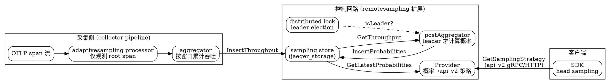

# Jaeger Sampling: Remote Strategies and the Adaptive Control Loop

## Introduction

Jaeger v2 的采样不是一个开关，而是一套**分层的、可闭环的**体系。最容易被误读的是「adaptive sampling（自适应采样）」——很多人以为它是某种 tail sampling 变体，实际上它是**用控制回路驱动 head sampling**：一个 pipeline 处理器悄悄观测 root span 的流量，算出每个 service/operation 该抽多少，再让 SDK 通过 remote sampling 接口把这些概率拉回去当头部采样率用。这一节把 `remotesampling` 扩展（策略服务器）和 `adaptivesampling` 处理器（传感器）拆开讲，并给出完整的反馈回路。

> 基线：`E:/Projects/jaeger-2.23.0`（tag v2.23.0）。下文讲解直接贴真实源码，路径相对仓库根，不再标注行号。

## Two Components, One Loop

采样相关的代码分属两个 OTel Collector 构件，但必须配合使用：

- **`remotesampling` extension**：策略服务器。它对外暴露 sampling 策略（SDK 来拉取），内部要么是静态文件、要么跑一套自适应算法把概率算出来存进 sampling store。
- **`adaptivesampling` processor**：埋在 collector 的 pipeline 里。它**不丢也不改 span**，只是顺手统计流过它的 root span 流量，喂给上面的自适应算法。

两者通过 `jaeger_storage` 扩展提供的 sampling store + 分布式锁共享状态——`remotesampling.Dependencies()` 直接声明依赖 `jaegerstorage.ID`（extension.go），所以这套采样必须配一个存储后端。

## Remote Sampling Extension: The Strategy Server

`Start` 按配置同时可能拉起几个东西，关键点在于**策略来源**只能二选一（config.go 里 `errMultipleProviders` 会拦）：

```go
// cmd/jaeger/internal/extension/remotesampling/extension.go
func (ext *rsExtension) Start(ctx context.Context, host component.Host) error {
	if ext.cfg.File.HasValue() {
		ext.startFileBasedStrategyProvider(ctx)   // 静态 JSON 文件
	}
	if ext.cfg.Adaptive.HasValue() {
		ext.startAdaptiveStrategyProvider(host)    // 自适应：从 sampling store 计算
	}
	if ext.cfg.HTTP.HasValue() { ext.startHTTPServer(ctx, host) }
	if ext.cfg.GRPC.HasValue() { ext.startGRPCServer(ctx, host) }
}
```

- **File 模式**：`file.NewProvider` 直接读一份 JSON 策略文件，`ReloadInterval` 定时重载，最简单，无状态、无回路。
- **Adaptive 模式**：从 `jaegerstorage` 取 sampling store 工厂，建 sampling store，再建一把**分布式锁**做 leader election（extension.go），最后 `adaptive.NewProvider` 接管。换句话说，自适应算法只有在配了采样存储时才转得起来。

对外暴露走两套协议，但都落在**老接口**上：

```go
// extension.go
api_v2.RegisterSamplingManagerServer(ext.grpcServer, samplinggrpc.NewHandler(ext.strategyProvider))
```

注意这里注册的是 `jaeger-idl/proto-gen/api_v2` 的 `SamplingManager`——也就是 v1 时代的那套 gRPC 采样接口，并非 v2 的 api_v3。说明 remote sampling 这条线在 v2 里**仍用 v1 协议对外**，SDK 侧的 jaeger 客户端协议没动。

## Adaptive Sampling Processor: The Sensor

处理器本身极简，启动时会反过来向 `remotesampling` 扩展要那套共享组件（sampling store + 锁 + options）：

```go
// cmd/jaeger/internal/processors/adaptivesampling/processor.go
func (tp *traceProcessor) start(_ context.Context, host component.Host) error {
	parts, err := remotesampling.GetAdaptiveSamplingComponents(host)
	...
	agg, err := adaptive.NewAggregator(*parts.Options, ..., parts.DistLock, parts.SamplingStore)
	agg.Start()
	tp.aggregator = agg
}
```

每来一批 span，它只做一件事——把 OTLP 转回 v1 模型，对每个 **root span** 调 `HandleRootSpan`：

```go
// processor.go
func (tp *traceProcessor) processTraces(_ context.Context, td ptrace.Traces) (ptrace.Traces, error) {
	batches := v1adapter.V1BatchesFromTraces(td)
	for _, batch := range batches {
		for _, span := range batch.Spans {
			...
			tp.aggregator.HandleRootSpan(span)   // 只统计根 span
		}
	}
	return td, nil   // 原样放回，不采样
}
```

为什么只盯 root span？`HandleRootSpan` 里明确：只有 `ParentSpanID == 0` 的才算根（aggregator.go），而且只有 `sampler.type == probabilistic` 的根 span 才计入吞吐（aggregator.go）。换言之，自适应算法依据的是「每条 trace 的入口流量」，而不是把每个子 span 都数一遍。

## The Aggregator: Flush Throughput to Storage

aggregator 按 `CalculationInterval` 定时跑一轮：先把本周期累计的吞吐写进 sampling store，再触发概率计算。

```go
// internal/sampling/samplingstrategy/adaptive/aggregator.go
func (a *aggregator) runAggregationLoop() {
	case <-ticker.C:
		a.saveThroughput()              // 写 store.InsertThroughput
		a.currentThroughput = make(...) // 清零，进入下一窗口
		a.postAggregator.runCalculation()
}
```

`saveThroughput`（aggregator.go）把 `service/operation -> count` 的吞吐切片 `storage.InsertThroughput` 落库。这一步把「各 collector 实例各自观测到的流量」汇总进共享存储，是多副本环境下把观测合并的关键。

## The Post-Aggregator: Compute Probabilities (Leader Only)

真正的概率计算在 `PostAggregator`，而且有个硬约束——**只有持有 leader 锁的 collector 才计算并回写概率**：

```go
// internal/sampling/samplingstrategy/adaptive/post_aggregator.go
func (p *PostAggregator) runCalculation() {
	throughput, _ := p.storage.GetThroughput(startTime, endTime)
	aggregated := p.aggregateThroughput(throughput)
	p.prependThroughputBucket(&throughputBucket{...})
	if p.isLeader() {                       // ← 只有 leader 才算
		probabilities, qps := p.calculateProbabilitiesAndQPS()
		p.probabilities, p.qps = probabilities, qps
		p.saveProbabilitiesAndQPS()           // 写回 store
	}
}
```

算概率的核心是「按目标 QPS 反推采样率」：先算出每个 operation 的加权 QPS（越近的窗口权重越高，`calculateWeightedQPS` 用 `WeightVectorCache` 给的权重向量），再用计算器推出新概率：

```go
// post_aggregator.go
func (p *PostAggregator) calculateProbability(service, operation string, qps float64) float64 {
	...
	if p.withinTolerance(qps, p.TargetSamplesPerSecond) || !usingAdaptiveSampling {
		return oldProbability            // 已经在目标附近或没在用自适应，不动
	}
	if FloatEquals(qps, 0) {
		newProbability = oldProbability * 2.0   // 流量为 0 时翻倍，保证至少抽到 1 条
	} else {
		newProbability = p.probabilityCalculator.Calculate(p.TargetSamplesPerSecond, qps, oldProbability)
	}
	return math.Min(maxSamplingProbability, math.Max(p.MinSamplingProbability, newProbability))
}
```

几个值得记住的点：

- 目标不是「抽百分之多少」，而是「每个 operation 维持 `TargetSamplesPerSecond` 条/秒」——高流量 operation 自动降概率，低流量 operation 自动升概率，整体收敛到目标采样量。
- 计算器是 `PercentageIncreaseCappedCalculator`（上限 1.0），概率变化被**封顶**，避免抖动。
- 结果夹在 `[MinSamplingProbability, 1.0]` 之间，并带 `DeltaTolerance` 容差提前短路，减少无谓重写。
- **leader/follower 分工**：follower 不计算，只周期性从 store 读最新概率刷新本地缓存（`provider.go` 的 `runUpdateProbabilitiesLoop`，非 leader 才 `loadProbabilities`）。leader 挂了，别的 collector 靠分布式锁抢到 leader 接着算，回路不中断。

## The Provider: Probabilities → Strategies → SDKs

算出的概率由 `Provider` 变成 SDK 能消费的 `api_v2.SamplingStrategyResponse`：

```go
// internal/sampling/samplingstrategy/adaptive/provider.go
func (p *Provider) generateStrategyResponses() {
	for svc, opProbabilities := range p.probabilities {
		opStrategies := [...]
		for op, probability := range opProbabilities {
			opStrategies[idx] = &api_v2.OperationSamplingStrategy{
				Operation: op,
				ProbabilisticSampling: &api_v2.ProbabilisticSamplingStrategy{
					SamplingRate: probability,   // 这里就是反推出来的每条 operation 的采样率
				},
			}
		}
		...
	}
}
```

SDK 通过 remote sampling 的 gRPC/HTTP 接口拉取 `GetSamplingStrategy(service)`，拿到这些 per-operation 概率，在**客户端做 head sampling**。整条链路闭合：观测 → 聚合 → 计算 → 下发 → 采样。

## Mental Model



一句话总结：**adaptive sampling 是 head sampling 的控制回路，不是 tail sampling**。处理器只观测、不丢弃；leader 用加权 QPS 把每个 operation 收敛到目标采样量；概率经 `api_v2` 老协议下发，SDK 在入口处执行。Tail sampling（异常链路保全）走的是另一条 OTel Tail Sampling Processor 链路，两者正交、可叠加。

## Links

- [Jaeger 源码实现总览](/docs/CS/Distributed/Tracing/Jaeger.md)
- [Jaeger 存储抽象](/docs/CS/Distributed/Tracing/Jaeger/Storage.md)
- [Jaeger 枢纽页](/docs/CS/Distributed/Tracing/Jaeger.md)
- [Zipkin 源码实现](/docs/CS/Distributed/Tracing/Zipkin/Architecture.md)

## References

- Remote sampling extension: `cmd/jaeger/internal/extension/remotesampling/extension.go`
- Adaptive sampling processor: `cmd/jaeger/internal/processors/adaptivesampling/processor.go`
- Aggregator / PostAggregator / Provider: `internal/sampling/samplingstrategy/adaptive/{aggregator,post_aggregator,provider}.go`
- Remote sampling gRPC API (legacy `api_v2`): `jaeger-idl/proto-gen/api_v2` (`SamplingManager`)
- Jaeger adaptive sampling design: <https://github.com/jaegertracing/jaeger/blob/main/docs/architecture/adaptive-sampling.md>
