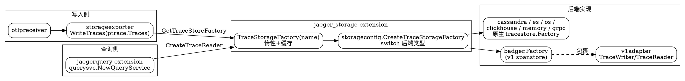

# Jaeger Storage: v2 Abstraction and the v1↔v2 Bridge

## Introduction

Jaeger v2 把存储层彻底重做了一层：对外只认一套 `tracestore.Factory` 契约，所有后端（memory / badger / grpc / cassandra / elasticsearch / opensearch / clickhouse）都实现它；而真正持有这些工厂、并按名字分发的，是一个叫 `jaeger_storage` 的 **extension**，不是 collector 内建的逻辑。这一节把这套抽象拆开，并重点讲清一个容易被误读的点：**所谓「v2 存储后端」并不都是 v2 原生实现**——Badger 这种默认嵌入式后端，骨子里还是 v1 的 `spanstore`，只是被 `v1adapter` 包了一层才凑出 v2 接口。

> 基线：`E:/Projects/jaeger-2.23.0`（tag v2.23.0，2026-11-04）。下文讲解直接贴真实源码，路径相对仓库根，不再标注行号。

## The v2 Contract: Factory / Reader / Writer

三条接口是存储层的全部门面。工厂只负责造读写器：

```go
// internal/storage/v2/api/tracestore/factory.go
type Factory interface {
	CreateTraceReader() (Reader, error)
	CreateTraceWriter() (Writer, error)
}
```

`Writer` 只有一句话，但注释里藏着一份强契约——它要求**同步落盘**才返回 nil，否则返回真错误，好让上层（如 Kafka ingester）重试或背压；异步「fire-and-forget」是必须显式声明的偏离模式：

```go
// internal/storage/v2/api/tracestore/writer.go
type Writer interface {
	// WriteTraces writes a batch of spans to storage. Idempotent.
	// ... A conformant implementation writes synchronously: it returns nil only
	// after the batch is durably persisted ...
	WriteTraces(ctx context.Context, td ptrace.Traces) error
}
```

同步写还可能甩出一种结构化错误 `RejectedSpansError`（writer.go），把「被后端以终态错误拒绝的毒丸 span」单独列出来，方便死信连接器精确重路由——这是 v1 完全没有的概念。

`Reader` 接口则明显是面向「流式 + 现代查询模型」设计的：方法大多返回 Go 1.23 的 `iter.Seq2` 迭代器，且区分 `GetTraces` / `FindTraces` / `FindTraceIDs` / `FindTraceSummaries` / `FindSpans` 几种语义（reader.go）。两个细节很能说明设计取向：

- 查询过滤既支持传统的 `ServiceName`/`Attributes` 字段，也支持 `Filter *expression.Call`（reader.go）——后者是 RFC 0005 的结构化查询表达式，由 `jaeger-idl/query/expression/v1` 定义。
- 分页用 `Pagination{PageSize, PageToken}`（reader.go），对应 RFC 0014；后端若不支持就在首个 chunk 前 yield `errors.ErrUnsupported`，由查询服务在分发前就拒绝。

## The `jaeger_storage` Extension: Where Factories Live

v2 里「存储」不是一个全局单例，而是一个 extension 实例。它的接口只暴露两个按名字取工厂的方法：

```go
// cmd/jaeger/internal/extension/jaegerstorage/extension.go
type Extension interface {
	extension.Extension
	TraceStorageFactory(name string) (tracestore.Factory, error)
	MetricStorageFactory(name string) (storage.MetricStoreFactory, error)
}
```

取工厂是**惰性 + 加锁缓存**的：第一次按名字要时才真正建，之后复用（extension.go）。建工厂委托给 `storageconfig.CreateTraceStorageFactory`，按配置里的后端类型 `switch` 到具体实现。

```go
// cmd/jaeger/internal/extension/jaegerstorage/extension.go
factory, err := storageconfig.CreateTraceStorageFactory(
	context.Background(), name, cfg, s.telset, /* authResolver */)
```

更关键的是 `findExtension`（extension.go）：它遍历 host 上所有已加载扩展，**强制要求全场只有一个 `jaeger_storage`**，否则直接报错。换言之，所有后端（哪怕 memory + badger + cassandra 共存）都必须声明在同一个 extension 配置块里——这是 v2 把「存储注册表」中心化、单一化的明确信号。下游（storageexporter、jaegerquery）都通过 `GetTraceStoreFactory(name, host)` 这个包级函数，从 host 里反查出这个 extension 再取工厂。

## Dispatch: One Switch, Native v2 Factories

`storageconfig.CreateTraceStorageFactory` 就是个巨大的 `switch`，按「配置里哪个后端非空」选一个原生 v2 工厂：

```go
// cmd/internal/storageconfig/factory.go
switch {
case backend.Memory != nil:
	factory, err = memory.NewFactory(*backend.Memory, telset)
case backend.Badger != nil:
	factory, err = badger.NewFactory(*backend.Badger, telset)
case backend.GRPC != nil:
	factory, err = grpc.NewFactory(ctx, *backend.GRPC, telset)
case backend.Cassandra != nil:
	factory, err = cassandra.NewFactory(*backend.Cassandra, telset)
case backend.Elasticsearch != nil:
	... es.NewFactory(...)
case backend.Opensearch != nil:
	... es.NewFactory(...)
case backend.ClickHouse != nil:
	factory, err = clickhouse.NewFactory(*backend.ClickHouse, telset)
default:
	err = errors.New("empty configuration")
}
```

到这里会得到一个**反直觉但重要**的观察：这个分发函数**没有任何 `v1adapter` 的影子**。也就是说，v2.23.0 里 Cassandra / Elasticsearch / OpenSearch / ClickHouse 都已经重写成原生实现 `tracestore.Factory` 的 v2 后端了——它们不再需要适配层。那么 `v1adapter` 到底给谁用？

## The v1↔v2 Bridge: Badger Is v1 Under the Hood

全局搜 `v1adapter.NewTraceWriter / NewTraceReader` 的调用点，**只有一处**：`internal/storage/v2/badger/factory.go`。看这个工厂的结构就明白了：

```go
// internal/storage/v2/badger/factory.go
type Factory struct {
	v1Factory *badger.Factory   // 注意：是 v1 的 badger.Factory
}

func (f *Factory) CreateTraceWriter() (tracestore.Writer, error) {
	v1Writer, _ := f.v1Factory.CreateSpanWriter() // error is always nil
	return v1adapter.NewTraceWriter(v1Writer), nil
}

func (f *Factory) CreateTraceReader() (tracestore.Reader, error) {
	v1Reader, _ := f.v1Factory.CreateSpanReader()
	return v1adapter.NewTraceReader(v1Reader), nil
}
```

Badger 是 all-in-one 的默认存储，但它**至今仍是 v1 `spanstore` 实现**，只是被 `v1adapter` 一层层裹成 v2 接口对外暴露。这就是 `v1adapter` 包存在的全部理由：让还没来得及重写的老后端能以 v2 身份继续上岗。

适配本身很简单——写方向把 `ptrace.Traces` 拆回 v1 的 `model.Batch`，再逐 span 调 v1 的 `WriteSpan`：

```go
// internal/storage/v2/v1adapter/tracewriter.go
func (t *TraceWriter) WriteTraces(ctx context.Context, td ptrace.Traces) error {
	batches := V1BatchesFromTraces(td)        // ptrace.Traces -> []*model.Batch
	for _, batch := range batches {
		for _, span := range batch.Spans {
			if span.Process == nil { span.Process = batch.Process }
			err := t.spanWriter.WriteSpan(ctx, span)   // 落到 v1 spanstore
			...
		}
	}
	return errors.Join(errs...)
}
```

读方向则把 v1 `spanstore.Reader` 包成 v2 的 `tracestore.Reader`，并**显式嵌入两个「不支持」的桩**——因为 v1 后端压根没有「trace 摘要」和「span 级搜索」能力，查询服务看到这两个桩就该在分发前拒掉对应请求（tracereader.go）：

```go
type TraceReader struct {
	tracestore.UnsupportedTraceSummaries   // v1 后端算不了摘要，回退 FindTraces + 客户端聚合
	tracestore.UnsupportedSpanSearch       // v1 没有 span 搜索方法
	spanReader spanstore.Reader
}
```

还有一条**反向**桥：`GetV1Writer(writer tracestore.Writer) spanstore.Writer`（tracewriter.go）。如果传进来的 v2 writer 本身就是 `*TraceWriter`，直接吐出它内嵌的 v1 writer；否则用 `&SpanWriter{traceWriter: writer}` 把任意 v2 writer 反向包成 v1 接口。这是给「手里只有 v2 writer、但需要喂给某个只认 v1 的组件」的场景准备的。

## The Translator Reuses OTel's, Not a Bespoke One

`V1BatchesFromTraces` / `V1BatchesToTraces` 看上去是 Jaeger 自己的模型转换，实则把活儿甩给了 OpenTelemetry Collector 自带的 translator：

```go
// internal/storage/v2/v1adapter/translator.go
func V1BatchesFromTraces(traces ptrace.Traces) []*model.Batch {
	batches := jaegertranslator.ProtoFromTraces(traces)   // 来自 opentelemetry-collector-contrib
	...
}
// translator.go
func V1BatchesToTraces(batches []*model.Batch) ptrace.Traces {
	traces, _ := jaegertranslator.ProtoToTraces(batches)  // never returns an error
	...
}
```

`jaegertranslator` 就是 `github.com/open-telemetry/opentelemetry-collector-contrib/pkg/translator/jaeger`——也就是 OTel 自己的 jaeger exporter/receiver 用的同一套 OTLP↔Jaeger model 转换。Jaeger v2 选择**复用而非重写**这套逻辑，只额外在两侧搬运 `Warnings`（span 上的转换告警），避免重复造轮子。

ID 映射也是直接复用 OTel 的字节序约定（otelids.go）：v1 的 `model.TraceID{High, Low uint64}` 按大端铺进 OTLP 的 16 字节 `[16]byte`，`SpanID` 同理——所以 128-bit trace ID 在两个世界里都是大端 16 字节，零歧义。

## Mental Model



一句话总结：**v2 的存储契约是统一的，但实现是分层的**——重后端已原生 v2，Badger 仍靠 `v1adapter` 顶着 v1 老壳；转换交给 OTel 官方 translator，Jaeger 自己只做 ID 字节序和告警搬运。

## Links

- [Jaeger 源码实现总览](/docs/CS/Distributed/Tracing/Jaeger.md)
- [Jaeger 枢纽页](/docs/CS/Distributed/Tracing/Jaeger.md)
- [Zipkin 源码实现](/docs/CS/Distributed/Tracing/Zipkin/Architecture.md)
- [SkyWalking 源码实现](/docs/CS/Distributed/Tracing/SkyWalking.md)

## References

- Jaeger v2 storage `tracestore` interfaces: `internal/storage/v2/api/tracestore/{factory,reader,writer}.go` (jaeger v2.23.0)
- `jaeger_storage` extension: `cmd/jaeger/internal/extension/jaegerstorage/extension.go`
- v1↔v2 adapter: `internal/storage/v2/v1adapter/{tracewriter,tracereader,translator,otelids}.go`
- OTel Collector Jaeger translator (reused by Jaeger v2): <https://github.com/open-telemetry/opentelemetry-collector-contrib/tree/main/pkg/translator/jaeger>
- Jaeger v2 storage RFC index: <https://github.com/jaegertracing/jaeger/tree/main/rfcs>
