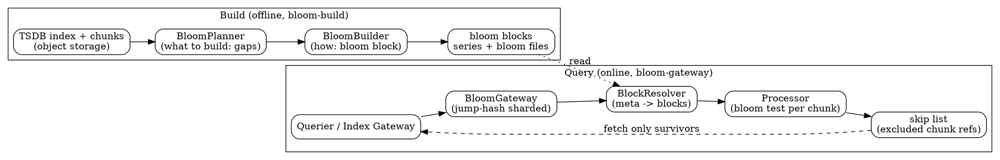

## Introduction

[Loki](/docs/CS/Distributed/Tracing/Loki.md) 的核心取舍是「只索引标签，不索引日志内容」，这让全文检索（needle in the haystack，例如「在所有日志里搜某个 user_id」）很慢——因为没有任何索引能直接指向它，只能暴力扫描被标签圈定的那些流。Bloom filter 是 Loki 3.x 用来**缓解**这一问题的加速层：它不告诉你「哪些行命中」，而是告诉你「哪些 chunk 一定不含目标串」，从而让查询跳过大量无关 chunk。

关键定性（常被误解）：

- **它是「跳查过滤器」（skip filter），不是「命中索引」**。Bloom 只有假阳性（可能误留一个其实不含的 chunk），没有假阴性（不会漏掉真正含目标串的 chunk）。查询仍然要扫描存活 chunk 的正文，只是扫描量被大幅削减。
- **它建在离线、服务于在线**。建块（bloom-build）是后台批处理，扫 TSDB 索引 + chunk 正文生成 bloom block 落对象存储；查询时（bloom-gateway）再把这些 block 拿来逐 chunk 测试。

> [!NOTE]
> 本页为**源码级**笔记，结论已对照 **Loki `v3.7.10`**（tag `v3.7.10`，浅克隆于 `loki-3.7.10/`）逐条核实。下文讲解直接贴真实源码片段，涉及的文件路径相对仓库根（统一前缀 `loki-3.7.10/`），不再标注行号。读者不会打开仓库，需要看机制时直接看贴出的代码。
>
> 两个反直觉的事实（文档几乎不提）：
> 1. `pkg/bloom/` 在本 tag **不存在**；bloom block / directory / series 类型在 `pkg/storage/bloom/v1/`，meta/store/key-resolver 在 `pkg/storage/stores/shipper/bloomshipper/`。
> 2. **bloom-gateway 没有自己的 ring**。分片是客户端 jump-hash，按 block key 把每个 block 固定映射到某台 gateway（见 [Serve Path](#serve-path-bloomgateway)）。整个 bloom 子系统唯一用到 ring 的是 bloombuild 的 `RingWatcher`（planner 选主 / builder 找 planner 地址）。

## Design: Bloom as a Skip Filter

每个 series 的 chunk 集合会生成一个 bloom filter，覆盖该 series 日志行的**索引 token（词）**。查询里的行过滤器 `|= "error"` 会被翻译成 token `"error"`；对某个 chunk，如果它的 bloom 判定「肯定不含 error」，这个 chunk 就被排除出扫描。

为什么用 bloom 而不是精确倒排索引：保持 Loki「只索引标签」的哲学——bloom 体积极小、离线批量构建、只用于剪枝，不引入在线写放大。代价是查询结果仍需对存活 chunk 做正文扫描（bloom 只减不增正确性负担）。

源码印证这条链路。查询期的 matcher 抽取点在 `pkg/bloomgateway/bloomgateway.go` 的 `FilterChunkRefs` 里：

```go
matchers := v1.ExtractTestableLabelMatchers(req.Plan.AST)
stats.NumMatchers = len(matchers)
g.metrics.receivedMatchers.Observe(float64(len(matchers)))

// Shortcut if request does not contain filters
if len(matchers) == 0 {
	stats.Status = labelSuccess
	return &logproto.FilterChunkRefResponse{ChunkRefs: req.Refs}, nil
}
```

抽取逻辑在 `pkg/storage/bloom/v1/ast_extractor.go`——只取第一个 parser 之前的 label/line filter，并把 `|= "error"` 这类过滤器映射成 key/value matcher：

```go
// ExtractTestableLabelMatchers extracts label matchers from the label filters
// in an expression. The resulting label matchers can then be used for testing
// against bloom filters. Only label matchers before the first parse stage are
// included.
//
// Unsupported LabelFilterExprs map to an UnsupportedLabelMatcher, for which
// bloom tests should always pass.
func ExtractTestableLabelMatchers(expr syntax.Expr) []LabelMatcher {
	if expr == nil {
		return nil
	}
	filters := syntax.ExtractLabelFiltersBeforeParser(expr)
	return buildLabelMatchers(filters)
}

func buildLabelMatcher(filter log.LabelFilterer) LabelMatcher {
	switch filter := filter.(type) {

	case *log.LineFilterLabelFilter:
		switch filter.Type {
		case labels.MatchEqual:
			return KeyValueMatcher{
				Key:   filter.Name,
				Value: filter.Value,
			}
		case labels.MatchRegexp:
			reg, err := regexsyn.Parse(filter.Value, regexsyn.Perl)
			if err != nil {
				return UnsupportedLabelMatcher{}
			}
			return buildSimplifiedRegexMatcher(filter.Name, reg.Simplify())
		}

		return UnsupportedLabelMatcher{}

	case *log.StringLabelFilter:
		if filter.Type != labels.MatchEqual {
			return UnsupportedLabelMatcher{}
		}

		return KeyValueMatcher{
			Key:   filter.Name,
			Value: filter.Value,
		}
	// ...
	}
}
```

这些 matcher 再由 `pkg/storage/bloom/v1/bloom_tester.go` 的 `LabelMatchersToBloomTest` 编译成查询期使用的 `BloomTest`：

```go
func LabelMatchersToBloomTest(matchers ...LabelMatcher) BloomTest {
	tests := make(BloomTests, 0, len(matchers))
	for _, matcher := range matchers {
		tests = append(tests, matcherToBloomTest(matcher))
	}
	return tests
}

func matcherToBloomTest(matcher LabelMatcher) BloomTest {
	switch matcher := matcher.(type) {
	case UnsupportedLabelMatcher:
		return matchAllTest{}

	case KeyValueMatcher:
		return newKeyValueMatcherTest(matcher)

	case KeyMatcher:
		return newKeyMatcherTest(matcher)

	case OrLabelMatcher:
		return newOrTest(
			matcherToBloomTest(matcher.Left),
			matcherToBloomTest(matcher.Right),
		)

	case AndLabelMatcher:
		return newAndTest(
		// ...
		)
	}
}
```

## Data Model: Bloom Block

一个 **bloom block** 由**两个文件**组成：`series`（series 目录：fingerprint → bloom 偏移）+ `bloom`（bloom 页，`filter.ScalableBloomFilter` 按 series 的 chunk 集合组织）。

文件名常量与写入实现在 `pkg/storage/bloom/v1/block_writer.go`：

```go
const (
	BloomFileName  = "bloom"
	SeriesFileName = "series"
)
```

```go
// Directory based impl
type DirectoryBlockWriter struct {
	dir           string
	blooms, index *os.File

	initialized bool
}

func NewDirectoryBlockWriter(dir string) *DirectoryBlockWriter {
	return &DirectoryBlockWriter{
		dir: dir,
	}
}

func (b *DirectoryBlockWriter) Init() error {
	if !b.initialized {
		err := util.EnsureDirectory(b.dir)
		if err != nil {
			return errors.Wrap(err, "creating bloom block dir")
		}

		b.index, err = os.Create(filepath.Join(b.dir, SeriesFileName))
		if err != nil {
			return errors.Wrap(err, "creating series file")
		}

		b.blooms, err = os.Create(filepath.Join(b.dir, BloomFileName))
		if err != nil {
			return errors.Wrap(err, "creating bloom file")
		}

		b.initialized = true
	}
	return nil
}
```

读回对应 `pkg/storage/bloom/v1/reader.go` 的 `DirectoryBlockReader`（同样按 `SeriesFileName` / `BloomFileName` 打开两个文件）。

内存中的 block 模型在 `pkg/storage/bloom/v1/block.go`：

```go
type Block struct {
	metrics *Metrics
	// covers series pages
	index BlockIndex
	// covers bloom pages
	blooms BloomBlock

	metadata BlockMetadata

	reader BlockReader

	initialized bool
}
```

gateway 侧的读视图是同文件的 `BlockQuerier`：

```go
type BlockQuerier struct {
	*LazySeriesIter
	blooms *LazyBloomIter

	block *Block // ref to underlying block
}
```

bloom 页本体在 `pkg/storage/bloom/v1/bloom.go`——每个 series 一个包裹 `filter.ScalableBloomFilter` 的 `Bloom`，block 层则是 schema + 页头数组：

```go
type Bloom struct {
	filter.ScalableBloomFilter
}

func NewBloom() *Bloom {
	return &Bloom{
		// TODO parameterise SBF options. fp_rate
		ScalableBloomFilter: *filter.NewScalableBloomFilter(1024, 0.01, 0.8),
	}
}
```

```go
type BloomBlock struct {
	schema      Schema
	pageHeaders []BloomPageHeader
}
```

schema 与页大小/块大小限制由 `pkg/storage/bloom/v1/builder.go` 的 `BlockOptions` 承载：

```go
func NewBlockOptions(enc compression.Codec, maxBlockSizeBytes, maxBloomSizeBytes uint64) BlockOptions {
	schema := NewSchema(CurrentSchemaVersion, enc)
	opts := NewBlockOptionsFromSchema(schema, maxBloomSizeBytes)
	opts.BlockSize = maxBlockSizeBytes
	opts.UnencodedBlockOptions.MaxBloomSizeBytes = maxBloomSizeBytes
	return opts
}
```

体积上限来自租户 limits：`pkg/bloombuild/builder/config.go` 的 `Limits` 接口：

```go
type Limits interface {
	BloomBlockEncoding(tenantID string) string
	BloomMaxBlockSize(tenantID string) int
	BloomMaxBloomSize(tenantID string) int
	BuilderResponseTimeout(tenantID string) time.Duration
	PrefetchBloomBlocks(tenantID string) bool
}
```

## Build Path (bloombuild)

bloom 块由 `bloom-build` 组件（planner + builder）离线生成。

### Planner — 决定「建什么」

`pkg/bloombuild/planner/planner.go` 的 `Planner` 持有 TSDB store、bloom store、任务队列与 ring watcher：

```go
type Planner struct {
	services.Service
	// Subservices manager.
	subservices        *services.Manager
	subservicesWatcher *services.FailureWatcher
	retentionManager   *RetentionManager

	cfg       Config
	limits    Limits
	schemaCfg config.SchemaConfig

	tsdbStore  common.TSDBStore
	bloomStore bloomshipper.StoreBase

	tasksQueue  *queue.Queue
	planFactory *strategies.Factory

	metrics *Metrics
	logger  log.Logger

	// used only in SSD mode where a single planner of the backend replicas needs to create tasksQueue
	// therefore is nil when planner is run in microservice mode (default)
	ringWatcher *common.RingWatcher
}
```

microservice 模式下 planner 是单例，SSD 模式下走 `ringWatcher.IsLeader()` 选主：

```go
func (p *Planner) isLeader() bool {
	if p.ringWatcher == nil {
		// when the planner runs as standalone service in microserivce mode, then there is no ringWatcher
		// therefore we can safely assume that the planner is a singleton
		return true
	}
	return p.ringWatcher.IsLeader()
}
```

`running` 周期循环按 `PlanningInterval` 触发 `runOne` 单次规划：

```go
func (p *Planner) running(ctx context.Context) error {
	go p.trackInflightRequests(ctx)

	// run once at beginning, but delay by 1m to allow ring consolidation when running in SSD mode
	initialPlanningTimer := time.NewTimer(time.Minute)
	defer initialPlanningTimer.Stop()

	planningTicker := time.NewTicker(p.cfg.PlanningInterval)
	defer planningTicker.Stop()
	// ...
}
```

`runOne` 先列出周期内租户，**跳过 `BloomCreationEnabled` 为 false 的租户**（见 `loadTenantTables`）：

```go
func (p *Planner) runOne(ctx context.Context) error {
	if !p.isLeader() {
		return errPlannerIsNotLeader
	}
	// ...
	tables := p.tables(time.Now())

	tenantTables, err := p.loadTenantTables(ctx, tables)
	if err != nil {
		return fmt.Errorf("error loading work: %w", err)
	}
	// ...
}
```

```go
// loadTenantTables loads all tenants with bloom build enabled for each table.
func (p *Planner) loadTenantTables(
	ctx context.Context,
	tables *dayRangeIterator,
) (map[config.DayTable][]string, error) {
	// ...
	for tenants.Next() && tenants.Err() == nil && ctx.Err() == nil {
		tenant := tenants.At()
		if tenant == "" {
			// Tables that have not been fully compacted yet will have multi-tenant TSDBs for which the tenant is ""
			// in this case we just skip the tenant
			continue
		}

		p.metrics.tenantsDiscovered.Inc()
		if !p.limits.BloomCreationEnabled(tenant) {
			level.Debug(p.logger).Log("msg", "bloom creation disabled for tenant", "tenant", tenant)
			continue
		}
		// ...
	}
}
```

`computeTasks` 拉取已有 meta，再交给策略产出任务：

```go
func (p *Planner) computeTasks(
	ctx context.Context,
	table config.DayTable,
	tenant string,
) ([]*protos.Task, []bloomshipper.Meta, error) {
	strategy, err := p.planFactory.GetStrategy(tenant)
	if err != nil {
		return nil, nil, fmt.Errorf("error creating strategy: %w", err)
	}

	// Fetch source metas to be used in both build and cleanup of out-of-date metas+blooms
	metas, err := p.bloomStore.FetchMetas(
		ctx,
		bloomshipper.MetaSearchParams{
			TenantID: tenant,
			Interval: bloomshipper.NewInterval(table.Bounds()),
			Keyspace: v1.NewBounds(0, math.MaxUint64),
		},
	)
	// ...
	tasks, err := strategy.Plan(ctx, table, tenant, openTSDBs, metas)
	// ...
}
```

`pkg/bloombuild/planner/strategies/splitkeyspace.go` 的 `SplitKeyspaceStrategy.Plan` 把 fingerprint keyspace 按 `BloomSplitSeriesKeyspaceBy` 切分，对比已有 meta 找出过期 gap，为每个 gap 发一个任务：

```go
func (s *SplitKeyspaceStrategy) Plan(
	ctx context.Context,
	table config.DayTable,
	tenant string,
	tsdbs TSDBSet,
	metas []bloomshipper.Meta,
) ([]*protos.Task, error) {
	splitFactor := s.limits.BloomSplitSeriesKeyspaceBy(tenant)
	ownershipRanges := SplitFingerprintKeyspaceByFactor(splitFactor)

	var tasks []*protos.Task
	for _, ownershipRange := range ownershipRanges {
		// Filter only the metas that overlap in the ownership range
		metasInBounds := bloomshipper.FilterMetasOverlappingBounds(metas, ownershipRange)

		// Find gaps in the TSDBs for this tenant/table
		gaps, err := s.findOutdatedGaps(ctx, tenant, tsdbs, ownershipRange, metasInBounds, logger)
		if err != nil {
			level.Error(logger).Log("msg", "failed to find outdated gaps", "err", err)
			continue
		}

		for _, gap := range gaps {
			tasks = append(tasks, protos.NewTask(table, tenant, ownershipRange, gap.tsdb, gap.gaps))
		}
	}

	return tasks, nil
}
```

任务经 gRPC `BuilderLoop` 下发给 builder。整个子系统唯一用到 ring 的地方是 `pkg/bloombuild/common/ringwatcher.go` 的 `RingWatcher`（planner 选主 / builder 找 planner 地址）：

```go
type RingWatcher struct {
	services.Service
	id           string
	ring         *ring.Ring
	leader       *ring.InstanceDesc
	lookupPeriod time.Duration
	logger       log.Logger
}

// NewRingWatcher creates a service.Service that watches a ring for a leader instance.
// The leader instance is the instance that owns the key `RingKeyOfLeader`.
// It provides functions to get the leader's address, and to check whether a given instance in the ring is leader.
// Bloom planner and bloom builder use this ring watcher to hook into index gateway ring when they are run as
// part of the `backend` target of the Simple Scalable Deployment (SSD).
```

```go
func (w *RingWatcher) GetLeaderAddress() (string, error) {
	if w.leader == nil {
		return "", ring.ErrEmptyRing
	}
	return w.leader.Addr, nil
}
```

### Builder — 决定「怎么建」

`pkg/bloombuild/builder/builder.go` 的 `Builder` 持有 bloom store、chunk loader 与 gateway 客户端（可选预取）：

```go
type Builder struct {
	services.Service

	ID string

	cfg     Config
	limits  Limits
	metrics *Metrics
	logger  log.Logger

	bloomStore   bloomshipper.Store
	chunkLoader  ChunkLoader
	bloomGateway bloomgateway.Client

	client protos.PlannerForBuilderClient

	// used only in SSD mode where a single planner of the backend replicas needs to create tasksQueue
	// therefore is nil when planner is run in microservice mode (default)
	ringWatcher *common.RingWatcher
}
```

`running` 对 planner 断连自动重试 `connectAndBuild`：

```go
func (b *Builder) running(ctx context.Context) error {
	// Retry if the connection to the planner is lost.
	retries := backoff.New(ctx, b.cfg.BackoffConfig)
	for retries.Ongoing() {
		err := b.connectAndBuild(ctx)
		if err != nil {
			err := standardizeRPCError(err)

			// When the builder is shutting down, we will get a context canceled error
			if errors.Is(err, context.Canceled) && b.State() != services.Running {
				level.Debug(b.logger).Log("msg", "builder is shutting down")
				break
			}

			// If the planner disconnects while we are sending/receive a message we get an EOF error.
			// In this case we should reset the backoff and retry
			if errors.Is(err, io.EOF) {
				level.Error(b.logger).Log("msg", "planner disconnected. Resetting backoff and retrying", "err", err)
				retries.Reset()
				continue
			}
		}
		// ...
	}
	// ...
}
```

核心构建例程 `processTask` 对每个 `Gap` 构建 `bloomshipper.Meta`，加载已有重叠 block 以复用旧 bloom 加速生成：

```go
func (b *Builder) processTask(
	ctx context.Context,
	task *protos.Task,
) ([]bloomshipper.Meta, error) {
	tenant := task.Tenant
	// ...
	var (
		blockCt      int
		maxBlockSize = uint64(b.limits.BloomMaxBlockSize(tenant))
		maxBloomSize = uint64(b.limits.BloomMaxBloomSize(tenant))
		blockOpts    = v1.NewBlockOptions(blockEnc, maxBlockSize, maxBloomSize)
		created      []bloomshipper.Meta
		totalSeries  int
		bytesAdded   int
	)

	for i := range task.Gaps {
		if ctx.Err() != nil {
			return nil, ctx.Err()
		}

		gap := task.Gaps[i]

		meta := bloomshipper.Meta{
			MetaRef: bloomshipper.MetaRef{
				Ref: bloomshipper.Ref{
					TenantID:  tenant,
					TableName: task.Table.Addr(),
					Bounds:    gap.Bounds,
				},
			},
		}

		// Fetch blocks that aren't up to date but are in the desired fingerprint range
		// to try and accelerate bloom creation.
		seriesItr, blocksIter, err := b.loadWorkForGap(ctx, task.Table, gap)
		// ...
	}
	// ...
}
```

```go
func (b *Builder) loadWorkForGap(
	ctx context.Context,
	table config.DayTable,
	gap protos.Gap,
) (iter.Iterator[*v1.Series], iter.CloseResetIterator[*v1.SeriesWithBlooms], error) {
	seriesItr := iter.NewCancelableIter(ctx, iter.NewSliceIter(gap.Series))

	// load a blocks iterator for the gap
	fetcher, err := b.bloomStore.Fetcher(table.ModelTime())
	if err != nil {
		return nil, nil, errors.Wrap(err, "failed to get fetcher")
	}

	f := FetchFunc[bloomshipper.BlockRef, *bloomshipper.CloseableBlockQuerier](func(ctx context.Context, refs []bloomshipper.BlockRef) ([]*bloomshipper.CloseableBlockQuerier, error) {
		blks, err := fetcher.FetchBlocks(ctx, refs, bloomshipper.WithFetchAsync(false), bloomshipper.WithIgnoreNotFound(true))
		// ...
	})
	// ...
}
```

`pkg/bloombuild/builder/spec.go` 的 `SimpleBloomGenerator` 驱动实际生成：过滤 schema 兼容的已有块，把 series 合并进 block，直到写满产出 `v1.Block`：

```go
// Simple implementation of a BloomGenerator.
type SimpleBloomGenerator struct {
	userID      string
	store       iter.Iterator[*v1.Series]
	chunkLoader ChunkLoader
	blocksIter  iter.ResetIterator[*v1.SeriesWithBlooms]

	// options to build blocks with
	opts v1.BlockOptions

	metrics *v1.Metrics
	logger  log.Logger

	writerReaderFunc func() (v1.BlockWriter, v1.BlockReader)
	reporter         func(model.Fingerprint)

	tokenizer *v1.BloomTokenizer
}
```

```go
func (s *SimpleBloomGenerator) Generate(ctx context.Context) *LazyBlockBuilderIterator {
	series := iter.NewPeekIter(s.store)

	impl, ok := s.blocksIter.(*blockLoadingIter)
	if ok {
		impl.Filter(
			func(bq *bloomshipper.CloseableBlockQuerier) bool {
				// ...
				if !s.opts.Schema.Compatible(schema) {
					level.Warn(logger).Log("msg", "block schema incompatible with options", "generator_schema", fmt.Sprintf("%+v", s.opts.Schema), "block_schema", fmt.Sprintf("%+v", schema))
					bq.Close() // close unused querier
					return false
				}
				// ...
				return true
			},
		)
	}

	return NewLazyBlockBuilderIterator(ctx, s.opts, s.metrics, s.logger, s.populator(ctx), s.writerReaderFunc, series, s.blocksIter)
}
```

构建完成后经 `bloomshipper` client 的 `PutBlock` / `PutMeta` 上传；可选地按 `PrefetchBloomBlocks` limits 预取到 gateway。

### Meta 与对象存储布局

`pkg/storage/stores/shipper/bloomshipper/client.go` 定义 meta 模型：

```go
// todo rename it
type Meta struct {
	MetaRef `json:"-"`

	// The specific TSDB files used to generate the block.
	Sources []tsdb.SingleTenantTSDBIdentifier

	// A list of blocks that were generated
	Blocks []BlockRef
}
```

`PutMeta` 把 `Meta` 序列化为 JSON 写到 meta key（即 `meta.json` 对象）：

```go
func (b *BloomClient) PutMeta(ctx context.Context, meta Meta) error {
	data, err := json.Marshal(meta)
	if err != nil {
		return fmt.Errorf("failed to encode meta file %s: %w", meta.String(), err)
	}
	key := b.Meta(meta.MetaRef).Addr()
	return b.client.PutObject(ctx, key, bytes.NewReader(data))
}
```

对象存储键布局由 `pkg/storage/stores/shipper/bloomshipper/resolver.go` 的 `defaultKeyResolver` 决定：

```go
const (
	BloomPrefix  = "bloom"
	MetasPrefix  = "metas"
	BlocksPrefix = "blocks"

	metaExtension  = ".json"
	blockExtension = v1.ExtTar
)
```

```go
func (defaultKeyResolver) Meta(ref MetaRef) Location {
	return simpleLocation{
		BloomPrefix,
		fmt.Sprintf("%v", ref.TableName),
		ref.TenantID,
		MetasPrefix,
		fmt.Sprintf("%v-%x%s", ref.Bounds, ref.Checksum, metaExtension),
	}
}
```

即 meta 路径为 `bloom/<table>/<tenant>/metas/<bounds>-<checksum>.json`；block 路径为 `bloom/<table>/<tenant>/blocks/<bounds>/<start>-<end>-<checksum>.tar[.compression]`：

```go
func (defaultKeyResolver) Block(ref BlockRef) Location {
	ext := blockExtension + compression.ToFileExtension(ref.Codec)
	return simpleLocation{
		BloomPrefix,
		fmt.Sprintf("%v", ref.TableName),
		ref.TenantID,
		BlocksPrefix,
		ref.Bounds.String(),
		fmt.Sprintf("%d-%d-%x%s", ref.StartTimestamp, ref.EndTimestamp, ref.Checksum, ext),
	}
}
```

## Serve Path (bloomgateway)

### Gateway

`pkg/bloomgateway/bloomgateway.go` 的 `Gateway` 持有 bloom store、进程内请求队列与 worker 服务：

```go
type Gateway struct {
	services.Service

	cfg     Config
	logger  log.Logger
	metrics *metrics

	queue       *queue.RequestQueue
	activeUsers *util.ActiveUsersCleanupService
	bloomStore  bloomshipper.Store

	pendingTasks *atomic.Int64

	serviceMngr    *services.Manager
	serviceWatcher *services.FailureWatcher

	workerConfig workerConfig
}
```

`New` 建请求队列并按 `WorkerConcurrency` 起 worker：

```go
func New(cfg Config, store bloomshipper.Store, logger log.Logger, reg prometheus.Registerer) (*Gateway, error) {
	utillog.WarnExperimentalUse("Bloom Gateway", logger)
	g := &Gateway{
		// ...
		workerConfig: workerConfig{
			maxItems:         cfg.NumMultiplexItems,
			queryConcurrency: cfg.BlockQueryConcurrency,
			async:            cfg.FetchBlocksAsync,
		},
		// ...
		bloomStore: store,
	}

	queueMetrics := queue.NewMetrics(reg, constants.Loki, metricsSubsystem)
	g.queue = queue.NewRequestQueue(cfg.MaxOutstandingPerTenant, time.Minute, &fixedQueueLimits{0}, queueMetrics)
	g.activeUsers = util.NewActiveUsersCleanupWithDefaultValues(queueMetrics.Cleanup)
	// ...
}
```

```go
func (g *Gateway) initServices() error {
	var err error
	svcs := []services.Service{g.queue, g.activeUsers}
	for i := 0; i < g.cfg.WorkerConcurrency; i++ {
		id := fmt.Sprintf("bloom-query-worker-%d", i)
		w := newWorker(id, g.workerConfig, g.queue, g.bloomStore, g.pendingTasks, g.logger, g.metrics.workerMetrics)
		svcs = append(svcs, w)
	}
	g.serviceMngr, err = services.NewManager(svcs...)
	// ...
}
```

gRPC handler 实现 `FilterChunkRefs`：

```go
// FilterChunkRefs implements BloomGatewayServer
func (g *Gateway) FilterChunkRefs(ctx context.Context, req *logproto.FilterChunkRefRequest) (*logproto.FilterChunkRefResponse, error) {
	tenantID, err := tenant.TenantID(ctx)
	if err != nil {
		return nil, err
	}
	// ...
	matchers := v1.ExtractTestableLabelMatchers(req.Plan.AST)
	// ...
}
```

最终 `filterChunkRefs` 把各 series 的 `Removals` 合并成最终「排除列表」返回给调用方：

```go
// TODO(owen-d): improve perf. This can be faster with a more specialized impl
// NB(owen-d): `req` is mutated in place for performance, but `responses` is not
// Removals of the outputs must be sorted.
func filterChunkRefs(req *logproto.FilterChunkRefRequest, responses []v1.Output) []*logproto.GroupedChunkRefs {
	// sort responses by fingerprint
	sort.Slice(responses, func(i, j int) bool { return responses[i].Fp < responses[j].Fp })

	res := make([]*logproto.GroupedChunkRefs, 0, len(req.Refs))

	// dedupe outputs, merging the same series.
	dedupedResps := iter.NewDedupingIter(
		// eq
		func(o1, o2 v1.Output) bool {
			return o1.Fp == o2.Fp
		},
		// from
		iter.Identity[v1.Output],
		// merge two removal sets for the same series, deduping
		// requires that the removals of the outputs are sorted
		func(o1, o2 v1.Output) v1.Output {
			// ...
		},
	)
	// ...
}
```

注意 `Gateway` 类型本身**没有** `RegisterGRPC` 方法，gRPC 注册发生在模块装配处（`pkg/loki/modules.go`）：

```go
gateway, err := bloomgateway.New(t.Cfg.BloomGateway, t.BloomStore, logger, prometheus.DefaultRegisterer)
if err != nil {
	return nil, err
}
logproto.RegisterBloomGatewayServer(t.Server.GRPC, gateway)
return gateway, nil
```

### Sharding — 没有 ring，只有 jump-hash

`pkg/bloomgateway/client_pool.go` 的 `JumpHashClientPool` 按 key 做 jump-hash 选址：

```go
func NewJumpHashClientPool(clientFactory ClientFactory, dnsProvider AddressProvider, updateInterval time.Duration, logger log.Logger) (*JumpHashClientPool, error) {
	selector := jumphash.DefaultSelector("bloomgateway")
	err := selector.SetServers(dnsProvider.Addresses()...)
	// ...
}

func (p *JumpHashClientPool) Addr(key string) (string, error) {
	addr, err := p.FromString(key)
	if err != nil {
		return "", err
	}
	return addr.String(), nil
}
```

客户端 `NewClient`（`pkg/bloomgateway/client.go`）构建该 pool：

```go
clientFactory := func(addr string) (ringclient.PoolClient, error) {
	pool, err := NewBloomGatewayGRPCPool(addr, dialOpts)
	if err != nil {
		return nil, errors.Wrap(err, "new bloom gateway grpc pool")
	}
	return pool, nil
}

dnsProvider := discovery.NewDNS(logger, cfg.PoolConfig.CheckInterval, cfg.Addresses, nil)
dnsProvider.RunOnce()

pool, err := NewJumpHashClientPool(clientFactory, dnsProvider, cfg.PoolConfig.CheckInterval, logger)
```

`GatewayClient.FilterChunks` 按 `block.String()` 分组、逐组路由到所属 gateway，合并结果——**每个 block 恰好由一台 gateway 拥有**：

```go
// FilterChunks implements Client
func (c *GatewayClient) FilterChunks(ctx context.Context, _ string, interval bloomshipper.Interval, blocks []blockWithSeries, plan plan.QueryPlan) ([]*logproto.GroupedChunkRefs, error) {
	// no block and therefore no series with chunks
	if len(blocks) == 0 {
		return nil, nil
	}

	pos := make(map[string]int)
	servers := make([]addrWithGroups, 0, len(blocks))
	for _, blockWithSeries := range blocks {
		addr, err := c.pool.Addr(blockWithSeries.block.String())

		// the client should return the full, unfiltered list of chunks instead of an error
		if err != nil {
			// ...
			return mergeSeries(series, nil)
		}

		if idx, found := pos[addr]; found {
			servers[idx].groups = append(servers[idx].groups, blockWithSeries.series...)
			servers[idx].blocks = append(servers[idx].blocks, blockWithSeries.block.String())
		} else {
			pos[addr] = len(servers)
			servers = append(servers, addrWithGroups{
				addr:   addr,
				blocks: []string{blockWithSeries.block.String()},
				groups: blockWithSeries.series,
			})
		}
	}
	// ... 并发对每台 gateway 调 client.FilterChunkRefs，失败仅记录并跳过，不使整个查询失败
}
```

### Resolver — 查询映射到 bloom 块

`pkg/bloomgateway/resolver.go` 定义 `BlockResolver` 接口与默认实现：

```go
type BlockResolver interface {
	Resolve(ctx context.Context, tenant string, interval bloomshipper.Interval, series []*logproto.GroupedChunkRefs) (blocks []blockWithSeries, skipped []*logproto.GroupedChunkRefs, err error)
}

type defaultBlockResolver struct {
	store  bloomshipper.StoreBase
	logger log.Logger
}
```

`Resolve` 对租户/区间/keyspace `FetchMetas`，再做 series→block 映射：

```go
func (r *defaultBlockResolver) Resolve(ctx context.Context, tenant string, interval bloomshipper.Interval, series []*logproto.GroupedChunkRefs) ([]blockWithSeries, []*logproto.GroupedChunkRefs, error) {
	minFp, maxFp := getFirstLast(series)
	metaSearch := bloomshipper.MetaSearchParams{
		TenantID: tenant,
		Interval: interval,
		Keyspace: v1.NewBounds(model.Fingerprint(minFp.Fingerprint), model.Fingerprint(maxFp.Fingerprint)),
	}

	metas, err := r.store.FetchMetas(ctx, metaSearch)
	if err != nil {
		return nil, series, err
	}

	mapped := blocksMatchingSeries(metas, interval, series)
	skipped := unassignedSeries(mapped, series)
	return mapped, skipped, nil
}
```

`blocksMatchingSeries` 为每个 series fingerprint 选**边界重叠的最新 block**——即「该查哪个 bloom-shard」的映射：

```go
func blocksMatchingSeries(metas []bloomshipper.Meta, interval bloomshipper.Interval, series []*logproto.GroupedChunkRefs) []blockWithSeries {
	slices.SortFunc(series, func(a, b *logproto.GroupedChunkRefs) int { return int(a.Fingerprint - b.Fingerprint) })

	result := make([]blockWithSeries, 0, len(metas))

	// find the newest block for each series
	for _, s := range series {
		var b *bloomshipper.BlockRef
		var newestTs time.Time

		for i := range metas {
			for j := range metas[i].Blocks {
				block := metas[i].Blocks[j]
				sourceTs := metas[i].Sources[0].TS
				// Newer metas have len(Sources) == len(Blocks)
				if len(metas[i].Sources) > j {
					sourceTs = metas[i].Sources[j].TS
				}
				// skip blocks that are not within time interval
				if !interval.Overlaps(block.Interval()) {
					continue
				}
				// skip blocks that do not contain the series
				if block.Cmp(s.Fingerprint) != v1.Overlap {
					continue
				}
				// only use the block if it is newer than the previous
				if sourceTs.After(newestTs) {
					b = &block
					newestTs = sourceTs
				}
			}
		}
		// ...
	}
	// ...
}
```

没有任何匹配 block 的 series 进入 `skipped` 集（原样返回，不被剪枝）：

```go
func unassignedSeries(mapped []blockWithSeries, series []*logproto.GroupedChunkRefs) []*logproto.GroupedChunkRefs {
	skipped := make([]*logproto.GroupedChunkRefs, len(series))
	_ = copy(skipped, series)

	for _, block := range mapped {
		minFp, maxFp := getFirstLast(block.series)

		minIdx := sort.Search(len(skipped), func(i int) bool {
			return skipped[i].Fingerprint >= minFp.Fingerprint
		})

		maxIdx := sort.Search(len(skipped), func(i int) bool {
			return skipped[i].Fingerprint > maxFp.Fingerprint
		})

		if minIdx == len(skipped) || maxIdx == 0 || minIdx == maxIdx {
			continue
		}

		skipped = append(skipped[0:minIdx], skipped[maxIdx:]...)
	}

	return skipped
}
```

`NewBlockResolver` 在模块装配处（`pkg/loki/modules.go`）注入给 index gateway 的 bloom querier（见下文 Query Integration）。

### Multiplexing & Processor

`pkg/bloomgateway/multiplexing.go` 的 `Task` 是 worker 处理单元：

```go
// Task is the data structure that is enqueued to the internal queue and dequeued by query workers
type Task struct {
	// tenant is the tenant ID
	tenant string

	// channel to write partial responses to
	resCh chan v1.Output
	// channel to notify listener that the task is done
	done chan struct{}

	// the last error of the task
	err *wrappedError
	// the responses received from the block queriers
	responses []v1.Output

	// series of the original request
	series []*logproto.GroupedChunkRefs
	// matchers to check against
	matchers []v1.LabelMatcher
	// blocks that were resolved on the index gateway and sent with the request
	blocks []bloomshipper.BlockRef
	// from..through date of the task's chunks
	interval bloomshipper.Interval
	// the context from the request
	ctx context.Context
	// ...
}
```

`RequestIter` 把 task 转成 `v1.Request` 迭代器，其中 `v1.LabelMatchersToBloomTest` 把行过滤器 matcher 翻译成 bloom test：

```go
func (t Task) RequestIter() iter.Iterator[v1.Request] {
	return &requestIterator{
		recorder: t.recorder,
		series:   iter.NewSliceIter(t.series),
		search:   v1.LabelMatchersToBloomTest(t.matchers...),
		channel:  t.resCh,
		curr:     v1.Request{},
	}
}
```

`pkg/bloomgateway/processor.go` 的 `processor` 按天分组、按 block 分区，拉 block 后逐块处理：

```go
func (p *processor) processTasks(ctx context.Context, tasks []Task) error {
	tenant := tasks[0].tenant

	for ts, tasks := range group(tasks, func(t Task) config.DayTime { return t.table }) {
		err := p.processTasksForDay(ctx, tenant, ts, tasks)
		if err != nil {
			for _, task := range tasks {
				task.CloseWithError(err)
			}
			return err
		}
		for _, task := range tasks {
			task.Close()
		}
	}
	return nil
}
```

```go
func (p *processor) processTasksForDay(ctx context.Context, _ string, _ config.DayTime, tasks []Task) error {
	// ...
	tasksByBlock := partitionTasksByBlock(tasks, blocksRefs)

	refs := make([]bloomshipper.BlockRef, 0, len(tasksByBlock))
	for _, block := range tasksByBlock {
		refs = append(refs, block.ref)
	}

	bqs, err := p.store.FetchBlocks(
		ctx,
		refs,
		bloomshipper.WithFetchAsync(p.async),
		bloomshipper.WithIgnoreNotFound(true),
		// NB(owen-d): we relinquish bloom pages to a pool
		// after iteration for performance (alloc reduction).
		// This is safe to do here because we do not capture
		// the underlying bloom []byte outside of iteration
		bloomshipper.WithPool(p.store.Allocator()),
	)
	// ...
	res := p.processBlocks(ctx, bqs, tasksByBlock)
	// ...
}
```

`processBlock` 要求 schema `>= V3`，汇聚 task 迭代器跑 `fq.Run()` 逐 series/chunk 测 bloom：

```go
func (p *processor) processBlock(_ context.Context, bq *bloomshipper.CloseableBlockQuerier, tasks []Task) (err error) {
	blockQuerier := bq.BlockQuerier
	schema, err := blockQuerier.Schema()
	if err != nil {
		return err
	}

	// We require V3+ schema
	if schema.Version() < v1.V3 {
		return v1.ErrUnsupportedSchemaVersion
	}

	iters := make([]iter.PeekIterator[v1.Request], 0, len(tasks))
	for _, task := range tasks {
		it := iter.NewPeekIter(task.RequestIter())
		iters = append(iters, it)
	}

	fq := blockQuerier.Fuse(iters, logger)
	// ...
}
```

### Querier / Client / Worker / gRPC

`pkg/bloomgateway/querier.go` 的 `BloomQuerier` 是 store 层封装：

```go
// BloomQuerier is a store-level abstraction on top of Client
// It is used by the index gateway to filter ChunkRefs based on given line fiter expression.
type BloomQuerier struct {
	c             Client
	cfg           QuerierConfig
	logger        log.Logger
	metrics       *querierMetrics
	limits        Limits
	blockResolver BlockResolver
}
```

`FilterChunkRefs` 在 bloom-gateway 关闭、无 chunk 或无可测 matcher 时短路返回，否则 resolve block 并调 client：

```go
func (bq *BloomQuerier) FilterChunkRefs(ctx context.Context, tenant string, from, through model.Time, series map[uint64]labels.Labels, chunkRefs []*logproto.ChunkRef, queryPlan plan.QueryPlan) ([]*logproto.ChunkRef, bool, error) {
	// Shortcut that does not require any filtering
	if !bq.limits.BloomGatewayEnabled(tenant) || len(chunkRefs) == 0 || len(v1.ExtractTestableLabelMatchers(queryPlan.AST)) == 0 {
		return chunkRefs, false, nil
	}
	// ...
	// Do not attempt to filter chunks for which there are no blooms
	minAge := model.Now().Add(-1 * (config.ObjectStorageIndexRequiredPeriod*time.Duration(bq.cfg.BuildTableOffset) + 2*bq.cfg.BuildInterval))
	if through.After(minAge) {
		// ... skip too recent chunks
		return chunkRefs, false, nil
	}
	// ...
	for _, s := range partitionSeriesByDay(from, through, grouped) {
		day := bloomshipper.NewInterval(s.day.Time, s.day.Add(Day))
		blocks, skipped, err := bq.blockResolver.Resolve(ctx, tenant, day, s.series)
		if err != nil {
			return nil, false, err
		}

		refs, err := bq.c.FilterChunks(ctx, tenant, s.interval, blocks, queryPlan)
		if err != nil {
			return nil, false, err
		}
		// ...
	}
	// ...
}
```

client 接口在 `pkg/bloomgateway/client.go`：

```go
type Client interface {
	FilterChunks(ctx context.Context, tenant string, interval bloomshipper.Interval, blocks []blockWithSeries, plan plan.QueryPlan) ([]*logproto.GroupedChunkRefs, error)
	PrefetchBloomBlocks(ctx context.Context, blocks []bloomshipper.BlockRef) error
}
```

worker（`pkg/bloomgateway/worker.go`）从队列批量取出任务后跑 `processTasks`：

```go
type worker struct {
	services.Service

	id      string
	cfg     workerConfig
	queue   *queue.RequestQueue
	store   bloomshipper.Store
	pending *atomic.Int64
	logger  log.Logger
	metrics *workerMetrics
}

func (w *worker) running(_ context.Context) error {
	idx := queue.StartIndexWithLocalQueue

	p := newProcessor(w.id, w.cfg.queryConcurrency, w.cfg.async, w.store, w.logger, w.metrics)

	for st := w.State(); st == services.Running || st == services.Stopping; {
		items, newIdx, err := w.queue.DequeueMany(taskCtx, idx, w.id, w.cfg.maxItems)
		// ...
	}
	// ...
}
```

块载入内存由 `bloomshipper.Store.FetchBlocks` 完成（`pkg/storage/stores/shipper/bloomshipper/store.go`），返回 `[]*CloseableBlockQuerier`：

```go
// FetchBlocks implements Store.
func (b *BloomStore) FetchBlocks(ctx context.Context, blocks []BlockRef, opts ...FetchOption) ([]*CloseableBlockQuerier, error) {
	refs, fetchers := b.partitionBlocksByFetcher(blocks)

	results := make([]*CloseableBlockQuerier, 0, len(blocks))
	for i := range fetchers {
		res, err := fetchers[i].FetchBlocks(ctx, refs[i], opts...)
		if err != nil {
			return results, err
		}
		results = append(results, res...)
	}

	// sort responses (results []*CloseableBlockQuerier) based on requests (blocks []BlockRef)
	sortBlocks(results, blocks)

	return results, nil
}
```

gateway 再经 `v1.NewBlockReader` / `BlockQuerier`（`pkg/storage/bloom/v1/block.go`）读取；`processor.processTasksForDay` 支持 `WithFetchAsync` / `WithPool` 异步拉取与内存回收（见上文贴出的源码）。

## Query Integration — 行过滤器如何变成 bloom 测试

**index gateway 是真正调用 bloom 的地方**。`pkg/indexgateway/gateway.go` 定义接口并持有字段：

```go
type BloomQuerier interface {
	FilterChunkRefs(ctx context.Context, tenant string, from, through model.Time, series map[uint64]labels.Labels, chunks []*logproto.ChunkRef, plan plan.QueryPlan) ([]*logproto.ChunkRef, bool, error)
}

type Gateway struct {
	services.Service

	indexQuerier IndexQuerier
	indexClients []IndexClientWithRange
	bloomQuerier BloomQuerier
	metrics      *Metrics
	// ...
}
```

在 `QueryIndex` 的处理流程里，这就是 index gateway 问 bloom「哪些 chunk 该跳过」、并用过滤后的集合**替换** `result.Refs` 的确切调用点：

```go
start = time.Now()
chunkRefs, used, err := g.bloomQuerier.FilterChunkRefs(ctx, instanceID, req.From, req.Through, seriesMap, result.Refs, req.Plan)
bloomFilterDuration := time.Since(start)
if err != nil {
	return nil, err
}
```

装配在 `pkg/loki/modules.go` 的 `initIndexGateway`：`BloomGateway.Enabled` 时构建 resolver 与 bloom querier：

```go
var bloomQuerier indexgateway.BloomQuerier
if t.Cfg.BloomGateway.Enabled {
	resolver := bloomgateway.NewBlockResolver(t.BloomStore, logger)
	querierCfg := bloomgateway.QuerierConfig{
		BuildTableOffset: t.Cfg.BloomBuild.Planner.MinTableOffset,
		BuildInterval:    t.Cfg.BloomBuild.Planner.PlanningInterval,
	}
	bloomQuerier = bloomgateway.NewQuerier(t.bloomGatewayClient, querierCfg, t.Overrides, resolver, prometheus.DefaultRegisterer, logger)
}

gateway, err := indexgateway.NewIndexGateway(t.Cfg.IndexGateway, t.Overrides, logger, prometheus.DefaultRegisterer, t.Store, indexClients, bloomQuerier)
```

gRPC 服务定义在 `pkg/logproto/bloomgateway.proto`：

```proto
service BloomGateway {
  rpc FilterChunkRefs(FilterChunkRefRequest) returns (FilterChunkRefResponse) {}
  rpc PrefetchBloomBlocks(PrefetchBloomBlocksRequest) returns (PrefetchBloomBlocksResponse) {}
}
```

生成代码 `pkg/logproto/bloomgateway.pb.go` 提供服务端接口 `BloomGatewayServer`，服务端实现即上文 `Gateway.FilterChunkRefs`。

## Enabling

`pkg/bloombuild/config.go` 定义 bloom-build 总开关（默认 false）：

```go
// Config configures the bloom-planner component.
type Config struct {
	Enabled bool `yaml:"enabled"`

	Planner planner.Config `yaml:"planner"`
	Builder builder.Config `yaml:"builder"`
}

// RegisterFlags registers flags for the bloom building configuration.
func (cfg *Config) RegisterFlags(f *flag.FlagSet) {
	f.BoolVar(&cfg.Enabled, "bloom-build.enabled", false, "Flag to enable or disable the usage of the bloom-planner and bloom-builder components.")
	cfg.Planner.RegisterFlagsWithPrefix("bloom-build.planner", f)
	cfg.Builder.RegisterFlagsWithPrefix("bloom-build.builder", f)
}
```

planner/builder 子配置（规划间隔、表偏移、`PlannerAddress`/`WorkingDir`）分别在 `pkg/bloombuild/planner/config.go` 与 `pkg/bloombuild/builder/config.go`。

bloom-gateway 的配置在 `pkg/bloomgateway/config.go`：

```go
// Config configures the Bloom Gateway component.
type Config struct {
	// Enabled is the global switch to configures whether Bloom Gateways should be used to filter chunks.
	Enabled bool `yaml:"enabled"`
	// Client configures the Bloom Gateway client
	Client ClientConfig `yaml:"client,omitempty" doc:""`

	WorkerConcurrency       int  `yaml:"worker_concurrency"`
	BlockQueryConcurrency   int  `yaml:"block_query_concurrency"`
	MaxOutstandingPerTenant int  `yaml:"max_outstanding_per_tenant"`
	NumMultiplexItems       int  `yaml:"num_multiplex_tasks"`
	FetchBlocksAsync        bool `yaml:"fetch_blocks_async" doc:"hidden"`
}

// RegisterFlagsWithPrefix registers flags for the Bloom Gateway configuration with a common prefix.
func (cfg *Config) RegisterFlagsWithPrefix(prefix string, f *flag.FlagSet) {
	f.BoolVar(&cfg.Enabled, prefix+"enabled", false, "Flag to enable or disable the bloom gateway component globally.")
	// ...
}

type Limits interface {
	BloomGatewayEnabled(tenantID string) bool
}
```

每租户开关是 `pkg/validation/limits.go` 里的 limit 字段：

```go
BloomGatewayEnabled bool `yaml:"bloom_gateway_enable_filtering" json:"bloom_gateway_enable_filtering" category:"experimental"`
```

`Overrides.BloomGatewayEnabled(userID)` 在 `pkg/bloomgateway/querier.go` 的 `FilterChunkRefs` 短路分支处被检查（见上文贴出的源码）。



## Links

- [Loki](/docs/CS/Distributed/Tracing/Loki.md) — 枢纽页；bloom 是「只索引标签」取舍下全文检索的加速层
- [Mimir](/docs/CS/Distributed/Tracing/Mimir.md) — 同为 LGTM：Mimir 走 block 索引，Loki 走 bloom 跳查，对照有趣
- [Tracing](/docs/CS/Distributed/Tracing/Tracing.md)
- [OpenTelemetry](/docs/CS/Distributed/Tracing/Otel.md)
- [Prometheus](/docs/CS/Distributed/Tracing/Prometheus/Prometheus.md)

## References

1. [Grafana Loki — Bloom filters](https://grafana.com/docs/loki/latest/operations/bloom_filters/)
2. [Loki bloom gateway configuration](https://grafana.com/docs/loki/latest/configure/#bloom-gateway)
3. [Bloom build configuration](https://grafana.com/docs/loki/latest/configure/#bloom-build)
4. [logproto/bloomgateway.proto](https://github.com/grafana/loki/blob/v3.7.10/pkg/logproto/bloomgateway.proto)
5. [grafana/loki Releases](https://github.com/grafana/loki/releases)
