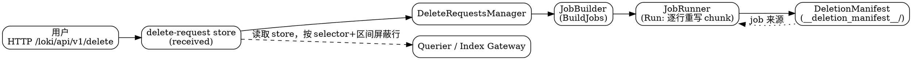

## Introduction

Loki 的删除是**软删除（soft delete）**：用户提交一个删除请求后，数据**不会立刻从对象存储消失**，而是先登记、查询时被屏蔽，直到 compactor 真正把受影响的 chunk 物理重写（filter-and-delete）才落地。这与「删除 = 立刻 rm」的直觉完全不同，是运维上最容易被误解的行为。

整个过程分两半，且是异步解耦的：

1. **登记**：API 收到 `selector + 时间区间` 的删除请求，写入 delete-request store（状态 `received`）。此时数据还在，但查询已经开始屏蔽它。
2. **执行**：compactor 周期性把删除请求变成「删除作业」，物理重写命中 chunk（逐行删、整块变空则删块），并构建 deletion manifest 记录已删内容。

> [!NOTE]
> 本页为**源码级**笔记，结论已对照 **Loki `v3.7.10`**（tag `v3.7.10`，浅克隆于 `loki-3.7.10/`）逐条核实。下文讲解直接贴真实源码片段，涉及的文件路径相对仓库根（统一前缀 `loki-3.7.10/`），不再标注行号。读者不会打开仓库，需要看机制时直接看贴出的代码。
>
> 三个反直觉事实（文档不提，源码级才看得出）：
> 1. **没有 `StatusPending`、没有 `status_reason`**。`DeleteRequest.Status` 只有 `StatusReceived`("received") 与 `StatusProcessed`("processed")；「pending」即 `received`，处理进度以 `"N% Complete"` 字符串表达（见 `pkg/compactor/deletion/deletionproto/custom.go` 与 `pkg/compactor/deletion/request_handler.go`）。
> 2. **没有 gRPC `AddDeleteRequest` RPC**。提交/取消删除请求是 **HTTP-only**（`PUT/POST /loki/api/v1/delete`）；gRPC 仅暴露读取接口 `GetDeleteRequests`（`pkg/compactor/deletion/grpc_request_handler.go`）。
> 3. **SQLite 并非字面默认值**。flag 默认值仍是 `boltdb`（`pkg/compactor/config.go`）；SQLite 是现代实现 + 从 boltdb 的单向迁移，boltdb 仍可用作 legacy/backup（`pkg/compactor/deletion/delete_requests_store.go`）。

## DeleteRequest Model

模型定义在 `pkg/compactor/deletion/deletionproto/types.pb.go`：

```go
type DeleteRequest struct {
	RequestID   string                                  `protobuf:"bytes,1,opt,name=requestID,proto3" json:"request_id"`
	StartTime   github_com_prometheus_common_model.Time `protobuf:"varint,2,opt,name=startTime,proto3,customtype=github.com/prometheus/common/model.Time" json:"start_time"`
	EndTime     github_com_prometheus_common_model.Time `protobuf:"varint,3,opt,name=endTime,proto3,customtype=github.com/prometheus/common/model.Time" json:"end_time"`
	Query       string                                  `protobuf:"bytes,4,opt,name=query,proto3" json:"query"`
	Status      DeleteRequestStatus                     `protobuf:"bytes,5,opt,name=status,proto3,customtype=DeleteRequestStatus" json:"status"`
	CreatedAt   github_com_prometheus_common_model.Time `protobuf:"varint,6,opt,name=createdAt,proto3,customtype=github.com/prometheus/common/model.Time" json:"created_at"`
	UserID      string                                  `protobuf:"bytes,7,opt,name=userID,proto3" json:"user_id"`
	SequenceNum int64                                   `protobuf:"varint,8,opt,name=sequenceNum,proto3" json:"-"`
}
```

状态常量只有两个，在 `pkg/compactor/deletion/deletionproto/custom.go`：

```go
const (
	StatusReceived  DeleteRequestStatus = "received"
	StatusProcessed DeleteRequestStatus = "processed"
)
```

内部包装 `deleteRequest`（`pkg/compactor/deletion/delete_request.go`）持有解析后的 matchers 与 log selector：

```go
type deleteRequest struct {
	deletionproto.DeleteRequest
	matchers        []*labels.Matcher      `json:"-"`
	logSelectorExpr syntax.LogSelectorExpr `json:"-"`
	timeInterval    *timeInterval          `json:"-"`

	TotalLinesDeletedMetric *prometheus.CounterVec `json:"-"`
	DeletedLines            atomic.Int32           `json:"-"`
}
```

`IsDeleted` 用「userID + 时间重叠 + label matcher」判定 chunk 是否命中：

```go
// IsDeleted checks if the given chunk entry would have data requested for deletion.
func (d *deleteRequest) IsDeleted(userID []byte, lbls labels.Labels, chunk retention.Chunk) bool {
	if d.UserID != unsafeGetString(userID) {
		return false
	}

	if !intervalsOverlap(model.Interval{
		Start: chunk.From,
		End:   chunk.Through,
	}, model.Interval{
		Start: d.StartTime,
		End:   d.EndTime,
	}) {
		return false
	}
	// ...
	if !labels.Selector(d.matchers).Matches(lbls) {
		return false
	}

	return true
}
```

`GetChunkFilter` 决定整块删除还是逐行过滤：

```go
// GetChunkFilter tells whether the chunk is covered by the DeleteRequest and
// optionally returns a filter.Func if the chunk is supposed to be deleted partially or the delete request has line filters.
func (d *deleteRequest) GetChunkFilter(userID []byte, lbls labels.Labels, chunk retention.Chunk) (bool, filter.Func) {
	if !d.IsDeleted(userID, lbls, chunk) {
		return false, nil
	}

	if d.StartTime <= chunk.From && d.EndTime >= chunk.Through && !d.logSelectorExpr.HasFilter() {
		// Delete request covers the whole chunk and there are no line filters in the logSelectorExpr so the whole chunk will be deleted
		return true, nil
	}

	ff, err := d.FilterFunction(lbls)
	if err != nil {
		// ...
		return false, nil
	}

	return true, ff
}
```

分片处理进度以 `"N% Complete"` 字符串表达（`pkg/compactor/deletion/request_handler.go`）：

```go
percentCompleted := float64(processed) / float64(total)
return deletionproto.DeleteRequestStatus(fmt.Sprintf("%d%% Complete", int(percentCompleted*100)))
```

批量侧（`pkg/compactor/deletion/delete_request_batch.go`）按 user 聚合多个待处理请求，`expired()` 对单 chunk 求并集过滤——这是「该 chunk 是否被某删除请求删掉」的核心判定：

```go
// deleteRequestBatch holds a batch of requests loaded for processing
type deleteRequestBatch struct {
	deleteRequestsToProcess map[string]*userDeleteRequests
	duplicateRequests       []deletionproto.DeleteRequest
	count                   int
	metrics                 *deleteRequestsManagerMetrics
}
```

```go
func (b *deleteRequestBatch) expired(userID []byte, chk retention.Chunk, lbls labels.Labels, skipRequest func(*deleteRequest) bool) (bool, filter.Func) {
	userIDStr := unsafeGetString(userID)
	if b.deleteRequestsToProcess[userIDStr] == nil || !intervalsOverlap(b.deleteRequestsToProcess[userIDStr].requestsInterval, model.Interval{
		Start: chk.From,
		End:   chk.Through,
	}) {
		return false, nil
	}

	var filterFuncs []filter.Func

	for _, deleteRequest := range b.deleteRequestsToProcess[userIDStr].requests {
		if skipRequest(deleteRequest) {
			continue
		}
		isDeleted, ff := deleteRequest.GetChunkFilter(userID, lbls, chk)
		if !isDeleted {
			continue
		}

		if ff == nil {
			level.Info(util_log.Logger).Log(
				"msg", "no chunks to retain: the whole chunk is deleted",
				// ...
			)
			return true, nil
		}
		filterFuncs = append(filterFuncs, ff)
	}

	if len(filterFuncs) == 0 {
		return false, nil
	}

	return true, func(ts time.Time, s string, structuredMetadata labels.Labels) bool {
		for _, ff := range filterFuncs {
			if ff(ts, s, structuredMetadata) {
				return true
			}
		}

		return false
	}
}
```

## Storage of Delete Requests

`pkg/compactor/deletion/delete_requests_store.go` 定义 DB 类型常量与 store 接口：

```go
const (
	DeleteRequestsStoreDBTypeBoltDB DeleteRequestsStoreDBType = "boltdb"
	DeleteRequestsStoreDBTypeSQLite DeleteRequestsStoreDBType = "sqlite"

	deleteRequestsWorkingDirName = "delete_requests"
)
```

```go
type DeleteRequestsStore interface {
	AddDeleteRequest(ctx context.Context, userID, query string, startTime, endTime model.Time, shardByInterval time.Duration) (string, error)
	addDeleteRequestWithID(ctx context.Context, requestID, userID, query string, startTime, endTime model.Time, shardByInterval time.Duration) error
	GetAllRequests(ctx context.Context) ([]deletionproto.DeleteRequest, error)
	GetAllDeleteRequestsForUser(ctx context.Context, userID string, forQuerytimeFiltering bool, timeRange *TimeRange) ([]deletionproto.DeleteRequest, error)
	RemoveDeleteRequest(ctx context.Context, userID string, requestID string) error
	GetDeleteRequest(ctx context.Context, userID, requestID string) (deletionproto.DeleteRequest, error)
	GetCacheGenerationNumber(ctx context.Context, userID string) (string, error)
	MergeShardedRequests(ctx context.Context) error

	MarkShardAsProcessed(ctx context.Context, req deletionproto.DeleteRequest) error
	GetUnprocessedShards(ctx context.Context) ([]deletionproto.DeleteRequest, error)

	Stop()
}
```

`newDeleteRequestsStore` 体现了「SQLite 是现代实现 + 从 boltdb 单向迁移」：仅当主库为 sqlite 且为空时才从 boltdb 拷贝数据，并支持 primary+backup tee：

```go
	if deleteRequestsStoreDBType == DeleteRequestsStoreDBTypeSQLite {
		deleteRequestsStoreSQLite := store.(*deleteRequestsStoreSQLite)
		sqliteStoreIsEmpty, err := deleteRequestsStoreSQLite.isEmpty(context.Background())
		if err != nil {
			return nil, err
		}

		// copy data from boltdb to sqlite only if the sqlite store is empty
		if sqliteStoreIsEmpty {
			boltdbStore, err := newDeleteRequestsStoreBoltDB(workingDirectory, indexStorageClient)
			if err != nil {
				return nil, err
			}

			shards, cacheGen, err := boltdbStore.getAllData(context.Background())
			if err != nil {
				return nil, err
			}
			boltdbStore.Stop()

			err = deleteRequestsStoreSQLite.copyData(context.Background(), shards, cacheGen)
			if err != nil {
				return nil, err
			}
		}
		// ...
	}

	if backupDeleteRequestStoreDBType != "" && deleteRequestsStoreDBType != backupDeleteRequestStoreDBType {
		backupStore, err := createDeleteRequestsStore(backupDeleteRequestStoreDBType, workingDirectory, indexStorageClient, indexUpdatePropagationMaxDelay)
		if err != nil {
			return nil, err
		}

		store = newDeleteRequestsStoreTee(store, backupStore)
	}
```

BoltDB vs SQLite 二选一的 switch 也在此文件：

```go
func createDeleteRequestsStore(
	DeleteRequestsStoreDBType DeleteRequestsStoreDBType,
	workingDirectory string,
	indexStorageClient storage.Client,
	indexUpdatePropagationMaxDelay time.Duration,
) (DeleteRequestsStore, error) {
	switch DeleteRequestsStoreDBType {
	case DeleteRequestsStoreDBTypeBoltDB:
		return newDeleteRequestsStoreBoltDB(workingDirectory, indexStorageClient)
	case DeleteRequestsStoreDBTypeSQLite:
		return newDeleteRequestsStoreSQLite(workingDirectory, indexStorageClient, indexUpdatePropagationMaxDelay)
	default:
		return nil, fmt.Errorf("unexpected delete requests store DB type %s. Supported types: (%s, %s)", DeleteRequestsStoreDBType, DeleteRequestsStoreDBTypeBoltDB, DeleteRequestsStoreDBTypeSQLite)
	}
}
```

SQLite 实现见 `pkg/compactor/deletion/delete_requests_store_sqlite.go`。`AddDeleteRequest` 生成 requestID 后走公共分片写入：

```go
// AddDeleteRequest creates entries for new delete requests. All passed delete requests will be associated to
// each other by request id
func (ds *deleteRequestsStoreSQLite) AddDeleteRequest(ctx context.Context, userID, query string, startTime, endTime model.Time, shardByInterval time.Duration) (string, error) {
	// Generate unique request ID
	requestID := generateUniqueID(userID, query)

	// Use common implementation
	err := ds.addDeleteRequestWithID(ctx, requestID, userID, query, startTime, endTime, shardByInterval)
	if err != nil {
		return "", err
	}

	return requestID, nil
}
```

`MarkShardAsProcessed` 删 shard 行 + 更新 `processed_shards`（事务内要求恰一行变更）：

```go
func (ds *deleteRequestsStoreSQLite) buildMarkShardAsProcessedQueries(req deletionproto.DeleteRequest) []sqlQuery {
	return []sqlQuery{
		{
			query: sqlDeleteShard,
			execOpts: &sqlitex.ExecOptions{
				Args: []any{
					req.RequestID,
					req.StartTime,
					req.EndTime,
				},
			},
			postUpdateExecCallback: func(numChanges int) error {
				// Exactly one row should be deleted. Fail the transaction if not.
				if numChanges != 1 {
					return fmt.Errorf("expected 1 change, got %d", numChanges)
				}

				return nil
			},
		}, {
			query: sqlProcessedShardUpdate,
			execOpts: &sqlitex.ExecOptions{
				Args: []any{
					model.Now(),
					req.RequestID,
				},
			},
			postUpdateExecCallback: func(numChanges int) error {
				// Exactly one row should be deleted. Fail the transaction if not.
				if numChanges != 1 {
					return fmt.Errorf("expected 1 change, got %d", numChanges)
				}

				return nil
			},
		},
	}
}
```

查询侧最关键的是 `GetAllDeleteRequestsForUser`：查询时过滤只考虑 `completed_at IS NULL OR completed_at > now()-indexUpdatePropagationMaxDelay` 的请求——**索引更新传播完才隐藏**，对应 SQL 常量与实现：

```go
	// while listing requests for query-time filtering, consider only the requests which are unprocessed or
	// a specific duration has elapsed since they completed, to let the index updates get propagated.
	sqlSelectUserRequestsForQueryTimeFiltering = `SELECT * FROM requests WHERE user_id = ? AND (completed_at IS NULL OR completed_at > ?);`
```

```go
	// for time elapsed since the requests got processed, consider the given index update propagation delay
	return ds.queryDeleteRequests(ctx, sqlSelectUserRequestsForQueryTimeFiltering, []any{userID, model.Now().Add(-ds.indexUpdatePropagationMaxDelay)})
```

BoltDB legacy 实现在 `pkg/compactor/deletion/delete_requests_store_boltdb.go`（结构体与 `AddDeleteRequest`）。

Manager 在 `pkg/compactor/deletion/delete_requests_manager.go`：

```go
type DeleteRequestsManager struct {
	workingDir                string
	deleteRequestsStore       DeleteRequestsStore
	deleteRequestCancelPeriod time.Duration

	HSModeEnabled               bool
	deletionManifestStoreClient client.ObjectClient
	jobBuilder                  *JobBuilder
	tablesManager               TablesManager

	metrics      *deleteRequestsManagerMetrics
	wg           sync.WaitGroup
	batchSize    int
	limits       Limits
	currentBatch *deleteRequestBatch
	// ...
}
```

`loadDeleteRequestsToProcess` 按删除模式过滤请求，超出 retention 的直接标 processed：

```go
func (d *DeleteRequestsManager) loadDeleteRequestsToProcess(kind DeleteRequestsKind) (*deleteRequestBatch, error) {
	batch := newDeleteRequestBatch(d.metrics)

	deleteRequests, err := d.filteredSortedDeleteRequests()
	if err != nil {
		return nil, err
	}
	// ...
		maxRetentionInterval := getMaxRetentionInterval(deleteRequest.UserID, d.limits)
		// retention interval 0 means retain the data forever
		if maxRetentionInterval != 0 {
			oldestRetainedLogTimestamp := model.Now().Add(-maxRetentionInterval)
			if deleteRequest.StartTime.Before(oldestRetainedLogTimestamp) && deleteRequest.EndTime.Before(oldestRetainedLogTimestamp) {
				level.Info(util_log.Logger).Log(
					"msg", "Marking delete request with interval beyond retention period as processed",
					// ...
				)
				d.markRequestAsProcessed(deleteRequest.DeleteRequest, 0)
				continue
			}
		}
	// ...
}
```

只有 `FilterAndDelete` 模式的请求才进入物理删除：

```go
func (d *DeleteRequestsManager) shouldProcessRequest(dr deletionproto.DeleteRequest) (bool, error) {
	mode, err := deleteModeFromLimits(d.limits, dr.UserID)
	if err != nil {
		// ...
		return false, err
	}

	return mode == deletionmode.FilterAndDelete, nil
}
```

`markRequestAsProcessed` 最终落到 `store.MarkShardAsProcessed`：

```go
func (d *DeleteRequestsManager) markRequestAsProcessed(deleteRequest deletionproto.DeleteRequest, deletedLines int32) {
	if err := d.deleteRequestsStore.MarkShardAsProcessed(context.Background(), deleteRequest); err != nil {
		// ...
	} else {
		level.Info(util_log.Logger).Log(
			"msg", "delete request for user marked as processed",
			// ...
		)
		d.metrics.deleteRequestsProcessedTotal.WithLabelValues(deleteRequest.UserID).Inc()
	}
}
```

## API Entry — 如何触发删除

提交/取消删除请求是 **HTTP-only**。`pkg/compactor/deletion/request_handler.go` 的 `AddDeleteRequestHandler` 解析 query/start/end、按需分片、调 `store.AddDeleteRequest`：

```go
// AddDeleteRequestHandler handles addition of a new delete request
func (dm *DeleteRequestHandler) AddDeleteRequestHandler(w http.ResponseWriter, r *http.Request) {
	if dm == nil {
		http.Error(w, "Retention is not enabled", http.StatusBadRequest)
		return
	}
	// ...
	params := r.URL.Query()
	query, parsedExpr, err := query(params)
	if err != nil {
		http.Error(w, err.Error(), http.StatusBadRequest)
		return
	}
	// ...
	var shardByInterval time.Duration
	// shard delete requests only when there are line filters
	if parsedExpr.HasFilter() {
		var err error
		shardByInterval, err = dm.interval(params, startTime, endTime)
		if err != nil {
			http.Error(w, err.Error(), http.StatusBadRequest)
			return
		}
	}

	requestID, err := dm.deleteRequestsStore.AddDeleteRequest(ctx, userID, query, startTime, endTime, shardByInterval)
	if err != nil {
		level.Error(util_log.Logger).Log("msg", "error adding delete request to the store", "err", err)
		http.Error(w, err.Error(), http.StatusInternalServerError)
		return
	}
	// ...
	dm.metrics.deleteRequestsReceivedTotal.WithLabelValues(userID).Inc()
	w.Header().Set("X-Delete-Request-ID", requestID)
	w.WriteHeader(http.StatusNoContent)
}
```

`CancelDeleteRequestHandler` 同在 `request_handler.go`：已 processed 或超过取消期限的请求拒绝取消（可 `?force=true` 强制）。

路由注册在 `pkg/loki/modules.go`：

```go
	if t.Cfg.CompactorConfig.RetentionEnabled {
		t.Server.HTTP.Path(constants.PathLokiDelete).Methods("PUT", "POST").Handler(t.addCompactorMiddleware(t.compactor.DeleteRequestsHandler.AddDeleteRequestHandler))
		t.Server.HTTP.Path(constants.PathLokiDelete).Methods("GET").Handler(t.addCompactorMiddleware(t.compactor.DeleteRequestsHandler.GetAllDeleteRequestsHandler))
		t.Server.HTTP.Path(constants.PathLokiDelete).Methods("DELETE").Handler(t.addCompactorMiddleware(t.compactor.DeleteRequestsHandler.CancelDeleteRequestHandler))
		t.Server.HTTP.Path(constants.PathLokiCacheGenNumbers).Methods("GET").Handler(t.addCompactorMiddleware(t.compactor.DeleteRequestsHandler.GetCacheGenerationNumberHandler))
		grpc.RegisterCompactorServer(t.Server.GRPC, t.compactor.DeleteRequestsGRPCHandler)
	}
```

gRPC 只注册读取接口。`pkg/compactor/deletion/grpc_request_handler.go` 的 `GRPCRequestHandler` 仅暴露 `GetDeleteRequests`：

```go
func (g *GRPCRequestHandler) GetDeleteRequests(ctx context.Context, req *grpc.GetDeleteRequestsRequest) (*grpc.GetDeleteRequestsResponse, error) {
	userID, err := tenant.TenantID(ctx)
	if err != nil {
		return nil, err
	}
	// ...
	deleteRequests, err := g.deleteRequestsStore.GetAllDeleteRequestsForUser(ctx, userID, req.ForQuerytimeFiltering, timeRange)
	if err != nil {
		level.Error(util_log.Logger).Log("msg", "error getting delete requests from the store", "err", err)
		return nil, err
	}
	// ...
}
```

装配点在 `pkg/compactor/compactor.go` 的 `initDeletes`：构建 store + HTTP handler + gRPC handler + `DeleteRequestsManager`，并把 `DeletionManifestStorePrefix` 前缀客户端交给 manager：

```go
func (c *Compactor) initDeletes(objectClient client.ObjectClient, indexUpdatePropagationMaxDelay time.Duration, r prometheus.Registerer, limits Limits) error {
	deletionWorkDir := filepath.Join(c.cfg.WorkingDirectory, "deletion")
	indexStorageClient := storage.NewIndexStorageClient(objectClient, c.cfg.DeleteRequestStoreKeyPrefix)
	store, err := deletion.NewDeleteRequestsStore(
		deletion.DeleteRequestsStoreDBType(c.cfg.DeleteRequestStoreDBType),
		deletionWorkDir,
		indexStorageClient,
		deletion.DeleteRequestsStoreDBType(c.cfg.BackupDeleteRequestStoreDBType),
		indexUpdatePropagationMaxDelay,
	)
	if err != nil {
		return err
	}

	c.deleteRequestsStore = store

	c.DeleteRequestsHandler = deletion.NewDeleteRequestHandler(
		c.deleteRequestsStore,
		c.cfg.DeleteMaxInterval,
		c.cfg.DeleteRequestCancelPeriod,
		r,
	)

	c.DeleteRequestsGRPCHandler = deletion.NewGRPCRequestHandler(c.deleteRequestsStore, limits)

	c.deleteRequestsManager, err = deletion.NewDeleteRequestsManager(
		deletionWorkDir,
		c.deleteRequestsStore,
		c.cfg.DeleteRequestCancelPeriod,
		c.cfg.DeleteBatchSize,
		limits,
		c.cfg.HorizontalScalingMode == HorizontalScalingModeMain,
		client.NewPrefixedObjectClient(objectClient, c.cfg.JobsConfig.Deletion.DeletionManifestStorePrefix),
		r,
	)
	// ...
}
```

多租户门禁：`pkg/compactor/deletion/tenant_request_handler.go` 的 `TenantMiddleware` 按租户 `validDeletionLimit` 把关：

```go
func TenantMiddleware(limits Limits) middleware.Interface {
	return middleware.Func(func(next http.Handler) http.Handler {
		return http.HandlerFunc(func(w http.ResponseWriter, r *http.Request) {
			ctx := r.Context()
			userID, err := tenant.TenantID(ctx)
			if err != nil {
				http.Error(w, err.Error(), http.StatusBadRequest)
				return
			}

			hasDelete, err := validDeletionLimit(limits, userID)
			if err != nil {
				http.Error(w, err.Error(), http.StatusBadRequest)
				return
			}

			if !hasDelete {
				http.Error(w, deletionNotAvailableMsg, http.StatusForbidden)
				return
			}

			next.ServeHTTP(w, r)
		})
	})
}
```

读取侧由 `pkg/compactor/deletion/tenant_delete_requests_client.go` 按租户 `DeletionMode` 拦截：

```go
func (c *perTenantDeleteRequestsClient) GetAllDeleteRequestsForUser(ctx context.Context, userID string, forQuerytimeFiltering bool, timeRange *TimeRange) ([]deletionproto.DeleteRequest, error) {
	hasDelete, err := validDeletionLimit(c.limits, userID)
	if err != nil {
		return nil, err
	}

	if hasDelete {
		return c.client.GetAllDeleteRequestsForUser(ctx, userID, forQuerytimeFiltering, timeRange)
	}
	return nil, nil
}
```

## Compactor Processing — 真正的软删除执行

作业构建由 `pkg/compactor/deletion/job_builder.go` 的 `JobBuilder` 完成：

```go
type JobBuilder struct {
	deletionManifestStoreClient client.ObjectClient
	applyStorageUpdatesFunc     ApplyStorageUpdatesFunc
	markRequestsAsProcessedFunc markRequestsAsProcessedFunc

	// Current manifest being processed
	currentManifest    manifestJobs
	currentManifestMtx sync.RWMutex

	currSegmentStorageUpdates   *storageUpdatesCollection
	currSegmentNumJobsToProcess atomic.Int32
	metrics                     *jobBuilderMetrics
}
```

`buildJobs` 列读 manifest 目录、逐 manifest 处理/应用/清理：

```go
func (b *JobBuilder) buildJobs(ctx context.Context, jobsChan chan<- *grpc.Job) error {
	// List all manifest directories
	manifests, err := b.listManifests(ctx)
	if err != nil {
		return err
	}
	// ...
	for _, manifestPath := range manifests {
		manifest, err := b.readManifest(ctx, manifestPath)
		if err != nil {
			// ...
			return err
		}

		if err := b.processManifest(ctx, manifest, manifestPath, jobsChan); err != nil {
			// ...
			return err
		}

		if err := b.applyStorageUpdates(ctx, manifest, manifestPath); err != nil {
			// ...
			return err
		}

		if err := b.cleanupManifest(ctx, manifest, manifestPath); err != nil {
			// ...
			return err
		}
		// ...
	}

	return nil
}
```

`processManifest` 遍历 segment `<ts>/<n>.proto`，为每个 chunks group 建作业；`createJobsForChunksGroup` 按 `maxChunksPerJob=1000` 切分并投递：

```go
func (b *JobBuilder) createJobsForChunksGroup(ctx context.Context, tableName, userID string, group deletionproto.ChunksGroup, jobsChan chan<- *grpc.Job) error {
	for labels := range group.Chunks {
		chunks := group.Chunks[labels].IDs
		// Split chunks into groups of maxChunksPerJob
		for i := 0; i < len(chunks); i += maxChunksPerJob {
			end := i + maxChunksPerJob
			if end > len(chunks) {
				end = len(chunks)
			}

			payload, err := proto.Marshal(&deletionproto.DeletionJob{
				TableName:      tableName,
				UserID:         userID,
				ChunkIDs:       chunks[i:end],
				DeleteRequests: group.Requests,
			})
			if err != nil {
				return err
			}

			job := &grpc.Job{
				Type:    grpc.JOB_TYPE_DELETION,
				Payload: payload,
			}
			// ...
			select {
			case <-ctx.Done():
				return ctx.Err()
			case jobsChan <- job:
			}
		}
	}

	return nil
}
```

作业执行在 `pkg/compactor/deletion/job_runner.go` 的 `JobRunner.Run`：拉 chunk、用各请求的 `FilterFunction` **逐行重写**；命中整块变空则 `RebuiltChunks[chunkID]=nil`（标记删除），否则上传重建后的新 chunk 并 de-index 旧块——即 filter-and-delete 的物理重写：

```go
		// Build a chain of filters to apply on the chunk to remove data requested for deletion.
		var filterFuncs []filter.Func
		for _, req := range deleteRequests {
			filterFunc, err := req.FilterFunction(chks[0].Metric)
			if err != nil {
				return err
			}

			filterFuncs = append(filterFuncs, filterFunc)
		}

		// rebuild the chunk and see if we excluded any of the lines from the existing chunk
		var linesDeleted bool
		newChunkData, err := chks[0].Data.Rewrite(func(ts time.Time, s string, structuredMetadata labels.Labels) bool {
			for _, filterFunc := range filterFuncs {
				if filterFunc(ts, s, structuredMetadata) {
					linesDeleted = true
					return true
				}
			}

			return false
		})
		if err != nil {
			if errors.Is(err, storage_chunk.ErrRewriteNoDataLeft) {
				level.Info(util_log.Logger).Log("msg", "Delete request filterFunc leaves an empty chunk", "chunk ref", chunkID)
				updatesMtx.Lock()
				defer updatesMtx.Unlock()
				updates.RebuiltChunks[chunkID] = nil
				return nil
			}
			return err
		}

		// if no lines were deleted then there is nothing to do
		if !linesDeleted {
			return nil
		}
		// ...
		// upload the new chunk to object storage
		newChunk := storage_chunk.NewChunk(
			deletionJob.UserID, chks[0].FingerprintModel(), chks[0].Metric,
			facade,
			newChunkStart,
			newChunkEnd,
		)
		// ...
		err = chunkClient.PutChunks(ctx, []storage_chunk.Chunk{newChunk})
```

Manifest 构建在 `pkg/compactor/deletion/deletion_manifest_builder.go`。构造时限制 ≤64 请求/批（uint64 位图的宽度）：

```go
// deletionManifestBuilder helps with building the manifest for listing out which chunks to process for a batch of delete requests.
// It is not meant to be used concurrently.
type deletionManifestBuilder struct {
	deletionManifestStoreClient client.ObjectClient
	deleteRequestBatch          *deleteRequestBatch

	currentSegment            map[uint64]deletionproto.ChunksGroup
	currentSegmentChunksCount int32
	currentUserID             string
	currentTableName          string
	// ...
}

func newDeletionManifestBuilder(deletionManifestStoreClient client.ObjectClient, deleteRequestBatch *deleteRequestBatch) (*deletionManifestBuilder, error) {
	// ...
	// We use a uint64 as a bit field to track which delete requests apply to each chunk.
	// Since uint64 has 64 bits, we can only handle up to 64 delete requests at a time.
	if requestCount > 64 {
		return nil, fmt.Errorf("only upto 64 delete requests allowed, current count: %d", requestCount)
	}
	// ...
}
```

`AddSeries` 遍历索引 series/chunks，用 uint64 位图把匹配的删除请求聚成 `ChunksGroup`：

```go
		// We use a uint64 as a bit field to track which delete requests apply to each chunk.
		chunksGroupIdentifier = 0
		for i, deleteRequest := range d.allUserRequests {
			if !deleteRequest.IsDeleted(series.UserID(), series.Labels(), chk) {
				continue
			}

			chunksGroupIdentifier |= 1 << i
		}

		if chunksGroupIdentifier == 0 {
			continue
		}
		d.currentSegmentChunksCount++

		if _, ok := d.currentSegment[chunksGroupIdentifier]; !ok {
			// Iterate through d.allUserRequests and find which bits are turned on in chunksGroupIdentifier
			var deleteRequests []deletionproto.DeleteRequest
			for i := range d.allUserRequests {
				if chunksGroupIdentifier&(1<<i) != 0 { // Check if the i-th bit is turned on
					request := d.allUserRequests[i]
					deleteRequests = append(deleteRequests, deletionproto.DeleteRequest{
						RequestID: request.RequestID,
						Query:     request.Query,
						StartTime: request.StartTime,
						EndTime:   request.EndTime,
						UserID:    request.UserID,
					})
				}
			}
			// ...
		}
```

`Finish` 序列化 `DeletionManifest` 写对象存储，键格式 `<creationTime.UnixNano()>/manifest.proto`（前缀 `DeletionManifestStorePrefix`，默认 `__deletion_manifest__/` 由配置提供）：

```go
	manifestProto, err := proto.Marshal(&deletionproto.DeletionManifest{
		Requests:          requests,
		DuplicateRequests: d.deleteRequestBatch.duplicateRequests,
		SegmentsCount:     d.segmentsCount,
		ChunksCount:       d.overallChunksCount,
	})
	if err != nil {
		return err
	}

	return d.deletionManifestStoreClient.PutObject(ctx, d.buildObjectKey(manifestFileName), strings.NewReader(unsafeGetString(manifestProto)))
```

```go
func (d *deletionManifestBuilder) buildObjectKey(filename string) string {
	return path.Join(fmt.Sprint(d.creationTime.UnixNano()), filename)
}
```

manager 侧的 `buildDeletionManifestLoop` / `buildDeletionManifest` 周期驱动上述 builder。



## Query-time Skipping — 软删除如何「隐藏」数据

**查询路径并不加载 manifest**——它直接读 delete-request store，把待处理/已处理请求变成 `[]*logproto.Delete`，在读取时按 selector + 时间区间**逐行丢弃**。

`pkg/querier/querier.go` 的 `SelectLogs` 把删除请求装入查询参数：

```go
	params.Deletes, err = deletion.DeletesForUserQuery(ctx, params.Start, params.End, q.deleteGetter)
	if err != nil {
		level.Error(spanlogger.FromContext(ctx, q.logger)).Log("msg", "failed loading deletes for user", "err", err)
	}
```

`pkg/querier/deletion/delete.go` 的 `DeletesForUserQuery` 调 store 取请求并转成 `logproto.Delete`：

```go
type DeleteGetter interface {
	GetAllDeleteRequestsForUser(ctx context.Context, userID string, forQuerytimeFiltering bool, timeRange *deletion.TimeRange) ([]deletionproto.DeleteRequest, error)
}

// DeletesForUserQuery returns the deletes for a user (taken from request context) within a given time range.
func DeletesForUserQuery(ctx context.Context, startT, endT time.Time, g DeleteGetter) ([]*logproto.Delete, error) {
	userID, err := tenant.TenantID(ctx)
	if err != nil {
		return nil, err
	}

	d, err := g.GetAllDeleteRequestsForUser(ctx, userID, true, nil)
	if err != nil {
		return nil, err
	}

	start := startT.UnixNano()
	end := endT.UnixNano()

	var deletes []*logproto.Delete
	for _, del := range d {
		if del.StartTime.UnixNano() <= end && del.EndTime.UnixNano() >= start {
			deletes = append(deletes, &logproto.Delete{
				Selector: del.Query,
				Start:    del.StartTime.UnixNano(),
				End:      del.EndTime.UnixNano(),
			})
		}
	}

	return deletes, nil
}
```

引擎层同样从 store 拉取：`pkg/engine/internal/deletion/deletion.go` 的 `Getter` 接口 + `DeletesForUser`。

**关键隐藏点**在 `pkg/util/deletion/deletion.go`：`SetupPipeline` / `SetupExtractor` 把 `[]*logproto.Delete` 转成 `log.PipelineFilter`，在读取时逐行丢弃——数据仍留在对象存储，仅查询时被过滤，这正是「软删除」的精髓：

```go
func SetupPipeline(req logql.SelectLogParams, p log.Pipeline) (log.Pipeline, error) {
	if len(req.Deletes) == 0 {
		return p, nil
	}

	filters, err := deleteFilters(req.Deletes)
	if err != nil {
		return nil, err
	}

	return log.NewFilteringPipeline(filters, p), nil
}

func SetupExtractor(req logql.QueryParams, se log.SampleExtractor) (log.SampleExtractor, error) {
	if len(req.GetDeletes()) == 0 {
		return se, nil
	}

	filters, err := deleteFilters(req.GetDeletes())
	if err != nil {
		return nil, err
	}

	return log.NewFilteringSampleExtractor(filters, se), nil
}

func deleteFilters(deletes []*logproto.Delete) ([]log.PipelineFilter, error) {
	var filters []log.PipelineFilter
	for _, d := range deletes {
		expr, err := syntax.ParseLogSelector(d.Selector, true)
		if err != nil {
			return nil, err
		}

		pipeline, err := expr.Pipeline()
		if err != nil {
			return nil, err
		}

		filters = append(filters, log.PipelineFilter{
			Start:    d.Start,
			End:      d.End,
			Matchers: expr.Matchers(),
			Pipeline: pipeline,
		})
	}

	return filters, nil
}
```

读取客户端在 `pkg/compactor/deletion/delete_requests_client.go`：`DeleteRequestsClient` 带 5 分钟缓存（`updateLoop`/`cache`），`GetAllDeleteRequestsForUser` 是唯一读取方法：

```go
type deleteRequestsClient struct {
	compactorClient CompactorClient
	mu              sync.RWMutex

	cache         map[string][]deletionproto.DeleteRequest
	cacheDuration time.Duration
	// ...
}

func NewDeleteRequestsClient(compactorClient CompactorClient, deleteClientMetrics *DeleteRequestClientMetrics, clientType string, opts ...DeleteRequestsStoreOption) (DeleteRequestsClient, error) {
	client := &deleteRequestsClient{
		compactorClient: compactorClient,
		cacheDuration:   5 * time.Minute,
		cache:           make(map[string][]deletionproto.DeleteRequest),
		// ...
	}
	// ...
	go client.updateLoop()
	return client, nil
}
```

## Retention Interaction & Config

`pkg/compactor/config.go` 定义删除相关配置：

```go
	DeleteRequestStore              string                `yaml:"delete_request_store"`
	DeleteRequestStoreKeyPrefix     string                `yaml:"delete_request_store_key_prefix"`
	DeleteRequestStoreDBType        string                `yaml:"delete_request_store_db_type"`
	BackupDeleteRequestStoreDBType  string                `yaml:"backup_delete_request_store_db_type"`
```

flag 默认值仍是 boltdb（非字面 SQLite）：

```go
	f.StringVar(&cfg.DeleteRequestStoreDBType, "compactor.delete-request-store.db-type", string(deletion.DeleteRequestsStoreDBTypeBoltDB), fmt.Sprintf("Type of DB to use for storing delete requests. Supported types: %s", strings.Join(*(*[]string)(unsafe.Pointer(&deletion.SupportedDeleteRequestsStoreDBTypes)), ", ")))
```

删除作业配置（manifest 前缀默认 `__deletion_manifest__/`）：

```go
type DeletionJobsConfig struct {
	DeletionManifestStorePrefix string        `yaml:"deletion_manifest_store_prefix"`
	ChunkProcessingConcurrency  int           `yaml:"chunk_processing_concurrency"`
	Timeout                     time.Duration `yaml:"timeout"`
	MaxRetries                  int           `yaml:"max_retries"`
}

func (c *DeletionJobsConfig) RegisterFlagsWithPrefix(prefix string, f *flag.FlagSet) {
	f.StringVar(&c.DeletionManifestStorePrefix, prefix+"deletion-manifest-store-prefix", "__deletion_manifest__/", "Object storage path prefix for storing deletion manifests.")
	// ...
}
```

`pkg/validation/limits.go` 定义每租户删除模式与保留期：

```go
	// Global and per tenant deletion mode
	DeletionMode string `yaml:"deletion_mode" json:"deletion_mode"`

	// Global and per tenant retention
	RetentionPeriod model.Duration    `yaml:"retention_period" json:"retention_period"`

	// Deprecated
	CompactorDeletionEnabled bool `yaml:"allow_deletes" json:"allow_deletes" doc:"deprecated|description=Use deletion_mode per tenant configuration instead."`
```

模式枚举在 `pkg/compactor/deletionmode/mode.go`：

```go
const (
	disabled        = "disabled"
	filterOnly      = "filter-only"
	filterAndDelete = "filter-and-delete"
	unknown         = "unknown"

	Disabled Mode = iota
	FilterOnly
	FilterAndDelete
)

func (m Mode) DeleteEnabled() bool {
	return m == FilterOnly || m == FilterAndDelete
}
```

与 retention 汇合在 `pkg/compactor/compactor.go`：`initDeletes` 末尾把删除 manager 桥接进 `newExpirationChecker`；retention 压缩循环里 retention 命中则删，否则交删除侧判定：

```go
func newExpirationChecker(retentionExpiryChecker, deletionExpiryChecker retention.ExpirationChecker) retention.ExpirationChecker {
	return &expirationChecker{retentionExpiryChecker, deletionExpiryChecker}
}

func (e *expirationChecker) Expired(userID []byte, chk retention.Chunk, lbls labels.Labels, seriesID []byte, tableName string, now model.Time) (bool, filter.Func) {
	if expired, nonDeletedIntervals := e.retentionExpiryChecker.Expired(userID, chk, lbls, seriesID, tableName, now); expired {
		return expired, nonDeletedIntervals
	}

	return e.deletionExpiryChecker.Expired(userID, chk, lbls, seriesID, tableName, now)
}
```

HS（horizontal scaling）模式下删除作业走水平扩展 job 队列（`initDeletes` 构建的 manager 已带 `HSModeEnabled` 标志，`pkg/loki/modules.go` 中注册 `grpc.RegisterJobQueueServer`）。

## Links

- [Loki](/docs/CS/Distributed/Tracing/Loki.md) — 枢纽页；软删除是「只索引标签」取舍下数据治理的一环
- [Loki Bloom 子系统](/docs/CS/Distributed/Tracing/Loki/Bloom.md) — 同为 Loki 3.x 的离线建块 + 在线过滤加速思路
- [Mimir](/docs/CS/Distributed/Tracing/Mimir.md) — 同为 LGTM，Mimir 的 block 删除/compaction 可作对照
- [Tracing](/docs/CS/Distributed/Tracing/Tracing.md)
- [OpenTelemetry](/docs/CS/Distributed/Tracing/Otel.md)

## References

1. [Grafana Loki — Deleting log lines](https://grafana.com/docs/loki/latest/operations/delete/)
2. [Loki deletion HTTP API](https://grafana.com/docs/loki/latest/api/#delete-log-lines)
3. [compactor config (delete-request-store)](https://grafana.com/docs/loki/latest/configure/#compactor)
4. [grafana/loki Releases](https://github.com/grafana/loki/releases)
