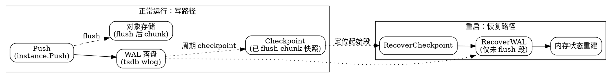

## Introduction

Loki ingester 是**有状态**组件：日志在内存里攒成 chunk，满足条件才 flush 到对象存储。一旦进程崩溃或重启，内存状态会丢——除非有持久化机制把它重建回来。这就是 **WAL（Write-Ahead Log）+ Checkpoint** 的职责：WAL 把每次写入先落盘，重启时回放重建内存；checkpoint 把「已 flush 的 chunk 快照」固化，使回放只覆盖「checkpoint 之后、尚未落对象存储」的数据，避免无限回放与重复 flush。

整体提供 **at-least-once** 持久性：已 `wal.Log` 成功并经底层 Prometheus tsdb `wlog` 落盘的 entries，崩溃后可通过 checkpoint + 后续 WAL 段重放重建；重放遇到已应用的 entries 是**幂等**的（安全重复，不报错）。

> [!NOTE]
> 本页为**源码级**笔记，结论已对照 **Loki `v3.7.10`**（tag `v3.7.10`，浅克隆于 `loki-3.7.10/`）逐条核实。下文讲解直接贴真实源码片段，涉及的文件路径相对仓库根（统一前缀 `loki-3.7.10/`），不再标注行号。读者不会打开仓库，需要看机制时直接看贴出的代码。
>
> 四处反直觉事实（文档不提，源码级才看得出）：
> 1. **`pkg/ingester/wal/` 只含 `encoding.go` / `recordpool.go`**（无 `checkpoint.go`、无 reader）。checkpoint 逻辑在 **`pkg/ingester/checkpoint.go`**，WAL reader 在 **`pkg/util/wal/reader.go`**。
> 2. **没有 `recoverFromWAL` / `replayWAL` / `recoverIngester` / `OpenWithRecovery` 这类函数名**。真正的恢复入口是 `pkg/ingester/ingester.go` 的 `start()` 内联恢复块 + `pkg/ingester/recovery.go` 的 `RecoverWAL` / `RecoverCheckpoint`。
> 3. **`WALConfig` 定义在 `pkg/ingester/wal.go`**，不是 `pkg/ingester/config.go`（该文件不存在）。
> 4. 编码层 `pkg/ingester/wal/encoding.go` **全文件无 `Sync`/`fsync`/`Flush`**——持久性委托给底层 tsdb `wlog`（见 `pkg/ingester/wal.go` 的 `newWAL`）。

## WAL Creation

`WALConfig` 及默认值都在 `pkg/ingester/wal.go`：

```go
const walSegmentSize = wlog.DefaultSegmentSize * 4
const defaultCeiling = 4 << 30 // 4GB

type WALConfig struct {
	Enabled             bool             `yaml:"enabled"`
	Dir                 string           `yaml:"dir"`
	CheckpointDuration  time.Duration    `yaml:"checkpoint_duration"`
	FlushOnShutdown     bool             `yaml:"flush_on_shutdown"`
	ReplayMemoryCeiling flagext.ByteSize `yaml:"replay_memory_ceiling"`
	DiskFullThreshold   float64          `yaml:"disk_full_threshold"`
}

// RegisterFlags adds the flags required to config this to the given FlagSet
func (cfg *WALConfig) RegisterFlags(f *flag.FlagSet) {
	f.StringVar(&cfg.Dir, "ingester.wal-dir", "wal", "Directory where the WAL data is stored and/or recovered from.")
	f.BoolVar(&cfg.Enabled, "ingester.wal-enabled", true, "Enable writing of ingested data into WAL.")
	f.DurationVar(&cfg.CheckpointDuration, "ingester.checkpoint-duration", 5*time.Minute, "Interval at which checkpoints should be created.")
	f.BoolVar(&cfg.FlushOnShutdown, "ingester.flush-on-shutdown", false, "When WAL is enabled, should chunks be flushed to long-term storage on shutdown.")
	// ...
}
```

WAL 接口允许禁用时使用 no-op 实现：

```go
// WAL interface allows us to have a no-op WAL when the WAL is disabled.
type WAL interface {
	Start()
	// Log marshalls the records and writes it into the WAL.
	Log(*wal.Record) error
	// Stop stops all the WAL operations.
	Stop() error
	// IsDiskThrottled returns true if the disk is too full and writes should be throttled.
	IsDiskThrottled() bool
}
```

`newWAL` 在 WAL 禁用时返回 `noopWAL{}`，否则用 `wlog.NewSize` 建底层 Prometheus tsdb WAL：

```go
// newWAL creates a WAL object. If the WAL is disabled, then the returned WAL is a no-op WAL.
func newWAL(cfg WALConfig, registerer prometheus.Registerer, metrics *ingesterMetrics, seriesIter SeriesIter) (WAL, error) {
	if !cfg.Enabled {
		return noopWAL{}, nil
	}

	tsdbWAL, err := wlog.NewSize(util_log.SlogFromGoKit(util_log.Logger), registerer, cfg.Dir, walSegmentSize, compression.None)
	if err != nil {
		return nil, err
	}

	w := &walWrapper{
		cfg:        cfg,
		quit:       make(chan struct{}),
		wal:        tsdbWAL,
		metrics:    metrics,
		seriesIter: seriesIter,
	}

	return w, nil
}
```

ingester 启动时创建并持有 WAL（`pkg/ingester/ingester.go`）：

```go
	wal, err := newWAL(cfg.WAL, registerer, metrics, newIngesterSeriesIter(i))
	if err != nil {
		return nil, err
	}
	i.wal = wal
```

恢复完成后才启动 WAL 后台写与 checkpoint goroutine（见下文 Replay on Startup 的 `start()` 片段末尾的 `i.wal.Start()`）。

## Record Encoding

记录类型与版本演进在 `pkg/ingester/wal/encoding.go`：

```go
// RecordType represents the type of the WAL/Checkpoint record.
type RecordType byte

const (
	_ = iota // ignore first value so the zero value doesn't look like a record type.
	// WALRecordSeries is the type for the WAL record for series.
	WALRecordSeries RecordType = iota
	// WALRecordEntriesV1 is the type for the WAL record for samples.
	WALRecordEntriesV1
	// CheckpointRecord is the type for the Checkpoint record based on protos.
	CheckpointRecord
	// WALRecordEntriesV2 is the type for the WAL record for samples with an
	// additional counter value for use in replaying without the ordering constraint.
	WALRecordEntriesV2
	// WALRecordEntriesV3 is the type for the WAL record for samples with structured metadata.
	WALRecordEntriesV3
)

// The current type of Entries that this distribution writes.
// Loki can read in a backwards compatible manner, but will write the newest variant.
const CurrentEntriesRec = WALRecordEntriesV3

// Record is a struct combining the series and samples record.
type Record struct {
	UserID string
	Series []record.RefSeries

	// entryIndexMap coordinates the RefEntries index associated with a particular fingerprint.
	// This is helpful for constant time lookups during ingestion and is ignored when restoring
	// from the WAL.
	entryIndexMap map[uint64]int
	RefEntries    []RefEntries
}
```

`AddEntries` 按 fingerprint 聚合并带 `Counter` 用于重放去重/排序：

```go
func (r *Record) AddEntries(fp uint64, counter int64, entries ...logproto.Entry) {
	if idx, ok := r.entryIndexMap[fp]; ok {
		r.RefEntries[idx].Entries = append(r.RefEntries[idx].Entries, entries...)
		r.RefEntries[idx].Counter = counter
		return
	}

	r.entryIndexMap[fp] = len(r.RefEntries)
	r.RefEntries = append(r.RefEntries, RefEntries{
		Counter: counter,
		Ref:     chunks.HeadSeriesRef(fp),
		Entries: entries,
	})
}

type RefEntries struct {
	Counter int64
	Ref     chunks.HeadSeriesRef
	Entries []logproto.Entry
}
```

`EncodeSeries` 写类型头 + UserID，再用 tsdb `record.Encoder` 序列化 series：

```go
func (r *Record) EncodeSeries(b []byte) []byte {
	buf := encoding.EncWith(b)
	buf.PutByte(byte(WALRecordSeries))
	buf.PutUvarintStr(r.UserID)

	var enc record.Encoder
	// The 'encoded' already has the type header and userID here, hence re-using
	// the remaining part of the slice (i.e. encoded[len(encoded):])) to encode the series.
	encoded := buf.Get()
	encoded = append(encoded, enc.Series(r.Series, encoded[len(encoded):])...)

	return encoded
}
```

`EncodeEntries` 写类型头 + UserID + 首时间戳基准，然后逐 ref 写 fingerprint /（V2+）Counter / entries 数 / 时间戳差 + 日志行 +（V3+）structured metadata：

```go
func (r *Record) EncodeEntries(version RecordType, b []byte) []byte {
	buf := encoding.EncWith(b)
	buf.PutByte(byte(version))
	buf.PutUvarintStr(r.UserID)

	// Placeholder for the first timestamp of any sample encountered.
	// All others in this record will store their timestamps as diffs relative to this
	// as a space optimization.
	var first int64
	// ...
	for _, ref := range r.RefEntries {
		// ignore refs with 0 entries
		if len(ref.Entries) < 1 {
			continue
		}
		buf.PutBE64(uint64(ref.Ref)) // write fingerprint

		if version >= WALRecordEntriesV2 {
			buf.PutBE64int64(ref.Counter) // write highest counter value
		}

		buf.PutUvarint(len(ref.Entries)) // write number of entries

		for _, s := range ref.Entries {
			buf.PutVarint64(s.Timestamp.UnixNano() - first)
			buf.PutUvarint(len(s.Line))
			buf.PutString(s.Line)

			if version >= WALRecordEntriesV3 {
				// structured metadata
				buf.PutUvarint(len(s.StructuredMetadata))
				for _, l := range s.StructuredMetadata {
					buf.PutUvarint(len(l.Name))
					buf.PutString(l.Name)
					buf.PutUvarint(len(l.Value))
					buf.PutString(l.Value)
				}
			}
		}
	}
	return buf.Get()
}
```

`DecodeRecord` 按首字节分派 series / entries(V1/V2/V3)：

```go
func DecodeRecord(b []byte, walRec *Record) (err error) {
	var (
		userID  string
		dec     record.Decoder
		rSeries []record.RefSeries

		decbuf = encoding.DecWith(b)
		t      = RecordType(decbuf.Byte())
	)

	switch t {
	case WALRecordSeries:
		userID = decbuf.UvarintStr()
		rSeries, err = dec.Series(decbuf.B, walRec.Series)
	case WALRecordEntriesV1, WALRecordEntriesV2, WALRecordEntriesV3:
		userID = decbuf.UvarintStr()
		err = DecodeEntries(decbuf.B, t, walRec)
	default:
		return errors.New("unknown record type")
	}
	// ...
}
```

`pkg/ingester/wal/recordpool.go` 的 `ResettingPool` 复用 WAL 记录与字节缓冲：

```go
type ResettingPool struct {
	rPool *sync.Pool // records
	bPool *sync.Pool // bytes
}

func NewRecordPool() *ResettingPool {
	return &ResettingPool{
		rPool: &sync.Pool{
			New: func() interface{} {
				return &Record{}
			},
		},
		bPool: &sync.Pool{
			New: func() interface{} {
				buf := new([]byte)            // Attempt to force allocation on heap.
				*buf = make([]byte, 0, 1<<10) // 1kb
				return buf
			},
		},
	}
}
```

## Write Path — 镜像写 WAL

一次 Push 的所有 series+entries 批量落 WAL。`pkg/ingester/instance.go` 的 `instance.Push` 遍历请求流构造 `record`，最后一次性写 WAL；磁盘满 ENOSPC 时触发 flush-on-shutdown：

```go
func (i *instance) Push(ctx context.Context, req *logproto.PushRequest) error {
	record := recordPool.GetRecord()
	record.UserID = i.instanceID
	defer recordPool.PutRecord(record)
	// ...
	_, appendErr = s.Push(ctx, reqStream.Entries, record, 0, false, rateLimitWholeStream, i.customStreamsTracker, req.Format)
	s.chunkMtx.Unlock()
	// ...
	if !record.IsEmpty() {
		if err := i.wal.Log(record); err != nil {
			if e, ok := err.(*os.PathError); ok && e.Err == syscall.ENOSPC {
				i.metrics.walDiskFullFailures.Inc()
				i.flushOnShutdownSwitch.TriggerAnd(func() {
					// ...
				})
			}
			// ...
		}
	}
	// ...
}
```

建流时确定是否允许乱序，并把新流登记为 series 记录——这就是 WAL 中「series record」的来源：

```go
	s := newStream(chunkfmt, headfmt, i.cfg, i.limiter.rateLimitStrategy, i.instanceID, fp, sortedLabels, i.limiter.UnorderedWrites(i.instanceID), i.streamRateCalculator, i.metrics, i.writeFailures, i.configs, retentionHours, policy)

	// record will be nil when replaying the wal (we don't want to rewrite wal entries as we replay them).
	if record != nil {
		record.Series = append(record.Series, tsdb_record.RefSeries{
			Ref:    chunks.HeadSeriesRef(fp),
			Labels: sortedLabels,
		})
	} else {
		// If the record is nil, this is a WAL recovery.
		i.metrics.recoveredStreamsTotal.Inc()
	}
```

流侧（`pkg/ingester/stream.go`）把 entries 写入 WAL 记录并带 entry 计数器；重放时 `record` 为 nil，只更新指标：

```go
func (s *stream) recordAndSendToTailers(record *wal.Record, entries []logproto.Entry) {
	if len(entries) == 0 {
		return
	}

	// record will be nil when replaying the wal (we don't want to rewrite wal entries as we replay them).
	if record != nil {
		record.AddEntries(uint64(s.fp), s.entryCt, entries...)
	} else {
		// If record is nil, this is a WAL recovery.
		s.metrics.recoveredEntriesTotal.Add(float64(len(entries)))
	}
	// ...
}
```

`pkg/ingester/wal.go` 的 `walWrapper.Log` 先写 series 再写 entries，逐条交给底层 tsdb WAL：

```go
func (w *walWrapper) Log(record *wal.Record) error {
	if record == nil || (len(record.Series) == 0 && len(record.RefEntries) == 0) {
		return nil
	}
	select {
	case <-w.quit:
		return errors.New("wal is stopped")
	default:
		buf := recordPool.GetBytes()
		defer func() {
			recordPool.PutBytes(buf)
		}()

		// Always write series then entries.
		if len(record.Series) > 0 {
			*buf = record.EncodeSeries(*buf)
			if err := w.wal.Log(*buf); err != nil {
				return err
			}
			w.metrics.walRecordsLogged.Inc()
			w.metrics.walLoggedBytesTotal.Add(float64(len(*buf)))
			*buf = (*buf)[:0]
		}
		if len(record.RefEntries) > 0 {
			*buf = record.EncodeEntries(wal.CurrentEntriesRec, *buf)
			if err := w.wal.Log(*buf); err != nil {
				return err
			}
			w.metrics.walRecordsLogged.Inc()
			w.metrics.walLoggedBytesTotal.Add(float64(len(*buf)))
		}
		return nil
	}
}
```

## Checkpoint Mechanism — 仅回放未 flush 的数据

checkpoint 持久化的是「已 flush 的 chunk 快照」，并以「最后覆盖到的 WAL 段号」命名，重启据此定位起始段。`pkg/ingester/checkpoint.go` 定义命名规则与定位逻辑：

```go
const checkpointPrefix = "checkpoint."
const checkpointTmpSuffix = ".tmp"

var checkpointRe = regexp.MustCompile("^" + regexp.QuoteMeta(checkpointPrefix) + "(\\d+)(" + regexp.QuoteMeta(checkpointTmpSuffix) + ")?$")
```

```go
// Checkpoint is named after the last WAL segment present so that when replaying the WAL
// we can start from that particular WAL segment.
checkpointDir := filepath.Join(w.segmentWAL.Dir(), fmt.Sprintf(checkpointPrefix+"%06d", lastSegment))
```

```go
// lastCheckpoint returns the directory name and index of the most recent checkpoint.
// If dir does not contain any checkpoints, -1 is returned as index.
func lastCheckpoint(dir string) (string, int, error) {
	dirs, err := os.ReadDir(dir)
	if err != nil {
		return "", -1, err
	}
	var (
		maxIdx        = -1
		checkpointDir string
	)
	// There may be multiple checkpoints left, so select the one with max index.
	for i := 0; i < len(dirs); i++ {
		// ...
		if idx > maxIdx {
			checkpointDir = di.Name()
			maxIdx = idx
		}
	}
	if maxIdx >= 0 {
		return filepath.Join(dir, checkpointDir), maxIdx, nil
	}
	return "", -1, nil
}
```

`WALCheckpointWriter` 推进 WAL 段、建临时目录、以 `CheckpointRecord` 类型头编码 `Series` 入缓冲，满 1MB 刷盘：

```go
type WALCheckpointWriter struct {
	metrics    *ingesterMetrics
	segmentWAL *wlog.WL

	checkpointWAL walLogger
	lastSegment   int    // name of the last segment guaranteed to be covered by the checkpoint
	final         string // filename to atomically rotate upon completion
	bufSize       int
	recs          [][]byte
}

func (w *WALCheckpointWriter) Advance() (bool, error) {
	_, lastSegment, err := wlog.Segments(w.segmentWAL.Dir())
	if err != nil {
		return false, err
	}

	if lastSegment < 0 {
		// There are no WAL segments. No need of checkpoint yet.
		return true, nil
	}

	// First we advance the wal segment internally to ensure we don't overlap a previous checkpoint in
	// low throughput scenarios and to minimize segment replays on top of checkpoints.
	if _, err := w.segmentWAL.NextSegment(); err != nil {
		return false, err
	}
	// ...
	checkpointDirTemp := checkpointDir + checkpointTmpSuffix

	// cleanup any old partial checkpoints (not just the current one)
	cleanupStaleTmpCheckpoints(w.segmentWAL.Dir(), util_log.Logger)

	if err := os.MkdirAll(checkpointDirTemp, 0750); err != nil {
		return false, fmt.Errorf("create checkpoint dir: %w", err)
	}
	// ...
	w.checkpointWAL = checkpoint
	w.lastSegment = lastSegment
	w.final = checkpointDir

	return false, nil
}
```

```go
func (w *WALCheckpointWriter) Write(s *Series) error {
	size := s.Size() + 1 // +1 for header
	buf := recordBufferPool.Get(size).([]byte)[:size]

	b, err := encodeWithTypeHeader(s, wal.CheckpointRecord, buf)
	if err != nil {
		return err
	}

	w.recs = append(w.recs, b)
	w.bufSize += len(b)
	level.Debug(util_log.Logger).Log("msg", "writing series", "size", humanize.Bytes(uint64(len(b))))

	// 1MB
	if w.bufSize > 1<<20 {
		if err := w.flush(); err != nil {
			return err
		}
	}
	return nil
}
```

`Close(abort)` 用 `fileutil.Replace` 原子改名，然后**截断已被 checkpoint 覆盖的 WAL 段**并删旧 checkpoint：

```go
func (w *WALCheckpointWriter) Close(abort bool) error {
	if len(w.recs) > 0 {
		if err := w.flush(); err != nil {
			return err
		}
	}
	if err := w.checkpointWAL.Close(); err != nil {
		return err
	}

	if abort {
		return os.RemoveAll(w.checkpointWAL.Dir())
	}

	if err := fileutil.Replace(w.checkpointWAL.Dir(), w.final); err != nil {
		return fmt.Errorf("rename checkpoint directory: %w", err)
	}
	level.Info(util_log.Logger).Log("msg", "atomic checkpoint finished", "old", w.checkpointWAL.Dir(), "new", w.final)
	// We delete the WAL segments which are before the previous checkpoint and not before the
	// current checkpoint created. This is because if the latest checkpoint is corrupted for any reason, we
	// should be able to recover from the older checkpoint which would need the older WAL segments.
	if err := w.segmentWAL.Truncate(w.lastSegment + 1); err != nil {
		// It is fine to have old WAL segments hanging around if deletion failed.
		// We can try again next time.
		level.Error(util_log.Logger).Log("msg", "error deleting old WAL segments", "err", err, "lastSegment", w.lastSegment)
	}

	if w.lastSegment >= 0 {
		if err := w.deleteCheckpoints(w.lastSegment); err != nil {
			// It is fine to have old checkpoints hanging around if deletion failed.
			// We can try again next time.
			level.Error(util_log.Logger).Log("msg", "error deleting old checkpoint", "err", err)
		}
	}

	return nil
}
```

`Checkpointer.PerformCheckpoint` 按 `perSeriesDuration` 节奏写每流，`Run` 按 `CheckpointDuration` 周期触发：

```go
func (c *Checkpointer) PerformCheckpoint() (err error) {
	noop, err := c.writer.Advance()
	if err != nil {
		return err
	}
	if noop {
		return nil
	}
	// ...
	// Give a 10% buffer to the checkpoint duration in order to account for
	// new series, slow writes, etc.
	perSeriesDuration := (90 * c.dur) / (100 * time.Duration(n))
	// ...
	iter := c.iter.Iter()
	for iter.Next() {
		if err := c.writer.Write(iter.Stream()); err != nil {
			return err
		}
		// ...
		select {
		case <-c.quit:
			return c.writer.Close(true)
		case <-ticker.C:
		}
	}
	// ...
	return c.writer.Close(false)
}

func (c *Checkpointer) Run() {
	ticker := time.NewTicker(c.dur)
	// ...
}
```

checkpoint 实际持久化什么？`toWireChunks`/`fromWireChunks` 把内存 chunk 的 blocks+head 序列化进 checkpoint——即「已 flush 的 chunk 快照」：

```go
func fromWireChunks(conf *Config, headfmt chunkenc.HeadBlockFmt, wireChunks []Chunk) ([]chunkDesc, error) {
	descs := make([]chunkDesc, 0, len(wireChunks))
	for _, c := range wireChunks {
		desc := chunkDesc{
			closed:      c.Closed,
			synced:      c.Synced,
			flushed:     c.FlushedAt,
			lastUpdated: c.LastUpdated,
		}

		mc, err := chunkenc.MemchunkFromCheckpoint(c.Data, c.Head, headfmt, conf.BlockSize, conf.TargetChunkSize)
		if err != nil {
			return nil, err
		}
		desc.chunk = mc

		descs = append(descs, desc)
	}
	return descs, nil
}
```

`pkg/ingester/checkpoint.pb.go` 的 `Series` proto 是重放时跳过已应用 entries 的载体：

```go
// Series is a {de,}serializable intermediate type for Series.
type Series struct {
	UserID string `protobuf:"bytes,1,opt,name=userID,proto3" json:"userID,omitempty"`
	// post mapped fingerprint is necessary because subsequent wal writes will reference it.
	Fingerprint uint64 `protobuf:"varint,2,opt,name=fingerprint,proto3" json:"fingerprint,omitempty"`
	Labels      []github_com_grafana_loki_v3_pkg_logproto.LabelAdapter `protobuf:"bytes,3,rep,name=labels,proto3,customtype=github.com/grafana/loki/v3/pkg/logproto.LabelAdapter" json:"labels"`
	Chunks      []Chunk                                                `protobuf:"bytes,4,rep,name=chunks,proto3" json:"chunks"`
	// most recently pushed timestamp.
	To time.Time `protobuf:"bytes,5,opt,name=to,proto3,stdtime" json:"to"`
	// most recently pushed line.
	LastLine string `protobuf:"bytes,6,opt,name=lastLine,proto3" json:"lastLine,omitempty"`
	// highest counter value for pushes to this stream.
	// Used to skip already applied entries during WAL replay.
	EntryCt int64 `protobuf:"varint,7,opt,name=entryCt,proto3" json:"entryCt,omitempty"`
	// highest timestamp pushed to this stream.
	HighestTs time.Time `protobuf:"bytes,8,opt,name=highestTs,proto3,stdtime" json:"highestTs"`
}
```

`decodeCheckpointRecord` 按类型头还原：

```go
func decodeCheckpointRecord(rec []byte, s *Series) error {
	// TODO(owen-d): reduce allocs
	// The proto unmarshaling code will retain references to the underlying []byte it's passed
	// in order to reduce allocs. This is harmful to us because when reading from a WAL, the []byte
	// is only guaranteed to be valid between calls to Next().
	// Therefore, we copy it to avoid this problem.
	cpy := make([]byte, len(rec))
	copy(cpy, rec)

	switch wal.RecordType(cpy[0]) {
	case wal.CheckpointRecord:
		return proto.Unmarshal(cpy[1:], s)
	default:
		return fmt.Errorf("unexpected record type: %d", rec[0])
	}
}
```

## Replay on Startup — 恢复路径

真实入口是 `pkg/ingester/ingester.go` 的 `start()` 内联恢复块：禁限流、建 recoverer、先 checkpoint 后 WAL 段、最后启动 WAL：

```go
	if i.cfg.WAL.Enabled {
		start := time.Now()

		// Ignore retain period during wal replay.
		oldRetain := i.cfg.RetainPeriod
		i.cfg.RetainPeriod = 0

		// Disable the in process stream limit checks while replaying the WAL.
		// It is re-enabled in the recover's Close() method.
		i.limiter.DisableForWALReplay()

		recoverer := newIngesterRecoverer(i)
		// ...
		level.Info(i.logger).Log("msg", "recovering from checkpoint")
		checkpointReader, checkpointCloser, err := newCheckpointReader(i.cfg.WAL.Dir, i.logger)
		if err != nil {
			return err
		}
		defer checkpointCloser.Close()

		checkpointRecoveryErr := RecoverCheckpoint(checkpointReader, recoverer)
		// ...
		level.Info(i.logger).Log("msg", "recovering from WAL")
		segmentReader, segmentCloser, err := wal.NewWalReader(i.cfg.WAL.Dir, -1)
		if err != nil {
			return err
		}
		defer segmentCloser.Close()

		segmentRecoveryErr := RecoverWAL(ctx, segmentReader, recoverer)
		// ...
		endReplay()

		i.wal.Start()
	}
```

注意上面 `wal.NewWalReader` 里的 `wal` 是 `pkg/util/wal` 包。WAL reader 实现：

```go
// If startSegment is <0, it means all the segments.
func NewWalReader(dir string, startSegment int) (*wlog.Reader, io.Closer, error) {
	var (
		segmentReader io.ReadCloser
		err           error
	)
	if startSegment < 0 {
		segmentReader, err = wlog.NewSegmentsReader(dir)
		if err != nil {
			return nil, nil, err
		}
	} else {
		// ...
		segmentReader, err = wlog.NewSegmentsRangeReader(wlog.SegmentRange{
			Dir:   dir,
			First: startSegment,
			Last:  -1, // Till the end.
		})
		// ...
	}
	return wlog.NewReader(segmentReader), segmentReader, nil
}
```

`pkg/ingester/recovery.go` 的 `newCheckpointReader` 先清理 stale checkpoint，再从最新 checkpoint 目录读：

```go
func newCheckpointReader(dir string, logger log.Logger) (WALReader, io.Closer, error) {
	// Proactively clean up stale checkpoints at startup before recovery
	cleanupCheckpointsAtStartup(dir, logger)

	lastCheckpointDir, idx, err := lastCheckpoint(dir)
	if err != nil {
		return nil, nil, err
	}
	if idx < 0 {
		level.Info(logger).Log("msg", "no checkpoint found, treating as no-op")
		var reader NoopWALReader
		return reader, reader, nil
	}

	r, err := wlog.NewSegmentsReader(lastCheckpointDir)
	if err != nil {
		return nil, nil, err
	}
	return wlog.NewReader(r), r, nil
}
```

`Recoverer` 接口与实现：

```go
type Recoverer interface {
	NumWorkers() int
	Series(series *Series) error
	SetStream(ctx context.Context, userID string, series record.RefSeries) error
	Push(userID string, entries wal.RefEntries) error
	Done() <-chan struct{}
}
```

`Series` 重建流、设 chunks，并累加在途字节；用**原始** fingerprint 存 recovery map——因为后续 WAL 记录引用的是映射前 fingerprint：

```go
func (r *ingesterRecoverer) Series(series *Series) error {
	return r.ing.replayController.WithBackPressure(func() error {
		// ...
		bytesAdded, entriesAdded, err := stream.setChunks(series.Chunks)
		stream.lastLine.ts = series.To
		stream.lastLine.content = series.LastLine
		stream.entryCt = series.EntryCt
		stream.highestTs = series.HighestTs
		// ...
		r.ing.replayController.Add(int64(bytesAdded))

		// now store the stream in the recovery map under the fingerprint originally recorded
		// as it's possible the newly mapped fingerprint is different. This is because the WAL records
		// will use this original reference.
		got, _ := r.users.LoadOrStore(series.UserID, &sync.Map{})
		streamsMap := got.(*sync.Map)
		streamsMap.Store(chunks.HeadSeriesRef(series.Fingerprint), stream)

		return nil
	})
}
```

`SetStream` 的注释直接说明了 fingerprint 映射的关键性：

```go
// SetStream is responsible for setting the key path for userIDs -> fingerprints -> streams.
// Internally, this uses nested sync.Maps due to their performance benefits for sets that only grow.
// Using these also allows us to bypass the ingester -> instance -> stream hierarchy internally, which
// may yield some performance gains, but is essential for the following:
// Due to the use of the instance's fingerprint mapper, stream fingerprints are NOT necessarily
// deterministic. The WAL uses the post-mapped fingerprint on the ingester that originally
// created the stream and we ensure that said fingerprint maps correctly to the newly
// created stream during WAL replay, even if the new in memory stream was assigned a different
// fingerprint from the mapper. This is paramount because subsequent WAL records will use
// the fingerprint reported in the WAL record, not the potentially differing one assigned during
// stream creation.
func (r *ingesterRecoverer) SetStream(ctx context.Context, userID string, series record.RefSeries) error {
	// ...
}
```

`Push` 以 `isReplay=true` 调 `stream.Push`，忽略 `ErrEntriesExist` 重复错误：

```go
func (r *ingesterRecoverer) Push(userID string, entries wal.RefEntries) error {
	return r.ing.replayController.WithBackPressure(func() error {
		// ...
		// ignore out of order errors here (it's possible for a checkpoint to already have data from the wal segments)
		bytesAdded, err := s.(*stream).Push(context.Background(), entries.Entries, nil, entries.Counter, true, false, r.ing.customStreamsTracker, "loki")
		r.ing.replayController.Add(int64(bytesAdded))
		if err != nil && err == ErrEntriesExist {
			r.ing.metrics.duplicateEntriesTotal.Add(float64(len(entries.Entries)))
		}
		return nil
	})
}
```

`Close` 在重放结束时恢复限流；若重放乱序但当前配置禁乱序，则 `ConvertHead` 转换头块而不丢数据：

```go
func (r *ingesterRecoverer) Close() {
	// ...
	// Enable the limiter here to accurately reflect tenant limits after recovery.
	r.ing.limiter.Enable()

	for _, inst := range r.ing.getInstances() {
		inst.forAllStreams(context.Background(), func(s *stream) error {
			// ...
			// If we've replayed a WAL with unordered writes, but the new
			// configuration disables them, convert all streams/head blocks
			// to ensure unordered writes are disabled after the replay,
			// but without dropping any previously accepted data.
			isAllowed := r.ing.limiter.UnorderedWrites(s.tenant)
			old := s.unorderedWrites
			s.unorderedWrites = isAllowed

			if !isAllowed && old {
				err := s.chunks[len(s.chunks)-1].chunk.ConvertHead(headBlockType(s.chunkFormat, isAllowed))
				if err != nil {
					level.Warn(r.logger).Log(
						"msg", "error converting headblock",
						// ...
					)
				}
			}

			return nil
		})
	}
}
```

`RecoverWAL`：decode 每条记录 → `SetStream` 建流 → 按 fingerprint 分发多 worker `Push` 并行重放：

```go
func RecoverWAL(ctx context.Context, reader WALReader, recoverer Recoverer) error {
	dispatch := func(recoverer Recoverer, b []byte, inputs []chan recoveryInput) error {
		rec := recordPool.GetRecord()
		if err := wal.DecodeRecord(b, rec); err != nil {
			return err
		}

		// First process all series to ensure we don't write entries to nonexistant series.
		var firstErr error
		for _, s := range rec.Series {
			if err := recoverer.SetStream(ctx, rec.UserID, s); err != nil {
				if firstErr == nil {
					firstErr = err
				}
			}
		}

		for _, entries := range rec.RefEntries {
			worker := int(uint64(entries.Ref) % uint64(len(inputs)))
			inputs[worker] <- recoveryInput{
				userID: rec.UserID,
				data:   entries,
			}
		}

		return firstErr
	}
	// ...
	return recoverGeneric(
		reader,
		recoverer,
		dispatch,
		process,
	)
}
```

`RecoverCheckpoint` 与之对称：decode checkpoint 记录 → 按 fingerprint 分发 → `recoverer.Series` 重建。

两者共用通用 reader→dispatch→process worker 池 `recoverGeneric`：

```go
func recoverGeneric(
	reader WALReader,
	recoverer Recoverer,
	dispatch func(Recoverer, []byte, []chan recoveryInput) error,
	process func(Recoverer, <-chan recoveryInput, chan<- error),
) error {
	var wg sync.WaitGroup
	var firstErr error
	nWorkers := recoverer.NumWorkers()
	// ...
	go func() {
		for reader.Next() {
			b := reader.Record()
			if err := reader.Err(); err != nil {
				errCh <- err
				continue
			}

			if err := dispatch(recoverer, b, inputs); err != nil {
				errCh <- err
				continue
			}
		}
		// ...
	}()
	// ...
}
```

`pkg/ingester/replay_controller.go` 实现重放背压。`replayFlusher.Flush` 初始化 flush 队列、flush 但不移除流，避免后续 WAL 写入找不到流：

```go
func (f *replayFlusher) Flush() {
	f.i.InitFlushQueues()
	f.i.flush(false) // flush data but don't remove streams from the ingesters

	// Similar to sweepUsers with the exception that it will not remove streams
	// afterwards to prevent unlinking a stream which may receive later writes from the WAL.
	// We have to do this here after the flushQueues have been drained.
	// ...
}
```

`replayController` 用 atomic 计数追踪在途字节，`WithBackPressure` 在内存达 `ReplayMemoryCeiling*90%` 时触发 flush，零进展则报错：

```go
// replayController handles coordinating backpressure between WAL replays and chunk flushing.
type replayController struct {
	// Note, this has to be defined first to make sure it is aligned properly for 32bit ARM OS
	currentBytes    atomic.Int64
	totalSubtracted atomic.Int64 // monotonically increasing; used to detect flush no-progress without being affected by concurrent Add calls
	cfg             WALConfig
	metrics         *ingesterMetrics

	flusher Flusher
	flushSF singleflight.Group
}

func (c *replayController) WithBackPressure(fn func() error) error {
	ceiling := int(c.cfg.ReplayMemoryCeiling) * 9 / 10
	if ceiling <= 0 {
		return fn()
	}
	// use 90% as a threshold since we'll be adding to it.
	for c.Cur() > ceiling {
		// too much backpressure, flush. ...
		if c.Flush() == 0 && c.Cur() > ceiling {
			return fmt.Errorf("WAL replay flush made no progress: %s in use, ceiling %s; cannot recover",
				humanize.Bytes(uint64(c.currentBytes.Load())),
				humanize.Bytes(uint64(ceiling)),
			)
		}
	}

	return fn()
}
```

`pkg/ingester/limiter.go` 的 `DisableForWALReplay` 关掉限流（重放不应丢弃已确认写入），而 `UnorderedWrites` 在 disabled 时强制返回 true——使重放把乱序 WAL 重放进有序配置：

```go
func (l *Limiter) DisableForWALReplay() {
	l.mtx.Lock()
	defer l.mtx.Unlock()
	l.disabled = true
	l.metrics.limiterEnabled.Set(0)
	l.rateLimitStrategy.SetDisabled(true)
}
```

```go
func (l *Limiter) UnorderedWrites(userID string) bool {
	// WAL replay should not discard previously ack'd writes,
	// so allow out of order writes while the limiter is disabled.
	// This allows replaying unordered WALs into ordered configurations.
	if l.disabled {
		return true
	}
	return l.limits.UnorderedWrites(userID)
}
```



## Unordered / Out-of-order Support

chunk 头块格式由 `pkg/chunkenc/memchunk.go` 驱动：

```go
var HeadBlockFmts = []HeadBlockFmt{OrderedHeadBlockFmt, UnorderedHeadBlockFmt, UnorderedWithStructuredMetadataHeadBlockFmt}
```

```go
const (
	_ HeadBlockFmt = iota
	// placeholders to start splitting chunk formats vs head block
	// fmts at v3
	_
	_
	OrderedHeadBlockFmt
	UnorderedHeadBlockFmt
	UnorderedWithStructuredMetadataHeadBlockFmt
)

// ChunkHeadFormatFor returns corresponding head block format for the given `chunkfmt`.
func ChunkHeadFormatFor(chunkfmt byte) HeadBlockFmt {
	if chunkfmt < ChunkFormatV3 {
		return OrderedHeadBlockFmt
	}

	if chunkfmt == ChunkFormatV3 {
		return UnorderedHeadBlockFmt
	}

	// return the latest head format for all chunkformat >v3
	return UnorderedWithStructuredMetadataHeadBlockFmt
}
```

`ConvertHead` 让重放后可在有序/无序头块间转换：

```go
func (c *MemChunk) ConvertHead(desired HeadBlockFmt) error {
	if c.head != nil && c.head.Format() != desired {
		newH, err := c.head.Convert(desired, c.symbolizer)
		if err != nil {
			return err
		}

		c.head = newH
	}
	c.headFmt = desired
	return nil
}
```

`pkg/ingester/stream.go` 的 `headBlockType` 结合 chunk 格式与流配置决定头块类型：

```go
func headBlockType(chunkfmt byte, unorderedWrites bool) chunkenc.HeadBlockFmt {
	if unorderedWrites {
		if chunkfmt >= chunkenc.ChunkFormatV3 {
			return chunkenc.ChunkHeadFormatFor(chunkfmt)
		}
	}
	return chunkenc.OrderedHeadBlockFmt
}
```

建流时 `i.limiter.UnorderedWrites(...)` 决定该流 `unorderedWrites` 标志（见上文 `pkg/ingester/instance.go` 的 `newStream` 调用与 `pkg/ingester/limiter.go` 的 `UnorderedWrites`）；重放期间该函数强制 true。

正确性保证由测试锁定：`pkg/ingester/checkpoint_test.go` 的 `TestIngesterWALReplaysUnorderedToOrdered` 证明乱序→有序重放正确；`pkg/ingester/recovery_test.go` 的 `TestRecoveryWritesContinuesEntryCountAfterWALReplay` 证明重放后 entry 计数正确延续。

## Durability / At-least-once Semantics

底层 durable WAL 来自 tsdb `wlog.WL`，fsync/段管理由 tsdb 负责；编码层 `pkg/ingester/wal/encoding.go` 无 `Sync`/`fsync`/`Flush`，持久性委托见 `newWAL` 里的：

```go
	tsdbWAL, err := wlog.NewSize(util_log.SlogFromGoKit(util_log.Logger), registerer, cfg.Dir, walSegmentSize, compression.None)
```

checkpoint 完成后即截断已覆盖 WAL 段，配合 `lastCheckpoint` 定位，使重启重放只覆盖「checkpoint 之后的未 flush 段」，实现 at-least-once（不重放已 flush 内容）：

```go
	if err := w.segmentWAL.Truncate(w.lastSegment + 1); err != nil {
		// It is fine to have old WAL segments hanging around if deletion failed.
		// We can try again next time.
		level.Error(util_log.Logger).Log("msg", "error deleting old WAL segments", "err", err, "lastSegment", w.lastSegment)
	}
```

幂等性由 `Series.EntryCt`（注释「Used to skip already applied entries during WAL replay」）配合 `RefEntries.Counter` 实现（见上文 `pkg/ingester/checkpoint.pb.go` 与 `pkg/ingester/wal/encoding.go` 的贴码）；重放遇 `ErrEntriesExist` 记 `duplicateEntriesTotal` 而非报错（见上文 `pkg/ingester/recovery.go` 的 `Push` 贴码），体现 at-least-once 允许重复、安全幂等。

`pkg/ingester/ingester.go` 的 `createShutdownMarker` 里有 `file.Sync()` / `dir.Sync()`：

```go
func createShutdownMarker(p string) error {
	// Write the file, fsync it, then fsync the containing directory in order to guarantee
	// it is persisted to disk. From https://man7.org/linux/man-pages/man2/fsync.2.html
	//
	// > Calling fsync() does not necessarily ensure that the entry in the
	// > directory containing the file has also reached disk.  For that an
	// > explicit fsync() on a file descriptor for the directory is also
	// > needed.
	file, err := os.Create(p)
	if err != nil {
		return err
	}
	// ...
	merr.Add(file.Sync())
	merr.Add(file.Close())
	// ...
	merr.Add(dir.Sync())
	merr.Add(dir.Close())
	return merr.Err()
}
```

注意这是对**关闭标记文件**的 fsync，保证正常关闭可被识别，并非 WAL 数据本身的 fsync。

## Links

- [Loki](/docs/CS/Distributed/Tracing/Loki.md) — 枢纽页；WAL 是 ingester 有状态与持久化的基石
- [Loki Bloom 子系统](/docs/CS/Distributed/Tracing/Loki/Bloom.md) — 同为 Loki 3.x 离线建块 / 在线过滤的加速层
- [Mimir](/docs/CS/Distributed/Tracing/Mimir.md) — 同为 LGTM；Mimir ingester 也有 WAL + TSDB block flush，可作对照
- [Tracing](/docs/CS/Distributed/Tracing/Tracing.md)

## References

1. [Grafana Loki — ingester WAL](https://grafana.com/docs/loki/latest/operations/storage/ingesters/)
2. [Loki architecture: ingesters](https://grafana.com/docs/loki/latest/architecture/components/ingester/)
3. [Prometheus TSDB WAL](https://prometheus.io/docs/prometheus/latest/storage/)
4. [grafana/loki Releases](https://github.com/grafana/loki/releases)
