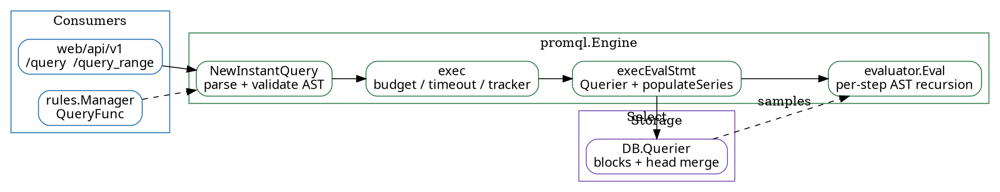

## Introduction

[PromQL Engine](/docs/CS/Distributed/Tracing/Prometheus/Promql.md) 讲 Prometheus 查询引擎的实现：从 HTTP 端点到 `promql.Engine` 的执行管线，以及限流与超时机制。规则引擎（rule manager）是它的最大消费方，见 [Rules](/docs/CS/Distributed/Tracing/Prometheus/Rules.md)。

> [!NOTE]
> 源码级笔记。代码事实基于 `prometheus/prometheus` **v3.16.0**（commit `e2e28adeee2c5883d000fc82aca6008cfbf7e96d`）。讲解直接贴真实源码，路径相对仓库根，不再标注行号。

## Query Endpoint

查询的 HTTP 入口在 `web/api/v1/api.go`，`/api/v1/query`（GET/POST）与 `/api/v1/query_range` 都收敛到 `promql.Engine`。瞬时查询 handler 先解析 `time`/`timeout`/`limit` 参数并给 ctx 挂上 deadline，然后构造查询：

```go
func (api *API) query(r *http.Request) (result apiFuncResult) {
	limit, err := parseLimitParam(r.FormValue("limit"))
	if err != nil {
		return invalidParamError(err, "limit")
	}
	ts, err := parseTimeParam(r, "time", api.now())
	if err != nil {
		return invalidParamError(err, "time")
	}
	ctx := r.Context()
	timeout, apiErr := api.queryTimeout(r)
	if apiErr != nil {
		return apiFuncResult{nil, apiErr, nil, nil}
	}
	if timeout > 0 {
		var cancel context.CancelFunc
		ctx, cancel = context.WithDeadline(ctx, api.now().Add(timeout))
		defer cancel()
	}

	// ...
	qry, err := api.QueryEngine.NewInstantQuery(ctx, api.Queryable, opts, r.FormValue("query"), ts)
	if err != nil {
		span.RecordError(err)
		span.SetStatus(codes.Error, err.Error())
		return apiFuncResult{nil, queryConstructionError(err), nil, nil}
	}

	// From now on, we must only return with a finalizer in the result (to
	// be called by the caller) or call qry.Close ourselves (which is
	// required in the case of a panic).
	defer func() {
		if result.finalizer == nil {
			qry.Close()
		}
	}()
	// ...
}
```

注意 `qry.Close()` 的注释：查询一旦构造成功，后续任何 return 路径都必须保证资源被释放——API 层通过 finalizer 机制处理 panic 场景。

## Engine 装配

引擎在 `cmd/prometheus/main.go` 中创建（仅 server 模式，Agent 模式不加载查询）：

```go
		activeQueryTracker, err := promql.NewActiveQueryTracker(localStoragePath, cfg.queryConcurrency, logger.With("component", "activeQueryTracker"))
		// ...

		opts := promql.EngineOpts{
			Logger:                   logger.With("component", "query engine"),
			Reg:                      prometheus.DefaultRegisterer,
			MaxSamples:               cfg.queryMaxSamples,
			Timeout:                  time.Duration(cfg.queryTimeout),
			ActiveQueryTracker:       activeQueryTracker,
			LookbackDelta:            time.Duration(cfg.lookbackDelta),
			NoStepSubqueryIntervalFn: noStepSubqueryInterval.Get,
			// EnableAtModifier and EnableNegativeOffset have to be
			// always on for regular PromQL as of Prometheus v2.33.
			EnableAtModifier:         true,
			EnableNegativeOffset:     true,
			EnablePerStepStats:       cfg.enablePerStepStats,
			// ...
		}

		queryEngine = promql.NewEngine(opts)
```

三个限流维度的实现落在不同组件：

- **MaxSamples**：单次查询可处理的最大样本数，超限返回 `ErrTooManySamples`——这是「查询爆内存」的硬保险。
- **ActiveQueryTracker**：并发查询数上限 + 当前活跃查询列表落盘（可在 Web UI 的查询页看到正在跑的语句）。
- **Timeout**：ctx deadline，从 API 层传入。

`LookbackDelta`（默认 5 分钟）定义了「一个序列多久没有新样本后查询视为过期」——瞬时向量选择器往前看多久，就是它。

## 执行管线

一次查询的生命周期：`NewInstantQuery/NewRangeQuery` 解析 PromQL 为 AST 并校验 → `newQuery` 构造 `query` 对象 → `exec` 执行 → `execEvalStmt` 驱动求值。`execEvalStmt` 的主体展示了管线分工——**准备阶段**（算时间窗、开 Querier、预取序列）与**求值阶段**（evaluator 逐步计算）分离：

```go
func (ng *Engine) execEvalStmt(ctx context.Context, query *query, s *parser.EvalStmt) (parser.Value, annotations.Annotations, error) {
	var budget *queryBudget
	if ng.enableQueryCost {
		budget = &queryBudget{
			maxSeries:      uint64ToInt64Limit(query.maxSeries),
			maxSamplesRead: uint64ToInt64Limit(query.maxSamplesRead),
		}
		defer func() {
			// Preserve costs even when a child aborts before its statistics merge.
			query.sampleStats.TotalSeries = budget.series
			query.sampleStats.SamplesRead = budget.samplesRead
		}()
	}
	prepareSpanTimer, ctxPrepare := query.stats.GetSpanTimer(ctx, stats.QueryPreparationTime, ng.metrics.queryPrepareTime, ng.metrics.queryPrepareTimeHistogram)
	mint, maxt := FindMinMaxTime(s)

	querier, err := query.queryable.Querier(mint, maxt)
	if err != nil {
		// ...
		return nil, nil, err
	}
	defer querier.Close()

	ng.populateSeries(ctxPrepare, querier, s)
	prepareSpanTimer.Finish()

	// Modify the offset of vector and matrix selectors for the @ modifier
	// w.r.t. the start time since only 1 evaluation will be done on them.
	setOffsetForAtModifier(timeMilliseconds(s.Start), s.Expr)
	evalSpanTimer, ctxInnerEval := query.stats.GetSpanTimer(ctx, stats.InnerEvalTime, ng.metrics.queryInnerEval, ng.metrics.queryInnerEvalHistogram)
	// Instant evaluation. This is executed as a range evaluation with one step.
	if s.Start.Equal(s.End) && s.Interval == 0 {
		start := timeMilliseconds(s.Start)
		evaluator := &evaluator{
			startTimestamp:           start,
			endTimestamp:             start,
			interval:                 1,
			maxSamples:               ng.maxSamplesPerQuery,
			budget:                   budget,
			logger:                   ng.logger,
			lookbackDelta:            s.LookbackDelta,
			samplesStats:             query.sampleStats,
			noStepSubqueryIntervalFn: ng.noStepSubqueryIntervalFn,
			// ...
		}
		query.sampleStats.InitStepTracking(start, start, 1)

		val, warnings, err := evaluator.Eval(ctxInnerEval, s.Expr)
		// ...
	}
	// ...
}
```

两个值得记住的设计：

1. **瞬时查询是区间查询的特例**——`Start == End && Interval == 0` 时构造 `interval: 1` 的 evaluator，走同一套求值代码。统一路径意味着函数语义在两种查询间天然一致。
2. **AST 逐节点求值**——`evaluator.Eval` 按 AST 类型递归分发（`evalAggregation`、`evalCall`、`rangeEval` 等），二元运算用向量对齐匹配（`VectorMatching`），聚合先按 `by/without` 分桶。没有「执行计划优化器」：PromQL 的选择器 pruning 发生在 `populateSeries`（准备期一次取出全部需要的序列），求值期不再回存储层。

`@ modifier`（绝对时间戳）在准备阶段统一改写偏移；子查询 `[30m:1m]` 的默认步长来自 `NoStepSubqueryIntervalFn`（按范围自适应，越小越细）。

## 标量与向量模型

求值结果的类型是 `parser.Value` 的三态：`Vector`（瞬时向量）、`Matrix`（区间矩阵）、`Scalar`。区间查询每一步都产出瞬时值，最后拼成 Matrix；这就是为什么 `rate()` 必须接 range selector——它需要每步往回看整个 `[5m]` 窗口。

原生直方图（native histogram）在 v3.x 已稳定：样本值不再是 float64 而是 `histogram.Histogram`，evaluator 内部对浮点与直方图两条分支分别处理（`ValFloat` / `ValHistogram` / `ValFloatHistogram` 的迭代器三态在 Federate 与读取路径同样出现）。

## 与 Grafana/规则引擎的协作

Grafana 的 `/api/ds/query` 最终打到上面的 `/api/v1/query(_range)`；rule manager 则不走 HTTP，直接持有 `QueryFunc`（`rules.EngineQueryFunc(queryEngine, fanoutStorage)`）调用同一个引擎。两条消费路径共享全部限流配置——这意味着**规则评估过重同样会触发 MaxSamples 限制**，recording rule 的表达式复杂度直接影响告警可用性。



## Links

- [Prometheus](/docs/CS/Distributed/Tracing/Prometheus/Prometheus.md)
- [Scrape](/docs/CS/Distributed/Tracing/Prometheus/Scrape.md)
- [TSDB](/docs/CS/Distributed/Tracing/Prometheus/Tsdb.md)
- [Rules](/docs/CS/Distributed/Tracing/Prometheus/Rules.md)

## References

1. [prometheus/prometheus v3.16.0 source](https://github.com/prometheus/prometheus/tree/v3.16.0)
2. [PromQL documentation](https://prometheus.io/docs/prometheus/latest/querying/basics/)
3. [HTTP API: instant queries](https://prometheus.io/docs/prometheus/latest/querying/api/#instant-queries)
