## Introduction

[Scrape](/docs/CS/Distributed/Tracing/Prometheus/Scrape.md) 讲 Prometheus 如何把「服务发现产出的目标列表」变成「周期性抓取并写入 TSDB 的样本流」。它是 Pull 模型的全部实现：发现（discovery）→ 池同步（scrapePool）→ 抓取循环（scrapeLoop）→ 追加存储（Appender）。

> [!NOTE]
> 源码级笔记。代码事实基于 `prometheus/prometheus` **v3.16.0**（commit `e2e28adeee2c5883d000fc82aca6008cfbf7e96d`，"Merge pull request #20324 ... release-3.16-fixes"）。浅克隆 `--depth 1 --branch v3.16.0` 获取；讲解直接贴真实源码，路径相对仓库根，不再标注行号。

## Discovery Manager

服务发现的目标集合由 `discovery.Manager` 统一管理。每个 scrape job 的每个 SD 配置注册成一个 `Provider`，管理器把所有 provider 产出的 target group 按 job 名合并，通过 `SyncCh()` 广播：

```go
func (m *Manager) Run() error {
	go m.sender()
	<-m.ctx.Done()
	m.cancelDiscoverers()
	return m.ctx.Err()
}

// SyncCh returns a read only channel used by all the clients to receive target updates.
func (m *Manager) SyncCh() <-chan map[string][]*targetgroup.Group {
	return m.syncCh
}
```

配置加载时 `ApplyConfig` 做**增量协商**：已经按相同配置跑起来的 provider 原样保留，只有新出现的配置才启动新 provider；失去所有订阅者的旧 provider 被 cancel 掉并清理对应指标——这就是热更新 `/-/reload` 时服务发现不断连的原因：

```go
// ApplyConfig checks if discovery provider with supplied config is already running and keeps them as is.
// Remaining providers are then stopped and new required providers are started using the provided config.
func (m *Manager) ApplyConfig(cfg map[string]Configs) error {
	m.mtx.Lock()
	defer m.mtx.Unlock()

	var failedCount int
	for name, scfg := range cfg {
		failedCount += m.registerProviders(scfg, name)
	}
	m.metrics.FailedConfigs.Set(float64(failedCount))

	var (
		wg           sync.WaitGroup
		newProviders []*Provider
	)
	for _, prov := range m.providers {
		// Cancel obsolete providers if it has no new subs and it has a cancel function.
		prov.mu.RLock()
		if len(prov.newSubs) == 0 && prov.cancel != nil {
			// ...
			prov.cancel()
			prov.mu.RUnlock()
			// ...
		}
		// ...
	}
	// ...
}
```

`main.go` 里创建两个独立的 discovery manager（scrape 与 notify 各一个），scrape 侧的产出直接喂给 scrape manager。

## Scrape Manager：目标集到抓取池

`scrape.Manager` 消费 `SyncCh()` 的目标集合，按 `job_name` 维护一组 `scrapePool`。`reload` 时：池不存在就按该 job 的 `ScrapeConfig` 新建；已存在则只同步目标。同步在独立 goroutine 里并行执行，因为高负载下同步本身可能跟不上节奏：

```go
func (m *Manager) reload() {
	m.mtxScrape.Lock()
	var wg sync.WaitGroup
	for setName, groups := range m.targetSets {
		if _, ok := m.scrapePools[setName]; !ok {
			scrapeConfig, ok := m.scrapeConfigs[setName]
			if !ok {
				m.logger.Error("error reloading target set", "err", "invalid config id:"+setName)
				continue
			}
			m.metrics.targetScrapePools.Inc()
			sp, err := newScrapePool(scrapeConfig, m.appendable, m.appendableV2, m.offsetSeed, m.logger.With("scrape_pool", setName), m.buffers, m.opts, m.metrics)
			if err != nil {
				m.metrics.targetScrapePoolsFailed.Inc()
				m.logger.Error("error creating new scrape pool", "err", err, "scrape_pool", setName)
				continue
			}
			m.scrapePools[setName] = sp
		}

		wg.Add(1)
		// Run the sync in parallel as these take a while and at high load can't catch up.
		go func(sp *scrapePool, groups []*targetgroup.Group) {
			sp.Sync(groups)
			wg.Done()
		}(m.scrapePools[setName], groups)
	}
	m.mtxScrape.Unlock()
	wg.Wait()
}
```

`scrapePool.Sync/sync` 把目标列表与运行中的 loop 做差集：新目标建新 loop，消失的目标停 loop 并丢弃，`__meta_*` 标签被 relabel 后不合法的目标进 `droppedTargets`（只记录不抓取）。

一个有趣的细节是**全局抓取错峰种子**：`Manager.setOffsetSeed` 用「主机名 + extra labels」的 FNV-64 哈希做随机种子，让每个目标的实际抓取时刻在 interval 内错开，避免 HA 部署的多台 Prometheus 同一瞬间打爆同一批目标：

```go
// setOffsetSeed calculates a global offsetSeed per server relying on extra label set.
func (m *Manager) setOffsetSeed(labels labels.Labels) error {
	h := fnv.New64a()
	hostname := m.opts.fqdn
	if hostname == "" {
		var err error
		hostname, err = osutil.GetFQDN()
		if err != nil {
			return err
		}
	}
	if _, err := fmt.Fprintf(h, "%s%s", hostname, labels.String()); err != nil {
		return err
	}
	m.offsetSeed = h.Sum64()
	return nil
}
```

## scrapeLoop：抓取循环

每个目标一个 `scrapeLoop`（goroutine）。`run` 先按 offset/jitter 等待到首个对齐时刻，然后 ticker 周期性触发 `scrapeAndReport`：

```go
func (sl *scrapeLoop) run(errc chan<- error) {
	var (
		last   time.Time
		ticker = time.NewTicker(sl.interval)
	)
	defer func() {
		if sl.scrapeOnShutdown {
			last = sl.scrapeAndReport(last, time.Now().Round(0), errc)
		}
		// Let the stop() know it can continue.
		close(sl.stopped)
		if sl.parentCtx.Err() == nil {
			if !sl.disabledEndOfRunStalenessMarkers.Load() {
				sl.endOfRunStaleness(last, ticker, sl.interval)
			}
		}
		ticker.Stop()
	}()

	// Initial offset and jitter offset, if any.
	offset := sl.getScrapeOffset()
	if offset > 0 {
		select {
		case <-time.After(offset):
			// Continue after a scraping offset.
		case <-sl.ctx.Done():
			return
		}
	}

	// Reset the ticker so target scrape times are aligned to the offset+intervals.
	ticker.Reset(sl.interval)
	alignedScrapeTime := time.Now().Round(0)

	for {
		select {
		case <-sl.ctx.Done():
			return
		default:
		}

		// Temporary workaround for a jitter in go timers that causes disk space
		// increase in TSDB.
		// See https://github.com/prometheus/prometheus/issues/7846
		scrapeTime := time.Now().Round(0)
		if AlignScrapeTimestamps {
			// Tolerance is clamped to maximum 1% of the scrape interval.
			tolerance := min(sl.interval/100, ScrapeTimestampTolerance)
			for scrapeTime.Sub(alignedScrapeTime) >= sl.interval {
				alignedScrapeTime = alignedScrapeTime.Add(sl.interval)
			}
			if scrapeTime.Sub(alignedScrapeTime) <= tolerance {
				scrapeTime = alignedScrapeTime
			}
		}

		last = sl.scrapeAndReport(last, scrapeTime, errc)

		select {
		case <-sl.ctx.Done():
			return
		case <-ticker.C:
		}
	}
}
```

注释里点明了一个实战痛点：Go 定时器的抖动会让样本时间戳轻微漂移，长期累积会推高 TSDB 磁盘占用，所以有 `AlignScrapeTimestamps` 这个对齐补丁（默认容差仅 interval 的 1%）。

`scrapeAndReport` 是一次完整抓取的事务边界：先取 Appender，成功则 `Commit`、任何错误则 `Rollback`；`sl.report` 负责写入 `up`、`scrape_duration_seconds`、`scrape_samples_scraped` 等上报指标——注意上报指标写在 defer 里，保证**抓取失败也会记录失败本身**：

```go
func (sl *scrapeLoop) scrapeAndReport(last, appendTime time.Time, errc chan<- error) time.Time {
	start := time.Now()

	spanCtx, span := otel.Tracer("").Start(sl.appenderCtx, "scrape")
	defer span.End()

	// ...
	_, appenderSpan := otel.Tracer("").Start(spanCtx, "newAppender")
	app := sl.appender()
	appenderSpan.End()
	defer func() {
		if err != nil {
			_ = app.Rollback()
			return
		}
		_, commitSpan := otel.Tracer("").Start(spanCtx, "scrapeCommit")
		err = app.Commit()
		// ...
	}()

	defer func() {
		_, reportSpan := otel.Tracer("").Start(spanCtx, "scrapeReport")
		err = sl.report(app, appendTime, time.Since(start), total, added, seriesAdded, bytesRead, scrapeErr)
		// ...
	}()

	if forcedErr := sl.getForcedError(); forcedErr != nil {
		scrapeErr = forcedErr
		// Add stale markers.
		// ...
	}
	// ...
}
```

## scrapeCache 与 Staleness

`scrapeLoop` 持有一个 `scrapeCache`：把本次抓到的每个 metric 文本映射到上次抓取时 TSDB 返回的 `SeriesRef`，避免每次都按标签集合重新查找建序列；同时记录哪些序列「上次有、这次没了」。

目标下线或某序列从抓取结果中消失时，Prometheus **不删除历史数据，而是写入 StaleNaN 样本**：查询引擎看到最新样本是 StaleNaN 就把该序列视为「当前无值」，从而区分「没数据」与「值为 0」。目标所在 loop 结束时由 `endOfRunStaleness` 统一补齐；序列级消失则在 `iterDone(flushCache=true)` 里对 `forEachStale` 逐个追加。

这就是「抓取失败时图表断线而不是归零」的机制来源。也解释了为什么目标标签变更后旧序列会自然消失——旧序列被打了 stale 标记，新标签集合产生新序列。

## 采样限制

`appenderWithLimits` 给 Appender 套上三层限制：单次抓取样本数（`sample_limit`）、直方图桶数（`bucket_limit`）与标签长度/数量上限（`label_limits`）。超限的抓取整体失败并计入 `scrape_samples_limit_exceeded_total`——限制对象是**单次抓取**而不是单序列，防止某个失控 target 一口气撑爆基数。

## 查询入口与抓取的关系

抓取循环写入的样本落进 TSDB Head（内存 + mmap chunks + WAL），查询端 `web/api/v1` 的 `/api/v1/query` 随后从 `Queryable` 读出——读路径与 PromQL 引擎见 [PromQL Engine](/docs/CS/Distributed/Tracing/Prometheus/Promql.md)，存储细节见 [TSDB](/docs/CS/Distributed/Tracing/Prometheus/Tsdb.md)。

```dot
digraph prometheus_scrape {
  rankdir=LR;
  node [shape=box, style=rounded, fontname="sans-serif"];

  subgraph cluster_sd { label="Service Discovery"; color="#1f6fb2";
    prov [label="SD providers\n(k8s/consul/file/...)", color="#1f6fb2"];
    dm [label="discovery.Manager\nsender / SyncCh", color="#1f6fb2"];
  }
  subgraph cluster_sc { label="scrape"; color="#2d7d46";
    mgr [label="scrape.Manager\nRun(tsets) / reload", color="#2d7d46"];
    pool [label="scrapePool\nSync / sync", color="#2d7d46"];
    loop [label="scrapeLoop.run\noffset + ticker", color="#2d7d46"];
    rep [label="scrapeAndReport\nCommit / Rollback / report", color="#2d7d46"];
    cache [label="scrapeCache\nrefs + staleness", color="#2d7d46"];
  }
  subgraph cluster_st { label="Storage"; color="#7a4fb5";
    app [label="storage.Appender", color="#7a4fb5"];
    head [label="TSDB Head\nchunks + WAL", color="#7a4fb5"];
  }

  prov -> dm;
  dm -> mgr [label="tsets map[job][]group"];
  mgr -> pool;
  pool -> loop [label="1 loop per target"];
  loop -> rep;
  rep -> app;
  app -> head;
  loop -> cache [style=dashed, label="ref cache"];
  cache -> app [style=dashed, label="stale NaN"];
}
```



## Links

- [Prometheus](/docs/CS/Distributed/Tracing/Prometheus/Prometheus.md)
- [TSDB](/docs/CS/Distributed/Tracing/Prometheus/Tsdb.md)
- [PromQL Engine](/docs/CS/Distributed/Tracing/Prometheus/Promql.md)
- [Rules](/docs/CS/Distributed/Tracing/Prometheus/Rules.md)
- [Deploy](/docs/CS/Distributed/Tracing/Prometheus/Deploy.md)

## References

1. [prometheus/prometheus v3.16.0 source](https://github.com/prometheus/prometheus/tree/v3.16.0)
2. [Configuration: scrape_config](https://prometheus.io/docs/prometheus/latest/configuration/configuration/#scrape_config)
3. [Exposition format negotiation](https://prometheus.io/docs/instrumenting/exposition_formats/)
