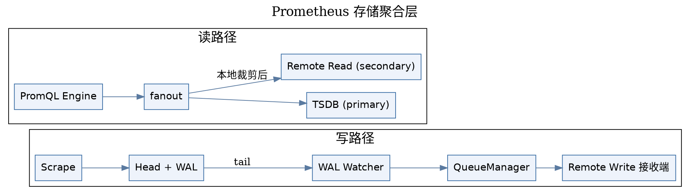

## Introduction

[Storage](/docs/CS/Distributed/Tracing/Prometheus/Storage.md) 讲 Prometheus 的存储聚合层：fanout 如何把本地 TSDB 与 remote read 拼成一个 Queryable、读写错误语义的差异、Agent 模式下的精简存储栈，以及 exemplar 的环形缓冲实现。

> [!NOTE]
> 源码级笔记。代码事实基于 `prometheus/prometheus` **v3.16.0**（commit `e2e28adeee2c5883d000fc82aca6008cfbf7e96d`）。讲解直接贴真实源码，路径相对仓库根，不再标注行号。

## fanout：主从不对称的错误语义

`storage.NewFanout(logger, localStorage, remoteStorage)` 把多个 Storage 拼成一个。注释把语义说得非常清楚：**主库错误是硬错误，从库错误降级为警告**：

```go
// storage/fanout.go
// NewFanout returns a new fanout Storage, which proxies reads and writes
// through to multiple underlying storages.
//
// The difference between primary and secondary Storage is only for read (Querier) path and it goes as follows:
// * If the primary querier returns an error, then any of the Querier operations will fail.
// * If any secondary querier returns an error the result from that queries is discarded. The overall operation will succeed,
// and the error from the secondary querier will be returned as a warning.
//
// NOTE: In the case of Prometheus, it treats all remote storages as secondary / best effort.
func NewFanout(logger *slog.Logger, primary Storage, secondaries ...Storage) Storage {
	return &fanout{
		logger:      logger,
		primary:     primary,
		secondaries: secondaries,
	}
}
```

读取端拼 MergeQuerier——主库与各从库的结果经 `ChainedSeriesMerge` 归并（同 ref 按 primary 优先去重）：

```go
// storage/fanout.go — fanout.Querier
func (f *fanout) Querier(mint, maxt int64) (Querier, error) {
	primary, err := f.primary.Querier(mint, maxt)
	if err != nil {
		return nil, err
	}

	secondaries := make([]Querier, 0, len(f.secondaries))
	for _, storage := range f.secondaries {
		querier, err := storage.Querier(mint, maxt)
		if err != nil {
			// Close already open Queriers, append potential errors to returned error.
			errs := []error{
				err,
				primary.Close(),
			}
			for _, q := range secondaries {
				errs = append(errs, q.Close())
			}
			return nil, errors.Join(errs...)
		}
		if _, ok := querier.(noopQuerier); !ok {
			secondaries = append(secondaries, querier)
		}
	}
	return NewMergeQuerier([]Querier{primary}, secondaries, ChainedSeriesMerge), nil
}
```

noopQuerier 被显式过滤，避免对空 remote read 端做无谓归并。这就是「远端长期存储挂了不影响本地查询，只多一条 warning」的实现位置。

## Agent 模式

`--agent` 标志切换进程形态。Agent 关闭 query、rule、alert 全链路，存储栈只剩「WAL + 转发」：

```go
// cmd/prometheus/main.go
	a.Flag("agent", "Run Prometheus in 'Agent mode'.").BoolVar(&agentMode)
	// ...
	if agentMode && len(serverOnlyFlags) > 0 {
		// server-only flags passed with agent mode
	}
	if !agentMode && len(agentOnlyFlags) > 0 {
		// agent-only flags passed with server mode
	}
```

Agent 的 DB（`tsdb/agent`）与完整 TSDB 的本质差异：**没有 Head chunk、没有块、没有查询接口**，只维护 series 索引与 WAL，并作为 remote write 的生产者：

```go
// tsdb/agent/db.go — agent.Open
	// remote_write expects WAL to be stored in a "wal" subdirectory of the main storage.
	dir = filepath.Join(dir, "wal")

	w, err := wlog.NewSize(l, reg, dir, opts.WALSegmentSize, opts.WALCompression)
	if err != nil {
		return nil, fmt.Errorf("creating WAL: %w", err)
	}

	db := &DB{
		logger: l,
		opts:   opts,
		rs:     rs,

		wal:    w,
		locker: locker,

		nextRef: atomic.NewUint64(0),
		series:  newStripeSeries(opts.StripeSize),
		deleted: make(map[chunks.HeadSeriesRef]deletedRefMeta),
```

`nextRef` 用原子计数器自增——Agent 没有跨重启的 ref 稳定性需求（重启后 series 全部重建），所以不需要 series 状态持久化。WAL 截断由 `TruncateFrequency` 驱动，`MinWALTime`/`MaxWALTime` 控制数据在 WAL 里至少/至多保留多久，避免远端长时间不可达时丢数据。

## Exemplar 环形缓冲

Exemplar 存储是固定长度的环形缓冲（`--storage.exemplars.exemplars-limit`），按 series 索引 + 全局循环双结构组织：

```go
// tsdb/exemplar.go
type CircularExemplarStorage struct {
	lock           sync.RWMutex
	index          map[string]*indexEntry
	exemplars      []*circularBufferEntry
	newest, oldest int
	full           bool
	m              *ExemplarMetrics
	oooTimeWindowMillis int64
}
```

校验规则比直觉严格：同一 series 的 exemplar 时间戳不能倒退；同时间戳的重复 exemplar 判重依赖「值 + label 哈希」排序，以支持原生直方图同时间戳多 bucket 的合法场景：

```go
// tsdb/exemplar.go — validateExemplar
	// Check for duplicate vs last stored exemplar for this series.
	// NB these are expected, and appending them is a no-op.
	// For floats and classic histograms, there is only 1 exemplar per series,
	// so this is sufficient. For native histograms with multiple exemplars per series,
	// we have another check below.
	newestExemplar := ce.exemplars[idx.newest].exemplar
	if newestExemplar.Equals(e) {
		return storage.ErrDuplicateExemplar
	}

	// Reject exemplars older than the OOO time window relative to the newest exemplar.
	// Exemplars with the same timestamp are ordered by value then label hash to detect
	// duplicates without iterating through all stored exemplars, which would be too
	// expensive under lock. Exemplars with equal timestamps but different values or
	// labels are allowed to support multiple buckets of native histograms.
	if (e.Ts < newestExemplar.Ts && e.Ts <= newestExemplar.Ts-ce.oooTimeWindowMillis) ||
		(e.Ts == newestExemplar.Ts && e.Value < newestExemplar.Value) ||
		(e.Ts == newestExemplar.Ts && e.Value == newestExemplar.Value && e.Labels.Hash() < newestExemplar.Labels.Hash()) {
		if appended {
			ce.metrics.outOfOrderExemplars.Inc()
		}
		return storage.ErrOutOfOrderExemplar
	}
	return nil
```

`oooTimeWindowMillis` 跟随 TSDB 的乱序窗口配置——exemplar 与 sample 的 OOO 语义保持一致。缓冲满后新 exemplar 覆盖 `oldest` 指针位置的旧条目，`Resize` 支持运行时扩缩（shrink 会按摄入顺序丢弃最旧数据）。

## 读写两面的汇合点

整条链路可以概括为：



写路径把「本地持久」与「远端转发」解耦在 WAL 上；读路径把「本地权威」与「远端补充」解耦在 fanout 上。两个不对称——写全量转发、读主从裁剪——正是 Prometheus「单机自治 + 可选长期存储」架构的全部秘密。

## Links

- [Prometheus](/docs/CS/Distributed/Tracing/Prometheus/Prometheus.md)
- [Remote](/docs/CS/Distributed/Tracing/Prometheus/Remote.md)
- [Tsdb](/docs/CS/Distributed/Tracing/Prometheus/Tsdb.md)
- [Wal](/docs/CS/Distributed/Tracing/Prometheus/Wal.md)
- [Promql](/docs/CS/Distributed/Tracing/Prometheus/Promql.md)

## References

- https://github.com/prometheus/prometheus/blob/v3.16.0/storage/fanout.go
- https://github.com/prometheus/prometheus/blob/v3.16.0/tsdb/agent/db.go
- https://github.com/prometheus/prometheus/blob/v3.16.0/tsdb/exemplar.go
- https://prometheus.io/docs/prometheus/latest/feature_flags/#exemplars-storage
