## Introduction

[Apache SkyWalking](https://skywalking.apache.org/) 是一款**开源可观测性平台（APM）**，面向云原生、容器化的分布式系统，统一采集、分析、聚合并可视化来自服务与云原生基础设施的遥测数据。与 [Zipkin](/docs/CS/Distributed/Tracing/Zipkin.md) / [Jaeger](/docs/CS/Distributed/Tracing/Jaeger.md) 这类「纯追踪后端」不同，SkyWalking 从设计上就是 APM——除了分布式追踪，还内置指标（Metrics）、日志（Logging）、拓扑（Topology）、告警（Alarm）与 profiling，并围绕「服务 / 实例 / 端点」的对象层级做聚合分析。

其架构遵循官方文档「逻辑四部分」划分：探针（Probes）、平台后端（OAP Server）、存储（Storage）、UI。与通用追踪系统最关键的差异在于两点——**对象层级模型**（Service → Service Instance → Endpoint）与 **sw8 跨进程传播协议**：探针在请求头里携带的不仅是 trace/span ID，还有父服务、父实例、父端点与目标地址，使 OAP 后端无需额外 join 即可直接还原服务拓扑。

> 版本基线（以本地源码为准）：**11.1.0-SNAPSHOT**（2026-11-03 HEAD，pom `revision=11.1.0-SNAPSHOT`）；**10.2.0 起永久移除 H2 存储、默认存储改为 BanyanDB**——事实由 `oap-server/server-starter/src/main/resources/application.yml` 的 `selector: ${SW_STORAGE:banyandb}` 证实，全仓已无 `H2StorageProvider`；v11 起引入下一代 **Horizon UI**。OAP 运行需 Java 11/17/21/25（默认 Docker 镜像基于 Java 25）。

各分册展开：

- [SkyWalking Data Model](/docs/CS/Distributed/Tracing/SkyWalking/Data_Model.md) — Trace / Segment / Span（Entry/Exit/Local）、ContextCarrier / ContextSnapshot
- [SkyWalking Transport](/docs/CS/Distributed/Tracing/SkyWalking/Transport.md) — 探针类型、gRPC 11800 / HTTP 12800 / Kafka 上报、sw8 传播头
- [SkyWalking OAP Backend and Storage](/docs/CS/Distributed/Tracing/SkyWalking/Collector_and_Storage.md) — Receiver、OAL / MAL / LAL、存储选型、告警
- [SkyWalking Query and UI](/docs/CS/Distributed/Tracing/SkyWalking/Query_and_UI.md) — GraphQL 查询、拓扑 / 追踪 / 指标视图、booster-ui 与 Horizon UI
- [SkyWalking Agent 机理](/docs/CS/Distributed/Tracing/SkyWalking/Agent.md) — 探针侧：span 栈、EntrySpan/ExitSpan 复用、Segment 组装、TraceSegmentRef、agent 滑窗采样（两级采样之 agent 侧）
- [SkyWalking 存储抽象与 BanyanDB 写路径](/docs/CS/Distributed/Tracing/SkyWalking/Storage.md) — StorageModule 超宽 DAO 契约、IBatchDAO 流式写、BanyanDB provider 注册、bulk 处理器三 catalog 写路径、MetadataRegistry 模型映射
- [SkyWalking 查询服务与 GraphQL](/docs/CS/Distributed/Tracing/SkyWalking/Query.md) — GraphQLQueryProvider（ModuleProvider）、query-protocol .graphqls 版本化、/graphql 端点、resolver→存储 DAO 桥接
- [SkyWalking 接收管线](/docs/CS/Distributed/Tracing/SkyWalking/Receiver.md) — skywalking-trace-receiver、TraceSegmentReportServiceHandler gRPC 接收、接入 SegmentParserServiceImpl
- [SkyWalking 采样与流控](/docs/CS/Distributed/Tracing/SkyWalking/Sampling.md) — TraceSegmentSampler 确定性采样、可配置采样、强制采样
- [SkyWalking 拓扑与告警](/docs/CS/Distributed/Tracing/SkyWalking/Topology_Alarm.md) — TopologyBuilder/ITopologyQueryDAO、AlarmEntrance 告警链路

## Architecture

SkyWalking 逻辑上分为四部分（探针 / OAP / 存储 / UI），组件交互如下：

```
Probes (agent / SDK / mesh / 3rd-party)
   │  gRPC :11800 / HTTP :12800 / Kafka
   ▼
┌──────────────────────────────────────────────┐
│              OAP Server (Platform backend)    │
│  Receiver → Analysis Core (L1/L2 agg, OAL)    │
│           → Query Core (GraphQL) → Alarm      │
└───────────────────────┬──────────────────────┘
                        │  pluggable
                        ▼
                   Storage (BanyanDB / ES / MySQL ...)
                        ▲
                        │  GraphQL :12800
                   UI (:8080)
```

- **Probes（探针）**：采集 trace / metric / log / event，格式覆盖 SkyWalking 原生、Zipkin、OTel、Prometheus、Zabbix、Telegraf。
- **OAP Server（Platform backend）**：聚合、分析与流式处理，同时扮演 Aggregator 与 Receiver 角色；模块体系与集群机制见 [SkyWalking OAP Backend and Storage](/docs/CS/Distributed/Tracing/SkyWalking/Collector_and_Storage.md)。
- **Storage（存储）**：开放可插拔接口，默认 `banyandb`。
- **UI**：Web 界面，端口 8080，通过 GraphQL 向 OAP 的 12800 发起查询。

对象层级（Layer / Service / Service Instance / Endpoint / Process）与 Service Hierarchy 的细节见 [SkyWalking Data Model](/docs/CS/Distributed/Tracing/SkyWalking/Data_Model.md)。

## Object Model

SkyWalking 的对象层级自上而下为 **Layer → Service → Service Instance → Endpoint**（外加 **Process**）：

- **Layer**：对计算机科学中某类抽象框架的归类，如 `OS_LINUX`、Kubernetes（`k8s`）、Service Mesh（`mesh` / `mesh-dp`）。一个 Service 通常只属于一个 Layer，但也可同时属于多个（如同时被 k8s 与 Istio mesh 探测到的服务）。
- **Service**：提供相同行为的一组工作负载（workloads）；服务名可由探针 / SDK 定义，也可沿用 Istio 等平台已有的名字。
- **Service Instance**：Service 组里单个的工作负载，如 Kubernetes 中的一个 `pod`；使用探针时，一个实例即一个真实 OS 进程。
- **Endpoint**：服务内一次入站请求的路径，如 HTTP URI 或 gRPC `service + method` 签名。
- **Process**：操作系统进程；某些场景下 Service Instance 并不等于一个进程（如一个 pod 内含多个进程）。

SkyWalking 还能建立 **Service Hierarchy Relationship**，把不同 Layer 中「逻辑上同一服务」连起来（如 k8s 层与 mesh 层里同一个服务）。字段级定义与 Segment / Span 细节见 [SkyWalking Data Model](/docs/CS/Distributed/Tracing/SkyWalking/Data_Model.md)。

## Observability Coverage

SkyWalking 不止于 tracing，它把五类遥测统一进同一套对象模型：

- **Tracing**：原生格式 + Zipkin v1/v2。
- **Metrics**：原生 meter 格式、OTEL metrics、Telegraf 格式；service mesh 接收器从 Istio / Envoy 数据面或控制面构建可观测性；原生 agent 还可运行在 metrics-only 模式以提升性能。
- **Logging**：从磁盘或网络收集日志；原生 agent 可自动把追踪上下文与日志绑定。
- **Profiling**：随语言 agent 与独立 eBPF agent 提供，从代码行级别定位性能问题。
- **Event**：记录版本升级、配置变更等关键时刻，与指标 / 追踪 / 日志联动辅助排障。

## Mechanics

上面讲的是 SkyWalking「长什么样」，这一节讲它「怎么跑起来」。三处最关键的实现选择：

**Agent 侧以 Segment 而非 Span 为单位。** 探针在一个线程内维护 ActiveSpanStack，EntrySpan / ExitSpan 在栈顶同类时会**复用**而非新建（否则 filter 链会造出伪端点）；只有栈顶 span 能被 stop，未弹栈的 span 不会被上报。Segment 完成后整体打包成 protobuf 一次性发出，代价是单段 span 数有上限（默认 300，超限降级为 NoopSpan 而非抛异常）。

**采样有两级，且互不知情。** agent 侧是「每 3 秒最多 N 个 Segment」的滑动窗口限流（CAS 抢占保证硬上界，非百分比）；OAP 侧再按 `traceId` 哈希取模做确定性采样——同一 trace 的所有 Segment 哈希相同，因此**整条 trace 同生共死**，不会断成半截。错误 Segment 可配置为强制保留。

**拓扑是分析器的副产品，不是配置项。** OAP 把收到的 Segment 拆成 Source，按 scope 路由给 OAL 编译生成的 dispatcher；调用关系被 **CLIENT / SERVER 双端各检测一次**，任一端 agent 存活即可维持拓扑边。边的聚合只存「出现过哪些组件」的集合、不存数值，所以拓扑图能零配置自动出现。

完整链路（含 TimeBucket 编码、OAL 编译成 Java 字节码、BanyanDB 的 Stream / Measure / Property 三模型与 Series 分片）见 [SkyWalking 存储抽象与 BanyanDB 写路径](/docs/CS/Distributed/Tracing/SkyWalking/Storage.md) 与 [OAP Backend and Storage](/docs/CS/Distributed/Tracing/SkyWalking/Collector_and_Storage.md)。

## OAP 运行期：SPI 装配与三方对照

## Boot: Module Assembly via SPI

入口极薄：`OAPServerStartUp.main` 只有一行 `OAPServerBootstrap.start()`。装配核心在 `ModuleManager.init`，它用两个 `ServiceLoader` 分别加载 `ModuleDefine` 和 `ModuleProvider`，再拿 `application.yml` 里声明的模块名去匹配：

```java
// oap-server/server-library/library-module/.../ModuleManager.java
public void init(ApplicationConfiguration applicationConfiguration)
    throws ModuleNotFoundException, ProviderNotFoundException, ... {

    String[] moduleNames = applicationConfiguration.moduleList();
    ServiceLoader<ModuleDefine> moduleServiceLoader = ServiceLoader.load(ModuleDefine.class);
    ServiceLoader<ModuleProvider> moduleProviderLoader = ServiceLoader.load(ModuleProvider.class);

    HashSet<String> moduleSet = new HashSet<>(Arrays.asList(moduleNames));
    for (ModuleDefine module : moduleServiceLoader) {
        if (moduleSet.contains(module.name())) {
            module.prepare(
                this,
                applicationConfiguration.getModuleConfiguration(module.name()),
                moduleProviderLoader,
                bootingParameters
            );
            loadedModules.put(module.name(), module);
            moduleSet.remove(module.name());
        }
    }
    // Finish prepare stage
    isInPrepareStage = false;

    if (moduleSet.size() > 0) {
        throw new ModuleNotFoundException(moduleSet.toString() + " missing.");
    }

    BootstrapFlow bootstrapFlow = new BootstrapFlow(loadedModules);
    bootstrapFlow.start(this);
    bootstrapFlow.notifyAfterCompleted();
}
```

上面贴出的 `init()` 中，配置里声明了、但 classpath 上找不到对应 `ModuleProvider` 实现的模块名，会直接抛 `ModuleNotFoundException`（`moduleSet.size() > 0` 分支）。这意味着「模块缺失」在启动期就被钉死，而不是运行时空指针。这套 SPI 与 Zipkin 的「Spring Boot 但关掉自动配置、靠 `@EnableZipkinServer` 显式装配」（见 [Zipkin 架构](/docs/CS/Distributed/Tracing/Zipkin/Architecture.md)）和 Jaeger v2 的「OTel Collector 组件注册」（见 [Jaeger 架构](/docs/CS/Distributed/Tracing/Jaeger.md)）是三种完全不同的装配哲学。

## Three Backends, Three Assemblies

把三个系统的「进程如何被拼起来」放在一起看，能更清楚各自的取舍：

| 维度 | SkyWalking OAP | Jaeger v2 | Zipkin |
| --- | --- | --- | --- |
| 装配机制 | 自研 `ServiceLoader` SPI（`ModuleDefine` / `ModuleProvider`） | OTel Collector `otelcol.NewCommand` + factory 注册 | Spring Boot（默认关自动配置，靠 `@EnableZipkinServer`） |
| 配置入口 | `application.yml` 的 `selector: ${SW_xxx:default}` | 单二进制 + 同一份 YAML pipeline | `zipkin-server.yml` + 环境变量 |
| 模块发现 | 启动时 `ClassPath` 扫描 | 编译期 `MakeFactoryMap` 写死 | `@Configuration` 条件化 bean |
| 默认存储 | BanyanDB（11.x 起） | 内存（`max_traces=100000`） | 内存 |
| 水平扩展 | 多 OAP + 共享存储 + 集群选主 | 同二进制换 YAML / Kafka connector | 多 server + Kafka collector + 共享存储 |

```dot
digraph skywalking_oap {
  rankdir=LR;
  subgraph cluster_boot {
    label="ModuleManager.init (SPI)";
    yaml[label="application.yml\nselector: SW_*"];
    spi[label="ServiceLoader\nModuleDefine/Provider"];
  }
  subgraph cluster_rx {
    label="Receiver";
    grpc[label="gRPC :11800\nSegmentObject"];
    parser[label="SegmentParserServiceImpl\nsend()"];
    analyzer[label="TraceAnalyzer\ndoAnalysis()"];
  }
  subgraph cluster_dispatch {
    label="Dispatch (runtime scan)";
    src[label="SourceReceiverImpl\nscan() ClassPath"];
    disp[label="DispatcherManager\nforward by scope"];
  }
  subgraph cluster_agg {
    label="Aggregation";
    sample[label="TraceSegmentSampler\n|traceId.hash|%10000"];
    l1[label="L1 MetricsAggregateWorker\n(500ms flush)"];
    l2[label="L2 PersistentWorker\nmin/hour/day"];
  }
  storage[label="BanyanDB"];

  yaml -> spi -> grpc;
  grpc -> parser -> analyzer -> src -> disp -> sample -> l1 -> l2 -> storage;
}
```



## 端到端生命周期（Putting It Together）

## Putting It Together

一次 HTTP 请求的完整生命周期：

```text
[Agent]
  Tomcat filter 拦截 → createEntrySpan（栈顶）
  Controller 方法    → createLocalSpan
  HTTP client        → createExitSpan + peer
      ↓ inject：写 sw8 头（含 traceId / 父段 / 父 spanId / 父服务 / 父端点 / 目标地址）
[网络]
      ↓
[下游 Agent]
  extract → 建 TraceSegmentRef → 关联父段
      ↓ Segment 完成 → transform() → SegmentObject
[OAP receiver]
  ↓ gRPC 11800
[agent-analyzer]
  ↓ 遍历 Span，按 First/Entry/Exit/Local 分派 listener
  ↓ 产出 Source：Segment / ServiceRelation / EndpointRelation / ...
  ↓ 后端采样：traceId.hashCode() % 10000 → 命中或 IGNORE
[core]
  ↓ SourceReceiver.receive → DispatcherManager.forward(scope)
  ↓ 命中 OAL 生成的 dispatcher → 产出 Metrics
[MetricsStreamProcessor]
  ↓ 按 metrics class 路由 → MetricsAggregateWorker
  ↓ session cache 按 StorageID（时间桶 + entityId）聚合
  ↓ L1（分钟）→ L2（小时/天）
[BanyanDB]
  ↓ Metrics → Measure（按 Series hash 分片，可服务端 TopN）
  ↓ Trace / Segment → Stream（明细，protobuf 原样）
[GraphQL / UI]
  ↓ 拓扑由 ServiceRelation 双端检测的结果合并而来
```

## 设计取舍（Design Trade-offs）

## Design Trade-offs Worth Noting

深挖源码后，几个「为什么这样设计」比「用了什么」更有价值：

| 设计 | 收益 | 代价 |
| --- | --- | --- |
| 上报单位是 Segment 而非 Span | 网络与序列化开销降一个量级 | Segment 内 Span 数受限（默认 300） |
| 拓扑边双端检测 | 任一端 agent 存活即可维持拓扑 | 存储两套关系指标 |
| 拓扑边只存 componentIds 集合，无数值 | 零配置自动成图 | 无法直接回答「这条边有多慢」（需另行关联指标） |
| 采样用滑窗而非百分比 | 突发流量下采样行为平滑可预测 | 实际采样率与直觉差距大，需按 QPS 反推 |
| 后端采样用 traceId 哈希 | 无状态、集群一致、整条 trace 同生共死 | 策略变更需重算，缺少 tail-based 的延迟决策能力 |
| TraceSegmentRef 只留首个父 | 内存与序列化可控 | 批处理扇入场景弱关联，非严格多父树 |
| OAL 编译成 Java 类 | 运行期零解释开销、可用标准调试器 | 改脚本需重启、集群需一致 |
| 时间用定长数字前缀 | 排序/截断降采样极廉价 | 区间判别粒度固定，新增粒度需改编码 |
| Series 按 hash 分片 | 同 Series 数据聚簇、免跨节点 join | 扩分片需重分布，冷热不均需处理 |


## Relationship to OpenTelemetry

SkyWalking 与 [OpenTelemetry](/docs/CS/Distributed/Tracing/Otel.md) 是「后端 vs 生成框架」的关系：OTel SDK 负责埋点与上下文传播（默认 W3C Trace Context），SkyWalking OAP 通过 `receiver-otel` 模块直接接收 OTLP；Zipkin / Jaeger 格式则由各自 receiver 接纳。新项目通常以 OTel 为起点、SkyWalking 作后端，而不再引入 SkyWalking 专有客户端。跨进程传播上，SkyWalking 用自己的 **sw8** 协议而非 B3 / W3C，与 [Zipkin](/docs/CS/Distributed/Tracing/Zipkin.md) 的 B3 形成对照（见 [SkyWalking Transport](/docs/CS/Distributed/Tracing/SkyWalking/Transport.md)）。

## Quickstart

一条命令拉起 OAP + UI（默认存储 BanyanDB 需先就绪；UI 端口 8080）：

```bash
# 先起 BanyanDB（官方推荐存储）
docker run -d -p 17912:17912 -p 17913:17913 --name banyandb apache/skywalking-banyandb:${BYDB_VERSION} standalone
# 再起 SkyWalking（OAP 监听 gRPC 11800 / HTTP 12800，UI 8080）
docker run -d -p 11800:11800 -p 12800:12800 -p 8080:8080 apache/skywalking-oap-server
# UI: http://localhost:8080
```

更完整的部署（存储选型、Kafka 通道、集群、动态配置）见 [SkyWalking OAP Backend and Storage](/docs/CS/Distributed/Tracing/SkyWalking/Collector_and_Storage.md)。探针接入（Java agent、其它语言 SDK、Service Mesh、第三方格式）见 [SkyWalking Transport](/docs/CS/Distributed/Tracing/SkyWalking/Transport.md)。

## Links

- [Tracing](/docs/CS/Distributed/Tracing/Tracing.md) — 可观测性三支柱、trace/span 数据模型
- [Jaeger](/docs/CS/Distributed/Tracing/Jaeger.md) — CNCF 追踪后端，多进程架构对照
- [Zipkin](/docs/CS/Distributed/Tracing/Zipkin.md) — 轻量追踪系统，B3 传播对照
- [OpenTelemetry](/docs/CS/Distributed/Tracing/Otel.md) — vendor-agnostic 遥测框架，可桥接 SkyWalking
- [Java Agent](/docs/CS/Java/JDK/Agent.md) — SkyWalking Java 探针的字节码增强实现
- [SkyWalking 存储抽象与 BanyanDB 写路径](/docs/CS/Distributed/Tracing/SkyWalking/Storage.md) — StorageModule 超宽 DAO 契约、IBatchDAO 流式写、BanyanDB provider 注册、bulk 处理器写路径
- [Elasticsearch](/docs/CS/Framework/ES/ES.md) — SkyWalking 的可选存储后端

## References

1. [Apache SkyWalking](https://skywalking.apache.org/) — 官方网站
2. [SkyWalking Overview](https://skywalking.apache.org/docs/main/next/en/concepts-and-designs/overview/) — 概念与对象模型
3. [Backend setup](https://skywalking.apache.org/docs/main/next/en/setup/backend/backend-setup/) — 端口、启动与模块化
4. [Backend storage](https://skywalking.apache.org/docs/main/next/en/setup/backend/backend-storage/) — 存储后端选型
5. [Cross Process Propagation Headers (sw8)](https://skywalking.apache.org/docs/main/next/en/api/x-process-propagation-headers-v3/) — sw8 协议规范
