# SkyWalking Query: The GraphQL Endpoint and the Resolver → DAO Bridge

## Introduction

SkyWalking 把「查询」做成了**一条独立的 ModuleProvider 线**（`query` 模块），而不是像 Jaeger 那样把查询塞进一个 collector extension、也不是像 Zipkin 那样用 Armeria 单 handler 直接 handler 化。它的对外契约只有一个：**单个 GraphQL 端点 `/graphql`**，背后是一套从 `query-protocol/*.graphqls` 资源文件装配出来的 schema。

这一节把查询侧拆开讲，并点出一个和 Jaeger/Zipkin 都不同的关键事实：**SkyWalking 的「版本化」发生在 GraphQL schema 文件内部（v1/v2/v3 多套 `.graphqls`），而不是像 Jaeger 那样分成 `api_v2`/`api_v3` 两个 wire 路径、也不像 Zipkin 那样摄入侧 v1+v2、查询侧只出 v2**。GraphQL 这一层天然允许 schema 演进共存，SkyWalking 就利用了这一点。

> 基线：`E:/Projects/skywalking`（HEAD 11.1.0-SNAPSHOT，2026-11-03）。下文直接贴真实源码，路径相对仓库根、不再标注行号；查询插件在 `oap-server/server-query-plugin/query-graphql-plugin`。

## The Provider: `GraphQLQueryProvider` Is Just Another `ModuleProvider`

和 SkyWalking 一切一样，查询服务也是 `ModuleProvider`：

```java
// oap-server/server-query-plugin/.../graphql/GraphQLQueryProvider.java
public class GraphQLQueryProvider extends ModuleProvider {
    @Override public String name() { return "graphql"; }
    @Override public Class<? extends ModuleDefine> module() { return QueryModule.class; }
```

它的 `prepare()` 干一件事：用 `graphql-kickstart` 的 `SchemaParserBuilder`，把一组 `.graphqls` 文件和对应的 resolver 类**链式装配**成可执行 schema：

```java
// GraphQLQueryProvider.java
schemaBuilder.file("query-protocol/common.graphqls").resolvers(new Query(), new Mutation(), new HealthQuery(getManager()))
            .file("query-protocol/topology.graphqls").resolvers(new TopologyQuery(getManager()))
            .file("query-protocol/metrics-v3.graphqls").resolvers(new MetricsExpressionQuery(getManager()))
            // Deprecated Queries
            .file("query-protocol/metric.graphqls").resolvers(new MetricQuery(getManager()))
            .file("query-protocol/metrics-v2.graphqls").resolvers(new MetricsQuery(getManager()))
            .file("query-protocol/trace.graphqls").resolvers(new TraceQuery(getManager()))
            .file("query-protocol/trace-v2.graphqls").resolvers(new TraceQueryV2(getManager()))
            .file("query-protocol/alarm.graphqls").resolvers(new AlarmQuery(getManager()))
            .file("query-protocol/log.graphqls").resolvers(new LogQuery(getManager()), new LogTestQuery(getManager(), config))
            // ……record / hierarchy / ebpf / continuous-profiling / pprof / async-profiler 等
            ;
schemaBuilder.scalars(ExtendedScalars.GraphQLLong);
```

两个细节值得记住：

- **版本共存于文件名**。`metrics-v3.graphqls`（9.5.0 引入，由新增的 MQE 指标查询表达式语言驱动）与旧的 `metric.graphqls` / `metrics-v2.graphqls`（已标 Deprecated）**同时装配进同一 schema**。这意味着同一 `/graphql` 端点上新旧查询协议长期共存，客户端按自己支持的字段名选取——这是 GraphQL 优于「多 wire 路径」的地方：版本演进不需要新建端口或路径。
- **`query-protocol` 是独立资源集**。这些 `.graphqls` 来自仓库里单独的 `query-protocol` 目录（也是 SkyWalking 跨语言共享的查询协议定义），不是散落在 Java 代码里的字符串。OAP 启动时把它们读进来和 resolver 绑定。

## The Endpoint: A Single `/graphql` on the OAP HTTP Port

`start()` 把装配好的 schema 包成一个 Armeria 的 `GraphQLQueryHandler`，注册到 `HTTPHandlerRegister`：

```java
// GraphQLQueryProvider.java
@Override
public void start() throws ServiceNotProvidedException, ModuleStartException {
    HTTPHandlerRegister service = getManager().find(CoreModule.NAME)
                                              .provider().getService(HTTPHandlerRegister.class);
    service.addHandler(
        new GraphQLQueryHandler(getManager(), config, schemaBuilder.build().makeExecutableSchema()),
        Collections.singletonList(HttpMethod.POST)
    );
}
```

handler 本身极薄——一个 `@Blocking @Post("/graphql")` 方法，把请求交给 Armeria 的 `GraphqlService`：

```java
// oap-server/server-query-plugin/.../graphql/GraphQLQueryHandler.java
@Blocking
@Post("/graphql")
public HttpResponse graphql(final ServiceRequestContext ctx, final HttpRequest req) throws Exception {
    try (final var ignored = getQueryHistogram().createTimer()) {
        return graphqlService.serve(ctx, req);
    } catch (Exception e) {
        getErrorCount().inc();
        throw e;
    }
}
```

构造时挂了一个 `MaxQueryComplexityInstrumentation`，超过 `config.getMaxQueryComplexity()` 的查询直接 abort（避免一次 GraphQL 把后端打爆）；同时埋了 `graphql_query_latency` 直方图和 `graphql_query_error_count` 计数器：

```java
// oap-server/server-query-plugin/.../graphql/GraphQLQueryHandler.java
@Getter(lazy = true)
private final HistogramMetrics queryHistogram =
    moduleManager.find(TelemetryModule.NAME)
                 .provider()
                 .getService(MetricsCreator.class)
                 .createHistogramMetric(
                        "graphql_query_latency",
                        "The processing latency of graphql query",
                        MetricsTag.EMPTY_KEY,
                        MetricsTag.EMPTY_VALUE);
@Getter(lazy = true)
private final CounterMetrics errorCount =
    moduleManager.find(TelemetryModule.NAME)
                 .provider()
                 .getService(MetricsCreator.class)
                 .createCounter(
                         "graphql_query_error_count",
                         "The error count of graphql query",
                         MetricsTag.EMPTY_KEY,
                         MetricsTag.EMPTY_VALUE);

public GraphQLQueryHandler(
    final ModuleManager moduleManager,
    final GraphQLQueryConfig config,
    final GraphQLSchema schema) {
    final int allowedComplexity = config.getMaxQueryComplexity();

    this.moduleManager = moduleManager;

    graphqlService =
        GraphqlService
            .builder()
            .schema(schema)
            .instrumentation(new MaxQueryComplexityInstrumentation(allowedComplexity, info -> {
                log.warn(
                    "Aborting query because it's too complex, maximum allowed is [{}] but was [{}]",
                    /* ... */);
```

整条链路只有一个 HTTP 入口 `/graphql`（在 OAP 的 HTTP 端口 12800 上，见架构图），与 Jaeger `jaegerquery` 同端口跑 `api_v2`+`api_v3` 两套 gRPC/HTTP、Zipkin 查询侧只暴露 `/api/v2/*` 都不同——SkyWalking 用「一个端点 + schema 内版本共存」作答。

## The Bridge: Resolver → CoreModule Service → Storage DAO

GraphQL resolver 不直接碰存储 DAO。它先经 `moduleManager` 惰性取到 **CoreModule 的查询服务**（如 `TraceQueryService`），再由该服务去存储模块取 DAO。以 `TraceQuery` resolver 为例：

```java
// oap-server/server-query-plugin/.../graphql/resolver/TraceQuery.java
private TraceQueryService getQueryService() {
    if (queryService == null) {
        this.queryService = moduleManager.find(CoreModule.NAME)
                                         .provider().getService(TraceQueryService.class);
    }
    return queryService;
}

public CompletableFuture<TraceBrief> queryBasicTraces(final TraceQueryCondition condition, boolean debug) {
    return queryAsync(() -> { /* 调用 TraceQueryService，带 DebuggingTraceContext */ });
}
```

而 `TraceQueryService` 这一层（CoreModule 内的查询逻辑服务）才真正落到存储 DAO：

```java
// oap-server/server-core/.../core/query/TraceQueryService.java
protected ITraceQueryDAO getTraceQueryDAO() {
    if (traceQueryDAO == null) {
        this.traceQueryDAO = moduleManager.find(StorageModule.NAME).provider().getService(ITraceQueryDAO.class);
        if (ITraceQueryV2DAO.class.isAssignableFrom(traceQueryDAO.getClass())) {
            this.supportTraceV2 = true;
        }
    }
    return traceQueryDAO;
}
```

所以完整的调用栈是三层：**GraphQL resolver → CoreModule 查询服务（`TraceQueryService`/`TopologyQueryService`/`MetricsExpressionQuery`…）→ StorageModule 的 `*QueryDAO`（`ITraceQueryDAO`/`ITopologyQueryDAO`/`IMetricsQueryDAO`…）**。resolver 层只负责 GraphQL 参数到领域对象的映射和异步化（`queryAsync` → `CompletableFuture`），真正的查询编排与「后端 DAO 能力探测」（如 `ITraceQueryV2DAO` 是否可赋值）都在 CoreModule 服务里。拓扑查询 `TopologyQueryService` 走的也是同一条路：

```java
// oap-server/server-core/.../core/query/TopologyQueryService.java
private ITopologyQueryDAO getTopologyQueryDAO() {
    if (topologyQueryDAO == null) {
        topologyQueryDAO = moduleManager.find(StorageModule.NAME).provider().getService(ITopologyQueryDAO.class);
    }
    return topologyQueryDAO;
}

private MetadataQueryService getMetadataQueryService() {
    if (metadataQueryService == null) {
        metadataQueryService = moduleManager.find(CoreModule.NAME).provider().getService(MetadataQueryService.class);
    }
    return metadataQueryService;
}

private IComponentLibraryCatalogService getComponentLibraryCatalogService() {
    if (componentLibraryCatalogService == null) {
        componentLibraryCatalogService = moduleManager.find(CoreModule.NAME)
                                                      .provider()
                                                      .getService(IComponentLibraryCatalogService.class);
    }
    return componentLibraryCatalogService;
}
```

它取 `ITopologyQueryDAO` 拿边，再结合 `MetadataQueryService`、`IComponentLibraryCatalogService` 做节点与组件名补全。

## Mental Model

```dot
digraph query {
  rankdir=LR;
  node [shape=box, style=rounded];

  subgraph cluster_client {
    label="外部";
    ui [label="UI / 外部客户端\nPOST /graphql (HTTP 12800)"];
  }

  subgraph cluster_provider {
    label="query 模块 (ModuleProvider)";
    gp [label="GraphQLQueryProvider\nprepare(): 装配 query-protocol/*.graphqls\nstart(): 注册 /graphql"];
    h [label="GraphQLQueryHandler\n@Post(/graphql) @Blocking\nMaxQueryComplexityInstrumentation"];
    gp -> h;
  }

  subgraph cluster_resolver {
    label="Resolver 层";
    r [label="TraceQuery / TopologyQuery /\nMetricsExpressionQuery …\nqueryAsync → CompletableFuture"];
  }

  subgraph cluster_core {
    label="CoreModule 查询服务";
    qs [label="TraceQueryService / TopologyQueryService …\n编排 + DAO 能力探测"];
  }

  subgraph cluster_storage {
    label="StorageModule";
    dao [label="ITraceQueryDAO / ITopologyQueryDAO\nIMetricsQueryDAO …"];
  }

  ui -> h;
  h -> r;
  r -> qs [label="moduleManager.find(CoreModule)"];
  qs -> dao [label="moduleManager.find(StorageModule)"];
}
```



一句话总结：**SkyWalking 的查询是「一条 query ModuleProvider + 单一 `/graphql` 端点 + 由 `query-protocol/*.graphqls` 版本共存的 schema」，版本演进藏在 GraphQL schema 内部（v1/v2/v3）而非 wire 路径；resolver 不直接碰存储，而是经 CoreModule 的查询服务再落到 StorageModule 的各 `*QueryDAO`——三层桥接，与 Jaeger 双 wire API、Zipkin 非对称 v1/v2 是三种不同的「查询 API 怎么暴露」答案。**

## Links

- [SkyWalking 源码实现总览](/docs/CS/Distributed/Tracing/SkyWalking.md)
- [SkyWalking 存储抽象与 BanyanDB 写路径](/docs/CS/Distributed/Tracing/SkyWalking/Storage.md)
- [SkyWalking 枢纽页](/docs/CS/Distributed/Tracing/SkyWalking.md)
- [Jaeger 查询服务](/docs/CS/Distributed/Tracing/Jaeger/Query.md)
- [Zipkin 查询 API](/docs/CS/Distributed/Tracing/Zipkin/Query.md)

## References

- 查询 provider：`oap-server/server-query-plugin/query-graphql-plugin/src/main/java/org/apache/skywalking/oap/query/graphql/GraphQLQueryProvider.java`
- 查询 handler：`oap-server/server-query-plugin/query-graphql-plugin/src/main/java/org/apache/skywalking/oap/query/graphql/GraphQLQueryHandler.java`
- Trace resolver：`oap-server/server-query-plugin/query-graphql-plugin/src/main/java/org/apache/skywalking/oap/query/graphql/resolver/TraceQuery.java`
- 查询服务（CoreModule）：`oap-server/server-core/src/main/java/org/apache/skywalking/oap/server/core/query/TraceQueryService.java`、`TopologyQueryService.java`
- 存储查询 DAO 接口：`oap-server/server-core/.../core/storage/query/ITraceQueryDAO.java`、`ITopologyQueryDAO.java`、`IMetricsQueryDAO.java`
- SkyWalking GraphQL query protocol：<https://skywalking.apache.org/docs/main/latest/en/api/graphql-query-protocol/>
