# SkyWalking Receiver: The gRPC Trace Ingest Path

## Introduction

SkyWalking 的「接收端」和 Jaeger/Zipkin 的「collector 进程」不是一个概念。Jaeger 的接收是 OTel Collector 管线里的 receiver，Zipkin 的接收是 Armeria handler 直接接 `List<Span>`；SkyWalking 的接收是**一组 ModuleProvider（`*receiver-plugin`）**，每个 receiver 把自己实现的 gRPC/HTTP handler 注册进 OAP 的 gRPC 或 HTTP 服务器。原生 trace 的入口就在 `skywalking-trace-receiver-plugin` 里。

这一节只追一条线：**SkyWalking agent 通过 gRPC `:11800` 推上来的 Segment，如何进到分析核心**——也就是 `TraceSegmentReportServiceHandler` → `ISegmentParserService.send` 这一段。它正好接上 [SkyWalking](/docs/CS/Distributed/Tracing/SkyWalking.md) 里 `SegmentParserServiceImpl.send(SegmentObject)` → `TraceAnalyzer.doAnalysis` 的链路。

> 基线：`E:/Projects/skywalking`（HEAD 11.1.0-SNAPSHOT，2026-11-03）。下文直接贴真实源码，路径相对仓库根，不再标注行号；trace receiver 在 `oap-server/server-receiver-plugin/skywalking-trace-receiver-plugin`。

## The Handler: A gRPC Service Impl That Feeds the Analyzer

原生 trace 的 gRPC 服务由 `TraceSegmentReportServiceHandler` 实现，它同时是生成的 gRPC 基类的子类、又实现了 OAP 的 `GRPCHandler` 标记接口（后者让它被自动注册进 OAP 的 gRPC server）：

```java
// oap-server/server-receiver-plugin/.../handler/v8/grpc/TraceSegmentReportServiceHandler.java
public class TraceSegmentReportServiceHandler
    extends TraceSegmentReportServiceGrpc.TraceSegmentReportServiceImplBase
    implements GRPCHandler {

    private ISegmentParserService segmentParserService;

    public TraceSegmentReportServiceHandler(ModuleManager moduleManager) {
        this.segmentParserService = moduleManager.find(AnalyzerModule.NAME)
                                                 .provider()
                                                 .getService(ISegmentParserService.class);
        // telemetry: trace_in_latency (histogram), trace_analysis_error_count (counter)
    }
}
```

构造时它从 `AnalyzerModule` 取出 `ISegmentParserService`——这就是分析核心的入口。注意路径里的 `v8/grpc`：SkyWalking 把 gRPC 服务版本号直接编码进包名，和 GraphQL 那边把版本藏在 `.graphqls` 文件名里是两种并行的「协议版本化」手段。

## Two Entry Points: Streaming `collect` and Batch `collectInSync`

gRPC 服务暴露两个方法，语义不同但归宿相同——都调 `segmentParserService.send(segment)`：

```java
// TraceSegmentReportServiceHandler.java
@Override
public StreamObserver<SegmentObject> collect(StreamObserver<Commands> responseObserver) {
    return new StreamObserver<SegmentObject>() {
        @Override
        public void onNext(SegmentObject segment) {
            HistogramMetrics.Timer timer = histogram.createTimer();
            try {
                segmentParserService.send(segment);          // 单条流式推送
            } catch (Exception e) {
                errorCounter.inc();
                log.error(e.getMessage(), e);
            } finally {
                timer.finish();
            }
        }
        @Override public void onError(Throwable t) { /* CANCELLED 静默忽略 */ }
        @Override public void onCompleted() {
            responseObserver.onNext(Commands.newBuilder().build());
            responseObserver.onCompleted();
        }
    };
}

// TraceSegmentReportServiceHandler.java
@Override
public void collectInSync(final SegmentCollection request, final StreamObserver<Commands> responseObserver) {
    request.getSegmentsList().forEach(segment -> {
        HistogramMetrics.Timer timer = histogram.createTimer();
        try {
            segmentParserService.send(segment);             // 批量推送，逐条 send
        } catch (Exception e) {
            errorCounter.inc();
            log.error(e.getMessage(), e);
        } finally {
            timer.finish();
        }
    });
    responseObserver.onNext(Commands.newBuilder().build());
    responseObserver.onCompleted();
}
```

几个点：

- **`collect` 是服务端流式**：agent 维持一个 Segment 流，OAP 每条 `onNext` 就立刻 `send` 进分析核心，不攒批；`onCompleted` 回一个空 `Commands`（用于服务端下发控制指令，如采样率、关闭）。`onError` 时只有 `CANCELLED` 静默忽略，其余照常记日志——因为流式中断不应让已收到的 segment 分析半途而废。
- **`collectInSync` 是批量兼容入口**：收一个 `SegmentCollection` 包，遍历逐条 `send`。给那些不支持流式 gRPC 的客户端（或网桥）用。两者最终都收敛到同一个 `ISegmentParserService.send`，所以分析逻辑只有一份。
- **接收侧不做采样、不做解析**：handler 只负责「把字节变成 `SegmentObject` 并交给 `send`」，真正的 Segment→Source 派生、采样、L1/L2 聚合全在 [SkyWalking](/docs/CS/Distributed/Tracing/SkyWalking.md) 描述的分析核心里。这也意味着**原生 trace receiver 是个薄适配层**，和 Zipkin 的 collector（核心解码/采样/落库都在这）形成对照。

## Where It Fits: Receiver Is One of Many

`skywalking-trace-receiver-plugin` 只是 receiver 家族的一员。OAP 的 `server-receiver-plugin` 下还有一长串：`otel-receiver-plugin`（接 OTLP）、`zipkin-receiver-plugin`、`envoy-metrics-receiver-plugin`、`skywalking-mesh-receiver-plugin`、`skywalking-jvm-receiver-plugin`、`skywalking-log-receiver-plugin`、`skywalking-event-receiver-plugin`、`skywalking-meter-receiver-plugin`、`skywalking-profile-receiver-plugin`、`skywalking-browser-receiver-plugin`、`skywalking-ebpf-receiver-plugin` 等。它们各自的 handler 都实现 `GRPCHandler`/`HTTPHandler` 标记接口，被统一注册进 OAP 的 gRPC/HTTP server。原生 trace 走 `:11800` 的 gRPC，OTel/Zipkin 走各自 receiver 的端口或共享端口——**「接收」在 SkyWalking 里是按遥测来源横向切分的插件集合，而非一个集中式 collector 进程**。

## Mental Model

```dot
digraph receiver {
  rankdir=LR;
  node [shape=box, style=rounded];

  subgraph cluster_agent {
    label="探针侧";
    a [label="SkyWalking Agent\nSegment (protobuf)"];
  }

  subgraph cluster_grpc {
    label="OAP gRPC server :11800";
    h [label="TraceSegmentReportServiceHandler\n(GRPCHandler)"];
    a -> h [label="collect (stream) / collectInSync (batch)"];
  }

  subgraph cluster_analyzer {
    label="AnalyzerModule";
    sp [label="ISegmentParserService.send(SegmentObject)"];
    h -> sp;
    sp -> core [label="TraceAnalyzer.doAnalysis\n(见本页「从 gRPC 到 TraceAnalyzer」)"];
  }

  subgraph cluster_storage {
    label="写路径（见 Storage.md）";
    core [label="Source → L1/L2 聚合 → IBatchDAO"];
  }
}
```



一句话总结：**原生 trace 的接收是 `skywalking-trace-receiver-plugin` 里一个极薄的 gRPC handler——它把 agent 推上来的 `SegmentObject`（流式 `collect` 或批量 `collectInSync`）原样交给 `AnalyzerModule` 的 `ISegmentParserService.send`，自己不做采样/解析；「接收」在 SkyWalking 里是按遥测来源切分的一族 receiver 插件，而非集中式 collector 进程。**

## 从 gRPC 到 TraceAnalyzer

## Trace Reception

trace receiver 收到 gRPC 的 `SegmentObject` 后，不自己解析，而是委托给 `TraceAnalyzer`：

```java
// oap-server/analyzer/agent-analyzer/.../SegmentParserServiceImpl.java
public class SegmentParserServiceImpl implements ISegmentParserService {
    private final ModuleManager moduleManager;
    private final AnalyzerModuleConfig config;
    @Setter
    private SegmentParserListenerManager listenerManager;

    @Override
    public void send(SegmentObject segment) {
        final TraceAnalyzer traceAnalyzer = new TraceAnalyzer(moduleManager, listenerManager, config);
        traceAnalyzer.doAnalysis(segment);
    }
}
```

`doAnalysis` 内部遍历 Segment 的每个 Span，按类型（First / Entry / Exit / Local / Segment）分派给一组 `AnalysisListener`——正是 [SkyWalking Agent 机理](/docs/CS/Distributed/Tracing/SkyWalking/Agent.md) 里描述的 `SegmentAnalysisListener` / `EndpointDependencyBuilder` / `RPCTrafficSourceBuilder` 那套机制。这里想强调的是：**解析与「产出什么 Source」是分层的**——`SegmentParserServiceImpl` 只负责把字节变成 `TraceAnalyzer`，真正的语义提取在 listener 里，这样新增一种派生数据不必改 receiver。


## Links

- [SkyWalking 源码实现总览](/docs/CS/Distributed/Tracing/SkyWalking.md)
- [SkyWalking 存储抽象与 BanyanDB 写路径](/docs/CS/Distributed/Tracing/SkyWalking/Storage.md)
- [SkyWalking 查询服务与 GraphQL](/docs/CS/Distributed/Tracing/SkyWalking/Query.md)
- [SkyWalking 枢纽页](/docs/CS/Distributed/Tracing/SkyWalking.md)
- [Zipkin Collector 传输层](/docs/CS/Distributed/Tracing/Zipkin/Collectors.md)

## References

- trace receiver handler：`oap-server/server-receiver-plugin/skywalking-trace-receiver-plugin/src/main/java/org/apache/skywalking/oap/server/receiver/trace/provider/handler/v8/grpc/TraceSegmentReportServiceHandler.java`
- 分析核心入口（send）：`oap-server/analyzer/agent-analyzer/src/main/java/org/apache/skywalking/oap/server/analyzer/provider/trace/parser/SegmentParserServiceImpl.java`
- receiver 插件家族：`oap-server/server-receiver-plugin/` 下各 `*receiver-plugin`
- SkyWalking 后端端口与 receiver：<https://skywalking.apache.org/docs/main/latest/en/setup/backend/backend-setup/>
