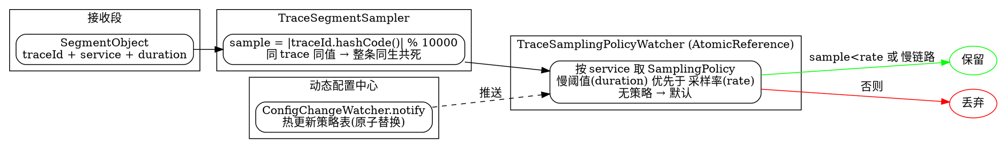

# SkyWalking Sampling: Deterministic Hash Plus Per-Service Policy

## Introduction

SkyWalking 的采样是**两级、且互不知情**的：探针侧是「每 3 秒最多 N 个 Segment」的滑动窗口限流（见 [SkyWalking 枢纽页](/docs/CS/Distributed/Tracing/SkyWalking.md) Mechanics 一节），OAP 侧再按 `traceId` 哈希做**确定性采样**。这一节只讲 OAP 侧这一半——`TraceSegmentSampler` 和它背后的 `TraceSamplingPolicyWatcher`。

一个容易被讲错的点：SkyWalking 的后端采样**不是**按「百分比随机丢」那么简单。它先对 traceId 做确定性哈希（保证整条 trace 同生共死），再叠加**按服务可配置的两档策略（采样率 + 慢链路阈值）**，且策略可**热更新**。这比 Jaeger 的 `hashCode%10000` 单点、Zipkin 的存储层 `CollectorSampler`（只看 traceId 低 64 位 + rate）都要精细：SkyWalking 把「慢/可疑链路强制保留」做成了一等公民。

> 基线：`E:/Projects/skywalking`（HEAD 11.1.0-SNAPSHOT，2026-11-03）。下文直接贴真实源码，路径相对仓库根，不再标注行号；采样器在 `oap-server/analyzer/agent-analyzer/.../trace/parser/listener/TraceSegmentSampler.java` 与 `.../trace/TraceSamplingPolicyWatcher.java`。

## The Deterministic Hash: One `sample` per Trace

采样器的前半段只是算一个 0–9999 的整数：

```java
// oap-server/analyzer/agent-analyzer/.../listener/TraceSegmentSampler.java
public boolean shouldSample(SegmentObject segmentObject, int duration) {
    int sample = Math.abs(segmentObject.getTraceId().hashCode()) % 10000;
    String serviceName = segmentObject.getService();
    return traceSamplingPolicyWatcher.shouldSample(serviceName, sample, duration);
}
```

`Math.abs(traceId.hashCode()) % 10000` 把任意 traceId 映射到 `[0, 10000)` 的一个固定槽位。由于同一个 trace 的所有 Segment 共享同一个 traceId，**它们的 `sample` 值必然相同**——所以一旦某个 segment 被采样，整条 trace 的其余 segment 也都会被采样，不会被切成半截（这正是 [SkyWalking 枢纽页](/docs/CS/Distributed/Tracing/SkyWalking.md) 说的「整条 trace 同生共死」）。`duration` 是这段 segment 的耗时（毫秒），后面用于慢链路判定。

## The Policy: Rate vs Slow-Threshold, Per Service

真正的判定在 `TraceSamplingPolicyWatcher`。它先看有没有这个服务的专属策略，没有就回落默认：

```java
// oap-server/analyzer/agent-analyzer/.../trace/TraceSamplingPolicyWatcher.java
public boolean shouldSample(String service, int sample, int duration) {
    SamplingPolicy samplingPolicy = this.samplingPolicySettings.get().get(service);
    if (samplingPolicy == null) {
        return shouldSampleByDefault(sample, duration);     // 无服务策略 → 默认
    }
    return shouldSampleService(samplingPolicy, sample, duration);
}
```

服务级策略的判定逻辑把「慢阈值」放在「采样率」之前：

```java
// TraceSamplingPolicyWatcher.java
private boolean shouldSampleService(SamplingPolicy samplingPolicy, int sample, int duration) {
    return (samplingPolicy.getDuration() != null && isOverSlowThreshold(duration, samplingPolicy.getDuration()))
        || (samplingPolicy.getRate() != null && withinRateRange(sample, samplingPolicy.getRate()))
        // 服务策略未设的维度，回落全局默认
        || (samplingPolicy.getDuration() == null && isOverDefaultSlowThreshold(duration))
        || (samplingPolicy.getRate() == null && withinDefaultRateRange(sample));
}

// 两个原子判定
private boolean isOverSlowThreshold(int currentDuration, int policyDuration) {
    return (policyDuration > -1) && (currentDuration >= policyDuration);   // 耗时越界 → 强制采样
}
private boolean withinRateRange(int currentSample, int policySample) {
    return currentSample < policySample;                                  // sample ∈ [0, rate) → 采样
}
```

把这段翻译成人话，就是**两档、慢优先**：

- **慢链路强制保留**：只要 `duration >= policy.duration`（且该服务配了 duration 阈值），无条件采样，不管 `sample` 落在哪。这是「慢/可疑请求永远留底」的保障。
- **按率采样**：否则看 `sample < policy.rate` 是否成立。`rate` 是配置里把采样率换算到 `[0,10000)` 的整数（例如 rate=5000 ≈ 50%），`sample` 落在 `[0, rate)` 才采。
- **服务策略未覆盖的维度回落全局默认**：服务策略只设了 rate 没设 duration，就按默认 duration 补判慢阈值；反之亦然。优先级永远是 **慢阈值 > 采样率**，无论服务级还是全局级。

默认策略来自静态 YAML，构造时由 `parseFromFile` 加载；`shouldSampleByDefault` 用的就是这份 `defaultPolicy` 的 rate 与 duration：

```java
// TraceSamplingPolicyWatcher.java
private boolean shouldSampleByDefault(int sample, int duration) {
    return isOverDefaultSlowThreshold(duration) || withinDefaultRateRange(sample);
}

private boolean withinDefaultRateRange(int sample) {
    return withinRateRange(sample, this.samplingPolicySettings.get().getDefaultPolicy().getRate());
}

private boolean isOverDefaultSlowThreshold(int duration) {
    return isOverSlowThreshold(duration, this.samplingPolicySettings.get().getDefaultPolicy().getDuration());
}

private SamplingPolicySettings parseFromFile(final String file) {
    try {
        SamplingPolicySettingsReader reader = new SamplingPolicySettingsReader(ResourceUtils.read(file));
        return reader.readSettings();
    } catch (Exception e) {
        log.error("[trace-sampling-policy] Cannot load configs from: {}", file, e);
    }
    // It must have a default config on init
    return new SamplingPolicySettings();
}
```

## Hot Reload: `ConfigChangeWatcher`

采样策略不是写死在代码里的。`TraceSamplingPolicyWatcher extends ConfigChangeWatcher`——它挂在 SkyWalking 的动态配置中心上：

```java
// TraceSamplingPolicyWatcher.java
@Override
public void notify(ConfigChangeEvent value) {
    if (EventType.DELETE.equals(value.getEventType()) || StringUtil.isBlank(value.getNewValue())) {
        this.settingsString.set(null);
        log.info("[trace-sampling-policy] Delete trace-sampling-policy,use default config");
        loadDefaultPolicySettings();                 // 配置被删 → 回退静态默认
    } else {
        activeSetting(value.getNewValue());          // 新 YAML → 解析并原子替换
    }
}
```

`notify` 收到配置中心的变更后，`parseFromYml` 解析、成功则 `samplingPolicySettings.set(...)` **原子替换整个策略表**：

```java
// TraceSamplingPolicyWatcher.java
private void activeSetting(String config) {
    if (log.isDebugEnabled()) {
        log.debug("[trace-sampling-policy] Updating using new config: {}", config);
    }
    onUpdated(parseFromYml(config));
}

private void onUpdated(final SamplingPolicySettings samplingPolicySettings) {
    if (!isNull(samplingPolicySettings)) {
        this.samplingPolicySettings.set(samplingPolicySettings);
        log.info("[trace-sampling-policy] Updating trace-sample-policy with: {}", samplingPolicySettings);
    } else {
        log.info(
            "[trace-sampling-policy] Parse yaml fail, retain last configuration: {}", this.samplingPolicySettings);
    }
}
```

因为读取端 `shouldSample` 用的是 `this.samplingPolicySettings.get()`（一个 `AtomicReference`），所以一次配置推送能让所有在途的采样判定**无缝切换到新策略**，无需重启 OAP。解析失败时 `parseFromYml` 返回 `null`，`onUpdated` 保留旧配置（不破坏线上），只打 info 日志。

## Contrast With Jaeger / Zipkin

把三家的后端采样摆在一起看差异很明显：

- **Jaeger（v2）**：`TraceSegmentSampler` 没有——Jaeger 的 head sampling 是 `tail_sampling` processor + `remotesampling` 策略服务器，且还有 `adaptivesampling` 按 operation 吞吐收敛到 `TargetSamplesPerSecond`（见 [Jaeger 采样](/docs/CS/Distributed/Tracing/Jaeger/Sampling.md)）。它是**采样决策与落库解耦的闭环**，方向是「客户端执行 + 服务端算率」。
- **Zipkin**：`CollectorSampler.isSampled` 是**存储层采样**，只看 traceId 低 64 位、`boundary = Long.MAX_VALUE * rate`、debug 恒过（见 [Zipkin Collectors](/docs/CS/Distributed/Tracing/Zipkin/Collectors.md)）。它是单点百分比 + debug 白名单，没有「慢链路强制保留」这一说。
- **SkyWalking**：确定性哈希保证整 trace 一致 + 按服务可配「采样率 / 慢阈值」双档（慢优先）+ 策略热更新。它把「慢/可疑链路必留」做成了一等公民，且粒度细到**每个服务**。

## Mental Model



一句话总结：**SkyWalking 的 OAP 侧采样 = 确定性哈希（整 trace 一致）+ 按服务可配的「采样率 / 慢阈值」双档（慢优先）+ 配置中心热更新；`sample` 落在 `[0,rate)` 才按率采，但只要 `duration >= 阈值` 慢链路一律强制保留，且服务策略未覆盖的维度回落全局默认。**

## Links

- [SkyWalking 源码实现总览](/docs/CS/Distributed/Tracing/SkyWalking.md)
- [SkyWalking 接收管线](/docs/CS/Distributed/Tracing/SkyWalking/Receiver.md)
- [SkyWalking 枢纽页](/docs/CS/Distributed/Tracing/SkyWalking.md)
- [Jaeger 采样体系](/docs/CS/Distributed/Tracing/Jaeger/Sampling.md)
- [Zipkin Collector 传输层](/docs/CS/Distributed/Tracing/Zipkin/Collectors.md)

## References

- 采样器：`oap-server/analyzer/agent-analyzer/src/main/java/org/apache/skywalking/oap/server/analyzer/provider/trace/parser/listener/TraceSegmentSampler.java`
- 采样策略：`oap-server/analyzer/agent-analyzer/src/main/java/org/apache/skywalking/oap/server/analyzer/provider/trace/TraceSamplingPolicyWatcher.java`
- 策略数据模型：`oap-server/analyzer/agent-analyzer/src/main/java/org/apache/skywalking/oap/server/analyzer/provider/trace/sampling/SamplingPolicy.java`、`SamplingPolicySettings.java`
- SkyWalking 后端采样文档：<https://skywalking.apache.org/docs/main/latest/en/setup/backend/backend-setting-override/#trace-sampling>
