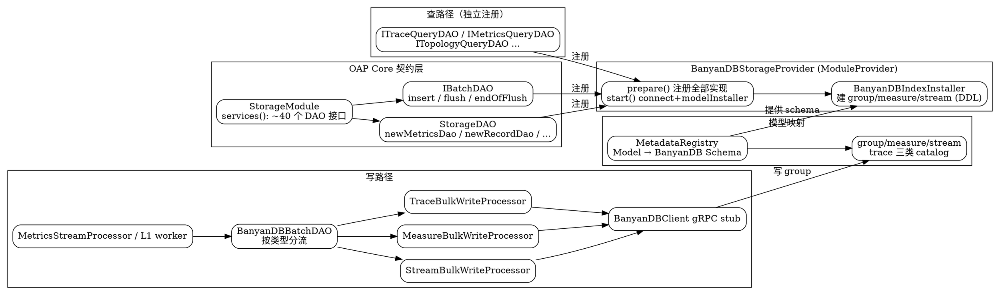

# SkyWalking Storage: Module Abstraction and the BanyanDB Write Path

## Introduction

SkyWalking 把「存储」当成一条**纯 SPI 模块线**来治理，而不是像 Jaeger 那样做成 collector 里的 extension，也不是像 Zipkin 那样用 Spring 的 `@Bean` 同 JVM 覆盖。它和 SkyWalking 其它一切一样——由 `ModuleManager` 用 `ServiceLoader` 加载 `ModuleDefine`/`ModuleProvider`（详见 [SkyWalking 枢纽](/docs/CS/Distributed/Tracing/SkyWalking.md) 的 Boot SPI 一节）——`storage` 这条线就是 `StorageModule` 声明契约、各个后端（BanyanDB / Elasticsearch / JDBC）各自实现成 `ModuleProvider`。

这一节拆开两层：**契约层**（OAP Core 里那 ~40 个 DAO 接口到底约束了什么），以及**默认后端的写路径**（BanyanDB 怎么把一条 Span / 一个 Metrics 真正落进服务端）。一个容易被文档误导的点：`StorageModule` 的 JavaDoc 至今还写着「H2, MySQL, ES, TiDB」，但 [SkyWalking 枢纽](/docs/CS/Distributed/Tracing/SkyWalking.md) 已用 `application.yml` 的 `selector: ${SW_STORAGE:banyandb}` 证明 **默认就是 BanyanDB、H2 存储 provider 早已移除**——JDBC 系（MySQL/PG）以 `storage-jdbc-hikaricp-plugin` 形式仍在，但 H2 不在。

> 基线：`E:/Projects/skywalking`（HEAD 11.1.0-SNAPSHOT，2026-11-03）。下文直接贴真实源码，路径相对仓库根，不再标注行号；BanyanDB 插件路径在 `oap-server/server-storage-plugin/storage-banyandb-plugin`。

## The Contract: `StorageModule` Declares the DAO Surface

`StorageModule` 本身只是个空壳 `ModuleDefine`，它的全部分量都在 `services()` 返回的接口数组里——这是 OAP 对「一个存储后端必须提供哪些能力」的集中声明：

```java
// oap-server/server-core/.../core/storage/StorageModule.java
public class StorageModule extends ModuleDefine {
    public static final String NAME = "storage";

    @Override
    public Class[] services() {
        return new Class[] {
            StorageBuilderFactory.class,
            IBatchDAO.class,                       // 流式写入（本节重点）
            StorageDAO.class,                      // DAO 工厂（指标/记录/管理）
            IHistoryDeleteDAO.class,
            INetworkAddressAliasDAO.class,
            ITopologyQueryDAO.class,               // 拓扑查询
            IMetricsQueryDAO.class,                // 指标查询
            ITraceQueryDAO.class,                  // 链路查询
            IMetadataQueryDAO.class,
            IAggregationQueryDAO.class,
            IAlarmQueryDAO.class,
            IRecordsQueryDAO.class,
            ILogQueryDAO.class,
            IZipkinQueryDAO.class, IOTLPTraceQueryDAO.class, // 桥接 Zipkin/OTLP 查询
            IHierarchyQueryDAO.class,
            // …… 另有 profiling / ebpf / pprof / genAI / asyncProfiler 等 ~25 个专用 DAO
        };
    }
}
```

注意两件事。第一，这份名单是**读、写、查全混在一起**的：既有 `IBatchDAO`（写）、`StorageDAO`（造写 DAO），也有 `ITraceQueryDAO`/`IMetricsQueryDAO`/`ITopologyQueryDAO`（查）。第二，它把「链路 (`ITraceQueryDAO`)、指标 (`IMetricsQueryDAO`)、拓扑 (`ITopologyQueryDAO`)、日志 (`ILogQueryDAO`)、告警 (`IAlarmQueryDAO`)」全部抽成独立接口——后端插件必须一次性把这些都实现并注册，否则 `ModuleManager` 在启动期就会因「服务未提供」而失败。这比 Jaeger 一个 `tracestore.Factory` 包打天下、Zipkin 一个 `StorageComponent` 拆五接口，约束面都要宽。

## `IBatchDAO`: The Streaming Write Contract

写这一侧只靠一个接口，而且语义被注释钉得很死——它明确要求**异步、流式**，且方法返回不代表数据已可查：

```java
// oap-server/server-core/.../core/storage/IBatchDAO.java
public interface IBatchDAO extends DAO {
    // Push data into the database in async mode. This method is driven by streaming process.
    // This method doesn't request the data queryable immediately after the method finished.
    void insert(InsertRequest insertRequest);

    // Push data collection into the database in async mode... requires thread safe.
    // No delete happens in streaming mode.
    CompletableFuture<Void> flush(List<PrepareRequest> prepareRequests);

    // End of flush is an event to notify the whole flush period is ending.
    default void endOfFlush() {}
}
```

两类写模式分得很清：`insert(InsertRequest)` 是**纯追加**（流式 worker 每产出一条就推一条），`flush(List<PrepareRequest>)` 是**批量混合 insert/update**（Metrics 的 L1 聚合结果要做 upsert）。注释特意强调 streaming 模式「No delete happens」——删除（TTL 清理）走的是另一条 `IHistoryDeleteDAO` 路径，不污染热写路径。这也是为什么 SkyWalking 的写入能撑住高吞吐：它把「逐条 append」和「周期性批量 upsert」在接口层面就分开了。

## The Provider: `BanyanDBStorageProvider` Registers Everything

BanyanDB 后端就是一个 `ModuleProvider`，`name()="banyandb"`、`module()=StorageModule.class`。真正的戏份在 `prepare()`——它把上面那一长串接口**逐个 new 出 BanyanDB 实现并注册**：

```java
// oap-server/server-storage-plugin/.../banyandb/BanyanDBStorageProvider.java
@Slf4j
public class BanyanDBStorageProvider extends ModuleProvider {
    @Override public String name() { return "banyandb"; }
    @Override public Class<? extends ModuleDefine> module() { return StorageModule.class; }

    @Override
    public void prepare() throws ServiceNotProvidedException, ModuleStartException {
        config = new BanyanDBConfigLoader(this).loadConfig();
        if (StringUtil.isBlank(config.getGlobal().getNamespace())) {
            config.getGlobal().setNamespace("sw");          // 默认 namespace
        }
        // TTL 级联校验：指标各粒度 TTL 不得越过 metadata TTL
        if (config.getMetricsDay().getTtl() > config.getMetadata().getTtl()) {
            throw new ModuleStartException("metricsDay ttl must be less than or equal to metadata ttl");
        }
        this.registerServiceImplementation(StorageBuilderFactory.class, new StorageBuilderFactory.Default());
        this.client = new BanyanDBStorageClient(getManager(), config);
        this.modelInstaller = new BanyanDBIndexInstaller(client, getManager(), this.config);

        this.registerServiceImplementation(IBatchDAO.class,
            new BanyanDBBatchDAO(client, maxBulkSize, flushInterval, concurrency));
        this.registerServiceImplementation(StorageDAO.class, new BanyanDBStorageDAO(client));
        this.registerServiceImplementation(ITraceQueryDAO.class,
            new BanyanDBTraceQueryDAO(client, segmentQueryMaxSize, getManager()));
        this.registerServiceImplementation(IMetricsQueryDAO.class, new BanyanDBMetricsQueryDAO(client));
        this.registerServiceImplementation(ITopologyQueryDAO.class, new BanyanDBTopologyQueryDAO(client));
        // ……警报/日志/Profile/EBPF/GenAI 等几十个 DAO 同上
    }
}
```

几个值得记的点：

- **TTL 级联约束**（`prepare()` 内 `metricsDay/Hour/Min > metadata` 即抛 `ModuleStartException`）——BanyanDB 里 metadata（服务/端点目录）必须比任何指标分桶活得更久，否则拓扑/服务名查出来会缺条目。这是 BanyanDB 多 TTL 分桶模型对 OAP 的倒逼。
- **DDL 在 `start()` 而非 `prepare()`**：`start()` 里 `client.connect()` 之后调 `modelInstaller.start()` 真正建 group/measure/stream，再把 `ModelRegistry` 的 model 变更监听挂上：

```java
// BanyanDBStorageProvider.java
@Override
public void start() throws ServiceNotProvidedException, ModuleStartException {
    MetricsCreator metricCreator = getManager().find(TelemetryModule.NAME)
                                               .provider()
                                               .getService(MetricsCreator.class);
    HealthCheckMetrics healthChecker = metricCreator.createHealthCheckerGauge(
        "storage_banyandb", MetricsTag.EMPTY_KEY, MetricsTag.EMPTY_VALUE);
    this.client.registerChecker(healthChecker);
    try {
        this.client.connect();
        this.modelInstaller.start();

        getManager().find(CoreModule.NAME).provider().getService(ModelRegistry.class).addModelListener(modelInstaller);

        ServerStatusService serverStatusService =
            getManager().find(CoreModule.NAME).provider().getService(ServerStatusService.class);
        serverStatusService.registerConfigDumpExtension(
            new BanyanDBConfigDumpExtension(StorageModule.NAME + "." + name(), this.config));
    } catch (Exception e) {
        throw new ModuleStartException(e.getMessage(), e);
    }
}
```

`prepare()` 只造对象，`start()` 才碰服务端——这是 SkyWalking ModuleProvider 生命周期的标准套路。
- **`notifyAfterCompleted()` 做 TopN 规则清理**：启动收尾时比对本端配置的 TopN 规则与 BanyanDB 服务端实际存在的规则，多出来的按 `cleanupUnusedTopNRules` 开关决定删还是只告警：

```java
// BanyanDBStorageProvider.java
// Cleanup TopN rules in BanyanDB server that are not configured in the current config.
private void cleanupUnusedTopNRules(List<BanyandbCommon.Group> groups) throws BanyanDBException {
    Set<String> topNNames = new HashSet<>();
    this.config.getTopNConfigs().values().forEach(topNConfig -> {
        topNNames.addAll(topNConfig.keySet());
    });
    for (BanyandbCommon.Group group : groups) {
        if (BanyandbCommon.Catalog.CATALOG_MEASURE.equals(group.getCatalog())) {
            String groupName = group.getMetadata().getName();
            List<BanyandbDatabase.TopNAggregation> topNAggregations = this.client.client.findTopNAggregations(
                groupName);
            if (CollectionUtils.isNotEmpty(topNAggregations)) {
                for (BanyandbDatabase.TopNAggregation topNAggregation : topNAggregations) {
                    String topNName = topNAggregation.getMetadata().getName();
                    if (!topNNames.contains(topNName)) {
                        if (this.config.getGlobal().isCleanupUnusedTopNRules()) {
                            this.client.client.deleteTopNAggregation(groupName, topNName);
                            log.info(
                                "Deleted unused topN rule from BanyanDB server: {}, group: {}. Please check bydb-topn.yml. " +
                                    "If you don't want to cleanup unused rules from server, please set cleanupUnusedTopNRules=false in bydb.yml",
                                topNName, groupName
                            );
                        } else {
                            // Log the unused TopN aggregation.
                            log.warn(
                                "Unused topN rule in BanyanDB server: {}, group: {}. Please check bydb-topn.yml. " +
                                    "If you want to cleanup unused rules from server, please set cleanupUnusedTopNRules=true in bydb.yml",
                                topNName, groupName
                            );
                        }
                    }
                }
            }
        }
    }
}
```

也就是说「规则漂移」是 OAP 主动对账，而不是指望 BanyanDB 自己回收。

## The Write Path: `BanyanDBBatchDAO` → Bulk Processors → gRPC

写一条 Span 或 Metrics 落进 BanyanDB 的实际路径，是 `MetricsStreamProcessor`/各 L1 worker 调 `IBatchDAO.insert/flush`，进到 `BanyanDBBatchDAO` 后按**请求类型分流**到三种 bulk 处理器：

```java
// oap-server/server-storage-plugin/.../banyandb/BanyanDBBatchDAO.java
@Override
public void insert(InsertRequest insertRequest) {
    if (insertRequest instanceof BanyanDBStreamInsertRequest) {        // 记录/日志/告警
        getStreamBulkWriteProcessor().add(((BanyanDBStreamInsertRequest) insertRequest).getStreamWrite());
    } else if (insertRequest instanceof BanyanDBMeasureInsertRequest) { // 指标
        getMeasureBulkWriteProcessor().add(((BanyanDBMeasureInsertRequest) insertRequest).getMeasureWrite());
    } else if (insertRequest instanceof BanyanDBTraceInsertRequest) {  // 链路 segment
        getTraceBulkWriteProcessor().add(((BanyanDBTraceInsertRequest) insertRequest).getTraceWrite());
    }
}
```

三种处理器各自惰性 DCL 初始化（三个独立的 `SYNCHRONIZER` 锁），分别由 `client.createStreamBulkProcessor / createMeasureBulkProcessor / createTraceBulkProcessor` 造出，最终都落到 `BanyanDBClient` 的 gRPC stub。这里印证了 BanyanDB 的**三类数据模型**：Stream（记录类，带 entityId）、Measure（指标类，带 timestamp+fields）、Trace（链路类，BanyanDB 专属的 trace 模型）——正好一一对应 OAP 的 Record / Metrics / Segment 三种模型。

一个容易忽略的细节是 `endOfFlush()` 只强制刷 Measure、不碰 Stream/Trace：

```java
// BanyanDBBatchDAO.java
@Override
public void endOfFlush() {
    if (measureBulkWriteProcessor != null) {
        measureBulkWriteProcessor.flush();
    }
}
```

注释解释得很直白：指标是**持久化定时器**按轮次 queue 出来的，若交给 bulk 自己的 `flushInterval` 调度，要等最长一个间隔，比定时器等 ack 还久，这一轮会在 session 缓存填满前就结束；Stream/Trace 不是定时器驱动，保留自己的节奏即可。这说明 OAP 的「指标落库」和「链路/记录落库」在冲刷时机上被刻意区别对待。

单条 gRPC 写入的容错也写得很实——`BanyanDBStorageClient.write(StreamWrite)` 用 `StreamObserver` 把 BanyanDB 的状态码翻译成异常：

```java
// oap-server/server-storage-plugin/.../banyandb/BanyanDBStorageClient.java
public CompletableFuture<Void> write(StreamWrite streamWrite) {
    checkState(client.getStreamServiceStub() != null, "stream service is null");
    CompletableFuture<Void> future = new CompletableFuture<>();
    final StreamObserver<BanyandbStream.WriteRequest> obs = client.getStreamServiceStub()
        .withDeadlineAfter(options.getDeadline(), TimeUnit.SECONDS).write(new StreamObserver<>() {
            @Override public void onNext(BanyandbStream.WriteResponse r) {
                switch (StatusUtil.convertStringToStatus(r.getStatus())) {
                    case STATUS_SUCCEED: break;
                    case STATUS_INVALID_TIMESTAMP: /* → InvalidArgumentException */ break;
                    case STATUS_NOT_FOUND:        /* → InvalidArgumentException（元数据找不到）*/ break;
                    case STATUS_EXPIRED_SCHEMA:    /* → 记录 group.name + modRevision，告警 */ break;
                    default: /* → InternalException */ break;
                }
            }
            @Override public void onError(Throwable t) { future.completeExceptionally(t); }
            @Override public void onCompleted() { future.complete(null); }
        });
    writeRequestStreamObserver.onNext(streamWrite.build());
    writeRequestStreamObserver.onCompleted();
    return future;
}
```

`STATUS_EXPIRED_SCHEMA` 分支特别值得留意：它记下 `metadata.getGroup()+"."+metadata.getName()` 和 `modRevision` 并打 error。OAP 在 `MetadataRegistry` 里用 `ConcurrentHashMap` 缓存模型 schema（见下节贴出的 registry 声明），而 BanyanDB 服务端做 schema 变更会产生新 revision——这条错误码就是「本地缓存的 schema 版本落后于服务端」的信号，配合 `requireManagementSchema` 的兜底重推导（client 里 `MetadataRegistry.INSTANCE.findManagementMetadata`），形成「读路径发现 schema 缺失就本地重算、写路径发现过期就告警」的双保险。

## `StorageDAO`: The Read/Write DAO Factory

与 `IBatchDAO`（流式追加）正交的是 `StorageDAO`——它是**造「读/写 DAO」对象的工厂**，专门给 Metrics / Record / NoneStream / Management 四类数据用：

```java
// oap-server/server-core/.../core/storage/StorageDAO.java
public interface StorageDAO extends Service {
    IMetricsDAO newMetricsDao(StorageBuilder storageBuilder);
    IRecordDAO  newRecordDao(StorageBuilder storageBuilder);
    INoneStreamDAO newNoneStreamDao(StorageBuilder storageBuilder);
    IManagementDAO newManagementDao(StorageBuilder storageBuilder);
}
```

BanyanDB 的实现把每一种都 new 成对应的具体 DAO：

```java
// oap-server/server-storage-plugin/.../banyandb/stream/BanyanDBStorageDAO.java
public class BanyanDBStorageDAO extends AbstractDAO<BanyanDBStorageClient> implements StorageDAO {
    @Override public IMetricsDAO newMetricsDao(StorageBuilder b) {
        return new BanyanDBMetricsDAO(getClient(), (StorageBuilder<Metrics>) b);
    }
    @Override public IRecordDAO newRecordDao(StorageBuilder b) {
        return new BanyanDBRecordDAO(getClient(), (StorageBuilder<Record>) b);
    }
    // newNoneStreamDao → BanyanDBNoneStreamDAO, newManagementDao → BanyanDBManagementDAO
}
```

这里出现一个与 Jaeger/Zipkin 都不同的写法：**写 DAO（`IMetricsDAO` 等）和查 DAO（`ITraceQueryDAO`/`IMetricsQueryDAO`）是两套独立的注册**。`IBatchDAO`/`StorageDAO` 负责「谋而后动」的写（带 `StorageBuilder` 做对象↔存储行的序列化），而 `ITraceQueryDAO` 之类是直接 `registerServiceImplementation` 进去的查询实现。也就是说 OAP 把「怎么写进去」和「怎么查出来」在 SPI 层面就拆成了两个维度，后端要填的表比另外两家都大。

## Model → BanyanDB Mapping: `MetadataRegistry`

最后一层是「OAP 的 Model（一个 Metrics 类、一个 Record 类）如何落成 BanyanDB 的 group/measure/stream」。这由 `MetadataRegistry` 这个枚举单例承担——它把每个 `Model` 推导成 BanyanDB 的 `Schema`（group 名、catalog、tag family、index rule）：

```java
// oap-server/server-storage-plugin/.../banyandb/MetadataRegistry.java
public enum MetadataRegistry {
    INSTANCE;
    // ConcurrentHashMap: boot 单线程填充，self-heal 路径从持久化/查询线程并发回写
    private final Map<String, Schema> registry = new ConcurrentHashMap<>();
    // 纯本地推导，无需服务端 RPC；读路径发现缓存空时由 repopulateLocally 重算
    @FunctionalInterface
    public interface LocalSchemaPopulator { void populateLocally(Model model); }
}
```

`DownSampling`（指标按分钟/小时/天降采样）直接映射到 BanyanDB 的多个 measure group，各带独立 TTL——这正对应 `BanyanDBStorageConfig` 里按粒度拆开的 TTL 配置桶。而全局写参数定义在 `Global` 内部类里：

```java
// oap-server/server-storage-plugin/.../banyandb/BanyanDBStorageConfig.java
@Getter
@Setter
public class BanyanDBStorageConfig extends ModuleConfig {
    private Global global = new Global();
    // ... recordsNormal / trace / zipkinTrace / otlpTrace ...
    private MetricsMin metricsMin = new MetricsMin();
    private MetricsHour metricsHour = new MetricsHour();
    private MetricsDay metricsDay = new MetricsDay();
    private Metadata metadata = new Metadata();
    private Property property = new Property();

    @Getter
    @Setter
    public static class Global {
        /**
         * A comma-separated list of BanyanDB targets.
         */
        private String targets = "127.0.0.1:17912";
        /**
         * The maximum size of write entities in a single batch write call.
         */
        private int maxBulkSize = 5000;
        /**
         * Period of flush interval. In the timeunit of seconds.
         */
        private int flushInterval = 15;
        /**
         * Timeout of flush. In the timeunit of seconds.
         */
        private int flushTimeout = 10;
        /**
         * Concurrent consumer threads for batch writing.
         */
        private int concurrentWriteThreads = 2;
        // ...
        /**
         * Row cap for a query that does not carry a limit of its own — cache loads such as network aliases,
         * and every read whose result size is not bounded by paging. It is always sent to the server: a
         * BydbQL query with no {@code LIMIT} would otherwise fall back to BanyanDB's own default (100 rows
         * for measures, 20 for streams/traces), which truncates the result set silently.
         */
        private int resultWindowMaxSize = 10000;
        // ...
    }
}
```

即 `targets=127.0.0.1:17912`、`maxBulkSize=5000`、`flushInterval=15s`、`flushTimeout=10s`、`concurrentWriteThreads=2`、`resultWindowMaxSize=10000`——这些就是上一节 bulk 处理器和 `resultWindowMaxSize` 兜底 `LIMIT` 的源头。

## Mental Model



一句话总结：**SkyWalking 的存储是「SPI 模块 + 一份超宽 DAO 契约」，写路径靠 `IBatchDAO` 把流式 append 与批量 upsert 分开、再按 Stream/Measure/Trace 三类 catalog 走各自的 bulk 处理器落进 BanyanDB；模型到 BanyanDB 的映射集中在 `MetadataRegistry`，指标的分钟/小时/天降采样直接翻译成多个带独立 TTL 的 measure group。** 与 Jaeger（extension + 单一 `tracestore.Factory`）和 Zipkin（Spring bean + 单一 `StorageComponent`）相比，它的后端要填的「能力表」最广，但也因此把链路/指标/拓扑/日志/告警的存储语义一次性钉死。

## 时间桶 TimeBucket

## TimeBucket: Time as a Sortable Integer

时间序列存储的效率取决于时间编码。SkyWalking 的 `TimeBucket` 把时间压成一个**十进制前缀整数**：

| 粒度 | 格式 | 示例 | 数值区间 |
| --- | --- | --- | --- |
| Second | `yyyyMMddHHmmss` | `20240711221830` | 1e13 ~ 1e14 |
| Minute | `yyyyMMddHHmm` | `202407112218` | 1e11 ~ 1e12 |
| Hour | `yyyyMMddHH` | `2024071122` | 1e9 ~ 1e10 |
| Day | `yyyyMMdd` | `20240711` | 1e7 ~ 1e8 |

编码是**定长数字前缀**而非字符串，这带来三个直接好处：

1. **天然按时间排序**，字典序即时间序，无需额外时间索引；
2. **降采样是位/位段截断**：`toTimeBucketInHour()` / `toTimeBucketInDay()` 直接截掉低位（`retainToDay4MinuteBucket` 把 `202407112218` 变成 `202407110000`），无需日期计算；
3. **粒度靠数值区间判别**：`isSecondBucket` / `isMinuteBucket` / `isHourBucket` / `isDayBucket` 各自用固定区间判断——这既省了字段，也保证了「反查时间戳」能自动得出原粒度。

L1/L2 降采样正建立在这个编码之上：OAP 按分钟聚合（`l1FlushPeriod` 默认 500ms 是**聚合窗口刷新周期**，不是数据粒度），再由 `toHour()` / `toDay()` 产出小时级、天级指标。

## BanyanDB 三种物理模型与 Series 分片

## BanyanDB: Three Physical Models

BanyanDB 不是「又一个时序库」，它提供**三种数据模型**，SkyWalking 按数据性质映射：

| 模型 | 语义 | SkyWalking 映射 | 关键特征 |
| --- | --- | --- | --- |
| **Stream** | 明细型时序 | Trace、Segment、日志、Records | 保留明细，一条不落；支持 Trace retention pipeline（Hot 阶段 LSM compaction 时整条丢弃） |
| **Measure** | 可聚合指标 | 分钟 / 小时 / 天级 Metrics（`metricsMinute` / `metricsHour` / `metricsDay`） | 围绕标签预聚合，支持服务端 TopN |
| **Property** | 非时序属性 | UI、Profiling | 不按时间分段，无 `segmentInterval` / `ttl` |

对应的存储插件类分别是 `StreamModel` / `MeasureModel` / `PropertyModel`，三者都携带一组 `IndexRule`——即**索引规则由 SkyWalking 侧定义并下发**，而非 BanyanDB 自动推断。

### Series and Sharding

BanyanDB 的 **Series** 是核心概念：由**相同的 Tag 组合**标识的一组时间序列数据。SkyWalking 侧由 `@BanyanDB.SeriesID(index = 0)` 指定哪个字段充当 Series ID（关系指标里是 `entityId`）。

分片规则是 **对 Series ID 取 hash**：

```
Tags → Series 身份 → Series ID → hash → Shard
```

这解释了 SkyWalking 为什么把 `entityId` 设计成「源服务 + 目标服务」的组合：它既是聚合的幂等键，也是分片的路由键——**同一对服务的所有数据必定落在同一 shard**，拓扑查询因此无需跨节点 join。

### TopN 服务端预聚合

`bydb.yaml` 里的度量定义支持：

```yaml
- name: endpoint_cpm-service
  metricName: endpoint_cpm
  groupByTagNames:
    - service_id
  sort: des
```

按 `service_id` 分组、降序维护 TopN，**排序在 BanyanDB 服务端完成**，查询时无需扫全量再排序。这是 Measure 相对 Stream 的核心优势，也是「OAP 只写指标、聚合交给存储」这一分工的基础。

## 两级流式聚合 L1/L2

## Two-Stage Streaming Aggregation

`SourceDispatcher` 最终把 Source 转成 `Metrics`，交给 `MetricsStreamProcessor`。它的 `in()` 按指标类路由到 L1 聚合 worker：

```java
// oap-server/server-core/.../core/analysis/worker/MetricsStreamProcessor.java
private final Map<Class<? extends Metrics>, MetricsAggregateWorker> entryWorkers = new ConcurrentHashMap<>();
private final List<MetricsPersistentWorker> persistentWorkers = new CopyOnWriteArrayList<>();
// ...
private long l1FlushPeriod = 500;          // L1 aggregation flush, unit ms
private long storageSessionTimeout = 70_000;

public void in(Metrics metrics) {
    MetricsAggregateWorker worker = entryWorkers.get(metrics.getClass());
    if (worker != null) {
        worker.in(metrics);
        return;
    }
    // Unknown class: structural rollout / hot-remove window, or a bug.
    unroutableSampleCount.incrementAndGet();
    if (warnedUnroutableClasses.putIfAbsent(metrics.getClass(), Boolean.TRUE) == null) {
        log.warn("Dropped sample for unregistered metric class {}", metrics.getClass().getName());
    }
}
```

两个细节值得注意：

- **L1 是内存合并，L2 才落库**。一个指标类对应一条 `MetricsAggregateWorker`（L1，按 `StorageID` = 时间桶 + 实体 ID 合并），以及一组 `MetricsPersistentWorker`（L2，负责分钟/小时/天降采样写入）。`l1FlushPeriod=500ms` 是 L1 的刷新周期，不是数据粒度；真正的降采样（toHour / toDay）在 L2 完成。
- **未注册类静默丢弃**。上面 `in()` 里 `warnedUnroutableClasses` 的 `putIfAbsent` 保证每个未知指标类只告警一次——这是为 OAL 热更新 / 滚动发布窗口设计的：新指标在一个节点上还没注册时，样本不会刷屏日志，而是被默默丢弃。

这套两段式聚合与 [SkyWalking Agent 机理](/docs/CS/Distributed/Tracing/SkyWalking/Agent.md) 里讲的 `MetricsSessionCache` / `combine()` 是同一链路的两面：本篇看到的是「worker 怎么编排」，Internals 看到的是「一次 combine 合并了什么（拓扑边只并 componentIds 集合）」。


## Links

- [SkyWalking 源码实现总览](/docs/CS/Distributed/Tracing/SkyWalking.md)
- [SkyWalking 枢纽页](/docs/CS/Distributed/Tracing/SkyWalking.md)
- [Jaeger 存储抽象](/docs/CS/Distributed/Tracing/Jaeger/Storage.md)
- [Zipkin 存储抽象](/docs/CS/Distributed/Tracing/Zipkin/Storage.md)

## References

- StorageModule 契约：`oap-server/server-core/src/main/java/org/apache/skywalking/oap/server/core/storage/StorageModule.java`
- 流式写接口：`oap-server/server-core/.../core/storage/IBatchDAO.java`
- BanyanDB provider：`oap-server/server-storage-plugin/storage-banyandb-plugin/src/main/java/org/apache/skywalking/oap/server/storage/plugin/banyandb/BanyanDBStorageProvider.java`
- BanyanDB 批量写：`oap-server/server-storage-plugin/storage-banyandb-plugin/src/main/java/org/apache/skywalking/oap/server/storage/plugin/banyandb/BanyanDBBatchDAO.java`
- BanyanDB 客户端：`oap-server/server-storage-plugin/storage-banyandb-plugin/src/main/java/org/apache/skywalking/oap/server/storage/plugin/banyandb/BanyanDBStorageClient.java`
- DAO 工厂：`oap-server/server-storage-plugin/storage-banyandb-plugin/src/main/java/org/apache/skywalking/oap/server/storage/plugin/banyandb/stream/BanyanDBStorageDAO.java`
- 模型映射：`oap-server/server-storage-plugin/storage-banyandb-plugin/src/main/java/org/apache/skywalking/oap/server/storage/plugin/banyandb/MetadataRegistry.java`
- 存储配置：`oap-server/server-storage-plugin/storage-banyandb-plugin/src/main/java/org/apache/skywalking/oap/server/storage/plugin/banyandb/BanyanDBStorageConfig.java`
- SkyWalking storage plugin 官方文档：<https://skywalking.apache.org/docs/main/latest/en/setup/backend/backend-storage/>
