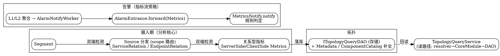

# SkyWalking Topology & Alarm: Derive-at-Ingest, Not Query-Time

## Introduction

Jaeger 和 Zipkin 的「拓扑」「告警」几乎都不在核心存储/分析链路里——Jaeger 靠查询期对 span 做 join、或依赖外部 UI 计算；Zipkin 的 `DependencyLinker` 是**查询期**服务端视角从 span 反推依赖边（且仅 SERVER/CONSUMER）。SkyWalking 的做法相反：**拓扑边在 ingest 期就由分析核心算好存下来，告警则寄生在指标聚合流上**。这一节把这两块讲清，它们正好体现了 SkyWalking「APM 而非纯追踪」的定位。

> 基线：`E:/Projects/skywalking`（HEAD 11.1.0-SNAPSHOT，2026-11-03）。下文直接贴真实源码，路径相对仓库根，不再标注行号。

## Topology: A Stored Byproduct of the Analysis Core

拓扑的**查询**侧和别的查询一样走三层：resolver → CoreModule 服务 → StorageModule DAO。以 `TopologyQueryService` 为例：

```java
// oap-server/server-core/.../core/query/TopologyQueryService.java
private ITopologyQueryDAO getTopologyQueryDAO() {
    if (topologyQueryDAO == null) {
        topologyQueryDAO = moduleManager.find(StorageModule.NAME)
                                          .provider().getService(ITopologyQueryDAO.class);
    }
    return topologyQueryDAO;
}
```

但它不是只查 `ITopologyQueryDAO`——还拉 `MetadataQueryService`（补节点名/服务名）和 `IComponentLibraryCatalogService`（补组件类型名，如 Tomcat/HttpClient/Redis），把裸边补成带语义的拓扑图：

```java
// TopologyQueryService.java
private MetadataQueryService getMetadataQueryService() {
    if (metadataQueryService == null) {
        metadataQueryService = moduleManager.find(CoreModule.NAME).provider().getService(MetadataQueryService.class);
    }
    return metadataQueryService;
}

private IComponentLibraryCatalogService getComponentLibraryCatalogService() {
    if (componentLibraryCatalogService == null) {
        componentLibraryCatalogService = moduleManager.find(CoreModule.NAME)
                                                      .provider()
                                                      .getService(IComponentLibraryCatalogService.class);
    }
    return componentLibraryCatalogService;
}
```

关键在于**边从哪来**。拓扑不是查询期算的，而是 ingest 期由分析核心派生并落库的。在 [SkyWalking 枢纽](/docs/CS/Distributed/Tracing/SkyWalking.md) 描述的「Segment→Source 按 scope 分发」链路里，一个 Segment 会被拆出 `ServiceRelation` / `EndpointRelation` 这类**关系型 Source**：

```java
// oap-server/server-core/.../source/ServiceRelation.java
@ScopeDeclaration(id = SERVICE_RELATION, name = "ServiceRelation", catalog = SERVICE_RELATION_CATALOG_NAME)
@ScopeDefaultColumn.VirtualColumnDefinition(fieldName = "entityId", columnName = "entity_id", isID = true, type = String.class)
public class ServiceRelation extends Source {
    private String entityId;

    @Override
    public int scope() {
        return DefaultScopeDefine.SERVICE_RELATION;
    }

    @Override
    public String getEntityId() {
        if (StringUtil.isEmpty(entityId)) {
            entityId = IDManager.ServiceID.buildRelationId(
                new IDManager.ServiceID.ServiceRelationDefine(
                    sourceServiceId,
                    destServiceId
                )
            );
        }
        return entityId;
    }
    // ...
}
```

它们的 dispatcher 不直接落原始关系，而是生成 `ServiceRelationServerSideMetrics` / `ServiceRelationClientSideMetrics` 这类**关系型指标**：

```java
// oap-server/server-core/.../manual/relation/service/ServiceRelationServerSideMetrics.java
@Stream(name = ServiceRelationServerSideMetrics.INDEX_NAME, scopeId = DefaultScopeDefine.SERVICE_RELATION,
    builder = ServiceRelationServerSideMetrics.Builder.class, processor = MetricsStreamProcessor.class)
@MetricsExtension(supportDownSampling = true, supportUpdate = true, timeRelativeID = true)
@EqualsAndHashCode(of = {
    "entityId"
}, callSuper = true)
public class ServiceRelationServerSideMetrics extends Metrics {

    public static final String INDEX_NAME = "service_relation_server_side";
    public static final String SOURCE_SERVICE_ID = "source_service_id";
    public static final String DEST_SERVICE_ID = "dest_service_id";
    public static final String COMPONENT_IDS = "component_ids";

    @Setter
    @Getter
    @Column(name = SOURCE_SERVICE_ID, length = 250)
    private String sourceServiceId;
    @Setter
    @Getter
    @Column(name = DEST_SERVICE_ID, length = 250)
    private String destServiceId;
    @Setter
    @Getter
    @Column(name = COMPONENT_IDS, storageOnly = true)
    private IntList componentIds = new IntList(3);
    // ...
}
```

（`ServiceRelationClientSideMetrics` 同构，`INDEX_NAME = "service_relation_client_side"`。）而边的产生遵循 [SkyWalking 枢纽页](/docs/CS/Distributed/Tracing/SkyWalking.md) Mechanics 一节说的「CLIENT / SERVER 双端各检测一次」——**任一端 agent 存活，这条调用边就会出现**。边的聚合只存「出现过哪些组件」的集合（`componentIds`）、不存数值，所以拓扑图能**零配置自动出现**。

这就和 Zipkin 形成本质对照：Zipkin 的 `DependencyLinker` 是查询期从存储的 span 反推、且只认 SERVER/CONSUMER 建边、还会回补缺失的 client link；SkyWalking 是**在摄入时就把关系指标写进存储**，查询只是把已存好的边读回来再补名字。一个是 pull-derived，一个是 push-derived。

## Alarm: A Side-Output of the Metrics Stream

告警不是一条独立的摄入路径，而是**指标聚合流的旁路输出**。`AlarmEntrance` 不在 receiver 里被 new，而是在 metrics 的 worker 链里：

```java
// oap-server/server-core/.../core/analysis/worker/AlarmNotifyWorker.java
this.entrance = new AlarmEntrance(moduleDefineHolder);
```

`AlarmEntrance.forward(Metrics)` 是告警入口——每个走完 L1/L2 聚合的 `Metrics` 都会被喂给它：

```java
// oap-server/server-core/.../core/alarm/AlarmEntrance.java
public void forward(Metrics metrics) {
    if (!moduleDefineHolder.has(AlarmModule.NAME)) {
        return;                                  // 未启用告警模块 → 直接丢弃
    }
    init();
    metricsNotify.notify(metrics);               // 交给告警规则判定
}
```

`init()` 惰性取出 `AlarmModule` 的 `MetricsNotify` 服务（若告警模块没启用，`has(AlarmModule.NAME)` 为 false，整段直接 return，零开销）。也就是说：**告警规则是挂在「指标」上的**——服务 SLA、实例 CPU、端点时延、关系错误率……凡是能聚合成 Metrics 的遥测，都可能触发告警；告警引擎消费的是 metrics 流，而不是 trace 或 log 流。这再次印证 SkyWalking 以「指标」为中心的设计：追踪/日志负责还原现场，指标负责持续观测与异常判定。

## Why This Is Different

把三家的「拓扑/告警」摆一起：

- **Jaeger**：拓扑基本不在后端，靠 UI / 查询期对 span 做 join 还原；告警也非内建核心，更多依赖外部（如 Prometheus 侧）。
- **Zipkin**：拓扑是**查询期** `DependencyLinker` 从 span 反推（SERVER/CONSUMER 建边、回补 client link）；无内建告警。
- **SkyWalking**：拓扑边**摄入期**由分析核心双端检测派生成关系指标落库，查询只回读；告警寄生在指标聚合流上，规则作用于 Metrics。两者都是「主动算、提前存」，而非「查询时现算」。

## Mental Model



一句话总结：**SkyWalking 的拓扑边是摄入期由分析核心「CLIENT/SERVER 双端检测」派生出的关系指标、提前落库，查询只是回读补全；告警则寄生在指标聚合流上（经由 `AlarmNotifyWorker` → `AlarmEntrance.forward(Metrics)` → `MetricsNotify`），规则作用于 Metrics 而非 trace。两者都是「主动算、提前存」，与 Zipkin 查询期反推依赖、Jaeger 靠外部 UI 形成对照。**

## 源码级：DetectPoint 双端检测（ServiceCallRelationDispatcher）

### Topology Derivation: DetectPoint 双端检测

拓扑边的生成机制在 `ServiceCallRelationDispatcher`：

```java
public void dispatch(ServiceRelation source) {
    switch (source.getDetectPoint()) {
        case SERVER: serverSide(source); break;
        case CLIENT: clientSide(source); break;
    }
}
```

同一类调用关系被**从两端各检测一次**：

| DetectPoint | 视角 | 产出指标 |
| --- | --- | --- |
| **CLIENT** | 调用方看到「我调了谁」 | `ServiceRelationClientSideMetrics`（index `service_relation_client_side`） |
| **SERVER** | 被调方看到「谁调了我」 | `ServiceRelationServerSideMetrics`（index `service_relation_server_side`） |

为什么两端都要？因为**单端检测会丢数据**：若只靠 CLIENT 侧，被调服务重启或 agent 未接入时这条边就断了；反之只靠 SERVER 侧，调用方未接入时同样断。两侧独立记录，UI 合并展示，任意一侧存活即可维持拓扑。TLS 状态也在这时被编码成 component id（`m-tls = 142`、`tls = 130`），使拓扑图能区分加密链路。

`ServiceRelation` 的 `entityId` 同样是 `source_service_id` + `dest_service_id` 的组合去重键——**同一对服务在同一个时间桶内只有一条关系记录**，`combine` 只负责把 componentIds 合并进去。


## Links

- [SkyWalking 源码实现总览](/docs/CS/Distributed/Tracing/SkyWalking.md)
- [SkyWalking 查询服务与 GraphQL](/docs/CS/Distributed/Tracing/SkyWalking/Query.md)
- [SkyWalking 采样与流控](/docs/CS/Distributed/Tracing/SkyWalking/Sampling.md)
- [SkyWalking 枢纽页](/docs/CS/Distributed/Tracing/SkyWalking.md)
- [Zipkin 查询 API](/docs/CS/Distributed/Tracing/Zipkin/Query.md)

## References

- 拓扑查询：`oap-server/server-core/src/main/java/org/apache/skywalking/oap/server/core/query/TopologyQueryService.java`
- 拓扑存储 DAO：`oap-server/server-core/src/main/java/org/apache/skywalking/oap/server/core/storage/query/ITopologyQueryDAO.java`
- 关系型源/指标：`oap-server/server-core/.../core/source/ServiceRelation.java`、`.../analysis/manual/relation/service/ServiceRelationServerSideMetrics.java`、`ServiceRelationClientSideMetrics.java`
- 告警入口：`oap-server/server-core/src/main/java/org/apache/skywalking/oap/server/core/alarm/AlarmEntrance.java`
- 告警 worker：`oap-server/server-core/src/main/java/org/apache/skywalking/oap/server/core/analysis/worker/AlarmNotifyWorker.java`
- SkyWalking 拓扑与告警文档：<https://skywalking.apache.org/docs/main/latest/en/concepts-and-designs/backend-overview/>、<https://skywalking.apache.org/docs/main/latest/en/setup/backend/backend-alarm/>
