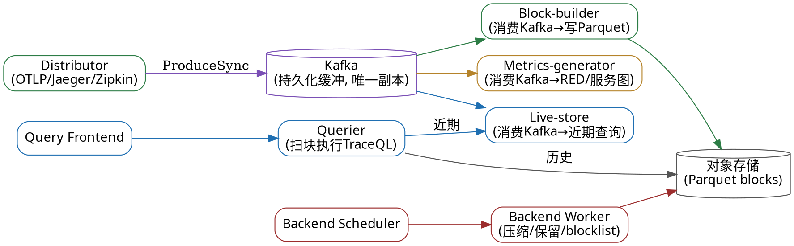

## Introduction

[Grafana Tempo](https://grafana.com/oss/tempo/) 是 Grafana Labs 开源的**分布式追踪后端**（distributed tracing backend），主打「海量 trace、极低成本」。它是 LGTM 栈中的 **T**（Traces），通常与 [Loki](/docs/CS/Distributed/Tracing/Loki.md)（日志）、[Mimir](/docs/CS/Distributed/Tracing/Mimir.md)（指标）、[Grafana](/docs/CS/Distributed/Tracing/Grafana.md)（可视化）一起构成完整方案。

Tempo 的设计哲学很直接：**trace 是很少被查、但必须被留一阵子的数据**。所以它放弃了传统追踪后端（Jaeger on Elasticsearch、Zipkin on Cassandra）那种「为 trace 建昂贵索引」的路线，改为——接收 OTLP/Jaeger/Zipkin 协议的数据，打包成 **Parquet 块**直接写对象存储，查询时用 **TraceQL** 扫。

代价是「按 trace id 查秒回，按条件搜索慢一些」；收益是存储成本量级下降，且不需要维护一个庞大的索引集群。

> [!NOTE]
> 源码级笔记。代码事实基于 `grafana/tempo` **v3.1.1**（浅克隆 + codegraph 索引；`vendor/` 已排除，仅取 `modules/` `tempodb/` `pkg/traceql` `pkg/parquetquery` `pkg/ingest` `pkg/validation` `cmd/tempo/app` 等源码目录）。下面讲解直接贴真实源码，路径相对仓库根，不再标注行号。Tempo 是多模块 Go 仓：**分布式模式（microservices）依赖 Kafka 作持久化层**，单体（monolithic）模式不需要 Kafka——这一点在 `cmd/tempo/app/modules.go` 的 `initDistributor` / `configureGenerator` 里按 `IsSingleBinary` 切换（见下文）。

## 与 Jaeger / Zipkin 的分工

| 维度 | Tempo | [Jaeger](/docs/CS/Distributed/Tracing/Jaeger.md) | [Zipkin](/docs/CS/Distributed/Tracing/Zipkin.md) |
| --- | --- | --- | --- |
| 存储 | 对象存储 + Parquet 块，无外部数据库 | Elasticsearch / OpenSearch / Cassandra / ClickHouse | [Cassandra / Elasticsearch / MySQL](/docs/CS/Distributed/Tracing/Zipkin/Collector_and_Storage.md) |
| 索引 | 轻索引（按 trace id 定位） | 依赖后端的索引能力 | 依赖后端的索引能力 |
| 查询语言 | TraceQL | 自有 UI + ES 查询 | 自有 UI |
| 成本 | 低（对象存储为主） | 中到高（取决于后端） | 中 |
| 运维面 | 3.x 起分布式模式需要 Kafka | 取决于存储后端 | 取决于存储后端 |
| UI | 主要依托 Grafana | 自带成熟 UI | 自带 UI |

Tempo 不自带重量级 UI，它的定位是「Grafana 的一个数据源」——这既是它的优势（与 metrics/logs 天然联动），也是选择它时必须接受的约束（可视化层绑定 Grafana）。

## Data Model

- **Span**：一次操作，含操作名、起止时间、attributes、status、parent span id。
- **Trace**：共享同一 trace id 的 span 集合，形成一棵（或 DAG）调用树。
- **Block**：Tempo 把一段时间内收到的 spans 聚合成 Parquet 块写入对象存储。当前默认写 **vParquet5**（`tempodb/encoding/vparquet5/encoding.go` 与 `tempodb/encoding/versioned.go`）：

  ```go
  // tempodb/encoding/vparquet5/encoding.go
  const VersionString = "vParquet5"
  ```

  ```go
  // tempodb/encoding/versioned.go — DefaultEncoding for newly written blocks.
  //
  // The default is vParquet5. Existing vParquet3 and vParquet4 blocks are still
  // read without migration; only newly written blocks use this default. Pin
  // storage.trace.block.version to vParquet4 to opt out. See CHANGELOG.md for
  // migration guidance.
  func DefaultEncoding() VersionedEncoding {
      return vparquet5.Encoding{}
  }
  ```

  仍可读 vParquet4 / vParquet3，无需数据迁移。
- **Tenant**：通过 `X-Scope-OrgID` 头做多租户隔离。

Tempo 与 [OpenTelemetry](/docs/CS/Distributed/Tracing/Otel.md) 的分工清晰：OTel 负责**产生与采集** span，Tempo 负责**存与查**。Tempo 直接接收 OTLP，也兼容 Jaeger 与 Zipkin 协议，因此可以嵌进已有的 OTel Collector 管道。

## Architecture

### 3.0 之前：ingester 为中心

```
Distributor ──▶ Ingester(×3, RF3) ──flush──▶ 对象存储（Parquet blocks）
                     │                            ▲
                     └──▶ 近期 trace 查询           │
                                       Compactor（合并/保留/维护 blocklist）
                     Metrics-generator ──▶ 本地 blocks（第二份数据）
```

这套架构有三个硬伤，也是重构的动因：

1. **RF3 强制**：ingester 需要三副本保证持久性，加上 metrics-generator 的第二份数据，实际存储量是原始 trace 的 **3 到 3.5 倍**。
2. **读写路径耦合**：同一个组件既管写又管读，一个坏负载能同时拖垮两边。真实事故包括 Mimir 查询压垮摄取、慢查询饿死快查询、超大 trace 属性 OOM querier。
3. **TraceQL metrics 可用性受限**：指标数据绑在单个 generator 上，generator 挂了它手上那批数据就暂时不可用。

### 3.0 起：读写分离 + Kafka



关键变化：

- **读写路径彻底分离**。ingester 被 block-builder（写侧）与 live-store（读侧）取代，compactor 被 backend scheduler/worker 取代。坏负载不再跨路径传染。
- **Kafka 成为持久化层**，取代 ingester 复制，只存一份数据，直接降低对象存储成本。
- **新 trace 立即可查**：live-store 直接消费 Kafka 流，服务尚未成块的近期 trace，不再依赖 ingester 内存路径。
- **TraceQL metrics 转为 GA**，且不再依赖 metrics-generator 组件，默认启用。
- **单体模式（monolithic）不需要 Kafka**，仍是小规模部署的最简选择。

### Components

| 组件 | 职责 | 源码入口（`modules/`） |
| --- | --- | --- |
| Distributor | 接收 OTLP / Jaeger / Zipkin 数据，校验后写入 Kafka | `distributor/distributor.go`（`Distributor` struct、`PushTraces`、`sendToKafka`） |
| Block-builder | 消费 Kafka，把 spans 写成 Parquet 块到对象存储 | `blockbuilder/blockbuilder.go`（`ConsumerGroup="block-builder"`、`BlockBuilder` struct、`consume` / `consumePartition`） |
| Live-store | 消费同一 Kafka 流，服务「近期 trace」查询 | `livestore/live_store.go`（`LiveStore` struct、consumer group 在 `New` 中计算、`QueryRange`） |
| Backend Scheduler / Worker | 协调压缩、保留、blocklist 维护与 redaction 作业 | `backendscheduler/backendscheduler.go`（compaction / retention / redaction providers）；实际引擎在 `tempodb/compactor.go` / `tempodb/retention.go` |
| Metrics-generator | 从 span 派生 RED 指标（Rate/Error/Duration）与服务拓扑图 | `generator/generator.go`（`Generator` struct、`ConsumeFromKafka` 时在 `starting` 建 Kafka 消费者）；处理器 `generator/processor/spanmetrics/spanmetrics.go` |
| Query Frontend | 拆分、缓存、排队查询 | `frontend/frontend.go`（`QueryFrontend` struct、`New`、`Search`） |
| Querier | 扫描对象存储中的块执行 TraceQL，并回查 live-store 拿近期 | `querier/querier.go`（`SearchRecent`、`SearchBlock`）；HTTP handler 在 `querier/http.go` |

目标（target）常量在 `cmd/tempo/app/modules.go` 统一声明，单体/分布式的切换也在这里：

```go
// cmd/tempo/app/modules.go
// individual targets
Distributor                   string = "distributor"
MetricsGenerator              string = "metrics-generator"
MetricsGeneratorNoLocalBlocks string = "metrics-generator-no-local-blocks"
Querier                       string = "querier"
QueryFrontend                 string = "query-frontend"
BlockBuilder                  string = "block-builder"
BackendScheduler              string = "backend-scheduler"
BackendWorker                 string = "backend-worker"
LiveStore                     string = "live-store"

func IsSingleBinary(target string) bool {
	return target == SingleBinary
}

func (t *App) initDistributor() (services.Service, error) {
	singleBinary := IsSingleBinary(t.cfg.Target)
	// ...
	t.cfg.Distributor.PushSpansToKafka = !singleBinary
	// ...
}

func (t *App) configureGenerator() {
	t.cfg.Generator.Ingest = t.cfg.Ingest
	t.cfg.Generator.ConsumeFromKafka = !IsSingleBinary(t.cfg.Target)
	// ...
}
```

单体模式下 `PushSpansToKafka = !singleBinary`，即只有非单体才把数据推入 Kafka；generator 的 `ConsumeFromKafka` 同理。

#### Write Path（写路径源码引证）

Distributor 不自己落盘：它把收到的 push 请求编码为 Kafka 记录后同步生产。`modules/distributor/distributor.go` 里 `Distributor` 持有 Kafka producer，`PushTraces` 负责校验、限流后转发：

```go
// modules/distributor/distributor.go
type Distributor struct {
	services.Service

	cfg             Config
	DistributorRing *ring.Ring
	overrides       overrides.Interface

	// Local in-process push targets used in single-binary mode.
	localPushTargets   LocalPushTargets
	generatorForwarder *generatorForwarder

	// Kafka
	kafkaProducer *ingest.Producer
	partitionRing ring.PartitionRingReader

	pushSpansToKafka bool
	// ...
}

// PushTraces pushes a batch of traces
func (d *Distributor) PushTraces(ctx context.Context, traces ptrace.Traces) (*tempopb.PushResponse, error) {
	reqStart := time.Now()

	ctx, span := tracer.Start(ctx, "distributor.PushTraces")
	defer span.End()

	// Call trace push middlewares
	for _, mw := range d.tracePushMiddlewares {
		if err := mw(ctx, traces); err != nil {
			_ = level.Warn(d.logger).Log("msg", "trace push middleware failed", "err", err)
		}
	}

	userID, spanCount, size, err := d.extractBasicInfo(ctx, traces)
	// ...
}
```

真正写 Kafka 的是 `sendToKafka`：按 partition ring 分批，把 traces 编码成记录后 `ProduceSync` 同步生产：

```go
// modules/distributor/distributor.go — sendToKafka
return ring.DoBatchWithOptions(ctx, ring.Write, ring.NewActivePartitionBatchRing(partitionRing), keys, func(partition ring.InstanceDesc, indexes []int) error {
	// ...
	// The partition ID is stored in the ring.InstanceDesc ID.
	partitionID, err := strconv.ParseInt(partition.Id, 10, 32)
	if err != nil {
		return err
	}

	records, err := ingest.Encode(int32(partitionID), userID, req, d.cfg.KafkaConfig.ProducerMaxRecordSizeBytes)
	if err != nil {
		return fmt.Errorf("failed to encode PushSpansRequest: %w", err)
	}

	metricKafkaRecordsPerRequest.Observe(float64(len(records)))

	startTime := time.Now()
	produceResults := d.kafkaProducer.ProduceSync(localCtx, records)
	metricKafkaWriteLatency.Observe(time.Since(startTime).Seconds())
	// ...
	return ingest.StatusFromProduceErr(produceResults.FirstErr())
})
```

Block-builder 是 Kafka 的消费者，按分区拉取记录、聚合成 Parquet 块再 `WriteBlock` 到对象存储（`modules/blockbuilder/blockbuilder.go` 的 `consume` → `consumePartition`）：

```go
// modules/blockbuilder/blockbuilder.go
const (
	blockBuilderServiceName = "block-builder"
	ConsumerGroup           = "block-builder"
	cutTime                 = 10 * time.Second
	// ...
)

type BlockBuilder struct {
	services.Service

	logger log.Logger
	cfg    Config

	kafkaClient           *kgo.Client
	partitionOffsetClient *ingest.PartitionOffsetClient
	kadm                  *kadm.Client
	decoder               *ingest.Decoder
	partitionRing         ring.PartitionRingReader
	// ...
}

// It consumes records for all the asigneed partitions, priorizing the ones with more lag. ...
func (b *BlockBuilder) consume(ctx context.Context) (time.Duration, error) {
	partitions := b.getAssignedPartitions()
	// ...

	// First iteration over all the assigned partitions to get their current lag in time
	for i, p := range ps {
		if !p.hasRecords() { // No records, skip for the first iteration
			// ...
			continue
		}
		lastRecordTs, commitOffset, err := b.consumePartition(ctx, p)
		if err != nil {
			return 0, err
		}
		ps[i].lastRecordTs = lastRecordTs
		ps[i].commitOffset = commitOffset
	}

	// Iterate over the laggiest partition until the lag is less than the cycle duration or none of the partitions has records
	for {
		// ...
	}
}

func (b *BlockBuilder) consumePartition(ctx context.Context, ps partitionState) (lastTs time.Time, commitOffset int64, err error) {
	// ...
	// We always rewind the partition's offset to the commit offset by reassigning the partition to the client ...
	b.kafkaClient.AddConsumePartitions(map[string]map[int32]kgo.Offset{
		topic: {
			ps.partition: startOffset,
		},
	})
	defer b.kafkaClient.RemoveConsumePartitions(map[string][]int32{topic: {ps.partition}})
	// ...
}
```

Live-store 与 metrics-generator 是**同一 topic 的另外两个消费者组**，各自独立推进 offset——这是「一份数据、三份用途」的实现基础。

#### Read Path（读路径源码引证）

Querier 把查询拆成「近期」与「历史」两路。`modules/querier/querier.go` 的 `SearchRecent` 打到 live-store，`SearchBlock` 扫对象存储的 Parquet 块：

```go
// modules/querier/querier.go
func (q *Querier) SearchRecent(ctx context.Context, req *tempopb.SearchRequest) (resp *tempopb.SearchResponse, err error) {
	// ...
	results, err := q.forLiveStoreRing(ctx, func(ctx context.Context, client tempopb.QuerierClient) (any, error) {
		return client.SearchRecent(ctx, req)
	})
	if err != nil {
		return nil, fmt.Errorf("error querying live-stores in Querier.SearchRecent: %w", err)
	}

	return q.postProcessIngesterSearchResults(req, results), nil
}

// SearchBlock searches the specified subset of the block for the passed tags.
func (q *Querier) SearchBlock(ctx context.Context, req *tempopb.SearchBlockRequest) (resp *tempopb.SearchResponse, err error) {
	// ...
	meta := &backend.BlockMeta{
		Version:      req.Version,
		TenantID:     tenantID,
		Size_:        req.Size_,
		IndexPageSize: req.IndexPageSize,
		TotalRecords: req.TotalRecords,
		BlockID:      blockID,
		FooterSize:   req.FooterSize,
		DedicatedColumns: dc,
	}
	// ...

	if api.IsTraceQLQuery(req.SearchReq) {
		fetcher := traceql.NewSpansetFetcherWrapperBoth(
			func(ctx context.Context, req traceql.FetchSpansRequest) (traceql.FetchSpansResponse, error) {
				return q.store.Fetch(ctx, meta, req, opts)
			},
			func(ctx context.Context, req traceql.FetchSpansRequest) (traceql.FetchSpansOnlyResponse, error) {
				return q.store.FetchSpans(ctx, meta, req, opts)
			},
		)
		// ...
	}
	// ...
}
```

Query Frontend 在前面做拆分/缓存/排队，流式搜索入口在 `modules/frontend/frontend.go`：

```go
// modules/frontend/frontend.go
type QueryFrontend struct {
	TraceByIDHandler, TraceByIDHandlerV2, TraceDiffHandler, SearchHandler                      http.Handler
	SearchTagsHandler, SearchTagsV2Handler, SearchTagsValuesHandler, SearchTagsValuesV2Handler http.Handler
	MetricsQueryInstantHandler, MetricsQueryRangeHandler                                       http.Handler
	// ...
}

// Search implements StreamingQuerierServer interface for streaming search
func (q *QueryFrontend) Search(req *tempopb.SearchRequest, srv tempopb.StreamingQuerier_SearchServer) error {
	return q.streamingSearch(req, srv)
}
```

TraceQL 的真正执行发生在 querier 调用 `pkg/traceql` 引擎时（见下）。

## TraceQL

TraceQL 是 Tempo 的查询语言，语法向 PromQL/LogQL 靠拢：`{}` 内是选择器，`|` 后接管道。

```traceql
# 基础筛选
{ resource.service.name = "checkout" && status = error }

# 按耗时筛选
{ resource.service.name = "api" && duration > 500ms }

# 嵌套结构查询
{ span.http.method = "POST" && span.http.status_code >= 500 }

# 结构化：按父子关系筛选（A 调用 B）
{ resource.service.name = "frontend" } >> { resource.service.name = "cart" }
```

**TraceQL metrics** 让你直接从 trace 数据算时间序列，不必先把指标导出到 Mimir：

```traceql
# 各服务的 span 速率
{} | rate() by (resource.service.name)

# p95 耗时（毫秒）
({} | quantile_over_time(duration, 0.95)) * 1000

# 错误率：3.1 起支持两个 metrics 查询做算术运算
({ status = error } | rate() by (resource.service.name))
  / ({} | rate() by (resource.service.name))
```

3.1 的算术规则：每个子查询要各自加括号，标量与标量可出现在任一侧，只有标签集完全一致的序列才会合并，末尾的 `with(extrapolate=true)` 提示对两侧子查询同时生效。

### TraceQL 引擎（源码级）

查询由 `pkg/traceql` 解析为 AST 后执行。引擎与解析入口在 `pkg/traceql/engine.go` / `pkg/traceql/parse.go`：

```go
// pkg/traceql/engine.go
type Engine struct{}

func NewEngine() *Engine {
	return &Engine{}
}

// Compile parses and compiles a TraceQL query. Options specific to metrics queries are ignored. It does not support math expressions.
func Compile(query string, opts ...CompileOption) (*RootExpr, Pipeline, SpansetFilterFunc, *FetchSpansRequest, error) {
	expr, err := Parse(query, opts...)
	if err != nil {
		return nil, Pipeline{}, nil, nil, err
	}
	err = expr.validate()
	if err != nil {
		return nil, Pipeline{}, nil, nil, err
	}
	p, ok := expr.SinglePipeline()
	if !ok {
		return nil, Pipeline{}, nil, nil, ErrMathNotSupported
	}
	// ...
	return expr, p, p.evaluate, &req, nil
}

// ExecuteSearch executes a search query. Options control AST optimization and hint behavior.
func (e *Engine) ExecuteSearch(ctx context.Context, searchReq *tempopb.SearchRequest, fetcher SpansetFetcher, opts ...CompileOption) (*tempopb.SearchResponse, error) {
	ctx, span := tracer.Start(ctx, "traceql.Engine.ExecuteSearch")
	defer span.End()

	cfg := applyCompileOptions(opts...)
	rootExpr, pipeline, eval, fetchSpansRequest, err := Compile(searchReq.Query, opts...)
	if err != nil {
		return nil, err
	}
	// ...
}
```

```go
// pkg/traceql/parse.go
// Parse parses a TraceQL query string and applies AST transformations according to opts.
// Options specific to metrics queries (e.g. WithSpanOnlyFetch) are ignored here.
func Parse(s string, opts ...CompileOption) (expr *RootExpr, err error) {
	cfg := applyCompileOptions(opts...)
	return parseInternal(s, cfg.skipTransformations, cfg.allowUnsafeHints)
}
```

（语法/语义校验在 `pkg/traceql/ast_validate.go`。）求值逻辑在 `pkg/traceql/ast_execute.go`，`GroupOperation` / `SpansetOperation` / `ScalarFilter` / `Aggregate` 的 `evaluate` 逐层约简 spanset：

```go
// pkg/traceql/ast_execute.go
func (g GroupOperation) evaluate(ss []*Spanset) ([]*Spanset, error) {
	result := make([]*Spanset, 0, len(ss))
	groups := g.groupBuffer

	// Iterate over each spanset in the input slice
	for _, spanset := range ss {
		// clear out the groups
		for k := range groups {
			delete(groups, k)
		}

		// Iterate over each span in the spanset
		for _, span := range spanset.Spans {
			// Execute the FieldExpression for the span
			result, err := g.Expression.execute(span)
			if err != nil {
				return nil, err
			}
			// ...
		}
		// ...
	}

	return result, nil
}

func (f ScalarFilter) evaluate(input []*Spanset) (output []*Spanset, err error) {
	// ...
	switch l := f.LHS.(type) {
	case Aggregate:
		switch r := f.RHS.(type) {
		case Static:
			input, err = l.evaluate(input)
			if err != nil {
				return nil, err
			}

			for _, ss := range input {
				res, err := binOp(f.Op, ss.Scalar, r)
				if err != nil {
					return nil, fmt.Errorf("scalar filter (%v) failed: %v", f, err)
				}
				if res {
					output = append(output, ss)
				}
			}
		// ...
		}
	// ...
	}

	return output, nil
}

func (a Aggregate) evaluate(input []*Spanset) ([]*Spanset, error) {
	var output []*Spanset

	for _, ss := range input {
		switch a.op {
		case aggregateCount:
			cpy := ss.clone()
			cpy.Scalar = NewStaticInt(len(ss.Spans))
			cpy.AddAttribute(a.String(), cpy.Scalar)
			output = append(output, cpy)
		// ...
		}
	}
	// ...
}
```

metrics 模式在 `pkg/traceql/ast_metrics.go`，`newMetricsAggregate` 实现 `rate()` / `quantile_over_time()` 等聚合，3.1 的跨查询算术由 `pkg/traceql/ast_metrics_math.go` 支撑：

```go
// pkg/traceql/ast_metrics.go
func newMetricsAggregate(agg MetricsAggregateOp, by []Attribute) *MetricsAggregate {
	return &MetricsAggregate{
		op: agg,
		by: by,
	}
}

func newMetricsAggregateQuantileOverTime(attr Attribute, qs []float64, by []Attribute) *MetricsAggregate {
	return &MetricsAggregate{
		op:     metricsAggregateQuantileOverTime,
		floats: qs,
		attr:   attr,
		by:     by,
	}
}
```

AST 的叶子比较（如 `duration > 500ms`、`status = error`）最终落到 `pkg/parquetquery` 对 Parquet 列的谓词下推——这正是 vParquet5 块能「扫」而非「全量读」的关键。

## 3.1 的重要更新

- **vParquet5 成为默认写入格式**，继续读 vParquet4 / vParquet3，无需迁移。注意：配置为写 vParquet3 时 Tempo 会拒绝启动。
- **span-only fetch 默认开启**（vParquet5 块）：不需要完整 trace 结构的查询只处理单个 span，实测约快一倍。
- **按查询做 trace redaction**：3.0 引入的脱敏只能用 trace id 枚举，3.1 起可直接提交 TraceQL 选择器批量脱敏，支持时间窗口，用于清除误入 span 属性的邮箱、token、账号等敏感数据。脱敏作业由 backend scheduler/worker 执行（见架构图 `bw` 节点）。
- **Kafka 连接能力补齐**：TLS 与 mTLS、SASL 机制扩展到 SCRAM-SHA-256/512、OAUTHBEARER、AWS_MSK_IAM；rack-aware fetching（KIP-392，按 `client_rack` 从本可用区副本读取以省跨区流量费）；`producer_compression` 可选 none/gzip/snappy/lz4/zstd，其中 gzip 让 Azure Event Hubs 成为可用的 Kafka 后端。
- **服务图可诊断性**：过期边增加 `unmatched_span_kind` 标签，用于分辨「连接本就不存在」和「对端 span 没到齐」；同时接受 OTel 语义约定 v1.30.0 更名后的 `db.system.name`（两者并存时 `db.system` 优先）。
- **Redis 缓存重写**：Redis Cluster 成为默认，Sentinel 支持移除，配置键与 TLS 设置变更。
- **实验特性**：span pruning（裁剪 trace-by-ID 响应体）、trace diff 与摘要。

## Metrics-generator

metrics-generator 是可选组件，从摄入的 span 派生两类派生指标：

- **Span metrics**：RED 三件套（rate / error / duration），按服务、操作等维度聚合。实现为 `modules/generator/processor/spanmetrics/spanmetrics.go` 的 `Processor`，`PushSpans` 在收到 span 时聚合计数器：

```go
// modules/generator/processor/spanmetrics/spanmetrics.go
type Processor struct {
	Cfg Config

	registry registry.Registry

	spanMetricsCallsTotal      registry.Counter
	spanMetricsDurationSeconds registry.Histogram
	spanMetricsSizeTotal       registry.Counter
	spanMetricsTargetInfo      registry.Gauge
	// ...
}

func (p *Processor) PushSpans(_ context.Context, req *tempopb.PushSpansRequest) {
	p.aggregateMetrics(req.Batches)
}
```

- **Service graph**：服务间调用拓扑的边与节点，用于在 Grafana 里画服务依赖图。配置在 `modules/generator/config.go` 的 `ProcessorConfig`，处理器在 `modules/generator/processor/servicegraphs/`：

```go
// modules/generator/config.go
type ProcessorConfig struct {
	ServiceGraphs servicegraphs.Config `yaml:"service_graphs"`
	SpanMetrics   spanmetrics.Config   `yaml:"span_metrics"`
	HostInfo      hostinfo.Config      `yaml:"host_info"`
}
```

它是「用 trace 数据反哺 metrics」的通道，配合 Grafana 的服务图面板可以直观看到系统拓扑。3.1 通过复用池化 label buffer 把稳态 service-graph 的每操作分配降到零。generator 与 block-builder / live-store 共享同一 Kafka topic，靠独立的 consumer group（`cmd/tempo/app/modules.go` 中 `generator-ring-watcher` 等 ring 配置）隔离。

## Operations Notes

- **采样策略比后端选型更影响成本**。头部采样在 SDK 侧决定，尾部采样在 Collector 侧决定——后者能保留全部错误与慢 trace，性价比更高。
- **Kafka 只影响分布式模式**。小规模用 monolithic 模式可以完全绕开 Kafka；一旦走微服务模式，Kafka 就是必须纳入运维面的第二个依赖。
- **升级前必读 upgrade guide**。3.1 包含破坏性配置变更与新默认值，涉及 Redis 缓存、vParquet3 写入、自定义 query-frontend 配置的安装需要提前调整。
- **窗口化脱敏的版本一致性**：scheduler 与 worker 版本不一致时不要提交带时间窗口的脱敏作业——旧 worker 会忽略时间窗口，把块内所有匹配的 trace 全部脱敏。
- 与日志侧的关联：日志里带上 trace id（作为 Loki 的 structured metadata），就能从 [Loki](/docs/CS/Distributed/Tracing/Loki.md) 的日志行一键跳到 Tempo 的 trace，这是三支柱落地最常用的一个动作。

## Source Map

最值得直接打开的源码锚点（相对 `grafana/tempo` 根）：

- **目标注册 / 模式切换**：`cmd/tempo/app/modules.go`（target 常量、`IsSingleBinary`、`initDistributor`、`configureGenerator`）。
- **写路径**：`modules/distributor/distributor.go`（→ Kafka）；`modules/blockbuilder/blockbuilder.go`（Kafka → Parquet）。
- **近期读路径**：`modules/livestore/live_store.go`（Kafka → 近期查询）。
- **历史读路径**：`modules/querier/querier.go`、`modules/frontend/frontend.go`。
- **压缩 / 保留引擎**：`tempodb/compactor.go`、`tempodb/retention.go`，由 `modules/backendscheduler/backendscheduler.go` 编排。
- **指标派生**：`modules/generator/generator.go`、`modules/generator/processor/spanmetrics/spanmetrics.go`。
- **块格式**：`tempodb/encoding/versioned.go`（默认 vParquet5）、`tempodb/encoding/vparquet5/encoding.go`（版本常量）。
- **TraceQL 引擎**：`pkg/traceql/engine.go`、`pkg/traceql/parse.go`、`pkg/traceql/ast_execute.go`、`pkg/traceql/ast_metrics.go`；列谓词下推在 `pkg/parquetquery/`。

## Links

- [Tracing](/docs/CS/Distributed/Tracing/Tracing.md)
- [OpenTelemetry](/docs/CS/Distributed/Tracing/Otel.md)
- [Loki](/docs/CS/Distributed/Tracing/Loki.md)
- [Mimir](/docs/CS/Distributed/Tracing/Mimir.md)
- [Jaeger](/docs/CS/Distributed/Tracing/Jaeger.md)
- [Zipkin](/docs/CS/Distributed/Tracing/Zipkin.md)

## References

1. [Grafana Tempo documentation](https://grafana.com/docs/tempo/latest/)
2. [Tempo recommended versions](https://grafana.com/docs/tempo/latest/set-up-for-tracing/setup-tempo/recommended-versions/)
3. [Tempo 3.0 release blog](https://grafana.com/blog/tempo-3-0-release-all-the-latest-features/)
4. [Tempo 3.1 release blog](https://grafana.com/blog/tempo-3-1-release-all-the-latest-features/)
5. [TraceQL documentation](https://grafana.com/docs/tempo/latest/traceql/)
6. [grafana/tempo Releases](https://github.com/grafana/tempo/releases)
