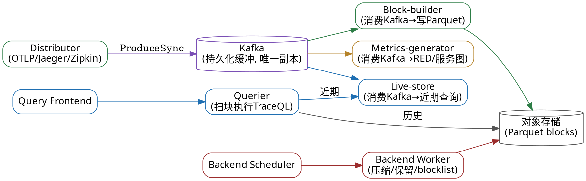

## Introduction

[Grafana Tempo](https://grafana.com/oss/tempo/) 是 Grafana Labs 开源的**分布式追踪后端**（distributed tracing backend），主打「海量 trace、极低成本」。它是 LGTM 栈中的 **T**（Traces），通常与 [Loki](/docs/CS/Distributed/Tracing/Loki.md)（日志）、[Mimir](/docs/CS/Distributed/Tracing/Mimir.md)（指标）、[Grafana](/docs/CS/Distributed/Tracing/Grafana.md)（可视化）一起构成完整方案。

Tempo 的设计哲学很直接：**trace 是很少被查、但必须被留一阵子的数据**。因此它没有为每个 trace 维护一套昂贵的关系型索引，而是接收 OTLP、Jaeger、Zipkin 协议的数据，按时间窗口聚合成 **Parquet 块**写入对象存储，再用 **TraceQL** 查询。它并非完全没有索引：Bloom filter、Parquet row-group 元数据和列统计都能帮助 trace-by-ID 定位；只是这些轻量结构与业务标签的全量倒排索引不是一回事。

代价是按属性搜索需要扫描更多数据；收益是存储放大更低，不需要维护庞大的索引集群，并且天然适合廉价、可扩展的对象存储。

> [!NOTE]
> 本文以 **Tempo v3.1.1** 源码为机制基线，对应 tag `v3.1.1`、commit `9db7df79d2af105a90d96484e6403e1fda0d011e`。版本事实截至 2026-11-25：v3.1.1 是最新发布，但官方 self-managed 推荐版本仍是 **3.0.x**。官方支持策略为每个 minor 发布后维护 9 个月补丁，major 的最后一个 minor 维护 15 个月。文中的 `文件:行号` 均相对该源码 tag。
> 源码级笔记。代码事实基于 `grafana/tempo` **v3.1.1**（浅克隆 + codegraph 索引；`vendor/` 已排除，仅取 `modules/` `tempodb/` `pkg/traceql` `pkg/parquetquery` `pkg/ingest` `pkg/validation` `cmd/tempo/app` 等源码目录）。下面讲解直接贴真实源码，路径相对仓库根，不再标注行号。Tempo 是多模块 Go 仓：**分布式模式（microservices）依赖 Kafka 作持久化层**，单体（monolithic）模式不需要 Kafka——这一点在 `cmd/tempo/app/modules.go` 的 `initDistributor` / `configureGenerator` 里按 `IsSingleBinary` 切换（见下文）。

## Design Trade-offs

| 维度 | Tempo | [Jaeger](/docs/CS/Distributed/Tracing/Jaeger.md) | [Zipkin](/docs/CS/Distributed/Tracing/Zipkin.md) |
| --- | --- | --- | --- |
| 存储 | 对象存储 + Parquet 块；3.x 微服务写路径还需要 Kafka | Elasticsearch / OpenSearch / Cassandra / ClickHouse | [Cassandra / Elasticsearch / MySQL](/docs/CS/Distributed/Tracing/Zipkin/Collector_and_Storage.md) |
| 索引 | Bloom、Parquet 元数据、列统计、可选 trace-ID index | 依赖后端的索引能力 | 依赖后端的索引能力 |
| 查询语言 | TraceQL | 自有 UI + 后端查询 | 自有 UI + 存储相关查询 |
| 成本 | 低，前提是接受扫描成本和对象存储访问费 | 中到高，取决于后端 | 中 |
| 运维面 | monolithic 无 Kafka；microservices 必须有 Kafka | 取决于存储后端 | 取决于存储后端 |
| UI | 主要依托 Grafana | 自带成熟 UI | 自带 UI |
| 数据组织 | 以 block 为中心，trace 可跨 block | 通常以 trace 文档/行为中心 | 通常以 trace 为中心 |

Tempo 不自带重量级 UI，它的定位是「Grafana 的一个数据源」。这使它能与 metrics、logs 天然联动，也意味着完整的 trace 浏览体验主要依赖 Grafana。

理解 Tempo 的成本模型要区分三件事：

1. **写入放大**：Kafka 副本、live-store 本地 WAL、metrics-generator 派生数据都会占资源，但 block 本身默认只写一份到对象存储。
2. **读取放大**：trace-by-ID 可以靠 Bloom 和 row-group 定位；TraceQL search 与 metrics 更接近列式扫描。
3. **生命周期成本**：小 block 多会增加对象数和 list/read 请求，compaction 用额外写入换取更少的查询对象。

因此「对象存储便宜」不等于「任意配置都便宜」。采样、block 大小、Kafka 保留、compaction 和缓存命中率共同决定实际成本。

## Data Model

- **Span**：一次操作，包含 span ID、parent span ID、名称、起止时间、attributes、events、links、status 等。
- **Trace**：共享同一 trace ID 的 span 集合，形成调用树或更一般的依赖关系。
- **Block**：Tempo 按消费时间窗口聚合出的 Parquet 文件及其元数据。一个 trace 的不同 span 可以落入不同 block，甚至被硬切到不同 consumption cycle。
- **Tenant**：通过 `X-Scope-OrgID` 隔离的逻辑租户，贯穿 Kafka key、对象存储路径、查询上下文和 runtime overrides。
- **Span**：一次操作，含操作名、起止时间、attributes、status、parent span id。
- **Trace**：共享同一 trace id 的 span 集合，形成一棵（或 DAG）调用树。
- **Block**：Tempo 把一段时间内收到的 spans 聚合成 Parquet 块写入对象存储。当前默认写 **vParquet5**（`tempodb/encoding/vparquet5/encoding.go` 与 `tempodb/encoding/versioned.go`）：

  ```go
  // tempodb/encoding/vparquet5/encoding.go
  const VersionString = "vParquet5"
  ```

  ```go
  // tempodb/encoding/versioned.go — DefaultEncoding for newly written blocks.
  //
  // The default is vParquet5. Existing vParquet3 and vParquet4 blocks are still
  // read without migration; only newly written blocks use this default. Pin
  // storage.trace.block.version to vParquet4 to opt out. See CHANGELOG.md for
  // migration guidance.
  func DefaultEncoding() VersionedEncoding {
      return vparquet5.Encoding{}
  }
  ```

  仍可读 vParquet4 / vParquet3，无需数据迁移。
- **Tenant**：通过 `X-Scope-OrgID` 头做多租户隔离。

Tempo 与 [OpenTelemetry](/docs/CS/Distributed/Tracing/Otel.md) 的分工清晰：OTel 负责**产生与采集** span，Tempo 负责**存与查**。Tempo 直接接收 OTLP，也兼容 Jaeger 与 Zipkin 协议，因此可以嵌入已有 OTel Collector 管道。

### Kafka Record Is Not a Trace

3.x 微服务模式里，Kafka record 与业务 trace 不是一一对应：

- record 的 **key 是 tenant ID**，不是 trace ID。
- record 的 **value** 是编码后的 `PushBytesRequest`，可能包含多条 trace。
- 超限的 push 会被编码器拆成多条 record。
- partition 由 Distributor 在 producer 中显式指定，不依赖 Kafka 对 key 的默认哈希。

对应实现是 `pkg/ingest/encoding.go:40` 的请求拆分，以及 `pkg/ingest/encoding.go:104-114` 的 record 构造。这个区别很重要：Kafka partition 的划分单位是请求批次，不是完整 trace；下游仍要按 trace ID 在内存/WAL 中重组 span。

## Architecture

### Before 3.0: Ingester-centric

```text
Distributor ──▶ Ingester (RF=3) ──flush──▶ Object storage (Parquet blocks)
                      │                         ▲
                      └──▶ Recent trace query    │
                                          Compactor
                      Metrics-generator ──▶ Derived blocks / metrics
```
Distributor ──▶ Ingester(×3, RF3) ──flush──▶ 对象存储（Parquet blocks）
                     │                            ▲
                     └──▶ 近期 trace 查询           │
                                       Compactor（合并/保留/维护 blocklist）
                     Metrics-generator ──▶ 本地 blocks（第二份数据）
```

2.x 的核心问题是 ingester 同时承担写入复制、近期数据查询和 flush：

1. **RF3 强制**：ingester 保存三份，加上 metrics-generator 的第二份数据，官方 v3.0 发布说明估计重复数据约为原始 trace 的 **2 到 2.5 倍**。
2. **读写路径耦合**：同一组件既接收写入又服务查询，写入拥塞、内存压力和慢查询可能相互放大。
3. **维护成本高**：trace 的近期可查状态与 ingester ring、内存和本地盘绑定。

### From 3.0: Separate Write and Query Paths

```text
                         Write path
Receiver ──▶ Distributor ──▶ Kafka
                              ├──▶ Block-builder ──▶ Object storage (Parquet)
                              ├──▶ Live-store ─────▶ Recent trace / search
                              └──▶ Metrics-generator

                         Query path
Grafana ──▶ Query frontend ──▶ Querier ──┬──▶ Live-store
                                         └──▶ Object storage blocks

                         Maintenance path
Backend scheduler ──▶ Backend worker ──▶ Compaction / retention / blocklist / redaction


3.x 把 ingester 的职责拆开：

- **block-builder** 专注把 Kafka 数据持久化为对象存储 block。
- **live-store** 专注近期 trace 的内存/WAL 查询，不负责把完整 block 写入后端。
- **querier** 专注读取 live-store 与对象存储 block。
- **backend scheduler/worker** 把 compaction、retention、blocklist 维护和 redaction 变成可水平扩展的后端作业。

这是**逻辑读写分离**，不是组件之间完全没有共同依赖：Kafka、对象存储、租户配置和 ring 仍是共享基础设施。

### Deployment Modes

| 维度 | Monolithic / single binary | Microservices |
| --- | --- | --- |
| 进程模型 | 默认 `-target=all`，组件在同一进程 | Distributor、block-builder、live-store、querier 等独立部署 |
| Kafka | 不需要 | 必须 |
| Block-builder | 不运行 | 运行 |
| 近期写入 | Distributor 进程内直推 live-store | live-store 独立消费 Kafka |
| Complete block | live-store 后台 flush 到对象存储 | 仅本地保留，由 block-builder 写对象存储 |
| 资源隔离 | 共享进程资源池，读写负载会互相影响 | 可分别扩缩容和分配资源 |
| 适用场景 | 小规模、低运维复杂度、验证环境 | 生产、独立扩缩容、故障隔离 |

v3.0 已移除 scalable monolithic / single-binary 模式；现在文档中的 monolithic 指单进程 all-in-one，而不是「一个二进制横向扩展所有组件」。部署语义见 `docs/sources/tempo/reference-tempo-architecture/deployment-modes.md:12-24`、`:30-44`。

### Components

| 组件 | 职责 | 关键状态 |
| --- | --- | --- |
| Receiver / Distributor | 协议解码、租户提取、限制检查、trace 路由、写入 Kafka 或 live-store | 无长期 trace 状态 |
| Kafka | 微服务模式的持久化缓冲和多个消费者的共同输入 | offset、broker 副本、retention |
| Block-builder | 按 Kafka record 时间切 cycle，重组 span，写 Parquet block | 本地 WAL block、消费 offset |
| Live-store | 维护近期 trace、本地 WAL、complete block，服务近期查询 | 内存 trace、WAL、partition ownership |
| Metrics-generator | 从 span 派生 RED 指标和服务图 | 独立消费进度和聚合状态 |
| Query frontend | 查询拆分、排队、调度和部分结果缓存 | search job / query range |
| Querier | 扫描 live-store 和对象存储 block，执行 TraceQL | 查询任务与物理块缓存 |
| Backend scheduler / worker | 调度并执行 compaction、retention、blocklist、redaction | backend work objects |
| Compactor | 在 backend worker 中合并 block、执行保留和删除 | blocklist、compaction level |

## Write Path

### Receiver and Tenant Extraction

开启多租户时，receiver 要求请求中**恰好有一个** `X-Scope-OrgID`；缺失或多个都会失败。关闭多租户时会注入 fake tenant。实现位于 `modules/distributor/receiver/middleware.go:54-83`。

这只是一层**路由与隔离**，不是身份认证。生产环境仍应由网关、代理或 Collector 验证调用方是否有权使用某个 tenant ID，不能让客户端任意伪造租户头。

### Trace Routing

Distributor 为每条 trace 生成路由 token：

```go
ringTokens = append(ringTokens, util.TokenFor(userID, tr.id))
```

`TokenFor` 是 `FNV32(tenantID || traceID)`，见 `pkg/util/hash.go:7-14`。随后 Distributor：

1. 对 tenant 做 shuffle shard，缩小可用实例集合。
2. 在 active partition ring 中查找 token 对应的分区实例。
3. 取 `InstanceDesc.Id` 作为 Kafka partition ID。
4. 用 manual partitioner 显式写入该分区。

对应链路是 `modules/distributor/distributor.go:654-720` 的 Kafka 路由，以及 `:847-852` 的 token 生成。

这里有两个容易混淆的点：

- token 是 **32 位 FNV 哈希**，源码明确说明它不适合去重；重复 span 不能靠它判断。
- Distributor 的 ring 是**分区发现与路由**，不是 trace 数据的 RF3 副本环。通用 ring 配置还把 `ReplicationFactor` 固定为 1，见 `pkg/ring/config.go:52-60`。

同一 trace 的 span 使用同一 token 查找分区，便于下游重组；实际分区取决于 Kafka partition 数、tenant shuffle shard 和 active partition ring 的当前成员。

### Kafka Producer Semantics

v3.1.1 的核心 producer 配置包括：

```go
kgo.RequiredAcks(kgo.AllISRAcks()),
kgo.RecordPartitioner(kgo.ManualPartitioner()),
kgo.DisableIdempotentWrite(),
kgo.ProducerLinger(50 * time.Millisecond),
```

实现位于 `pkg/ingest/writer_client.go:45-65`。

- `acks=all` 要求写入被当前 ISR 确认，降低「只写入 leader 就返回成功」的风险。
- manual partitioner 保证使用 Distributor 计算出的分区。
- 禁用 Kafka idempotent producer，意味着 Kafka 不会替 Tempo 自动去重。
- linger 用极小等待换取更高批次效率。

调用方取消的处理更微妙：record 入队使用 `context.WithoutCancel(ctx)`，但等待 produce 结果仍监听调用方 context，见 `pkg/ingest/writer_client.go:299-370`。由此得到：

1. 入队前已经取消，请求会被拒绝。
2. 入队后取消或超时，record 可能仍在写入。
3. 客户端重试可能产生重复 trace/span。
4. 微服务写路径是**至少一次**语义，不是 exactly-once。

`ProduceSync` 返回错误只说明本次等待没有拿到成功确认，不能反向证明 Kafka 一定没有写入。需要端到端幂等时，应在 trace ID 和业务侧处理重复，而不是假设 Tempo 会去重。

### Block-builder Consumption Cycle

block-builder 消费 Kafka 时不是「等一条 trace 完整再落块」，而是按**第一条 record 的 timestamp**开启一个固定 duration 的 cycle：

```go
end = rec.Timestamp.Add(dur)
```

遇到超过 `end` 的 record 就结束当前 cycle，见 `modules/blockbuilder/blockbuilder.go:416-440`；`MaxBytesPerCycle` 也会提前切块，见 `:452`。

这带来几个直接后果：

- trace 是否完整不影响切块。
- 一条 trace 可以跨 cycle、跨 block。
- 查询时必须合并多个 block 和 live-store 中的 trace 片段。
- search 的命中对象可能是 trace 的某个片段，而不是完整调用链。

cycle 内会重组 live trace，并按 `SpanID + Kind` 去重，见 `modules/blockbuilder/live_traces_iter.go:122-133`。这不是按 trace ID 去重，而是去掉同一 span 的重复副本；不同 trace 中相同的 span ID 仍属于不同 trace。

### Flush, Offset and Compaction Order

block-builder 的落块顺序是安全设计的关键：

```go
err = writer.flush(ctx, b.reader, b.writer, b.compactor)
offset := kadm.NewOffsetFromRecord(lastRec)
err = b.commitOffset(ctx, offset, group, ps.partition)
writer.allowCompaction(ctx, b.writer)
```

对应 `modules/blockbuilder/blockbuilder.go:486-504`。即：

1. 先写 block 对象，包括最后的 `meta.json`。
2. 再提交 Kafka offset。
3. 最后删除 `nocompact.flg`，允许 compaction。

block ID 根据 cycle 输入确定性生成；新 consumer 没有 committed offset 时从 earliest 开始，见 `modules/blockbuilder/blockbuilder.go:135-149`。block-builder 创建的 block 默认带 no-compact flag，且 `meta.ReplicationFactor = 1`，见 `modules/blockbuilder/tenant_store.go:61`、`:147-150`。

崩溃窗口因此可以这样理解：

- **flush 前崩溃**：offset 未提交，重启后重放。
- **对象已写、offset 未提交**：用确定性 block ID 重放；遇到已存在的 live block 时，通过 `replaces` 元数据替换旧输出，避免把新旧块都当作有效数据。
- **offset 已提交、no-compact 尚未删除**：数据已经持久化，但块暂时不可压缩；不会因为允许 compaction 而与替换流程竞态。

本地 WAL block 只有在后端 `WriteBlock` 成功后才清除，见 `modules/blockbuilder/tenant_store.go:189-199`。

### Live-store Lifecycle

live-store 是近期查询路径，按 trace ID 在内存中组织 span，并定期写本地 Parquet WAL：

```text
active trace ──idle──▶ WAL block ──flush──▶ complete block ──TTL──▶ evict
```

状态转换不是按整条 trace 的语义完成，而是由内存上限、idle/live 超时和本地 block 大小驱动。v3.1.1 源码默认值如下：

| 配置 | 默认值 | 含义 |
| --- | --- | --- |
| `max_trace_live` | 30s | trace 在 active 状态的最长存活时间 |
| `max_trace_idle` | 5s | 无新 span 后转为 idle 的等待 |
| `max_live_traces_bytes` | 250 MB | live trace 的内存预算 |
| `max_block_duration` | 30s | 本地 WAL block 的时间上限 |
| `max_block_bytes` | 50 MiB | 本地 block 的字节上限 |
| `complete_block_timeout` | 20m | complete block 的本地保留时间 |
| `commit_interval` | 5s | Kafka offset 提交间隔 |
| `readiness_target_lag` | 0 | 默认不等待 lag 降为 0 才 ready |
| `fail_on_high_lag` | true | 仅在 `readiness_target_lag > 0` 时生效；超限可使 search/metrics 失败 |

默认值见 `modules/livestore/config.go:100-122`。官方文档中的示例配置可能不同，不应把示例值当成所有版本的默认值。

zone-aware 部署下，每个 Kafka partition 在每个 AZ 有一个 live-store owner；querier 对每个 partition 只需一个 live-store 响应，read quorum 为 1，因此**读路径不做跨 AZ 去重**。这些副本主要用于可用性和故障恢复，不意味着一次查询会等所有 AZ 返回。见 `docs/sources/tempo/reference-tempo-architecture/components/live-store.md:80-88`。

Kafka 模式与 monolithic 的 complete block 处理也不同：

- Kafka 模式：live-store 的 complete-block lifecycle 是 no-op，完整 block 由 block-builder 写对象存储。
- Monolithic：Distributor 进程内推送 live-store，local lifecycle 在后台 flush complete block 到 backend。

见 `modules/livestore/complete_block_lifecycle.go:58-124`。

### Visibility Is Eventually Consistent

「刚写入的 trace 立即可查」只应是近似说法。live-store 异步消费 Kafka，新 trace 至少受到以下延迟影响：

1. Distributor produce 与 Kafka 确认。
2. live-store 消费 lag。
3. trace 从 active 到可被查询路径识别。
4. querier 查询 live-store 与 blocklist 的合并。

更严格的是，v3.1.1 的 live-store 在记录**过旧、解码失败或 tenant instance 创建失败**时仍会推进消费 offset，见 `modules/livestore/live_store.go:627-689`。这些记录不能简单靠「把 offset 回退」恢复。高 lag 时还可能按 `fail_on_high_lag` 拒绝查询，而不是返回看似完整的结果。

### Metrics-generator as a Third Consumer

metrics-generator 独立消费同一 trace 流，维护自己的聚合状态。它既不是 block-builder 的替代品，也不是主 trace 数据的持久性来源；它故障主要影响预生成的指标和服务图，逻辑上不阻断主 trace 存储。但 monolithic 共享进程资源时，它的 CPU/内存压力仍可能间接影响其他组件。

## Storage Format

### Object Layout

对象存储中的逻辑布局为：

```text
<backend-prefix>/<tenant-id>/<block-uuid>/
├── data            Parquet block
├── bloom-*         Bloom filter shards
├── index           可选 trace-ID index
├── meta.json       block 元数据
└── nocompact.flg   可选，禁止 compaction
```

tenant 与 block UUID 组成对象键前缀，见 `tempodb/backend/raw.go:342-349`。`meta.json` 是 block 被发现和查询的提交标记；对象复制顺序见 `tempodb/encoding/vparquet5/copy.go:38-110`。

但**最后写 `meta.json` 不等于多对象原子事务**。它保证正常路径下前端不会先看见一个尚未提交的 block，却不能把后端的部分失败自动回滚成一个原子操作。写失败仍需依赖确定性 ID、重放和 no-compact/replaces 机制恢复。

### vParquet5

v3.1 起新 block 默认写 **vParquet5**，旧 vParquet4/vParquet3 仍可读；显式配置 vParquet3 会拒绝启动，见 `tempodb/encoding/versioned.go:97-104` 与 `CHANGELOG.md:171-173`、`:268-271`。

vParquet5 的核心变化是**一行不是一条 span，而是一条 trace**：

```text
Trace
├── TraceID / TraceIDText
├── StartTime / EndTime / Duration
├── RootServiceName / RootSpanName
├── ServiceStats[]
└── ResourceSpans[]
    └── Resource + ScopeSpans[]
        └── Scope + Span[]
```

结构定义见 `tempodb/encoding/vparquet5/schema.go:203-293`。span 内仍保留 attributes、events、links、状态和丢弃计数；嵌套资源与 instrumentation scope 避免把相同属性重复展开到每个 span。

schema 还包含两类查询优化：

- **Dedicated attribute columns**：可动态分配 20 个 string 列和 5 个 int 列，见 `schema.go:127-154`。它们让常用标签直接成为独立列，减少对通用 attribute 列表的扫描。
- **Rounded time columns**：保存 15s、60s、300s、3600s 粒度的 epoch interval，而不是把完整 64 位纳秒时间戳重复圆整，见 `schema.go:229-237`。这些列更适合时间窗口过滤和压缩。

trace 按 TraceID 排序，因此 row group 的 TraceID 范围可以用于定位，见 `schema.go:278-280`。

### Trace-by-ID Lookup

对象存储中的 trace-by-ID 查询不是「每次下载整个 block」：

1. 用 Bloom filter 排除不包含该 trace ID 的 block。
2. 如果启用了可选 trace-ID index，直接定位 row group。
3. 否则利用 TraceID 排序，对 row group 做二分查找。
4. 只读取命中的 row group 和必要列。

见 `tempodb/encoding/vparquet5/block_findtracebyid.go:36-69`、`:146-169`。

可选 index 只有在环境变量 `VPARQUET_INDEX=1` 时才启用，见 `:32-33`、`:65-69`。所以「trace-ID index 默认开启」是错误认知；默认关闭它也不意味着 trace-by-ID 退化为全表顺序扫描。

### Blocklist

blocklist 是 querier 眼中的 block 目录视图。对象存储 list 是最终一致的，poller 会周期性刷新；单个 tenant 轮询失败时沿用上一份 blocklist，失败 tenant 过多则放弃整个 polling cycle，见 `tempodb/blocklist/poller.go:211-245`。

这意味着 blocklist 不是强一致目录：新 block 可能延迟出现，瞬时 list 失败也不应被解释为数据已经被删除。

## Block Lifecycle

### Compaction

block-builder 产生的是按消费 cycle 切出的小 block。compaction 把同一时间窗内满足条件的块合并成更大的块，用额外读写换取：

- 更少的 block 元数据和 list 请求。
- 更好的 TraceQL 扫描局部性。
- 更低的重复 footer/索引开销。

默认 active compaction window 为 24 小时，最小 2 块、最大 4 块，见 `tempodb/blockselector/compaction_block_selector.go:18-20`。选择器按时间窗、RF、compaction level 分组，优先选小块，并要求同组 block 的 Parquet version 和 dedicated-columns hash 一致，见 `:103-162`。

因此 compaction 不是「把相邻块无条件粘在一起」。格式版本、标签列布局、复制因子和时间窗都会影响能否合并。

### Two-stage Retention

retention 分两阶段：

1. block 的 `EndTime` 超过 `BlockRetention` 后，先标记为 **compacted**，从活跃 blocklist 移走。
2. 标记时间超过 `CompactedBlockRetention` 后，才真正删除对象。

见 `tempodb/retention.go:82-128`。两阶段之间的延迟给在途查询和后台维护留出收敛时间，也意味着「超过查询保留期」与「对象马上消失」不是同一件事。

删除 block 时会显式清除 Bloom 和 trace-ID index 缓存；Parquet page、footer 等缓存依赖 TTL 或 LRU，见 `retention.go:135-156`。

### Backend Scheduler and Worker

scheduler 把 compaction、retention、blocklist 维护、redaction 等工作序列化到 backend 的 `work` 对象中，worker 领取并执行。work cache 优先使用本地 shard 文件，缺失或读取失败时从 backend 加载，见 `modules/backendscheduler/cache.go:17-87`。

job 有 pending、running、succeeded、failed 状态；running 超过 `DeadJobTimeout` 会被判为 failed，见 `modules/backendscheduler/work/work.go:298-356`。维护作业失败不等于原始 trace block 被删除，scheduler/provider 可以继续生成替代维护作业，但不能把失败作业描述成「所有数据都会自动恢复」。

### Redaction Deletes Whole Traces

redaction 支持两种输入：

- 显式 trace ID 列表。
- TraceQL query selector。

selector 模式从 v3.1 开始支持，并可用 `[start, end]` 限制扫描窗口，见 `CHANGELOG.md:13`、`:48-53`。时间窗口**不能**和显式 trace ID 列表组合，因为 trace ID 列表本身不带时间边界，组合会留下同一 trace 在其他块中的副本却报告成功。

更重要的是，redaction 通过 compactor 的 `DropObject` 删除匹配 trace，见 `tempodb/tempodb.go:681-766`。它不是「只把邮箱字段抹掉」，而是**删除整条匹配 trace**；即使某条 span 的时间不在窗口内，只要它属于被选中的 trace，也会随 trace 一起消失。

`dry-run` 可以先预览影响范围。生产操作应先 dry-run，再审查匹配数和租户范围。scheduler 与 worker 版本不一致时不要提交 windowed redaction：旧 worker 可能忽略时间窗口，删除它收到的每个 block 中所有匹配 trace。

## Query Path

### Frontend, Queue and Querier

```text
TraceQL / trace-by-ID
        │
        ▼
Query frontend ──split & schedule──▶ Querier jobs
                                      ├──▶ Live-store owners
                                      └──▶ Object storage blocks
                                      │
                                      ▼
                             merge partial traces / results
```

querier 并行查询 live-store 和对象存储 block，再合并 partial trace，同时收集 block error，见 `modules/querier/querier.go:212-267`。因此一个存储块失败时，结果可能是**部分结果加错误**，而不是严格的「全有或全无」。

v3.1.1 querier 默认值包括：

| 配置 | 默认值 |
| --- | --- |
| trace-by-ID query timeout | 10s |
| search query timeout | 30s |
| `max_concurrent_queries` | 20 |
| metrics `concurrent_blocks` | 2 |
| live-store `minimize_requests` | true |
| live-store hedging delay | 3s |

见 `modules/querier/config.go:61-89`。这些是保护 querier 的资源闸门，不是查询性能承诺；大租户、宽时间范围和低命中率查询仍可能很慢。

### Frontend Cache Boundary

v3.1.1 frontend 只显式构造两类结果缓存 key：

- `searchJobCacheKey`
- `queryRangeCacheKey`

见 `modules/frontend/cache_keys.go:18-38`。这两类缓存只有在查询时间范围**完整覆盖 block** 时才复用该块结果：

```go
if !(start.Before(meta.StartTime) && end.After(meta.EndTime)) {
    return ""
}
```

trace-by-ID 没有对应的 frontend 结果缓存。它仍可使用 backend 的 footer、Bloom、column/offset index、trace-ID index 和 Parquet page 缓存，但那是**物理读取缓存**，不等同于缓存完整 trace 查询响应。

### Search Execution

TraceQL search 的执行不是把整条 query 原样交给 Parquet：

1. 编译 AST 并提取可下推的 storage conditions。
2. 只读取候选 span/列。
3. 在 fetch 阶段执行 pipeline 和第二遍过滤。
4. 组装 spanset/trace 并返回。

编译与下推见 `pkg/traceql/engine.go:32-68`；second-pass conditions 和完整表达式过滤见 `:122-140`。第二遍过滤用于减少不满足完整表达式的数据被继续传递，不能理解为每条查询都一定有两个独立的全量扫描。

vParquet5 默认启用 **span-only fetch**：不需要完整 trace 结构的查询可以使用 span 级 driver 和列裁剪，见 `CHANGELOG.md:146` 与 `tempodb/encoding/vparquet5/block_traceql_fetch.go:35-89`。span-only fetch 复用一个 buffer span，消费者不能长期持有返回对象，这是内部流式实现约束，不是 API 承诺对象永久有效。

### TraceQL Metrics Aggregation

TraceQL metrics 在查询时从 span 计算时间序列，内部区分三种聚合模式：

| 模式 | 执行位置 | 典型能力 |
| --- | --- | --- |
| `AggregateModeRaw` | 直接运行在 span 上 | 产生第一层 raw series |
| `AggregateModeSum` | querier/frontend 等中间层 | 合并多个 job/pod 的 rate、count、min/max 等中间结果 |
| `AggregateModeFinal` | 单点执行 | quantile、average 等不能再分阶段精确合并的计算 |

定义见 `pkg/traceql/enum_aggregates.go:32-49`。这也是为什么 metrics 查询会同时产生 raw 扫描和跨分片汇总，而不是每个 querier 独立算完后简单拼接最终曲线。
| 组件 | 职责 | 源码入口（`modules/`） |
| --- | --- | --- |
| Distributor | 接收 OTLP / Jaeger / Zipkin 数据，校验后写入 Kafka | `distributor/distributor.go`（`Distributor` struct、`PushTraces`、`sendToKafka`） |
| Block-builder | 消费 Kafka，把 spans 写成 Parquet 块到对象存储 | `blockbuilder/blockbuilder.go`（`ConsumerGroup="block-builder"`、`BlockBuilder` struct、`consume` / `consumePartition`） |
| Live-store | 消费同一 Kafka 流，服务「近期 trace」查询 | `livestore/live_store.go`（`LiveStore` struct、consumer group 在 `New` 中计算、`QueryRange`） |
| Backend Scheduler / Worker | 协调压缩、保留、blocklist 维护与 redaction 作业 | `backendscheduler/backendscheduler.go`（compaction / retention / redaction providers）；实际引擎在 `tempodb/compactor.go` / `tempodb/retention.go` |
| Metrics-generator | 从 span 派生 RED 指标（Rate/Error/Duration）与服务拓扑图 | `generator/generator.go`（`Generator` struct、`ConsumeFromKafka` 时在 `starting` 建 Kafka 消费者）；处理器 `generator/processor/spanmetrics/spanmetrics.go` |
| Query Frontend | 拆分、缓存、排队查询 | `frontend/frontend.go`（`QueryFrontend` struct、`New`、`Search`） |
| Querier | 扫描对象存储中的块执行 TraceQL，并回查 live-store 拿近期 | `querier/querier.go`（`SearchRecent`、`SearchBlock`）；HTTP handler 在 `querier/http.go` |

目标（target）常量在 `cmd/tempo/app/modules.go` 统一声明，单体/分布式的切换也在这里：

```go
// cmd/tempo/app/modules.go
// individual targets
Distributor                   string = "distributor"
MetricsGenerator              string = "metrics-generator"
MetricsGeneratorNoLocalBlocks string = "metrics-generator-no-local-blocks"
Querier                       string = "querier"
QueryFrontend                 string = "query-frontend"
BlockBuilder                  string = "block-builder"
BackendScheduler              string = "backend-scheduler"
BackendWorker                 string = "backend-worker"
LiveStore                     string = "live-store"

func IsSingleBinary(target string) bool {
	return target == SingleBinary
}

func (t *App) initDistributor() (services.Service, error) {
	singleBinary := IsSingleBinary(t.cfg.Target)
	// ...
	t.cfg.Distributor.PushSpansToKafka = !singleBinary
	// ...
}

func (t *App) configureGenerator() {
	t.cfg.Generator.Ingest = t.cfg.Ingest
	t.cfg.Generator.ConsumeFromKafka = !IsSingleBinary(t.cfg.Target)
	// ...
}
```

单体模式下 `PushSpansToKafka = !singleBinary`，即只有非单体才把数据推入 Kafka；generator 的 `ConsumeFromKafka` 同理。

#### Write Path（写路径源码引证）

Distributor 不自己落盘：它把收到的 push 请求编码为 Kafka 记录后同步生产。`modules/distributor/distributor.go` 里 `Distributor` 持有 Kafka producer，`PushTraces` 负责校验、限流后转发：

```go
// modules/distributor/distributor.go
type Distributor struct {
	services.Service

	cfg             Config
	DistributorRing *ring.Ring
	overrides       overrides.Interface

	// Local in-process push targets used in single-binary mode.
	localPushTargets   LocalPushTargets
	generatorForwarder *generatorForwarder

	// Kafka
	kafkaProducer *ingest.Producer
	partitionRing ring.PartitionRingReader

	pushSpansToKafka bool
	// ...
}

// PushTraces pushes a batch of traces
func (d *Distributor) PushTraces(ctx context.Context, traces ptrace.Traces) (*tempopb.PushResponse, error) {
	reqStart := time.Now()

	ctx, span := tracer.Start(ctx, "distributor.PushTraces")
	defer span.End()

	// Call trace push middlewares
	for _, mw := range d.tracePushMiddlewares {
		if err := mw(ctx, traces); err != nil {
			_ = level.Warn(d.logger).Log("msg", "trace push middleware failed", "err", err)
		}
	}

	userID, spanCount, size, err := d.extractBasicInfo(ctx, traces)
	// ...
}
```

真正写 Kafka 的是 `sendToKafka`：按 partition ring 分批，把 traces 编码成记录后 `ProduceSync` 同步生产：

```go
// modules/distributor/distributor.go — sendToKafka
return ring.DoBatchWithOptions(ctx, ring.Write, ring.NewActivePartitionBatchRing(partitionRing), keys, func(partition ring.InstanceDesc, indexes []int) error {
	// ...
	// The partition ID is stored in the ring.InstanceDesc ID.
	partitionID, err := strconv.ParseInt(partition.Id, 10, 32)
	if err != nil {
		return err
	}

	records, err := ingest.Encode(int32(partitionID), userID, req, d.cfg.KafkaConfig.ProducerMaxRecordSizeBytes)
	if err != nil {
		return fmt.Errorf("failed to encode PushSpansRequest: %w", err)
	}

	metricKafkaRecordsPerRequest.Observe(float64(len(records)))

	startTime := time.Now()
	produceResults := d.kafkaProducer.ProduceSync(localCtx, records)
	metricKafkaWriteLatency.Observe(time.Since(startTime).Seconds())
	// ...
	return ingest.StatusFromProduceErr(produceResults.FirstErr())
})
```

Block-builder 是 Kafka 的消费者，按分区拉取记录、聚合成 Parquet 块再 `WriteBlock` 到对象存储（`modules/blockbuilder/blockbuilder.go` 的 `consume` → `consumePartition`）：

```go
// modules/blockbuilder/blockbuilder.go
const (
	blockBuilderServiceName = "block-builder"
	ConsumerGroup           = "block-builder"
	cutTime                 = 10 * time.Second
	// ...
)

type BlockBuilder struct {
	services.Service

	logger log.Logger
	cfg    Config

	kafkaClient           *kgo.Client
	partitionOffsetClient *ingest.PartitionOffsetClient
	kadm                  *kadm.Client
	decoder               *ingest.Decoder
	partitionRing         ring.PartitionRingReader
	// ...
}

// It consumes records for all the asigneed partitions, priorizing the ones with more lag. ...
func (b *BlockBuilder) consume(ctx context.Context) (time.Duration, error) {
	partitions := b.getAssignedPartitions()
	// ...

	// First iteration over all the assigned partitions to get their current lag in time
	for i, p := range ps {
		if !p.hasRecords() { // No records, skip for the first iteration
			// ...
			continue
		}
		lastRecordTs, commitOffset, err := b.consumePartition(ctx, p)
		if err != nil {
			return 0, err
		}
		ps[i].lastRecordTs = lastRecordTs
		ps[i].commitOffset = commitOffset
	}

	// Iterate over the laggiest partition until the lag is less than the cycle duration or none of the partitions has records
	for {
		// ...
	}
}

func (b *BlockBuilder) consumePartition(ctx context.Context, ps partitionState) (lastTs time.Time, commitOffset int64, err error) {
	// ...
	// We always rewind the partition's offset to the commit offset by reassigning the partition to the client ...
	b.kafkaClient.AddConsumePartitions(map[string]map[int32]kgo.Offset{
		topic: {
			ps.partition: startOffset,
		},
	})
	defer b.kafkaClient.RemoveConsumePartitions(map[string][]int32{topic: {ps.partition}})
	// ...
}
```

Live-store 与 metrics-generator 是**同一 topic 的另外两个消费者组**，各自独立推进 offset——这是「一份数据、三份用途」的实现基础。

#### Read Path（读路径源码引证）

Querier 把查询拆成「近期」与「历史」两路。`modules/querier/querier.go` 的 `SearchRecent` 打到 live-store，`SearchBlock` 扫对象存储的 Parquet 块：

```go
// modules/querier/querier.go
func (q *Querier) SearchRecent(ctx context.Context, req *tempopb.SearchRequest) (resp *tempopb.SearchResponse, err error) {
	// ...
	results, err := q.forLiveStoreRing(ctx, func(ctx context.Context, client tempopb.QuerierClient) (any, error) {
		return client.SearchRecent(ctx, req)
	})
	if err != nil {
		return nil, fmt.Errorf("error querying live-stores in Querier.SearchRecent: %w", err)
	}

	return q.postProcessIngesterSearchResults(req, results), nil
}

// SearchBlock searches the specified subset of the block for the passed tags.
func (q *Querier) SearchBlock(ctx context.Context, req *tempopb.SearchBlockRequest) (resp *tempopb.SearchResponse, err error) {
	// ...
	meta := &backend.BlockMeta{
		Version:      req.Version,
		TenantID:     tenantID,
		Size_:        req.Size_,
		IndexPageSize: req.IndexPageSize,
		TotalRecords: req.TotalRecords,
		BlockID:      blockID,
		FooterSize:   req.FooterSize,
		DedicatedColumns: dc,
	}
	// ...

	if api.IsTraceQLQuery(req.SearchReq) {
		fetcher := traceql.NewSpansetFetcherWrapperBoth(
			func(ctx context.Context, req traceql.FetchSpansRequest) (traceql.FetchSpansResponse, error) {
				return q.store.Fetch(ctx, meta, req, opts)
			},
			func(ctx context.Context, req traceql.FetchSpansRequest) (traceql.FetchSpansOnlyResponse, error) {
				return q.store.FetchSpans(ctx, meta, req, opts)
			},
		)
		// ...
	}
	// ...
}
```

Query Frontend 在前面做拆分/缓存/排队，流式搜索入口在 `modules/frontend/frontend.go`：

```go
// modules/frontend/frontend.go
type QueryFrontend struct {
	TraceByIDHandler, TraceByIDHandlerV2, TraceDiffHandler, SearchHandler                      http.Handler
	SearchTagsHandler, SearchTagsV2Handler, SearchTagsValuesHandler, SearchTagsValuesV2Handler http.Handler
	MetricsQueryInstantHandler, MetricsQueryRangeHandler                                       http.Handler
	// ...
}

// Search implements StreamingQuerierServer interface for streaming search
func (q *QueryFrontend) Search(req *tempopb.SearchRequest, srv tempopb.StreamingQuerier_SearchServer) error {
	return q.streamingSearch(req, srv)
}
```

TraceQL 的真正执行发生在 querier 调用 `pkg/traceql` 引擎时（见下）。

## TraceQL

TraceQL 的语法向 PromQL/LogQL 靠拢：`{}` 是 spanset 选择器，`|` 后接 pipeline，结构运算符描述 span 之间的调用关系。

```traceql
# 基础筛选：服务与状态
{ resource.service.name = "checkout" && status = error }

# 按耗时筛选
{ resource.service.name = "api" && duration > 500ms }

# Pipeline：筛选 5xx span
{ resource.service.name = "api" }
  | select(span.http.status_code >= 500)

# 结构查询：frontend 调用 cart
{ resource.service.name = "frontend" }
  >> { resource.service.name = "cart" }
```

### Metrics Queries

TraceQL metrics 可以直接从 trace 数据计算时间序列：

```traceql
# 各服务的 span 速率
{} | rate() by (resource.service.name)

# p95 耗时，单位从秒转为毫秒
({} | quantile_over_time(duration, 0.95)) * 1000

# 错误率：两个子查询先各自聚合，再做除法
({ status = error } | rate() by (resource.service.name))
  / ({} | rate() by (resource.service.name))
```

v3.1 支持 metrics 子查询之间的 `+ - * /` 算术。实现先在各子查询上求值，再按 series key 合并 SeriesSet，见 `pkg/traceql/ast_metrics_math.go:115-130`、`:180-226`。

但它还不是完整 PromQL：

- 每个子查询需要独立括号。
- 向量按标签集匹配，标量可以与任意一侧组合。
- v3.1.1 仍没有 PromQL 的 `on()`、`group_left()` 等完整向量匹配语义，相关 TODO 见 `ast_metrics_math.go:270-280`。

### Sampling Extrapolation

查询末尾可加：

```traceql
with(extrapolate=true)
```

当 span 的 W3C tracestate 带有 OTel 采样概率阈值 `ot=th:...` 时，Tempo 按 `1 / sampling_probability` 放大匹配 span 的贡献。它支持 `rate`、`count_over_time`、`sum_over_time`、`avg_over_time`、`histogram_over_time`、`quantile_over_time` 和 `compare`，不影响 `min_over_time`/`max_over_time`，且只支持 vParquet4 及以后格式。

没有 tracestate 概率时 multiplier 为 1。见 `CHANGELOG.md:31-38` 与 `pkg/traceql/options.go:78-87`。因此外推值是根据采样元数据估算的总体值，不应被当作未采样数据的精确计数。
### TraceQL 引擎（源码级）

查询由 `pkg/traceql` 解析为 AST 后执行。引擎与解析入口在 `pkg/traceql/engine.go` / `pkg/traceql/parse.go`：

```go
// pkg/traceql/engine.go
type Engine struct{}

func NewEngine() *Engine {
	return &Engine{}
}

// Compile parses and compiles a TraceQL query. Options specific to metrics queries are ignored. It does not support math expressions.
func Compile(query string, opts ...CompileOption) (*RootExpr, Pipeline, SpansetFilterFunc, *FetchSpansRequest, error) {
	expr, err := Parse(query, opts...)
	if err != nil {
		return nil, Pipeline{}, nil, nil, err
	}
	err = expr.validate()
	if err != nil {
		return nil, Pipeline{}, nil, nil, err
	}
	p, ok := expr.SinglePipeline()
	if !ok {
		return nil, Pipeline{}, nil, nil, ErrMathNotSupported
	}
	// ...
	return expr, p, p.evaluate, &req, nil
}

// ExecuteSearch executes a search query. Options control AST optimization and hint behavior.
func (e *Engine) ExecuteSearch(ctx context.Context, searchReq *tempopb.SearchRequest, fetcher SpansetFetcher, opts ...CompileOption) (*tempopb.SearchResponse, error) {
	ctx, span := tracer.Start(ctx, "traceql.Engine.ExecuteSearch")
	defer span.End()

	cfg := applyCompileOptions(opts...)
	rootExpr, pipeline, eval, fetchSpansRequest, err := Compile(searchReq.Query, opts...)
	if err != nil {
		return nil, err
	}
	// ...
}
```

```go
// pkg/traceql/parse.go
// Parse parses a TraceQL query string and applies AST transformations according to opts.
// Options specific to metrics queries (e.g. WithSpanOnlyFetch) are ignored here.
func Parse(s string, opts ...CompileOption) (expr *RootExpr, err error) {
	cfg := applyCompileOptions(opts...)
	return parseInternal(s, cfg.skipTransformations, cfg.allowUnsafeHints)
}
```

（语法/语义校验在 `pkg/traceql/ast_validate.go`。）求值逻辑在 `pkg/traceql/ast_execute.go`，`GroupOperation` / `SpansetOperation` / `ScalarFilter` / `Aggregate` 的 `evaluate` 逐层约简 spanset：

```go
// pkg/traceql/ast_execute.go
func (g GroupOperation) evaluate(ss []*Spanset) ([]*Spanset, error) {
	result := make([]*Spanset, 0, len(ss))
	groups := g.groupBuffer

	// Iterate over each spanset in the input slice
	for _, spanset := range ss {
		// clear out the groups
		for k := range groups {
			delete(groups, k)
		}

		// Iterate over each span in the spanset
		for _, span := range spanset.Spans {
			// Execute the FieldExpression for the span
			result, err := g.Expression.execute(span)
			if err != nil {
				return nil, err
			}
			// ...
		}
		// ...
	}

	return result, nil
}

func (f ScalarFilter) evaluate(input []*Spanset) (output []*Spanset, err error) {
	// ...
	switch l := f.LHS.(type) {
	case Aggregate:
		switch r := f.RHS.(type) {
		case Static:
			input, err = l.evaluate(input)
			if err != nil {
				return nil, err
			}

			for _, ss := range input {
				res, err := binOp(f.Op, ss.Scalar, r)
				if err != nil {
					return nil, fmt.Errorf("scalar filter (%v) failed: %v", f, err)
				}
				if res {
					output = append(output, ss)
				}
			}
		// ...
		}
	// ...
	}

	return output, nil
}

func (a Aggregate) evaluate(input []*Spanset) ([]*Spanset, error) {
	var output []*Spanset

	for _, ss := range input {
		switch a.op {
		case aggregateCount:
			cpy := ss.clone()
			cpy.Scalar = NewStaticInt(len(ss.Spans))
			cpy.AddAttribute(a.String(), cpy.Scalar)
			output = append(output, cpy)
		// ...
		}
	}
	// ...
}
```

metrics 模式在 `pkg/traceql/ast_metrics.go`，`newMetricsAggregate` 实现 `rate()` / `quantile_over_time()` 等聚合，3.1 的跨查询算术由 `pkg/traceql/ast_metrics_math.go` 支撑：

```go
// pkg/traceql/ast_metrics.go
func newMetricsAggregate(agg MetricsAggregateOp, by []Attribute) *MetricsAggregate {
	return &MetricsAggregate{
		op: agg,
		by: by,
	}
}

func newMetricsAggregateQuantileOverTime(attr Attribute, qs []float64, by []Attribute) *MetricsAggregate {
	return &MetricsAggregate{
		op:     metricsAggregateQuantileOverTime,
		floats: qs,
		attr:   attr,
		by:     by,
	}
}
```

AST 的叶子比较（如 `duration > 500ms`、`status = error`）最终落到 `pkg/parquetquery` 对 Parquet 列的谓词下推——这正是 vParquet5 块能「扫」而非「全量读」的关键。

## 3.1 的重要更新

- **vParquet5 成为默认写入格式**，继续读 vParquet4 / vParquet3，无需迁移。注意：配置为写 vParquet3 时 Tempo 会拒绝启动。
- **span-only fetch 默认开启**（vParquet5 块）：不需要完整 trace 结构的查询只处理单个 span，实测约快一倍。
- **按查询做 trace redaction**：3.0 引入的脱敏只能用 trace id 枚举，3.1 起可直接提交 TraceQL 选择器批量脱敏，支持时间窗口，用于清除误入 span 属性的邮箱、token、账号等敏感数据。脱敏作业由 backend scheduler/worker 执行（见架构图 `bw` 节点）。
- **Kafka 连接能力补齐**：TLS 与 mTLS、SASL 机制扩展到 SCRAM-SHA-256/512、OAUTHBEARER、AWS_MSK_IAM；rack-aware fetching（KIP-392，按 `client_rack` 从本可用区副本读取以省跨区流量费）；`producer_compression` 可选 none/gzip/snappy/lz4/zstd，其中 gzip 让 Azure Event Hubs 成为可用的 Kafka 后端。
- **服务图可诊断性**：过期边增加 `unmatched_span_kind` 标签，用于分辨「连接本就不存在」和「对端 span 没到齐」；同时接受 OTel 语义约定 v1.30.0 更名后的 `db.system.name`（两者并存时 `db.system` 优先）。
- **Redis 缓存重写**：Redis Cluster 成为默认，Sentinel 支持移除，配置键与 TLS 设置变更。
- **实验特性**：span pruning（裁剪 trace-by-ID 响应体）、trace diff 与摘要。

## Metrics-generator

metrics-generator 是可选组件，从摄入的 span 派生两类数据：

- **Span metrics**：RED 三件套（rate、error、duration），按服务、操作等维度聚合。
- **Service graph**：服务间调用拓扑，用于 Grafana 的服务依赖图。

它和 TraceQL metrics 的分工是：

| 维度 | Metrics-generator | TraceQL metrics |
| --- | --- | --- |
| 计算时机 | 摄入时持续预计算 | 查询时扫描 span |
| 主要用途 | 固定维度的低延迟仪表盘、服务图 | 灵活、临时的 trace 指标分析 |
| 故障影响 | 派生指标/拓扑延迟或缺失 | 主 trace 存储不依赖它 |
| 成本 | 额外消费、聚合状态和存储 | 每次查询消耗扫描资源 |

所以「TraceQL metrics 默认启用」不代表 metrics-generator 没有价值。前者灵活，后者适合稳定的大盘和高频查询；两者都会消耗资源，只是成本落在不同阶段。

v3.1 还为过期服务图边增加 `unmatched_span_kind` 标签，用于区分连接不存在与对端 span 未到齐；同时识别 OTel 新属性 `db.system.name`，两者并存时仍优先 `db.system`，见 `CHANGELOG.md:88-90`。

## Multi-tenancy and Limits

### Tenant Isolation

tenant ID 贯穿整条链路：

- HTTP/gRPC metadata 中的 `X-Scope-OrgID`。
- Kafka record key。
- Kafka partition 路由 token 的输入。
- 对象存储路径的一级目录。
- querier、compactor、scheduler 的 tenant 上下文。
- runtime overrides 的查找键。

查询端同样需要租户上下文；只知道 trace ID 不应跨租户读取数据。租户头的存在只证明「请求声明了某个 tenant」，不证明请求方被授权使用它。

### Runtime Overrides

runtime overrides 的查找顺序是：

```text
exact tenant override ──missing──▶ wildcard "*" ──missing──▶ cluster defaults
```

见 `modules/overrides/runtime_config_overrides.go:714-727`。

tenant override 是**整个 limits 对象替换**，不是逐字段继承：如果某个 tenant override 没有设置 ingestion 限额，该字段会使用 Go 零值，而不是自动回退到 cluster default。配置时必须显式补齐该租户需要的限制，不能把 wildcard/default 当成字段级 fallback。

限额至少覆盖以下层面：

| 层面 | 保护对象 |
| --- | --- |
| Ingestion rate / burst | Distributor、Kafka 和存储写入 |
| Max trace/attribute bytes | 单条 trace 导致的内存与响应膨胀 |
| Search bytes / query concurrency | querier 扫描和前端队列 |
| Metrics concurrency | 高成本聚合查询 |
| Retention / compaction overrides | 单个租户的存储生命周期 |
| Metrics-generator dimensions | 派生指标基数和资源占用 |

## Consistency and Failure Semantics

### Durability Layers

「Tempo 只存一份数据」只在**block 元数据的 RF** 这个层面成立，不能推广到整个系统：

| 层 | v3.x 语义 | 边界 |
| --- | --- | --- |
| Block | block-builder 写 `ReplicationFactor = 1` | Tempo 自己不复制 block 到多个 AZ |
| Kafka | `acks=all`，按 broker 配置形成 ISR 副本 | 物理副本数取决于 Kafka RF |
| Live-store | zone-aware 时每 partition 每 AZ 一个 owner | 本地内存/WAL 不是对象存储的替代品 |
| Object storage | 由后端提供商持久化 | 跨区域复制、版本控制、删除保护需外部配置 |
| Cache | Bloom/footer/page/index 等可重建数据 | 不应被视为唯一副本 |

因此端到端持久性 = Kafka 保留与副本 + 已提交 block + 对象存储 durability。任何一层配置不足，都会在 Tempo 之外形成单点。

### Failure Matrix

| 故障窗口 | 结果 | 恢复或注意事项 |
| --- | --- | --- |
| Distributor 入队后超时 | Kafka 可能已经写入 | 重试可能重复，按至少一次设计 |
| Block-builder flush 前崩溃 | offset 未提交 | 从 Kafka 重放 |
| 对象已写、offset 未提交 | 重放可能重复写同一 block | 确定性 ID + `replaces` |
| Offset 已提交、no-compact 未删 | block 已持久化但暂不可压缩 | 不会因 compaction 与替换竞态 |
| Live-store 重启 | 近期查询可能暂时落后 | Kafka offset + 本地 WAL 恢复 |
| Record 被 live-store 判为过旧/坏数据 | offset 仍推进 | 回退 offset 不一定能恢复 |
| 对象存储 list 瞬时失败 | 新 block 延迟可见 | blocklist 保留旧视图 |
| 某个 block 查询失败 | 可能返回部分结果 | 检查 response 中的 block errors |
| Backend worker 崩溃 | 维护 job 失败或超时 | scheduler/provider 重新调度，原 block 仍在 |
| Redaction scheduler/worker 版本不一致 | window 可能被忽略 | 禁止混版提交 windowed redaction |

### No Cross-request Atomicity

Tempo 不提供「push 成功 → 任意 querier 立刻看到完整 trace」的线性一致读：

- 微服务模式下 push 成功主要对应 Kafka 确认，而不是所有消费者已经处理。
- live-store 有消费 lag。
- blocklist 最终一致。
- trace 可跨 block，跨 block 结果需要合并。
- 单个 block 失败可以产生部分结果。

如果业务需要「写入后立刻读回」，应在应用层等待、校验或使用更强一致的数据存储，而不是把 Tempo 当成事务数据库。
- **Span metrics**：RED 三件套（rate / error / duration），按服务、操作等维度聚合。实现为 `modules/generator/processor/spanmetrics/spanmetrics.go` 的 `Processor`，`PushSpans` 在收到 span 时聚合计数器：

```go
// modules/generator/processor/spanmetrics/spanmetrics.go
type Processor struct {
	Cfg Config

	registry registry.Registry

	spanMetricsCallsTotal      registry.Counter
	spanMetricsDurationSeconds registry.Histogram
	spanMetricsSizeTotal       registry.Counter
	spanMetricsTargetInfo      registry.Gauge
	// ...
}

func (p *Processor) PushSpans(_ context.Context, req *tempopb.PushSpansRequest) {
	p.aggregateMetrics(req.Batches)
}
```

- **Service graph**：服务间调用拓扑的边与节点，用于在 Grafana 里画服务依赖图。配置在 `modules/generator/config.go` 的 `ProcessorConfig`，处理器在 `modules/generator/processor/servicegraphs/`：

```go
// modules/generator/config.go
type ProcessorConfig struct {
	ServiceGraphs servicegraphs.Config `yaml:"service_graphs"`
	SpanMetrics   spanmetrics.Config   `yaml:"span_metrics"`
	HostInfo      hostinfo.Config      `yaml:"host_info"`
}
```

它是「用 trace 数据反哺 metrics」的通道，配合 Grafana 的服务图面板可以直观看到系统拓扑。3.1 通过复用池化 label buffer 把稳态 service-graph 的每操作分配降到零。generator 与 block-builder / live-store 共享同一 Kafka topic，靠独立的 consumer group（`cmd/tempo/app/modules.go` 中 `generator-ring-watcher` 等 ring 配置）隔离。

## Operations Notes

### Capacity and Cost

- **采样策略比后端选型更影响成本**。头部采样在 SDK 侧决定；尾部采样在 Collector 侧决定，可以按错误、慢 trace 或属性保留。外推查询还需要正确的 tracestate 采样概率。
- **Kafka retention 必须覆盖最长消费停顿与恢复窗口**。尤其不能早于 block-builder 把数据可靠落块并提交 offset；否则尚未消费的记录被删除后，就不能靠 Tempo 内部重放找回。
- **partition 数限制 block-builder 最大有效实例数**。静态分区分配下，实例多于 partition 不会增加并行消费能力；每个 block-builder 的 scratch disk 至少要容纳一个 cycle 的数据，见 `docs/sources/tempo/reference-tempo-architecture/components/block-builder.md:95-107`。
- **block 大小是扫描成本与对象数的权衡**。关注 block-builder、live-store 和 compactor 三类输出大小，而不是只看总吞吐。
- **live-store 同时受内存和本地盘约束**。`max_live_traces_bytes` 防止 active trace 无限增长，WAL/complete block 则需要足够的本地 IOPS 和容量。
- **对象存储必须独立保证 durability**。block RF1 时，跨 AZ/region 复制、版本控制、删除保护和灾难恢复都在 Tempo 之外。

### Observability

优先监控能直接解释一致性和容量的指标：

- Distributor：push bytes、received traces、push duration、Kafka produce 错误。
- Kafka：每个 partition 的 consumer lag、ISR 缩容、retention 与磁盘水位。
- Block-builder：flush size、flush 失败、cycle 时长、scratch disk 使用率。
- Live-store：lag、内存 trace 字节、本地 flush size、inspected bytes、readiness。
- Backend：`tempo_backend_scheduler_jobs_pending{tenant, job_type}`、compaction 输出大小、失败作业。
- Querier：并发查询、超时、inspected bytes、block errors、缓存命中。

其中 pending jobs、三类 flush/compaction 大小和 live-store inspected bytes 在 v3.1 得到增强，见 `CHANGELOG.md:42-57`、`:75`、`:82-85`。

### Query Reliability

- 限制宽时间范围的 TraceQL search/metrics，它们比 trace-by-ID 更接近扫描。
- 为 `max_concurrent_queries`、timeout 和 frontend queue 设置符合集群容量的值，避免慢查询挤占资源。
- 检查部分响应中的 block errors；HTTP 成功不一定代表所有块都成功。
- 高 lag 时把 `fail_on_high_lag` 视为完整性保护，而不是普通 readiness 告警。
- 缓存主要降低物理读取成本；frontend 没有 trace-by-ID 结果缓存。

### Upgrade Notes

- v3.1.1 只包含 Go 1.27.3 的安全依赖升级，没有应用层功能修复，见 `CHANGELOG.md:3-7`。
- v3.1 将 vParquet5 设为默认写格式；旧 vParquet3 仍可读，但不能继续配置为写格式，compactor 也不再把它与新格式一起压缩。
- v3.1 默认开启 span-only fetch，可用 tenant override `metrics_spanonly_fetch: false` 关闭。
- v3.1 重写实验性 Redis cache：Redis Cluster 成为默认，Sentinel 被移除，多项 YAML/flag/TLS 配置变更，见 `CHANGELOG.md:154-163`。
- query frontend 的 trace lookup sharding 改用 `blocks_per_shard` 替代 `query_shards`，自定义配置需要升级检查，见 `CHANGELOG.md:170`。
- Kafka 客户端补齐 `client_rack` rack-aware fetching、TLS/mTLS、SASL 机制选择和 producer compression；它们改变跨区流量、连接安全与兼容性，不改变至少一次写入语义，见 `CHANGELOG.md:27`、`:70-77`。
- v3.1 还提供实验性 span pruning、trace diff 与摘要；它们属于查询响应裁剪/诊断能力，不是存储格式或一致性机制，见 `CHANGELOG.md:21-30`。
- 升级前阅读目标版本的 upgrade guide，并在非生产环境验证配置与数据读取。

### Log Correlation

日志行只要携带 trace ID，就可以从 [Loki](/docs/CS/Distributed/Tracing/Loki.md) 跳到 Tempo trace，也可以从 Grafana 的 trace 视图反向跳回日志。建议同时保留 `service.name`、`deployment.environment` 等 resource 字段，减少跨信号检索时的歧义。

## Counterintuitive Facts

1. **Kafka record 不是一条 trace**：key 是 tenant ID，value 可以包含多条 trace，partition 由 Distributor 显式指定。
2. **trace 路由 token 不是 Kafka partition ID**：token 先经过 tenant shuffle shard 和 ring 查找，实例 ID 才被当作 partition。
3. **32 位 FNV token 不能去重**：源码明确禁止把它用于 dedup。
4. **`acks=all` 不等于 exactly-once**：idempotent producer 被禁用，超时后重试可能重复。
5. **block-builder 不等 trace 完成**：它按 record timestamp 和字节上限硬切 cycle。
6. **vParquet5 一行是一条 trace**：span 嵌在 `ResourceSpans[].ScopeSpans[].Spans[]` 中。
7. **trace-ID index 默认关闭**：默认仍可用 Bloom 和 row-group 二分定位。
8. **最后写 `meta.json` 不是原子事务**：它只是提交标记，部分对象失败仍要重放恢复。
9. **新 trace 不是线性一致可查**：live-store 异步消费，blocklist 最终一致。
10. **block RF1 不等于全系统只有一份数据**：Kafka、live-store 和对象存储分别有自己的副本边界。
11. **redaction 删除整条 trace**：不是只删除匹配的敏感字段，窗口也不会保留同一条 trace 的窗口外 span。
12. **trace-by-ID 没有 frontend 结果缓存**：backend 物理缓存仍然有效。
13. **tenant override 不逐字段继承 default**：未设置字段会是零值。

## Source Map

以下入口可用于复核本文最容易出错的机制。行号对应 v3.1.1，升级后应重新定位。

| 主题 | 源码入口 |
| --- | --- |
| 版本与 v3.1 变更 | `CHANGELOG.md:3-90`、`:146-173`、`:268-271` |
| 租户提取 | `modules/distributor/receiver/middleware.go:54-83` |
| Kafka 路由与 token | `modules/distributor/distributor.go:654-720`、`:847-852` |
| Monolithic 直推 | `modules/distributor/distributor.go:578-584` |
| 32 位 token | `pkg/util/hash.go:7-14` |
| Push 拆分与 record 布局 | `pkg/ingest/encoding.go:40`、`:104-114` |
| Kafka producer 与取消语义 | `pkg/ingest/writer_client.go:45-65`、`:299-370` |
| Cycle 硬切与 flush 顺序 | `modules/blockbuilder/blockbuilder.go:416-504` |
| Block ID、RF1、WAL 清理 | `modules/blockbuilder/tenant_store.go:61`、`:147-199`、`:215-262` |
| Span 去重键 | `modules/blockbuilder/live_traces_iter.go:122-133` |
| Live-store 默认值 | `modules/livestore/config.go:100-122` |
| Live-store 消费与 offset | `modules/livestore/live_store.go:627-689` |
| Complete block 模式分流 | `modules/livestore/complete_block_lifecycle.go:58-124`、`:202-224` |
| Parquet 默认版本 | `tempodb/encoding/versioned.go:97-104` |
| vParquet5 schema | `tempodb/encoding/vparquet5/schema.go:127-293` |
| Bloom / index / row group | `tempodb/encoding/vparquet5/block_findtracebyid.go:32-169` |
| 对象写入顺序 | `tempodb/encoding/vparquet5/copy.go:38-110` |
| 对象键布局 | `tempodb/backend/raw.go:342-349` |
| Blocklist 轮询 | `tempodb/blocklist/poller.go:211-245` |
| Compaction 选择 | `tempodb/blockselector/compaction_block_selector.go:18-20`、`:103-162` |
| 两阶段 retention | `tempodb/retention.go:82-156` |
| Redaction | `tempodb/tempodb.go:681-766` |
| Frontend 缓存边界 | `modules/frontend/cache_keys.go:18-38` |
| Querier 默认值与合并 | `modules/querier/config.go:61-89`；`modules/querier/querier.go:212-267` |
| TraceQL 下推与第二遍过滤 | `pkg/traceql/engine.go:32-68`、`:122-140` |
| Span-only fetch | `tempodb/encoding/vparquet5/block_traceql_fetch.go:35-89` |
| Metrics 聚合模式 | `pkg/traceql/enum_aggregates.go:32-49` |
| Metrics 算术 | `pkg/traceql/ast_metrics_math.go:115-226`、`:270-280` |
| 采样外推 | `pkg/traceql/options.go:78-87`；`CHANGELOG.md:31-38` |
| Tenant overrides | `modules/overrides/runtime_config_overrides.go:714-727` |
| Ring RF1 | `pkg/ring/config.go:52-60` |
| Backend work cache | `modules/backendscheduler/cache.go:17-87`；`modules/backendscheduler/work/work.go:43-50`、`:298-356` |

## Source Map

最值得直接打开的源码锚点（相对 `grafana/tempo` 根）：

- **目标注册 / 模式切换**：`cmd/tempo/app/modules.go`（target 常量、`IsSingleBinary`、`initDistributor`、`configureGenerator`）。
- **写路径**：`modules/distributor/distributor.go`（→ Kafka）；`modules/blockbuilder/blockbuilder.go`（Kafka → Parquet）。
- **近期读路径**：`modules/livestore/live_store.go`（Kafka → 近期查询）。
- **历史读路径**：`modules/querier/querier.go`、`modules/frontend/frontend.go`。
- **压缩 / 保留引擎**：`tempodb/compactor.go`、`tempodb/retention.go`，由 `modules/backendscheduler/backendscheduler.go` 编排。
- **指标派生**：`modules/generator/generator.go`、`modules/generator/processor/spanmetrics/spanmetrics.go`。
- **块格式**：`tempodb/encoding/versioned.go`（默认 vParquet5）、`tempodb/encoding/vparquet5/encoding.go`（版本常量）。
- **TraceQL 引擎**：`pkg/traceql/engine.go`、`pkg/traceql/parse.go`、`pkg/traceql/ast_execute.go`、`pkg/traceql/ast_metrics.go`；列谓词下推在 `pkg/parquetquery/`。

## Links

- [Tracing](/docs/CS/Distributed/Tracing/Tracing.md)
- [Distributed Systems](/docs/CS/Distributed/Distributed.md)
- [Grafana Alloy](/docs/CS/Distributed/Tracing/Alloy.md)
- [Prometheus](/docs/CS/Distributed/Tracing/Prometheus/Prometheus.md)
- [SkyWalking](/docs/CS/Distributed/Tracing/SkyWalking.md)
- [OpenTelemetry](/docs/CS/Distributed/Tracing/Otel.md)
- [Loki](/docs/CS/Distributed/Tracing/Loki.md)
- [Mimir](/docs/CS/Distributed/Tracing/Mimir.md)
- [Jaeger](/docs/CS/Distributed/Tracing/Jaeger.md)
- [Zipkin](/docs/CS/Distributed/Tracing/Zipkin.md)

## References

1. [Grafana Tempo](https://grafana.com/docs/tempo/latest/)
2. [Recommended versions](https://grafana.com/docs/tempo/latest/set-up-for-tracing/setup-tempo/recommended-versions/)
3. [Version 3.1 release notes](https://grafana.com/docs/tempo/latest/release-notes/v3-1/)
4. [Tempo architecture reference](https://grafana.com/docs/tempo/latest/reference-tempo-architecture/)
5. [Deployment modes](https://grafana.com/docs/tempo/latest/reference-tempo-architecture/deployment-modes/)
6. [Block-builder](https://grafana.com/docs/tempo/latest/reference-tempo-architecture/components/block-builder/)
7. [Live-store](https://grafana.com/docs/tempo/latest/reference-tempo-architecture/components/live-store/)
8. [Object storage](https://grafana.com/docs/tempo/latest/reference-tempo-architecture/object-storage/)
9. [Block format](https://grafana.com/docs/tempo/latest/reference-tempo-architecture/block-format/)
10. [TraceQL](https://grafana.com/docs/tempo/latest/traceql/)
11. [TraceQL metrics](https://grafana.com/docs/tempo/latest/metrics-from-traces/metrics-queries/)
12. [Enable multi-tenancy](https://grafana.com/docs/tempo/latest/operations/manage-advanced-systems/multitenancy/)
13. [Tempo 3.0 release: a new architecture for scale and lower TCO, TraceQL metrics GA, and more](https://grafana.com/blog/tempo-3-0-release-all-the-latest-features/)
14. [Tempo 3.1 release: new features for Kafka, TraceQL metrics updates, trace redaction, and more](https://grafana.com/blog/tempo-3-1-release-all-the-latest-features/)
15. [grafana/tempo v3.1.1 source](https://github.com/grafana/tempo/tree/v3.1.1)
