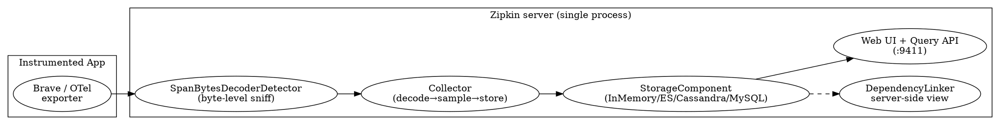

## Introduction

本篇展开 [Zipkin](/docs/CS/Distributed/Tracing/Zipkin.md) 的系统架构：数据如何从被埋点的应用流向 collector、存储、查询与 UI，以及贯穿其中的「带内传播 ID」与「异步上报」两条核心设计原则。

## Components

Zipkin 的逻辑角色可以拆成五层，自底向上为：**Tracer / Instrumentation → Reporter → Collector → Storage → Query + Web UI**。在 openzipkin/zipkin 的发行版里，后三者（Collector、Storage、Query、UI）运行在**同一个 `zipkin-server` 进程**内，这是它与 [Jaeger](/docs/CS/Distributed/Tracing/Jaeger.md)（agent / collector / query 多进程）在运维模型上的根本区别。

```
Instrumented Service (Tracer + Reporter)
   │  HTTP / Kafka / RabbitMQ / Scribe
   ▼
┌──────────────────────────────────────────────┐
│                zipkin-server                 │
│  Collector ──► StorageComponent ──► Storage  │
│      │                                       │
│      └──────────────► Query Service ──► UI   │
└──────────────────────────────────────────────┘
```

| 组件 | 运行位置 | 职责 |
| --- | --- | --- |
| **Tracer / Instrumentation** | 应用进程内 | 记录操作时间与元数据；对常见库（HTTP client、RPC、DB driver）做埋点，对用户透明 |
| **Reporter** | 应用进程内 | 把 span 编码后通过某种传输发给 collector |
| **Collector** | zipkin-server | 接收 span、校验、建立索引并交由存储持久化 |
| **Storage / StorageComponent** | zipkin-server | 可插拔存储抽象，写入并读取 span |
| **Query Service** | zipkin-server | 提供 REST API 检索 trace |
| **Web UI** | zipkin-server | 单页应用，检索并以时间轴 / 依赖图可视化 trace |

## In-Band Context Propagation

Tracer 的核心任务是**在带内（in-band）传播 trace 上下文**：它只在请求头里传递少量 ID（traceId、spanId、parentId、sampling 标记），告知下游「当前有一条 trace 正在进行」，而不传递完整的 span 数据。真正的 span 数据由 Reporter **异步、带外（out-of-band）** 上报。

这一设计带来两个关键性质：

- **对业务透明且开销极小**：instrumentation 只对库做埋点，不参与业务逻辑；传播的是定长 ID 而非 span 体。
- **故障隔离**：trace instrumentation 异步上报 span，因此追踪系统自身的延迟、抖动甚至宕机，都不会拖慢或打断用户代码。

上下文在两跳服务之间的具体内容（字段、编码、header 名）由 **B3 传播格式**规定，详见 [Zipkin Transport](/docs/CS/Distributed/Tracing/Zipkin/Transport.md)。

## Async Reporting

无论采用哪种传输，span 上报都是异步的：instrumentation 调用 `reporter.report(span)` 后立刻返回，真正的网络发送由独立的 flush 线程在后台完成。这样即使 collector 不可达或网络拥塞，应用线程也不会被阻塞。

`AsyncReporter` 的实现要点（以 `BoundedAsyncReporter` 为例）：

- 用**有界队列**（`ByteBoundedQueue`）缓冲待发 span，队列满或单条超过消息上限时**丢弃该 span 并计入 dropped metrics**，绝不阻塞生产者。
- 独立的 daemon 线程按 `messageTimeoutNanos` / 消息字节上限攒批（`BufferNextMessage`），再交给 `Sender` 发送。
- 发送失败按异常类型递增 `messagesDropped` / `spansDropped`，并在首次失败时把后续错误降级到 FINE 日志，避免日志风暴。

这意味着追踪系统**默认允许在压力下丢数据**——它定位延迟问题的辅助手段，而非必须 100% 投递的审计日志。完整的 Reporter / Sender / AsyncReporter 代码与多语言客户端见 [Zipkin Transport](/docs/CS/Distributed/Tracing/Zipkin/Transport.md)。

## Span Lifecycle in a Request

以一次跨服务 RPC 为例，追踪数据的产生与合并过程如下：

1. 入口服务创建 **root span**（`traceId` 与 `spanId` 由它生成，`parentId` 缺省）。
2. 它向下游发起调用时，通过 B3 把 `traceId` / `spanId`（作为下游的 `parentId`）传播出去，自身作为一个 child span。
3. 每个下游服务对同一次调用，在 RPC 的客户端侧记录 `cs`/`cr`、在服务端侧记录 `sr`/`ss`（详见 [Zipkin Data Model](/docs/CS/Distributed/Tracing/Zipkin/Data_Model.md)）；客户端与服务端共享同一 `spanId`，collector 收到后**合并**成一条完整记录。
4. 所有 span 经 Reporter 异步上报到 collector，落存储后由 Query Service 聚合成一条可检索的 trace。

## Server Bootstrap: Spring Boot Under the Hood

尽管核心采集/存储逻辑与框架无关，Zipkin 的 server 端确实跑在 **Spring Boot** 上。`ZipkinServer` 用 `@SpringBootConfiguration` + `@EnableAutoConfiguration`，但**默认关掉**自动配置（`ENABLED_OVERRIDE_PROPERTY=false`），改由 `@EnableZipkinServer` 与 `ZipkinModuleImporter` 显式装配支持哪些存储 / collector 模块：

```java
// zipkin/server/ZipkinServer.java
@SpringBootConfiguration
@EnableAutoConfiguration
@EnableZipkinServer
public class ZipkinServer {
    public static void main(String[] args) {
        new SpringApplicationBuilder(ZipkinServer.class)
            .banner(new ZipkinBanner())
            .initializers(new ZipkinModuleImporter(), new ZipkinActuatorImporter())
            .logStartupInfo(false)
            .properties(
                EnableAutoConfiguration.ENABLED_OVERRIDE_PROPERTY + "=false",
                "spring.config.name=zipkin-server").run(args);
    }
}
```

这与 SkyWalking 的纯 `ServiceLoader` SPI（见 [SkyWalking Source Code](/docs/CS/Distributed/Tracing/SkyWalking.md)）和 Jaeger v2 的 OTel Collector 组件模型形成三方对照：Zipkin 用 Spring 但把它「关到最小」，只为复用其配置加载与 actuator 健康端点。

## Why Zipkin Is Not "Just a Monolith"

单进程架构常被误解为「无法水平扩展」。源码事实是：扩展点在于**共享存储 + 多 server 实例 + 可选 Kafka collector**，而不是进程内多副本。两条常被忽略的边界：

- `strictTraceId=false` 时，128-bit 与 64-bit 的 traceId 按**低 64 位**归并——这是为了兼容老 instrumentation 截断 traceId 的过渡期，但会引入不同 trace 碰撞的风险（`StorageComponent.Builder` 的 javadoc 有详尽说明）。
- `Span` 的合并（client + server 两段）发生在**入库前**的 `Builder.merge`，存储层拿到的是已经拼好的完整 span，因此同一 `spanId` 的 client/server 视图在存储里是「一条记录 + shared 标志」，而非两条。



## Links

- [Zipkin](/docs/CS/Distributed/Tracing/Zipkin.md) — 枢纽页与 Quickstart
- [Zipkin Data Model](/docs/CS/Distributed/Tracing/Zipkin/Data_Model.md) — span 字段、注解与合并语义
- [Zipkin Transport](/docs/CS/Distributed/Tracing/Zipkin/Transport.md) — 传输方式、Reporter 与 B3 传播
- [Zipkin Collector and Storage](/docs/CS/Distributed/Tracing/Zipkin/Collector_and_Storage.md) — 存储后端与检索开关
- [Jaeger](/docs/CS/Distributed/Tracing/Jaeger.md) — 多进程架构对照

## References

1. [Zipkin Architecture](https://zipkin.io/public/img/architecture-1.png) — 官方架构图
2. [Instrumenting a library](https://zipkin.io/pages/instrumenting) — 埋点与上下文传播官方文档
