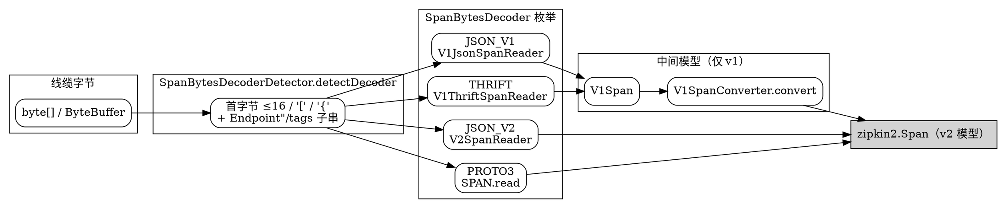

# Zipkin 编解码内核（字节级）

## Introduction

Zipkin 在「线缆格式」层面同时背着四套协议：v1 JSON（已废弃）、v1 Thrift（二进制）、v2 JSON（当前主线）、v2 Proto3（二进制）。这四种格式的**入口嗅探**集中在 `SpanBytesDecoderDetector`，**实际解码**由 `SpanBytesDecoder` 枚举分派，而底层所有二进制/字符串的读写都跑在一个自研的零依赖缓冲层 `WriteBuffer` / `ReadBuffer` 上。

本篇不讲「Span 长什么样」（见 [Zipkin Data Model](/docs/CS/Distributed/Tracing/Zipkin/Data_Model.md)），只盯**字节是怎么被拼出来、又怎么被认出来的**。结论先行：Zipkin 的编解码不是「丢给 gson / protobuf 自动搞定」，而是手写了整套缓冲、嗅探、分派与逐字段序列化逻辑——代价是代码量大，收益是零反射、零额外模型类、字段顺序与命名完全可控。

## 1. 缓冲原语：写不安全、读安全

两个类是全部编码的底座，设计哲学截然相反（均在 `zipkin/src/main/java/zipkin2/internal/`，下同）。

`WriteBuffer` 是**不安全的**：所有写方法直接 `buf[pos++] = ...`，没有任何边界检查。注释写得很直白——「overrunning a buffer is a programming error」：

```java
/**
 * Writes are unsafe as they do no bounds checks. This means you should take care to allocate or
 * wrap an array at least as big as you need prior to writing. As it is possible to calculate size
 * prior to writing, overrunning a buffer is a programming error.
 */
public final class WriteBuffer {

  public void writeByte(int v) {
    buf[pos++] = (byte) (v & 0xff);
  }
```

它的代价模型是**先算尺寸、再一次性分配、最后写**：每个 `Writer` 都必须实现 `sizeInBytes`，调用方先 `new byte[writer.sizeInBytes(value)]` 再 `wrap`。`JsonCodec.write` 就是这个模式：

```java
/** Inability to encode is a programming bug. */
public static <T> byte[] write(WriteBuffer.Writer<T> writer, T value) {
  byte[] result = new byte[writer.sizeInBytes(value)];
  WriteBuffer b = WriteBuffer.wrap(result);
  try {
    writer.write(value, b);
  } catch (RuntimeException e) {
    // ...
  }
  return result;
}
```

所以写路径几乎零扩容、零越界。它提供的方法是性能取向的：

- `writeLongHex`：把 64 位 traceId 写成 16 个 hex 字符，手写查表 `HEX_DIGITS`，**不走** `Long.toHexString`：

```java
/** Inspired by {@code okio.Buffer.writeLong} */
public void writeLongHex(long v) {
  int pos = this.pos;
  writeHexByte(buf, pos + 0, (byte) ((v >>> 56L) & 0xff));
  writeHexByte(buf, pos + 2, (byte) ((v >>> 48L) & 0xff));
  // ... 逐字节右移，共 8 次 writeHexByte ...
  writeHexByte(buf, pos + 14, (byte) (v & 0xff));
  this.pos = pos + 16;
}

static void writeHexByte(byte[] data, int pos, byte b) {
  data[pos + 0] = (byte) HEX_DIGITS[(b >> 4) & 0xf];
  data[pos + 1] = (byte) HEX_DIGITS[b & 0xf];
}
```

- `writeUtf8`：手工 UTF-8 转码，对连续的 7-bit ASCII 段做批量快路径，surrogate 单独处理（坏字符落 `'?'`）：

```java
public void writeUtf8(CharSequence string) {
  for (int i = 0, len = string.length(); i < len; i++) {
    char ch = string.charAt(i);
    if (ch < 0x80) { // 7-bit ASCII character
      writeByte(ch);
      // This could be an ASCII run, or possibly entirely ASCII
      while (i < len - 1) {
        ch = string.charAt(i + 1);
        if (ch >= 0x80) break;
        i++;
        // ... 连续 ASCII 批量写入 ...
      }
    }
    // ... 非 ASCII 按 UTF-8 手工编码，surrogate 特判 ...
  }
}
```

- `writeVarint`：标准 protobuf base-128 变长整数：

```java
void writeVarint(int v) {
  while ((v & ~0x7f) != 0) {
    writeByte((byte) ((v & 0x7f) | 0x80));
    v >>>= 7;
  }
  writeByte((byte) v);
}

// com.squareup.wire.ProtoWriter.writeVarint v2.3.0
void writeVarint(long v) {
  while ((v & ~0x7fL) != 0) {
    writeByte((byte) ((v & 0x7f) | 0x80));
    v >>>= 7;
  }
  writeByte((byte) v);
}
```

- `asciiSizeInBytes`：用**二分查表**直接定 long 的十进制宽度（避免反复除法），`varintSizeInBytes` 同理按位移判断 varint 字节数：

```java
/**
 * Binary search for character width which favors matching lower numbers.
 *
 * <p>Adapted from okio.Buffer
 */
public static int asciiSizeInBytes(long v) {
  if (v == 0) return 1;
  if (v == Long.MIN_VALUE) return 20;

  boolean negative = false;
  if (v < 0) {
    v = -v; // making this positive allows us to compare using less-than
    negative = true;
  }
  int width =
    v < 100000000L
      ? v < 10000L
      ? v < 100L ? v < 10L ? 1 : 2 : v < 1000L ? 3 : 4
      : v < 1000000L ? v < 100000L ? 5 : 6 : v < 10000000L ? 7 : 8
      : /* ... 继续二分高位 ... */;
  return negative ? width + 1 : width;
}
```

`ReadBuffer` 则**严格边界检查**：抽象类 + 三种实现——`Array`（裸 `byte[]`）、`BigEndianByteBuffer`、`LittleEndianByteBuffer`，`wrapUnsafe` 按 `ByteBuffer` 的字节序选对应实现。任何越界都抛 `IllegalArgumentException("Truncated: ...")`：

```java
/** Read operations do bounds checks, as typically more errors occur reading than writing. */
public abstract class ReadBuffer extends InputStream {

  /** Do not use the buffer passed here after, as it may be manipulated directly. */
  public static ReadBuffer wrapUnsafe(ByteBuffer buffer) {
    if (buffer.hasArray()) {
      int offset = buffer.arrayOffset() + buffer.position();
      return wrap(buffer.array(), offset, buffer.remaining());
    }
    return buffer.order() == ByteOrder.BIG_ENDIAN
      ? new BigEndianByteBuffer(buffer)
      : new LittleEndianByteBuffer(buffer);
  }

  final void require(int byteCount) {
    if (this.available() < byteCount) {
      throw new IllegalArgumentException(
        "Truncated: length " + byteCount + " > bytes available " + this.available());
    }
  }
```

读侧的关键原语：

- `readVarint32/64`：protobuf varint 解码，超过 32/64 位直接抛异常：

```java
/**
 * @return the value read. Use {@link WriteBuffer#varintSizeInBytes(long)} to tell how many bytes.
 * @throws IllegalArgumentException if more than 64 bits were encoded
 */
// included in the main api as this is used commonly, for example reading proto tags
final int readVarint32() {
  byte b; // negative number implies MSB set
  if ((b = readByte()) >= 0) {
    return b;
  }
  int result = b & 0x7f;

  if ((b = readByte()) >= 0) {
    return result | b << 7;
  }
  result |= (b & 0x7f) << 7;

  // ... 逐字节续读，超过 5 字节（32 位）抛异常 ...
}
```

- `tryReadAscii`：尝试把字节当 7-bit ASCII 读进 `RecyclableBuffers.shortStringBuffer()` 复用的短字符串缓冲，**命中则避免一次新分配**：

```java
final String readUtf8(int length) {
  if (length == 0) return ""; // ex error tag with no value
  require(length);
  if (length > RecyclableBuffers.SHORT_STRING_LENGTH) return doReadUtf8(length);

  // Speculatively assume all 7-bit ASCII characters.. common in normal tags and names
  char[] buffer = RecyclableBuffers.shortStringBuffer();
  if (tryReadAscii(buffer, length)) {
    return new String(buffer, 0, length);
  }
  return doReadUtf8(length);
}
```

（`RecyclableBuffers.shortStringBuffer()` 内部就是一个 `ThreadLocal<char[]>`，取不到就 new 一个定长数组并挂到线程上。）

- `readBytesAsHex`：把字节流按 hex 读出（上限 32 字符，对应 128-bit traceId）：

```java
final String readBytesAsHex(int length) {
  // All our hex fields are at most 32 characters.
  if (length > 32) {
    throw new IllegalArgumentException("hex field greater than 32 chars long: " + length);
  }

  require(length);
  char[] result = RecyclableBuffers.shortStringBuffer();
  int hexLength = length * 2;
  for (int i = 0; i < hexLength; i += 2) {
    byte b = readByteUnsafe();
    result[i + 0] = HEX_DIGITS[(b >> 4) & 0xf];
    result[i + 1] = HEX_DIGITS[b & 0xf];
  }
  return new String(result, 0, hexLength);
}
```

设计上「写不安全、读安全」是因为：写的长度总可预先算出，越界是调用方 bug；而读面对的是外部不可信字节，错误几乎全发生在读侧，必须兜底。

## 2. 嗅探入口：首字节定生死

`SpanBytesDecoderDetector` 是唯一「不知道格式也能解码」的地方——Kafka 这类没有 content-type 的传输就靠它（`zipkin/src/main/java/zipkin2/SpanBytesDecoderDetector.java`，下同）。类头注释先摆结论：

```java
/**
 * Detecting decoder used in transports which don't include means to identify the type of the data.
 *
 * <p>For example, we can identify the encoding and also the format in http via the request path
 * and content-type. However, in Kafka it could be that folks send mixed Zipkin data without
 * identifying its format. For example, Kafka historically has no content-type and users don't
 * always segregate different queues by instrumentation format.
 */
// In TBinaryProtocol encoding, the first byte is the TType, in a range 0-16
// .. If the first byte isn't in that range, it isn't a thrift.
//
// When byte(0) == '[' (91), assume it is a list of json-encoded spans
//
// When byte(0) == 10, assume it is a proto3-encoded span or trace ID field
//
// When byte(0) <= 16, assume it is a TBinaryProtocol-encoded thrift
// .. When serializing a Span (Struct), the first byte will be the type of a field
// .. When serializing a List[ThriftSpan], the first byte is the member type, TType.STRUCT(12)
// .. As ThriftSpan has no STRUCT fields: so, if the first byte is TType.STRUCT(12), it is a list.
```

判定逻辑全在 `detectDecoder`：

```java
/** @throws IllegalArgumentException if the input isn't a json or thrift list or object. */
static BytesDecoder<Span> detectDecoder(ByteBuffer bytes) {
  byte first = bytes.get(bytes.position());
  if (first <= 16) { // binary format
    if (protobuf3(bytes)) return SpanBytesDecoder.PROTO3;
    return SpanBytesDecoder.THRIFT; /* the first byte is the TType, in a range 0-16 */
  } else if (first != '[' && first != '{') {
    throw new IllegalArgumentException("Could not detect the span format");
  }
  if (contains(bytes, ENDPOINT_FIELD_SUFFIX)) return SpanBytesDecoder.JSON_V2;
  if (contains(bytes, TAGS_FIELD)) return SpanBytesDecoder.JSON_V2;
  return SpanBytesDecoder.JSON_V1;
}
```

JSON 里区分 v1/v2 靠两个子串常量——`Endpoint"` 与 `"tags"`：

```java
/**
 * Zipkin v2 json will have "localEndpoint" or "remoteEndpoint" fields, and others won't.
 *
 * <p>Note: Technically, it is also possible that one can thwart this by creating an binary
 * annotation of type string with a name or value literally ending in Endpoint. This would be
 * strange, especially as the convention to identify a local endpoint is the key "lc". To prevent
 * a secondary check, this scenario is also ignored.
 */
static final byte[] ENDPOINT_FIELD_SUFFIX = {'E', 'n', 'd', 'p', 'o', 'i', 'n', 't', '"'};

/**
 * Technically, it is possible to have a v2 span with no endpoints. This should catch the case
 * where someone reported a tag without reporting the "localEndpoint".
 *
 * <p>Note: we don't check for annotations as that exists in both v1 and v2 formats.
 */
static final byte[] TAGS_FIELD = {'"', 't', 'a', 'g', 's', '"'};
```

注意一个**刻意的反直觉**：v2 的判定锚点是 `"Endpoint"` 这个后缀，而不是 `"localEndpoint"`。注释解释了原因——v1 的 binaryAnnotation 里可能有人用名字结尾为 `Endpoint` 的字符串，若锚 `localEndpoint` 会被污染。

`protobuf3` 的判定是「首字节 == 10 且下一字节 ≠ 0」：`10` 即 `(field 1 << 3) | wiretype 2`（length-delimited），正是 ListOfSpans 的包装键；下一个字节是长度前缀，为 0 就不是合法 proto3 span：

```java
/* span key or trace ID key */
static boolean protobuf3(ByteBuffer bytes) {
  // varint follows and won't be zero
  return bytes.get(bytes.position()) == 10 && bytes.get(bytes.position() + 1) != 0;
}
```

还有一条**正交性约束**值得记：格式（v1/v2）与「单条 vs 批量」是正交的。`decoderForMessage` 拒绝 list 编码，且 v2 格式只允许 list message；`decoderForListMessage` 反过来要求 list 编码：

```java
/**
 * Throws {@link IllegalArgumentException} if the input isn't a v1 json or thrift single-span
 * message
 */
public static BytesDecoder<Span> decoderForMessage(byte[] span) {
  BytesDecoder<Span> decoder = detectDecoder(ByteBuffer.wrap(span));
  if (span[0] == 12 /* List[ThriftSpan] */ || span[0] == '[') {
    throw new IllegalArgumentException("Expected json or thrift object, not list encoding");
  }
  if (decoder == SpanBytesDecoder.JSON_V2 || decoder == SpanBytesDecoder.PROTO3) {
    throw new UnsupportedOperationException("v2 formats should only be used with list messages");
  }
  return decoder;
}

public static BytesDecoder<Span> decoderForListMessage(ByteBuffer spans) {
  BytesDecoder<Span> decoder = detectDecoder(spans);
  byte first = spans.get(spans.position());
  if (first != 12 /* List[ThriftSpan] */
      && first != 11 /* openzipkin/zipkin-reporter-java#133 */
      && !protobuf3(spans) && first != '[') {
    throw new IllegalArgumentException("Expected json, proto3 or thrift list encoding");
  }
  return decoder;
}
```

所以「单条 JSON_V2」在 Zipkin 里是非法组合——v2 永远走批量通道。

## 3. 分派面：SpanBytesDecoder 枚举

`SpanBytesDecoder` 是个枚举，四个常量各自实现 `decode` / `decodeList` / `decodeOne`（byte[] 与 `ByteBuffer` 两个重载）（`zipkin/src/main/java/zipkin2/codec/SpanBytesDecoder.java`，下同）。解码树分两条：

- **v2 直通车**：`JSON_V2` → `JsonCodec.readList(new V2SpanReader(), ...)`；`PROTO3` → `Proto3Codec.readList` → `SPAN.read`。两者都**直接还原成 `Span`**：

```java
/** Corresponds to the Zipkin v2 json format */
JSON_V2 {
  @Override public boolean decode(byte[] span, Collection<Span> out) { // ex DependencyLinker
    return JsonCodec.read(new V2SpanReader(), ReadBuffer.wrap(span), out);
  }

  @Override public boolean decodeList(byte[] spans, Collection<Span> out) { // ex getTrace
    return JsonCodec.readList(new V2SpanReader(), ReadBuffer.wrap(spans), out);
  }

  @Override @Nullable public Span decodeOne(byte[] span) {
    return JsonCodec.readOne(new V2SpanReader(), ReadBuffer.wrap(span));
  }
  // ...
},
PROTO3 {
  @Override public boolean decodeList(byte[] spans, Collection<Span> out) { // ex getTrace
    return Proto3Codec.readList(ReadBuffer.wrap(spans), out);
  }
  // ...
},
```

- **v1 中间模型桥**：`JSON_V1` → `new V1JsonSpanReader().readList` → `V1Span` → `V1SpanConverter.create().convert`；`THRIFT` → `ThriftCodec.readList` → `V1ThriftSpanReader` → `V1Span` → `V1SpanConverter.convert`。两者都先还原成中间模型 `V1Span`，再转 `Span`：

```java
/** Corresponds to the Zipkin v1 json format */
JSON_V1 {
  @Override public boolean decodeList(byte[] spans, Collection<Span> out) { // ex getTrace
    return new V1JsonSpanReader().readList(ReadBuffer.wrap(spans), out);
  }

  Span decodeOne(ReadBuffer buffer) {
    V1Span v1 = JsonCodec.readOne(new V1JsonSpanReader(), buffer);
    List<Span> out = new ArrayList<>(1);
    V1SpanConverter.create().convert(v1, out);
    return out.get(0);
  }
  // ...
},
```

```java
// zipkin2/internal/ThriftCodec.java
public static boolean read(ReadBuffer buffer, Collection<Span> out) {
  if (buffer.available() == 0) return false;
  try {
    V1Span v1Span = new V1ThriftSpanReader().read(buffer);
    V1SpanConverter.create().convert(v1Span, out);
    return true;
  } catch (Exception e) {
    throw exceptionReading("Span", e);
  }
}
```

这印证了前文判断：**v2 是主线，v1 仅作兼容留存**——两种 v1 格式都必须经过 `V1Span` 这个「annotations 元组 + binaryAnnotation（lc/ca/sa/ma）」的旧模型，再被 `V1SpanConverter` 折叠进 v2 的 `Span`。



## 4. JSON 序列化：V2SpanWriter vs V1SpanWriter

两套 JSON 写入器写的是**两个不同模型**，字段形状完全不同。

`V2SpanWriter` 手写 v2 序列化，字段顺序固定：`traceId → parentId → id → kind → name → timestamp → duration → localEndpoint → remoteEndpoint → annotations → tags → debug → shared`。关键细节：traceId **直接写已是 hex 串的字符串** `value.traceId()`，不拆 high/low；端点 `writeEndpoint(..., writeEmptyServiceName=false)`——v2 端点没有「空 serviceName 占位」的概念：

```java
@Override public void write(Span value, WriteBuffer b) {
  b.writeAscii("{\"traceId\":\"");
  b.writeAscii(value.traceId());
  b.writeByte('"');
  if (value.parentId() != null) {
    b.writeAscii(",\"parentId\":\"");
    b.writeAscii(value.parentId());
    b.writeByte('"');
  }
  b.writeAscii(",\"id\":\"");
  b.writeAscii(value.id());
  b.writeByte('"');
  if (value.kind() != null) {
    b.writeAscii(",\"kind\":\"");
    b.writeAscii(value.kind().toString());
    b.writeByte('"');
  }
  if (value.name() != null) {
    b.writeAscii(",\"name\":\"");
    b.writeUtf8(jsonEscape(value.name()));
    b.writeByte('"');
  }
  // ... timestamp/duration/endpoints/annotations/tags/debug/shared 依序写 ...
}
```

`V1SpanWriter` 写的是 `V1Span` 模型，形状是 v1 的「注释元组 + binaryAnnotation」：traceId 需 `writeLongHex(traceIdHigh())` + `writeLongHex(traceId())` 拼接高低 64 位；annotations 是 `{timestamp, value, endpoint}`；binaryAnnotations 是 `{key, value, endpoint}`，其中 `value:true` 表示布尔型（如 `lc`/`ca`）而非字符串：

```java
@Override public void write(V1Span value, WriteBuffer b) {
  b.writeAscii("{\"traceId\":\"");
  if (value.traceIdHigh() != 0L) b.writeLongHex(value.traceIdHigh());
  b.writeLongHex(value.traceId());
  b.writeByte('"');
  // ... parentId/id 同为 writeLongHex，annotations/binaryAnnotations 逐个写 ...
}
// binaryAnnotation 布尔型分支：
// b.writeAscii("{\"key\":\""); b.writeAscii(a.key());
// b.writeAscii("\",\"value\":true,\"endpoint\":");
```

这与 v2 的 `kind`/`tags` 语义天差地别。

`V1JsonSpanWriter` 是「v2 写 v1 格式」的桥：`Span` → `V2SpanConverter.create()` → `V1Span` → `V1SpanWriter`。读侧 `V1JsonSpanReader` 反向做同样的事，且对 annotations 强制 `timestamp != null && value != null`，否则抛 `Incomplete annotation`——JSON_V1 的注释元组缺字段即视为损坏：

```java
/** This type isn't thread-safe: it re-uses state to avoid re-allocations in conversion loops. */
public final class V1JsonSpanWriter implements WriteBuffer.Writer<Span> {
  final V2SpanConverter converter = V2SpanConverter.create();
  final V1SpanWriter v1SpanWriter = new V1SpanWriter();

  @Override public int sizeInBytes(Span value) {
    V1Span v1Span = converter.convert(value);
    return v1SpanWriter.sizeInBytes(v1Span);
  }

  @Override public void write(Span value, WriteBuffer b) {
    V1Span v1Span = converter.convert(value);
    v1SpanWriter.write(v1Span, b);
  }
}
```

```java
// zipkin2/internal/V1JsonSpanReader.java
if (timestamp == null || value == null) {
  throw new IllegalArgumentException("Incomplete annotation at " + reader.getPath());
}
reader.endObject();
builder.addAnnotation(timestamp, value, endpoint);
```

`JsonCodec` 用 gson 的 `JsonReader` 做流式拉取，但**序列化只手写、不依赖 gson 自动反射**。类头注释列了五个理由：不必为 proto3 vs json 维护两套模型、避免魔法字段初始化漏掉构造约束、可复用 JSON 形状做 `toString`、鼓励逻辑基于 JSON 形态、保证字段顺序与命名稳定：

```java
/**
 * This explicitly constructs instances of model classes via manual parsing for a number of
 * reasons.
 *
 * <ul>
 *   <li>Eliminates the need to keep separate model classes for proto3 vs json
 *   <li>Avoids magic field initialization which, can miss constructor guards
 *   <li>Allows us to safely re-use the json form in toString methods
 *   <li>Encourages logic to be based on the json shape of objects
 *   <li>Ensures the order and naming of the fields in json is stable
 * </ul>
 *
 * <p>There is the up-front cost of creating this, and maintenance of this to consider. However,
 * this should be easy to justify as these objects don't change much at all.
 */
public final class JsonCodec {
  // Hides gson types for internal use in other submodules
  public static final class JsonReader {
    final com.google.gson.stream.JsonReader delegate;

    JsonReader(ReadBuffer buffer) {
      delegate = new com.google.gson.stream.JsonReader(new InputStreamReader(buffer, UTF_8));
    }
    // ...
  }
```

## 5. Thrift 二进制：ThriftField 头 + 逐字段写

`ThriftField` 是 Thrift 二进制的**字段头**：3 字节 = `type(1) + id(2, big-endian short)`。`type` 取自 Apache Thrift 的 TType 常量：

```java
public final class ThriftField {
  // taken from org.apache.thrift.protocol.TType
  static final byte TYPE_STOP = 0;
  static final byte TYPE_BOOL = 2;
  static final byte TYPE_BYTE = 3;
  static final byte TYPE_DOUBLE = 4;
  static final byte TYPE_I16 = 6;
  static final byte TYPE_I32 = 8;
  static final byte TYPE_I64 = 10;
  static final byte TYPE_STRING = 11;
  static final byte TYPE_STRUCT = 12;
  static final byte TYPE_MAP = 13;
  static final byte TYPE_SET = 14;
  static final byte TYPE_LIST = 15;

  final byte type;
  final int id;

  void write(WriteBuffer buffer) {
    buffer.writeByte(type);
    // Write ID as a short!
    buffer.writeByte((id >>> 8L) & 0xff);
    buffer.writeByte(id & 0xff);
  }

  static ThriftField read(ReadBuffer bytes) {
    byte type = bytes.readByte();
    return new ThriftField(type, type == TYPE_STOP ? TYPE_STOP : bytes.readShort());
  }
}
```

`V1ThriftSpanWriter` 把 `Span` 经 `V2SpanConverter` 转成 `V1Span` 后逐字段写，字段号与 Thrift IDL 对齐：

| 字段 | ThriftField | 说明 |
| --- | --- | --- |
| TRACE_ID | I64, 1 | 低 64 位 traceId |
| NAME | STRING, 3 | span 名 |
| ID | I64, 4 | span id |
| PARENT_ID | I64, 5 | 有则写 |
| ANNOTATIONS | LIST, 6 | 内嵌 `ThriftAnnotationWriter` |
| BINARY_ANNOTATIONS | LIST, 8 | 内嵌 `ThriftBinaryAnnotationWriter` |
| DEBUG | BOOL, 9 | |
| TIMESTAMP | I64, 10 | |
| DURATION | I64, 11 | |
| TRACE_ID_HIGH | I64, 12 | 128-bit traceId 的高位，非零才写 |

结尾写 `TYPE_STOP`。list 编码用 `ThriftCodec.writeListBegin` = `writeByte(TYPE_STRUCT)` + `writeInt(size)`——所以**单个 span 在 list 里也是以 STRUCT（首字节 12）开头**，这正是 `decoderForListMessage` 用「首字节 == 12」判 Thrift list 的依据：

```java
// zipkin2/internal/ThriftCodec.java
static void writeListBegin(WriteBuffer buffer, int size) {
  buffer.writeByte(TYPE_STRUCT);
  writeInt(buffer, size);
}
```

注释/二进制注释内部再各自是 STRUCT 嵌套。binaryAnnotation 写的是 `type=6`——这不是 Thrift 的 TType，而是 Zipkin v1 IDL 里 `BinaryAnnotation.type` 枚举的 `STRING=6`，用来区分 string 与布尔型值：

```java
// zipkin2/internal/V1ThriftSpanWriter.java（ThriftBinaryAnnotationWriter）
static void write(String key, String stringValue, byte[] endpointBytes, WriteBuffer buffer) {
  KEY.write(buffer);
  ThriftCodec.writeLengthPrefixed(buffer, key);

  VALUE.write(buffer);
  int type = 0;
  if (stringValue != null) {
    type = 6;
    ThriftCodec.writeInt(buffer, utf8SizeInBytes(stringValue));
    buffer.writeUtf8(stringValue);
  } else {
    ThriftCodec.writeInt(buffer, 1);
    buffer.writeByte(1);
  }
  // ...
}
```

## 6. Proto3 编码：从 ListOfSpans 包到逐字段 wire key

`Proto3SpanWriter` 负责把 `List<Span>` 包进 ListOfSpans：`writeSpan` 先写 `SPAN.key`（`(1<<3)|2 = 0x0A`），再 `writeVarint(sizeOfSpan)` 长度前缀，最后 `SPAN.writeValue`。单条 span 直接写、不带 ListOfSpans 包装——这再次印证第 2 节的「v2 永远批量」约束：

```java
// zipkin2/internal/Proto3SpanWriter.java
byte[] write(Span onlySpan) {
  int sizeOfValue = SPAN.sizeOfValue(onlySpan);
  byte[] result = new byte[sizeOfLengthDelimitedField(sizeOfValue)];
  writeSpan(onlySpan, sizeOfValue, WriteBuffer.wrap(result));
  return result;
}

// prevents resizing twice
void writeSpan(Span span, int sizeOfSpan, WriteBuffer result) {
  result.writeByte(SPAN.key);
  result.writeVarint(sizeOfSpan); // length prefix
  SPAN.writeValue(result, span);
}
```

`Proto3ZipkinFields.SPAN` 是真正的字段表，wire key = `(field << 3) | wiretype`：

| 字段 | field | wireType | wire key (hex) | 类型 |
| --- | --- | --- | --- | --- |
| trace_id | 1 | len-delimited | `0A` | HexField（16/32 字节） |
| parent_id | 2 | len-delimited | `12` | HexField |
| id | 3 | len-delimited | `1A` | HexField |
| kind | 4 | varint | `20` | `ordinal()+1`，0=unknown |
| name | 5 | len-delimited | `2A` | Utf8Field |
| timestamp | 6 | FIXED64 | `31` | Fixed64Field |
| duration | 7 | varint | `38` | VarintField |
| local_endpoint | 8 | len-delimited | `42` | EndpointField |
| remote_endpoint | 9 | len-delimited | `4A` | EndpointField |
| annotation | 10 | len-delimited | `52` | AnnotationField |
| tag | 11 | len-delimited | `5A` | TagField（map<string,string>） |
| debug | 12 | varint | `60` | BooleanField |
| shared | 13 | varint | `68` | BooleanField |

Endpoint 子消息字段（wire key 都是 `(field << 3) | wiretype` 常量）：

```java
// zipkin2/internal/Proto3ZipkinFields.java
static class EndpointField extends LengthDelimitedField<Endpoint> {
  static final int SERVICE_NAME_KEY = (1 << 3) | WIRETYPE_LENGTH_DELIMITED;
  static final int IPV4_KEY = (2 << 3) | WIRETYPE_LENGTH_DELIMITED;
  static final int IPV6_KEY = (3 << 3) | WIRETYPE_LENGTH_DELIMITED;
  static final int PORT_KEY = (4 << 3) | WIRETYPE_VARINT;

  static final Utf8Field SERVICE_NAME = new Utf8Field(SERVICE_NAME_KEY);
  static final BytesField IPV4 = new BytesField(IPV4_KEY);
  static final BytesField IPV6 = new BytesField(IPV6_KEY);
  static final VarintField PORT = new VarintField(PORT_KEY);
```

**与 v2 JSON 的关键差异**：proto3 里 `trace_id` 是 `HexField`——定长 16 或 32 字节的原始 hex 二进制，而非 JSON 里的字符串；`kind` 编成 `ordinal()+1`，0 表示 unknown：

```java
// in java, there's no zero index for unknown
int toByte(Span.Kind kind) {
  return kind != null ? kind.ordinal() + 1 : 0;
}
```

读取侧 `readValue` 用 `while(pos < endPos)` 循环读 varint key + `switch`，**未知字段走 `logAndSkip`**——按 wireType 跳过并打 FINE 日志。这正是 proto3 前向/后向兼容的落地机制：加了新字段的旧 reader 不会崩：

```java
static void logAndSkip(ReadBuffer buffer, int nextKey) {
  int nextWireType = wireType(nextKey, buffer.pos());
  if (LOG.isLoggable(FINE)) {
    int nextFieldNumber = fieldNumber(nextKey, buffer.pos());
    LOG.fine(String.format("Skipping field: byte=%s, fieldNumber=%s, wireType=%s",
      buffer.pos(), nextFieldNumber, nextWireType));
  }
  skipValue(buffer, nextWireType);
}
```

## 7. 反直觉结论

1. **写零分配、读复用缓冲**：编码前先 `sizeInBytes` 算准尺寸、一次 `wrap` 分配（如 `JsonCodec.write` 的 `new byte[writer.sizeInBytes(value)]`），写路径绝不扩容；读侧 `tryReadAscii` 复用 `RecyclableBuffers.shortStringBuffer()` 避免短字符串分配。性能是手写的，不是白来的。
2. **JSON 是手写而非 gson 反射**：`JsonCodec` 只借 gson 的 `JsonReader` 做解析，**序列化一律手写**，换来字段顺序/命名稳定与零额外模型类。
3. **v1 是「活化石」**：THRIFT 与 JSON_V1 都先还原成中间模型 `V1Span` 再经 `V1SpanConverter` 转 v2，说明 v2 才是主线，v1 仅为兼容留存。
4. **「单条 v2」非法**：v2 格式（JSON_V2/PROTO3）只能走 list 通道，`decoderForMessage` 会显式拒绝。
5. **Thrift list 靠首字节 12 识别**：单个 span 也是 STRUCT 开头，所以嗅探器用 `bytes[0]==12` 判 Thrift list。

## Links

- [Zipkin 源码实现](/docs/CS/Distributed/Tracing/Zipkin/Architecture.md) — Span 模型、flags 三态、Collector 管线（本篇聚焦其字节层）
- [Zipkin 存储抽象](/docs/CS/Distributed/Tracing/Zipkin/Storage.md) — `StorageComponent` 契约与后端分派
- [Zipkin 查询 API](/docs/CS/Distributed/Tracing/Zipkin/Query.md) — 非对称双协议（摄入 v1+v2 / 查询仅 v2）
- [Zipkin Collector 传输层](/docs/CS/Distributed/Tracing/Zipkin/Collectors.md) — Kafka/Rabbit 等字节嗅探落库
- [Jaeger 源码实现](/docs/CS/Distributed/Tracing/Jaeger.md) — 对照 OTel Collector 的 proto/JSON 处理

## References

- `zipkin2.internal.WriteBuffer` — `E:/Projects/zipkin-3.6.1/zipkin/src/main/java/zipkin2/internal/WriteBuffer.java`
- `zipkin2.internal.ReadBuffer` — `E:/Projects/zipkin-3.6.1/zipkin/src/main/java/zipkin2/internal/ReadBuffer.java`
- `zipkin2.SpanBytesDecoderDetector` — `E:/Projects/zipkin-3.6.1/zipkin/src/main/java/zipkin2/SpanBytesDecoderDetector.java`
- `zipkin2.codec.SpanBytesDecoder` — `E:/Projects/zipkin-3.6.1/zipkin/src/main/java/zipkin2/codec/SpanBytesDecoder.java`
- `zipkin2.internal.V2SpanWriter` — `E:/Projects/zipkin-3.6.1/zipkin/src/main/java/zipkin2/internal/V2SpanWriter.java`
- `zipkin2.internal.V1SpanWriter` / `V1JsonSpanWriter` / `V1JsonSpanReader` — `E:/Projects/zipkin-3.6.1/zipkin/src/main/java/zipkin2/internal/`
- `zipkin2.internal.ThriftCodec` / `ThriftField` / `V1ThriftSpanWriter` — `E:/Projects/zipkin-3.6.1/zipkin/src/main/java/zipkin2/internal/`
- `zipkin2.internal.Proto3Codec` / `Proto3SpanWriter` / `Proto3ZipkinFields` — `E:/Projects/zipkin-3.6.1/zipkin/src/main/java/zipkin2/internal/`
