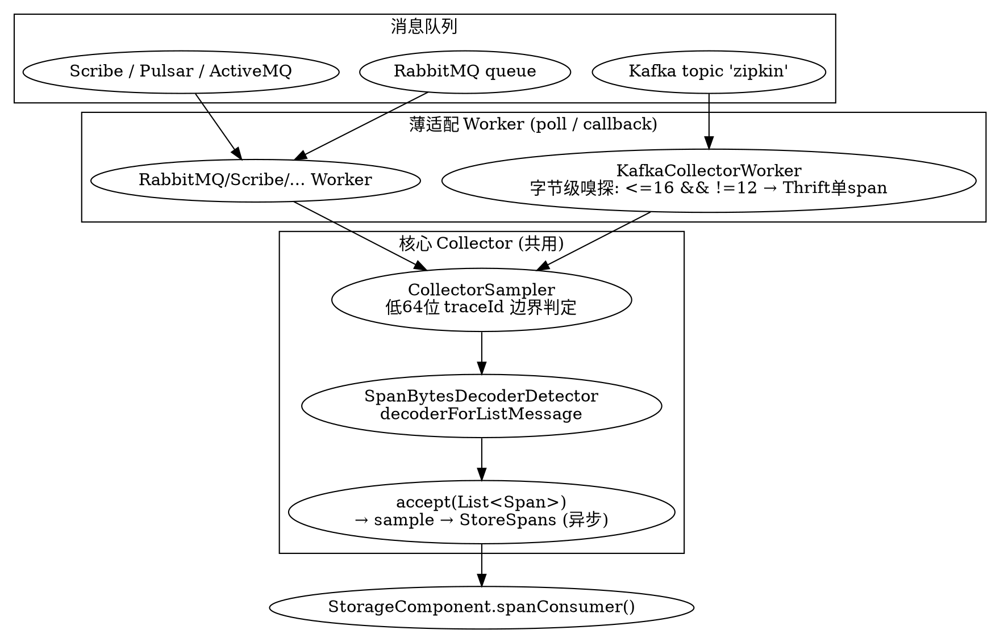

# Zipkin Collector Transport Layer

## Introduction

本页下方 **核心 Collector 管线** 一节把核心 `Collector` 管线（`accept(List<Span>)` → 采样 → 异步 `StoreSpans` 落库）讲清了。但那一层**只接收已经解好的 `List<Span>`**——span 究竟怎么从 Kafka / RabbitMQ / Scribe 这类消息队列里「长」出来的。本页补这部分：Zipkin 的传输层是一组**薄适配组件**，每个 MQ 适配器只干两件事——从队列拉字节、把字节交给同一个 `Collector.acceptSpans`——格式嗅探、采样、落库全在核心层。同时讲清 `CollectorSampler` 这个「存储层采样」组件（与客户端采样是两回事）。

## The Storage-Layer Sampler: `CollectorSampler`

Collectors 在落库前会过一道采样，决定是否真的写存储。这是**存储层采样**（Zipkin v1 遗存），与客户端概率采样不同——它发生在 span 已经到达 server 之后，用来「防止流量尖峰冲垮存储」：

`CollectorSampler` 是个抽象类，判定逻辑全在 `isSampled`——以 `abs(traceId) <= boundary` 做一致性判定（`zipkin-collector/core/src/main/java/zipkin2/collector/CollectorSampler.java`，下同）：

```java
public static CollectorSampler create(float rate) {
  if (rate < 0 || rate > 1)
    throw new IllegalArgumentException("rate should be between 0 and 1: was " + rate);
  final long boundary = (long) (Long.MAX_VALUE * rate); // safe cast as less <= 1
  return new CollectorSampler() {
    @Override
    protected long boundary() {
      return boundary;
    }
  };
}

protected abstract long boundary();

public boolean isSampled(String hexTraceId, boolean debug) {
  if (Boolean.TRUE.equals(debug)) return true;
  long traceId = HexCodec.lowerHexToUnsignedLong(hexTraceId);
  // The absolute value of Long.MIN_VALUE is larger than a long, so Math.abs returns identity.
  // This converts to MAX_VALUE to avoid always dropping when traceId == Long.MIN_VALUE
  long t = traceId == Long.MIN_VALUE ? Long.MAX_VALUE : Math.abs(traceId);
  return t <= boundary();
}
```

几个要点：① 只看 **traceId 低 64 位**（javadoc 解释：instrumentation 仍混用 traceId 宽度，所以统一按低 64 位判定，保证同 trace 一致——`isSampled` 的 javadoc 原话是「This uses only the lower 64 bits of the trace ID as instrumentation still send mixed trace ID width」）；② `debug` span 永远保留——和 v2 `Span.debug()` 的语义呼应；③ `Long.MIN_VALUE` 的 `Math.abs` 会返回自身（溢出），特判成 `MAX_VALUE` 以免该 traceId 永远被丢；④ `rate` 最小 0.0001（javadoc：`minimum sample rate is 0.0001`），`ALWAYS_SAMPLE = create(1.0f)`。注释也坦言「采样率不会精确等于输入 rate，因为 traceId 在 64 位上分布不均，实测 100K 随机 id 误差约 3%」——这和随机 hash 取模的常识一致。

## The Kafka Collector: A Thin Adapter Over the Core

`KafkaCollector` 是 `CollectorComponent` 子类（`zipkin-collector/kafka/src/main/java/zipkin2/collector/kafka/KafkaCollector.java`，下同），Builder 暴露的配置极简：

```java
public static final class Builder extends CollectorComponent.Builder {
  final Properties properties = new Properties();
  final Collector.Builder delegate = Collector.newBuilder(KafkaCollector.class);
  CollectorMetrics metrics = CollectorMetrics.NOOP_METRICS;
  String topic = "zipkin";   // 默认主题，逗号可分隔多主题
  int streams = 1;           // 消费线程数，默认 1

  /** Count of threads consuming the topic. Defaults to 1 */
  public Builder streams(int streams) {
    this.streams = streams;
    return this;
  }
  // ...

  Builder() {
    // Settings below correspond to "New Consumer Configs"
    // https://kafka.apache.org/documentation/#newconsumerconfigs
    properties.put(GROUP_ID_CONFIG, "zipkin");
    properties.put(AUTO_OFFSET_RESET_CONFIG, "earliest");   // 默认从头消费
    properties.put(KEY_DESERIALIZER_CLASS_CONFIG, ByteArrayDeserializer.class.getName());
    properties.put(VALUE_DESERIALIZER_CLASS_CONFIG, ByteArrayDeserializer.class.getName());
    // KEY/VALUE 反序列化都是 ByteArrayDeserializer —— 字节原样交给核心层解码
  }
}
```

启动后由 `LazyKafkaWorkers` 用「单线程 or 固定线程池」起 N 个 `KafkaCollectorWorker`（`streams==1` 用单线程）：

```java
ExecutorService compute() {
  ExecutorService pool =
    streams == 1 ? Executors.newSingleThreadExecutor() : Executors.newFixedThreadPool(streams);

  for (int i = 0; i < streams; i++) {
    KafkaCollectorWorker worker = new KafkaCollectorWorker(builder);
    workers.add(worker);
    pool.execute(guardFailures(worker));
  }

  return pool;
}

Runnable guardFailures(final Runnable delegate) {
  return () -> {
    try {
      delegate.run();
    } catch (InterruptException e) {
      // Interrupts are normal on shutdown, intentionally swallow
    } catch (KafkaException e) {
      KafkaException kafkaException = e;
      if (kafkaException.getCause() instanceof ConfigException) kafkaException = (KafkaException) kafkaException.getCause();
      LOG.error("Kafka worker exited with exception", kafkaException);
      failure.set(CheckResult.failed(kafkaException));
    } catch (RuntimeException e) {
      LOG.error("Kafka worker exited with exception", e);
      failure.set(CheckResult.failed(e));
    } catch (Error e) {
      LOG.error("Kafka worker exited with error", e);
      failure.set(CheckResult.failed(new RuntimeException(e)));
    }
  };
}
```

`guardFailures` 把 Kafka 异常记进 `failure` 这个 `AtomicReference`，供 `check()` 用 AdminClient 探活——探活失败即 `CheckResult.failed`，Spring Boot actuator 就能把 collector 标红：

```java
@Override
public CheckResult check() {
  try {
    CheckResult failure = kafkaWorkers.failure.get(); // check the kafka workers didn't quit
    if (failure != null) return failure;
    KafkaFuture<String> maybeClusterId = getAdminClient().describeCluster().clusterId();
    maybeClusterId.get(1, TimeUnit.SECONDS);          // 1 秒超时探活
    return CheckResult.OK;
  } catch (Throwable e) {
    Call.propagateIfFatal(e);
    return CheckResult.failed(e);
  }
}
```

真正的解码发生在 worker 的 poll 循环：

```java
// zipkin-collector/kafka/src/main/java/zipkin2/collector/kafka/KafkaCollectorWorker.java
while (running.get()) {
  final ConsumerRecords<byte[], byte[]> consumerRecords = kafkaConsumer.poll(Duration.of(1000, ChronoUnit.MILLIS));
  for (ConsumerRecord<byte[], byte[]> record : consumerRecords) {
    final byte[] bytes = record.value();
    metrics.incrementMessages();
    metrics.incrementBytes(bytes.length);

    if (bytes.length == 0) continue; // lenient on empty messages

    if (bytes.length < 2) { // need two bytes to check if protobuf
      metrics.incrementMessagesDropped();
    } else {
      // If we received legacy single-span encoding, decode it into a singleton list
      if (!protobuf3(bytes) && bytes[0] <= 16 && bytes[0] != 12 /* thrift, but not list */) {
        Span span;
        try {
          span = SpanBytesDecoder.THRIFT.decodeOne(bytes);
        } catch (RuntimeException e) {
          metrics.incrementMessagesDropped();
          continue;
        }
        collector.accept(List.of(span), NOOP);
      } else {
        collector.acceptSpans(bytes, NOOP);        // 走核心嗅探
      }
    }
  }
}

/* span key or trace ID key */
static boolean protobuf3(byte[] bytes) {
  return bytes[0] == 10 && bytes[1] != 0; // varint follows and won't be zero
}
```

注意 worker 自己先做了一层**字节级格式嗅探**：`bytes[0] <= 16 && bytes[0] != 12` 是「旧版单 span Thrift 编码」特征，直接 `THRIFT.decodeOne` 解成单个 span；否则交给 `collector.acceptSpans(bytes)`，由核心层的 `SpanBytesDecoderDetector.decoderForListMessage`（见 [Zipkin Codec](/docs/CS/Distributed/Tracing/Zipkin/Codec.md)）嗅探列表编码（JSON_V2 / JSON_V1 / PROTO3 / Thrift 列表）。这与 [Zipkin Codec](/docs/CS/Distributed/Tracing/Zipkin/Codec.md) 讲的「无 content-type 字节嗅探」是**同源逻辑**，只是从 HTTP 边界挪到了 MQ 消费边界。

## The Whole Collector Family Shares One Shape

grep 证实五个传输适配器**同构**——都 `extends CollectorComponent`、都用 `CollectorComponent.Builder`，且最终都调 `collector.acceptSpans(body, NOOP)`：

| Collector | 类声明 | 解码出口 |
| --- | --- | --- |
| Kafka | `KafkaCollector extends CollectorComponent` | `collector.acceptSpans(bytes, NOOP)`（worker poll 循环） |
| RabbitMQ | `RabbitMQCollector extends CollectorComponent` | `collector.acceptSpans(body, NOOP)`（`RabbitMQCollector` 的 `handleDelivery`） |
| Scribe | `ScribeCollector extends CollectorComponent` | 同模式 |
| Pulsar | `PulsarCollector extends CollectorComponent` | 同模式 |
| ActiveMQ | `ActiveMQCollector extends CollectorComponent` | 同模式 |

也就是说，**差异化只在「怎么把字节从各自 MQ 拉出来」**——Kafka 是 `poll` 循环、RabbitMQ 是 `RabbitMQSpanConsumer extends DefaultConsumer` 的 `handleDelivery` 回调、Scribe 是 Thrift RPC server——拉到字节后，解码、采样、落库的链路**完全共用核心 `Collector`**。这也是为什么各 collector 模块极薄：传输是适配，语义在核心。



## Contrast With Jaeger

Jaeger v2 的「接收端」是 OTel Collector 的 `receivers`（otlp / jaeger / zipkin），由 `all-in-one.yaml` 配置驱动、`batch` processor 串起来（见 [Jaeger Ingestion](/docs/CS/Distributed/Tracing/Jaeger/Ingestion.md)）——接收是**声明式 pipeline 的一部分**。Zipkin 则是**独立的 Java 组件族**：每个 MQ 一个 `CollectorComponent` 子类，靠代码生成 worker，没有 YAML 管线概念。另一个对照点：**Jaeger 没有「存储层采样」这一层**——它的采样要么在客户端（head），要么在 `tail_sampling` processor（按 trace 全量到达后决策）；Zipkin 的 `CollectorSampler` 是「按 traceId 低 64 位整除边界」的存储层概率丢弃，是 v1 时代为扛流量尖峰留下的机制。两者都解决了「不是所有 span 都要存」，但落点完全不同。

## 核心 Collector 管线：accept → sample → StoreSpans

`Collector` 是把 transport 传来的字节变成存储里行记录的胶水层。它的 `accept` 先解码，再采样，最后把落库动作丢到另一个 executor 上，使得调用线程（HTTP/gRPC 线程）与存储线程彻底解耦——源码注释明确「Callbacks passed do not propagate to the storage layer」：

```java
// zipkin2/collector/Collector.java
public void accept(List<Span> spans, Callback<Void> callback, Executor executor) {
    if (spans.isEmpty()) { callback.onSuccess(null); return; }
    metrics.incrementSpans(spans.size());
    List<Span> sampledSpans = sample(spans);
    if (sampledSpans.isEmpty()) { callback.onSuccess(null); return; }
    try {
        executor.execute(new StoreSpans(sampledSpans)); // 落库在另一个线程
        callback.onSuccess(null);
    } catch (Throwable unexpected) {
        callback.onError(unexpected);
        throw unexpected;
    }
}
```

采样是**尾部决策**：先收下全部 span，再按 `traceId` 决定是否保留。debug 标记的 span 无条件保留：

```java
List<Span> sample(List<Span> input) {
    List<Span> sampled = new ArrayList<>(input.size());
    for (int i = 0, length = input.size(); i < length; i++) {
        Span s = input.get(i);
        if (sampler.isSampled(s.traceId(), Boolean.TRUE.equals(s.debug()))) {
            sampled.add(s);
        }
    }
    int dropped = input.size() - sampled.size();
    if (dropped > 0) metrics.incrementSpansDropped(dropped);
    return sampled;
}
```

这与 Jaeger 的 tail-sampling processor 思路一致（先缓冲整条 trace 再决策），但 Zipkin 的采样粒度是 **trace 级**、实现远比 OTel 的 tail-sampling processor 轻——它不缓冲完整 trace 等待决策，而是在「这批 span 已接收完」的瞬间按 traceId 放行。

## Links

- [Zipkin](/docs/CS/Distributed/Tracing/Zipkin.md) — 枢纽页（架构、数据模型、与 OTel 关系）
- [Zipkin Storage](/docs/CS/Distributed/Tracing/Zipkin/Storage.md) — 存储抽象与后端分派（collector 最终落点 spanConsumer）
- [Zipkin Query API](/docs/CS/Distributed/Tracing/Zipkin/Query.md) — 查询侧与 v1/v2 双协议
- [Jaeger Ingestion](/docs/CS/Distributed/Tracing/Jaeger/Ingestion.md) — 对照 OTel Collector 接收管线
- [Tracing](/docs/CS/Distributed/Tracing/Tracing.md) — trace/span 数据模型总论

## References

1. [CollectorSampler.java (zipkin 3.6.1)](https://github.com/openzipkin/zipkin/blob/3.6.1/zipkin-collector/core/src/main/java/zipkin2/collector/CollectorSampler.java) — 存储层采样、低64位边界、debug 恒过、MIN_VALUE 特判
2. [KafkaCollector.java](https://github.com/openzipkin/zipkin/blob/3.6.1/zipkin-collector/kafka/src/main/java/zipkin2/collector/kafka/KafkaCollector.java) — 配置、LazyKafkaWorkers、guardFailures、AdminClient 探活
3. [KafkaCollectorWorker.java](https://github.com/openzipkin/zipkin/blob/3.6.1/zipkin-collector/kafka/src/main/java/zipkin2/collector/kafka/KafkaCollectorWorker.java) — poll 循环、字节嗅探、Thrift 单 span 特判、protobuf3 判定
4. [Collector.java](https://github.com/openzipkin/zipkin/blob/3.6.1/zipkin-collector/core/src/main/java/zipkin2/collector/Collector.java) — acceptSpans(byte[]) 经 decoderForListMessage 嗅探
5. [RabbitMQCollector.java](https://github.com/openzipkin/zipkin/blob/3.6.1/zipkin-collector/rabbitmq/src/main/java/zipkin2/collector/rabbitmq/RabbitMQCollector.java) — 同构适配器（handleDelivery 里 acceptSpans(body, NOOP)）
6. [SpanBytesDecoderDetector.java](https://github.com/openzipkin/zipkin/blob/3.6.1/zipkin/src/main/java/zipkin2/SpanBytesDecoderDetector.java) — 无 content-type 字节级格式嗅探（与 worker 同源）
