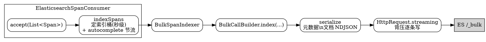

# Zipkin Elasticsearch 存储后端

## Introduction

`zipkin-storage/elasticsearch` 是 Zipkin 的**生产主力后端**。它实现的是 [Storage](/docs/CS/Distributed/Tracing/Zipkin/Storage.md) 里那套「五接口」契约，但落地方式与 InMemory 截然不同：底层不是内存索引，而是把 span 序列化成 JSON 文档、按天分索引写入 Elasticsearch/OpenSearch 的 `_bulk` 接口，查询时再拼 bool filter + terms 聚合。`ElasticsearchStorage` 是个不可变的 `@AutoValue`，所有配置在 Builder 阶段定死（`zipkin-storage/elasticsearch/src/main/java/zipkin2/elasticsearch/ElasticsearchStorage.java`，下同）。

本篇只盯着这个后端**怎么写、怎么读、索引怎么分、文档长什么样**，不重复 [Storage](/docs/CS/Distributed/Tracing/Zipkin/Storage.md) 已讲的抽象契约。结论先行：它的设计处处是「为 ES 特性量身定做」——内容寻址的 `_id`、秒级分桶、`_q` 搜索字段、streaming bulk、版本相关的索引分隔符。

## 1. 不可变配置与惰性客户端

`ElasticsearchStorage.newBuilder` 给出的默认值已经透露了产品取向：

```java
/** The lazy http client supplier will be closed on {@link #close()} */
public static Builder newBuilder(LazyHttpClient lazyHttpClient) {
  return new $AutoValue_ElasticsearchStorage.Builder()
    .lazyHttpClient(lazyHttpClient)
    .strictTraceId(true)
    .searchEnabled(true)
    .index("zipkin")
    .dateSeparator('-')
    .indexShards(5)
    .indexReplicas(1)
    .ensureTemplates(true)
    .namesLookback(86400000)
    .flushOnWrites(false)
    .autocompleteKeys(List.of())
    .autocompleteTtl((int) TimeUnit.HOURS.toMillis(1))
    .autocompleteCardinality(5 * 4000); // Ex. 5 site tags with cardinality 4000 each
}
```

| 配置 | 默认 | 含义 |
| --- | --- | --- |
| `strictTraceId` | `true` | 128-bit traceId 严格比对 |
| `searchEnabled` | `true` | 写入 `_q` / `timestamp_millis` 搜索字段 |
| `index` | `"zipkin"` | 索引前缀 |
| `indexShards` / `indexReplicas` | `5` / `1` | 分片/副本 |
| `flushOnWrites` | `false` | 写后是否 `refresh=wait_for`（近实时可见） |
| `namesLookback` | `86400000` | 服务名/操作名查询回看 1 天 |
| `autocompleteTtl` / `cardinality` | `1h` / `20000` | 自动补全的 TTL 与基数上限 |

HTTP 客户端是**惰性**的：`LazyHttpClient` 是个 `Supplier<WebClient> & Closeable`，接口上的注释讲得很直白——构造函数里做 I/O（DNS、健康检查）会拖慢甚至搞崩启动，所以 `WebClient` 延迟到首次使用才创建。`http()` 用 `@Memoized` 缓存为 `HttpCall.Factory`，整个生命周期只建一次：

```java
/**
 * This defers creation of an {@link WebClient}. This is needed because routinely, I/O occurs in
 * constructors and this can delay or cause startup to crash. For example, an underlying {@link
 * EndpointGroup} could be delayed due to DNS, implicit api calls or health checks.
 */
public interface LazyHttpClient extends Supplier<WebClient>, Closeable {
  @Override WebClient get();
  // ...
}

@Memoized HttpCall.Factory http() {
  return new HttpCall.Factory(lazyHttpClient().get());
}
```

`isOverCapacity` 把 `RejectedExecutionException` 和 Armeria 的 `ResponseTimeoutException` 都归为「容量问题」——bulk 解析里 HTTP 429 正是转成 `RejectedExecutionException`，这样上层 `Collector` 的限流/重试逻辑能统一识别：

```java
/**
 * Internal code and api responses coerce to {@link RejectedExecutionException} when work is
 * rejected. We also classify {@link ResponseTimeoutException} as a capacity related exception
 * even though capacity is not the only reason (timeout could also result from a misconfiguration
 * or a network problem).
 */
@Override public boolean isOverCapacity(Throwable e) {
  return e instanceof RejectedExecutionException || e instanceof ResponseTimeoutException;
}
```

```java
// zipkin2/elasticsearch/internal/BulkCallBuilder.java
if (status != null && status.intValue() == 429) {
  toThrow = new RejectedExecutionException(message);
}
```

## 2. 五接口合一与一个 store 类

与 InMemory 一个类实现五接口类似，ES 后端也把拆开的接口**聚合回一个实现**：`ElasticsearchSpanStore` 同时 `implements SpanStore, Traces, ServiceAndSpanNames`。于是 `ElasticsearchStorage` 的四个工厂方法都指向它：

```java
final class ElasticsearchSpanStore implements SpanStore, Traces, ServiceAndSpanNames {
  // ...
}
```

```java
@Override public SpanStore spanStore() {
  ensureIndexTemplates();
  return new ElasticsearchSpanStore(this);
}

@Override public Traces traces() {
  return (Traces) spanStore();
}

@Override public ServiceAndSpanNames serviceAndSpanNames() {
  return (ServiceAndSpanNames) spanStore();
}

@Override public AutocompleteTags autocompleteTags() {
  ensureIndexTemplates();
  return new ElasticsearchAutocompleteTags(this);
}
```

- `spanStore()` / `traces()` / `serviceAndSpanNames()` 全返回同一 `ElasticsearchSpanStore` 实例；
- `autocompleteTags()` 返回独立的 `ElasticsearchAutocompleteTags`。

这佐证了 [Storage](/docs/CS/Distributed/Tracing/Zipkin/Storage.md) 的判断——「五接口是逻辑拆分，具体后端自行决定聚合粒度」。

## 3. 索引模板：double-checked locking 装一次

`ensureIndexTemplates()` 用经典的**双重检查锁**防止并发重复安装：`volatile ensuredTemplates` 先快路径返回，再加 `synchronized` 真正执行 `doEnsureIndexTemplates()`。`doEnsureIndexTemplates` 对 `span` / `dependency` / `autocomplete` 三类模板分别调 `ensureIndexTemplate`：

```java
volatile boolean ensuredTemplates;

// synchronized since we don't want overlapping calls to apply the index templates
void ensureIndexTemplates() {
  if (ensuredTemplates) return;
  if (!ensureTemplates()) ensuredTemplates = true;
  synchronized (this) {
    if (ensuredTemplates) return;
    doEnsureIndexTemplates();
    ensuredTemplates = true;
  }
}

IndexTemplates doEnsureIndexTemplates() {
  try {
    HttpCall.Factory http = http();
    IndexTemplates templates = versionSpecificTemplates(version());
    ensureIndexTemplate(http, buildUrl(templates, TYPE_SPAN), templates.span());
    ensureIndexTemplate(http, buildUrl(templates, TYPE_DEPENDENCY), templates.dependency());
    ensureIndexTemplate(http, buildUrl(templates, TYPE_AUTOCOMPLETE), templates.autocomplete());
    return templates;
  } catch (IOException e) {
    throw new UncheckedIOException(e);
  }
}
```

模板内容由 `versionSpecificTemplates(version())` 按**集群真实版本**选择，因为 ES 7 删了 type、8 改了模板 API。一个随之而来的细节是 `indexTypeDelimiter()`：版本 < 7 用冒号 `:`，≥ 7 用连字符 `-`——这是 ES7 弃用索引名冒号后的迁移尾巴：

```java
char indexTypeDelimiter() {
  return VersionSpecificTemplates.forVersion(version()).indexTypeDelimiter();
}
```

## 4. 索引命名：写入定分隔符、读取用通配

`IndexNameFormatter`（`zipkin-storage/elasticsearch/src/main/java/zipkin2/elasticsearch/internal/IndexNameFormatter.java`）同时承担写入命名与读取模式生成：

- **写入**：`index + delimiter + type + '-' + yyyy-MM-dd`。例如 `zipkin-span-2019-05-03`（ES7+）或 `zipkin:span-2019-05-03`（老版本）：

```java
/** On insert, require a version-specific index-type delimiter as ES 7+ dropped colons */
public String formatTypeAndTimestampForInsert(String type, char indexTypeDelimiter,
  long timestampMillis) {
  return index() + indexTypeDelimiter + type + '-' + format(timestampMillis);
}
```

- **读取**：`prefix` 返回 `index + "*" + type`。注意这里用 `*` 单字符通配——因为老集群有冒号索引、新集群有连字符索引，读取时必须同时匹配两种，`*` 是唯一能覆盖两者的写法（ES 不支持单字符精确通配）：

```java
private String prefix(@Nullable String type) {
  // We use single-character wildcard here in order to read both : and - as starting in ES 7, :
  // is no longer permitted.
  return type != null ? index() + "*" + type : index();
}
```

查询时 `formatTypeAndRange(begin, end)` 会把时间跨度**压成通配模式**以减少 index 模式数量：比如 `2016-11-30, 2016-12-*, 2017-01-01`，跨月/跨年主动折叠成 `2016-12-*`、`2016-*` 这样的粗粒度模式，避免把每天一个索引名都列出来：

```java
public List<String> formatTypeAndRange(@Nullable String type, long beginMillis, long endMillis) {
  GregorianCalendar current = midnightUTC(beginMillis);
  GregorianCalendar end = midnightUTC(endMillis);

  String prefix = prefix(type);
  List<String> indices = new ArrayList<>();
  while (current.compareTo(end) <= 0) {
    if (current.get(Calendar.MONTH) == Calendar.JANUARY && current.get(DAY_OF_MONTH) == 1) {
      // attempt to compress a year
      current.set(Calendar.DAY_OF_YEAR, current.getActualMaximum(Calendar.DAY_OF_YEAR));
      if (current.compareTo(end) <= 0) {
        indices.add(
          "%s-%s%c*".formatted(prefix, current.get(Calendar.YEAR), dateSeparator()));
        current.add(DAY_OF_MONTH, 1); // rollover to next year
        continue;
      } else {
        current.set(Calendar.DAY_OF_YEAR, 1); // rollback to first of the year
      }
    } else if (current.get(DAY_OF_MONTH) == 1) {
      // attempt to compress a month
      // ...
    }
    // ...
  }
  return indices;
}
```

## 5. 写入路径：逐条分桶 + streaming bulk

`ElasticsearchSpanConsumer.accept` 把 `List<Span>` 交给 `BulkSpanIndexer`，后者 `newCall()` 返回可执行的 `Call<Void>`（`zipkin-storage/elasticsearch/src/main/java/zipkin2/elasticsearch/ElasticsearchSpanConsumer.java`，下同）。核心在 `indexSpans`——它决定每个 span 落入哪个索引桶：

```java
@Override public Call<Void> accept(List<Span> spans) {
  if (spans.isEmpty()) return Call.create(null);
  BulkSpanIndexer indexer = new BulkSpanIndexer(this);
  indexSpans(indexer, spans);
  return indexer.newCall();
}

void indexSpans(BulkSpanIndexer indexer, List<Span> spans) {
  for (Span span : spans) {
    final long indexTimestamp; // which index to store this span into
    if (span.timestampAsLong() != 0L) {
      indexTimestamp = span.timestampAsLong() / 1000L;
    } else if (!span.annotations().isEmpty()) {
      // guessTimestamp is made for determining the span's authoritative timestamp. When choosing
      // the index bucket, any annotation is better than using current time.
      indexTimestamp = span.annotations().get(0).timestamp() / 1000L;
    } else {
      indexTimestamp = System.currentTimeMillis();
    }
    indexer.add(indexTimestamp, span);
    if (searchEnabled && !span.tags().isEmpty()) {
      indexer.addAutocompleteValues(indexTimestamp, span);
    }
  }
}
```

**关键反直觉点：ES 按秒级时间戳分桶**（`/1000`），不是毫秒。这跟 Jaeger（按天/小时）的索引粒度不同，也解释了为何文档里要额外存 `timestamp_millis` 字段供 Kibana 用（见第 7 节）。

自动补全值仅在 `searchEnabled && !tags.isEmpty` 时写，且 key 必须在 `autocompleteKeys` 白名单内、并通过 `DelayLimiter`（TTL + 基数限流，默认 1h / 20000）去重节流——避免高频相同 tag 把 autocomplete 索引打爆：

```java
void addAutocompleteValues(long indexTimestamp, Span span) {
  String idx = consumer.formatTypeAndTimestampForInsert(TYPE_AUTOCOMPLETE, indexTimestamp);
  for (Map.Entry<String, String> tag : span.tags().entrySet()) {
    int length = tag.getKey().length() + tag.getValue().length() + 1;
    if (length > SHORT_STRING_LENGTH) continue;

    // If the autocomplete whitelist doesn't contain the key, skip storing its value
    if (!consumer.autocompleteKeys.contains(tag.getKey())) continue;

    AutocompleteContext context =
      new AutocompleteContext(indexTimestamp, tag.getKey(), tag.getValue());
    if (!consumer.delayLimiter.shouldInvoke(context)) continue;
    pendingAutocompleteContexts.add(context);

    bulkCallBuilder.index(idx, TYPE_AUTOCOMPLETE, tag, BulkIndexWriter.AUTOCOMPLETE);
  }
}
```

`BulkCallBuilder.build` 拼出 `/_bulk` 的 URL，可选追加 `pipeline`（ES5 ingest）与 `refresh=wait_for`（当 `flushOnWrites=true`）。请求体**不走整块缓冲**，而是用 Armeria 的 `HttpRequest.streaming` + `writeEntry` 递归 + `whenConsumed().thenRun(...)` 做**背压流式写**——注释明确说「响应可能早于请求写完到达，所以必须背压而非缓冲」，这是防止大批量 OOM 的关键：

```java
// zipkin-storage/elasticsearch/src/main/java/zipkin2/elasticsearch/internal/BulkCallBuilder.java
public HttpCall<Void> build() {
  QueryStringEncoder urlBuilder = new QueryStringEncoder("/_bulk");
  if (pipeline != null) urlBuilder.addParam("pipeline", pipeline);
  if (waitForRefresh) urlBuilder.addParam("refresh", "wait_for");
  // ...
}

private void writeEntry(HttpRequestWriter writer, int index) {
  if (index == entries.size()) { // out of entries.
    writer.close();
    return;
  }
  // Write the current entry directly to the current request.
  if (!writer.tryWrite(HttpData.wrap(serialize(alloc, entries.get(index), shouldAddType)))) {
    // Stream aborted, no need to serialize anymore.
    return;
  }
  // Recurse to proceed to the next entry, if any.
  writer.whenConsumed().thenRun(() -> writeEntry(writer, index + 1));
}
```

每条文档被序列化成两行 NDJSON：`{元数据}\n{文档}\n`（`serialize` 方法里 `payload.writeBytes(metadata).writeByte('\n').writeBytes(document).writeByte('\n')`）。



## 6. 文档 ID 是内容寻址：天然幂等

真正的文档序列化在 `BulkIndexWriter.write`（`zipkin-storage/elasticsearch/src/main/java/zipkin2/elasticsearch/internal/BulkIndexWriter.java`）。它产出 `_id` 的方式很特别——先写完整篇文档，再对刚写的字节切片做 MD5：

```java
static String write(Span span, boolean searchEnabled, ByteBufOutputStream sink) {
  int startIndex = sink.buffer().writerIndex();
  try (JsonGenerator writer = JsonSerializers.jsonGenerator(sink)) {
    // ... 逐字段写 JSON 文档 ...
  } catch (IOException e) {
    throw new AssertionError(e); // No I/O writing to a Buffer.
  }

  // get a slice representing the document we just wrote so that we can make a content hash
  ByteBuf slice = sink.buffer().slice(startIndex, sink.buffer().writerIndex() - startIndex);

  return span.traceId() + '-' + md5(slice);   // _id = traceId-md5(文档)
}
```

`_id` = `traceId + '-' + MD5(整篇文档)`。这是**内容寻址**：同一个 span 被重复上报，会算出相同的 `_id`，ES 以 upsert 语义去重，无需应用层去重逻辑即幂等。`writeIndexMetadata` 把 `_id` 塞进 bulk 的 action 行，且 `_type` 字段只为 ES < 6.x 保留（`shouldAddType` 由版本决定）：

```java
// zipkin2/elasticsearch/internal/BulkCallBuilder.java
static <T> void writeIndexMetadata(ByteBufOutputStream sink, IndexEntry<T> entry, String id,
  boolean shouldAddType) {
  try (JsonGenerator writer = JsonSerializers.jsonGenerator(sink)) {
    writer.writeStartObject();
    writer.writeObjectFieldStart("index");
    writer.writeStringField("_index", entry.index());
    // the _type parameter is needed for Elasticsearch < 6.x
    if (shouldAddType) writer.writeStringField("_type", entry.typeName());
    writer.writeStringField("_id", id);
    writer.writeEndObject();
    writer.writeEndObject();
  } catch (IOException e) {
    throw new AssertionError(e); // No I/O writing to a Buffer.
  }
}
```

## 7. 搜索字段 timestamp_millis 与 _q

`write` 在文档开头**前缀注入**两个搜索专用字段：

- **`timestamp_millis`**：`span.timestampAsLong() / 1000L` 的秒级值。注释说这是因为 Kibana 等外部工具按毫秒时间戳搜索，而 Zipkin 不想改 codec，所以直接前缀拼上。
- **`_q`**：数组字段，装 annotation 的 `value` 与 tag 的 `key`、`key=value`。原因是 **tag 名常带点号（如 `error.message`），ES 无法自然索引带点号的字段名**，于是把所有可搜索的词另存进 `_q`，查询时直接 `q=_q:error=500`：

```java
/**
 * In order to allow systems like Kibana to search by timestamp, we add a field "timestamp_millis"
 * when storing. The cheapest way to do this without changing the codec is prefixing it to the
 * json. For example. {"traceId":"... becomes {"timestamp_millis":12345,"traceId":"...
 *
 * <p>Tags are stored as a dictionary. Since some tag names will include inconsistent number of
 * dots (ex "error" and perhaps "error.message"), we cannot index them naturally with
 * elasticsearch. Instead, we add an index-only (non-source) field of {@code _q} which includes
 * valid search queries. For example, the tag {@code error -> 500} results in {@code
 * "_q":["error", "error=500"]}. This matches the input query syntax, and can be checked manually
 * with curl.
 *
 * <p>Ex {@code curl -s localhost:9200/zipkin:span-2017-08-11/_search?q=_q:error=500}
 */
static void addSearchFields(Span span, JsonGenerator writer) throws IOException {
  long timestampMillis = span.timestampAsLong() / 1000L;
  if (timestampMillis != 0L) writer.writeNumberField("timestamp_millis", timestampMillis);
  if (!span.tags().isEmpty() || !span.annotations().isEmpty()) {
    writer.writeArrayFieldStart("_q");
    for (Annotation a : span.annotations()) {
      if (a.value().length() > SHORT_STRING_LENGTH) continue;
      writer.writeString(a.value());
    }
    for (Map.Entry<String, String> tag : span.tags().entrySet()) {
      int length = tag.getKey().length() + tag.getValue().length() + 1;
      if (length > SHORT_STRING_LENGTH) continue;
      writer.writeString(tag.getKey()); // search is possible by key alone
      writer.writeString(tag.getKey() + "=" + tag.getValue());
    }
    writer.writeEndArray();
  }
}
```

若 `searchEnabled=false`，这两个字段都不写，文档退化成纯 span JSON；相应地 `BulkSpanIndexer` 选用 `SPAN_SEARCH_DISABLED` 写入器：

```java
// zipkin2/elasticsearch/ElasticsearchSpanConsumer.java（BulkSpanIndexer 构造器）
this.spanWriter =
  consumer.searchEnabled ? BulkIndexWriter.SPAN : BulkIndexWriter.SPAN_SEARCH_DISABLED;
```

## 8. 读路径：terms 聚合出 traceId 再拉全量

`ElasticsearchSpanStore.getTraces` 是查询主路径（`zipkin-storage/elasticsearch/src/main/java/zipkin2/elasticsearch/ElasticsearchSpanStore.java`，下同）：

1. `lookback` 下限钳到 `EARLIEST_MS = 1456790400000L // March 2016`，上限 `endTs - lookback`；
2. 用 `formatTypeAndRange` 算出索引模式列表（第 4 节）；
3. 构造 bool filter：`timestamp_millis` 范围、`localEndpoint.serviceName`、`remoteEndpoint.serviceName`、`name`、`_q`（annotation 查询）、`duration` 范围；
4. **先聚合**：`Aggregation.terms("traceId", limit).addSubAggregation(Aggregation.min("timestamp_millis")).orderBy("timestamp_millis", "desc")`——按 traceId 分桶、用首 span 时间降序，得到匹配 trace 的 ID 列表；
5. `traceIdsCall.flatMap(new GetSpansByTraceId(search, indices)).map(groupByTraceId)`——再用这些 traceId 拉全量 span，按 traceId 聚合成 `List<List<Span>>`。

```java
@Override
public Call<List<List<Span>>> getTraces(QueryRequest request) {
  if (!searchEnabled) return Call.emptyList();

  long endMillis = request.endTs();
  long beginMillis = Math.max(endMillis - request.lookback(), EARLIEST_MS);

  SearchRequest.Filters filters = new SearchRequest.Filters();
  filters.addRange("timestamp_millis", beginMillis, endMillis);
  if (request.serviceName() != null) {
    filters.addTerm("localEndpoint.serviceName", request.serviceName());
  }
  // ... remoteServiceName / spanName / annotationQuery(_q) / duration 同样进 filters ...

  // We need to filter to traces that contain at least one span that matches the request,
  // but the zipkin API is supposed to order traces by first span, regardless of if it was
  // filtered or not. This is not possible without either multiple, heavyweight queries
  // or complex multiple indexing, defeating much of the elegance of using elasticsearch for this.
  // So we fudge and order on the first span among the filtered spans - in practice, there should
  // be no significant difference in user experience since span start times are usually very
  // close to each other in human time.
  Aggregation traceIdTimestamp =
    Aggregation.terms("traceId", request.limit())
      .addSubAggregation(Aggregation.min("timestamp_millis"))
      .orderBy("timestamp_millis", "desc");

  List<String> indices = indexNameFormatter.formatTypeAndRange(TYPE_SPAN, beginMillis, endMillis);
  if (indices.isEmpty()) return Call.emptyList();

  SearchRequest esRequest =
    SearchRequest.create(indices).filters(filters).addAggregation(traceIdTimestamp);

  HttpCall<List<String>> traceIdsCall = search.newCall(esRequest, BodyConverters.KEYS);

  Call<List<List<Span>>> result =
    traceIdsCall.flatMap(new GetSpansByTraceId(search, indices)).map(groupByTraceId);
  // Elasticsearch lookup by trace ID is by the full 128-bit length, but there's still a chance of
  // clash on lower-64 bit. When strict trace ID is enabled, we only filter client-side on clash.
  return strictTraceId ? result.map(StrictTraceId.filterTraces(request)) : result;
}
```

注释坦白承认一处「fudge」：zipkin API 要求按 trace 的**首 span**排序，但 ES 只能按「过滤后命中的首 span」排序——作者认为两者在人类时间尺度上差异可忽略（上面代码块中 `So we fudge...` 那段注释）。

`getTrace(traceId)` 则简单：`Span.normalizeTraceId` 规范化后，对 `allSpanIndices` 做 `term("traceId", traceId)` 点查。非 strict 模式下把 128-bit traceId 截断成低 64 位（16 字符）；strict 模式则客户端再用 `StrictTraceId.filterTraces` 过滤低 64 位冲突：

```java
@Override
public Call<List<Span>> getTrace(String traceId) {
  // make sure we have a 16 or 32 character trace ID
  traceId = Span.normalizeTraceId(traceId);

  // Unless we are strict, truncate the trace ID to 64bit (encoded as 16 characters)
  if (!strictTraceId && traceId.length() == 32) traceId = traceId.substring(16);

  SearchRequest request = SearchRequest.create(asList(allSpanIndices)).term("traceId", traceId);
  return search.newCall(request, BodyConverters.SPANS);
}
```

## 9. 反直觉结论

1. **秒级分桶**：ES 索引按 `timestamp/1000`（秒）而非毫秒分片，所以文档必须额外存 `timestamp_millis` 字段供查询/外部工具用。
2. **`_id` 是 MD5 内容哈希**：`traceId + '-' + md5(文档)`，天然幂等，重复上报自动去重，无需应用层处理。
3. **`_q` 是为绕开 ES 点号限制**：tag 名带点号无法自然索引，所有可搜索词另存进 `_q` 数组。
4. **Bulk 走 streaming + 背压，不缓冲整请求体**：防大批量 OOM。
5. **五接口被聚回一个 store 类**：`ElasticsearchSpanStore` 同时实现 `SpanStore`/`Traces`/`ServiceAndSpanNames`，与 Storage 篇的「逻辑拆分」形成对照。
6. **版本相关的索引分隔符 + `*` 通配兼容**：写入用 `:`（<ES7）或 `-`（≥ES7），读取用 `index + "*" + type` 同时匹配两种老索引。
7. **模板安装是双重检查锁**：`volatile + synchronized` 保证每个进程只装一次。
8. **查询先聚合 traceId 再拉全量**：两段式（terms 聚合 → 按 traceId 拉 span → groupByTraceId），并容忍「按命中首 span 排序」的近似。

## Links

- [Zipkin 存储抽象](/docs/CS/Distributed/Tracing/Zipkin/Storage.md) — `StorageComponent` 五接口契约与后端分派
- [Zipkin 编解码内核](/docs/CS/Distributed/Tracing/Zipkin/Codec.md) — span 的 JSON/Thrift/Proto3 字节级序列化
- [Zipkin 查询 API](/docs/CS/Distributed/Tracing/Zipkin/Query.md) — `ZipkinQueryApiV2` 如何调到本 store
- [Zipkin Collector 传输层](/docs/CS/Distributed/Tracing/Zipkin/Collectors.md) — Kafka/Rabbit 字节嗅探后调 `spanConsumer()`
- [Jaeger Badger 后端](/docs/CS/Distributed/Tracing/Jaeger/Badger.md) — 对照 Jaeger 的嵌入式后端（v1 spanstore 手写 KV 索引）

## References

- `zipkin2.elasticsearch.ElasticsearchStorage` — `E:/Projects/zipkin-3.6.1/zipkin-storage/elasticsearch/src/main/java/zipkin2/elasticsearch/ElasticsearchStorage.java`
- `zipkin2.elasticsearch.ElasticsearchSpanConsumer` — `E:/Projects/zipkin-3.6.1/zipkin-storage/elasticsearch/src/main/java/zipkin2/elasticsearch/ElasticsearchSpanConsumer.java`
- `zipkin2.elasticsearch.ElasticsearchSpanStore` — `E:/Projects/zipkin-3.6.1/zipkin-storage/elasticsearch/src/main/java/zipkin2/elasticsearch/ElasticsearchSpanStore.java`
- `zipkin2.elasticsearch.internal.IndexNameFormatter` — `E:/Projects/zipkin-3.6.1/zipkin-storage/elasticsearch/src/main/java/zipkin2/elasticsearch/internal/IndexNameFormatter.java`
- `zipkin2.elasticsearch.internal.BulkCallBuilder` — `E:/Projects/zipkin-3.6.1/zipkin-storage/elasticsearch/src/main/java/zipkin2/elasticsearch/internal/BulkCallBuilder.java`
- `zipkin2.elasticsearch.internal.BulkIndexWriter` — `E:/Projects/zipkin-3.6.1/zipkin-storage/elasticsearch/src/main/java/zipkin2/elasticsearch/internal/BulkIndexWriter.java`
