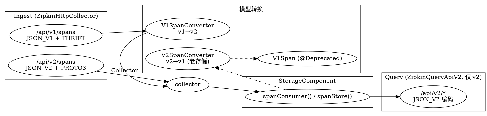

# Zipkin Query API and the Asymmetric V1/V2 Dual Protocol

## Introduction

Jaeger 的「双协议」是查询侧同端口跑 `api_v2` + `api_v3` 两套 *wire* API（见 [Jaeger Query](/docs/CS/Distributed/Tracing/Jaeger/Query.md)）。Zipkin 的「双协议」是另一种形态——**摄入侧 v1 与 v2 都收、查询侧只出 v2**，且内部还保留了一个 `@Deprecated` 的 v1 数据模型 `V1Span` 专门做存储兼容。这套「非对称双协议」是单进程历史包袱的特有解法，本页逐文件读 `zipkin-server` 的查询/摄入 handler 与 `zipkin2.v1` 的转换类，把边界讲清。

## Query Side: `ZipkinQueryApiV2` (Armeria, not Spring MVC)

查询服务是一个 Armeria HTTP handler 类，不是 Spring MVC。`ZipkinServer` 用 Armeria 当 HTTP 服务器，所有查询端点都靠 `@Get("/api/v2/...")` 注解暴露（`zipkin-server/src/main/java/zipkin2/server/internal/ZipkinQueryApiV2.java`，下同）：

```java
@ConditionalOnProperty(name = "zipkin.query.enabled", matchIfMissing = true)
@ExceptionHandler(BodyIsExceptionMessage.class)
public class ZipkinQueryApiV2 {
  final String storageType;
  final StorageComponent storage; // don't cache spanStore here as it can cause the app to crash!
  final long defaultLookback;     // @Value("${zipkin.query.lookback:86400000}") — 1 day in millis
  /**
   * The Cache-Control max-age (seconds) for /api/v2/services /api/v2/remoteServices and
   * /api/v2/spans
   */
  final int namesMaxAge;          // @Value("${zipkin.query.names-max-age:300}") — 5 minutes
```

端点清单（全部 `/api/v2/*`）：`dependencies`、`services`、`spans`、`remoteServices`、`traces`、`trace/{traceId}`、`traceMany`、`autocompleteKeys`、`autocompleteValues`。每个方法都标 `@Blocking`——跑在阻塞线程池而非事件循环上，因为底层存储调用是同步 `Call.execute()`：

```java
@Get("/api/v2/traces")
@Blocking
public AggregatedHttpResponse getTraces(
  @Param("serviceName") Optional<String> serviceName,
  @Param("remoteServiceName") Optional<String> remoteServiceName,
  @Param("spanName") Optional<String> spanName,
  @Param("annotationQuery") Optional<String> annotationQuery,
  @Param("minDuration") Optional<Long> minDuration,
  @Param("maxDuration") Optional<Long> maxDuration,
  @Param("endTs") Optional<Long> endTs,
  @Param("lookback") Optional<Long> lookback,
  @Default("10") @Param("limit") int limit)
  throws IOException {
  QueryRequest queryRequest =
    QueryRequest.newBuilder()
      .serviceName(serviceName.orElse(null))
      // ...
      .endTs(endTs.orElse(System.currentTimeMillis()))
      .lookback(lookback.orElse(defaultLookback))
      .limit(limit)
      .build();

  List<List<Span>> traces = storage.spanStore().getTraces(queryRequest).execute();
  return jsonResponse(writeTraces(SpanBytesEncoder.JSON_V2, traces));
}
```

两个实现细节值得记：

- **不缓存 `spanStore`**：字段声明处的注释明说「don't cache spanStore here as it can cause the app to crash!」。原因是 `TracingStorageComponent`（self-tracing 装饰器）可能在运行时替换 `StorageComponent` 的 `spanStore()` 返回，缓存旧引用会指向已关的存储。所以每次都重新取 `storage.spanStore()`。
- **预计算字节长度避免 buffer 增长**：`writeTraces` 先遍历算好嵌套 JSON 的精确字节数，一次性分配 `byte[] out`，再逐 trace/span 编码。注释原话「We get the encoded size of the nested list so that we don't need to grow the buffer」。名字类端点 `maybeCacheNames` 则只在**服务数 > 3** 时才加 `Cache-Control: max-age=namesMaxAge`，帮助入门期不缓存空结果（默认 `namesMaxAge=300` 秒）。`defaultLookback` 默认 1 天（86400000 ms）：

```java
/**
 * We cache names if there are more than 3 names. This helps people getting started: if we cache
 * empty results, users have more questions. We assume caching becomes a concern when zipkin is in
 * active use, and active use usually implies more than 3 services.
 */
AggregatedHttpResponse maybeCacheNames(
  boolean shouldCacheControl, List<String> values, ByteBufAllocator alloc) {
  Collections.sort(values);
  // ... 预估 JSON 数组尺寸，一次分配 ByteBuf ...
  if (shouldCacheControl) {
    headers = headers.add(CACHE_CONTROL, "max-age=" + namesMaxAge + ", must-revalidate");
  }
  return AggregatedHttpResponse.of(headers.build(), HttpData.wrap(buf));
}

// This is inlined here as there isn't enough re-use to warrant it being in the zipkin2 library
static byte[] writeTraces(SpanBytesEncoder codec, List<List<zipkin2.Span>> traces) {
  // Get the encoded size of the nested list so that we don't need to grow the buffer
  int length = traces.size();
  int sizeInBytes = 2; // []
  if (length > 1) sizeInBytes += length - 1; // comma to join elements

  for (int i = 0; i < length; i++) {
    List<zipkin2.Span> spans = traces.get(i);
    int jLength = spans.size();
    sizeInBytes += 2; // []
    if (jLength > 1) sizeInBytes += jLength - 1; // comma to join elements
    for (int j = 0; j < jLength; j++) {
      sizeInBytes += codec.sizeInBytes(spans.get(j));
    }
  }

  byte[] out = new byte[sizeInBytes];
  int pos = 0;
  out[pos++] = '['; // start list of traces
  for (int i = 0; i < length; i++) {
    pos += codec.encodeList(traces.get(i), out, pos);
    if (i + 1 < length) out[pos++] = ',';
  }
  out[pos] = ']'; // stop list of traces
  return out;
}
```

查询语义串起来：`/api/v2/traces` 把 HTTP 参数装进 `QueryRequest.newBuilder()`，调 `storage.spanStore().getTraces(queryRequest)`；`/api/v2/trace/{traceId}` 走 `storage.traces().getTrace(traceId)`（按 ID 回读，2.17+ 新接口）；服务名走 `storage.serviceAndSpanNames()`；自动补全走 `storage.autocompleteTags()`。编码统一用 `SpanBytesEncoder.JSON_V2`。

## Ingest Side: The V1/V2 Split Lives Here, Not In Query

「双协议」真正的不对称点在摄入侧。`ZipkinHttpCollector` 同时暴露 v2 与 v1 上传端点：

```java
// zipkin-server/src/main/java/zipkin2/server/internal/ZipkinHttpCollector.java
@Post("/api/v2/spans")
public HttpResponse uploadSpans(ServiceRequestContext ctx, HttpRequest req) {
  return validateAndStoreSpans(SpanBytesDecoder.JSON_V2, ctx, req);
}

@Post("/api/v2/spans")
@ConsumesProtobuf
public HttpResponse uploadSpansProtobuf(ServiceRequestContext ctx, HttpRequest req) {
  return validateAndStoreSpans(SpanBytesDecoder.PROTO3, ctx, req);
}

@Post("/api/v1/spans")
public HttpResponse uploadSpansV1(ServiceRequestContext ctx, HttpRequest req) {
  return validateAndStoreSpans(SpanBytesDecoder.JSON_V1, ctx, req);
}

@Post("/api/v1/spans")
@ConsumesThrift
public HttpResponse uploadSpansV1Thrift(ServiceRequestContext ctx, HttpRequest req) {
  return validateAndStoreSpans(SpanBytesDecoder.THRIFT, ctx, req);
}
```

也就是说：**摄入侧 v2（JSON_V2 + PROTO3）与 v1（JSON_V1 + THRIFT）都收**，v1 是为老客户端 / Scribe 格式留的口子；而**查询侧只出 v2**。解码后统一进 `Collector`（见 [Zipkin Collectors](/docs/CS/Distributed/Tracing/Zipkin/Collectors.md) 的核心 Collector 管线），最终落到 `StorageComponent.spanConsumer()`。v1 上报的字节经 `SpanBytesDecoder.THRIFT/JSON_V1` 解出后，必须经过 `V1SpanConverter`（v1→v2）转成 v2 `Span` 才进 Collector——这就是下面要说的内部 v1 模型。

## The Internal V1 Model: `V1Span`

`zipkin2.v1.V1Span` 是一个 `@Deprecated` 的内部模型（注释「new code should use Span」——实际 javadoc 为 `@Deprecated public final class V1Span`），但它活在两个地方：老存储后端（如仍用 annotation 的 Cassandra 表）与 v1 编解码。它和 v2 `Span` 的根本差异在**表达方式**：

| 维度 | v2 `Span` | v1 `V1Span` |
| --- | --- | --- |
| 角色/方向 | `kind`(CLIENT/SERVER/PRODUCER/CONSUMER) | `cs/sr/ss/cr` 等 **annotation 元组** |
| 端点 | `localEndpoint` / `remoteEndpoint` | `lc` / `sa` / `ca` / `ma` **binaryAnnotation** |
| 键值对 | `tags` | `binaryAnnotation`（带 key 的） |
| 时间戳 | `timestamp` / `duration` 字段 | 隐含在 `cs`/`sr`/`ss`/`cr` 各自时间戳里 |

注意 v1 的 `traceId` 拆成 `traceIdHigh` + `traceId`（`final long traceIdHigh, traceId, id;`），低 64 位单独成 `traceId()`，这正是 128-bit 兼容的遗留痕迹。

## The Two-Way Bridge: `V2SpanConverter` and `V1SpanConverter`

两个转换器方向相反，名字容易看反：

- **`V2SpanConverter`（v2 → v1）**：注释说「for legacy storage which still use annotations… shouldn't be used by new code」。核心是 `V1SpanMetadata.parse`，把 v2 的 `Span.Kind` 映射成 v1 注释元组与地址（`zipkin/src/main/java/zipkin2/v1/V2SpanConverter.java`，下同）：

```java
void parse(Span in) {
  // ...
  Span.Kind kind = in.kind();

  // scan annotations in case there are better timestamps, or inferred kind
  for (int i = 0, length = in.annotations().size(); i < length; i++) {
    Annotation a = in.annotations().get(i);
    String value = a.value();
    if (value.length() != 2) continue;

    if (value.equals("cs")) {
      kind = Span.Kind.CLIENT;
      if (a.timestamp() < startTs) startTs = a.timestamp();
    } else if (value.equals("sr")) {
      kind = Span.Kind.SERVER;
      // ...
    }
    // ... ss/cr/ms/mr/ws/wr 同理
  }

  if (in.remoteEndpoint() != null) addr = "sa"; // default value

  if (kind == null) return;

  switch (kind) {
    case CLIENT:
      addr = "sa";
      begin = "cs";
      end = "cr";
      break;
    case SERVER:
      addr = "ca";
      begin = "sr";
      end = "ss";
      break;
    case PRODUCER:
      addr = "ma";
      begin = "ms";
      end = "ws";
      // ...
      break;
    case CONSUMER:
      addr = "ma";
      // ...
      break;
  }
}
```

它还**扫描 v2 的 annotation 反推更准的时间戳或推断 kind**（cs/sr/ss/cr/ms/mr/ws/wr），shared span 不报 `timestamp/duration`，无 annotation/tag 的进程内 span 写空 `"lc"` binaryAnnotation 以免丢掉 `localEndpoint`：

```java
// Don't report timestamp and duration on shared spans (should be server, but not necessarily)
if (!Boolean.TRUE.equals(value.shared())) {
  result.timestamp(value.timestampAsLong());
  result.duration(value.durationAsLong());
}
// ...
boolean writeLocalComponent = annotationCount == 0 && ep != null && value.tags().isEmpty();

// write an empty "lc" annotation to avoid missing the localEndpoint in an in-process span
if (writeLocalComponent) result.addBinaryAnnotation("lc", "", ep);
if (hasRemoteEndpoint) result.addBinaryAnnotation(md.addr, value.remoteEndpoint());
```

- **`V1SpanConverter`（v1 → v2）**：反向，「split a v1 span when necessary」（javadoc 原话，针对读出合并过的 client+server v1 span 的场景）——把合并的 client+server v1 span 用 `forEndpoint(source, a.endpoint)` 按端点拆成两个 v2 `Span`（client 侧带 cs/cr，server 侧带 sr/ss）。这正是老 v1 存储里「一条合并记录」读出来变「v2 两条」的地方。



## Contrast With Jaeger

Jaeger 的 `jaegerquery` 在同端口并排注册 `api_v2`（legacy，出 `model.Span`）与 `api_v3`（新，原生 `ptrace.Traces`），差异在「是否转回 `model.Span`」。Zipkin 没有 wire 级双 API——查询只出 v2；它的「双」体现在**摄入侧多收一个 v1 口**，以及**内部多一个 v1 数据模型**做存储兼容。两者都是「历史 v1 如何与 v2 共存」的不同答案：Jaeger 在 wire 上显式保留 v1，Zipkin 把 v1 收进摄入入口与内部模型，对外只暴露 v2。

## Links

- [Zipkin](/docs/CS/Distributed/Tracing/Zipkin.md) — 枢纽页（架构、数据模型、与 OTel 关系）
- [Zipkin Storage](/docs/CS/Distributed/Tracing/Zipkin/Storage.md) — 存储抽象与后端分派（本册调用的 spanStore/traces 来源）
- [Jaeger Query](/docs/CS/Distributed/Tracing/Jaeger/Query.md) — 对照同端口 api_v2/api_v3 双 wire API
- [SkyWalking Source Code](/docs/CS/Distributed/Tracing/SkyWalking.md) — 对照 OAP 查询装配
- [Tracing](/docs/CS/Distributed/Tracing/Tracing.md) — trace/span 数据模型总论

## References

1. [ZipkinQueryApiV2.java (zipkin 3.6.1)](https://github.com/openzipkin/zipkin/blob/3.6.1/zipkin-server/src/main/java/zipkin2/server/internal/ZipkinQueryApiV2.java) — Armeria 查询 handler、端点清单、writeTraces 预分配
2. [ZipkinHttpCollector.java](https://github.com/openzipkin/zipkin/blob/3.6.1/zipkin-server/src/main/java/zipkin2/server/internal/ZipkinHttpCollector.java) — 摄入侧 v1/v2 双协议端点
3. [V1Span.java](https://github.com/openzipkin/zipkin/blob/3.6.1/zipkin/src/main/java/zipkin2/v1/V1Span.java) — @Deprecated 的 v1 内部模型
4. [V2SpanConverter.java](https://github.com/openzipkin/zipkin/blob/3.6.1/zipkin/src/main/java/zipkin2/v1/V2SpanConverter.java) — v2→v1（kind 映射 cs/cr/sr/ss/ms/ws/wr/mr）
5. [V1SpanConverter.java](https://github.com/openzipkin/zipkin/blob/3.6.1/zipkin/src/main/java/zipkin2/v1/V1SpanConverter.java) — v1→v2（合并 span 拆分）
6. [QueryRequest.java](https://github.com/openzipkin/zipkin/blob/3.6.1/zipkin/src/main/java/zipkin2/storage/QueryRequest.java) — 查询参数语义与 test 过滤
