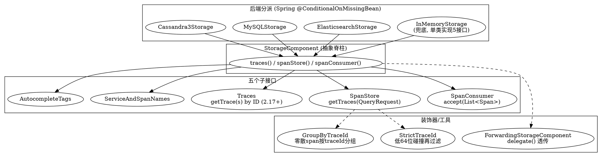

# Zipkin Storage Abstraction and Backend Dispatch

## Introduction

Zipkin 的存储不是「一个进程连一个数据库」那么简单，而是一组**同 JVM 内的 Java 接口契约**——这点和 Jaeger v2（把存储抽象成 OTel Collector 的 `tracestore.Factory`）与 SkyWalking（存储做成 OAP 的 `IModelManager` + 模块装配）都不同。Zipkin 把读、写、按 ID 回读、服务名枚举、自动补全分别切成不同接口，`StorageComponent` 只是把它们「聚起来」的脊柱。本页逐文件读源码，说清这套契约的边界、默认 `InMemoryStorage` 的实现细节，以及后端是如何被「分派」出来的。

## The Spine: `StorageComponent`

`StorageComponent` 是抽象基类，整个存储层对外只暴露两个抽象方法——读与写各一（`zipkin/src/main/java/zipkin2/storage/StorageComponent.java`，下同）：

```java
public abstract class StorageComponent extends Component {

  public Traces traces() {
    return new TracesAdapter(spanStore()); // delegates to deprecated methods.
  }

  public abstract SpanStore spanStore();   // 读

  public abstract SpanConsumer spanConsumer();  // 写
}
```

值得玩味的是 `traces()` 的默认实现：`new TracesAdapter(spanStore())`。`Traces` 是 2.17 才引入的「按 trace ID 回读」新接口（`getTrace(String)` / `getTraces(Iterable<String>)`），但默认实现是把**已经标注 `@Deprecated` 的 `SpanStore.getTrace`** 包一层（`TracesAdapter` 委托给 `spanStore()`）。这是 Zipkin 从 2.x 逐步迁移的活化石——新接口先以「包住旧实现」的方式存在，等各后端真正重写后才有原生实现。

`Builder` 承载的是**全局开关**而非后端细节：

```java
public abstract Builder strictTraceId(boolean strictTraceId);   // 128-bit vs 低64位归并
public abstract Builder searchEnabled(boolean searchEnabled);  // false 时只剩 traces() 按ID读
```

注释里把 `strictTraceId=false` 的取舍写得极细：128-bit 与 64-bit 的 traceId 按**低 64 位**归并，是为了兼容老 instrumentation 截断 traceId 的过渡期，但代价是不同 trace 可能碰撞成一条（这正是下面 `StrictTraceId` 装饰器要兜的雷）。另外 `autocompleteTags()` 与 `serviceAndSpanNames()` 都有默认实现——前者默认返回 `Call.emptyList()`，后者把 `getRemoteServiceNames` 默认降级为 `Call.emptyList()`（注释直言「incorrect for not yet ported 3rd party storage components」）——这些默认实现让第三方的存储后端「只实现核心方法也不会崩」。

## Read/Write Split Into Five Interfaces

存储层被切成五个独立接口，而非一个胖接口：

| 接口 | 职责 | 关键方法 |
| --- | --- | --- |
| `SpanConsumer` | 写 | `accept(List<Span>)`，极简函数式接口（全文仅一个方法：`Call<Void> accept(List<Span> spans);`） |
| `SpanStore` | 读（含查询/服务名/依赖） | `getTraces(QueryRequest)`、已废弃的 `getTrace`/`getServiceNames`、`getDependencies` |
| `Traces` | 按 ID 回读 | `getTrace` / `getTraces`（2.17+） |
| `ServiceAndSpanNames` | 服务/操作名枚举 | `getServiceNames` / `getSpanNames` / `getRemoteServiceNames` |
| `AutocompleteTags` | UI 自动补全 | `getKeys` / `getValues` |

注意 `SpanStore` 里 `getTrace`、`getServiceNames`、`getSpanNames` 都标了 `@Deprecated`——新的查询入口统一是 `getTraces(QueryRequest)`。而 `getDependencies` 的 javadoc 特别点出：有些后端是「把 span 捞出来喂给 `DependencyLinker` 算」而非走存储聚合查询，因为「跳树」之类的图逻辑用存储查询很难表达（javadoc 原话：「certain graph logic, such as skipping up the tree is difficult to implement as a storage query」）。这一点与下方 **Dependency Derivation: Server-Side View** 一节 `DependencyLinker` 服务端视角的结论互相印证。

## Default Backend: `InMemoryStorage`

`InMemoryStorage` 一个类**同时实现全部五个接口**（`zipkin/src/main/java/zipkin2/storage/InMemoryStorage.java`，下同），是 Zipkin 单测与 dev 默认后端。它的索引结构值得细看——**主索引只有一个**，其余皆为派生：

```java
public final class InMemoryStorage extends StorageComponent implements SpanStore, SpanConsumer,
  AutocompleteTags, ServiceAndSpanNames, Traces {

  /**
   * Primary source of data is this map, which includes spans ordered descending by timestamp. All
   * other maps are derived from the span values here. ...
   */
  private final SortedMultimap<TraceIdTimestamp, Span> spansByTraceIdTimestamp =
    new SortedMultimap<TraceIdTimestamp, Span>(TIMESTAMP_DESCENDING) { ... };  // 主索引：按时间戳降序

  /** This supports span lookup by {@link Span#traceId() lower 64-bits of the trace ID} */
  private final SortedMultimap<String, TraceIdTimestamp> traceIdToTraceIdTimestamps = ...;
  /** This is an index of {@link Span#traceId()} by {@link Endpoint#serviceName() service name} */
  private final ServiceNameToTraceIds serviceToTraceIds = new ServiceNameToTraceIds();
  /** This is an index of {@link Span#name()} by {@link Endpoint#serviceName() service name} */
  private final SortedMultimap<String, String> serviceToSpanNames = ...;
  /** This is an index of {@link Span#remoteServiceName()} by ... service name */
  private final SortedMultimap<String, String> serviceToRemoteServiceNames = ...;
}
```

写路径 `doAccept` 在**同调用线程**上 `synchronized` 执行，先把 span 以 `lowTraceId`（32 位串取后 16 位）落进主索引，再按 `searchEnabled` 决定是否维护服务名等倒排：

```java
synchronized void doAccept(List<Span> spans) {
  int delta = spans.size();
  acceptedSpanCount.addAndGet(delta);

  int spansToRecover = (spansByTraceIdTimestamp.size() + delta) - maxSpanCount;
  evictToRecoverSpans(spansToRecover);   // 超限逐出最老 trace
  for (Span span : spans) {
    long timestamp = span.timestampAsLong() / 1000L;
    String lowTraceId = lowTraceId(span.traceId());
    TraceIdTimestamp traceIdTimeStamp = new TraceIdTimestamp(lowTraceId, timestamp);
    spansByTraceIdTimestamp.put(traceIdTimeStamp, span);
    traceIdToTraceIdTimestamps.put(lowTraceId, traceIdTimeStamp);
    // ...
  }
}
```

`maxSpanCount` 默认 50 万（Builder 里 `int maxSpanCount = 500000;`），超限时 `deleteOldestTrace` 删掉 `spansByTraceIdTimestamp` 的 `lastKey`（即最旧 trace），并联动清理服务名倒排里的孤儿。

读路径 `getTraces(QueryRequest)` 体现「**先靠索引缩候选，再 client-side 精确过滤**」两阶段（`QueryRequest.test` 负责对候选 trace 逐条校验）：

```java
synchronized Call<List<List<Span>>> getTraces(QueryRequest request, boolean strictTraceId) {
  Set<String> lowTraceIdsInRange = traceIdsDescendingByTimestamp(request);
  if (lowTraceIdsInRange.isEmpty()) return Call.emptyList();

  List<List<Span>> result = new ArrayList<>();
  for (Iterator<String> lowTraceId = lowTraceIdsInRange.iterator();
    lowTraceId.hasNext() && result.size() < request.limit(); ) {
    List<Span> next = spansByTraceId(lowTraceId.next());
    if (!request.test(next)) continue;               // 候选粗筛
    if (!strictTraceId) {
      result.add(next);
      continue;
    }

    // re-run the query as now spans are strictly grouped
    for (List<Span> strictTrace : strictByTraceId(next)) {  // 严格模式按全 traceId 重分组
      if (request.test(strictTrace)) result.add(strictTrace);
    }
  }

  return Call.create(result);
}
```

`traceIdsDescendingByTimestamp` 在没有 `serviceName` 时直接退化成全表扫描主索引的 keySet，有 `serviceName` 时走 `serviceToTraceIds` 倒排——这跟 Jaeger 的 Badger 后端「没有 service name 就退化全表扫描」是同一种权衡（见 [Jaeger Storage](/docs/CS/Distributed/Tracing/Jaeger/Storage.md)）：

```java
Set<String> traceIdsDescendingByTimestamp(QueryRequest request) {
  if (!searchEnabled) return Collections.emptySet();

  Collection<TraceIdTimestamp> traceIdTimestamps =
    request.serviceName() != null
      ? traceIdTimestampsByServiceName(request.serviceName())
      : spansByTraceIdTimestamp.keySet();

  if (traceIdTimestamps == null || traceIdTimestamps.isEmpty()) return Collections.emptySet();

  return lowTraceIdsInRange(traceIdTimestamps, request.endTs, request.lookback);
}
```

## Decorators: The Glue Between Interfaces

三个工具类把上面五接口「缝」起来，体现出 Zipkin 对迁移兼容的谨慎：

- **`ForwardingStorageComponent`**：所有方法转调 `delegate()`。javadoc 明确说 delegate 是**方法而非字段**，是为了灵活性（final / lazy / 无字段皆可），且比直接继承 `StorageComponent` 好——将来加个缓存控制方法，wrapper 不重编也能透传，而不是把新特性挡掉。Zipkin 自带的 `TracingStorageComponent extends ForwardingStorageComponent`（`zipkin-server` 的 brave 集成包）正是用它给 Zipkin 自身做 self-tracing：

```java
public abstract class ForwardingStorageComponent extends StorageComponent {
  /**
   * The delegate is a method as opposed to a field, to allow for flexibility. For example, this
   * allows you to choose to make a final or lazy field, or no field at all.
   */
  protected abstract StorageComponent delegate();

  @Override public SpanConsumer spanConsumer() {
    return delegate().spanConsumer();
  }

  @Override public Traces traces() {
    return delegate().traces();
  }

  @Override public SpanStore spanStore() {
    return delegate().spanStore();
  }
  // ... autocompleteTags() / serviceAndSpanNames() 同样透传
}
```

- **`StrictTraceId`**：低 64 位碰撞时的 client-side 重过滤器。`hasClashOnLowerTraceId` **只在真有碰撞时**才跑 `FilterTraces`——注释里举了 Netflix 一个多 tag 的特殊索引模板，说明「盲目过滤会让服务端命中、客户端却丢」的反例。`lowerTraceId` 用 `length==16 ? 原串 : 后16位`，与 InMemory 的 `lowTraceId` 是同一套约定：

```java
/**
 * Filters the mutable input client-side when there's a clash on lower 64-bits of a trace ID.
 */
public static Mapper<List<List<Span>>, List<List<Span>>> filterTraces(QueryRequest request) {
  return new FilterTracesIfClashOnLowerTraceId(request);
}

@Override public List<List<Span>> map(List<List<Span>> input) {
  if (hasClashOnLowerTraceId(input)) {
    return FilterTraces.create(request).map(input);
  }
  return input;
}

/** Returns true if any trace clashes on the right-most 16 characters of the trace ID */
// Concretely, Netflix have a special index template for a multi-tag, "fit.sessionId". If we
// blindly filtered without seeing if we had to, a match that works on the server side would
// fail client side. Normally, we wouldn't special case like this, but not filtering unless
// necessary is also more efficient.
static boolean hasClashOnLowerTraceId(List<List<Span>> input) {
  int traceCount = input.size();
  if (traceCount <= 1) return false;

  Set<String> traceIdLows = new LinkedHashSet<>();
  boolean clash = false;
  for (List<Span> spans : input) {
    String traceId = lowerTraceId(spans.get(0).traceId());
    if (!traceIdLows.add(traceId)) {
      clash = true;
      break;
    }
  }
  return clash;
}

static String lowerTraceId(String traceId) {
  return traceId.length() == 16 ? traceId : traceId.substring(16);
}
```

- **`GroupByTraceId`**：把零散的 `List<Span>` 按 traceId 分组，给 `getTraces(QueryRequest)` 准备入参；`strictTraceId=false` 时同样按低 64 位归并：

```java
public final class GroupByTraceId implements Call.Mapper<List<Span>, List<List<Span>>> {
  @Override public List<List<Span>> map(List<Span> input) {
    if (input.isEmpty()) return Collections.emptyList();

    Map<String, List<Span>> groupedByTraceId = new LinkedHashMap<>();
    for (Span span : input) {
      String traceId = span.traceId();
      if (!strictTraceId) traceId = lowerTraceId(traceId);
      if (!groupedByTraceId.containsKey(traceId)) {
        groupedByTraceId.put(traceId, new ArrayList<>());
      }
      groupedByTraceId.get(traceId).add(span);
    }
    // Modifiable so that StrictTraceId can filter without allocating a new list
    return new ArrayList<>(groupedByTraceId.values());
  }
}
```

## Backend Dispatch: One `@Bean`, Many Overrides

「选哪个后端」不是 if/else 硬编码，而是 Spring 的条件 Bean 覆盖。`ZipkinConfiguration.InMemoryConfiguration` 提供**兜底** `InMemoryStorage`：

```java
// zipkin-server/src/main/java/zipkin2/server/internal/ZipkinConfiguration.java
/**
 * This is a special-case configuration if there's no StorageComponent of any kind. In-Mem can
 * supply both read apis, so we add two beans here.
 */
@Conditional(StorageTypeMemAbsentOrEmpty.class)
@ConditionalOnMissingBean(StorageComponent.class)
static class InMemoryConfiguration {
  @Bean
  StorageComponent storage(
    @Value("${zipkin.storage.strict-trace-id:true}") boolean strictTraceId,
    @Value("${zipkin.storage.search-enabled:true}") boolean searchEnabled,
    @Value("${zipkin.storage.mem.max-spans:500000}") int maxSpans,
    @Value("${zipkin.storage.autocomplete-keys:}") List<String> autocompleteKeys) {
    return InMemoryStorage.newBuilder()
      .strictTraceId(strictTraceId)
      .searchEnabled(searchEnabled)
      .maxSpanCount(maxSpans)
      .autocompleteKeys(autocompleteKeys)
      .build();
  }
}
```

当 `zipkin.storage.type=elasticsearch` 时，ES 模块用同样的 `@ConditionalOnMissingBean(StorageComponent.class)` 提供自己的 bean 顶替（`zipkin-storage` 各模块如 `ZipkinMySQLStorageConfiguration`、`ZipkinCassandra3StorageConfiguration` 都如此）。**收集器不参与选后端**——Kafka/Scribe/ActiveMQ 的 collector 配置只 `@Bean(initMethod="start")` 并注入 `StorageComponent storage`，然后调 `storage.spanConsumer()`（见 `ZipkinKafkaCollectorConfiguration` 等）。也就是说「谁写」由后端契约决定，「怎么收」由 collector 决定，二者通过 `StorageComponent` 这个接口解耦。



## Contrast With Jaeger / SkyWalking

- **Jaeger v2**：存储是 OTel Collector 的 `tracestore.Factory`，键约束是 `WriteTraces(ctx, ptrace.Traces)`；Badger 这种老后端还靠 `v1adapter` 包一层 v1 `spanstore`。Zipkin 没有「v1/v2 双栈」的桥，取而代之的是 `Traces`(新) 包 `SpanStore.getTrace`(旧) 这种接口级渐进迁移。
- **SkyWalking**：存储被做成 OAP 的 `IModelManager`，写入走 `MetricsStreamProcessor` 的 L1/L2 两段 worker 落库，查询是 `QueryService` 拼 DSL。Zipkin 的存储则朴素得多——就是同 JVM 的一个 Java 接口，后端实现自己决定索引怎么建（InMemory 用 TreeMap，ES 用索引模板）。

## Dependency Derivation: Server-Side View

依赖图不是从整棵 span 树随意连边，而是**只从 SERVER / CONSUMER 视角**建立。客户端 span 若没有 children，会被跳过；只有它带了 `remoteEndpoint`（代表未接入追踪的对端）才当作 client 处理：

```java
// zipkin2/internal/DependencyLinker.java
for (Iterator<SpanNode> i = traceTree.traverse(); i.hasNext(); ) {
    SpanNode current = i.next();
    Span currentSpan = current.span();
    Kind kind = currentSpan.kind();
    if (Kind.CLIENT.equals(kind) && !current.children().isEmpty()) continue;

    String serviceName = currentSpan.localServiceName();
    String remoteServiceName = currentSpan.remoteServiceName();
    // ...
    switch (kind) {
        case SERVER:
        case CONSUMER:
            child = serviceName;
            parent = remoteServiceName;
            break;
        case CLIENT:
        case PRODUCER:
            parent = serviceName;
            child = remoteServiceName;
            break;
    }
    addLink(parent, child, isError);
}
```

`addLink` 用 `Pair(parent, child)` 计数调用次数与错误次数。源码还特意处理了一种 instrumentation 误用：有人把 remote 服务名写在了 client annotation 上，于是 `DependencyLinker` 会**回补**一条从最近的 remote 祖先到该 client 的缺失链路：

```java
// zipkin2/internal/DependencyLinker.java
Span remoteAncestor = firstRemoteAncestor(current);
String remoteAncestorName;
if (remoteAncestor != null
  && (remoteAncestorName = remoteAncestor.localServiceName()) != null) {
  // Some users accidentally put the remote service name on client annotations.
  // Check for this and backfill a link from the nearest remote to that service as necessary.
  if (kind == Kind.CLIENT && serviceName != null && !remoteAncestorName.equals(serviceName)) {
    logger.fine("detected missing link to client span");
    addLink(remoteAncestorName, serviceName, false); // we don't know if there's an error here
  }
}
```

这解释了为什么 Zipkin 依赖图通常「干净」——它不靠 client span 建边，避免了客户端重复上报导致的重复边。

## Links

- [Zipkin](/docs/CS/Distributed/Tracing/Zipkin.md) — 枢纽页（架构、数据模型、与 OTel 关系）
- [Zipkin Query API](/docs/CS/Distributed/Tracing/Zipkin/Query.md) — 查询侧与 v1/v2 双协议
- [Jaeger Storage](/docs/CS/Distributed/Tracing/Jaeger/Storage.md) — 对照 v2 tracestore.Factory 与 v1adapter 桥
- [SkyWalking Source Code](/docs/CS/Distributed/Tracing/SkyWalking.md) — 对照 OAP 存储装配与流式聚合
- [Tracing](/docs/CS/Distributed/Tracing/Tracing.md) — trace/span 数据模型总论

## References

1. [StorageComponent.java (zipkin 3.6.1)](https://github.com/openzipkin/zipkin/blob/3.6.1/zipkin/src/main/java/zipkin2/storage/StorageComponent.java) — 脊柱抽象、`traces()` 包 `SpanStore`、Builder 全局开关
2. [SpanStore.java](https://github.com/openzipkin/zipkin/blob/3.6.1/zipkin/src/main/java/zipkin2/storage/SpanStore.java) — 读接口、`getTraces` 与废弃方法、`getDependencies` 注释
3. [Traces.java](https://github.com/openzipkin/zipkin/blob/3.6.1/zipkin/src/main/java/zipkin2/storage/Traces.java) — 2.17 引入的按 ID 回读接口
4. [InMemoryStorage.java](https://github.com/openzipkin/zipkin/blob/3.6.1/zipkin/src/main/java/zipkin2/storage/InMemoryStorage.java) — 单类实现五接口、主/派生索引、逐出、两阶段读
5. [ForwardingStorageComponent.java](https://github.com/openzipkin/zipkin/blob/3.6.1/zipkin/src/main/java/zipkin2/storage/ForwardingStorageComponent.java) — delegate 透传装饰器
6. [ZipkinConfiguration.java](https://github.com/openzipkin/zipkin/blob/3.6.1/zipkin-server/src/main/java/zipkin2/server/internal/ZipkinConfiguration.java) — InMemory 兜底 bean 与条件装配
