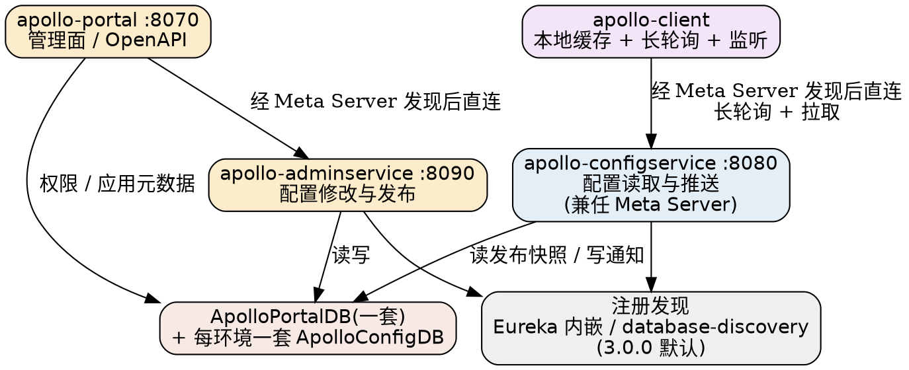

# Apollo

## Introduction

Apollo（ApolloConfig）是携程框架研发部出品的**分布式配置管理中心**。它的定位既不是 KV 存储也不是注册中心，而是「**配置发布平台**」——从设计之初就把配置当作需要治理的发布物：修改与发布分离、版本与回滚、灰度生效、编辑/发布双权限、全程审计。仓库 `apolloconfig/apollo`（原 `ctripcorp/apollo`，2016-03 创建）目前约 29.8k stars，Apache-2.0，服务端唯一外部依赖是 MySQL。

理解 Apollo 的四条判定线，本目录所有分册都围绕它们展开：

1. **配置的四维坐标**：`appId → env → cluster → namespace`。讨论任何一条配置行为，先问「这是在哪个维度上成立的」。
2. **服务端三个逻辑角色**：Config Service（面向客户端读/推）、Admin Service（面向 Portal 写）、Portal（管理面），注册发现早期靠内嵌 Eureka，**3.0.0 起默认改用库表（database-discovery）**。
3. **推送是两段式**：长轮询只携带「哪个 namespace 变了」的通知，内容由客户端再拉一次——不要把通知当内容。
4. **Java 客户端已拆出主仓库**：`apolloconfig/apollo-java` 独立演进，版本线与服务端解耦（客户端 tag 至 v2.5.0）。

版本基线（2026-10-25 现场核实）：

- 服务端 **v3.0.0**（2026-10-03）：运行基线从 Java 8 提到 **Java 17**，Spring Boot 4.1.1 / Spring Framework 7 / Spring Cloud 2025.1.3；Portal 全面 OpenAPI-first；新增用户访问 token（面向 AI agent 与自动化）；`database-discovery` 转为默认。
- 服务端 **v2.5.0**（2026-02-19）：引入**增量配置同步**（`config-service.incremental.change.enabled=true`，切换后需重启）、应用级配置导入导出、组织列表等新 Open API。
- Java 客户端仓库 `apolloconfig/apollo-java`（模块 `apollo-client` / `apollo-client-config-data` / `apollo-openapi` / `apollo-mockserver` 等），tag 至 **v2.5.0**。

> [!NOTE]
>
> 消歧：本目录的 Apollo 指携程配置中心。微软 OSDI'14 论文的 **Apollo 集群调度器**（resource monitor / process node、机会式调度）是完全另一回事，见 [Cluster Scheduler](/docs/CS/Distributed/Cluster_Scheduler.md) 的 `## Apollo`；分布式体系里还有第三个同名物——Apollo 域的网络计算系统 NCS，见 [Middleware](/docs/CS/Distributed/Middleware.md)。

## Server Architecture

- [Architecture](/docs/CS/Framework/Apollo/Architecture.md)：三个逻辑角色与 `apollo-biz` / `apollo-common` / `apollo-audit` 等模块的职责边界、Meta Server 封装、注册发现的四条替代路线（Eureka / database-discovery / Nacos / Consul / ZooKeeper / 自定义）、单点故障可用性矩阵、多数据中心部署形态。

## Client and Real-time Delivery

- [Client](/docs/CS/Framework/Apollo/Client.md)：Java 客户端启动参数的全链路优先级（`app.id`、`apollo.meta`、`apollo.cluster`、`apollo.cache-dir`、access key、label）、本地文件缓存、`ConfigService` / `@ApolloConfig` / `@ApolloConfigChangeListener` / `@EnableApolloConfig` 四种接入形态、Spring Boot 的 bootstrap 与 Config Data 两条路线、非 Java 生态。
- [Config Push](/docs/CS/Framework/Apollo/Config_Push.md)：「通知 + 拉取」两段式推送的完整时序——60 秒长轮询、304 语义、服务端消息扫描、5 分钟兜底拉取、2.5.0 增量同步，以及与 Nacos 长轮询 / etcd watch 的机制对照。

## Data Model and Management Plane

- [Namespace](/docs/CS/Framework/Apollo/Namespace.md)：四维数据模型的每一维语义（为什么 appId 跟代码走、env 不跟代码走）、私有与公共 namespace、关联与覆盖、配置格式（properties / yml / xml / json / txt）由名称后缀决定的规则、父子集群。
- [Portal](/docs/CS/Framework/Apollo/Portal.md)：管理面治理——编辑与发布分离、RBAC 权限链（Users → Role → Permission）、灰度发布七步流程与分支状态机、回滚语义、审计日志、Open API 与 token。

## Storage

- [Storage](/docs/CS/Framework/Apollo/Storage.md)：ApolloConfigDB 的读路径与写路径涉及的表（`Item` → `Commit` → `Release` → `ReleaseMessage` → `InstanceConfig`）、`GrayReleaseRule` 与 `ReleaseHistory.Operation` 枚举、ApolloPortalDB 的权限与 token 表、两库共用的软删除与审计列范式、schema delta 脚本布局。

## Deployment and Operations

- [Deployment and Ops](/docs/CS/Framework/Apollo/Deployment_and_Ops.md)：快速开始（H2）与分布式部署（MySQL）两条路、端口与网络边界（为什么 configservice / adminservice 不能暴露公网）、每环境一套 + 一个 PortalDB 的拓扑、环境变量清单、优雅停机、3.0.0 升级的三个必须动作。

## Horizontal Comparison

| 维度 | Apollo | [Nacos](/docs/CS/Framework/nacos/README.md) | [Spring Cloud Config](/docs/CS/Framework/Spring_Cloud/Config.md) |
| :-- | :-- | :-- | :-- |
| 定位 | 纯配置中心（发布平台） | 注册中心 + 配置中心合一 | 配置中心（Spring 生态组件） |
| 一致性 | 配置即发布物，无共识协议，DB 单点写入 | 配置侧 CP（JRaft） | 依赖 Git / Vault 后端 |
| 推送 | HTTP 长轮询（60s）+ 定时拉取兜底 | 2.x 长轮询 / 3.x gRPC 推送 | Spring Cloud Bus（MQ 广播） |
| 多语言 | 官方 Java / .Net，第三方 Go / Python / NodeJS / PHP / C / Rust + HTTP API | 多语言 SDK（Java / Go / Python / NodeJS） | 主要服务 Java 生态 |
| 治理 | 灰度、编辑/发布分离、审计、权限 | 灰度、权限、命名空间隔离 | 依赖 Spring Security / 自建 |
| 外部依赖 | MySQL | MySQL / Derby（+JRaft 自选举） | Git / Vault / JDBC / CredHub 等 |

一句话取舍：**要治理（灰度、双权限、审计）选 Apollo；要注册与配置一体选 Nacos；全 Spring 栈且接受 Git 作为 source of truth 选 Spring Cloud Config**。etcd / ZooKeeper / Consul 等协调底座的横向矩阵见 [etcd 横向对照](/docs/CS/Framework/etcd/compare.md)。

## Links

- [Eureka](/docs/CS/Framework/eureka/README.md)
- [ZooKeeper](/docs/CS/Framework/ZooKeeper/ZooKeeper.md)
- [Consul](/docs/CS/Framework/consul/README.md)
- [Dubbo](/docs/CS/Framework/Dubbo/Dubbo.md)
- [Spring Boot](/docs/CS/Framework/Spring_Boot/Spring_Boot.md)
- [Kubernetes 调度](/docs/CS/Container/k8s/K8s.md)

## References

- <https://github.com/apolloconfig/apollo>
- <https://github.com/apolloconfig/apollo-java>
- <https://www.apolloconfig.com/>
- <https://www.apolloconfig.com/#/en/design/apollo-introduction>
- <https://www.apolloconfig.com/#/en/deployment/distributed-deployment-guide>
- <https://github.com/apolloconfig/apollo/releases>
