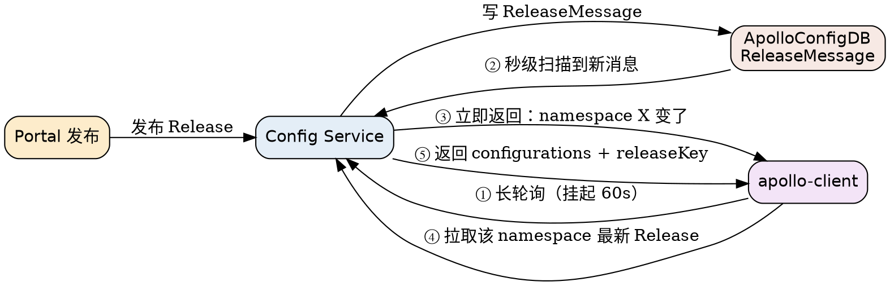

# Apollo Config Push

## Introduction

配置中心的核心价值不只是「能存」，更是「**改了客户端马上知道**」。Apollo 的推送被官方概括为三步：用户在配置中心修改并发布 → 配置中心通知 Apollo 客户端有更新 → 客户端拉取最新配置、更新本地配置并通知应用。官方宣称的端到端时效是 **1 秒级**。

这套机制的要点可以浓缩成一句：**通知与内容分离**。长轮询返回的只是「哪个 namespace 变了」，真正的配置内容永远由客户端再拉一次。本文拆开讲这条链路的两半（服务端通知、客户端拉取）与它们的兜底，基线为服务端 v3.0.0；客户端本地行为见 [Client](/docs/CS/Framework/Apollo/Client.md)。

## Long Polling: 60 Seconds and 304

长连接实际上通过 **HTTP 长轮询**实现，官方文档给出的时序：

1. 客户端向 Config Service 发起一个 HTTP 请求；
2. 服务端把连接**挂起 60 秒**：
   - 这 60 秒内出现客户端关心的配置变更，挂起的请求**立即返回**，告知发生变更的 namespace 信息；
   - 60 秒内没有变更，返回 **HTTP 304**；
3. 客户端收到响应后**立即重新发起**连接，回到第 1 步。

服务端用**异步 servlet（Spring DeferredResult）**承载这些挂起请求——官方明确说这是考虑到「成千上万的客户端同时发起长连接」的规模前提。

客户端收到「某 namespace 变了」的通知后，按 namespace 拉取最新配置，与本地比对确认变化后才回调 `ConfigChangeListener`——**通知本身不携带内容，也不直接触发回调**。

## Server-side Notification Source

发布动作在服务端产生两样东西：一条**全量配置快照**写入 `Release` 表，一条**通知消息**写入 `ReleaseMessage` 表（`Message` 列，形如包含 appId / cluster / namespace 的 JSON）。Config Service 有一个**约 1 秒间隔**的消息扫描，把新 `ReleaseMessage` 变成对挂起长轮询的唤醒信号——长轮询的「立即返回」依赖它。

因此**通知链路的时延 = 扫描间隔**，与长轮询的 60 秒是两件独立的事：扫描负责「尽快发现」，长轮询负责「尽快送达」。

## Fallback: Timed Pull

客户端除长轮询外还**定期主动拉取**全量配置，作为推送失效时的兜底：

- 默认**每 5 分钟**一次，System Property `apollo.refreshInterval` 覆盖，**单位为分钟**；
- 拉取时上报本地版本号，配置未变服务端返回 **304 Not Modified**。

排障时这条兜底是判断依据：推送链路断裂时，变更最长要等一个兜底周期（默认 5 分钟）才生效；如果超过 2 分钟没生效且远小于兜底周期，基本可判定推送链路（通知扫描或长轮询）出了问题，而不是兜底没到点。

## Incremental Sync (2.5.0+)

v2.5.0 引入**增量配置同步**：`config-service.incremental.change.enabled=true` 时，Config Service 缓存发布状态，长轮询唤醒后**只返回发生变化的配置项**，降低大规模集群下的网络开销。注意：

- 该开关**切换后需要重启** Config Service 才生效；
- 它优化的是「④→⑤ 拉取」的数据量，不改变通知语义——客户端拿到的仍是该 namespace 的最新完整视图。

## Comparison with Nacos and etcd Watch

| 维度 | Apollo 长轮询 | [Nacos 配置推送](/docs/CS/Framework/nacos/config-push.md) | [etcd Watch](/docs/CS/Framework/etcd/watch.md) |
| :-- | :-- | :-- | :-- |
| 通道 | HTTP 长轮询，服务端挂起 **60s** | 2.x HTTP 长轮询（客户端超时 30s / 服务端约 29.5s 提前返回）；3.x gRPC 长连接 | gRPC watch stream |
| 通知内容 | 仅「哪个 namespace 变了」 | 仅 dataId（需再拉取） | 完整 KV 变更 |
| 唤醒来源 | 服务端约 1s 扫描 `ReleaseMessage` | 服务端 `LocalDataChangeEvent` | revision 推进 |
| 空转响应 | 304 | 挂起至超时返回空 | — |
| 兜底 | 5 分钟定时拉取（304） | 3.x gRPC 重连 / 2.x 下一轮长轮询 | watch 断流重连 |
| 一致性语义 | 通知 + 拉取，最终一致 | 同左 | 线性一致（从某 revision 连续） |

共同的设计取向值得注意：Apollo 与 Nacos 都选了「**轻通知 + 主动拉**」，只有 etcd 的 watch 直接返回变更后的值。前两者用一次额外往返换来了推送消息的极小体积与对丢包的容忍，后者用流的有序性换来强一致语义。

## Links

- [Apollo](/docs/CS/Framework/Apollo/Apollo.md)
- [Client](/docs/CS/Framework/Apollo/Client.md)
- [Storage](/docs/CS/Framework/Apollo/Storage.md)
- [Nacos Config Push](/docs/CS/Framework/nacos/config-push.md)
- [etcd Watch](/docs/CS/Framework/etcd/watch.md)

## References

- <https://www.apolloconfig.com/#/en/design/apollo-introduction>
- <https://github.com/apolloconfig/apollo/releases>
