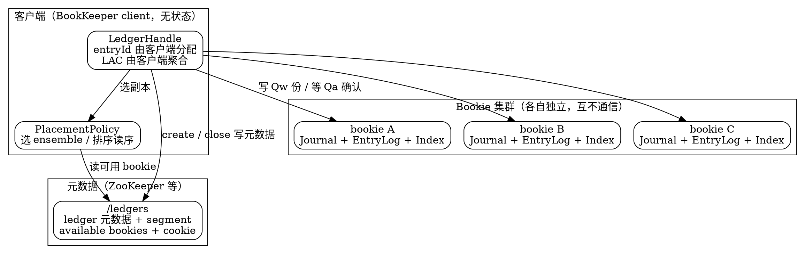

## Introduction

[Apache BookKeeper](https://bookkeeper.apache.org/) 是一个**只追加（append-only）的分布式日志存储服务**：客户端把字节序列写进 ledger，BookKeeper 负责把它复制到多个 bookie 上并保证「一旦确认，就能读到」。它自己不提供 topic、分区、订阅这类消息语义 —— 这些由上层（最典型的是 [Apache Pulsar](/docs/CS/MQ/Pulsar/Pulsar.md)）实现，BookKeeper 只解决**「日志怎么可靠地存下来」**这一件事。

> 版本基线：**4.18.1**（tag `release-4.18.1`，GitHub 上最新正式 release，2026-09-16 发布）。
> ⚠️ 官网 `bookkeeper.apache.org/releases` 页面**仍显示 4.17.3 为最新**（页面更新滞后于代码仓库），不要以它为准。
> ⚠️ 4.18.2 的发布公告已出现在 dev 邮件列表，但仓库里只有 `v4.18.2-rc0` tag，**尚不构成稳定基线**。
> ⚠️ [Pulsar](/docs/CS/MQ/Pulsar/Pulsar.md) 4.2.4 依赖的是 **4.17.3**（Pulsar 根 `pom.xml:185`）。本目录正文以 4.18.1 为准，与 4.17.3 的差异会在涉及处标注；Pulsar 侧的行为请以 [ManagedLedger 存储层](/docs/CS/MQ/Pulsar/ManagedLedger.md) 为准。

理解 BookKeeper 只需抓住一句话：**它是「一堆可由客户端打开、追加、封闭的复制日志」，一致性边界是 ledger，而不是消息、也不是分区**。这带来三个与其它存储系统截然不同的性质：

1. **ledger 封闭后不可变**：写权限的生命周期止于 close 或 recovery，之后任何人（包括原写者）都写不进去。
2. **副本关系可换**：ledger 的副本集合（ensemble）不是固定的，写失败时可以换一批 bookie 继续写，换副本的历史被记录在元数据里。
3. **bookie 之间不互相协调**：没有 leader、没有副本间同步协议。一致性完全由**客户端**通过 quorum 与 fencing 协议达成 —— 这是 BookKeeper 与 Kafka/RocketMQ 副本机制最本质的差异。

## Terminology

| 术语 | 含义 | 常见误解 |
| ---- | ---- | -------- |
| **entry** | 写入 ledger 的一条记录（字节序列 + ledgerId + entryId + digest），写后不可改 | 常被等同为「一条消息」。上层可以往一个 entry 里塞多条消息（Pulsar 的 batch），那是上层的决定 |
| **ledger** | entry 的序列，**一致性边界与生命周期单位**，有 OPEN / IN_RECOVERY / CLOSED 三态 | 常被说成「一个文件」。ledger 是逻辑概念，物理上散落在多个 bookie 的 entry log 里 |
| **bookie** | 单个存储服务进程，只存 ledger 的**一部分**片段，不存整个 ledger | 「某个 bookie 存了这个 ledger」这种说法不严谨 |
| **ensemble** | 某个 ledger 当前使用的 bookie 集合（大小为 E） | 认为 ensemble 固定不变 —— 错，ensemble 可以换，见下 |
| **segment** | ledger 元数据里记录 ensemble 变更的最小单位：`(ensembleMember, firstEntryId)` | 官方文档与大量中文资料叫 **fragment**，但 4.18.1 源码里**只有 `segment`**（`DataFormats.proto:39-43`）。写笔记时以源码术语为准 |
| **E / Qw / Qa** | ensemble 大小 / 每次写发往几个 bookie / 需要几个确认 | 认为是「全局配置项」。它们**随 ledger 元数据传递**，一个 ledger 建好后不可改 |

> [!WARNING]
> **术语 `fragment` 与 `segment` 的冲突是本目录最大的坑**。BookKeeper 官方文档（含最新版）通篇使用 *fragment*，而自 4.x 起源码的 protobuf 字段名、Java 侧 `LedgerMetadata` 的注释以及内部类名都已是 *segment*（语义相同：`ensembleMember` + `firstEntryId`）。本文统一用 **segment**，并在此声明两者等价。

## Consistency Model

BookKeeper 的一致性不是靠副本协商达成的，而是**客户端协议 + 元数据版本号**：

- **写的确认**：一条 entry 发往 Qw 个 bookie，收到任意 Qa 个成功即向调用方返回成功（`PendingAddOp.java:296,395`）。因此「确认」的含义是**至少 Qa 份落盘**，而不是「所有副本都有」。
- **读的安全线**：客户端只能读到 **LAC（Last Add Confirmed）** 之前的 entry。LAC 由客户端在写回调里推进（`LedgerHandle.java:1778` `updateLastConfirmed`），也可以在恢复时向 bookie 询问（`ReadLastConfirmedOp`）。
- **fencing**：打开一个已存在的 ledger 时向 ensemble 发带 fence 标志的请求，bookie 侧把该 ledger 标记为 fenced（`BookieImpl.java:1153` `fenceLedger`），此后拒绝普通写；只有携带 recovery 标志的写被接受。这是**防止旧写者「复活」继续写**的唯一机制。
- **recovery**：打开者 fencing 之后，把 LAC+1 到末尾的 entry 重新读出来、再写回 Qw 份（补齐副本），最后 close。细节见 [Ledger](/docs/CS/Framework/BookKeeper/Ledger.md)。

> [!IMPORTANT]
> **BookKeeper 只保证 ledger 封闭后的内容一致，不保证「写成功的数据一定不丢」**：如果所有持有某条 entry 的 bookie 同时永久损毁，数据在 auto-recovery 介入前就是少的；而 Qa < Qw 时，未确认的副本要靠后台补齐。这一点与「副本数为 N 就高枕无忧」的直觉不同。

## Comparison With Other Log Storage

与其它消息队列 / 日志存储的存储层放在一起看，BookKeeper 的特点才明显：

| | BookKeeper 4.18.1 | [Kafka Storage](/docs/CS/MQ/Kafka/Storage.md) | [RocketMQ Store](/docs/CS/MQ/RocketMQ/Store.md) |
| -- | ----------------- | -------------------------------------------- | ---------------------------------------------- |
| 复制单位 | **ledger**（客户端创建、可换 ensemble） | partition（ISR 集合） | broker 主备（[Dledger](/docs/CS/MQ/RocketMQ/Dledger.md) / 主从） |
| 副本协调 | **无**，客户端 quorum + fencing | controller + ISR 收缩 | Dledger Raft |
| 写入落盘 | Journal（WAL）**+** EntryLog（数据）双写 | 单个 segment 文件顺序写 | CommitLog 单文件顺序写 |
| 数据布局 | 多 ledger 交错写入同一个 entry log | 每分区独立文件 | 全 topic 共用 commitlog |
| 一致性边界 | ledger close / recovery | HW（高水位） | commitlog 刷盘位点 |
| 扩容方式 | 加 bookie，**旧数据不搬迁**（靠 auto-recovery 补副本） | 加分区（需重平衡数据） | 加 broker + 队列 |

> [!TIP]
> 上表最值得记住的一条：**BookKeeper 的扩容不需要搬迁历史数据**。新 bookie 加入后只影响**新建**的 ledger，旧 ledger 的副本数由 auto-recovery 逐步补齐 —— 这与 Kafka 加分区要做数据重平衡是两种完全不同的运维模型。

## Use Cases

| 场景 | 使用者 |
| ---- | ------ |
| WAL（write-ahead logging） | HDFS NameNode、Twitter Manhattan、HerdDB、Pravega |
| 消息存储 | [Apache Pulsar](/docs/CS/MQ/Pulsar/Pulsar.md)（ledger 存消息） |
| 位点 / 游标存储 | Pulsar（cursor 自身也是一个 ledger，见 [ManagedLedger 存储层](/docs/CS/MQ/Pulsar/ManagedLedger.md)） |
| 对象 / BLOB 存储 | 复制状态机的快照 |

## This Directory

本目录按「一条 entry 从写到读、再到一个集群怎么自愈」的顺序展开，各篇分工如下：

- [Ledger](/docs/CS/Framework/BookKeeper/Ledger.md)：ledger 是什么、元数据长什么样、如何从可写变成封闭、fencing 与 recovery 两段协议。
- [Write](/docs/CS/Framework/BookKeeper/Write.md)：写路径 —— 客户端怎么发、bookie 怎么落盘（Journal 与 EntryLog 的先后）、quorum 何时算成功、ensemble 怎么换。
- [Read](/docs/CS/Framework/BookKeeper/Read.md)：读路径 —— LAC 读与 entry 读、speculative read、读序重排、索引怎么定位到 entry。
- [Storage](/docs/CS/Framework/BookKeeper/Storage.md)：bookie 内部 —— Journal / EntryLog / Index 三件套、内存表刷盘、垃圾回收与压缩、磁盘水位与只读模式。
- [Cluster](/docs/CS/Framework/BookKeeper/Cluster.md)：集群侧 —— 元数据在 ZooKeeper 上的布局、cookie 校验、副本放置策略、auto-recovery 的 Auditor 与 ReplicationWorker。
- [Ops](/docs/CS/Framework/BookKeeper/Ops.md)：运维视角 —— 关键配置速查、监控指标、常见故障与 shell 命令。

Pulsar 侧如何使用这套存储（managed-ledger 的 rollover 判定、cursor 位点、compaction），见 [ManagedLedger 存储层](/docs/CS/MQ/Pulsar/ManagedLedger.md)；三款队列存储路线的整体取舍见 [MQ](/docs/CS/MQ/MQ.md)。

## Links

- [ZooKeeper](/docs/CS/Framework/ZooKeeper/ZooKeeper.md)
- [Apache Pulsar](/docs/CS/MQ/Pulsar/Pulsar.md)
- [ManagedLedger 存储层](/docs/CS/MQ/Pulsar/ManagedLedger.md)
- [Kafka Storage](/docs/CS/MQ/Kafka/Storage.md)
- [RocketMQ Store](/docs/CS/MQ/RocketMQ/Store.md)
- [Dledger](/docs/CS/MQ/RocketMQ/Dledger.md)

## References

1. [Apache BookKeeper — Concepts](https://bookkeeper.apache.org/docs/latest/getting-started/concepts)
2. [apache/bookkeeper release-4.18.1](https://github.com/apache/bookkeeper/tree/release-4.18.1)
3. [BookKeeper Admin Guide — Autorecovery](https://bookkeeper.apache.org/docs/latest/admin/autorecovery)
4. [Pulsar: concepts — architecture overview](https://pulsar.apache.org/docs/concepts-architecture-overview/)
