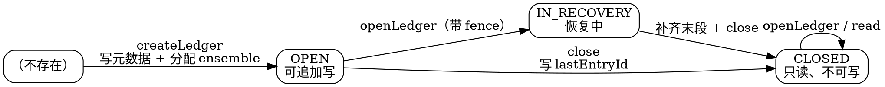

## Introduction

ledger 是 BookKeeper 里**唯一的生命周期与一致性单位**：客户端创建它、往里追加 entry、最后把它封闭；封闭之后内容不再变化，谁都写不进去。理解 BookKeeper 的一切机制（quorum、fencing、recovery、auto-recovery）都要先理解 ledger 的三件事：**元数据里记了什么、状态怎么迁移、封闭靠什么协议保证**。

本文顺着 ledger 的一生展开：创建 → 写入 → 封闭 / 恢复 → 元数据格式 → 被删除。写路径与读路径的细节分别在 [Write](/docs/CS/Framework/BookKeeper/Write.md) 与 [Read](/docs/CS/Framework/BookKeeper/Read.md)。

> 版本基线：**4.18.1**（`release-4.18.1`）。所有行号均出自该 tag。

## Lifecycle State Machine



三态定义在 protobuf 里（`DataFormats.proto:32-37`）：

```protobuf
enum State {
    OPEN = 1;
    IN_RECOVERY = 2;
    CLOSED = 3;
}
required State state = 5 [default = OPEN];
```

> [!NOTE]
> `IN_RECOVERY` **不是** ledger 在元数据里的常规状态 —— 它由 recovery 的发起方瞬时写入，用来告诉别人「这个 ledger 正在被我恢复」。多数 ledger 在一生中只会经历 OPEN → CLOSED。

## Creation

创建发生在 `LedgerCreateOp`（`client/LedgerCreateOp.java`），核心是三件事：选 ensemble、把元数据结构写进元数据存储、构造 `LedgerHandle`。

### E/Qw/Qa Are Passed Per Ledger, Not Configured Globally

E / Qw / Qa 是 `createLedger` 的**参数**，随元数据写入，之后不可改：

```java
// BookKeeper.java:916-918（两参数重载的默认行为）
public LedgerHandle createLedger(DigestType digestType, byte[] passwd) {
    return createLedger(3, 2, digestType, passwd);        // ← 默认 3 / 2
}
// BookKeeper.java:934-937：ackQuorum 未显式指定时等于 writeQuorum
public LedgerHandle createLedger(int ensSize, int qSize, DigestType digestType, byte[] passwd) {
    return createLedger(ensSize, qSize, qSize, digestType, passwd, Collections.emptyMap());
}
```

所以 **API 默认就是 3/2/2**（E=3、Qw=2、Qa=2）。但注意两件事：

> [!WARNING]
> **「3/2/2」是 BookKeeper 客户端 API 的默认重载值，不是配置项**。`ClientConfiguration` 里**没有** `ensembleSize` / `writeQuorumSize` / `ackQuorumSize` 这类配置键（grep 零命中）—— 因为它们是每次 `createLedger` 传入的。
>
> 而 [Pulsar](/docs/CS/MQ/Pulsar/Pulsar.md) 走的是 `ManagedLedgerConfig` 的字段，其库级默认 3/2/2 又被 `ServiceConfiguration` 覆盖成 **2/2/2**（见 [ManagedLedger 存储层](/docs/CS/MQ/Pulsar/ManagedLedger.md)）。也就是说：**直接调 BookKeeper API 与通过 Pulsar 使用，默认副本数不同**。

### Ensemble Degrades When Not Enough Bookies

`LedgerCreateOp.java:147-184` 有一个容易忽略的降级逻辑：选不出 E 个 bookie 时，只要还有 ≥ Qw 个可用，就把 ensemble **缩小**继续创建：

```java
int actualEnsembleSize = ensembleSize;
// we would like to select ensembleSize bookies, but
// we can settle to writeQuorumSize
while (actualEnsembleSize >= writeQuorumSize) {
    try {
        ensemble = placementPolicy.newEnsemble(actualEnsembleSize, writeQuorumSize, ...);
        ...
```

> [!TIP]
> 这解释了一个常见现象：**小集群（bookie 数 < E）上创建出来的 ledger，其 ensemble 实际小于配置值**，而不是创建失败。运维上看到「副本数不足」时先确认集群规模，别急着判定配置没生效。

## Metadata Format

元数据本体是 protobuf（`bookkeeper-proto/src/main/proto/DataFormats.proto:26-65`）：

```protobuf
message LedgerMetadataFormat {
    required int32 quorumSize = 1;        // ← 就是 writeQuorum（字段名与方法名不对称）
    required int32 ensembleSize = 2;
    required int64 length = 3;
    optional int64 lastEntryId = 4;
    enum State { OPEN = 1; IN_RECOVERY = 2; CLOSED = 3; }
    required State state = 5 [default = OPEN];

    message Segment {
        repeated string ensembleMember = 1;
        required int64 firstEntryId = 2;
    }
    repeated Segment segment = 6;         // ← ensemble 变更历史

    enum DigestType { CRC32 = 1; HMAC = 2; CRC32C = 3; DUMMY = 4; }
    optional DigestType digestType = 7;
    optional bytes password = 8;
    optional int32 ackQuorumSize = 9;     // ← 独立字段，不在 quorumSize 里
    optional int64 ctime = 10;
    repeated cMetadataMapEntry customMetadata = 11;
    optional int64 cToken = 12;
}
```

Java 侧接口为 `client/api/LedgerMetadata.java`（190 行），几个方法与字段的对应关系：

| 方法 | 行号 | 对应语义 |
| ---- | ---- | -------- |
| `getEnsembleSize()` | 49 | E |
| `getWriteQuorumSize()` | 56 | Qw —— **注意 proto 字段叫 `quorumSize`** |
| `getAckQuorumSize()` | 63 | Qa —— 独立字段 |
| `getLastEntryId()` | 72 | 封闭后的最后 entry |
| `getLength()` | 81 | ledger 总字节数 |
| `getDigestType()` | 105 | `CRC32` / `HMAC` / `CRC32C` / `DUMMY` |
| `getAllEnsembles()` | 141 | `NavigableMap<Long, List<BookieId>>`：**firstEntryId → ensemble**，即全部 segment |
| `getState()` | 148 | OPEN / IN_RECOVERY / CLOSED |
| `getMetadataFormatVersion()` | 182 | 元数据格式版本 |

> [!WARNING]
> 三个长期存在的误记：
> - proto 字段 `quorumSize` 与 Java 方法 `getWriteQuorumSize()` **同名不同字**，grep `writeQuorumSize` 在 proto 里是零命中的。
> - **`ackQuorumSize` 是独立字段（:9）**，不是从 `quorumSize` 推导出来的。
> - ledger 元数据里**没有** `off`、`marker`、`length` 以外的位点类字段；`length` 是字节数不是 entry 数。

## Segment: ensemble Change History

ledger 生命期内 ensemble 可以被替换（写失败时换 bookie），每次替换往元数据里**追加**一个 segment，而不是改写旧的：

```
segment[0]: firstEntryId=0    ensemble=[b1, b2, b3]
segment[1]: firstEntryId=5731 ensemble=[b1, b2, b4]   ← b3 写失败，换成 b4
segment[2]: firstEntryId=9840 ensemble=[b1, b5, b4]
```

于是「某条 entry 在哪些 bookie 上」= 在 `getAllEnsembles()` 这个有序 map 里按 `firstEntryId` 定位所属 segment。

> [!IMPORTANT]
> 因为 segment 只增不改，**ensemble 的历史对读路径是必须的**：读第 100 条 entry 要用 segment[0] 的副本集合，读第 6000 条要用 segment[1] 的。这也是 auto-recovery 能按片段（fragment）粒度补副本的依据 —— 见 [Cluster](/docs/CS/Framework/BookKeeper/Cluster.md)。

## Close

```java
// LedgerHandle.java:538
public void asyncClose(CloseCallback cb, Object ctx) { ... }
// LedgerHandle.java:576
void doAsyncCloseInternal(final CloseCallback cb, final Object ctx, final int rc) { ... }
// LedgerHandle.java:600 —— 关闭时以 LAC 为最后一条
    lastEntry = lastAddPushed = LedgerHandle.this.lastAddConfirmed;
```

close 的实质是：**把 `lastEntryId` 与 `state=CLOSED` 写进元数据**。完成这一刻起：

- 该 ledger 不可再写（bookie 侧没有 fence，但元数据封闭后重新 open 只能读）；
- 它的 LAC 就等于 `lastEntryId`，任何客户端读到的内容完全一致；
- 上层（如 Pulsar 的 managed-ledger）才会把它计入「可删除 / 可 offload」的范围。

> [!NOTE]
> **「ledger 关闭」与「bookie 上的数据被删除」是两件事**。close 只是元数据动作，物理数据要等上层调用 delete，还要等 bookie 的 GC 真正回收 entry log 空间 —— 见 [Storage](/docs/CS/Framework/BookKeeper/Storage.md)。

## Fencing And Recovery

当 ledger 的写者失联（进程崩溃、网络分区）时，ledger 会停在 OPEN 状态、末段 entry 副本不完整。这是 BookKeeper 唯一需要「分布式协议」的场景，解法是 **fence + recovery** 两段。

### Fencing

```java
// BookieImpl.java:1153
public CompletableFuture<Boolean> fenceLedger(long ledgerId, byte[] masterKey) {
    ...
    return handle.fenceAndLogInJournal(getJournal(ledgerId));
}
```

fence 标志随读请求一起发到 bookie，bookie 把该 ledger 记为 fenced 并**写进 journal**（保证重启后仍然 fenced）。此后普通写被拒绝，只有带 `FLAG_RECOVERY_ADD` 的写被接受：

```java
// PendingAddOp.java:260
int flags = isRecoveryAdd ? FLAG_RECOVERY_ADD | FLAG_HIGH_PRIORITY : FLAG_NONE;
```

### Recovery

`LedgerRecoveryOp`（`client/LedgerRecoveryOp.java`）的完整流程：

1. **带 fence 地读 LAC**（`:92-146`）：`ReadLastConfirmedOp.initiateWithFencing()`（`:146`）向 ensemble 询问各自收到的最大 entryId。
2. **确定恢复起点**（`:114-121`）——这里有一段很容易读漏的源码注释：

   ```java
   /**
    * The lowest an LAC can be for use in recovery is the first entry id
    * of the current ensemble - 1.
    * All ensembles prior to the current one, if any, are confirmed and
    * immutable (so are not part of the recovery process).
    */
   Long lastEnsembleEntryId = lh.getVersionedLedgerMetadata().getValue()
           .getAllEnsembles().lastEntry().getKey();
   lh.lastAddPushed = lh.lastAddConfirmed = Math.max(data.getLastAddConfirmed(),
           (lastEnsembleEntryId - 1));
   ```

   即：**LAC 的下界是「当前 segment 的第一个 entryId - 1」**，因为更早的 segment 在 ensemble 变更时就已经确认过了，不参与恢复。
3. **补写末段**（`:166-173`）：从 LAC+1 起按 `recoveryReadBatchSize` 逐批读，读到的 entry 以 recovery add 重新写回 Qw 份。

   ```java
   startEntryToRead = endEntryToRead + 1;
   endEntryToRead = endEntryToRead + clientCtx.getConf().recoveryReadBatchSize;
   new RecoveryReadOp(lh, clientCtx, startEntryToRead, endEntryToRead, this, null).initiate();
   ```

4. **close**：补写完成后写 `lastEntryId` 封闭。

`recoveryReadBatchSize` 默认 **1**（`ClientConfiguration.java:1138`）—— 恢复是逐条进行的，大 ledger 的恢复会比较慢，这也是可以调的参数。

> [!WARNING]
> 「先读 LAC，再补写」意味着**恢复会截断（truncate）未确认的尾段**：如果末段 entry 只写到了部分 bookie，而 quorum 判定它不算确认，它就消失。这不是 bug —— 客户端在收到成功回调前本来就不该假设数据存在。反过来，**已经收到成功回调的 entry 不会因为恢复而丢失**（Qa 份中至少一份持有它，恢复会读出来补齐）。

### openLedger vs openLedgerNoRecovery

| 方法 | 位置 | 行为 |
| ---- | ---- | ---- |
| `openLedger(long, DigestType, byte[])` | `BookKeeper.java:1355` | **触发 fence + recovery**，会把 ledger 封闭 |
| `openLedgerNoRecovery(long, DigestType, byte[])` | `BookKeeper.java:1405` | 只读打开，**不 fence、不封闭**（后台 re-replication 用，见 [Cluster](/docs/CS/Framework/BookKeeper/Cluster.md)） |

> [!TIP]
> 运维排障时用 `openLedgerNoRecovery` 去探查一个「疑似卡在 OPEN」的 ledger，避免把自己的排查动作变成恢复动作 —— 恢复具有**截断副作用**。

## Write Ordering Is The Client's Job

BookKeeper 不保证跨 ledger 的顺序，也不在服务端排序。entryId 由客户端在 `LedgerHandle` 内单调递增分配：

```java
// LedgerHandle.java:1727
long entryId = ++lastAddPushed;
```

因此**同一时刻只允许一个写者** —— 两个写者同时写一个 ledger 会得到重复 entryId 与错乱内容。BookKeeper 用 fencing 阻止第二个写者，而不是用锁去协调它们。

## Class Name Corrections

4.x 的类结构与旧资料差异很大，以下名称在 4.18.1 **全仓零命中**，不要凭记忆引用：

| 旧资料中的名字 | 4.18.1 实际 |
| -------------- | ----------- |
| `LedgerHandleImpl` / `PackagePrivateLedgerHandleImpl` | ❌ 不存在。4.17.3 起合并为单一 `LedgerHandle.java`（4.18.1 为 2563 行，`:94` `public class LedgerHandle implements WriteHandle`） |
| `LedgerMetadata`（构造自由的 Java bean） | ⚠️ 是 `client/api/LedgerMetadata.java` 的**接口**，实现为不可变对象，通过 `Versioned<LedgerMetadata>` 传递 |
| `fragment`（术语） | ⚠️ 官方文档用词；源码只有 `segment` |
| `LedgerEntryPage` / `LedgerCacheImpl` 持有 entry 数据 | ❌ 它们只管**索引页**，不缓存 entry 数据（见 [Storage](/docs/CS/Framework/BookKeeper/Storage.md)） |

## Links

- [BookKeeper](/docs/CS/Framework/BookKeeper/BookKeeper.md)
- [Write](/docs/CS/Framework/BookKeeper/Write.md)
- [Read](/docs/CS/Framework/BookKeeper/Read.md)
- [Cluster](/docs/CS/Framework/BookKeeper/Cluster.md)
- [ManagedLedger 存储层](/docs/CS/MQ/Pulsar/ManagedLedger.md)
- [ZooKeeper](/docs/CS/Framework/ZooKeeper/ZooKeeper.md)

## References

1. [DataFormats.proto (release-4.18.1)](https://github.com/apache/bookkeeper/blob/release-4.18.1/bookkeeper-proto/src/main/proto/DataFormats.proto)
2. [LedgerHandle.java (release-4.18.1)](https://github.com/apache/bookkeeper/blob/release-4.18.1/bookkeeper-server/src/main/java/org/apache/bookkeeper/client/LedgerHandle.java)
3. [LedgerRecoveryOp.java (release-4.18.1)](https://github.com/apache/bookkeeper/blob/release-4.18.1/bookkeeper-server/src/main/java/org/apache/bookkeeper/client/LedgerRecoveryOp.java)
4. [BookKeeper — Ledger recovery](https://bookkeeper.apache.org/docs/latest/getting-started/concepts)
