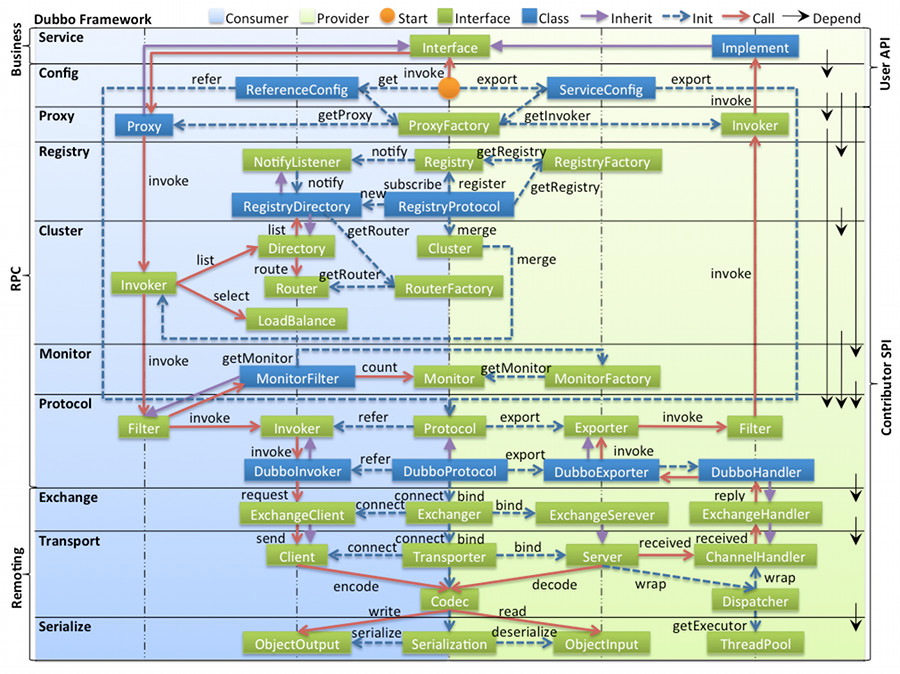

## Introduction

Dubbo 的「架构」这个词在网上同时指三件不同的东西：**部署架构**（Provider / Consumer / Registry / Monitor 四种节点）、**代码分层架构**（十层）、**数据面与控制面的划分**。三者互不冲突但经常被混着讲，导致「Dubbo 有十层，所以有十个模块」这类错误认知——十层是**逻辑分层**，不是模块划分，`dubbo-rpc/` 下只有 4 个模块就是反例。

本文版本基线：Apache Dubbo **3.3.6**（源码 tag `dubbo-3.3.6`）。十层分层表引用自[官方代码架构文档](https://cn.dubbo.apache.org/zh-cn/overview/mannual/java-sdk/reference-manual/architecture/code-architecture/)，但表中每个「3.3.6 是否还存在」的判断都回到源码核对过。

- 部署视角的四种节点与调用关系在枢纽页 [Dubbo](/docs/CS/Framework/Dubbo/Dubbo.md) 与 [cluster](/docs/CS/Framework/Dubbo/cluster.md)。
- 启动期如何把这十层组装起来的时序见 [Start](/docs/CS/Framework/Dubbo/Start.md)。
- 域模型（FrameworkModel / ApplicationModel / ModuleModel）决定了这些层的实例归属，见 [ScopeModel](/docs/CS/Framework/Dubbo/ScopeModel.md)。

## Ten Layers

Fig.1. Ten-Layer Code Architecture

图中左边淡蓝背景为服务消费方使用的接口，右边淡绿背景为服务提供方使用的接口，中轴线上为双方共用。自下而上十层，**各层单向依赖**，每层都可以剥离上层被复用：

| 层级 | 职责 | 3.3.6 归属与现状 |
| :--- | :--- | :--- |
| Service | 业务接口层，定义服务契约 | 用户代码，非框架模块 |
| Config | 配置层，以 `ServiceConfig` / `ReferenceConfig` 为中心 | `dubbo-config-api`；配置对象模型见 [ServiceConfig](/docs/CS/Framework/Dubbo/ServiceConfig.md) |
| Proxy | 代理层，生成客户端 Stub 与服务端 Skeleton | `dubbo-rpc-api`，默认 `javassist` |
| Registry | 注册层，封装服务地址的注册与发现 | `dubbo-registry-api` + 各注册中心实现，见 [registry](/docs/CS/Framework/Dubbo/registry.md) |
| Cluster | 集群层，路由 + 负载均衡 + 容错，把多个 Provider 聚合成一个 Invoker | `dubbo-cluster`，见 [cluster](/docs/CS/Framework/Dubbo/cluster.md) |
| Monitor | 监控层，统计调用次数与耗时 | 3.x 已由 `dubbo-metrics` 体系取代，老 `MonitorFactory` 仍在但基本不再使用，见 [Metrics](/docs/CS/Framework/Dubbo/Metrics.md) |
| Protocol | RPC 调用层，`Invoker` 是核心模型 | `dubbo-rpc/*`，见 [Protocol](/docs/CS/Framework/Dubbo/Protocol.md) |
| Exchange | 信息交换层，封装请求-响应语义，同步转异步 | `dubbo-remoting-api` 的 `exchange` 包 |
| Transport | 网络传输层，抽象 Netty 为统一接口 | `dubbo-remoting-netty4`（3.x 默认），见 [Transporter](/docs/CS/Framework/Dubbo/Transporter.md) |
| Serialize | 序列化层，可插拔 | 主仓库仅 hessian2 / fastjson2，见 [Serialization](/docs/CS/Framework/Dubbo/Serialization.md) |

图中还有三类约定：**绿色小块是扩展接口，蓝色小块是实现类**（只画出用于关联各层的实现类）；**蓝色虚线是初始化过程**（启动时组装链），**红色实线是方法调用过程**（运行时调用链），**紫色三角箭头是继承**。

> [!NOTE]
> **Service 与 Config 两层是 API，其余八层都是 SPI。** 这条界线决定了谁能被替换：业务代码直接依赖 Service / Config 的 API，而 Registry / Cluster / Protocol / Serialize 等八层的每一个实现都可以被用户扩展替换——这正是「Microkernel + Plugin」的落点。

## Call Flow

一次调用从启动到返回经过的完整链路：

1. Provider 启动 → 通过 Registry 注册服务地址（3.x 应用级发现下注册的是**应用名**，接口级映射写入元数据中心）
2. Consumer 启动 → 从 Registry 订阅服务列表，与 Provider 建立长连接
3. Consumer 调用 → Proxy 封装 `Invocation`，经 Cluster（Directory → Router → LoadBalance）选出一个 `Invoker`，再走 Protocol → Exchange → Transport 发出
4. Provider 处理 → Transport 收包、Codec 解码，层层向上到 Exchange → Protocol → Filter 链 → 动态代理 → Service 实现类
5. 结果返回 → 沿原链路回溯，`DefaultFuture` 按 request id 唤醒等待线程
6. 地址变更 → Registry 推送变更给 Consumer，Directory 刷新 Invoker 列表

第 3 步的选址细节见 [cluster](/docs/CS/Framework/Dubbo/cluster.md)，第 4 步的服务端线程模型见 [ThreadPool](/docs/CS/Framework/Dubbo/ThreadPool.md)。

## Five Core Abstractions

十层听起来复杂，落到代码里其实只有五个抽象在承担职责：

- **`Invoker`**：对服务提供者节点的抽象，封装地址与接口信息。它是全框架的统一模型——本地调用、远程调用、集群调用都向 `Invoker` 靠拢，这也是为什么 Protocol 层的核心方法就是 `refer(Class, URL)` 返回 `Invoker`。
- **`Directory`**：节点管理。从注册中心获取节点列表并封装成多个 `Invoker`，可看成 `List<Invoker>`，值随注册中心推送动态变化。
- **`Router`**：服务路由。按规则从多个 `Invoker` 中选出**子集**（读写分离、机房隔离、标签路由）。3.3.6 中路由实现全部改名为 `*StateRouter`，`ConditionRouter` / `TagRouter` **已不存在**，见 [Router](/docs/CS/Framework/Dubbo/Router.md)。
- **`LoadBalance`**：负载均衡。从多个 `Invoker` 中选出**一个**发起调用（Random / RoundRobin / LeastActive 等），见 [LoadBalance](/docs/CS/Framework/Dubbo/LoadBalance.md)。
- **`Cluster`**：服务容错。把 Directory 中的多个 `Invoker` 伪装成一个，对上层透明；伪装过程包含容错逻辑，如 Failover 失败后换一个 Invoker 重试。

三者的执行顺序固定：**先 Router 筛子集 → 再 LoadBalance 选一个 → 失败时由 Cluster 决定重试策略**。混淆「Router 返回子集」与「LoadBalance 返回一个」是最常见的口头表述错误。

## Design Principles

- **Microkernel + Plugin**：Microkernel 只负责组装 Plugin，Dubbo 自身的功能同样通过扩展点实现——这意味着**所有功能点都可被用户自定义扩展替换**，包括框架自带的那些。SPI 的加载机制、自适应扩展与作用域见 [SPI](/docs/CS/Framework/Dubbo/SPI.md)。
- **URL 作为配置信息的统一格式**：所有扩展点通过传递 URL 携带配置信息。理解了这一点就理解了 Dubbo 为什么到处是 `url.getParameter(...)`——地址、配置、元数据、路由规则全部编码在 URL 里并贯穿全链路。
- **面向接口编程 + 统一 `Invoker` 抽象**：调用方与提供方、本地与远程、单个节点与集群都收敛到 `Invoker<T>` 这一个接口（见下方 SPI 表与 [Five Core Abstractions](#five-core-abstractions)）；替换某一层实现时上层完全无感。

## SPI Extension Points of Each Layer

「Microkernel + Plugin」不是口号，它落实到下面这张表：每个被替换的层都对应一个 `@SPI` 接口，默认实现只是一个普通扩展点，**用户随时可以写一个新实现并通过 SPI 文件覆盖默认项**。这解释了为什么 Dubbo 自带功能（如 `FailoverCluster`、各种 `LoadBalance`）和你的自定义扩展站在同一机制上。

| 十层归属 | SPI 接口（包路径） | `@SPI` 默认 | 核心方法 | 典型实现类 |
| :--- | :--- | :--- | :--- | :--- |
| Proxy | `org.apache.dubbo.rpc.ProxyFactory`（`dubbo-rpc-api`） | `"javassist"`（`scope=FRAMEWORK`） | `getProxy(Invoker)` / `getInvoker(proxy,type,url)` | `JavassistProxyFactory`、`ByteBuddyProxyFactory` |
| Registry | `org.apache.dubbo.registry.RegistryFactory`（`dubbo-registry-api`） | 无默认（`scope=APPLICATION`） | `getRegistry(URL)` | `NacosRegistryFactory`、`ZookeeperRegistryFactory` |
| Cluster | `org.apache.dubbo.rpc.cluster.Cluster`（`dubbo-cluster`） | `Cluster.DEFAULT` = `"failover"` | `<T> Invoker<T> join(Directory<T>, boolean)` | `FailoverCluster`、`FailfastCluster`、`FailsafeCluster` |
| Router | `org.apache.dubbo.rpc.cluster.router.state.StateRouter`（`dubbo-cluster`） | 经 `StateRouterFactory` 激活 | `BitList<Invoker<T>> route(BitList, URL, Invocation, boolean, Holder)` | `MeshRuleRouter`、`ConditionStateRouter`（3.3.6 的路由全改名 `*StateRouter`，无 `ConditionRouter`） |
| LoadBalance | `org.apache.dubbo.rpc.cluster.LoadBalance`（`dubbo-cluster`） | `RandomLoadBalance.NAME` = `"random"` | `<T> Invoker<T> select(List<Invoker>, URL, Invocation)` | `RandomLoadBalance`、`RoundRobinLoadBalance`、`LeastActiveLoadBalance` |
| Protocol | `org.apache.dubbo.rpc.Protocol`（`dubbo-rpc-api`） | `"dubbo"`（`scope=FRAMEWORK`） | `<T> Exporter<T> export(Invoker<T>)` / `<T> Invoker<T> refer(Class, URL)` | `DubboProtocol`、`TripleProtocol` |
| Exchange | `org.apache.dubbo.remoting.exchange.Exchanger`（`dubbo-remoting-api`） | `HeaderExchanger.NAME` = `"header"`（`scope=FRAMEWORK`） | `ExchangeServer bind(URL, ExchangeHandler)` / `ExchangeClient connect(...)` | `HeaderExchanger` |
| Transport | `org.apache.dubbo.remoting.Transporter`（`dubbo-remoting-api`） | `"netty"`（`scope=FRAMEWORK`） | `RemotingServer bind(URL, ChannelHandler)` / `Client connect(...)` | `NettyTransporter`（3.3.6 主仓库仅 netty4，无 Mina/Grizzly） |
| Serialize | `org.apache.dubbo.common.serialize.Serialization`（`dubbo-serialization-api`） | 无默认（`scope=FRAMEWORK`） | `ObjectOutput serialize(URL, OutputStream)` / `ObjectInput deserialize(URL, InputStream)` | 主仓库仅 `Hessian2Serialization`、`Fastjson2Serialization` |
| Compiler | `org.apache.dubbo.common.compiler.Compiler`（`dubbo-common`） | `"javassist"`（`scope=FRAMEWORK`） | `Class<?> compile(Class, String, ClassLoader)` | `JavassistCompiler`、`JdkCompiler` |
| Logger | `org.apache.dubbo.common.logger.Logger` 由 `LoggerAdapter` SPI 产出（`dubbo-common`） | `LoggerAdapter` 默认 `"slf4j"` | `info/warn/error(...)` 等 | `Slf4jLogger`、`Log4j2Logger`、`JdkLogger` |

几点值得强调的源码事实：

- **`ProxyFactory` 的两个 `getProxy` 都标了 `@Adaptive({PROXY_KEY})`**（`ProxyFactory.java:38/43/50`）。`PROXY_KEY="proxy"`，意味着实际用哪个代理实现由运行时 URL 上的 `proxy=` 参数决定，而不是写死——这就是「URL 作为配置总线」+「自适应扩展」的叠加工效。
- **`Protocol.export()` 与 `refer()` 注释明确要求幂等**（`Protocol.java:72`：`export() must be idempotent`），`refer()` 返回的 `Invoker` 由协议自己实现、负责真正把请求发往远端（`Protocol.java:39/43`）。这把「协议」和「调用模型」彻底解耦：换协议 = 换 `Invoker` 实现，上层 `Cluster`/`Filter` 无感知。
- **`Router` 与 `StateRouter` 是两套接口**（`Router.java:35` 老接口；`StateRouter.java:39` 新接口）。3.3.6 的路由工厂走 `StateRouterFactory` SPI，`getActivateExtension(url, ROUTER_KEY)` 决定哪些路由器被激活——`StandardMeshRuleRouterFactory` 正是靠 `@Activate(order=-50)` 被纳入，见 [Mesh](/docs/CS/Framework/Dubbo/Mesh.md?id=how-meshrulerouter-joins-the-state-router-chain)。
- **`Logger` 本身不是 `@SPI`**，它通过 `LoggerAdapter` 这个 `@SPI` 接口创建（`Logger.java` 上无 `@SPI` 注解），换日志框架只需换 `LoggerAdapter` 实现。
- `Exchanger` / `Transporter` / `Codec2` / `Compiler` / `Serialization` 的 `@SPI` 都带 `scope=FRAMEWORK`，意味着这些扩展在 **FrameworkModel 级共享**，而 `RegistryFactory` 是 `APPLICATION` 级（每个应用可不同注册中心）——作用域差异来自三层域模型，见 [ScopeModel](/docs/CS/Framework/Dubbo/ScopeModel.md)。

## Registry Data Layout in 3.x

3.x 相比 2.x 在注册中心新增了几类数据目录，这是「应用级服务发现」的直接产物（2.x 只有接口级的 `/dubbo/<interface>/providers` 一类）：

| 路径 | 内容 | 源码出处 |
| :--- | :--- | :--- |
| `/dubbo/metadata/...` | 元数据信息 | `MetadataConstants.DEFAULT_PATH_TAG = "metadata"`（`dubbo-metadata/dubbo-metadata-api/src/main/java/org/apache/dubbo/metadata/MetadataConstants.java:21`），ZK 上拼成 `/dubbo/metadata/<interface>/<version>/<group>/<side>/<app>` |
| `/dubbo/mapping/<interface>` | 接口 → 应用名的映射 | `ServiceNameMapping.DEFAULT_MAPPING_GROUP = "mapping"`（`ServiceNameMapping.java:45`）+ `ZookeeperMetadataReport.buildPathKey()`（`:215-217`） |
| `/dubbo/config` | 注册中心充当配置中心时的配置数据 | `TreePathDynamicConfiguration.DEFAULT_CONFIG_BASE_PATH = "/config"`（`:55`）+ `DEFAULT_GROUP = "dubbo"`（`DynamicConfiguration.java:38`） |
| `/services` | 应用级服务发现的实例信息 | `ZookeeperServiceDiscovery.DEFAULT_GROUP = "/services"`（`ZookeeperServiceDiscovery.java:67`） |

根节点 `/dubbo` 来自 `DEFAULT_ROOT = "dubbo"`，**有两处同名常量**：`ZookeeperRegistry.java:63`（接口级注册）与 `AbstractMetadataReport.java:86`（元数据存储），都不在 `CommonConstants` 里。

> [!WARNING]
> 关于 mapping 路径有一个流传很广的误读。**ZK 上确实存在 `/dubbo/mapping/<interface>` 这一层**，被去掉的是**本地缓存 key** 里的 `mapping/` 前缀（issue #4671）：`ServiceNameMapping.buildGroup()` 里 `return DEFAULT_MAPPING_GROUP + SLASH + serviceInterface;` 那一行被注释掉了，改为只返回 `serviceInterface`（`ServiceNameMapping.java:67-71`）。该方法经 `buildMappingKey()` 只用于本地缓存，**不参与远端 ZK 路径拼装**。因此准确表述是「本地缓存 key 去掉了 `mapping/` 前缀，远端路径不变」，而不是「ZK 上没有 mapping 层」。

元数据整体的存储双轨制、revision 聚合与上报周期见 [Metadata](/docs/CS/Framework/Dubbo/Metadata.md)。

## Protocol Matrix and Its 3.3.6 Status

下表是 Dubbo 历史上支持过的协议全集，**其中大半在 3.3.6 主仓库已不存在**：

| Protocol | Transporter | Serialization | Features | Applicable Scene |
| :--- | :--- | :--- | :--- | :--- |
| dubbo | Mina / Netty / grizzly | dubbo, hessian2, java, json | 单长连接、异步 NIO、TCP | 小包高并发、消费者远多于提供者 |
| rmi | Java RMI | Serializable | 多短连接、同步、TCP | 已外置 |
| hessian | Servlet（默认 Jetty） | Hessian | 多短连接、同步、HTTP | 已外置 |
| http | Spring HttpInvoker | form | 多短连接、同步、HTTP | 已外置，不支持文件上传 |
| webservice | HTTP | SOAP 文件序列化 | 多短连接、同步、HTTP | 已外置 |
| tri（Triple） | Netty HTTP/2（`dubbo-remoting-http12`） | hessian2（PB 生成类走直通） | 单长连接、异步、HTTP/2 | 云原生、跨语言、需被网关或 Mesh 识别 |

> [!WARNING]
> `rmi` / `hessian` / `http` / `webservice` / `thrift` 的协议实现**已不在主仓库**（迁至 `org.apache.dubbo.extensions`），因此不是「标记为废弃」而是「不存在」。`dubbo-rpc/` 下实际只有 4 个模块：`dubbo-rpc-api`、`dubbo-rpc-dubbo`、`dubbo-rpc-injvm`、`dubbo-rpc-triple`。
>
> 另外三个高频错误：Triple 的协议名是 **`tri` 不是 `triple`**；默认端口 **50051**；默认序列化仍是 **hessian2 而不是 Protobuf**（只有 PB 生成类走直通）。详见 [Protocol](/docs/CS/Framework/Dubbo/Protocol.md) 与 [Triple](/docs/CS/Framework/Dubbo/Triple.md)。

## Pitfall List

- **把十层当成模块划分。** 十层是逻辑分层，`dubbo-rpc/` 只有 4 个模块，`dubbo-cluster` 一个模块承担了 Router + LoadBalance + Cluster + Directory 四层职责中的大部分。
- **以为 Monitor 层还在承担监控职责。** 3.x 的可观测走 `dubbo-metrics` + Micrometer，老 `MonitorFactory` 基本只剩兼容。
- **Transport 层只有 Netty。** 3.3.6 主仓库的 Transporter SPI 注册项是 netty4 / netty3（兼容），老笔记里的 Mina、Grizzly 已不在主仓库。
- **把 mapping 路径的「本地缓存 key 简化」读成「ZK 上没有 mapping 层」**，详见上节 WARNING。
- **以为 Protocol 层就是 Codec。** 协议层的 `DubboProtocol`（export/refer Invoker，属 `dubbo-rpc`）与 `DubboCodec`（16 字节头编解码，属 `dubbo-remoting`）是两套体系，见 [Protocol](/docs/CS/Framework/Dubbo/Protocol.md)。

## Links

- [Dubbo](/docs/CS/Framework/Dubbo/Dubbo.md)
- [Start](/docs/CS/Framework/Dubbo/Start.md)
- [ScopeModel](/docs/CS/Framework/Dubbo/ScopeModel.md)
- [Protocol](/docs/CS/Framework/Dubbo/Protocol.md)
- [registry](/docs/CS/Framework/Dubbo/registry.md)

## References

- <https://cn.dubbo.apache.org/zh-cn/overview/mannual/java-sdk/reference-manual/architecture/code-architecture/>
- <https://github.com/apache/dubbo/tree/dubbo-3.3.6>
