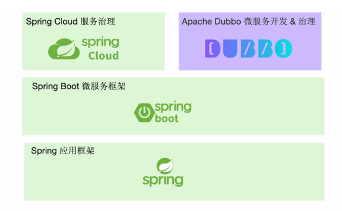

## Introduction

Dubbo、Spring Cloud、gRPC、Istio 四者经常被放在一起比较，但**它们并不在同一个抽象层次上**：gRPC 是通信协议规范，Dubbo 是微服务开发框架，Spring Cloud 是分布式模式抽象 + 厂商实现套件，Istio 是服务网格控制面。把它们放在一张表里「哪个更好」是没有意义的，真正要回答的是「**各自定义的边界在哪、能不能叠加使用**」。

结论先行：Dubbo 与 gRPC 是**可叠加**的（Dubbo 把 gRPC/Triple 作为内置协议）；Dubbo 与 Spring Cloud 是**可互通**的（通过 Spring Cloud Alibaba）；Dubbo 与 Istio 是**可被治理**的关系（Dubbo 进程作为数据面接入 Istio 控制面）。

本文版本基线：Apache Dubbo **3.3.6**。各协议在 3.3.6 的真实支持情况见 [Architecture](/docs/CS/Framework/Dubbo/Architecture.md?id=protocol-matrix-and-its-336-status)，Mesh 落地的能力边界见 [Mesh](/docs/CS/Framework/Dubbo/Mesh.md)。

<!-- tabs:start -->

##### **Dubbo vs Spring Cloud**

从下图可以看出，Dubbo 和 Spring Cloud 在整体架构图的相同位置提供了不少相似功能：

<div style="text-align: center;">



</div>

<p style="text-align: center;">
Fig.1. Dubbo vs Spring Cloud
</p>

**相似之处：**

- 两者都侧重对分布式系统中常见问题模式的抽象（服务发现、负载均衡、动态配置等），并对每个问题提供配套组件实现，形成微服务整体解决方案，让开发者专注业务逻辑。
- 两者都完全兼容 Spring 体系的开发模式；Dubbo 对 Spring 应用开发框架、Spring Boot 微服务框架都做了适配，Spring Cloud 出自 Spring 体系更不必多说。

**Spring Cloud 的优势：**

- 在同样支持 Spring 开发体系的前提下，得到更多原生支持。
- 对常用微服务模式做了抽象（服务发现、动态配置、异步消息），并延伸到批处理任务、定时任务、持久化数据访问等领域。
- 基于 HTTP 的通信模式，加上相对完善的入门文档、demo 与 starters，第一感觉更易于上手。

**Spring Cloud 的问题：**

- 只提供抽象模式的定义，**不提供官方稳定实现**，开发者只能寻求 Netflix、Alibaba、Azure 等不同厂商的实现套件，各厂商的完善度、稳定性、活跃度各异。
- 有微服务全家桶却不是能拿来就用的全家桶：demo 上手容易，落地推广与长期使用成本非常高。
- 欠缺服务治理能力，尤其是流量管控（负载均衡、流量路由）能力较弱。
- 编程模型与通信协议绑定 HTTP，在性能与异构 RPC 体系互通上存在障碍。
- 架构与实现只适用于小规模集群，规模增长后会遇到地址推送效率、内存占用等瓶颈，而此时迁移体系极难。
- 很多生产问题需要用户自行解决：优雅停机、启动预热、服务测试、双注册双订阅、延迟注册、分组隔离、集群容错等。

**而这些正是 Dubbo 的优势：**

- 完全支持 Spring & Spring Boot，在服务发现、动态配置等基础模式上提供对等能力。
- 是企业级微服务实践的**整体输出**：优雅上下线、多注册中心、流量管理等都在框架内，长期维护成本更低。
- 通信协议与编码选择更灵活：HTTP、HTTP/2（Triple、gRPC）、TCP 二进制协议、REST 均可，序列化支持 Protobuf、JSON、Hessian2 等，并支持**单端口多协议**。
- 突出服务治理能力：权重动态调整、标签路由、条件路由，并支持多种模式接入 Service Mesh。
- 高性能的 RPC 协议编码与实现。
- 面向超大规模集群设计，可支撑百万实例规模的集群水平扩容。
- 提供 Java 之外的多语言实现，使多语言异构微服务体系成为可能。

Dubbo 的劣势在于入门资料的欠缺——依赖配置管理、文档、demo 示例的完善度不及 Spring Cloud。

##### **Dubbo vs gRPC**

两者最大的差异在**定位**：

- **gRPC** 定位为一款 RPC 框架，Google 推出它的核心目标是定义云原生时代的 RPC 通信规范与标准实现。
- **Dubbo** 定位是一款微服务开发框架，侧重解决微服务实践从服务定义、开发、通信到治理的问题，因此同时提供 RPC 通信、应用开发框架适配与服务治理能力。

**Dubbo 不绑定特定通信协议**，Dubbo 服务间可通过多种 RPC 协议通信并灵活切换。你可以在 Dubbo 开发的微服务中选用 gRPC 通信——Dubbo 完全兼容 gRPC，并将 gRPC 设计为内置原生支持的协议之一。

gRPC 没有为开发者提供以下能力：

- 缺乏与业务应用框架集成的开发模式，用户需要基于 gRPC 底层的 RPC API 定义、发布或调用微服务。
- 缺乏微服务周边生态扩展与适配：服务发现、限流降级、链路追踪等官方实现稀少且扩展困难。
- 缺乏服务治理能力的抽象。

因此 **gRPC 更适合作为底层通信协议规范或编解码包，Dubbo 用作微服务整体解决方案**。推荐模式是 Dubbo + gRPC 组合：gRPC 只是隐藏在底层的通信协议，开发者基于 Dubbo 的 API 与配置开发服务，并使用 Dubbo 的服务治理能力治理服务。

在 3.3.6 中，Triple 协议（`tri`）同时注册了 `tri` / `grpc` / `rest2` 三个协议名，三者都是 `TripleProtocol` 的子类——「Dubbo 与 gRPC 二选一」在 3.x 已不成立。

##### **Dubbo vs Istio**

Service Mesh 是云原生背景下诞生的微服务架构：在 Kubernetes 体系下，让流量拦截、服务治理等能力下沉为基础设施，使微服务的开发与升级更轻量。Istio 是 Service Mesh 的开源代表实现，部署架构上分为数据面与控制面——这一点与 Dubbo 总体架构基本一致。Istio 带来的主要变化在于：

- **数据面**：通过引入 Sidecar 实现对服务流量的透明拦截，Sidecar 通常与 Dubbo 等传统微服务组件部署在一起。
- **控制面**：把此前抽象的服务治理中心聚合为具有统一实现的具体组件，并与 Kubernetes 等底层基础设施无缝适配。

Dubbo 已实现对 Istio 体系的全面接入：可以用 Istio 控制面治理 Dubbo 服务；针对 Sidecar 引入的复杂性与性能问题，Dubbo 还支持**无代理的 Proxyless 模式**。此外 Dubbo Mesh 体系还解决了 Istio 落地过程中的很多问题，包括更灵活的数据面部署架构与更低的迁移成本。

从数据面视角，Dubbo 支持两种开发与部署模式，均可通过 Istio、Consul、Linkerd 等控制面组件实现治理：

- **Proxy 模式**：Dubbo 与 Envoy 一起部署，Dubbo 作为编程框架 & 协议通信组件，流量管控由 Envoy 与 Istio 控制面交互完成。
- **Proxyless 模式**：Dubbo 进程保持独立部署，通过标准 xDS 协议直接接入 Istio 等控制面组件。

从控制面视角，Dubbo 可接入原生 Istio 标准控制面与规则体系；对于 Dubbo 老版本用户，Dubbo Mesh 提供了平滑迁移方案。

> [!WARNING]
> 「Dubbo 支持 Proxyless」在**概念**上成立，但 3.3.6 **主仓库里并没有 xDS 协议实现**——没有 xds / istio / proxyless 相关模块，registry 下也没有 xds 实现。主仓库真实存在的 Mesh 能力只有三项：`mesh-enable` + `providedBy` 拼装 K8s 服务地址、`mesh` 规则的路由实现、`unloadClusterRelated` 调用链。要用真正的 xDS，需要 Dubbo 的扩展实现而非主仓库。详见 [Mesh](/docs/CS/Framework/Dubbo/Mesh.md)。

<!-- tabs:end -->

## Code-Level Differentiators

上文是定位层面的对比；落到 3.3.6 源码，四个框架的差别集中在四件事：**传输模型、治理归属、注册中心抽象、扩展哲学**。下面用真实类把这几条钉死。

### Triple vs gRPC: A Compatible Layer, Not a Thin Wrapper

源码事实（3.3.6 已核实）：

- `org.apache.dubbo.rpc.protocol.tri.TripleProtocol extends AbstractProtocol`；其 SPI 文件 `dubbo-rpc-triple/.../META-INF/dubbo/internal/org.apache.dubbo.rpc.Protocol` 注册了三个名字：`tri=TripleProtocol`、`grpc=GrpcProtocol`、`rest2=RestProtocol`。
- `GrpcProtocol extends TripleProtocol`、`RestProtocol extends TripleProtocol`（`dubbo-rpc-triple/.../tri/GrpcProtocol.java:21`、`RestProtocol.java:21`）——三者共用同一套 HTTP/2 栈（`dubbo-remoting-http12`）。
- gRPC 只定义「线格式 + 代码生成工具链」；Dubbo 在 Triple 之上叠加了注册发现、路由、集群容错、Filter 等治理能力，这些 gRPC 原生没有。

为什么 Dubbo 的「支持 gRPC」不是「纯 gRPC」：

| 维度 | gRPC | Dubbo Triple |
| :--- | :--- | :--- |
| 协议名 | `grpc` | `tri` / `grpc` / `rest2`（同属 `TripleProtocol` 体系） |
| 默认序列化 | Protobuf | **hessian2**（仅 PB 生成类走直通） |
| 默认端口 | 自定义 | **50051**（`CommonConstants` 相关常量） |
| 服务治理 | 无（需另接控制面/sidecar） | 内置 Cluster / Router / LoadBalance / Filter |
| 定位 | 通信规范 | Dubbo 的一个内置协议 |

结论：**Dubbo 把 gRPC 当底层通信协议用，而非把 Dubbo 改写成 gRPC**。开发仍走 Dubbo 的 `@DubboService` / `@DubboReference` 与 `Invoker` 模型。

### Feign/Spring Cloud vs Dubbo Invoker: Sync-Blocking vs Async-First

| 维度 | Spring Cloud（Feign） | Dubbo |
| :--- | :--- | :--- |
| 调用模型 | `FeignClient` 同步阻塞 HTTP 调用 | `Invoker.invoke(Invocation)` 返回 `Result`；`org.apache.dubbo.rpc.AsyncRpcResult` 内嵌 `CompletableFuture`，**天生异步** |
| 服务发现 | `DiscoveryClient` 拉模型，与具体注册中心无关 | `RegistryFactory.getRegistry(URL)` 推模型，注册中心经 `@SPI` 抽象（主仓库仅 nacos / zookeeper） |
| 治理归属 | 依赖厂商套件（SCA / Netflix） | 框架内置 `Cluster` / `Router` / `LoadBalance` |
| 协议绑定 | 绑定 HTTP | 多协议可切换（`dubbo` / `tri` / `injvm`），支持单端口多协议 |

关键差异：Feign 的每次调用都阻塞在一条 HTTP 连接上，背压与异步需要调用方自己搭；Dubbo 的 `Invoker.invoke` 统一返回 `Result`，`AsyncRpcResult` 把 `CompletableFuture` 作为一等公民，同步/异步只是 `Result` 的两种取用方式（`Invocation.md` 详述）。这是「统一 `Invoker` 抽象」带来的直接好处。

### Istio vs Dubbo: Control Plane vs Data Plane

在 3.3.6 主仓库，Dubbo 与 Istio 的真实关系是**分层而非竞争**——且 mesh 能力只有 sidecar 模式（详见 [Mesh](/docs/CS/Framework/Dubbo/Mesh.md)）：

- **Dubbo 的角色 = 数据面**：以 triple（HTTP/2）协议把流量发往 Envoy，地址形如 `tri://<svc>.<ns>.svc.cluster.local:80`（由 `ReferenceConfig` 的 `mesh-enable` + `providedBy` 拼出）。
- **Istio 的角色 = 控制面**：做流量拦截、路由、mTLS、限流。
- **Dubbo 不实现 xDS 客户端**：主仓库无 `dubbo-xds` 模块、无 `Xds*` / `Proxyless*` 类（[Mesh](/docs/CS/Framework/Dubbo/Mesh.md?id=missing-parts-of-the-main-repo) 已逐条核实）。因此「Dubbo vs Istio」本质是「数据面 vs 控制面」的协作关系。

### Microkernel/SPI and Unified Invoker: The Real Differentiator

上面三栏都指向同一条设计哲学，这也是 Dubbo 区别于 gRPC、Feign、Spring Cloud 的根本：

- **每层都是 `@SPI` 接缝**：`ProxyFactory`(默认 `javassist`)、`Protocol`(默认 `dubbo`)、`Cluster`(默认 `failover`)、`LoadBalance`(默认 `random`)、`Transporter`(默认 `netty`)、`Compiler`(默认 `javassist`) 等，框架自带功能与你的扩展站在同一机制上（完整清单见 [Architecture](/docs/CS/Framework/Dubbo/Architecture.md?id=spi-extension-points-of-each-layer)）。gRPC / Feign 没有对等的插件内核。
- **`Invoker<T>` 统一了本地/远程/集群调用**：`Cluster.join(Directory)` 返回 `Invoker`、`Protocol.refer()` 返回 `Invoker`、mesh 单地址也是 `Invoker`。这种单一抽象让 `Filter` / `Cluster` / `Router` 能以正交方式自由组合，而不必为每种场景写一套调用接口。

## Summary

| 维度 | Dubbo | Spring Cloud | gRPC | Istio |
| :--- | :--- | :--- | :--- | :--- |
| 定位 | 微服务开发框架 | 模式抽象 + 厂商实现 | RPC 通信规范 | 服务网格控制面 |
| 通信协议 | 多协议可切换（dubbo / tri / injvm） | 绑定 HTTP | HTTP/2 + Protobuf | 与协议无关（靠 Sidecar 或 xDS） |
| 服务治理 | 框架内置 | 依赖厂商套件 | 无 | 控制面统一下发 |
| 与 Dubbo 的关系 | — | 可通过 SCA 互通 | 可作为 Dubbo 的底层协议 | 可作为 Dubbo 的控制面 |

## Integration with Spring Cloud Alibaba

Dubbo 可纳入 [Spring Cloud Alibaba](/docs/CS/Framework/Spring_Cloud/Alibaba.md) 体系，复用其服务发现与微服务生态。`com.alibaba.cloud:spring-cloud-starter-dubbo` 打通了 Spring Cloud 的 `DiscoveryClient` 与 Dubbo 的 RPC 框架：Dubbo 服务通过 `DubboServiceRegistry` 注册到 [Nacos](/docs/CS/Framework/nacos/Nacos.md) 等注册中心，并被 Spring Cloud 的 `DiscoveryClient` 可见；消费侧由 `DubboLoadBalancer` 提供客户端负载均衡，复用 [Spring Cloud LoadBalancer](/docs/CS/Framework/Spring_Cloud/LoadBalancer.md) 的实例列表供给。典型依赖：

```xml
<dependency>
  <groupId>com.alibaba.cloud</groupId>
  <artifactId>spring-cloud-starter-dubbo</artifactId>
</dependency>
<dependency>
  <groupId>com.alibaba.cloud</groupId>
  <artifactId>spring-cloud-starter-alibaba-nacos-discovery</artifactId>
</dependency>
```

核心注解仍是 `@DubboService`（暴露服务）与 `@DubboReference`（引用服务），配合 `dubbo.scan.base-packages` 扫描、`dubbo.registry.address=spring-cloud://localhost` 接入 Spring Cloud 服务发现。

> [!NOTE]
> SCA 2025.x 的 `spring-cloud-alibaba-dependencies` BOM **不再统一托管 Dubbo 版本**（依赖管理列表与 `dubbo.version` 属性均已移除），引入 `spring-cloud-starter-dubbo` 时需自行指定 Dubbo 版本或引入 Dubbo 自身的 BOM。Dubbo 3.x 的 Triple 协议基于 HTTP/2、完全兼容 [gRPC](/docs/CS/Framework/gRPC/gRPC.md)，支持 Unary 与双向流式通信，对网关与代理更透明，可与 Nacos、gRPC 协同用于云原生场景。

## Links

- [Dubbo](/docs/CS/Framework/Dubbo/Dubbo.md)
- [Architecture](/docs/CS/Framework/Dubbo/Architecture.md)
- [Mesh](/docs/CS/Framework/Dubbo/Mesh.md)
- [Triple](/docs/CS/Framework/Dubbo/Triple.md)

## References

- <https://cn.dubbo.apache.org/zh-cn/overview/what/is-dubbo/>
- <https://dubbo.apache.org/en/overview/what/overview/>
