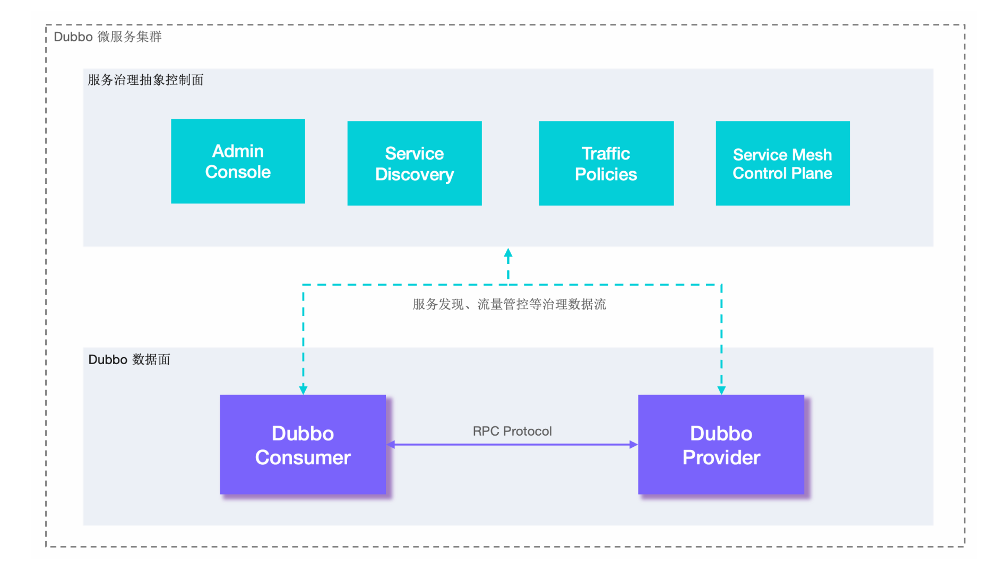

## Introduction

[Apache Dubbo](http://dubbo.apache.org/) 是一款易用、高性能的 WEB 和 RPC 框架，同时为构建企业级微服务提供服务发现、流量治理、可观测、认证鉴权等能力、工具与最佳实践。

使用 Dubbo 开发的微服务原生具备相互之间的远程地址发现与通信能力，利用 Dubbo 提供的丰富服务治理特性，可以实现诸如服务发现、负载均衡、流量调度等服务治理诉求。Dubbo 被设计为高度可扩展，用户可以方便地实现流量拦截、选址的各种定制逻辑。在云原生时代，Dubbo 相继衍生出了 Dubbo3、Proxyless Mesh 等架构与解决方案，在易用性、超大规模微服务实践、云原生基础设施适配、安全性等几大方向上进行了全面升级。

Dubbo 在很多大企业内部衍生出了独立版本，比如在阿里巴巴内部就基于 Dubbo3 衍生出了 [HSF3](/docs/CS/Framework/HSF/HSF.md)。

> [!NOTE]
> **版本基线：3.3.6**（2026-10 逐篇核实，tarball `apache/dubbo` tag `dubbo-3.3.6`；3.2.20 为 LTS，3.4 分支开发中）。
>
> **3.x 与 2.x 差异极大，网上中文资料大量停留在 2.x，照抄必错。** 本目录各分册（`Architecture`/`ScopeModel`/`ServiceConfig`/`Provider`/`Invocation`/`Protocol`/`Serialization`/`Triple`/`config` 等）开头均标注版本基线，与本页同为 3.3.6。全分册共用的「类/方法已死」级易错点统一汇总在文末 **Pitfall List**，逐篇深挖后的事实以各分册正文为准。

与其他框架（Spring Cloud、gRPC、Istio）的横向对比与集成方式见 [Comparison](/docs/CS/Framework/Dubbo/Comparison.md)。

### Core Components

- **Provider**：服务的提供方，通过 Jar 或者容器的方式启动服务
- **Consumer**：服务消费方
- **Registry**：注册中心
- **Monitor**：统计服务和调用次数、调用时间的监控中心（Dubbo 控制台页面中可以显示，目前只有一个简单版本；3.x 的可观测体系见 [Metrics](/docs/CS/Framework/Dubbo/Metrics.md)）
- **Container**：服务运行的容器

## Build

```shell
git clone https://github.com/apache/dubbo.git

mvn install -Dmaven.test.skip=true

mvn idea:idea
```

查看 module `dubbo-demo` 学习用例。

## Architecture

<div style="text-align: center;">



</div>

<p style="text-align: center;">
Fig.1. Architecture
</p>

以上是 Dubbo 的工作原理图，从抽象架构上分为两层：**服务治理控制面**和 **Dubbo 数据面**。

- **服务治理控制面**。它不是特指如注册中心类的单个具体组件，而是对 Dubbo 治理体系的抽象表达。控制面包含协调服务发现的注册中心、流量管控策略、Dubbo Admin 控制台等，如果采用了 Service Mesh 架构则还包含 Istio 等服务网格控制面。
- **Dubbo 数据面**。代表集群部署的所有 Dubbo 进程，进程之间通过 RPC 协议实现数据交换，Dubbo 定义了微服务应用开发与调用规范并负责完成数据传输的编解码工作。数据面内部分为**服务消费者**（发起业务调用或 RPC 通信的 Dubbo 进程）与**服务提供者**（接收业务调用或 RPC 通信的 Dubbo 进程）。

从数据面视角，Dubbo 帮助解决了微服务实践中的以下问题：作为服务开发框架约束了微服务定义、开发与调用的规范，定义了服务治理流程及适配模式；作为 RPC 通信协议实现解决服务间数据传输的编解码问题。

Dubbo 从设计上**不绑定任何一款特定通信协议**，HTTP/2、REST、gRPC、JsonRPC、Thrift、Hessian2 等几乎所有主流的通信协议 Dubbo 都可以提供支持——但要注意 3.3.6 主仓库里实际存在的协议模块远少于这个列表，见 [Architecture](/docs/CS/Framework/Dubbo/Architecture.md?id=protocol-matrix-and-its-336-status)。

当运行在 Spring 体系时，Dubbo 就是构建在 Spring Boot 应用开发框架之上的微服务开发框架，并在此之上抽象了一套 RPC 服务定义、暴露、调用与治理的编程范式。服务治理则抽象了无状态服务节点动态变化、外部化配置、日志跟踪、可观测性、流量管理、高可用性、数据一致性等一系列问题的解决模式，并发布了对应的官方实现。

十层代码架构、调用流程、五个核心抽象（Invoker / Directory / Router / LoadBalance / Cluster）与设计原则见 [Architecture](/docs/CS/Framework/Dubbo/Architecture.md)；三层域模型（FrameworkModel / ApplicationModel / ModuleModel）见 [ScopeModel](/docs/CS/Framework/Dubbo/ScopeModel.md)；服务暴露与引用的配置对象模型见 [ServiceConfig](/docs/CS/Framework/Dubbo/ServiceConfig.md)。

### Transport

`AbstractServer.doOpen()` 创建真正的 Netty Server 并使用 `NioEventLoop`；请求经 `NettyServer` → `AllChannelHandler` → 业务线程池 → Dubbo Protocol 的 `invoke()` → `received` → `handleRequest` → `reply()` 完成分发。注册侧由 `RegistryProtocol` 负责创建 Registry 并执行注册。

这一层的派发策略（Dispatcher 五种模型）、线程池四种实现与服务端/消费端默认值见 [Transporter](/docs/CS/Framework/Dubbo/Transporter.md) 与 [ThreadPool](/docs/CS/Framework/Dubbo/ThreadPool.md)，底层 remoting 抽象见 [remoting](/docs/CS/Framework/Dubbo/remoting.md)，拦截器见 [Filter](/docs/CS/Framework/Dubbo/Filter.md)。历史安全漏洞见 [CVE-2020-1948](https://www.cve.org/CVERecord?id=CVE-2020-1948)。

## Features

延迟暴露（`delay` 默认 `null`，即不延迟）与启动预热（`warmup` 默认 10 分钟，权重按 uptime 线性恢复）属于服务治理范畴，完整机制见 [Governance](/docs/CS/Framework/Dubbo/Governance.md)。

## Topic Navigation

Dubbo 3 的能力可以按「一次调用经过哪些环节」串起来阅读，也可以按「你要解决什么问题」直接定位。

**先看模型与启动。** 十层分层与五个核心抽象见 [Architecture](/docs/CS/Framework/Dubbo/Architecture.md)；三层域模型决定了扩展实例归属谁，见 [ScopeModel](/docs/CS/Framework/Dubbo/ScopeModel.md)；配置对象的字段与默认值见 [ServiceConfig](/docs/CS/Framework/Dubbo/ServiceConfig.md)，配置来源的七档优先级见 [config](/docs/CS/Framework/Dubbo/config.md)；从 `DubboBootstrap` 到服务暴露与引用的完整时序见 [Start](/docs/CS/Framework/Dubbo/Start.md)；所有这一切的装配机制是 [SPI](/docs/CS/Framework/Dubbo/SPI.md)。

**再看协议与传输。** Dubbo 协议的 16 字节报文格式、`Codec2` 体系与超时机制见 [Protocol](/docs/CS/Framework/Dubbo/Protocol.md)；Triple 协议的设计与 gRPC 兼容边界见 [Triple](/docs/CS/Framework/Dubbo/Triple.md)；序列化实现与 Hessian2 反序列化安全见 [Serialization](/docs/CS/Framework/Dubbo/Serialization.md)；remoting 抽象见 [remoting](/docs/CS/Framework/Dubbo/remoting.md)，Netty 服务端生命周期见 [Transporter](/docs/CS/Framework/Dubbo/Transporter.md)，线程模型与线程池默认值见 [ThreadPool](/docs/CS/Framework/Dubbo/ThreadPool.md)。

**然后看两侧。** 消费侧的调用链与扩展点全景见 [Consumer](/docs/CS/Framework/Dubbo/Consumer.md)，服务端暴露链路、Filter 与限流见 [Provider](/docs/CS/Framework/Dubbo/Provider.md)；同步/异步/单向三种调用模式、四类 `RpcContext` 与 attachment 透传规则、泛化调用见 [Invocation](/docs/CS/Framework/Dubbo/Invocation.md)；拦截器链与 order 排序见 [Filter](/docs/CS/Framework/Dubbo/Filter.md)。

**再看集群与治理。** 路由与容错的整体结构见 [cluster](/docs/CS/Framework/Dubbo/cluster.md)，条件路由与标签路由的规则语法见 [Router](/docs/CS/Framework/Dubbo/Router.md)，选择算法见 [LoadBalance](/docs/CS/Framework/Dubbo/LoadBalance.md)；优雅停机、Mock 降级、QoS 与内置限流见 [Governance](/docs/CS/Framework/Dubbo/Governance.md)；服务鉴权、凭据签名与 mTLS 见 [Auth](/docs/CS/Framework/Dubbo/Auth.md)；指标与链路追踪见 [Metrics](/docs/CS/Framework/Dubbo/Metrics.md)。

**最后是地址与生态。** 注册中心的实现与地址推送见 [registry](/docs/CS/Framework/Dubbo/registry.md)，接口到应用名的映射与元数据上报见 [Metadata](/docs/CS/Framework/Dubbo/Metadata.md)；Mesh 在 3.3.6 主仓库的真实能力边界（以及 Proxyless 尚未落地这一事实）见 [Mesh](/docs/CS/Framework/Dubbo/Mesh.md)；与 Spring Cloud、gRPC、Istio 的对比见 [Comparison](/docs/CS/Framework/Dubbo/Comparison.md)。

## Pitfall List

跨分册共用的「最容易记错、且类/方法已死级别」的点（均经源码逐篇核实，2026-10；逐篇深挖后的细节以各分册正文为准）：

- 协议名是 **`tri` 不是 `triple`**（另注册 `grpc`/`rest2`，三者皆为 `TripleProtocol` 子类）；Triple 默认序列化 **hessian2 不是 Protobuf**（仅 PB 生成类走直通）；默认端口 **50051**
- 路由实现全改名 **`*StateRouter`**（`ConditionRouter`/`TagRouter` **已不存在**）；条件路由**没有** `in`/`not in`/`matches`/`any`（只认 `& = != ,`）
- **`sent` 是「发送阻塞等写入完成」不是「不等响应」**；**没有 `oneway` 这个 key**（由 `return=false` 推导）
- **3.3.6 中不存在**：`SpringExtensionFactory`、`Cglib`、`destroyAll()`、`RedisMetadataReport`、`CompositeMetadataReport`、`RetryMetadataReport`、`FailZoneAwareCluster`、`mina`
- **`DubboBootstrap` 未被删除也未被取代**（`start()` 全文 3 行委派 `DefaultApplicationDeployer`）；`ServiceBean` 已不监听任何事件
- 优雅停机 key 是 **`dubbo.service.shutdown.wait`**（10000ms）；`delay` 默认 **`null`** 不是 -1
- 主仓库序列化实现**只有 hessian2 / fastjson2**；主仓库注册中心**只有 nacos / zookeeper**（Redis/Consul/Etcd 已外置 `org.apache.dubbo.extensions`）；`MetadataReportFactory.DEFAULT="redis"` 是**死常量**（无消费方）
- 认证默认 **`basic` 是 Base64 明文**；`dubbo-spring-security` **信任客户端上下文不做校验**；异常码是 `AUTHORIZATION_EXCEPTION=13` 不是 `UNAUTHORIZED`
- **`20888` 是死常量**（Metrics 导出走 QoS 的 `metrics` 命令，无总开关，看 classpath 有无 Micrometer）
- 配置优先级：**`dubbo.properties` 最低**、`-D` 最高，没有 `DefaultConfigManager`
- **`actives` 是消费侧**（`ActiveLimitFilter` 的 group 是 CONSUMER），服务端并发限制是 **`executes`**；Provider 侧**没有** `retries`
- **`/dubbo/mapping/<interface>` 在 ZK 上真实存在**——被移除的只是**本地缓存 key** 的 `mapping/` 前缀（issue #4671），两者不能混为一谈
- **`ExporterListener` 没有任何内置实现**（生产 resources 里连 SPI 文件都没有），监听暴露事件要用 `ServiceListener`

## Links

- [RPC](/docs/CS/Distributed/RPC/RPC.md)
- [Spring Cloud Alibaba](/docs/CS/Framework/Spring_Cloud/Alibaba.md)
- [Nacos](/docs/CS/Framework/nacos/Nacos.md)
- [ZooKeeper](/docs/CS/Framework/ZooKeeper/ZooKeeper.md)
- [gRPC](/docs/CS/Framework/gRPC/gRPC.md)
- [Higress Service Discovery](/docs/CS/Framework/Higress/Service_Discovery.md)

## References

- <http://dubbo.apache.org/>
- <https://github.com/apache/dubbo>
- <https://cn.dubbo.apache.org/zh-cn/overview/mannual/java-sdk/reference-manual/architecture/code-architecture/>
