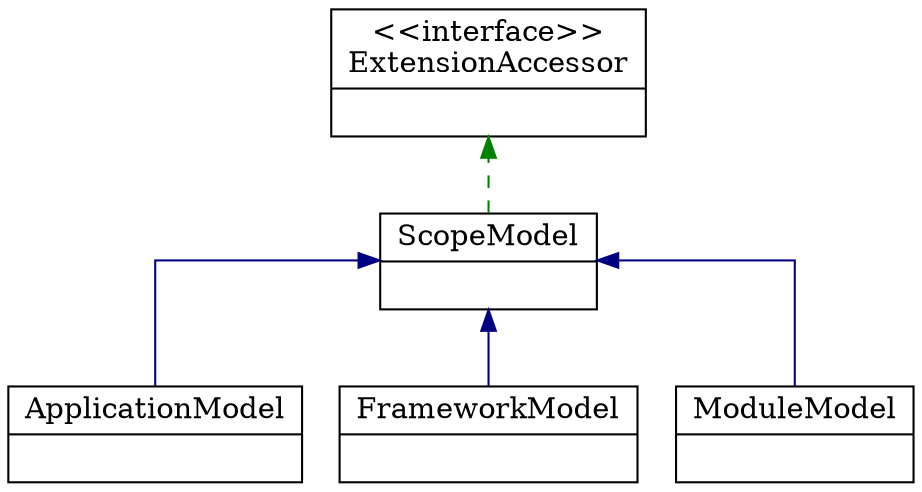

## Introduction

**为什么 Dubbo 3 要引入域模型（ScopeModel）？** 2.x 时代 Dubbo 只有一个作用域，大量状态通过**静态类属性**共享，这带来三个无法绕开的问题：

1. **无法支持多应用部署**——静态属性天然是进程级单例，同一 JVM 里跑两个 Dubbo 应用会互相污染。大企业（如阿里内部 HSF3）有明确诉求。
2. **静态属性资源的共享与清理问题**——没有归属就没有生命周期，销毁时无从下手。
3. **应用管理与服务管理混在一起**——配置中心、元数据中心应当归应用级管理，而服务的发布与引用应当归模块级管理。

引入三层模型后：Dubbo 3 启动时需要启动的配置中心、元数据中心由**应用模型（ApplicationModel）**管理；作为 RPC 框架需要发布和引用的服务交给**模块模型（ModuleModel）**管理。分层管理让职责边界清晰，父子模型又天然支持数据向下传递。

本文版本基线：Apache Dubbo **3.3.6**（源码 tag `dubbo-3.3.6`），所有行号相对该 tag。域模型对 SPI 实例作用域的影响（ExtensionDirector、ExtensionScope）在 [SPI](/docs/CS/Framework/Dubbo/SPI.md?id=scopemodel-which-model-an-extension-instance-belongs-to)，启动期模型如何被创建的时序见 [Start](/docs/CS/Framework/Dubbo/Start.md)。

## Three-Layer Model



| 类型 | 说明 |
| :--- | :--- |
| **ExtensionAccessor** | 扩展的统一访问器：获取 `ExtensionDirector` → 拿 `ExtensionLoader` → 按名字取扩展实例；也提供获取自适应扩展、默认扩展的入口 |
| **ScopeModel** | 模型对象的公共抽象父类型：内部 id 表达模型树层次、可设置的模型名与描述、ClassLoader 管理、父模型 `parent`、所属域 `ExtensionScope`、扩展加载管理器 `ExtensionDirector`、域内共享 Bean 工厂 `ScopeBeanFactory` |
| **FrameworkModel** | Dubbo 框架模型，可被多个应用共享：持有全部 `FrameworkModel` 实例 `allInstances`、全部 `ApplicationModel` 实例 `applicationModels`、已发布的 `pubApplicationModels`、框架级服务仓库 `FrameworkServiceRepository`（内存存储）、内部应用模型 `internalApplicationModel` |
| **ApplicationModel** | 表示正在使用 Dubbo 的应用程序，存储 RPC 调用所需的基础元数据；包含若干发布服务的 `ProviderModel` 与若干订阅服务的 `ConsumerModel` |
| **ModuleModel** | 服务模块的模型：持有 `ModuleServiceRepository`、`ModuleEnvironment`、`ModuleConfigManager`、`ModuleDeployer` |

`ExtensionScope` 只有四个值，**没有 GLOBAL**（`dubbo-common/src/main/java/org/apache/dubbo/common/extension/ExtensionScope.java`）：

| 值 | 行号 | 语义 |
| :--- | :--- | :--- |
| `FRAMEWORK` | `:43` | 框架级，全进程共享一份 |
| `APPLICATION` | `:59` | 应用级，每个 ApplicationModel 一份 |
| `MODULE` | `:72` | 模块级，每个 ModuleModel 一份 |
| `SELF` | `:77` | 自给自足，每个作用域各自创建实例，用于 `ExtensionInjector` 这类特殊 SPI |

## ScopeModel Abstract Class

字段（`dubbo-common/src/main/java/org/apache/dubbo/rpc/model/ScopeModel.java`）：`internalId:58`、`modelName:63`、`desc:65`、`classLoaders:67`、`parent:69`、`scope:70`、`extensionDirector:72`（volatile）、`beanFactory:74`（volatile）、`destroyListeners:75`、`classLoaderListeners:77`、`attributes:79`、`destroyed:80`（AtomicBoolean）、`internalScope:81`、`instLock:83`。

注意 `extensionDirector` 与 `beanFactory` 都是 **volatile 且延迟到 `initialize()` 才创建**，不在构造器里：

```java
// ScopeModel.java:100-113
protected void initialize() {
    synchronized (instLock) {
        this.extensionDirector =
                new ExtensionDirector(parent != null ? parent.getExtensionDirector() : null, scope, this);
        this.extensionDirector.addExtensionPostProcessor(new ScopeModelAwareExtensionProcessor(this));
        this.beanFactory = new ScopeBeanFactory(parent != null ? parent.getBeanFactory() : null, extensionDirector);

        // Add Framework's ClassLoader by default
        ClassLoader dubboClassLoader = ScopeModel.class.getClassLoader();
        if (dubboClassLoader != null) {
            this.addClassLoader(dubboClassLoader);
        }
    }
}
```

`internalId` 的层级含义是官方注释（`:45-57`），值得原样记住：

```
1          FrameworkModel (index=1)
1.2        FrameworkModel → ApplicationModel (index=2)
1.2.0      → ModuleModel (index=0, internal module)
1.2.1      → ModuleModel (index=1, first user module)
```

## FrameworkModel

构造函数（`dubbo-common/src/main/java/org/apache/dubbo/rpc/model/FrameworkModel.java:78-109`）：

```java
public FrameworkModel() {
    super(null, ExtensionScope.FRAMEWORK, false);
    synchronized (globalLock) {
        synchronized (instLock) {
            this.setInternalId(String.valueOf(index.getAndIncrement()));
            // register FrameworkModel instance early
            allInstances.add(this);
            if (LOGGER.isInfoEnabled()) {
                LOGGER.info(getDesc() + " is created");
            }
            initialize();

            TypeDefinitionBuilder.initBuilders(this);

            serviceRepository = new FrameworkServiceRepository(this);

            ExtensionLoader<ScopeModelInitializer> initializerExtensionLoader =
                    this.getExtensionLoader(ScopeModelInitializer.class);
            Set<ScopeModelInitializer> initializers = initializerExtensionLoader.getSupportedExtensionInstances();
            for (ScopeModelInitializer initializer : initializers) {
                initializer.initializeFrameworkModel(this);
            }

            internalApplicationModel = new ApplicationModel(this, true);
            internalApplicationModel
                    .getApplicationConfigManager()
                    .setApplication(new ApplicationConfig(
                            internalApplicationModel, CommonConstants.DUBBO_INTERNAL_APPLICATION));
            internalApplicationModel.setModelName(CommonConstants.DUBBO_INTERNAL_APPLICATION);
        }
    }
}
```

两个顺序细节容易被忽略：`initialize()` 在 `TypeDefinitionBuilder.initBuilders()` **之前**；`ScopeModelInitializer` 的遍历在 `internalApplicationModel` 创建**之前**（所以内部应用模型构造时还会再跑一遍 initializer）。

`DUBBO_INTERNAL_APPLICATION` 的字面量就是 `"DUBBO_INTERNAL_APPLICATION"`（`CommonConstants.java:531`），不是 `dubbo-internal-application`。

### Default Model and Its Reset

```java
// FrameworkModel.java:179-192
public static FrameworkModel defaultModel() {
    FrameworkModel instance = defaultInstance;
    if (instance == null) {
        synchronized (globalLock) {
            resetDefaultFrameworkModel();
            if (defaultInstance == null) {
                defaultInstance = new FrameworkModel();
            }
            instance = defaultInstance;
        }
    }
    return instance;
}
```

```java
// FrameworkModel.java:319-337
private static void resetDefaultFrameworkModel() {
    synchronized (globalLock) {
        if (defaultInstance != null && !defaultInstance.isDestroyed()) {
            return;
        }
        FrameworkModel oldDefaultFrameworkModel = defaultInstance;
        if (allInstances.size() > 0) {
            defaultInstance = allInstances.get(0);
        } else {
            defaultInstance = null;
        }
        ...
    }
}
```

官方注释给出了一条重要警告：

> During destroying the default FrameworkModel, the `FrameworkModel.defaultModel()` or `ApplicationModel.defaultModel()` will return a broken model, maybe cause unpredictable problem. **Recommendation: Avoid using the default model as much as possible.**

其它静态/实例成员：`index:50`（AtomicLong，初值 1）、`globalLock:52`、`defaultInstance:54`、`allInstances:56`、`appIndex:61`（注释：internal app index is 0, default app index is 1）、`defaultAppModel:63`、`applicationModels:65`、`pubApplicationModels:67`、`serviceRepository:69`、`internalApplicationModel:71`、`destroyLock:73`。

> [!NOTE]
> `defaultApplication()`（`:225-242`）与 `resetDefaultAppModel()`（`:299-317`）**都定义在 `FrameworkModel` 上，不在 `ApplicationModel` 上**；`ApplicationModel` 只有一个 `defaultModel()`（`:89-92`），其内部就是 `FrameworkModel.defaultModel().defaultApplication()`。网上很多资料把这三个方法的位置写反。

## ApplicationModel

```java
// dubbo-common/src/main/java/org/apache/dubbo/rpc/model/ApplicationModel.java:100-135
protected ApplicationModel(FrameworkModel frameworkModel, boolean isInternal) {
    super(frameworkModel, ExtensionScope.APPLICATION, isInternal);
    synchronized (instLock) {
        Assert.notNull(frameworkModel, "FrameworkModel can not be null");
        this.frameworkModel = frameworkModel;
        frameworkModel.addApplication(this);
        if (LOGGER.isInfoEnabled()) {
            LOGGER.info(getDesc() + " is created");
        }
        initialize();

        this.internalModule = new ModuleModel(this, true);
        this.serviceRepository = new ServiceRepository(this);

        ExtensionLoader<ApplicationInitListener> extensionLoader =
                this.getExtensionLoader(ApplicationInitListener.class);
        Set<String> listenerNames = extensionLoader.getSupportedExtensions();
        for (String listenerName : listenerNames) {
            extensionLoader.getExtension(listenerName).init();
        }

        initApplicationExts();

        ExtensionLoader<ScopeModelInitializer> initializerExtensionLoader =
                this.getExtensionLoader(ScopeModelInitializer.class);
        Set<ScopeModelInitializer> initializers = initializerExtensionLoader.getSupportedExtensionInstances();
        for (ScopeModelInitializer initializer : initializers) {
            initializer.initializeApplicationModel(this);
        }

        Assert.notNull(getApplicationServiceRepository(), "ApplicationServiceRepository can not be null");
        Assert.notNull(getApplicationConfigManager(), "ApplicationConfigManager can not be null");
        Assert.assertTrue(
                getApplicationConfigManager().isInitialized(), "ApplicationConfigManager can not be initialized");
    }
}
```

注意遍历 `ApplicationInitListener` 时用的是**先取名字再 `getExtension(name)`**，而 `ScopeModelInitializer` 用的是 `getSupportedExtensionInstances()`——两种写法在同一种构造逻辑里并存。

```java
// ApplicationModel.java:138-143
private void initApplicationExts() {
    Set<ApplicationExt> exts = this.getExtensionLoader(ApplicationExt.class).getSupportedExtensionInstances();
    for (ApplicationExt ext : exts) {
        ext.initialize();
    }
}
```

### ConfigManager and Environment Initialization

`ApplicationModel` 构造末尾的三个 Assert 直接依赖 `ConfigManager` 与 `Environment` 的初始化，两者都是「一次性 + 无锁读」设计。

`AbstractConfigManager` 是无锁配置管理器（`ConcurrentHashMap`）用于快速读取；写入操作按配置类型加锁以保证安全检查和新增的原子性。其 `initialize()` 只处理两个键：

```java
// dubbo-config/dubbo-config-api/.../AbstractConfigManager.java
public void initialize() throws IllegalStateException {
    if (!initialized.compareAndSet(false, true)) {
        return;
    }
    CompositeConfiguration configuration = scopeModel.modelEnvironment().getConfiguration();

    // dubbo.config.mode
    String configModeStr = (String) configuration.getProperty(ConfigKeys.DUBBO_CONFIG_MODE);
    ...
    // dubbo.config.ignore-duplicated-interface
    String ignoreDuplicatedInterfaceStr =
            (String) configuration.getProperty(ConfigKeys.DUBBO_CONFIG_IGNORE_DUPLICATED_INTERFACE);
    ...
}
```

`Environment.initialize()` 则一次性建好六个 `Configuration` 实例，构成配置来源的全部骨架：

```java
public void initialize() throws IllegalStateException {
    if (initialized.compareAndSet(false, true)) {
        this.propertiesConfiguration = new PropertiesConfiguration(scopeModel);
        this.systemConfiguration = new SystemConfiguration();
        this.environmentConfiguration = new EnvironmentConfiguration();
        this.externalConfiguration = new InmemoryConfiguration("ExternalConfig");
        this.appExternalConfiguration = new InmemoryConfiguration("AppExternalConfig");
        this.appConfiguration = new InmemoryConfiguration("AppConfig");

        loadMigrationRule();
    }
}
```

这六个来源的**优先级顺序**与配置中心启动链路见 [config](/docs/CS/Framework/Dubbo/config.md)。

## ModuleModel

`ModuleModel` 在不少资料里被一笔带过，但它的构造逻辑与 `ApplicationModel` 并不对称（`dubbo-common/src/main/java/org/apache/dubbo/rpc/model/ModuleModel.java:56-88`）：

```java
protected ModuleModel(ApplicationModel applicationModel, boolean isInternal) {
    super(applicationModel, ExtensionScope.MODULE, isInternal);
    synchronized (instLock) {
        Assert.notNull(applicationModel, "ApplicationModel can not be null");
        this.applicationModel = applicationModel;
        applicationModel.addModule(this, isInternal);   // 反向注册
        ...
        initialize();
        this.serviceRepository = new ModuleServiceRepository(this);
        initModuleExt();                                // ApplicationModel 里叫 initApplicationExts
        ExtensionLoader<ScopeModelInitializer> initializerExtensionLoader =
                this.getExtensionLoader(ScopeModelInitializer.class);
        for (ScopeModelInitializer initializer : initializers) {
            initializer.initializeModuleModel(this);
        }
        Assert.notNull(getServiceRepository(), "ModuleServiceRepository can not be null");
        Assert.notNull(getConfigManager(), "ModuleConfigManager can not be null");
        Assert.assertTrue(getConfigManager().isInitialized(), "ModuleConfigManager can not be initialized");
        ApplicationDeployer applicationDeployer = applicationModel.getDeployer();
        if (applicationDeployer != null) {
            applicationDeployer.notifyModuleChanged(this, DeployState.PENDING);
        }
    }
}
```

关键差异有两点：一是它会**反向注册**到父模型（`applicationModel.addModule`）并在末尾**通知 `ApplicationDeployer` 模块变更**（`DeployState.PENDING`）；二是它的扩展初始化方法叫 `initModuleExt()`（`:91-96`），不是 `initApplicationExts()`。

其余成员：`NAME = "ModuleModel"`（`:43`）、`getConfigManager()` 从 `ModuleExt` SPI 取 `ModuleConfigManager.NAME`（`:162-168`）、`modelEnvironment()`（`:154-160`）、覆写的 `addClassLoader` 会刷新 environment（`:146-151`）、`acquireDestroyLock()` 向上取到 FrameworkModel 的 `destroyLock`（`:179-181`）。

## ScopeModelInitializer SPI Registrations

域模型初始化器是三层模型真正的「装配工」——每个模块通过它把自己要注册的东西挂到对应层上。3.3.6 全仓库共 **15 个 SPI 文件、19 条注册项**，且**分散在各模块**，并不存在单一文件：

| key | 实现类 |
| :--- | :--- |
| `dubbo-common` | `CommonScopeModelInitializer` |
| `dubbo-cluster` | `ClusterScopeModelInitializer` |
| `dubbo-cluster-mergeable` | `MergeableClusterScopeModelInitializer` |
| `mesh` | `MeshScopeModelInitializer` |
| `rpc` | `RpcScopeModelInitializer` |
| `adaptive` | `AdaptiveScopeModelInitializer` |
| `dubbo-registry-api` | `RegistryScopeModelInitializer` |
| `dubbo-metadata-api` | `MetadataScopeModelInitializer` |
| `dubbo-config-api` | `ConfigScopeModelInitializer` |
| `dubbo-config-spring` | `SpringScopeModelInitializer` |
| `dubbo-metrics-init` | `MetricsScopeModelInitializer` |
| `serialization-api` | `SerializationScopeModelInitializer` |
| `hessian2` | `Hessian2ScopeModelInitializer` |
| `fastjson2` | `Fastjson2ScopeModelInitializer` |
| `qos` | `QosScopeModelInitializer` |
| `cert` | `CertScopeModelInitializer` |
| `securityApplicationScopeModelInitializer` | `SecurityScopeModelInitializer` |
| `rest-spring` | `RestSpringScopeModelInitializer` |
| `openapi` | `OpenAPIScopeModelInitializer` |

> [!NOTE]
> **运行时实际加载的数量取决于 classpath**，只有引入对应 jar 才会被 `ExtensionLoader` 扫到。所以「Dubbo 有 N 个 ScopeModelInitializer」这类固定数字是没有意义的——最小依赖场景大致 10 个左右。

## Destroy Cascade

三层模型的销毁是**自下而上自动级联**的，不需要用户手动关 FrameworkModel——这是 3.x 相对 2.x「静态单例难清理」的核心改进之一。

`ApplicationModel` 的销毁入口 `onDestroy()`（`ApplicationModel.java:146-193`）按 8 步收尾，最后一步是：

```java
// dubbo-common/src/main/java/org/apache/dubbo/rpc/model/ApplicationModel.java:191-192
// 8. destroy framework if none application
frameworkModel.tryDestroy();
```

`FrameworkModel.tryDestroy()`（`FrameworkModel.java:285-291`）只在**已发布应用数为 0**时才真正销毁整个框架：

```java
// dubbo-common/src/main/java/org/apache/dubbo/rpc/model/FrameworkModel.java:285-291
void tryDestroy() {
    synchronized (instLock) {
        if (pubApplicationModels.size() == 0) {
            destroy();
        }
    }
}
```

注意判据是 `pubApplicationModels`（已发布应用），不是含内部应用 `internalApplicationModel` 的 `applicationModels`——内部应用模型销毁不会触发框架销毁。

`FrameworkModel.destroy()`（`FrameworkModel.java:127-150`）自身再向下级联：

1. 遍历 `applicationModels` 逐个 `applicationModel.destroy()`；
2. `checkApplicationDestroy()` 断言销毁期间没有新应用被创建（否则抛 "Not all application models are completely destroyed"，`FrameworkModel.java:153-163`）；
3. `notifyDestroy()`（由 `FrameworkModelCleaner` 等监听器清理框架级资源）；
4. 从 `allInstances` 移除自己并 `resetDefaultFrameworkModel()`；
5. `destroyGlobalResources()`——仅当 `allInstances.isEmpty()` 时调用 `GlobalResourcesRepository.getInstance().destroy()`，**彻底关停 Dubbo**（释放全局静态资源，`FrameworkModel.java:165-171`）。

> [!WARNING]
> 销毁 default FrameworkModel 期间调用 `FrameworkModel.defaultModel()` / `ApplicationModel.defaultModel()` 会拿到 broken model（官方注释 `FrameworkModel.java:174`），所以官方明确建议「尽可能不用 default model」。级联销毁是自动的，但「最后一个应用 destroy 会顺带关掉 Framework」这一副作用，在单 JVM 多应用场景里要格外小心——别在别的应用还在跑时销毁其中一个。子模型的 `ExtensionLoader` 缓存随 `ExtensionDirector.destroy()` 一并清空，细节见 [SPI](/docs/CS/Framework/Dubbo/SPI.md?id=scopemodel-which-model-an-extension-instance-belongs-to)。

## Pitfall List

- **把 `defaultApplication()` / `resetDefaultAppModel()` 当成 `ApplicationModel` 的方法**——它们在 `FrameworkModel` 上（`:225` / `:299`）。
- **在销毁 default FrameworkModel 期间继续用 `defaultModel()`**——会拿到 broken model，官方明确建议尽可能不用 default model。
- **以为 `ExtensionScope` 还有 `GLOBAL`**——只有 FRAMEWORK / APPLICATION / MODULE / SELF 四个。
- **把 `ScopeModelInitializer` 的数量写死**——19 条注册项，且实际生效数量随 classpath 变化。
- **以为配置对象只属于应用级**——`ServiceConfig` 的 scopeModel 变更会沿继承链级联传播，见 [ServiceConfig](/docs/CS/Framework/Dubbo/ServiceConfig.md)。
- **混淆 `initApplicationExts()` 与 `initModuleExt()`**——两个方法名不同层不同名，ModuleModel 没有 `initApplicationExts`。

## Links

- [Dubbo](/docs/CS/Framework/Dubbo/Dubbo.md)
- [SPI](/docs/CS/Framework/Dubbo/SPI.md)
- [ServiceConfig](/docs/CS/Framework/Dubbo/ServiceConfig.md)
- [config](/docs/CS/Framework/Dubbo/config.md)
- [Start](/docs/CS/Framework/Dubbo/Start.md)

## References

- <https://github.com/apache/dubbo/tree/dubbo-3.3.6>
- <https://cn.dubbo.apache.org/zh-cn/overview/mannual/java-sdk/reference-manual/architecture/>
