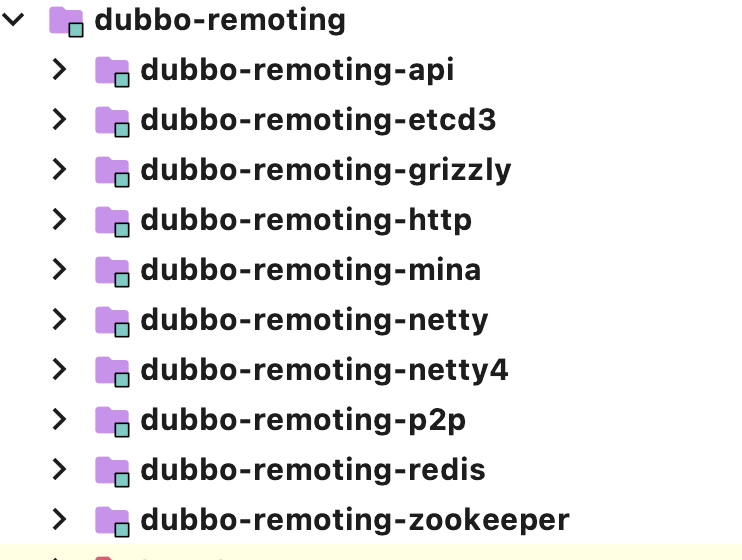

## Introduction

Dubbo 的 remoting 层要回答的问题很具体：**一条字节流怎么变成一次可以 `invoke` 的 Java 调用，以及这条连接idle 了由谁负责掐断。** 这一层只有 4 个核心接口（`Endpoint` / `Channel` / `Client` / `RemotingServer`）加4 个扩展点（`Dispatcher` / `ChannelHandler` / `Transporter` / `Codec2`），但流传的直觉几乎全是错的：

1. **「`Transporter` 有netty / netty4 / mina 三种实现」**——3.3.6 里**没有 `mina`**，整个 `dubbo-remoting/` 下连mina 的影子都没有。实际扩展名是 `netty` 与 `netty4`（**两者指向同一个 `NettyTransporter` 类**），加上独立 netty 模块里的 `netty3`。
2. **「`Transporters.getTransporter()` 是个静态无参方法」**——3.3.6 已改成 **`getTransporter(URL url)`**，内部从 URL 上取 `FrameworkModel` 再拿 `ExtensionLoader`。这是 3.x ScopeModel 化的直接体现，静态方法里不再有全局单例入口。
3. **「`Transporters` 里有 `Version.checkDuplicate` 静态块做 jar 冲突检测」**——该 static 块**已被删除**，构造器只剩 `private Transporters() {}` 一行。
4. **「所有 remoting 扩展点都是应用级SPI」**——`Dispatcher` / `ChannelHandler` / `Transporter` / `Codec2` 四者的 `@SPI` 在3.3.6 里全部带 `scope = ExtensionScope.FRAMEWORK`，即框架级SPI，只在 `FrameworkModel` 上加载一次。

本文版本基线：Apache Dubbo **3.3.6**，所有代码块均逐文件核对自源码 tag `dubbo-3.3.6`。其中 `Endpoint` / `Channel` / `Client` / `RemotingServer` 四个接口节已按 3.3.6 **逐字核对，与源码完全一致**（`Endpoint.java:31-88`、`Channel.java:28-74`、`Client.java:28-37`、`RemotingServer.java:31-57`）。传输层的具体落地实参见 [Transporter](/docs/CS/Framework/Dubbo/Transporter.md)，Filter 侧的拦截见 [Filter](/docs/CS/Framework/Dubbo/Filter.md)。

> [!NOTE]
>
> 本篇是 Dubbo 子树里源码保真度最高的一篇，四个核心接口原样保留。需修正的只有4 处 `@SPI` 的 `scope`、`Transporters` 的两处签名、一个标题笔误，以及补上 `HeaderExchange*` 的包路径与 3.3.6 新增的三个 remoting 模块指路。




> [!TIP]
>
> 接下来的 `Endpoint` / `Channel` / `Client` / `RemotingServer` 四节、以及 `Resetable` / `IdleSensible` 两个辅助接口，**已按 3.3.6 逐字核对，与源码完全一致**，未作任何改动。

```java
/**
 * Endpoint. (API/SPI, Prototype, ThreadSafe)
 *
 *
 * @see org.apache.dubbo.remoting.Channel
 * @see org.apache.dubbo.remoting.Client
 * @see RemotingServer
 */
public interface Endpoint {

    /**
     * get url.
     *
     * @return url
     */
    URL getUrl();

    /**
     * get channel handler.
     *
     * @return channel handler
     */
    ChannelHandler getChannelHandler();

    /**
     * get local address.
     *
     * @return local address.
     */
    InetSocketAddress getLocalAddress();

    /**
     * send message.
     *
     * @param message
     * @throws RemotingException
     */
    void send(Object message) throws RemotingException;

    /**
     * send message.
     *
     * @param message
     * @param sent    already sent to socket?
     */
    void send(Object message, boolean sent) throws RemotingException;

    /**
     * close the channel.
     */
    void close();

    /**
     * Graceful close the channel.
     */
    void close(int timeout);

    void startClose();

    /**
     * is closed.
     *
     * @return closed
     */
    boolean isClosed();

}
```


#### Channel

```java
/**
 * Channel. (API/SPI, Prototype, ThreadSafe)
 *
 * @see org.apache.dubbo.remoting.Client
 * @see RemotingServer#getChannels()
 * @see RemotingServer#getChannel(InetSocketAddress)
 */
public interface Channel extends Endpoint {

    /**
     * get remote address.
     *
     * @return remote address.
     */
    InetSocketAddress getRemoteAddress();

    /**
     * is connected.
     *
     * @return connected
     */
    boolean isConnected();

    /**
     * has attribute.
     *
     * @param key key.
     * @return has or has not.
     */
    boolean hasAttribute(String key);

    /**
     * get attribute.
     *
     * @param key key.
     * @return value.
     */
    Object getAttribute(String key);

    /**
     * set attribute.
     *
     * @param key   key.
     * @param value value.
     */
    void setAttribute(String key, Object value);

    /**
     * remove attribute.
     *
     * @param key key.
     */
    void removeAttribute(String key);
}
```


```java
public interface Resetable {
  
    void reset(URL url);

}
```

```java
/**
 * Indicate whether the implementation (for both server and client) has the ability to sense and handle idle connection.
 * If the server has the ability to handle idle connection, it should close the connection when it happens, and if
 * the client has the ability to handle idle connection, it should send the heartbeat to the server.
 */
public interface IdleSensible {
    /**
     * Whether the implementation can sense and handle the idle connection. By default it's false, the implementation
     * relies on dedicated timer to take care of idle connection.
     *
     * @return whether has the ability to handle idle connection
     */
    default boolean canHandleIdle() {
        return false;
    }
}
```


```java
/**
 * Remoting Client. (API/SPI, Prototype, ThreadSafe)
 * <p>
 * <a href="http://en.wikipedia.org/wiki/Client%E2%80%93server_model">Client/Server</a>
 *
 * @see org.apache.dubbo.remoting.Transporter#connect(org.apache.dubbo.common.URL, ChannelHandler)
 */
public interface Client extends Endpoint, Channel, Resetable, IdleSensible {

    /**
     * reconnect.
     */
    void reconnect() throws RemotingException;

    @Deprecated
    void reset(org.apache.dubbo.common.Parameters parameters);

}
```


```java
/**
 * Remoting Server. (API/SPI, Prototype, ThreadSafe)
 * <p>
 * <a href="http://en.wikipedia.org/wiki/Client%E2%80%93server_model">Client/Server</a>
 *
 * @see org.apache.dubbo.remoting.Transporter#bind(org.apache.dubbo.common.URL, ChannelHandler)
 */
public interface RemotingServer extends Endpoint, Resetable, IdleSensible {

    /**
     * is bound.
     *
     * @return bound
     */
    boolean isBound();

    /**
     * get channels.
     *
     * @return channels
     */
    Collection<Channel> getChannels();

    /**
     * get channel.
     *
     * @param remoteAddress
     * @return channel
     */
    Channel getChannel(InetSocketAddress remoteAddress);

    @Deprecated
    void reset(Parameters parameters);

}
```


#### Dispatcher

```java
/**
 * ChannelHandlerWrapper (SPI, Singleton, ThreadSafe)
 */
@SPI(value = AllDispatcher.NAME, scope = ExtensionScope.FRAMEWORK)
public interface Dispatcher {

    /**
     * dispatch the message to threadpool.
     *
     * @param handler
     * @param url
     * @return channel handler
     */
    @Adaptive({Constants.DISPATCHER_KEY, "dispather", "channel.handler"})
    // The last two parameters are reserved for compatibility with the old configuration
    ChannelHandler dispatch(ChannelHandler handler, URL url);

}
```


#### ChannelHandler


```java
/**
 * ChannelHandler. (API, Prototype, ThreadSafe)
 *
 * @see org.apache.dubbo.remoting.Transporter#bind(org.apache.dubbo.common.URL, ChannelHandler)
 * @see org.apache.dubbo.remoting.Transporter#connect(org.apache.dubbo.common.URL, ChannelHandler)
 */
@SPI(scope = ExtensionScope.FRAMEWORK)
public interface ChannelHandler {

    /**
     * on channel connected.
     *
     * @param channel channel.
     */
    void connected(Channel channel) throws RemotingException;

    /**
     * on channel disconnected.
     *
     * @param channel channel.
     */
    void disconnected(Channel channel) throws RemotingException;

    /**
     * on message sent.
     *
     * @param channel channel.
     * @param message message.
     */
    void sent(Channel channel, Object message) throws RemotingException;

    /**
     * on message received.
     *
     * @param channel channel.
     * @param message message.
     */
    void received(Channel channel, Object message) throws RemotingException;

    /**
     * on exception caught.
     *
     * @param channel   channel.
     * @param exception exception.
     */
    void caught(Channel channel, Throwable exception) throws RemotingException;

}
```


#### Transporter

```java
/**
 * Transporter. (SPI, Singleton, ThreadSafe)
 * <p>
 * <a href="http://en.wikipedia.org/wiki/Transport_Layer">Transport Layer</a>
 * <a href="http://en.wikipedia.org/wiki/Client%E2%80%93server_model">Client/Server</a>
 *
 * @see org.apache.dubbo.remoting.Transporters
 */
@SPI(value = "netty", scope = ExtensionScope.FRAMEWORK)
public interface Transporter {

    /**
     * Bind a server.
     *
     * @param url     server url
     * @param handler
     * @return server
     * @throws RemotingException
     * @see org.apache.dubbo.remoting.Transporters#bind(URL, ChannelHandler...)
     */
    @Adaptive({Constants.SERVER_KEY, Constants.TRANSPORTER_KEY})
    RemotingServer bind(URL url, ChannelHandler handler) throws RemotingException;

    /**
     * Connect to a server.
     *
     * @param url     server url
     * @param handler
     * @return client
     * @throws RemotingException
     * @see org.apache.dubbo.remoting.Transporters#connect(URL, ChannelHandler...)
     */
    @Adaptive({Constants.CLIENT_KEY, Constants.TRANSPORTER_KEY})
    Client connect(URL url, ChannelHandler handler) throws RemotingException;

}
```


#### Transporters

```java
/**
 * Transporter facade. (API, Static, ThreadSafe)
 */
public class Transporters {

    private Transporters() {}

    public static RemotingServer bind(String url, ChannelHandler... handler) throws RemotingException {
        return bind(URL.valueOf(url), handler);
    }

    public static RemotingServer bind(URL url, ChannelHandler... handlers) throws RemotingException {
        if (url == null) {
            throw new IllegalArgumentException("url == null");
        }
        if (handlers == null || handlers.length == 0) {
            throw new IllegalArgumentException("handlers == null");
        }
        ChannelHandler handler;
        if (handlers.length == 1) {
            handler = handlers[0];
        } else {
            handler = new ChannelHandlerDispatcher(handlers);
        }
        return getTransporter(url).bind(url, handler);
    }

    public static Client connect(String url, ChannelHandler... handler) throws RemotingException {
        return connect(URL.valueOf(url), handler);
    }

    public static Client connect(URL url, ChannelHandler... handlers) throws RemotingException {
        if (url == null) {
            throw new IllegalArgumentException("url == null");
        }
        ChannelHandler handler;
        if (handlers == null || handlers.length == 0) {
            handler = new ChannelHandlerAdapter();
        } else if (handlers.length == 1) {
            handler = handlers[0];
        } else {
            handler = new ChannelHandlerDispatcher(handlers);
        }
        return getTransporter(url).connect(url, handler);
    }

    public static Transporter getTransporter(URL url) {
        return url.getOrDefaultFrameworkModel()
                .getExtensionLoader(Transporter.class)
                .getAdaptiveExtension();
    }

}
```

两处 3.3.6 差异值得单独点出：

| 位置 | 旧写法 |3.3.6 真实形态 | 证据 |
|---|---|---|---|
| 类首 | `static { Version.checkDuplicate(Transporters.class); Version.checkDuplicate(RemotingException.class); }` | **static 块已删除**，只剩 `private Transporters() {}` | `Transporters.java:26-28` |
| 取实例 | `public static Transporter getTransporter()` | **`getTransporter(URL url)`**，从 URL 取 `FrameworkModel` | `Transporters.java:69-73` |
| 调用点 | `getTransporter().bind(...)` / `.connect(...)` | `getTransporter(url).bind(...)` / `.connect(...)` | `Transporters.java:47`、`:66` |

`getTransporter` 从「静态全局单例」变成「按 URL 定位 `FrameworkModel`」，意味着同一个 JVM 内可以有多个 `FrameworkModel`，各自持有独立的 `Transporter` 实例——这是 3.x 把扩展点作用域显式化的一个缩影。


#### Codec2

```java
@SPI(scope = ExtensionScope.FRAMEWORK)
public interface Codec2 {

    @Adaptive({Constants.CODEC_KEY})
    void encode(Channel channel, ChannelBuffer buffer, Object message) throws IOException;

    @Adaptive({Constants.CODEC_KEY})
    Object decode(Channel channel, ChannelBuffer buffer) throws IOException;


    enum DecodeResult {
        NEED_MORE_INPUT, SKIP_SOME_INPUT
    }

}
```

`Codec2` 在 3.3.6 注册了 4 个扩展名，其中 `default` 是 3.x 新增的类路径无关（Pu）编解码：

```properties
# dubbo-remoting/dubbo-remoting-api/src/main/resources/META-INF/dubbo/internal/org.apache.dubbo.remoting.Codec2
transport=org.apache.dubbo.remoting.transport.codec.TransportCodec
telnet=org.apache.dubbo.remoting.telnet.codec.TelnetCodec
exchange=org.apache.dubbo.remoting.exchange.codec.ExchangeCodec
default=org.apache.dubbo.remoting.api.pu.DefaultCodec
```

## Extension Point List

`Transporter` 的注册分散在**两个模块**里，且`netty` 与 `netty4` 是同一个实现类的两个名字：

```properties
# dubbo-remoting/dubbo-remoting-netty4/src/main/resources/META-INF/dubbo/internal/org.apache.dubbo.remoting.Transporter
netty4=org.apache.dubbo.remoting.transport.netty4.NettyTransporter
netty=org.apache.dubbo.remoting.transport.netty4.NettyTransporter

# dubbo-remoting/dubbo-remoting-netty/src/main/resources/META-INF/dubbo/internal/org.apache.dubbo.remoting.Transporter
netty3=org.apache.dubbo.remoting.transport.netty.NettyTransporter
```

`Dispatcher` 的 5 个扩展名（`all` / `direct` / `message` / `execution` / `connection`）与笔记旧版完全一致，仍然有效。

## Exchange Layer and New Modules in 3.3.6

`Endpoint` / `Channel` 只是「一条连接」的抽象，**真正被业务代码拿到的是 Exchange 层**：`Exchanger` 把 `Channel` 包装成 `ExchangeChannel`，而它的 header 协议实现在 3.3.6 位于：

```
dubbo-remoting/dubbo-remoting-api/src/main/java/org/apache/dubbo/remoting/exchange/support/header/
├── HeaderExchanger.java
├── HeaderExchangeChannel.java
├── HeaderExchangeClient.java
├── HeaderExchangeHandler.java
└── HeaderExchangeServer.java
```

这一层的 `HeartbeatTimerTask` / `ReconnectTimerTask` / `TimeoutCheckTask`（超时判定）都挂在 `HeaderExchange*` 上，消费端侧的完整调用时序见 [Consumer](/docs/CS/Framework/Dubbo/Consumer.md?id=timeout)。

3.3.6 在 `dubbo-remoting/` 下新增了三个模块，都是 Triple 协议的传输底座，与传统 `Transporter` 体系并行：

| 模块 | 注册的扩展 | 作用 |
|---|---|---|
| `dubbo-remoting-http12` | `HttpMessageAdapterFactory` / `HttpMessageEncoderFactory` / `HttpMessageDecoderFactory` | Triple 协议 HTTP/1.2 传输 |
| `dubbo-remoting-http3` | `ChannelAddressAccessor` | HTTP/3 |
| `dubbo-remoting-websocket` | 无 SPI 文件 | 仅客户端握手支持 |

> [!WARNING]
>
> 这三个模块用的是**各自独立的 `HttpMessage*` 工厂扩展点**，不是 `Transporter` / `Codec2`。想跟它们打交道，不要去 `org.apache.dubbo.remoting.Transporter` 的 SPI 文件里找。

## Dispatcher and ChannelHandler Mapping

`Dispatcher`（`@SPI(value = AllDispatcher.NAME, scope = ExtensionScope.FRAMEWORK)`）的唯一职责是把业务 `ChannelHandler` 包一层「线程模型」包装器，决定 `received`/`sent`/`connected` 等事件跑在哪个线程。5 个扩展名与对应包装器：

| SPI 名 | Dispatcher 实现 | 返回的 ChannelHandler 包装器 | 语义 |
| :--- | :--- | :--- | :--- |
| `all` | `AllDispatcher` | `AllChannelHandler` | 所有事件（连接/断开/读/写）都派发到线程池 |
| `direct` | `DirectDispatcher` | `DirectChannelHandler` | 直接在 I/O 线程执行，不派发 |
| `message` | `MessageOnlyDispatcher` | `MessageOnlyChannelHandler` | 仅 `received` 消息派发到线程池，连接事件在 I/O 线程 |
| `execution` | `ExecutionDispatcher` | `ExecutionChannelHandler` | 类似 all，但带队列隔离，避免业务阻塞 I/O 线程 |
| `connection` | `ConnectionOrderedDispatcher` | `ConnectionOrderedChannelHandler` | 连接事件有序（单线程）处理，消息事件派发线程池 |

映射代码极度简单，每个 Dispatcher 只做一件事：

```java
// dubbo-remoting/.../transport/dispatcher/all/AllDispatcher.java:31-33
public ChannelHandler dispatch(ChannelHandler handler, URL url) {
    return new AllChannelHandler(handler, url);   // 其余四个同理返回各自的 *ChannelHandler
}
```

`@Adaptive({Constants.DISPATCHER_KEY, "dispather", "channel.handler"})` 决定 URL 上的 `dispatcher` 参数（兼容旧写法 `dispather`/`channel.handler`）选择哪个实现，默认 `all`（`AllDispatcher.NAME`）。

这些 `*ChannelHandler` 都继承 `WrappedChannelHandler`（包 `org.apache.dubbo.remoting.transport.dispatcher`，注意**不在**各自的 `all`/`direct`/`message`/`execution`/`connection` 子包里——只有 `Dispatcher` 实现类在子包中），内部持有一个 `ExecutorSupport`（`WrappedChannelHandler.java:46,51-53`，由 `ExecutorRepository.getInstance(url.getOrDefaultApplicationModel()).getExecutorSupport(url)` 取得），把事件 submit 到线程池执行，从而把 I/O 线程与业务线程解耦——这正是 [Dubbo](/docs/CS/Framework/Dubbo/Dubbo.md) 中 `AllChannelHandler → 业务线程池 → Protocol.invoke` 这条链路的前半段（线程池配置见 [ThreadPool](/docs/CS/Framework/Dubbo/ThreadPool.md)）。

`AllChannelHandler.received` 用的是 `getPreferredExecutorService(message)`（按消息类型选线程池），而 `connected` / `disconnected` / `caught` 用 `getSharedExecutorService()`（共享池）；`received` 里还专门捕获 `RejectedExecutionException` 并对 `Request` 回一个 `sendFeedback` 响应（`AllChannelHandler.java:63-72`）——线程池满时不能让客户端干等。

## HeartbeatHandler and Idle Timeout

心跳不是协议层（`Codec2`）的事，而是 Exchange 层的 `HeartbeatHandler`（包 `exchange.support.header`）负责。它在每个 Channel 上记录最近读/写时间戳：

```java
// dubbo-remoting/.../exchange/support/header/HeartbeatHandler.java:33-39,66-92
public class HeartbeatHandler extends AbstractChannelHandlerDelegate {
    public static final String KEY_READ_TIMESTAMP = "READ_TIMESTAMP";     // :37
    public static final String KEY_WRITE_TIMESTAMP = "WRITE_TIMESTAMP";   // :39
    public void received(Channel channel, Object message) {
        setReadTimestamp(channel);
        if (isHeartbeatRequest(message)) {                 // message instanceof HeartBeatRequest && ((Request))isHeartbeat()
            HeartBeatRequest req = (HeartBeatRequest) message;
            if (req.isTwoWay()) {                          // 对方要回包
                HeartBeatResponse res = new HeartBeatResponse(req.getId(), req.getVersion());
                res.setEvent(HEARTBEAT_EVENT);
                channel.send(res);                        // 回一个心跳响应
            }
            return;                                        // 心跳请求不再往下传业务 handler
        }
        if (isHeartbeatResponse(message)) return;          // 收到心跳响应，仅更新时间戳
        handler.received(channel, message);                // 普通消息继续向下分发
    }
}
```

时间戳写在 **Channel 的 attribute** 里（不是内存字段），所以同一条连接上的读写时间天然共享给所有 TimerTask 读取——`AbstractTimerTask.lastRead` / `lastWrite` 就是直接 `channel.getAttribute(HeartbeatHandler.KEY_READ_TIMESTAMP)`（`AbstractTimerTask.java:52-58`）。

真正「定时发心跳 / 掐断空闲连接」的是**三个** TimerTask（都由 `HashedWheelTimer` 驱动），分属两侧：

```java
// dubbo-remoting/.../exchange/support/header/HeartbeatTimerTask.java:43-58（客户端侧：发心跳）
protected void doTask(Channel channel) {
    Long lastRead = lastRead(channel);
    Long lastWrite = lastWrite(channel);
    if ((lastRead != null && now - lastRead > heartbeat)
            || (lastWrite != null && now - lastWrite > heartbeat)) {
        Request req = new Request();                       // 空闲超过一个 heartbeat 周期，发心跳探活
        req.setVersion(Version.getProtocolVersion());
        req.setTwoWay(true);
        req.setEvent(HEARTBEAT_EVENT);
        channel.send(req);
    }
}
```

| TimerTask | 挂在哪 | 行为 | 阈值 |
| :--- | :--- | :--- | :--- |
| `HeartbeatTimerTask` | `HeaderExchangeClient` | 空闲超阈值就**发**一个 twoway 心跳请求探活 | `heartbeat` |
| `ReconnectTimerTask` | `HeaderExchangeClient` | 未连接则重连；已连接但读空闲超阈值也**重连** | `idleTimeout` |
| `CloseTimerTask` | `HeaderExchangeServer` | 读/写空闲超阈值就**关闭连接**（服务端不发心跳） | `closeTimeout` |

三个关键阈值：

- **心跳周期 `heartbeat`**：默认 `Constants.DEFAULT_HEARTBEAT = 60 * 1000`（60 秒，`remoting/Constants.java:157`），由 URL 的 `heartbeat` 参数覆盖。`DubboProtocol.createServer` 里会 `addParameterIfAbsent(HEARTBEAT_KEY, DEFAULT_HEARTBEAT)` 默认开启（`DubboProtocol.java:402`）。
- **空闲断开阈值 `idleTimeout`**：`UrlUtils.getIdleTimeout(url)` 返回 `url.getParameter(HEARTBEAT_TIMEOUT_KEY, heartbeat * 3)`，即默认 **180 秒**（`remoting/utils/UrlUtils.java:62-69`，key 是 `"heartbeat.timeout"`，`Constants.java:158`）。**注意它有下限校验**：`idleTimeout < heartBeat * 2` 直接抛 `IllegalStateException`——把 `heartbeat.timeout` 配到小于心跳周期的 2 倍会启动失败。
- **服务端关闭阈值 `closeTimeout`**：`UrlUtils.getCloseTimeout(url)`（`:40-59`）优先取 URL 的 `close.timeout`（`Constants.java:159`），未配置时**回落到 `getIdleTimeout(url)`**（同样默认 180 秒）；同样有 `closeTimeout < heartbeat * 2` 的校验。

三个 TimerTask 的**启用前提**都是 `!client.canHandleIdle()` / `!server.canHandleIdle()`（`IdleSensible` 接口，`canHandleIdle()` 默认 `false`）——如果底层传输自己实现了空闲感知（返回 `true`），Dubbo 就不插手，避免双重管理连接。

`HeartbeatHandler` 记录的时间戳正是这三个 TimerTask 的判断依据——它不亲自计时，只负责「收/发心跳包」与「维护时间戳」，把是否需要心跳的决策交给 TimerTask。客户端侧还有一个额外的用法：`HeaderExchangeClient.isConnected()`（`:118-131`）会读 `KEY_READ_TIMESTAMP`，读空闲超过 `idleTimeout` 时**直接返回 `false`**——所以「连接还在但已经算不通了」这个状态，在 Dubbo 里是靠时间戳判定的，不是靠 socket 状态。

## Codec2 Abstraction and Message Type Dispatch

`Codec2` 只有两个方法，但把「拆包粘包」这件事完全压在 `decode` 里。`ExchangeCodec`（`exchange/codec/ExchangeCodec.java`）作为 Dubbo 私有协议的实现，其 `encode` **按消息类型分派**：

```java
// dubbo-remoting/.../exchange/codec/ExchangeCodec.java:77-86
@Override
public void encode(Channel channel, ChannelBuffer buffer, Object msg) throws IOException {
    if (msg instanceof Request) {
        encodeRequest(channel, buffer, (Request) msg);
    } else if (msg instanceof Response) {
        encodeResponse(channel, buffer, (Response) msg);
    } else {
        super.encode(channel, buffer, msg);          // 交给父类 TelnetCodec
    }
}
```

`ExchangeCodec` 继承的是 `TelnetCodec`（不是 `AbstractCodec`）——非 Request/Response 的消息（如 telnet 指令）落到 telnet 分支处理。

`decode` 侧的半包/粘包状态机在 `AbstractCodec` 里，`ExchangeCodec.decode` 只覆写了「先读 16 字节头、按需补齐」这一段：

```java
// dubbo-remoting/.../exchange/codec/ExchangeCodec.java:88-94
@Override
public Object decode(Channel channel, ChannelBuffer buffer) throws IOException {
    int readable = buffer.readableBytes();
    byte[] header = new byte[Math.min(readable, HEADER_LENGTH)];
    buffer.readBytes(header);
    return decode(channel, buffer, readable, header);
}
```

后续 `:96-136` 的逻辑依次是：**校验魔数**（不匹配则扫描下一个 `0xda 0xbb` 重新对齐，把脏数据跳过去）→ **不足 16 字节返回 `NEED_MORE_INPUT`** → 从 `header[12..15]` 取 body 长度 → **不足则再次 `NEED_MORE_INPUT`** → 交给 `decodeBody`（`:152`）。

> [!TIP]
> `decode` 的返回值有两个分支值得记牢：`DecodeResult.NEED_MORE_INPUT` 表示「数据不够，等下次」（此时 readerIndex 会被回退，读取暂停）；`DecodeResult.SKIP_SOME_INPUT` 表示「跳过部分脏数据重新对齐」。这两个枚举值是 `Codec2` 的**唯一**状态输出——自定义 Codec 若要支持半包，只能用这两个值表达。

序列化 id 的解析走 `CodecSupport` 的两张静态表：

```java
// dubbo-remoting/.../remoting/transport/CodecSupport.java:79-99
public static Serialization getSerializationById(Byte id) {
    return ID_SERIALIZATION_MAP.get(id);
}
public static Serialization getSerialization(Byte id) throws IOException {
    Serialization result = getSerializationById(id);
    if (result == null) {
        throw new IOException("Unrecognized serialize type from consumer: " + id);
    }
    return result;
}
```

`ID_SERIALIZATION_MAP` 由静态块遍历所有 `Serialization` 扩展建立（`:57-72`），映射不上就抛 `IOException("Unrecognized serialize type from consumer: " + id)`——**这是「客户端与服务端序列化实现不一致」最典型的报错点**。

## Transporter Client Server Channel Layering

remoting 的四层抽象是**接口继承链**而非实现继承，每层只加一样东西：

| 层 | 接口 | 新增能力 | 3.3.6 实现 |
| :--- | :--- | :--- | :--- |
| 端点 | `Endpoint` | `getUrl` / `send` / `close` / `startClose` | 由 `Channel` 继承 |
| 通道 | `Channel extends Endpoint` | `getRemoteAddress` / `isConnected` / attribute 存取 | Netty 的 `AbstractChannel` |
| 服务端 | `RemotingServer extends Endpoint, Resetable, IdleSensible` | `isBound` / `getChannels` / `getChannel` | `AbstractServer` → `NettyServer` |
| 客户端 | `Client extends Endpoint, Channel, Resetable, IdleSensible` | `reconnect()` | `AbstractClient` → `NettyClient` |
| 传输 | `Transporter` | `bind` / `connect`，产出上面两种 | `NettyTransporter` |

`Transporter` 的两个方法都是 `@Adaptive`，按 URL 参数选择实现：

```java
// dubbo-remoting/.../remoting/Transporter.java:44-59
@Adaptive({Constants.SERVER_KEY, Constants.TRANSPORTER_KEY})
RemotingServer bind(URL url, ChannelHandler handler) throws RemotingException;

@Adaptive({Constants.CLIENT_KEY, Constants.TRANSPORTER_KEY})
Client connect(URL url, ChannelHandler handler) throws RemotingException;
```

`Constants.SERVER_KEY` / `CLIENT_KEY` 分别是 `"server"` / `"client"`，`TRANSPORTER_KEY` 是 `"transporter"`——所以 `server=netty4&client=netty4` 这类配置直接生效。默认 `netty`（`@SPI(value = "netty", ...)`）。

`Client` 与 `RemotingServer` 都继承了 `Resetable`（只有一个 `reset(URL url)`）与 `IdleSensible`（只有一个 `canHandleIdle()`，默认 `false`）——这两个接口是 3.x 的扩展点约定：前者让 `DubboProtocol.openServer` 能在复用 Server 时更新配置（`server.reset(url)`），后者让「空闲连接由谁管」可插拔。

## Exchange Layer Roles

Exchange 层是**协议无关的请求-响应骨架**，位于 `Codec2` 与业务之间。它只做四件事，不涉及任何序列化格式：

| 接口 | 角色 | 3.3.6 实现 |
| :--- | :--- | :--- |
| `ExchangeChannel extends Channel` | 增加 `request(...)`（发请求拿 future）与 `getExchangeHandler()` | `HeaderExchangeChannel` |
| `ExchangeHandler extends ChannelHandler, TelnetHandler` | 增加 `reply(ExchangeChannel, Object)` —— 服务端回复入口 | 业务侧 `ExchangeHandlerAdapter` |
| `ExchangeServer extends RemotingServer` | 把 `getChannels()` 换成 `getExchangeChannels()` | `HeaderExchangeServer` |
| `ExchangeClient extends Client, ExchangeChannel` | 客户端 + 请求能力合一 | `HeaderExchangeClient` |

`Exchanger` SPI（`dubbo-remoting/.../exchange/Exchanger.java`）只有一个扩展名 `header`，实现 `HeaderExchanger`——它把「传输层 Channel」升级成「Exchange 层 Channel」：

```java
// dubbo-remoting/.../exchange/support/header/HeaderExchanger.java:41-59
@Override
public ExchangeClient connect(URL url, ExchangeHandler handler) throws RemotingException {
    return new HeaderExchangeClient(
            Transporters.connect(url, new DecodeHandler(new HeaderExchangeHandler(handler))), true);
}

@Override
public ExchangeServer bind(URL url, ExchangeHandler handler) throws RemotingException {
    ExchangeServer server;
    boolean isPuServerKey = url.getParameter(IS_PU_SERVER_KEY, false);
    if (isPuServerKey) {
        server = new HeaderExchangeServer(
                PortUnificationExchanger.bind(url, new DecodeHandler(new HeaderExchangeHandler(handler))));
    } else {
        server = new HeaderExchangeServer(
                Transporters.bind(url, new DecodeHandler(new HeaderExchangeHandler(handler))));
    }
    return server;
}
```

这行代码里嵌套了三层装饰，是整个 remoting 层的**核心装配顺序**：

```
DecodeHandler(          ← 触发 Decodeable.decode()，延迟反序列化
    HeaderExchangeHandler(   ← 按消息类型分派：Response→DefaultFuture / Request→reply()
        业务 ExchangeHandler))  ← DubboProtocol.requestHandler
```

`HeaderExchangeHandler` 是分流的真正发生地：

```java
// dubbo-remoting/.../exchange/support/header/HeaderExchangeHandler.java:63-66
static void handleResponse(Channel channel, Response response) throws RemotingException {
    if (response != null && !response.isHeartbeat()) {
        DefaultFuture.received(channel, response);
    }
}
```

客户端收到 Response → `DefaultFuture.received` 按 request id 唤醒 future；服务端收到 Request → `handleRequest` → `handler.reply(channel, msg)` → future 完成后回写 Response。**心跳响应在这里被显式排除**（`!response.isHeartbeat()`），因为心跳不占 request id 槽位，走 `HeartbeatHandler` 那条路。

## Pitfall List

> [!WARNING]
>
> 这一节的每一条都对应一个「读了旧文档就会写错」的具体后果。

1. **`Transporter` 没有 `mina` 扩展名**。3.3.6 的 `dubbo-remoting/` 下只有 `dubbo-remoting-api`、`-netty`、`-netty4`、`-http12`、`-http3`、`-websocket`、`-zookeeper-curator5`。配置 `transporter=mina` 会在运行期报找不到扩展。
2. **`netty` 与 `netty4` 是同一个类**。两个名字注册到同一个 `org.apache.dubbo.remoting.transport.netty4.NettyTransporter`，语义上完全等价，不存在「netty 比 netty4 老所以要选 netty4」这回事。
3. **`getTransporter()` 无参版本已不存在**。3.3.6 只有 `getTransporter(URL)`，直接 `Transporters.getTransporter()` 编译不过。
4. **`@SPI` 不带 `scope` 就是错的**。`Dispatcher` / `ChannelHandler` / `Transporter` / `Codec2` 四者都是 `ExtensionScope.FRAMEWORK`。用 `ExtensionLoader.getExtensionLoader(Transporter.class)` 这类静态入口去拿它们，等于绕过了 ScopeModel 树。
5. **`HeaderExchange*` 不在 `org.apache.dubbo.remoting` 根包**，而在 `exchange.support.header` 子包。按根包找会漏掉整个 Exchange 层。
6. **`Version.checkDuplicate` 已从 `Transporters` 移除**。还在照着老笔记找classpath 冲突检测逻辑的人，需要改看 `FrameworkModelCleaner`。
7. **「`ExchangeCodec` 继承 `AbstractCodec`」**。3.3.6 里它继承的是 `TelnetCodec`——非 Request/Response 的消息走 telnet 分支，不是走抽象基类。
8. **「服务端也会定期发心跳」**。服务端只有 `CloseTimerTask`（空闲就关连接），**不发心跳**；发心跳的 `HeartbeatTimerTask` 只在客户端侧。
9. **「`heartbeat.timeout` 配多少都生效」**。`UrlUtils.getIdleTimeout` 有下限校验：小于 `heartbeat * 2` 直接抛 `IllegalStateException`，启动即失败。
10. **「`idleTimeout` 和 `closeTimeout` 是同一个值」**。`close.timeout` 未配时才回落到 `idleTimeout`；两者独立可配，但都必须 ≥ `heartbeat * 2`。
11. **「`Codec2.decode` 返回 `null` 表示解不出」**。它返回 `DecodeResult.NEED_MORE_INPUT` / `SKIP_SOME_INPUT` 两个状态值表达半包与脏数据，不靠 `null`。

## Links

- [Dubbo](/docs/CS/Framework/Dubbo/Dubbo.md)
- [Transporter](/docs/CS/Framework/Dubbo/Transporter.md)
- [Protocol](/docs/CS/Framework/Dubbo/Protocol.md)
- [Consumer](/docs/CS/Framework/Dubbo/Consumer.md)
- [ThreadPool](/docs/CS/Framework/Dubbo/ThreadPool.md)

## References

1. [Apache Dubbo 3.3.6 源码（tag dubbo-3.3.6）](https://github.com/apache/dubbo/tree/dubbo-3.3.6)
2. [dubbo-remoting 模块源码](https://github.com/apache/dubbo/tree/dubbo-3.3.6/dubbo-remoting)
3. [RPC 通信原理与 Dubbo 通信实现](https://cn.dubbo.apache.org/zh-cn/overview/core-features/rpc/)
