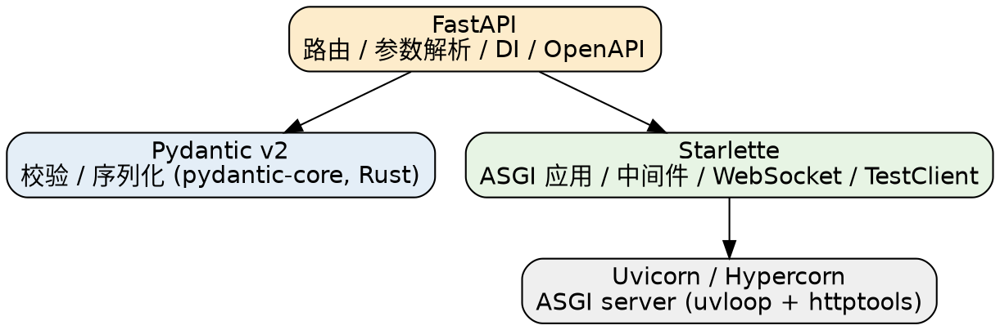

# FastAPI

## Introduction

FastAPI 是一个用于构建 API 的现代、快速（高性能）的 Web 框架，专为 Python 设计。它充分利用 Python 3.6+ 的类型提示（Type Hints）特性：函数签名的类型注解同时承担**参数解析、数据校验、序列化与 OpenAPI 文档生成**，是目前 Python 生态最主流的 API 框架之一。

核心特性：

- **高性能**：基于 ASGI，性能接近 Node.js 与 Go（[TechEmpower](https://www.techempower.com/benchmarks/) Python 框架第一梯队）。
- **类型即契约**：注解驱动参数解析 / 校验 / 序列化 / 文档，编辑器补全友好、样板代码少。
- **异步原生**：`async def` 跑在事件循环上、`def` 自动进线程池，且原生支持 WebSocket。

> [!NOTE]
>
> 消歧：FastAPI 是一个**应用层 Web 框架**，自身很薄——它建立在 [Starlette](/docs/CS/Framework/FastAPI/Architecture.md)（ASGI 基石）与 [Pydantic v2](/docs/CS/Framework/FastAPI/Request_and_Response.md)（校验/序列化）之上，服务器另用 Uvicorn / Hypercorn。它与 [Django](/docs/CS/Framework/Django.md) 的分工差异是"路由层薄、契约绑在类型系统" vs "ORM/admin/auth/migration 一体化"，选型对照见 [Python/Ecosystem](/docs/CS/Python/Ecosystem.md)。FastAPI **不自带 ORM**，数据层要自己选型（见 [Data Layer](/docs/CS/Framework/FastAPI/Data_Layer.md)）。

## Version Baseline

| 项 | 值 |
| :--- | :--- |
| 版本 | 0.146.0（2026-10，MIT） |
| Python | >= 3.10（0.129.0 起弃 3.9；支持 3.10 – 3.14） |
| 核心依赖 | Starlette（Web / ASGI 基石）、Pydantic v2（校验与序列化） |
| 服务器 | Uvicorn / Hypercorn（ASGI server） |

版本基线：**0.146.0（2026-10）**。自 0.100+ 起 Pydantic v2 为默认校验/序列化引擎（底层 `pydantic-core` 用 Rust 实现），Starlette 提供 ASGI 应用、中间件、WebSocket 与 TestClient。FastAPI 迭代极快（月均数十个补丁版），生产环境务必 pin 版本，不要无锁安装 latest。

## Quick Start

官方推荐装 `standard` extra——它把 FastAPI CLI 与 Uvicorn 一并带上：

```shell
uv add "fastapi[standard]"
```

只装最小依赖（自己管理 ASGI server）时：

```shell
uv add fastapi uvicorn
```

生成项目骨架用独立包 `fastapi-new`（注意：它**不是** `fastapi new` 子命令，而是单独的可执行工具）：

```shell
uvx fastapi-new awesomeapp   # 生成到新目录 awesomeapp
cd awesomeapp
uv run fastapi dev
```

最小程序 `main.py`：

```py
from fastapi import FastAPI

app = FastAPI()

@app.get("/")
async def read_root():
    return {"message": "Hello World"}

@app.get("/items/{item_id}")
async def read_item(item_id: int, q: str = None):
    # item_id 自动转 int；非法值返回 422
    return {"item_id": item_id, "q": q}
```

启动：`uvicorn main:app --reload`（`main:app` 指 `main.py` 的 `app`；`--reload` 仅开发用）。

### FastAPI CLI

`fastapi[standard]` 装上 `fastapi-cli`（0.0.32），封装 Uvicorn，提供两个子命令：

| 命令 | 监听地址 | auto-reload | `FASTAPI_ENV` |
| :--- | :--- | :--- | :--- |
| `fastapi dev` | `127.0.0.1` | 开启（默认） | 设为 `development`（已存在则保留） |
| `fastapi run` | `0.0.0.0` | 关闭（默认） | **不修改** |

CLI 自动探测 `main.py` 的 `app`，也可用 `--entrypoint` 显式指定；推荐写进 `pyproject.toml` 让外部工具也能发现入口：

```toml
[tool.fastapi]
entrypoint = "backend.main:app"
```

`fastapi run` 默认监听 `0.0.0.0`（容器里直接可用），但它**不**把 `FASTAPI_ENV` 设为 `production`——需区分环境的应用要自己显式设置该环境变量。

## Architecture Overview

FastAPI 的"薄"体现在分层：它只负责路由、参数解析、依赖注入与文档生成，真正的 Web/ASGI 能力与校验能力来自 Starlette 与 Pydantic。请求链路、中间件、lifespan、CORS 与 ASGI vs WSGI 的取舍集中在 [Architecture](/docs/CS/Framework/FastAPI/Architecture.md)。



## Request Handling

FastAPI 的"类型即契约"全部发生在请求处理这一层。参数从哪来（路径 / 查询 / 请求体 / Header / Cookie / 表单）、如何用 Pydantic 建模请求体与响应、如何用 `APIRouter` 拆分路由，三件事是写业务 handler 的前置知识：

- [Routing](/docs/CS/Framework/FastAPI/Routing.md)：`APIRouter` 的 `prefix` / `tags` / `status_code` / `responses`，以及 `include_router` 的装配方式。
- [Request and Response](/docs/CS/Framework/FastAPI/Request_and_Response.md)：Pydantic `BaseModel` 请求体、参数来源表、`response_model` 字段过滤，以及 Pydantic v2 的 `Annotated` + `Field` 约束写法。
- [Dependency Injection](/docs/CS/Framework/FastAPI/Dependency_Injection.md)：`Depends` 做横切（鉴权、DB 会话、分页），含嵌套依赖与测试期 `dependency_overrides`。

## Data and Persistence

FastAPI **不内置 ORM**——这是它与 Django 最实质的差异。社区主流组合是 SQLAlchemy 2.0 + Alembic，二者构成"ORM 模型面向库、Pydantic 模型面向 API 契约"的双层：

- [Data Layer](/docs/CS/Framework/FastAPI/Data_Layer.md)：`async_sessionmaker` 异步会话、声明式模型、2.0 风格 `select` 查询，以及 Alembic 迁移的 `--autogenerate` 边界。

## Security

鉴权在 FastAPI 里被拆成"按标准方式提取凭证"与"自己写校验逻辑"两层，没有内置 auth 后端：

- [Security](/docs/CS/Framework/FastAPI/Security.md)：`fastapi.security` 的提取器（`HTTPBearer` / `APIKey*` / `OAuth2*`）、JWT 接 `PyJWT` / `python-jose`，与 Django 自带 session+auth 的对照。

## Async and Real-time

路由用 `async def` 还是普通 `def`、何时会卡住事件循环、以及原生 WebSocket 的鉴权与多 worker 限制，都属于"异步运行时"话题：

- [Async and WebSockets](/docs/CS/Framework/FastAPI/Async_and_WebSockets.md)：`async def` vs `def`（线程池）、不要在 async 里调阻塞库、WebSocket 的连接模型与跨 worker 状态外置。

## Robustness and Quality

错误如何表达、测试如何驱动异步路由、以及请求返回后同进程的后处理，是工程化落地的三块：

- [Error Handling](/docs/CS/Framework/FastAPI/Error_Handling.md)：`HTTPException` 与 422（校验失败）vs 400、自定义异常处理器统一错误 envelope。
- [Testing](/docs/CS/Framework/FastAPI/Testing.md)：Starlette `TestClient`、依赖覆盖 `dependency_overrides`、用 `httpx.ASGITransport` 做异步测试。
- [Background Tasks](/docs/CS/Framework/FastAPI/Background_Tasks.md)：`BackgroundTasks` 的轻量后处理定位，以及它与 Celery / broker 队列的边界。

## Operations

配置收敛、可观测性端点、部署形态是上线前必定的事：

- [Configuration and Observability](/docs/CS/Framework/FastAPI/Configuration_and_Observability.md)：`pydantic-settings` 收敛环境变量、健康检查、结构化日志、`prometheus-client` 指标、OpenTelemetry 追踪。
- [Deployment](/docs/CS/Framework/FastAPI/Deployment.md)：Uvicorn 多 worker（spawn）、Gunicorn 的 `uvicorn-worker` / 原生 `asgi` worker、容器化（每容器单 worker）、Nginx 反代、交互文档的开关。

## API Contract

OpenAPI schema 是 FastAPI 的**契约产物**，不只是文档——SDK、网关、测试都从它派生：

- [OpenAPI and SDK Generation](/docs/CS/Framework/FastAPI/OpenAPI_and_SDK.md)：`title` / `openapi_tags` / `openapi_extra` 定制、统一错误响应、以及从 `/openapi.json` 生成多语言客户端。

## Links

- [Python README](/docs/CS/Python/README.md)
- [Typing](/docs/CS/Python/Typing.md)
- [Asyncio](/docs/CS/Python/Asyncio.md)
- [Django](/docs/CS/Framework/Django.md)
- [Data Layer](/docs/CS/Framework/FastAPI/Data_Layer.md)
- [Starlette 文档](https://www.starlette.io/)

## References

- [FastAPI 官方文档](https://fastapi.tiangolo.com/)
- [FastAPI CLI 文档](https://fastapi.tiangolo.com/fastapi-cli/)
- [Starlette 文档](https://www.starlette.io/)
- [Pydantic 文档](https://docs.pydantic.dev/)
- [Uvicorn 文档](https://www.uvicorn.org/)
