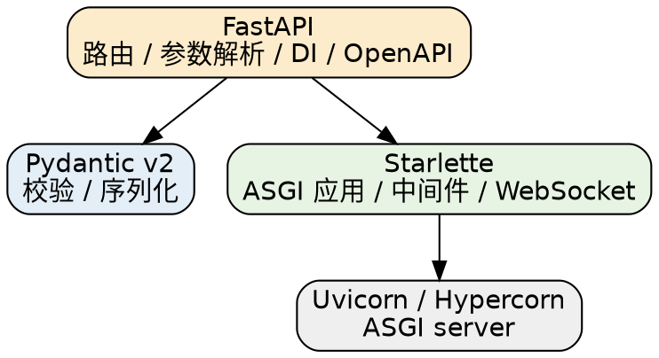

## Introduction

FastAPI 是一个**应用层**框架，自身很薄——它把真正的 Web/ASGI 能力与校验/序列化能力下放给两个下层库。理解分层是理解其余所有机制（路由、参数解析、依赖注入、WebSocket、中间件）的前提：FastAPI 只在上层编排，底层行为由 Starlette 与 Pydantic 决定。

## Layered Stack

| 层 | 组件 | 职责 |
| :--- | :--- | :--- |
| 应用层 | FastAPI | 路由、参数解析、依赖注入、OpenAPI 文档 |
| 数据层 | Pydantic v2 | 类型校验、序列化（底层用 Rust 实现的 pydantic-core） |
| Web 层 | Starlette | ASGI 应用、中间件、WebSocket、TestClient |
| 服务器 | Uvicorn / Hypercorn | ASGI server，基于 uvloop + httptools |



## Request Pipeline

一次请求从网卡到响应，经过四层：

```text
HTTP Request
  → Uvicorn (ASGI server, 解析 HTTP)
  → Starlette (路由匹配 / 中间件链)
  → FastAPI (依赖注入 + Pydantic 校验参数)
  → 用户路由函数 (async def / def 线程池)
  → Pydantic 序列化响应
  → HTTP Response
```


与传统 WSGI（Flask + Gunicorn 同步模型）不同，**ASGI 原生支持异步、WebSocket 和长连接**，请求不再被"一个请求一个线程"的模型限制。这也是 [FastAPI](/docs/CS/Framework/FastAPI.md) 与 [Django](/docs/CS/Framework/Django.md) 在运行模型上的根本分野：Django 经典部署仍是 WSGI 同步，FastAPI 生来 ASGI。

## Middleware and Lifespan

中间件在 Starlette 层以"洋葱"方式包裹每个请求，适合注入处理时间、请求 ID、CORS 头等横切逻辑：

```py
import time
from fastapi import Request

@app.middleware("http")
async def add_process_time_header(request: Request, call_next):
    start = time.perf_counter()
    response = await call_next(request)
    response.headers["X-Process-Time"] = str(time.perf_counter() - start)
    return response
```

跨请求的资源（连接池、模型加载）推荐用 `lifespan` 在启动时初始化、关闭时释放，而不是模块级全局变量——多 worker（spawn）下模块级全局不会在 worker 间共享，且 lifespan 能正确处理启动失败与优雅关闭。

## CORS

跨域由 Starlette 的 `CORSMiddleware` 处理，FastAPI 只是转接：

```py
from fastapi.middleware.cors import CORSMiddleware

app.add_middleware(
    CORSMiddleware,
    allow_origins=["https://example.com"],
    allow_methods=["*"],
    allow_headers=["*"],
)
```

`allow_origins` 在生产环境务必显式枚举，不要用 `["*"]` 配合 `allow_credentials=True`（浏览器会拒绝这种组合）。

## Links

- [FastAPI](/docs/CS/Framework/FastAPI.md)
- [Request and Response](/docs/CS/Framework/FastAPI/Request_and_Response.md)
- [Routing](/docs/CS/Framework/FastAPI/Routing.md)
- [Async and WebSockets](/docs/CS/Framework/FastAPI/Async_and_WebSockets.md)
- [Deployment](/docs/CS/Framework/FastAPI/Deployment.md)
- [Django](/docs/CS/Framework/Django.md)

## References

- [Starlette 文档](https://www.starlette.io/)
- [Uvicorn 文档](https://www.uvicorn.org/)
- [Pydantic 文档](https://docs.pydantic.dev/)
