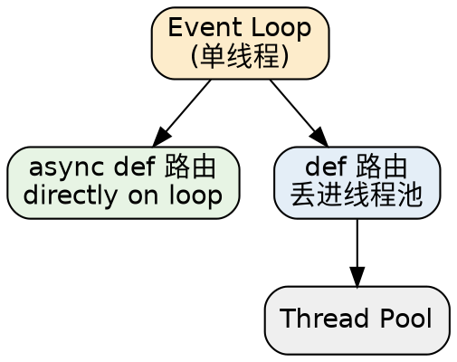

## Introduction

FastAPI 同时支持 `async def` 和普通 `def` 路由，二者的调度方式不同；原生 WebSocket 则由 Starlette 提供，无需像 [Django](/docs/CS/Framework/Django.md) 那样另引第三方 Channels。二者共同点是"都跑在 ASGI 异步运行时上"，属于同一类话题。

## async def vs def

- **`async def`**：路由内要 await 异步库（如 asyncpg、httpx.AsyncClient）时使用，全程跑在事件循环上，吞吐高。
- **普通 `def`**：FastAPI 自动放到线程池执行，避免阻塞事件循环——如果内部调用同步阻塞库（如 psycopg2、requests），用普通函数更稳妥。



> [!WARNING]
>
> 不要在 `async def` 里调用阻塞型同步库（如 `requests.get`、psycopg2 同步调用），否则会卡住**整个 worker** 的事件循环，拖垮所有并发请求。同步库就用 `def` 路由（自动进线程池），或换成对应的异步驱动（`httpx.AsyncClient`、asyncpg、aiomysql）。
>
> Python 协程原理见 [Asyncio](/docs/CS/Python/Asyncio.md) 与 [Concurrency](/docs/CS/SE/Concurrency.md)。

## WebSockets

FastAPI 原生支持 WebSocket（由 Starlette 提供），无需另引 Channels——这是与 Django 在「实时/长连接」场景上的关键差异：

```py
from fastapi import FastAPI, WebSocket

@app.websocket("/ws")
async def websocket_endpoint(websocket: WebSocket):
    await websocket.accept()
    while True:
        data = await websocket.receive_text()
        await websocket.send_text(f"echo: {data}")
```

要点：

- ASGI 天然双向，连接建立后由 `await` 驱动收发，不占线程。
- 适合推送、聊天、实时仪表盘等场景；**多 worker 下连接状态要放外部存储**（如 Redis 发布/订阅）而非进程内存，否则连到另一个 worker 的请求读不到状态。
- 鉴权可在 `accept()` 前读取 `websocket.headers` / `query_params` 自行校验（注意：WebSocket 的鉴权不走普通 HTTP 中间件链，需自己处理）。

## Links

- [FastAPI](/docs/CS/Framework/FastAPI.md)
- [Architecture](/docs/CS/Framework/FastAPI/Architecture.md)
- [Dependency Injection](/docs/CS/Framework/FastAPI/Dependency_Injection.md)
- [Security](/docs/CS/Framework/FastAPI/Security.md)
- [Asyncio](/docs/CS/Python/Asyncio.md)
- [Django](/docs/CS/Framework/Django.md)

## References

- [FastAPI 官方文档：Async](https://fastapi.tiangolo.com/async/)
- [FastAPI 官方文档：WebSockets](https://fastapi.tiangolo.com/tutorial/websockets/)
- [Starlette 文档：WebSockets](https://www.starlette.io/websockets/)
