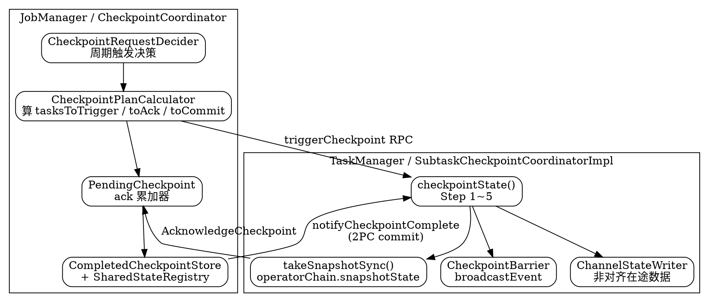

## Introduction

Checkpoint（检查点）是 Flink 容错的基石：**周期性地对整条流做一次全局一致快照**，把每个算子的 [State](/docs/CS/Framework/Flink/State.md) 与 Source 的读取位置一起持久化到远端存储。作业失败后，从最近一次成功的 checkpoint 恢复状态、从对应位置重放数据，从而做到"像没发生过一样"。

它与 [JobManager](/docs/CS/Framework/Flink/JobManager.md) 的 CheckpointCoordinator 协同工作：协调器在 Source 注入 barrier、收集各 Task 的 ack、全部成功后标记该 checkpoint 为 complete。

> [!NOTE]
> 版本基线（2026-11-23 核实）：Flink **2.3.0**（tag `release-2.3.0`，commit `c0f8d1a1e09f209885a88f9c19ceb9d9e9870283`，2026-06-25 发布）。本页源码片段均取自该 tag，路径相对仓库根目录，不带行号。

三个容易理解错的点：

- **Coordinator 不直接碰状态**：它只管 id、计划、ack、元数据；真正的状态快照在 Task 侧完成，经 `CheckpointStorage` 写远端。
- **barrier 不是 Coordinator 发进数据流的**：Coordinator 给每个 source task 发 `triggerCheckpoint` RPC，barrier 由 Task 侧的 `operatorChain.broadcastEvent()` 注入并随数据流传播。
- **ack 不等于完成**：所有 task ack 只是让 `PendingCheckpoint` 变成 `CompletedCheckpoint` 的前提，还要经过 `finalizeCheckpoint()` 写元数据 + 通知提交，2PC sink 的 commit 通知也在这一步。

## Two Sides, One Protocol



## How Snapshots Work: Barrier Alignment

Flink 用的是 Chandy-Lamport 分布式快照算法的变体，靠插入数据流的特殊记录 **checkpoint barrier** 来划分"属于本次快照"与"属于下次快照"的数据：

1. **注入**：CheckpointCoordinator 要求各 Source 在各自的 offset 处插入带编号的 barrier，并把自己的 offset 记入快照；
2. **广播与传递**：barrier 随数据往下流，每个算子收到 barrier 时对自己的状态做快照，然后向下游转发；
3. **对齐（alignment）**：多输入算子（如 `join`、`union`）必须等**所有**输入通道的 barrier 都到齐才做快照。先到的通道被**阻塞**，其后续数据缓存在缓冲区，避免污染本次快照；
4. **确认**：所有算子快照完成（异步上传到远端存储）后向协调器 ack，协调器收到全部 ack 才认为该 checkpoint 成功。

对齐保证了"快照里不含跨边界的脏数据"，代价是：

> 对齐期间被阻塞的通道不处理数据，**反压严重时对齐时间可能长到 checkpoint 超时**。

## Trigger Chain

周期触发的入口是 `startCheckpointScheduler()`，它把第一次触发延迟设为 `triggerDelay`（首次为配置的初始延迟，重启调度器后取 `minPauseBetweenCheckpoints`），之后每次触发都重新排期：

```java
public void startCheckpointScheduler() {
    synchronized (lock) {
        if (shutdown) { throw new IllegalArgumentException("Checkpoint coordinator is shut down"); }
        Preconditions.checkState(isPeriodicCheckpointingConfigured(),
                "Can not start checkpoint scheduler, if no periodic checkpointing is configured");
        if (isPeriodicCheckpointingStarted()) {
            stopCheckpointScheduler();
        }
        periodicScheduling = true;
        scheduleTriggerWithDelay(clock.relativeTimeMillis(), triggerDelay);
        // minimize delay for subsequent restarts of checkpoint scheduler
        triggerDelay = minPauseBetweenCheckpoints;
    }
}
```

`triggerCheckpoint()` 把请求交给 `chooseRequestToExecute()` 做并发门控（受 `max-concurrent-checkpoints` 与 `min-pause` 约束），被选中的请求才进入 `startTriggeringCheckpoint()`：

```java
CompletableFuture<CompletedCheckpoint> triggerCheckpoint(
        CheckpointProperties props,
        @Nullable String externalSavepointLocation,
        boolean isPeriodic) {
    CheckpointTriggerRequest request =
            new CheckpointTriggerRequest(props, externalSavepointLocation, isPeriodic);
    chooseRequestToExecute(request).ifPresent(this::startTriggeringCheckpoint);
    return request.onCompletionPromise;
}
```

`startTriggeringCheckpoint()` 是一条异步链，顺序有讲究——**先 OperatorCoordinator、再 master hook、最后 task**，注释里写明了原因：若用 `ExternallyInducedSource`，task 必须晚于 coordinator 快照：

```java
CompletableFuture<CheckpointPlan> checkpointPlanFuture =
        checkpointPlanCalculator.calculateCheckpointPlan();

final CompletableFuture<PendingCheckpoint> pendingCheckpointCompletableFuture =
        checkpointPlanFuture
                .thenApplyAsync(plan -> {
                    long checkpointID = checkpointIdCounter.getAndIncrement();
                    return new Tuple2<>(plan, checkpointID);
                }, executor)
                .thenApplyAsync(
                        checkpointInfo -> createPendingCheckpoint(
                                timestamp, request.props, checkpointInfo.f0,
                                request.isPeriodic, checkpointInfo.f1,
                                request.getOnCompletionFuture(),
                                masterTriggerCompletionPromise),
                        timer);
```

注意获取 checkpointID 与 HA 存储交互被特意放在 **coordinator-wide lock 之外**（源码注释：*this must happen outside the coordinator-wide lock, because it communicates with external services (in HA mode) and may block for a while*）——这是高频 checkpoint 下不阻塞 ack 处理的关键。

## PendingCheckpoint: The Ack Accumulator

`createPendingCheckpoint()` 在锁内二次检查全局状态，然后构造 `PendingCheckpoint`，它由三元组决定"谁要触发 / 谁要 ack / 谁要提交"：

```java
PendingCheckpointStats pendingCheckpointStats =
        trackPendingCheckpointStats(checkpointID, checkpointPlan, props, timestamp);

final PendingCheckpoint checkpoint =
        new PendingCheckpoint(
                job, checkpointID, timestamp, checkpointPlan,
                OperatorInfo.getIds(coordinatorsToCheckpoint),
                masterHooks.keySet(), props, onCompletionPromise,
                pendingCheckpointStats, masterTriggerCompletionPromise);
```

真正发给 task 的触发消息带上 `CheckpointOptions`，把对齐模式、目标存储位置、超时等一次性序列化进 RPC。是否强制 full snapshot 也在这里决策：

```java
final SnapshotType type;
if (this.forceFullSnapshot && !request.props.isSavepoint()) {
    type = FULL_CHECKPOINT;
} else {
    type = request.props.getCheckpointType();
}
final CheckpointOptions checkpointOptions =
        CheckpointOptions.forConfig(
                type,
                checkpoint.getCheckpointStorageLocation().getLocationReference(),
                isExactlyOnceMode,
                unalignedCheckpointsEnabled,
                alignedCheckpointTimeout);

List<CompletableFuture<Acknowledge>> acks = new ArrayList<>();
for (Execution execution : checkpoint.getCheckpointPlan().getTasksToTrigger()) {
    if (request.props.isSynchronous()) {
        acks.add(execution.triggerSynchronousSavepoint(
                checkpointId, timestamp, checkpointOptions));
    } else {
        acks.add(execution.triggerCheckpoint(checkpointId, timestamp, checkpointOptions));
    }
}
return FutureUtils.waitForAll(acks);
```

> [!NOTE]
> `tasksToTrigger` 通常只是 source 任务——barrier 由它们注入，再随数据自然传播到全拓扑。这也是为什么 checkpoint 耗时与算子链深度、反压状况相关，而不是与 task 数量线性相关。

## Acknowledgment

Task 完成后回送 `AcknowledgeCheckpoint`。`receiveAcknowledgeMessage()` 在锁内处理，其中 shared state 注册**先于** ack 结果判断——注释解释了这是为了让迟到消息或已被 task 使用的共享状态也能被正确登记并最终回收：

```java
final PendingCheckpoint checkpoint = pendingCheckpoints.get(checkpointId);

if (message.getSubtaskState() != null) {
    // Register shared state regardless of checkpoint state and task ACK state.
    // ... removed if checkpoint is late or state will be used by the task otherwise
    if (checkpoint == null || !checkpoint.getProps().isSavepoint()) {
        message.getSubtaskState()
                .registerSharedStates(
                        completedCheckpointStore.getSharedStateRegistry(), checkpointId);
    }
}

if (checkpoint != null && !checkpoint.isDisposed()) {
    switch (checkpoint.acknowledgeTask(
            message.getTaskExecutionId(),
            message.getSubtaskState(),
            message.getCheckpointMetrics())) {
        case SUCCESS:
            if (checkpoint.isFullyAcknowledged()) {
                completePendingCheckpoint(checkpoint);
            }
            break;
        case DUPLICATE:  // ...
        case UNKNOWN:    // 丢弃 state handle，避免泄漏
    }
}
```

只有 `acknowledgeTask()` 返回 `SUCCESS` 且 `isFullyAcknowledged()` 才进入完成流程。重复 ack、未知 execution attempt 都有独立分支——后者会主动丢弃状态句柄避免状态残留。

## Completion and Commit Phase

`completePendingCheckpoint()` 把 Pending 变成 Completed，写进 store，并触发下游提交通知：

```java
private void completePendingCheckpoint(PendingCheckpoint pendingCheckpoint)
        throws CheckpointException {
    final long checkpointId = pendingCheckpoint.getCheckpointID();
    final CompletedCheckpoint completedCheckpoint;
    final CheckpointProperties props = pendingCheckpoint.getProps();

    completedCheckpointStore.getSharedStateRegistry().checkpointCompleted(checkpointId);

    completedCheckpoint = finalizeCheckpoint(pendingCheckpoint);
    Preconditions.checkState(pendingCheckpoint.isDisposed() && completedCheckpoint != null);

    if (!props.isSavepoint()) {
        addCompletedCheckpointToStoreAndSubsumeOldest(
                checkpointId, completedCheckpoint, pendingCheckpoint);
    }
    reportCompletedCheckpoint(completedCheckpoint);
    pendingCheckpoint.getCompletionFuture().complete(completedCheckpoint);
    // ... finally: pendingCheckpoints.remove(checkpointId); scheduleTriggerRequest();
}
```

提交通知在 `cleanupAfterCompletedCheckpoint()` 里发给 `tasksToCommitTo`——这就是 **2PC sink 的 commit 阶段**，`notifyCheckpointComplete` 到达时 sink 才真正提交外部事务：

```java
if (!props.isSavepoint() || props.isSynchronous()) {
    dropSubsumedCheckpoints(checkpointId);
    // send the "notify complete" call to all vertices, coordinators, etc.
    sendAcknowledgeMessages(
            pendingCheckpoint.getCheckpointPlan().getTasksToCommitTo(),
            checkpointId,
            completedCheckpoint.getTimestamp(),
            extractIdIfDiscardedOnSubsumed(lastSubsumed));
}
```

> [!WARNING]
> 2PC 的可见性延迟来自这里：sink 预提交后必须等 coordinator 收齐所有 ack、写完元数据、再回送通知。因此 checkpoint 间隔就是端到端延迟下限，而不是一个可调的 sink 参数。

## Aligned vs Unaligned

| 维度 | Aligned（对齐，默认） | Unaligned（非对齐） |
| ---- | ---- | ---- |
| 做法 | 等所有输入 barrier 到齐，阻塞快通道 | 首个 barrier 到达即"超越"排队数据并立即向下转发，被超越的在途数据一并写进快照 |
| 快照体积 | 只含算子状态 | 额外含在途数据（in-flight），**快照更大** |
| 适用场景 | 常态、无严重反压 | 存在慢通道、对齐超时（日志里出现 alignment timeout） |
| 恢复 | 直接装载状态 | 先恢复在途数据再处理上游数据 |
| 开启方式 | 默认 | `execution.checkpointing.unaligned.enabled=true`（Flink 1.11 起提供，也支持按对齐超时自动切换） |

配套的三个优化：

- **Buffer Debloating**（Flink 1.14 起）：根据当前吞吐动态调节网络缓冲区大小，减少对齐阶段需排队的数据量，降低对齐耗时；
- **Changelog / 日志化增量检查点**（Flink 1.15 起）：状态变更持续写入 changelog（DSTL）并立即持久化，算子在 log 落盘后即可 ack，快照文件在后台周期性物化。它把"checkpoint 时长"与"状态大小"解耦，让 checkpoint 时长更稳定；
- **恢复期间触发 checkpoint**（Flink 2.3 / FLIP-547）：大状态作业用非对齐 checkpoint 恢复时，重放在途数据的过程可能很长，期间若再失败只能从头重放。2.3 允许在恢复阶段就触发新的 checkpoint，把已经重放的部分固化成新的恢复点。

```java
env.enableCheckpointing(30_000);                                  // 30s 一次
env.getCheckpointConfig().setCheckpointingMode(CheckpointingMode.EXACTLY_ONCE);
env.getCheckpointConfig().setMinPauseBetweenCheckpoints(10_000);  // 两次之间至少间隔 10s
env.getCheckpointConfig().setCheckpointTimeout(120_000);
env.getCheckpointConfig().setExternalizedCheckpointCleanup(
        ExternalizedCheckpointCleanup.RETAIN_ON_CANCELLATION);    // 取消作业后保留快照
env.getCheckpointConfig().enableUnalignedCheckpoints();           // 反压严重时可开
```

## Task Side: The Six-Step checkpointState()

Task 侧的权威流程直接写在 `SubtaskCheckpointCoordinatorImpl.checkpointState()` 的注释与步骤编号里，比任何二手资料都准：

```java
public void checkpointState(
        CheckpointMetaData metadata,
        CheckpointOptions options,
        CheckpointMetricsBuilder metrics,
        OperatorChain<?, ?> operatorChain,
        boolean isTaskFinished,
        Supplier<Boolean> isRunning)
        throws Exception {
    // All of the following steps happen as an atomic step from the perspective of barriers and
    // records/watermarks/timers/callbacks.
    // We generally try to emit the checkpoint barrier as soon as possible to not affect downstream
    // checkpoint alignments
    // ...
    // Step (0): Record the last triggered checkpointId and abort the sync phase of checkpoint
    //           if necessary.
    // Step (1): Prepare the checkpoint, allow operators to do some pre-barrier work.
    operatorChain.prepareSnapshotPreBarrier(metadata.getCheckpointId());
    // Step (2): Send the checkpoint barrier downstream
    CheckpointBarrier checkpointBarrier =
            new CheckpointBarrier(metadata.getCheckpointId(), metadata.getTimestamp(), options);
    operatorChain.broadcastEvent(checkpointBarrier, options.isUnalignedCheckpoint());
    // Step (3): Register alignment timer to timeout aligned barrier to unaligned barrier
    registerAlignmentTimer(metadata.getCheckpointId(), operatorChain, checkpointBarrier);
    // Step (4): Prepare to spill the in-flight buffers for input and output
    if (options.needsChannelState()) {
        channelStateWriter.finishOutput(metadata.getCheckpointId());
    }
    // Step (5): Take the state snapshot. This should be largely asynchronous.
    Map<OperatorID, OperatorSnapshotFutures> snapshotFutures = ...
    if (takeSnapshotSync(snapshotFutures, metadata, metrics, options, operatorChain, isRunning)) {
        finishAndReportAsync(snapshotFutures, metadata, metrics, ...);
    }
}
```

几个实现细节值得注意：

- Step 0 用 `lastCheckpointId >= metadata.getCheckpointId()` 拦住乱序 barrier，并广播 `CancelCheckpointMarker` 防止下游一直等一个不会来的 barrier，避免对齐造成反压；
- Step 3 的 alignment timer 只对 `isTimeoutable()` 的 checkpoint 注册，超时回调 `operatorChain.alignedBarrierTimeout(checkpointId)` 把对齐 checkpoint 转成非对齐；
- `FORCED_ALIGNED`（pointwise 连接强制对齐）会先 `withUnalignedSupported()` 回退，注释说明是为了让它能跳过输出数据。

## The Barrier Itself

`CheckpointBarrier` extends `RuntimeEvent`，只有三个字段：`id`、`timestamp`、`checkpointOptions`。它的序列化不走普通 `write()/read()`——那两个方法直接抛 `UnsupportedOperationException`，由 `EventSerializer` 特判：

```java
@Override
public void write(DataOutputView out) throws IOException {
    throw new UnsupportedOperationException("This method should never be called");
}

@Override
public void read(DataInputView in) throws IOException {
    throw new UnsupportedOperationException("This method should never be called");
}

public CheckpointBarrier asUnaligned() {
    return checkpointOptions.isUnalignedCheckpoint()
            ? this
            : new CheckpointBarrier(
                    getId(), getTimestamp(), getCheckpointOptions().toUnaligned());
}
```

类注释给出了对齐的定义：barrier ID **严格单调递增**；算子从某个 input channel 收到 barrier 就知道这是 checkpoint 前/后的分界点；从**所有** input channel 收到后才能触发本地快照并向下游广播；exactly-once 语义下会在快照完成前**扣住** checkpoint 后的数据。这正是"barrier 对齐"的源码级表述。

## Consistency Semantics

| 语义 | 含义 | 代价 |
| ---- | ---- | ---- |
| At-most-once | 失败即丢，不重放 | 最快，不保证正确性 |
| At-least-once | 重放保证不丢，可能重复 | 无需 barrier 对齐，开销低 |
| Exactly-once | 不丢不重，结果如同只处理过一次 | 需要对齐开销 + sink 侧配合 |

**Flink 内部的 exactly-once 不等于端到端 exactly-once**。内部状态靠 checkpoint 保证；而"输出到外部系统"还需要两件事之一：

1. **幂等写入**：sink 侧按主键覆盖（Redis、HBase、带主键的 Upsert Kafka / 湖表），重复写无害；
2. **两阶段提交（2PC）**：`TwoPhaseCommitSinkFunction` 在预提交阶段把数据写进外部事务（如 Kafka 事务），只有当 JobManager 确认全局 checkpoint 完成后才正式提交；失败则回滚。代价是输出的可见性被推迟到 checkpoint 完成，因此**checkpoint 间隔直接决定端到端延迟**。

## Savepoint vs Checkpoint

| 维度 | Checkpoint | Savepoint |
| ---- | ---- | ---- |
| 触发 | Flink 自动、周期性 | 用户手动触发（CLI / REST / 停止作业时） |
| 目的 | 故障自动恢复 | 计划性运维：版本升级、改并行度、迁移集群、A/B 双跑 |
| 格式 | 高度优化、可能依赖具体实现 | 更规范（canonical），跨版本兼容性更好 |
| 生命周期 | 默认由 Flink 管理（作业取消时可配置保留或清理） | 完全由用户管理 |
| 是否对齐 | 可非对齐 | **始终对齐** |

使用 savepoint 的两个硬约束：

- 算子必须**显式设置 uid**（`uid("my-source")`），否则作业拓扑改变后 Flink 无法把状态映射回算子；
- 拓扑变化过大时用 `--allow-non-restored-state` 允许丢弃无法匹配的状态，但要清楚这意味着那部分状态从零开始。

1.x → 2.x 的升级不能依赖 savepoint 直接恢复（状态不兼容），这是 [State](/docs/CS/Framework/Flink/State.md) 里已经标注的风险。

## Recovery

```
作业失败 / 手动从快照启动
  → JobMaster 选择最近一次 completed checkpoint
  → 按并行度把 key-group 重新分配到 TaskManager 的 Slot
  → 各 Task 从远端存储装载本地状态（RocksDB 后端需先重建本地实例）
  → Source 从快照记录的 offset（operator state）开始重放
  → 非对齐快照还需先重放在途数据
  → 作业进入 RUNNING
```

恢复时间 ≈ 状态下载/重建时间 + 重放时间。大状态作业的优化方向：增量 checkpoint（RocksDB）、分离式状态后端（2.x，无需搬运本地状态）、合理设置 checkpoint 间隔以控制重放量。

`completedCheckpointStore` 仍维护已完成 checkpoint 列表，share state 的生命周期由 `SharedStateRegistry` 管；`addCompletedCheckpointToStoreAndSubsumeOldest` 负责淘汰最旧的一个。

### Choosing the Recovery Path in Source

上面是"从快照恢复"的通用流程，但**失败后重启哪些 Task** 由 `FailoverStrategy` 决定；而"要不要触发新 checkpoint"另有开关。这两件事在旧资料里常被混为一谈。

> [!NOTE]
> 版本基线：Flink **2.3.0**（tag `release-2.3.0`）。下文源码片段均取自该 tag，路径相对仓库根目录，不带行号。

`FailoverStrategy` 接口只问一个问题——给定失败的 vertex，哪些 vertex 要重启（注意参数 `cause` 是可用的）：

```java
/** New interface for failover strategies. */
public interface FailoverStrategy {

    /**
     * Returns a set of IDs corresponding to the set of vertices that should be restarted.
     */
    Set<ExecutionVertexID> getTasksNeedingRestart(
            ExecutionVertexID executionVertexId, Throwable cause);
}
```

两种策略，由 `jobmanager.execution.failover-strategy` 选择（ `"full"` / `"region"`，其它值直接抛 `IllegalConfigurationException`）：

```java
switch (strategyParam.toLowerCase()) {
    case FULL_RESTART_STRATEGY_NAME:
        return new RestartAllFailoverStrategy.Factory();

    case PIPELINED_REGION_RESTART_STRATEGY_NAME:
        return new RestartPipelinedRegionFailoverStrategy.Factory();

    default:
        throw new IllegalConfigurationException("Unknown failover strategy: " + strategyParam);
}
```

- **full**：不看 cause，直接返回拓扑里所有 vertex：
```java
public Set<ExecutionVertexID> getTasksNeedingRestart(
        ExecutionVertexID executionVertexId, Throwable cause) {
    return IterableUtils.toStream(topology.getVertices())
            .map(SchedulingExecutionVertex::getId)
            .collect(Collectors.toSet());
}
```
- **region**：从失败 vertex 所在 pipelined region 出发 BFS，**只有不可用的输入分区才把其 producer region 拉进来**，并把所有 consumer region 纳入——这就是"局部恢复"的边界计算。如果是 `PartitionException`（数据消费错误），先把对应 partition 标记为 failed，恢复后再清掉：
```java
Optional<PartitionException> dataConsumptionException =
        ExceptionUtils.findThrowable(cause, PartitionException.class);
if (dataConsumptionException.isPresent()) {
    resultPartitionAvailabilityChecker.markResultPartitionFailed(
            dataConsumptionException.get().getPartitionId().getPartitionId());
}
// ... compute regions to restart ...
if (dataConsumptionException.isPresent()) {
    resultPartitionAvailabilityChecker.removeResultPartitionFromFailedState(
            dataConsumptionException.get().getPartitionId().getPartitionId());
}
```
处于 `CREATED`（尚未启动）状态的 vertex 会被跳过——不必重启一个还没跑起来的任务。

**恢复不等于立刻开 checkpoint**。`ExecutionTrackingCheckpointCoordinatorDeActivator` 同时跟踪 JobStatus 与每个 Execution 的状态，只有"作业 RUNNING 且所有 task 都不是 pending"才启动周期调度器：

```java
@Override
public void onStateUpdate(
        ExecutionAttemptID execution, ExecutionState previousState, ExecutionState newState) {
    if (newState == ExecutionState.RUNNING || newState == ExecutionState.FINISHED) {
        pendingExecutions.remove(execution);
    } else {
        pendingExecutions.add(execution);
    }
    maybeStartOrStopCheckpointScheduler();
}

private void maybeStartOrStopCheckpointScheduler() {
    if (jobStatus == JobStatus.RUNNING && allTasksRunning()) {
        if (!started) {
            coordinator.startCheckpointScheduler();
        }
    } else if (started) {
        coordinator.stopCheckpointScheduler();
    }
}
```

这解释了 FLIP-547"恢复期也能 checkpoint"为什么要单独设计——默认情况下恢复过程中的 task 处于非 RUNNING 状态，`allTasksRunning()` 为 false，周期 checkpoint 根本不会启动；显式支持恢复期 checkpoint 需要绕过这个闸门。

**重启时的状态选择**集中在 `restoreLatestCheckpointedStateInternal()`：先取 `completedCheckpointStore.getLatestCheckpoint()`，没有 checkpoint 时按 `errorIfNoCheckpoint` 决定报错还是重置 coordinators，有则交给 `StateAssignmentOperation` 分配：

```java
CompletedCheckpoint latest = completedCheckpointStore.getLatestCheckpoint();

if (latest == null) {
    if (errorIfNoCheckpoint) {
        throw new IllegalStateException("No completed checkpoint available");
    }
    // ... reset master hooks and coordinators to empty state ...
    return OptionalLong.empty();
}

this.forceFullSnapshot = latest.getProperties().isUnclaimed();

final Map<OperatorID, OperatorState> operatorStates = extractOperatorStates(latest);
StateAssignmentOperation stateAssignmentOperation =
        new StateAssignmentOperation(
                latest.getCheckpointID(), tasks, operatorStates, allowNonRestoredState, ...);
stateAssignmentOperation.assignStates();
```

`isUnclaimed()` 决定 `forceFullSnapshot`——从"无人认领"的 checkpoint 恢复后，下一次必须做全量快照，避免增量快照的 delta 链建立在错误的基线上。

> [!NOTE]
> `JobResultStore`（`flink-runtime/.../highavailability/`）用 `dirty` / `clean` 两态记录全局终止作业的结果：dirty 表示清理未完成。选主时先查它，防止一个已经完成的作业在 HA 切换后被重新拉起（详见 [JobManager](/docs/CS/Framework/Flink/JobManager.md) 的 Leadership 章节）。

> [!WARNING]
> 旧资料常说 `StateBackend` / `SubtaskCheckpointCoordinatorImpl` 在 `flink-streaming-java` 模块。2.3 源码树里这两个类都在 **`flink-runtime`**（`org.apache.flink.streaming.runtime.tasks` 包名未变，但模块归属变了）。查源码时按类找，不要按旧模块路径找。

## Tuning

- **间隔**：太短则快照开销大，太长则恢复时重放多；事务 sink 场景下间隔 = 端到端延迟下限；
- **超时**：反压下容易超时，先看对齐时间再决定是否开非对齐；
- **并发 checkpoint**：允许多个同时进行可提升恢复点密度，但增加运行时开销；
- **Checkpoint 存储**：与状态后端分离（1.15 起两个概念解耦），生产一般用 HDFS / S3 等分布式存储，而非 JobManager 内存；
- **Web UI 指标**：关注 `Checkpoint Duration`（同步 + 异步阶段）、`Alignment Duration`、`Persisted Data Size`，三者分别对应对齐、上传、状态规模问题。

## Why This Shape

- **为什么 Coordinator 与 Task 分离**：快照需要全局一致的决定（id、计划、何时提交），但数据落在各 Task 本地状态里；把"决策"集中到 Coordinator、"执行"分散到 Task，才能既有一致性又能让落盘并行。
- **为什么用数据流里的 barrier 而不是独立控制信号**：barrier 与记录同序传播，天然携带"哪些数据属于快照前/后"的分界信息；独立的 RPC 无法表达这个顺序关系。
- **为什么 ack 与 commit 分两阶段**：外部 sink 的事务要等全局快照成功后才能提交，否则恢复时出现"状态回到了旧值但事务已提交"的裂脑。
- **为什么 shared state 在 ack 判断前注册**：迟到 ack 里的状态句柄若不被登记，会在 task 仍引用时被清理；先注册、后按 checkpoint 淘汰，是更安全的生命周期顺序。
- **为什么 failover 按 region 而非固定粒度**：pipelined region 恰好是"互相背压、数据不可独立重放"的最小边界；只重启失败 region 及其上下游受影响 region，比 restart-all 省时间，又不会破坏 exactly-once。
- **为什么 checkpoint 调度器要等所有 task RUNNING**：恢复中的 task 状态还在装载，此时触发快照会把不完整的状态写进 completed store；`ExecutionTrackingCheckpointCoordinatorDeActivator` 用双条件闸门把这件事挡住。
- **为什么 unclaimed checkpoint 触发 forceFullSnapshot**：它的 delta 基准没有被任何成功的作业认领，继续做增量会让新作业的状态链挂在不可靠的历史上；强制全量是以一次快照成本换恢复正确性。

## Links

- [Connector](/docs/CS/Framework/Flink/Connector.md)
- [Flink](/docs/CS/Framework/Flink/Flink.md)
- [Time](/docs/CS/Framework/Flink/Time.md)
- [Dataflow](/docs/CS/Framework/Flink/Dataflow.md)
- [TaskManager](/docs/CS/Framework/Flink/TaskManager.md)

## References

1. [Flink Docs - Checkpoints (2.3)](https://nightlies.apache.org/flink/flink-docs-release-2.3/docs/dev/datastream/fault-tolerance/checkpointing/)
2. [Flink Docs - Checkpointing under Backpressure（非对齐检查点与 buffer debloating）](https://nightlies.apache.org/flink/flink-docs-release-2.3/docs/ops/state/checkpoints_vs_savepoints/)
3. [Flink Blog - Improving speed and stability of checkpointing with generic log-based incremental checkpoints](https://flink.apache.org/2022/05/30/improving-speed-and-stability-of-checkpointing-with-generic-log-based-incremental-checkpoints)
4. [Flink Blog - Getting into Low-Latency Gears with Apache Flink, Part Two](https://flink.apache.org/2022/05/23/latency-part2.html)
5. [Flink 2.3.0 Source: CheckpointCoordinator.java](https://github.com/apache/flink/blob/release-2.3.0/flink-runtime/src/main/java/org/apache/flink/runtime/checkpoint/CheckpointCoordinator.java)
6. [Flink 2.3.0 Source: SubtaskCheckpointCoordinatorImpl.java](https://github.com/apache/flink/blob/release-2.3.0/flink-runtime/src/main/java/org/apache/flink/streaming/runtime/tasks/SubtaskCheckpointCoordinatorImpl.java)
7. [Flink 2.3.0 Source: CheckpointBarrier.java](https://github.com/apache/flink/blob/release-2.3.0/flink-runtime/src/main/java/org/apache/flink/runtime/io/network/api/CheckpointBarrier.java)
8. [FLIP-547: Support checkpoint during recovery](https://cwiki.apache.org/confluence/spaces/FLINK/pages/384895569/FLIP-547+Support+checkpoint+during+recovery)
9. [Flink 2.3.0 Source: FailoverStrategy.java](https://github.com/apache/flink/blob/release-2.3.0/flink-runtime/src/main/java/org/apache/flink/runtime/executiongraph/failover/FailoverStrategy.java)
10. [Flink 2.3.0 Source: RestartPipelinedRegionFailoverStrategy.java](https://github.com/apache/flink/blob/release-2.3.0/flink-runtime/src/main/java/org/apache/flink/runtime/executiongraph/failover/RestartPipelinedRegionFailoverStrategy.java)
11. [Flink 2.3.0 Source: ExecutionTrackingCheckpointCoordinatorDeActivator.java](https://github.com/apache/flink/blob/release-2.3.0/flink-runtime/src/main/java/org/apache/flink/runtime/checkpoint/ExecutionTrackingCheckpointCoordinatorDeActivator.java)
12. [Flink 2.3.0 Source: JobResultStore.java](https://github.com/apache/flink/blob/release-2.3.0/flink-runtime/src/main/java/org/apache/flink/runtime/highavailability/JobResultStore.java)
