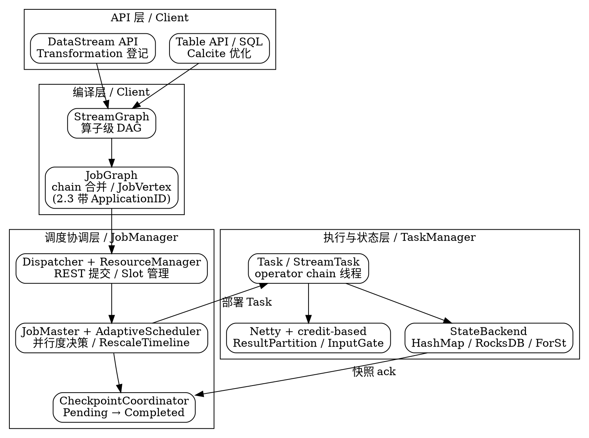

# Flink

## Introduction

Apache Flink 是一个框架和分布式处理引擎，用于对无界和有界数据流进行**状态计算**。基本数据模型是**数据流与事件（Event）序列**；批（batch）被视为"有界的流"，与流共用同一个运行时。

> [!NOTE]
> 版本基线（2026-11-23 核实）：**Flink 2.3.0**（tag `release-2.3.0`，commit `c0f8d1a1e09f209885a88f9c19ceb9d9e9870283`，2026-06-25 发布）是当前最新稳定版，实现了 15 个 FLIP；2.2.x / 2.1.x / 1.20.x 为维护线。2.x 是继 1.x 九年来第一个大版本，与 1.x **状态不兼容**、DataSet API 已移除；升级风险见 [Deployment](/docs/CS/Framework/Flink/Deployment.md)。本页源码片段均取自 2.3.0 tag；源码级深挖写在归属主题页内：[Checkpoint](/docs/CS/Framework/Flink/Checkpoint.md)（协调器协议）、[State](/docs/CS/Framework/Flink/State.md)（状态后端与 key-group）、[Dataflow](/docs/CS/Framework/Flink/Dataflow.md)（图与调度）。

**Flink应用场景**

- 电商和市场营销: 实时报表|广告投放|实时推荐
- 物流配送及服务: 订单状态跟踪|信息推送
- 物联网: 实时数据采集|实时报警
- 银行和金融业: 实时结算|风险检测

早期 Lambda架构（第二代）用两套系统，同时保证低延迟和结果准确；Flink 的路线是把两者统一到一个引擎里。这三次范式更替（Lambda / Kappa / 流批一体）的完整脉络与取舍见 [Lambda and Kappa Architecture](/docs/CS/BigData/Lambda_Kappa.md)，批与流在语义上的本质差异见 [Processing Model](/docs/CS/BigData/Processing_Model.md)。

**Flink核心特点**

- 高吞吐、低延迟
- 结果的正确性 （时间语义 事件时间 ）
- 精确一次（exacly-once）的状态一致性保证
- 可以与众多常用存储系统链接
- 高可用、支持动态扩展

**与 Spark 的分工**

- Spark采用RDD模型。Spark Streaming的DStream实际上也就是一组组小批数据RDD的集合，适合处理批次数据
- Flink基本数据模型是数据流，以及事件（Event）序列

## build

```shell
 mvn clean install -DskipTests -Dfast
```

standalone的Flink会启动MiniCluster模拟分布式集群环境 和真正的分布式集群环境相比，MiniCluster省略了集群的一些主要组件，如Flink WebUI等

分布式集群本地调试环境需要启动 StandaloneSessionClusterEntrypoint TaskManagerRunner

## Architecture

Flink 把「API / 编译优化 / 调度协调 / 执行与状态」压进一套运行时，四层各自只解决一类问题。源码核实于 2.3.0 tag：



四层边界的源码级证据（见 [Dataflow](/docs/CS/Framework/Flink/Dataflow.md) 与 [Checkpoint](/docs/CS/Framework/Flink/Checkpoint.md) 的源码章节）：JobGraph 用 `LinkedHashMap<JobVertexID, JobVertex>` 存顶点；ExecutionGraph 是接口、靠 `attachJobGraph()` 挂载；CheckpointCoordinator 只做决策、快照在 Task 侧 `checkpointState()` 完成。

Flink集群主要包含3部分：JobManager、TaskManager和 Client，三者均为独立的JVM进程。Flink集群启动后，会至少启动一个JobManager和多个TaskManager。

- [Client](/docs/CS/Framework/Flink/Client.md)：本地执行 main() 解析 JobGraph 对象，将 JobGraph 提交到 JobManager；
- [JobManager](/docs/CS/Framework/Flink/JobManager.md)：将任务拆分成 Task 并调度到各个 TaskManager，负责 Checkpoint 协调；
- [TaskManager](/docs/CS/Framework/Flink/TaskManager.md)：提供计算资源（内存、CPU 被切成 Slot），执行 Task 并向 JobManager 汇报。

JobGraph是客户端和集群运行时之间约定的**统一抽象数据结构**，也就是说，不管是什么类型的作业，都会通过客户端将提交的应用程序构建成JobGraph结构，最后提交到集群上运行。

TaskManager作为整个集群的工作节点，主要作用是向集群提供计算资源。这些计算资源会被封装成Slot资源卡槽，然后通过主节点中的ResourceManager组件进行统一协调和管理，而任务中并行的Task会被分配到Slot计算资源中。

根据底层集群资源管理器的不同，TaskManager的启动方式及资源管理形式也会有所不同：在基于Standalone模式的集群中，所有的TaskManager都是按照固定数量启动的；而YARN、Kubernetes等资源管理器上创建的Flink集群则支持按需动态启动TaskManager节点。

图从 StreamGraph → JobGraph → ExecutionGraph → 物理执行 Task 的四层演进，以及算子链（operator chain）、数据交换与背压，统一在 [Dataflow](/docs/CS/Framework/Flink/Dataflow.md) 里展开。

### 部署模式与资源提供者

三种集群运行模式（session、per-job、application）与三种资源管理器（Standalone / YARN / Kubernetes）的完整对比、Slot 资源模型与高可用方案，见 [Deployment](/docs/CS/Framework/Flink/Deployment.md)。一句话结论：**生产推荐 Application 模式**，底层优先 Kubernetes（Operator）或 YARN。

## WordCount demo

流式写法（DataStream API）：

```java
public class StreamWordCount {
    public static void main(String[] args) throws Exception {
        StreamExecutionEnvironment env = StreamExecutionEnvironment.getExecutionEnvironment();

        DataStreamSource<String> lineDataStreamSource = env.readTextFile(filePath);

        SingleOutputStreamOperator<Tuple2<String, Long>> wordAndOneTuple =
                lineDataStreamSource.flatMap((String line, Collector<Tuple2<String, Long>> out) -> {
                    for (String word : line.split(" ")) {
                        out.collect(Tuple2.of(word, 1L));
                    }
                }).returns(Types.TUPLE(Types.STRING, Types.LONG));

        wordAndOneTuple
                .keyBy(data -> data.f0)
                .sum(1)
                .print();

        env.execute();   // 流式作业必须显式触发执行
    }
}
```

批式写法在 2.x 里不再使用独立的 DataSet API，而是**同一套 DataStream API + 批执行模式**：

```java
ExecutionEnvironment env = ExecutionEnvironment.getExecutionEnvironment();   // 1.x DataSet API，2.x 已移除
// 2.x 等价做法：StreamExecutionEnvironment + execution.runtime-mode = BATCH
```

> [!WARNING]
> Flink 2.x 已移除 DataSet API。批作业应统一使用 DataStream API 的 BATCH 运行时模式（或 Table API / SQL），不要再用 `ExecutionEnvironment`。

## DataStream

数据读取的API定义在StreamExecutionEnvironment 从这里构建数据读取API DataStream

内置的数据读取支持从内存、文件和网络读取 同时支持使用Flink连接器 自定义读取函数 读取外部存储数据

Flink 支持的数据源连接器通过 addSource 函数添加，之后通过 addSink 添加到转换流程中；2.x 起推荐 `env.fromSource()` + `stream.sinkTo()`（见 [Connector](/docs/CS/Framework/Flink/Connector.md)）。

DataStream代表一系列同类型数据的集合，可以通过转换操作生成新的DataStream。DataStream用于表达业务转换逻辑，实际上并没有存储真实数据。

DataStream数据结构包含两个主要成员：StreamExecutionEnvironment和Transformation<T> transformation。其中transformation是当前DataStream对应的上一次的转换操作，换句话讲，就是通过transformation生成当前的DataStream。

当用户通过DataStream API构建Flink作业时，StreamExecutionEnvironment会将DataStream之间的转换操作存储至List<Transformation<?>> transformations集合，然后基于这些转换操作构建作业Pipeline拓扑，用于描述整个作业的计算逻辑。其中流式作业对应的Pipeline实现类为StreamGraph，批作业对应的Pipeline实现类为Plan。

转换操作

- 单数据：map、filter、flatmap
- window（见 [Window](/docs/CS/Framework/Flink/Window.md)）：timeWindowAll、countWindow
- 多流合并：join、connect、coGroup、union、interval join
- 单流切分：split、sideOutput

### Transformation

在Transformation的基础上又抽象出了PhysicalTransformation类。PhysicalTransformation中提供了setChainingStrategy()方法，可以将上下游算子按照指定的策略连接

ChainingStrategy支持如下四种策略：ALWAYS、NEVER、HEAD、HEAD_WITH_SOURCES

Transformation结构中最主要的组成部分就是StreamOperator。StreamOperator最终会通过StreamOperatorFactory封装在Transformation结构中，并存储在StreamGraph和JobGraph结构中，直到运行时执行StreamTask时，才会调用StreamOperatorFactory.createStreamOperator()方法在StreamOperatorFactory中定义StreamOperator实例

DataStream API中大部分转换操作都是通过SimpleOperatorFactory进行封装和创建的。SimpleStreamOperatorFactory根据算子类型的不同，拓展出了InputFormatOperatorFactory、UdfStreamOperatorFactory和OutputFormatOperatorFactory三种接口实现

## Function

Function作为Flink中最小的数据处理单元，在Flink中占据非常重要的地位。和Java提供的Function接口类似，Flink实现的Function接口专门用于处理接入的数据元素。StreamOperator负责对内部Function的调用和执行，当StreamOperator被Task调用和执行时，StreamOperator会将接入的数据元素传递给内部Function进行处理，然后将Function处理后的结果推送给下游的算子继续处理

## Runtime

运行时两块核心是资源与执行环境：

- **Resource Manager**：JobManager 侧组件，管理 TaskManager 注册上来的 Slot，不足时向底层平台申请新节点（见 [JobManager](/docs/CS/Framework/Flink/JobManager.md)）
- **Execution Environment**：Client 侧执行环境，把用户代码编译成图结构并提交执行（见 [Client](/docs/CS/Framework/Flink/Client.md)）

运行时的另外两根支柱是**状态**与**容错**：[State](/docs/CS/Framework/Flink/State.md) 负责算子记住什么，[Checkpoint](/docs/CS/Framework/Flink/Checkpoint.md) 负责失败后回到哪里。

## SQL

SQL / Table API 是 Flink 的声明式接口：用**动态表 + 连续查询**表达流计算，优化器生成计划后仍落到同一套运行时。窗口 TVF、各类 join、changelog 模式、物化表与 Streaming Lakehouse 见 [Table_SQL](/docs/CS/Framework/Flink/Table_SQL.md)。

## Metrics

生产可观测性主要看四组指标：

| 类别 | 关注点 | 典型指标 |
| ---- | ---- | ---- |
| 吞吐 / 延迟 | 算子是否跟得上 | numRecordsIn/Out、Watermark 推进速度 |
| 背压 | 瓶颈算子定位 | 各 Task 背压比例（见 [Dataflow](/docs/CS/Framework/Flink/Dataflow.md) 的 credit-based 流控） |
| Checkpoint | 容错健康度 | Duration、对齐时长、持久化大小、失败次数（见 [Checkpoint](/docs/CS/Framework/Flink/Checkpoint.md)） |
| 资源 | 是否资源瓶颈 | JVM 堆/堆外、GC、网络缓冲、Slot 利用率（见 [TaskManager](/docs/CS/Framework/Flink/TaskManager.md)） |

用户侧可用 MetricGroup（Counter / Gauge / Meter / Histogram）上报业务指标，通过 Reporter 推送到 Prometheus 等系统。

## Module Map (baseline 2.3.0)

读源码先认模块。2.3.0 根 `pom.xml` 的顶层模块（节选，已核实），与常见 1.x 资料差异明显：

| 模块 | 作用（2.3.0） |
| :-- | :-- |
| `flink-core-api` / `flink-core` | 公共 API 与核心抽象（`StateTtlConfig`、`Transformation` 等） |
| `flink-runtime` | **运行时主体**：JobGraph / ExecutionGraph、CheckpointCoordinator、`StreamTask`、`SubtaskCheckpointCoordinatorImpl`、AdaptiveScheduler、各类 StateBackend |
| `flink-streaming-java` | DataStream API 与执行环境（`StreamExecutionEnvironment`） |
| `flink-datastream` / `flink-datastream-api` | **2.3 新增模块**，DataStream 相关重构方向 |
| `flink-table` | Table API / SQL，Calcite 优化器与运行时 |
| `flink-state-backends` / `flink-dstl` | RocksDB / ForSt 后端；DSTL 即 changelog 存储 |
| `flink-connectors` / `flink-formats` | Source / Sink 连接器与格式 |
| `flink-clients` / `flink-runtime-web` | 提交客户端与 Web UI（2.3 新增 Applications 页签） |
| `flink-kubernetes` / `flink-yarn` / `flink-container` | 资源提供者与容器化部署 |
| `flink-models` | **2.3 新增模块**（AI 方向） |

> [!WARNING]
> 旧资料常把 `StreamTask`、`SubtaskCheckpointCoordinatorImpl`、`StateBackend` 归到 `flink-streaming-java` 模块。2.3 源码树里它们都在 **`flink-runtime`**（包名 `org.apache.flink.streaming.runtime.tasks` 未变，但模块归属变了）。按类名找，不要按旧模块路径找。

## 2.3 Highlights

2.3.0 实现 15 个 FLIP，与使用者最相关的几项（细节见各分册）：

| 变化 | FLIP / Issue | 影响 |
| :-- | :-- | :-- |
| `FROM_CHANGELOG` / `TO_CHANGELOG` 内置 PTF | FLIP-564 | SQL 层首次支持把 retract/upsert 流转成 append，见 [Table_SQL](/docs/CS/Framework/Flink/Table_SQL.md) |
| Upsert sink 显式 `ON CONFLICT` | FLIP-558 | upsert key 与主键不一致时默认规划失败，必须选冲突策略 |
| 物化表定义原地演进 | FLIP-557 / 550 | 改查询定义不再 drop + recreate 重跑历史 |
| 应用级生命周期管理 | FLIP-549 / 560 | 集群–应用–作业三级模型，Web UI 新增 Applications 页签，见 [Deployment](/docs/CS/Framework/Flink/Deployment.md) |
| 恢复期间触发 checkpoint | FLIP-547 | 非对齐恢复的长重放阶段可固化新恢复点，见 [Checkpoint](/docs/CS/Framework/Flink/Checkpoint.md) |
| 原生 S3 Filesystem（experimental） | FLIP-555 | AWS SDK v2、无 Hadoop 依赖；recoverable writer 丢字节缺陷修在 2.4，**勿用于生产 checkpoint/sink 存储** |
| Watermark alignment 缓冲区 | FLINK-37399 | 默认缓冲区 3，积压处理不再被限速；`buffer-size: 0` 回退 2.2 行为 |
| MiniBatch 聚合静默丢数据修复 | FLINK-35661 | `ONE_PHASE` + 全撤回 batch 会丢掉 bundle 剩余 key，是升级硬理由 |

## Why This Shape

Flink 长成「四层图 + 中央协调 + 分布式快照 + 可插拔状态后端」是几个约束共同决定的：

- **流批要一个运行时**：批被视为有界的流，于是数据模型统一成事件流，调度与 shuffle 再按是否有界做策略切换（见 [Dataflow](/docs/CS/Framework/Flink/Dataflow.md)）。
- **正确性要能重放**：事件时间 + watermark 给出确定性结果（[Time](/docs/CS/Framework/Flink/Time.md)），状态快照 + 重放给出 exactly-once（[Checkpoint](/docs/CS/Framework/Flink/Checkpoint.md)）；两件事缺一都做不到"像没失败过"。
- **状态规模要能扩**：key-group 作为扩缩容原子单位（[State](/docs/CS/Framework/Flink/State.md?id=key-groups)），让改并行度只搬连续区间而不是全量重哈希。
- **云原生要解耦存储**：ForSt 把状态主存放远端 DFS，本地只做缓存（2.3 仍 experimental），Pod 重建不再搬运状态。
- **决策与执行要分离**：CheckpointCoordinator 集中做一致性决策、Task 分散执行快照；AdaptiveScheduler 把并行度抽成可注入的 store，同一 JobGraph 可生成不同并行度的执行图。

## Directory Index

子树按"图 → 正确性 → 运行时 → API"展开，每层只解决一类问题；源码级深挖都写在对应归属页内。

### Graph and Scheduling

先读 [Dataflow](/docs/CS/Framework/Flink/Dataflow.md)：四层图的演进、算子链与 credit-based 流控是理解后续一切的前提，页内还给出图边界与 AdaptiveScheduler 的源码证据。只有知道图怎么变成 Task，才看得懂调度与部署的取舍。

### Time, Window and Correctness

[Time](/docs/CS/Framework/Flink/Time.md) 与 [Window](/docs/CS/Framework/Flink/Window.md) 回答"何时算"——事件时间、watermark、窗口触发；[State](/docs/CS/Framework/Flink/State.md) 与 [Checkpoint](/docs/CS/Framework/Flink/Checkpoint.md) 回答"记住什么、失败回到哪"，两页内分别嵌着状态后端 / key-group 与协调器协议的源码深挖。四者合起来才构成有状态流计算的正确性基础。

### Runtime and Deployment

[Client](/docs/CS/Framework/Flink/Client.md)、[JobManager](/docs/CS/Framework/Flink/JobManager.md)、[TaskManager](/docs/CS/Framework/Flink/TaskManager.md) 对应架构图里的三类进程；JobManager 页内含 Dispatcher / ResourceManager / JobMaster 的源码边界、选主与 fencing、Slot 申请链；[Deployment](/docs/CS/Framework/Flink/Deployment.md) 讲三种部署模式与资源提供者，生产推荐 Application 模式。

### API and Ecosystem

[Connector](/docs/CS/Framework/Flink/Connector.md) 负责 Source / Sink 与端到端一致性，[Table_SQL](/docs/CS/Framework/Flink/Table_SQL.md) 是声明式接口与 Streaming Lakehouse 的落点；[Storm](/docs/CS/Framework/Flink/Storm.md) 与 [Spark](/docs/CS/Framework/Spark/Spark.md) 提供执行模型的横向对照。

## Links

- [State](/docs/CS/Framework/Flink/State.md)
- [Dataflow](/docs/CS/Framework/Flink/Dataflow.md)
- [Checkpoint](/docs/CS/Framework/Flink/Checkpoint.md)

## References

- [Flink 2.3.0 Release Announcement](https://flink.apache.org/2026/06/25/apache-flink-2.3.0-release-announcement/)
- [Flink 2.3.0 Release Notes](https://nightlies.apache.org/flink/flink-docs-release-2.3/release-notes/flink-2.3/)
- [Flink 2.3.0 Documentation](https://nightlies.apache.org/flink/flink-docs-release-2.3/)
- [Flink 2.3.0 Source (tag release-2.3.0)](https://github.com/apache/flink/tree/release-2.3.0)
- [Flink Concepts - Architecture](https://nightlies.apache.org/flink/flink-docs-release-2.3/docs/concepts/flink-architecture/)
