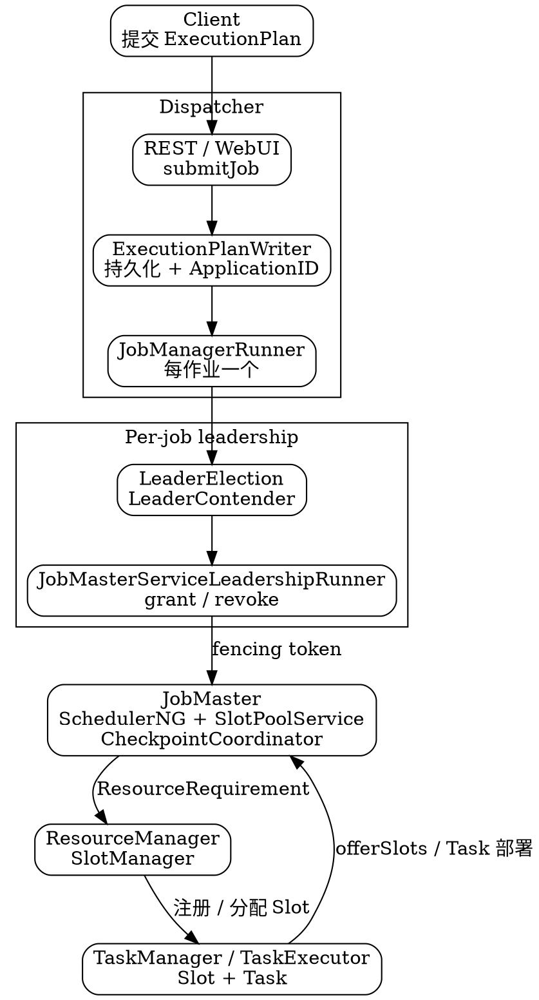

## Introduction

JobManager 是 Flink 集群的**管理节点（master）**，负责接收并执行来自 [Client](/docs/CS/Framework/Flink/Client.md) 提交的作业，协调、调度整个作业，并管理集群资源。集群启动后至少有一个 JobManager 和多个 [TaskManager](/docs/CS/Framework/Flink/TaskManager.md)，三者都是独立 JVM 进程。

从 Flink 1.x 起，"JobManager" 是一个逻辑概念，内部由三个主要组件构成：**Dispatcher、ResourceManager、JobMaster**。在 Session 模式下一个 JobManager 进程可同时服务多个作业（每个作业一个 JobMaster）；在 Per-Job / Application 模式下通常一个作业独享一个 JobManager。

> [!NOTE]
> 版本基线（2026-11-23 核实）：Flink **2.3.0**（tag `release-2.3.0`，commit `c0f8d1a1e09f209885a88f9c19ceb9d9e9870283`）。本页源码片段均取自该 tag，路径相对仓库根目录，不带行号。

三个容易理解错的点：

- **2.3 的提交契约不是具体的 `JobGraph`，而是 `ExecutionPlan` 接口**：`JobGraph implements ExecutionPlan`，但 Dispatcher / JobMaster 只认这个接口，StreamGraph 也能实现它。
- **JobMaster 不自己 new ExecutionGraph**：它把 `ExecutionPlan` 交给 `SlotPoolServiceSchedulerFactory.createScheduler()`，图的具体构造归 scheduler（见 [Dataflow](/docs/CS/Framework/Flink/Dataflow.md) 的源码章节）。
- **选主不等于启动作业**：拿到 leadership 后还要查 `JobResultStore` 确认作业没跑完，才创建 `JobMasterServiceProcess`；fencing token 用来隔离旧主。

## Component Boundaries in Source



### Dispatcher: Submission and Application Ownership

`ExecutionPlan` 是 2.3 里 `@Internal` 的接口，javadoc 明确说它可以由 JobGraph 和 StreamGraph 两类图实现，并带上 `ApplicationID` 与 `isDynamic()`：

```java
@Internal
public interface ExecutionPlan extends Serializable {
    JobID getJobID();
    String getName();
    JobType getJobType();
    boolean isDynamic();
```

```java
    Optional<ApplicationID> getApplicationId();
    void setApplicationId(ApplicationID applicationId);
}
```

`Dispatcher.submitJob()` 的入口参数已经是 `ExecutionPlan`；提交前会查重复提交、部分资源配置、以及必须存在已注册的 application（这是 FLIP-549 应用级模型落进 RPC 的证据）：

```java
public CompletableFuture<Acknowledge> submitJob(ExecutionPlan executionPlan, Duration timeout) {
    final JobID jobID = executionPlan.getJobID();
    try (MdcCloseable ignored = MdcUtils.withContext(MdcUtils.asContextData(jobID))) {
        log.info("Received job submission '{}' ({}).", executionPlan.getName(), jobID);
    }
    return isInGloballyTerminalState(jobID)
            .thenComposeAsync(
                    isTerminated -> {
                        if (isTerminated) {
                            log.warn(
                                    "Ignoring job submission '{}' ({}) because the job already "
                                            + "reached a globally-terminal state (i.e. {}) in a "
                                            + "previous execution.",
                                    executionPlan.getName(),
                                    jobID,
                                    Arrays.stream(JobStatus.values())
                                            .filter(JobStatus::isGloballyTerminalState)
                                            .map(JobStatus::name)
                                            .collect(Collectors.joining(", ")));
                            return FutureUtils.completedExceptionally(
                                    DuplicateJobSubmissionException.ofGloballyTerminated(
                                            jobID));
                        } else if (jobManagerRunnerRegistry.isRegistered(jobID)
                                || submittedAndWaitingTerminationJobIDs.contains(jobID)
                                || suspendedJobs.containsKey(jobID)) {
                            // job with the given jobID is not terminated, yet
                            return FutureUtils.completedExceptionally(
                                    DuplicateJobSubmissionException.of(jobID));
```

持久化与启动被拆成两步：`ExecutionPlanWriter.putExecutionPlan()` 落盘后才 `createJobMasterRunner()`，每个作业一个 `JobManagerRunner`：

```java
private void persistAndRunJob(ExecutionPlan executionPlan) throws Exception {
    executionPlanWriter.putExecutionPlan(executionPlan);
    initJobClientExpiredTime(executionPlan);
    runJob(
            createJobMasterRunner(executionPlan),
            ExecutionType.SUBMISSION,
            executionPlan.getApplicationId().orElse(null));
}

private JobManagerRunner createJobMasterRunner(ExecutionPlan executionPlan) throws Exception {
    checkState(!jobManagerRunnerRegistry.isRegistered(executionPlan.getJobID()));

    JobStatusListener jobStatusListener = null;
    Optional<AbstractApplication> optionalApplication =
            executionPlan.getApplicationId().map(applications::get);
```

Dispatcher 同时提供 REST 接口接收提交、为作业启动 JobMaster、托管 Web UI 并负责作业归档；三种部署模式下它跑在哪里见 [Deployment](/docs/CS/Framework/Flink/Deployment.md)。

### JobMaster: Per-Job Coordinator

JobMaster 的构造参数里是 `ExecutionPlan executionPlan` 与 `SlotPoolServiceSchedulerFactory`，不再有 `JobGraph`；它把建图委托给工厂，自己只持有 `SlotPoolService` 与 `SchedulerNG`：

```java
        this.schedulerNG =
                createScheduler(
                        slotPoolServiceSchedulerFactory,
                        executionDeploymentTracker,
                        jobManagerJobMetricGroup,
                        schedulerListener);
```

```java
    private SchedulerNG createScheduler(
            SlotPoolServiceSchedulerFactory slotPoolServiceSchedulerFactory,
            ExecutionDeploymentTracker executionDeploymentTracker,
            JobManagerJobMetricGroup jobManagerJobMetricGroup,
            JobStatusListener jobStatusListener)
            throws Exception {
        final SchedulerNG scheduler =
                slotPoolServiceSchedulerFactory.createScheduler(
                        log,
                        executionPlan,
                        ioExecutor,
                        jobMasterConfiguration.getConfiguration(),
                        slotPoolService,
                        futureExecutor,
                        userCodeLoader,
                        highAvailabilityServices.getCheckpointRecoveryFactory(),
```

`onStart()` 走 `startJobExecution()`；真正让作业可运行前，先启动心跳和 slot pool，再通过 leader retriever 连 ResourceManager——源码注释把因果关系写得很清楚：

```java
    private void startJobMasterServices() throws Exception {
        try {
            this.taskManagerHeartbeatManager = createTaskManagerHeartbeatManager(heartbeatServices);
            this.resourceManagerHeartbeatManager =
                    createResourceManagerHeartbeatManager(heartbeatServices);

            // start the slot pool make sure the slot pool now accepts messages for this leader
            slotPoolService.start(getFencingToken(), getAddress());

            // job is ready to go, try to establish connection with resource manager
            //   - activate leader retrieval for the resource manager
            //   - on notification of the leader, the connection will be established and
            //     the slot pool will start requesting slots
            resourceManagerLeaderRetriever.start(new ResourceManagerLeaderListener());
```

运行期间它负责所有需要中央协调的工作，最典型的是 [Checkpoint](/docs/CS/Framework/Flink/Checkpoint.md)：周期性触发检查点、收集各 Task 的 ack、全部成功后标记 complete。失败后的重启策略与恢复也在这里。

### ResourceManager: Cluster-Wide Slots

ResourceManager 在一个集群中只有一个，管理注册上来的 TaskExecutor 及其 Slot。注册时先连 RPC gateway，再在 `registerTaskExecutorInternal()` 里替换旧注册、建立 `WorkerRegistration` 并开始心跳：

```java
    public CompletableFuture<RegistrationResponse> registerTaskExecutor(
            final TaskExecutorRegistration taskExecutorRegistration, final Duration timeout) {

        CompletableFuture<TaskExecutorGateway> taskExecutorGatewayFuture =
                getRpcService()
                        .connect(
                                taskExecutorRegistration.getTaskExecutorAddress(),
                                TaskExecutorGateway.class);
        taskExecutorGatewayFutures.put(
                taskExecutorRegistration.getResourceId(), taskExecutorGatewayFuture);
```

```java
        if (oldRegistration != null) {
            // TODO :: suggest old taskExecutor to stop itself
            log.debug(
                    "Replacing old registration of TaskExecutor {}.",
                    taskExecutorResourceId.getStringWithMetadata());

            // remove old task manager registration from slot manager
            slotManager.unregisterTaskManager(
                    oldRegistration.getInstanceID(),
                    new ResourceManagerException(
                            String.format(
                                    "TaskExecutor %s re-connected to the ResourceManager.",
                                    taskExecutorResourceId.getStringWithMetadata())));
        }
```

`sendSlotReport()` 把 Slot 报告交给 `slotManager.registerTaskManager()`；Slot 不足时按部署形态扩容：Standalone 只能分配已注册的 Slot，YARN 申请新 container，Kubernetes 启动新 Pod。

## Leadership and Fencing

`JobMasterServiceLeadershipRunner` 同时是 `JobManagerRunner` 和 `LeaderContender`。`start()` 只是向 leader election 注册自己；拿到 leadership 后先查 `JobResultStore`，避免已完成的作业被重新拉起：

```java
    @Override
    public void grantLeadership(UUID leaderSessionID) {
        runIfStateRunning(
                () -> startJobMasterServiceProcessAsync(leaderSessionID),
                "starting a new JobMasterServiceProcess");
    }

    @GuardedBy("lock")
    private void startJobMasterServiceProcessAsync(UUID leaderSessionId) {
        sequentialOperation =
                sequentialOperation.thenCompose(
                        unused ->
                                jobResultStore
                                        .hasJobResultEntryAsync(getJobID())
                                        .thenCompose(
                                                hasJobResult -> {
                                                    if (hasJobResult) {
                                                        return handleJobAlreadyDoneIfValidLeader(
                                                                leaderSessionId);
                                                    } else {
                                                        return createNewJobMasterServiceProcessIfValidLeader(
                                                                leaderSessionId);
                                                    }
                                                }));
```

撤销 leadership 则反向停止进程，`jobMasterGatewayFuture` 被置为 exceptional，让所有调用方立刻知道旧主已失效：

```java
    @Override
    public void revokeLeadership() {
        runIfStateRunning(
                this::stopJobMasterServiceProcessAsync,
                "revoke leadership from JobMasterServiceProcess");
    }
```

`DefaultLeaderElectionService` 把选主回调串行到 leader event thread；确认 leadership 时会通过 `leaderElectionDriver.publishLeaderInformation()` 把 session ID 与地址发布到 HA 后端：

```java
    public void onGrantLeadership(UUID leaderSessionID) {
        runInLeaderEventThread(
                LEADER_ACQUISITION_EVENT_LOG_NAME,
                () -> onGrantLeadershipInternal(leaderSessionID));
    }
```

```java
                            final LeaderInformation newConfirmedLeaderInformation =
                                    LeaderInformation.known(leaderSessionID, leaderAddress);
                            confirmedLeaderInformation =
                                    LeaderInformationRegister.merge(
                                            confirmedLeaderInformation,
                                            componentId,
                                            newConfirmedLeaderInformation);
                            leaderElectionDriver.publishLeaderInformation(
                                    componentId, newConfirmedLeaderInformation);
```

> [!NOTE]
> `slotPoolService.start(getFencingToken(), getAddress())` 里的 fencing token 与 leader session ID 配套：旧主即使还没感知到失联，它对 slot pool 和 TaskExecutor 的操作也会被 token 挡住，这是 HA 切换时不出现双主的关键。

## Slot Acquisition Chain

JobMaster → ResourceManager 的资源链是**声明式需求**，不是逐 slot 的 RPC：

1. `SchedulerNG` 算出 `ResourceRequirement` 集合；
2. `JobMaster.notifyNotEnoughResourcesAvailable()` 转给 `slotPoolService`：
   ```java
   public void notifyNotEnoughResourcesAvailable(
           Collection<ResourceRequirement> acquiredResources) {
       slotPoolService.notifyNotEnoughResourcesAvailable(acquiredResources);
   }
   ```
3. ResourceManager 的 `SlotManager` 汇总需求，不足时向资源提供者申请新 TaskExecutor；
4. TaskExecutor 注册并上报 Slot 后，`SlotPoolService.offerSlots()` 接受分配，JobMaster 才把 ExecutionVertex 部署成 Task。

这条链解释了为什么 Standalone 模式下并行度超过已注册 Slot 会一直等资源——它不会凭空扩容。

## Job Lifecycle and Terminal States

```
Client 提交 ExecutionPlan
      -> Dispatcher 持久化并启动 JobManagerRunner
      -> 选主成功后创建 JobMaster
      -> JobMaster: ExecutionPlan -> ExecutionGraph（由 SchedulerNG 构造）
      -> JobMaster 向 ResourceManager 提出 ResourceRequirement
      -> ResourceManager 分配/启动 TaskManager，TaskManager 提供 Slot
      -> JobMaster 将 ExecutionVertex 部署为 Task
      -> Task 在 TaskManager 上执行，定期汇报状态 / Checkpoint ack
      -> 作业结束（FINISHED）或失败（触发重启/恢复）
```

终态还会触发 shuffle 数据的收尾：`jobStatusChanged()` 在 `isGloballyTerminalState()` 时停止追踪分区，FINISHED 时把 cluster partition 晋升而非释放，让后续作业还能读这批数据：

```java
    private void jobStatusChanged(final JobStatus newJobStatus) {
        validateRunsInMainThread();
        if (newJobStatus.isGloballyTerminalState()) {
            CompletableFuture<Void> partitionPromoteFuture;
            if (newJobStatus == JobStatus.FINISHED) {
                Collection<ResultPartitionID> jobPartitions =
                        partitionTracker.getAllTrackedNonClusterPartitions().stream()
                                .map(d -> d.getShuffleDescriptor().getResultPartitionID())
                                .collect(Collectors.toList());
                partitionTracker.stopTrackingAndReleasePartitions(jobPartitions);
```

## High Availability

生产环境 JobManager 必须做高可用，避免单点：

- 多个 JobManager 候选，基于 **ZooKeeper**（或 Kubernetes leader election）选主，Dispatcher / ResourceManager / JobMaster 各自有 leader election 组件；
- 关键元数据（ExecutionPlan、JobResult、已完成的 checkpoint 位置）写入高可用存储，主节点故障后 standby 节点接管并从最近 checkpoint 恢复；
- 旧主与新主之间靠 leader session ID 与 fencing token 隔离，见上文 [Leadership and Fencing](/docs/CS/Framework/Flink/JobManager.md?id=leadership-and-fencing)。

## JobManager vs TaskManager

| 维度 | JobManager（master） | TaskManager（worker） |
| ---- | ---- | ---- |
| 数量 | 至少 1 个（HA 下多候选选主） | 多个 |
| 职责 | 接收作业、调度、Checkpoint 协调、资源管理 | 真正执行 Task、缓存/交换数据、管理状态 |
| 资源抽象 | 管理 Slot 分配 | 把内存/CPU 切成 Slot 提供给集群 |
| 状态 | 协调态（checkpoint 元数据） | 持有每个算子的实际 keyed/operator state |

## Why This Shape

- **为什么三个组件要分开**：提交入口（Dispatcher）、集群资源（ResourceManager）、单作业生命周期（JobMaster）的故障域与伸缩性不同；Session 模式下多个 JobMaster 共享一个 RM，正是这种拆分才可能。
- **为什么提交契约抽象成 ExecutionPlan**：2.3 的应用级模型与动态图需要同一条提交链容纳不同图类型；把 JobGraph 提升为接口后，Dispatcher 与 JobMaster 不再依赖具体图实现。
- **为什么选主与作业执行解耦**：`JobMasterServiceLeadershipRunner` 只负责"谁是主"，真正的 `JobMaster` 由 `JobMasterServiceProcess` 在拿到 leadership 后创建；失联时停掉进程即可，不必重启整个 JobManager。
- **为什么资源申请用声明式需求**：逐 slot 请求会把调度策略散落在各组件；把 `ResourceRequirement` 交给 `SlotManager` 统一决策，AdaptiveScheduler 才能按可用资源重算并行度。

## Links

- [Flink](/docs/CS/Framework/Flink/Flink.md)
- [State](/docs/CS/Framework/Flink/State.md)
- [Connector](/docs/CS/Framework/Flink/Connector.md)
- [Table_SQL](/docs/CS/Framework/Flink/Table_SQL.md)

## References

1. [Flink Docs - JobManager Architecture (2.3)](https://nightlies.apache.org/flink/flink-docs-release-2.3/docs/concepts/flink-architecture/#job-manager)
2. [Flink Docs - JobManager High Availability (2.3)](https://nightlies.apache.org/flink/flink-docs-release-2.3/docs/deployment/ha/overview/)
3. [Flink Docs - Task Failure Recovery (2.3)](https://nightlies.apache.org/flink/flink-docs-release-2.3/docs/ops/state/task_failure_recovery/)
4. [Flink 2.3.0 Source: JobMaster.java](https://github.com/apache/flink/blob/release-2.3.0/flink-runtime/src/main/java/org/apache/flink/runtime/jobmaster/JobMaster.java)
5. [Flink 2.3.0 Source: Dispatcher.java](https://github.com/apache/flink/blob/release-2.3.0/flink-runtime/src/main/java/org/apache/flink/runtime/dispatcher/Dispatcher.java)
6. [Flink 2.3.0 Source: ResourceManager.java](https://github.com/apache/flink/blob/release-2.3.0/flink-runtime/src/main/java/org/apache/flink/runtime/resourcemanager/ResourceManager.java)
7. [Flink 2.3.0 Source: JobMasterServiceLeadershipRunner.java](https://github.com/apache/flink/blob/release-2.3.0/flink-runtime/src/main/java/org/apache/flink/runtime/jobmaster/JobMasterServiceLeadershipRunner.java)
8. [Flink 2.3.0 Source: DefaultLeaderElectionService.java](https://github.com/apache/flink/blob/release-2.3.0/flink-runtime/src/main/java/org/apache/flink/runtime/leaderelection/DefaultLeaderElectionService.java)
9. [Flink 2.3.0 Source: ExecutionPlan.java](https://github.com/apache/flink/blob/release-2.3.0/flink-runtime/src/main/java/org/apache/flink/streaming/api/graph/ExecutionPlan.java)
10. [Flink 2.3.0 Source: SlotPoolService.java](https://github.com/apache/flink/blob/release-2.3.0/flink-runtime/src/main/java/org/apache/flink/runtime/jobmaster/slotpool/SlotPoolService.java)
