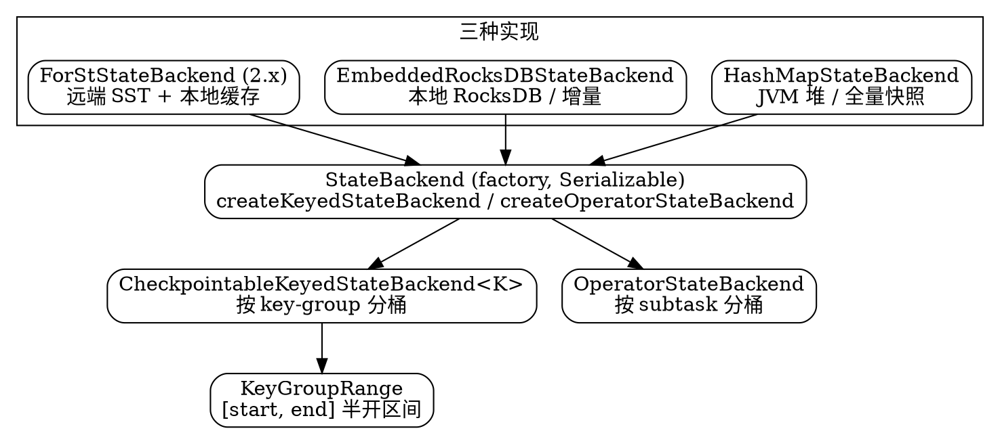

## Introduction

**状态（state）** 是 Flink 区别于"无状态转发"类系统的根本：算子可以记住之前看过的数据，从而做聚合、去重、join、模式匹配。Flink 的状态由运行时托管（managed state），与 [Checkpoint](/docs/CS/Framework/Flink/Checkpoint.md) 机制结合实现故障后精确恢复——这也是"有状态流计算"这一称谓的由来。

> [!NOTE]
> 版本基线（2026-11-23 核实）：Flink **2.3.0**（tag `release-2.3.0`，commit `c0f8d1a1e09f209885a88f9c19ceb9d9e9870283`）。本页源码片段均取自该 tag，且只贴真实片段、不带行号。

状态与窗口的关系很直接：[Window](/docs/CS/Framework/Flink/Window.md) 里累积的中间结果本质上就是状态，窗口超时后状态被清理。

## State Categories

Flink 把状态分成两类，划分依据是**是否按键（key）分区**：

### Keyed State

只能用在 `keyBy()` 之后的算子上。逻辑上每个 key 一份状态，物理上按 **key-group** 组织（key-group 数量由 `maxParallelism` 决定，是并行度调整时的最小再分配单元，数学细节见下文 [Key Groups](/docs/CS/Framework/Flink/State.md?id=key-groups)）。

| 类型 | 接口 | 语义 |
| ---- | ---- | ---- |
| ValueState | `ValueState<T>` | 单值，可读可写 |
| ListState | `ListState<T>` | 元素列表，可追加、可遍历 |
| MapState | `MapState<UK, UV>` | 一个 key 下的二级 map |
| ReducingState | `ReducingState<T>` | 按 `ReduceFunction` 自动聚合，只存聚合结果 |
| AggregatingState | `AggregatingState<IN, OUT>` | 按 `AggregateFunction` 聚合，输入/输出类型可不同 |

```java
public class DedupFunction extends KeyedProcessFunction<String, Event, Event> {
    private transient ValueState<Boolean> seen;

    @Override
    public void open(OpenContext ctx) {
        StateTtlConfig ttl = StateTtlConfig.newBuilder(Time.days(1))
                .setUpdateType(StateTtlConfig.UpdateType.OnCreateAndWrite)
                .build();
        ValueStateDescriptor<Boolean> desc = new ValueStateDescriptor<>("seen", Boolean.class);
        desc.enableTimeToLive(ttl);          // 1 天未更新则过期
        seen = getRuntimeContext().getState(desc);
    }

    @Override
    public void processElement(Event e, Context ctx, Collector<Event> out) throws Exception {
        if (Boolean.TRUE.equals(seen.value())) return;   // 已见过，去重丢弃
        seen.update(true);
        out.collect(e);
    }
}
```

### Operator State

绑定到**算子并行实例**（subtask）而非 key，常见于 Source 与 Sink：Kafka Source 用 `ListState` 记录各分区的 offset，就是典型的 operator state。

- 实现 `CheckpointedFunction` 或 `ListCheckpointed`；
- 并行度变化时支持三种重分配模式：`SPLIT_DISTRIBUTE`（均分）、`UNION`（每个实例拿到全量）、`BROADCAST`；
- 只有 `ListState` 支持重分配（union list state）。

### Broadcast State

第三类特殊形态：把一条低吞吐的流（如规则表）广播到所有并行实例，与主流在 `connect()` 后做匹配。它的 checkpoint 语义是"所有实例持有全量副本"，恢复时每个实例都能拿到完整广播状态。

## State Backend

状态后端决定**状态存在哪里、怎么存**。最容易被误解的一点是：`StateBackend` **自身不存数据**，它是一个可序列化的工厂，负责创建 `CheckpointableKeyedStateBackend`（键控状态）与 `OperatorStateBackend`（算子状态）两个服务对象。这个定位决定了后端可插拔、状态可序列化迁移，以及 2.x 能长出 ForSt 这种"远端为主存"的分离式后端而不改上层 API。



### The Factory Contract

`StateBackend` 接口的核心是创建方法加一组能力探测方法（异步状态、NO_CLAIM 恢复、savepoint 格式）：

```java
@PublicEvolving
public interface StateBackend extends java.io.Serializable {
    <K> CheckpointableKeyedStateBackend<K> createKeyedStateBackend(
            KeyedStateBackendParameters<K> parameters) throws Exception;

    @Experimental
    default <K> AsyncKeyedStateBackend<K> createAsyncKeyedStateBackend(
            KeyedStateBackendParameters<K> parameters) throws Exception {
        throw new UnsupportedOperationException(
                "Don't support createAsyncKeyedStateBackend by default");
    }

    @Experimental
    default boolean supportsAsyncKeyedStateBackend() {
        return false;
    }

    OperatorStateBackend createOperatorStateBackend(OperatorStateBackendParameters parameters)
            throws Exception;

    default boolean useManagedMemory() { return false; }

    default boolean supportsNoClaimRestoreMode() { return false; }

    default boolean supportsSavepointFormat(SavepointFormatType formatType) {
        return formatType == SavepointFormatType.CANONICAL;
    }
}
```

源码注释给出两条硬约束，解释了为什么后端是轻量工厂而不是重对象：

> *State Backends need to be serializable, because they are distributed across parallel processes together with the streaming application code.* … *State backend implementations have to be thread-safe. Multiple threads may be creating keyed-/operator state backends concurrently.*

也就是说：后端配置随作业代码一起被序列化分发到各 TaskManager，到达后再在本地创建真正的状态存储；所以状态本体不可能放在 backend 对象里。

### Implementation Landscape

| 后端 | 配置值 | 状态位置 | 快照 | 定位与适用 |
| :-- | :-- | :-- | :-- | :-- |
| `HashMapStateBackend` | `hashmap` | TaskManager JVM 堆，Java 对象 | 全量 | 默认；无需额外依赖；对象不可安全复用；状态小（MB~GB 级）、低延迟、调试 |
| `EmbeddedRocksDBStateBackend` | `rocksdb` | 本地 RocksDB（序列化字节） | 异步 + 增量（需 `execution.checkpointing.incremental: true`） | 生产大状态（TB 级）默认；受本地盘限制；读写需序列化 |
| `ForStStateBackend` | `forst` | 远端 FS 上的 SST，本地盘只做缓存 | 总是异步增量 | experimental；云原生 / K8s、超大状态、频繁扩缩容 |

`StateBackendLoader` 的注释确认了默认后端：

```
 * <p>If no state backend is configured, this instantiates the default state backend
 * (the {@link HashMapStateBackend}).
```

并列出了 hashmap 的快捷配置名：

```java
/** The shortcut configuration name of the HashMap state backend. */
public static final String HASHMAP_STATE_BACKEND_NAME = "hashmap";
```

```java
// 堆内
env.setStateBackend(new HashMapStateBackend());
// RocksDB + 增量快照
env.setStateBackend(new EmbeddedRocksDBStateBackend(true));
```

几个必须记住的差别：

- 堆内后端的状态以 Java 对象形式存在，读写无需序列化，但**大状态会拖垮 GC**；
- RocksDB 后端每次读写都要序列化/反序列化，单次访问更慢，但内存可控、支持增量快照（只上传自上次以来的 SST 文件）；
- Flink 2.x 引入**分离式状态管理**：状态主存放在远程 DFS，本地只做缓存，配合异步执行模型避免阻塞计算线程。

> [!WARNING]
> Flink 1.x 与 2.x 之间**不保证状态兼容**：从 1.x 升级到 2.x 通常无法直接用旧 savepoint 恢复，需要通过重放或双跑切换。

### ForSt: Disaggregated State

ForSt 基于 ForSt project —— 一个构建在 RocksDB 之上的 LSM-tree KV store，设计目标是 **disaggregated state management**：SST 文件可放在 Flink 支持的远端文件系统（HDFS / S3），状态规模不再受 TaskManager 本地盘约束，checkpoint / recovery 也因此变轻（不必搬运本地状态）。代价是远程访问延迟，以及 2.3 仍**不支持** canonical savepoint、full snapshot、changelog、file-merging checkpoints。

> [!WARNING]
> 官方文档在 "Available State Backends" 小节说 `EmbeddedRocksDBStateBackend is currently the only backend that offers incremental checkpoints`，但 ForSt 章节又明确写 `It always performs asynchronous incremental snapshots`。两处口径并存；实操按 ForSt 章节理解（它确实总是增量），不要因为前一句就认为 ForSt 没有增量。

### Async State Access

2.x 在 `StateBackend` 上增加了 `createAsyncKeyedStateBackend()` 与 `supportsAsyncKeyedStateBackend()`，但默认实现直接抛 `UnsupportedOperationException` / 返回 `false`——这是**后端自选的能力**，不是所有后端都有。2.3 官方口径：**只有 ForStStateBackend 支持异步状态访问**；配合 State API V2 的异步方法，可避免状态访问阻塞计算线程（尤其远端 SST 有网络延迟时）。

> [!NOTE]
> SQL 侧可通过 `table.exec.async-state.enabled` 让支持的算子切到异步状态访问；DataStream 侧要用 State API V2 的异步方法。别把"开启了异步执行"与"后端支持异步状态"混为一谈——后者是 backend 级能力。

### Changelog State Backend

`state.changelog.enabled: true`（或 `env.enableChangelogStateBackend(true)`）把状态变更持续写进 DSTL（`state.changelog.storage` 目前支持 `filesystem` 与测试用 `memory`，路径 `state.changelog.dstl.dfs.base-path`）。它把 checkpoint 时长与状态大小解耦：算子在变更日志落盘后即可 ack，快照文件后台周期性物化（`state.changelog.periodic-materialize.interval` 影响恢复时间）。

> [!WARNING]
> Changelog backend 要求 `execution.checkpointing.max-concurrent-checkpoints` 保持默认 `1`；且 ForSt 不支持 changelog，二者不能叠加。

## Key Groups

`KeyGroupRangeAssignment` 是键控状态扩缩容的全部数学。key → key-group 用 **MurmurHash 再取模 maxParallelism**（不是直接用 `hashCode()`）：

```java
public static final int DEFAULT_LOWER_BOUND_MAX_PARALLELISM = 1 << 7;

public static int assignToKeyGroup(Object key, int maxParallelism) {
    Preconditions.checkNotNull(key, "Assigned key must not be null!");
    return computeKeyGroupForKeyHash(key.hashCode(), maxParallelism);
}

public static int computeKeyGroupForKeyHash(int keyHash, int maxParallelism) {
    return MathUtils.murmurHash(keyHash) % maxParallelism;
}
```

key-group → subtask 的映射用整数乘除，它同时也是 `keyBy()` 之后记录路由到下游子任务的依据：

```java
public static int computeOperatorIndexForKeyGroup(
        int maxParallelism, int parallelism, int keyGroupId) {
    return keyGroupId * parallelism / maxParallelism;
}

public static KeyGroupRange computeKeyGroupRangeForOperatorIndex(
        int maxParallelism, int parallelism, int operatorIndex) {
    int start = ((operatorIndex * maxParallelism + parallelism - 1) / parallelism);
    int end = ((operatorIndex + 1) * maxParallelism - 1) / parallelism;
    return new KeyGroupRange(start, end);
}
```

未显式配置 `maxParallelism` 时，默认值取 `1.5 × 并行度` 向上取 2 的幂，并夹在 `[128, UPPER_BOUND]` 之间：

```java
public static int computeDefaultMaxParallelism(int operatorParallelism) {
    checkParallelismPreconditions(operatorParallelism);
    return Math.min(
            Math.max(
                    MathUtils.roundUpToPowerOfTwo(
                            operatorParallelism + (operatorParallelism / 2)),
                    DEFAULT_LOWER_BOUND_MAX_PARALLELISM),
            UPPER_BOUND_MAX_PARALLELISM);
}
```

> [!NOTE]
> 源码注释特别标注：maxParallelism 必须 ≤ `Short.MAX_VALUE + 1`，否则这里的整数运算会出现舍入问题。这也解释了为什么改 `maxParallelism` 会破坏 savepoint 兼容性——key-group 的划分和映射全变了。

扩缩容时的重分配规则：

- **Keyed State**：按 key-group 重新划分到新的并行子任务。key-group 数 = `maxParallelism`，因此**并行度不能超过 maxParallelism**，扩缩容只搬整段连续的 key-group 区间，而不是全量重哈希。
- **Operator State**：按上文三种模式分发。
- **分离式状态后端（2.x）**：状态不在本地，扩缩容不需要搬运大块状态，这是它相对 RocksDB 本地方案最大的运维收益。

## State TTL

无界流里状态只增不减，TTL 是控制规模的主要手段。`StateTtlConfig` 提供三个维度：

- **更新时机** `UpdateType`：`OnCreateAndWrite`（默认，写操作刷新）、`OnReadAndWrite`（读也刷新，代价更高）；
- **过期数据可见性**：`NeverReturnExpired`（默认，过期即不可见）、`ReturnExpiredIfNotCleanedUp`（物理未清除前仍返回，用于可接受脏读的场景）；
- **清理策略**：`cleanupIncrementally`（访问时惰性清理）、`cleanupInRocksdbCompactFilter`（借 RocksDB compaction）、`cleanupFullSnapshot`（快照时清理，不减运行时规模）、`cleanupInBackground`（后台线程）。

源码确认了默认值：

```java
private UpdateType updateType = OnCreateAndWrite;
private StateVisibility stateVisibility = NeverReturnExpired;
```

`isEnabled()` 的实现只是一行——`return updateType != UpdateType.Disabled`：

```java
public boolean isEnabled() {
    return updateType != UpdateType.Disabled;
}
```

清理策略是**可叠加的**：若配置了增量或 compaction 清理，`disableCleanupInBackground()` 不会关掉它们。

> [!NOTE]
> TTL 不解决"短时间 key 基数爆炸"——它只让旧 key 的状态最终过期，无法阻止新 key 瞬时涌入造成的内存/磁盘尖峰。那是 key 设计或加盐打散的问题。

## Fault Tolerance

- 状态快照由 [Checkpoint](/docs/CS/Framework/Flink/Checkpoint.md) 周期性地持久化到远端存储；
- 恢复时按 key-group 把状态重新装载到各子任务，并从对应 source 位置重放；
- Source 侧的 offset 也是 operator state，二者一起构成端到端一致性（见 [Connector](/docs/CS/Framework/Flink/Connector.md)）。

## Why This Shape

- **为什么后端是工厂**：后端配置随作业代码序列化分发，重对象不适合传输；到 TaskManager 后再按本地资源创建状态实例，天然支持三套实现互换。
- **为什么需要 key-group 这一层间接**：若直接用并行度分状态，改并行度就要按 key 全量重哈希迁移；固定 key-group 数后，扩缩容只搬整段连续区间，成本可控。
- **为什么 ForSt 把 SST 放远端**：云原生场景下 Pod 随时重建，本地盘状态成了阻碍；把状态主存放到 DFS、本地只做缓存，扩缩容和故障恢复都不必搬运状态。
- **为什么异步访问是 optional 而非默认**：同步 API 简单且对堆内后端足够快；只有远端状态（ForSt）才值得付出异步编程复杂度，所以做成后端能力探测。

## Links

- [Flink](/docs/CS/Framework/Flink/Flink.md)
- [TaskManager](/docs/CS/Framework/Flink/TaskManager.md)

## References

1. [Flink Docs - Stateful Stream Processing / Working with State (2.3)](https://nightlies.apache.org/flink/flink-docs-release-2.3/docs/concepts/stateful-stream-processing/)
2. [Flink Docs - State Backends (2.3)](https://nightlies.apache.org/flink/flink-docs-release-2.3/docs/ops/state/state_backends/)
3. [Flink Docs - State TTL (2.3)](https://nightlies.apache.org/flink/flink-docs-release-2.3/docs/dev/datastream/fault-tolerance/state/#state-time-to-live-ttl)
4. [Flink 2.0.0: A New Era of Real-Time Data Processing（分离式状态与异步执行模型）](https://flink.apache.org/2025/03/24/apache-flink-2.0.0-a-new-era-of-real-time-data-processing)
5. [Flink 2.3.0 Source: StateBackend.java](https://github.com/apache/flink/blob/release-2.3.0/flink-runtime/src/main/java/org/apache/flink/runtime/state/StateBackend.java)
6. [Flink 2.3.0 Source: KeyGroupRangeAssignment.java](https://github.com/apache/flink/blob/release-2.3.0/flink-runtime/src/main/java/org/apache/flink/runtime/state/KeyGroupRangeAssignment.java)
7. [Flink 2.3.0 Source: StateBackendLoader.java](https://github.com/apache/flink/blob/release-2.3.0/flink-runtime/src/main/java/org/apache/flink/runtime/state/StateBackendLoader.java)
8. [Flink 2.3.0 Source: StateTtlConfig.java](https://github.com/apache/flink/blob/release-2.3.0/flink-core/src/main/java/org/apache/flink/api/common/state/StateTtlConfig.java)
