## Introduction

TaskManager 是 Flink 集群的**工作节点（worker）**，是真正干活的 JVM 进程。它向集群提供计算资源（内存、CPU），接收 [JobManager](/docs/CS/Framework/Flink/JobManager.md) 部署下来的 Task 并执行，持有算子的实际状态，并负责数据在算子之间的交换（shuffle）。

每个 TaskManager 把自己的资源切成若干 **Slot（任务槽）**，注册给 ResourceManager 统一调度；一个作业并行子任务就运行在一个 Slot 中。根据资源管理器不同，TaskManager 可以是 Standalone 下固定数量启动，也可以在 Yarn/Kubernetes 上按需动态拉起。

## Slot

- Slot 是 TaskManager 资源调度的最小单位。`taskmanager.numberOfTaskSlots` 决定一个 TM 切多少个 Slot，通常建议与机器 CPU 核数相当。
- Slot 主要**切分内存**，CPU 目前是按需共享的。
- 通过 **Slot Sharing（槽位共享）**，同一个作业的不同算子子任务（source/map/sink 的一条 pipeline）可以共享同一个 Slot，从而：
  - 让不同资源开销的算子（轻量 source、重量 window）均衡到各 Slot，提高利用率；
  - 一个 Slot 里串起一条完整算子链，减少跨网络/线程的数据传递。
- 需要隔离时可用 `slotSharingGroup()` 把算子划到不同共享组，强制分配到不同 Slot。

## Task Execution

- JobMaster 把 ExecutionGraph 中的 ExecutionVertex 部署到 TaskManager，对应一个 **Task**；一个 Task 内部运行一条 **operator chain**（多个算子由同一线程以函数调用方式串联执行）。
- Task 的生命周期大致：`DEPLOYING → INITIALIZING → RUNNING → FINISHED`，异常时进入 `FAILED/CANCELING/CANCELED`。
- Task 通过 `StreamTask` / `OneInputStreamTask` / `SourceStreamTask` 等运行时载体驱动内部 `StreamOperator`，而 Operator 再调用用户写的 `Function`（这是 Flink 最小数据处理单元）。
- 输入由 InputGate 拉取/接收、经算子链处理后由 RecordWriter 输出，形成事件驱动的主循环 `processInput()`。

### The Mailbox Loop in Source

> [!NOTE]
> 版本基线：Flink **2.3.0**（tag `release-2.3.0`）。下文源码片段均取自该 tag，路径相对仓库根目录，不带行号。

Flink 的 Task 不用"锁 + 多线程"处理并发事件，而是把**数据处理**与**控制事件**（checkpoint 触发、timer、watermark、取消）塞进同一个 **mailbox**，由**单线程**顺序执行。核心类在 `flink-runtime/src/main/java/org/apache/flink/streaming/runtime/tasks/mailbox/`（2.x 已归入 `flink-runtime`，不在 `flink-streaming-java`）。

```dot
digraph MailboxLoop {
  rankdir=LR;
  node [shape=box, style=rounded];

  ext [label="外部线程\ncheckpoint / cancel / timer\n(经 MailboxExecutor)"];
  box [label="TaskMailboxImpl\nBlockingQueue + batch\nurgent mail 优先"];
  loop [label="MailboxProcessor\nrunMailboxLoop()\n单线程顺序执行"];
  def [label="MailboxDefaultAction\nStreamTask::processInput\n处理一条输入"];
  io [label="InputGate / RecordWriter\nbuffer 可用性"];
  susp [label="suspendDefaultAction\n+ resumeFuture"];
  back [label="空闲/背压计时器\nsoftBackPressured / idle", style=dashed];

  ext -> box;
  box -> loop [label="processMail"];
  loop -> def;
  def -> io;
  io -> susp [label="无可用 buffer"];
  susp -> back;
  back -> box [label=" future 完成 → resume", style=dashed];
}
```



主循环的结构极简：**先跑邮箱里的信，再跑默认动作**，循环往复：

```java
public void runMailboxLoop() throws Exception {
    suspended = !mailboxLoopRunning;
    final TaskMailbox localMailbox = mailbox;

    checkState(
            localMailbox.isMailboxThread(),
            "Method must be executed by declared mailbox thread!");

    final MailboxController mailboxController = new MailboxController(this);

    while (isNextLoopPossible()) {
        // The blocking `processMail` call will not return until default action is available.
        processMail(localMailbox, false);
        if (isNextLoopPossible()) {
            mailboxDefaultAction.runDefaultAction(mailboxController);
        }
    }
}
```

源码注释点出了设计目标——**让热路径（有数据、无信件）尽可能快**：所有控制标志（running / suspended）都挂在 `mailbox.hasMail()` 上，因此 mailbox 线程内可直接改标志，但必须确保邮箱里至少留一个 action，改动才会被看到；其他线程的改动则天然通过 mailbox action 提交：

```java
/**
 * The design of {@link #runMailboxLoop()} is centered around the idea of keeping the expected
 * hot path (default action, no mail) as fast as possible. This means that all checking of mail and
 * other control flags (mailboxLoopRunning, suspendedDefaultAction) are always connected to #hasMail
 * indicating true.
 */
```

默认动作暂停时，`processMail` 会**阻塞取信**直到恢复——这让"没数据可处理"的 Task 不占 CPU：

```java
private boolean processMailsWhenDefaultActionUnavailable() throws Exception {
    boolean processedSomething = false;
    Optional<Mail> maybeMail;
    while (!isDefaultActionAvailable() && isNextLoopPossible()) {
        maybeMail = mailbox.tryTake(MIN_PRIORITY);
        if (!maybeMail.isPresent()) {
            maybeMail = Optional.of(mailbox.take(MIN_PRIORITY));
        }
        // ... runMail(maybeMail.get())
    }
    return processedSomething;
}
```

`StreamTask.processInput()` 把这个协议用到了极致：输入耗尽时同时暂停默认动作与整个 mailbox；**输出缓冲不可用（背压）或输入不可用时，挂一个带计时器的 suspension，并注册 future 回调恢复**——这就是 Web UI 上 `softBackPressured` / `idle` 指标的来源：

```java
if (!recordWriter.isAvailable()) {
    timer = new GaugePeriodTimer(ioMetrics.getSoftBackPressuredTimePerSecond());
    resumeFuture = recordWriter.getAvailableFuture();
} else if (!inputProcessor.isAvailable()) {
    timer = new GaugePeriodTimer(ioMetrics.getIdleTimeMsPerSecond());
    resumeFuture = inputProcessor.getAvailableFuture();
} else if (changelogWriterAvailabilityProvider != null
        && !changelogWriterAvailabilityProvider.isAvailable()) {
    // waiting for changelog availability is reported as busy
    timer = new GaugePeriodTimer(ioMetrics.getChangelogBusyTimeMsPerSecond());
    resumeFuture = changelogWriterAvailabilityProvider.getAvailableFuture();
} else {
    return;
}
assertNoException(
        resumeFuture.thenRun(
                new ResumeWrapper(controller.suspendDefaultAction(timer), timer)));
```

> [!NOTE]
> 这段源码同时解释了 [Dataflow](/docs/CS/Framework/Flink/Dataflow.md) 里背压的最终落点：credit 耗尽 → `recordWriter.isAvailable()` 变 false → mailbox 默认动作被挂起、soft backpressure 计时开始 → 整个算子链停在处理完的这条记录之后。所谓"背压传播"在 Task 内部其实就是**默认动作被反复 suspend/resume**。

## Data Exchange and Shuffle

TaskManager 提供运行时的网络数据交换环境（主笔记里的 Shuffle Environment / Network Manager）：

- 上游 Task 的 `RecordWriter` → ResultPartition / ResultSubpartition → 经 **Netty** 网络通道 → 下游 Task 的 **InputGate / InputChannel**。
- 采用**信用制（credit-based）流控**：下游按 channel 给 credit，上游有 credit 才发数据，天然实现背压（背压一路传导回 Source）。
- 同一个 TaskManager 内的 Task 之间可走**本地通道（local channel）**，直接在内存传递，避免网络与序列化。
- 网络依赖 Netty + 自建 buffer pool（以 `NetworkBufferPool` 管理一批 `MemorySegment` 作为网络内存段），相关参数集中在 `taskmanager.network.memory.*`。
- 批模式还支持阻塞式 / sort 风格 shuffle（先落盘或存内存再给下游拉取），以支持大批量、可中断的批处理。

## State and Checkpoint

TaskManager **持有真正的状态**（算子状态/键控状态），状态后端（HashMapStateBackend 存堆内 + EmbeddedRocksDBStateBackend 落本地 RocksDB）运行在 Task 侧。

Checkpoint 由 JobMaster 的 CheckpointCoordinator 中央触发，但**快照动作在 TaskManager 上完成**：

1. Coordinator 注入 checkpoint barrier 随数据流向下游；
2. Task 对齐/非对齐各输入流的 barrier（alignment / unaligned checkpoint）；
3. 异步把当前状态快照到分布式存储（HDFS/S3 等），再向 JobMaster 回报 ack；
4. 所有 Task 都 ack 后该 checkpoint 才算完成。失败恢复时 Task 从最近 checkpoint 的状态位点重置。

## Memory Management

Flink 在 TaskManager 内做了精细的**自主内存管理**，这是它稳定与高性能的关键之一：

- 把内存明确划分为：Framework Heap/Off-Heap、Task Heap/Off-Heap、**Network**、**Managed Memory**、JVM Metaspace/Overhead 等区域（`process.size = total.flink.size + jvm.*`）。
- 大量内部数据（排序、哈希、RocksDB 批量写、缓存）使用基于 `MemorySegment` 的**堆外/托管内存**，减少 JVM GC 压力并避免大对象带来的停顿。
- Managed Memory 用于 RocksDB state backend、批模式的 sort/hash/shuffle 缓存等，可按比例配置。

**源码层的两个不变量**（均取自 2.3 tag）：

页大小固定为 32 KiB，下限 4 KiB；`MemoryManager` 以"owner → Segment 集合"记账，回收时靠 owner 兜底释放：

```java
/** The default memory page size. Currently set to 32 KiBytes. */
public static final int DEFAULT_PAGE_SIZE = 32 * 1024;

/** The minimal memory page size. Currently set to 4 KiBytes. */
public static final int MIN_PAGE_SIZE = 4 * 1024;

/** Memory segments allocated per memory owner. */
private final Map<Object, Set<MemorySegment>> allocatedSegments;
```

分配时先从预算预留 `numberOfPages * pageSize`，预留失败抛 `MemoryAllocationException`——**内存不够是显式失败，不是 GC 慢慢扛**：

```java
long memoryToReserve = numberOfPages * pageSize;
try {
    memoryBudget.reserveMemory(memoryToReserve);
} catch (MemoryReservationException e) {
    throw new MemoryAllocationException(
            String.format("Could not allocate %d pages", numberOfPages), e);
}
```

网络缓冲池 `NetworkBufferPool` 则是**固定大小**的 `MemorySegment` 池，启动时一次性分配堆外内存（`allocateUnpooledOffHeapMemory`），运行时只在这个池内借还：

```java
/** The NetworkBufferPool is a fixed size pool of {@link MemorySegment} instances for the network */
private final int totalNumberOfMemorySegments;
private final ArrayDeque<MemorySegment> availableMemorySegments;

availableMemorySegments.add(
        MemorySegmentFactory.allocateUnpooledOffHeapMemory(segmentSize, null));
```

这解释了为什么"调大 `taskmanager.network.memory.*`"能缓解背压敏感作业：它改变的是**固定池的容量**，不是让 JVM 动态多分配一些对象。

算子持有的实际状态如何存储（堆内 / RocksDB / 分离式后端）以及 TTL 清理，见 [State](/docs/CS/Framework/Flink/State.md)；状态如何被周期性落盘，见 [Checkpoint](/docs/CS/Framework/Flink/Checkpoint.md)。

## Why This Shape

- **为什么用 mailbox 而不是锁**：数据处理与控制事件共享单线程，消除了算子状态的并发访问与锁竞争；源码里 `runMailboxLoop()` 明确要求"必须由声明的 mailbox 线程调用"，把线程亲和性变成硬约束。
- **为什么热路径要绑在 `hasMail` 上**：无信件的常态路径只做一次 volatile 读就能进入默认动作，不需要加锁或遍历控制标志；代价是所有跨线程状态变更都必须以 mail 形式投递。
- **为什么背压用 suspend/resume 而非忙等**：`suspendDefaultAction(timer)` 把"等 buffer"变成注册 future 回调，Task 在此期间阻塞在 `mailbox.take()` 上不烧 CPU，同时计时器精确统计 soft backpressure 时间供 Web UI 展示。
- **为什么内存自己管**：固定页大小 + owner 记账 + 固定网络缓冲池，让"内存不够"变成可预测的显式失败，而不是随机 OOM 或 GC 停顿；代价是配置面复杂，且必须理解各区域边界才能调参。

## Actor / RPC

较新 Flink 已用 **Akka/Pekko（Actor 模型）+ RPC** 承载 TaskManager 与 JobManager 之间的控制消息（TaskManagerRunner 注册、心跳、Task 部署/取消），数据通路则单独走 Netty，控制面与数据面分离。TaskManager 启动后向 ResourceManager 注册，并通过心跳维持存活与 Slot 状态同步。

注意区分两层"单线程"：**Task 层面**是 mailbox 单线程（见 [The Mailbox Loop in Source](#the-mailbox-loop-in-source)），**RPC 层面**的 Actor/Pekko 是另一套线程模型；不要因为都叫"actor 模型"就把它们混为一谈。

## Links

- [Flink](/docs/CS/Framework/Flink/Flink.md)
- [JobManager](/docs/CS/Framework/Flink/JobManager.md)
- [Dataflow](/docs/CS/Framework/Flink/Dataflow.md)
- [Client](/docs/CS/Framework/Flink/Client.md)
- [State](/docs/CS/Framework/Flink/State.md)
- [Checkpoint](/docs/CS/Framework/Flink/Checkpoint.md)

## References

1. [Flink Architecture - Task Slots and Resources](https://nightlies.apache.org/flink/flink-docs-stable/docs/concepts/flink-architecture/#task-slots-and-resources)
2. [Flink Docs - Task Lifecycle](https://nightlies.apache.org/flink/flink-docs-stable/docs/internals/task_lifecycle/)
3. [Flink Docs - Network / Shuffle Service](https://nightlies.apache.org/flink/flink-docs-stable/docs/ops/networking/overview/)
4. [Flink Docs - Memory Configuration (2.3)](https://nightlies.apache.org/flink/flink-docs-release-2.3/docs/deployment/memory/mem_setup/)
5. [Flink 2.3.0 Source: MailboxProcessor.java](https://github.com/apache/flink/blob/release-2.3.0/flink-runtime/src/main/java/org/apache/flink/streaming/runtime/tasks/mailbox/MailboxProcessor.java)
6. [Flink 2.3.0 Source: MailboxDefaultAction.java](https://github.com/apache/flink/blob/release-2.3.0/flink-runtime/src/main/java/org/apache/flink/streaming/runtime/tasks/mailbox/MailboxDefaultAction.java)
7. [Flink 2.3.0 Source: StreamTask.java](https://github.com/apache/flink/blob/release-2.3.0/flink-runtime/src/main/java/org/apache/flink/streaming/runtime/tasks/StreamTask.java)
8. [Flink 2.3.0 Source: MemoryManager.java](https://github.com/apache/flink/blob/release-2.3.0/flink-runtime/src/main/java/org/apache/flink/runtime/memory/MemoryManager.java)
9. [Flink 2.3.0 Source: NetworkBufferPool.java](https://github.com/apache/flink/blob/release-2.3.0/flink-runtime/src/main/java/org/apache/flink/runtime/io/network/buffer/NetworkBufferPool.java)
