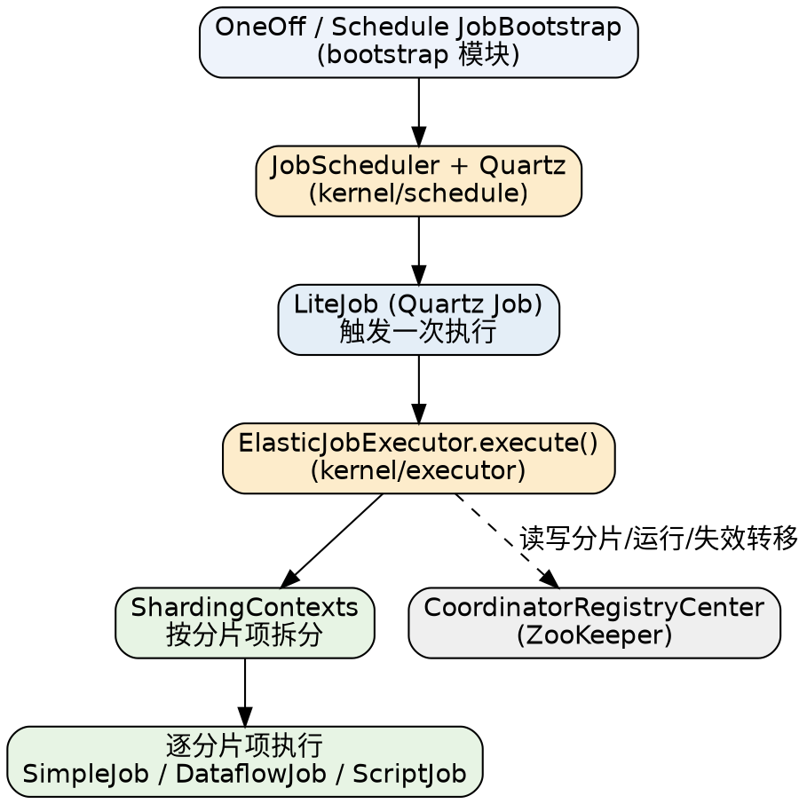

# ElasticJob

## Introduction

[ElasticJob](https://shardingsphere.apache.org/elasticjob/current/cn/overview/) 通过弹性调度、资源管控与作业治理，提供一套面向互联网场景的分布式调度解决方案，并以开放的架构设计支撑多元化的作业生态。各产品共用统一的作业 API：开发者一次开发，即可随意部署。

本页是 Job 子树的 ElasticJob 枢纽，父级入口见 [Job](/docs/CS/Framework/Job/Job.md)。

ElasticJob 的前身是当当网 2014 年开源的 elastic-job，2020-05-28 捐赠成为 [Apache ShardingSphere](https://shardingsphere.apache.org/) 子项目。它与 XXL-JOB 代表分布式调度的两条对立路线：**XXL-JOB 把调度集中到平台，ElasticJob 把调度摊回每个节点**——没有调度中心，每个引入依赖的应用节点自带 Quartz 调度器与执行器，节点间通过 ZooKeeper 就"谁执行哪一片"达成共识。需要工作流编排（DAG）的场景应看 [PowerJob](/docs/CS/Framework/Job/PowerJob.md) / [DolphinScheduler](/docs/CS/Framework/Job/DolphinScheduler.md)。

> [!NOTE]
>
> 版本基线（2026-10 现场核实 `apache/shardingsphere-elasticjob` GitHub Releases + `3.0.5` tag 源码）：当前最新稳定版 **3.0.5**（2026-02-07 发布），是 2.1.5 之后 3.x 线的最新维护版。本子树全部断言锚定 **3.0.5 tag 的源码**；源码路径以 `包.类` 标注。ZK 要求 3.6.0+。

## Architecture

### Decentralized Scheduling Model

ElasticJob 定位为轻量级、无中心化的解决方案，以 jar 形态嵌入业务应用，提供分布式任务的协调服务。它的"无中心"是**调度决策无中心**，而不是"不依赖任何中心服务"：

- 每个应用节点本地持有 **[Quartz](/docs/CS/Framework/Job/Quartz.md)** 调度器（3.0.5 内部 Quartz 依赖为 2.4.0），按 cron 自行触发作业；
- 节点间的所有协调（注册、分片、选主、失效转移）经 **ZooKeeper** 完成——**ZK 就是隐性中心**；
- **主节点（leader）是去中心化架构里唯一的"临时中心"**：由 ZK 选举产生，负责失效转移与重新分片的协调；leader 崩溃后临时节点消失，其余节点自动重选。

由此推出关键运维结论：**ZK 集群不可用时，已运行实例照常执行，但实例上下线、重新分片、失效转移全部停摆**。选 ElasticJob 的前提是具备 ZK 运维能力。

### Module Layout

仓库模块即架构分层（以 `3.0.5` 根 `pom.xml` 的 `<module>` 为准，已核实）：

| 模块 | 角色 |
| :--- | :--- |
| `api` | 作业 API 与配置模型：`ElasticJob` 接口、`JobConfiguration`、`ShardingContext`、注解 |
| `registry-center` | 注册中心抽象：`CoordinatorRegistryCenter` 接口 + ZooKeeper 实现 |
| `bootstrap` | 作业引导：`OneOffJobBootstrap`（一次性）/ `ScheduleJobBootstrap`（调度型） |
| `kernel` | 调度内核：选举 / 分片 / 失效转移 / 执行器 / Quartz 集成（`internal` 包下 `election` `sharding` `failover` `schedule` `executor` …） |
| `lifecycle` | 动态配置与运维 API（`elasticjob-lifecycle` 模块，支持运行时改作业） |
| `restful` | 管控端 REST 接口 |
| `ecosystem` | 作业类型实现：`simple` / `dataflow` / `script` / `http` 四类执行器 + Spring 集成 |
| `spring` | Spring / Spring Boot starter（`elasticjob-spring-boot-starter`） |
| `reachability-metadata` | GraalVM 原生镜像可达性元数据 |
| `distribution` | 打包发布 |

> [!WARNING]
>
> 旧版文档里还有 **ElasticJob-Cloud**（基于 Mesos 的中心式形态）。Cloud 因使用量不足、依赖过重，社区 2023-10 投票移除（PR #2288），至 **3.0.5 发布时 Cloud 产物已从 Downloads 页消失**——当前仓库模块布局里**没有 `cloud`**。Spring Boot starter artifact 由 `elasticjob-lite-spring-boot-starter` 改为 `elasticjob-spring-boot-starter`，动态配置 API 独立为 `elasticjob-lifecycle` 模块。

### Execution Flow

一次作业触发从引导类到分片执行的完整链路：



- `JobBootstrap` 是入口：`ScheduleJobBootstrap` 把作业交给 `JobScheduler` 经 Quartz 按 cron 周期触发；`OneOffJobBootstrap` 仅执行一次（手动触发 / 运维 API 触发）。
- Quartz 触发后由 `LiteJob`（实现 Quartz 的 `Job`）调用 `ElasticJobExecutor.execute()`。
- `ElasticJobExecutor` 根据当前分片分配结果构造 `ShardingContexts`，再逐分片项调用具体作业类型的执行器（执行来源区分 `ExecutionSource`：**NORMAL** / **MISFIRE** / **FAILOVER** 三种）。
- 全程通过 `CoordinatorRegistryCenter` 读写 ZK 上的分片归属、运行态、失效转移等节点。

### Coordination and Sharding at a Glance

去中心化的全部状态都落在 ZK 上，节点树与协调逻辑的源码级细节交给 [Registry Center](/docs/CS/Framework/Job/ElasticJob/RegistryCenter.md)；分片分配算法与重新分片屏障交给 [Sharding](/docs/CS/Framework/Job/ElasticJob/Sharding.md)；作业治理三件套（失效转移 / misfire / 自诊断修复）交给 [Failover](/docs/CS/Framework/Job/ElasticJob/Failover.md)。

## How to Read This Subtree

按"接到一个调度需求 → 它跑在哪一层 → 再查具体机制"的顺序读：

- 先确认 **架构全貌**就在本页：无中心模型、模块分层、执行链路、Lite/Cloud 演进、与 XXL-JOB / PowerJob 的取舍。
- 部署与协调的底座看 [Registry Center](/docs/CS/Framework/Job/ElasticJob/RegistryCenter.md)：ZK 节点树、`CoordinatorRegistryCenter`、`JobNodePath`、leader 选举、静态分片。
- 弹性调度的两个核心机制拆成两篇——[Sharding](/docs/CS/Framework/Job/ElasticJob/Sharding.md)（分片模型 + 四种分片策略 + 重新分片屏障）与 [Failover](/docs/CS/Framework/Job/ElasticJob/Failover.md)（失效转移 + misfire + monitorExecution + reconcile 自诊断）。
- 写业务作业看 [Job Types](/docs/CS/Framework/Job/ElasticJob/Job_Types.md)：`ElasticJob` 接口族、Simple/Dataflow/Script/Http 四类作业、两种 Bootstrap、`JobConfiguration` 全字段、Spring Boot 集成。
- 上线与运维看 [Operations](/docs/CS/Framework/Job/ElasticJob/Operations.md)：ElasticJob-UI 的版本不同步陷阱、lifecycle 动态配置、GraalVM 原生镜像、版本与 CVE 事实。

```text
                       ┌─ Registry Center ── 节点树 / 选主 / 静态分片
           枢纽 ElasticJob ─┤
           (架构/演进/对比)  ├─ Sharding ──────── 分片策略 / 重新分片屏障
                       │
                       ├─ Failover ─────── 失效转移 / misfire / 自诊断
                       ├─ Job Types ────── 作业接口 / Bootstrap / 配置
                       └─ Operations ───── UI / lifecycle / GraalVM / CVE
```

## Evolution: From Two Products to One

2.x 时代 ElasticJob 是双产品：**ElasticJob-Lite**（去中心化 jar 形态）与 **ElasticJob-Cloud**（基于 Mesos 的资源治理 + 容器化执行，中心式）。二者对比如下（历史形态，仅助于理解演进）：

| 维度 | ElasticJob-Lite | ElasticJob-Cloud |
| :--- | :--- | :--- |
| 去中心化 | 是 | 否 |
| 资源分配 | 否 | 是（Mesos） |
| 作业执行 | Daemon | Daemon + Transient |
| 部署依赖 | ZooKeeper | ZooKeeper + Mesos |

Cloud 因使用量不足、依赖过重，社区 2023-10 投票决定移除（PR #2288）；至 3.0.5 发布时 Cloud 产物已从 Downloads 页消失，ElasticJob-Lite 更名为 ElasticJob（去 Lite 后缀）。

## Comparison with XXL-JOB and PowerJob

| 维度 | ElasticJob | XXL-JOB | PowerJob |
| :--- | :--- | :--- | :--- |
| 调度决策 | 节点对等 + ZK 协商 | 调度中心集中决策 | Server 多活分片调度 |
| 外部依赖 | ZooKeeper | MySQL | MySQL + 自带 remote |
| 执行扩容 | 加分片即扩容 | 加执行器机器 | 加 Worker 机器 |
| 作业类型 | Simple/Dataflow/Script/Http | Bean / GLUE 脚本 | Java/Python/Shell + MapReduce |
| 运维界面 | ElasticJob-UI（独立部署） | 调度中心自带 Web UI | 自带 Console |
| 工作流 DAG | 不支持（TODO） | 不支持 | 原生支持 |
| 适合场景 | 有 ZK 基础、任务可分片、要弹性伸缩 | 无 ZK、要开箱即用的平台 | 要 DAG / 分布式计算 |

一句话取舍：**有 ZK 且任务天然可分片、要随节点线性扩容，选 ElasticJob；要零外部依赖、内置管控台，选 XXL-JOB；要 DAG 工作流与 MapReduce 式分布式计算，选 PowerJob。**

## Version Facts

- 当前基线 **3.0.5**（2026-02-07 发布），是 2.1.5 之后 3.x 线的最新维护版。
- 3.0.5 安全修复三连：**CVE-2025-25193**（Curator 相关）、**CVE-2024-47535**（Apache Commons IO 相关）、**CVE-2024-22259**（Spring 相关）；从更早版本升级时应优先核对这三项。
- 3.0.5 其他变更：Kernel 重构 Lambda 作业类的识别方式；移除并不存在的 `elasticjob-tracing-api` 与 `elasticjob-error-handler-spi` 模块声明；修复 `OneOffJobBootstrap` 在 Spring Boot Starter 下不可用的问题；内部 Quartz 升至 2.4.0。
- 运行要求 Java 8+，3.0.5 支持 OpenJDK 22/23/24 构建。

## Links

- [Job](/docs/CS/Framework/Job/Job.md) — 父级枢纽：四代调度框架演进与选型
- [Registry Center](/docs/CS/Framework/Job/ElasticJob/RegistryCenter.md)
- [Sharding](/docs/CS/Framework/Job/ElasticJob/Sharding.md)
- [Failover](/docs/CS/Framework/Job/ElasticJob/Failover.md)
- [Job Types](/docs/CS/Framework/Job/ElasticJob/Job_Types.md)
- [Operations](/docs/CS/Framework/Job/ElasticJob/Operations.md)

## References

- [Apache ShardingSphere ElasticJob - Overview](https://shardingsphere.apache.org/elasticjob/current/cn/overview/)
- [Apache ShardingSphere ElasticJob GitHub](https://github.com/apache/shardingsphere-elasticjob)
- [ElasticJob 3.0.5 Release](https://github.com/apache/shardingsphere-elasticjob/releases/tag/3.0.5)
- [Remove the ElasticJob Cloud from ShardingSphere ElasticJob](https://lists.apache.org/thread.html/1k6zkvx9dwf2hq2xbb1ngxyxrhw5rd23)
- [ElasticJob 官方架构图](https://shardingsphere.apache.org/elasticjob/current/img/architecture/elasticjob_lite.png)
