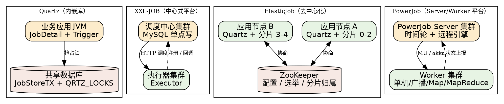

## Introduction

任务调度回答的是一个朴素的问题：**某段代码应该在未来的某个确定时刻被执行**。单机时代，这个问题由操作系统定时器、`cron` 守护进程或 JVM 内的 `Timer` / `ScheduledExecutorService` 回答；当执行单元从一台机器扩展成一个集群，"何时执行"就分裂成两个相互独立的问题——**整个集群由谁决定触发时刻**，以及**这次触发最终落在哪台机器上执行**。前者要求调度决策本身高可用，后者要求执行端可弹性伸缩、故障可转移。分布式任务调度框架就是把这两个问题从业务代码里剥离出来，做成独立的基础设施。

本页是 Job 子树的枢纽。先给分布式场景下的核心概念建立统一词汇（各家命名不同、语义相通），再按 Quartz → XXL-JOB → ElasticJob → PowerJob 的顺序叙述四代框架各自解决什么问题、又留下什么新问题，最后是选型对照。单机调度（Spring `@Scheduled`、`TaskScheduler`）不在本页展开，见 [Task](/docs/CS/Framework/Spring/Task.md)；跨层视角（内核定时器、时间轮、MQ 延时消息、DB 自建延迟队列）见 [Scheduled Task](/docs/CS/SE/Scheduled_Task.md)；以 DAG 工作流编排为目标的大数据调度（DolphinScheduler）与商业云调度（ScheduleX）只在本页末尾说明边界，细节在各自笔记。

## Core Concepts

分布式任务调度的词汇表高度收敛，四家框架的概念可以逐项对齐。读懂这张表，再看任何一家的文档都只是换名词：

| 概念 | Quartz | XXL-JOB | ElasticJob | PowerJob |
| :--- | :--- | :--- | :--- | :--- |
| 调度决策方 | Scheduler（各节点抢占 DB 锁） | 调度中心（集群部署，依赖 MySQL） | 无中心（节点对等，ZooKeeper 协调） | PowerJob-Server（集群） |
| 任务执行方 | 同进程线程池 | 执行器（Executor 集群） | 应用节点自身（jar 内嵌） | Worker（集群） |
| 触发时刻存储 | JobStore（关系库） | `xxl_job_info.trigger_next_time`（DB） | ZK config 节点 + 本地 Quartz | Server 数据库 |
| 分布式协调 | DB 锁表（`QRTZ_LOCKS`） | DB 锁（`schedule_lock`）+ 执行器注册表 | ZooKeeper（临时节点 + 主节点选举） | Server 心跳 + DB |
| 任务路由 | 抢占成功者执行 | 10 种路由策略 | 分片项自动分配 | 单机 / 广播 / Map / MapReduce |
| 阻塞处理 | 无（同 Job 串行由 `@DisallowConcurrentExecution` 控制） | 单机串行 / 丢弃后续 / 覆盖之前 | 分片天然隔离，单分片串行 | 单机串行（实例级） |
| 动态业务代码 | 无（Job 类随应用发布） | GLUE（在线编辑、在线编译） | 无（作业随应用发布） | 内置 / 外置 Java 类、Shell、Python |
| 运维界面 | 无（靠第三方或自建） | 调度中心 Web UI | ElasticJob-UI | Console Web UI |

三个贯穿全族的机制值得单独说明：

- **路由策略**：调度决策方在多个可用执行节点中挑选一个的方式。轮询、随机、一致性哈希、故障转移（心跳探测选第一个存活的）、忙碌转移、分片广播各有适用面，本质是"有状态任务选同一个、无状态任务均匀摊、执行端不稳定时探活优先"三件事。
- **分片（sharding）**：把一个大作业按参数切成 N 个分片项，由不同节点各执其一，是水平扩展执行吞吐的核心手段。ElasticJob 把分片做成了框架级能力（分片项与 ZK 节点绑定）；XXL-JOB 的分片是路由策略的一种（`SHARDING_BROADCAST`）；PowerJob 则把分片推进到 Map/MapReduce 的分布式计算模型。
- **misfire（错过触发）**：调度线程被阻塞、进程重启、时钟漂移都会让任务的触发时刻成为过去。所有框架都必须回答"过期多久内补偿、超过多久放弃"，这是调度系统从 demo 走向生产的第一道坎。

## From Library to Platform

四代框架的演进不是简单的后者取代前者，而是每一代都把上一代最痛的点制度化为自己的核心设计。四种拓扑的差异可以一句话概括：**Quartz 把调度做进每个业务进程，XXL-JOB 把调度集中到一个平台，ElasticJob 把调度摊回每个节点靠 ZK 协商，PowerJob 则用独立 Server 统一调度并顺带做分布式计算。**

### Quartz: the embedded library

[Quartz](/docs/CS/Framework/Job/Quartz.md) 是 Java 生态的事实标准调度库，以 jar 形式嵌入应用，核心抽象是 JobDetail（任务定义）与 Trigger（触发规则），集群能力靠共享数据库的 JobStoreTX 实现。它把"调度"做成了每个应用自己进程内的事——这也正是它的边界：调度逻辑与业务代码同生共死，任务量上涨后调度线程与业务线程互相挤占，DB 锁抢占导致节点负载悬殊。这些痛点直接催生了"调度中心 + 执行器"分离的平台型设计。

### XXL-JOB: centralized platform

[XXL-JOB](/docs/CS/Framework/Job/xxl-job.md) 把调度行为抽象成独立的"调度中心"平台，业务侧只留轻量执行器，二者经 HTTP 通信、按 AppName 自动注册。它用最简单的技术栈（Spring Boot + MySQL + 自研秒级时间轮）实现了平台化，学习成本低、开箱即用，是国内中小团队自建调度的事实默认选项。代价是调度中心依赖 MySQL 单点写，规模上限取决于这张表的写入能力。

它的调度内核是"秒级预读 + 60 槽时间轮"：扫库线程每秒抢一次 `xxl_job_lock` 行锁、预读未来 5s 到期的任务挂进内存时间轮，时间轮线程每秒跳一格投递触发——把"决定何时触发"从 DB 扫描路径上摘下来。执行器侧则是"一 jobId 一条线程 + 一个队列"，默认串行，用三种阻塞策略约定跑不过来时的行为。当前基线 **v3.5.0**（2026-10 发布，Spring Boot 4.1.1 / JDK 17），AccessToken 改为执行器维度隔离、新增任务管理 OpenAPI 与 GLUE 开关，升级需调度中心与执行器同步进行。实现细节拆成十篇分册：调度内核 [Scheduler](/docs/CS/Framework/Job/xxl-job/Scheduler.md)、触发链路 [Trigger](/docs/CS/Framework/Job/xxl-job/Trigger.md)、执行端 [Executor](/docs/CS/Framework/Job/xxl-job/Executor.md)、[阻塞策略](/docs/CS/Framework/Job/xxl-job/Block_Strategy.md)、[路由策略](/docs/CS/Framework/Job/xxl-job/Route_Strategy.md)、[注册发现](/docs/CS/Framework/Job/xxl-job/Registry_And_Discovery.md)、[数据模型](/docs/CS/Framework/Job/xxl-job/Data_Model.md)、[GLUE](/docs/CS/Framework/Job/xxl-job/GLUE.md)、[OpenAPI](/docs/CS/Framework/Job/xxl-job/OpenAPI.md)、[日志与告警](/docs/CS/Framework/Job/xxl-job/Log_And_Alarm.md)。

### ElasticJob: decentralized sharding

[ElasticJob](/docs/CS/Framework/Job/ElasticJob.md) 走的是相反路线：没有调度中心，每个引入依赖的应用节点自带 Quartz 调度器与执行器，节点间通过 ZooKeeper 就"谁执行哪一片"达成共识，主节点由 ZK 选举产生、负责失效转移与重新分片。它的设计目标是弹性伸缩——加节点即加分片，执行能力随资源线性增长；代价是引入了 ZK 运维负担，且 ZK 不可用时实例上下线与失效转移全部停摆。

### PowerJob: scheduling plus computing

[PowerJob](/docs/CS/Framework/Job/PowerJob.md)（原 OhMyScheduler）在平台化之上再进一步：Server/Worker 之间经自研远程引擎（Transporter SPI，akka 与 MU 协议两种实现）通信，定时策略覆盖 CRON、固定频率、固定延迟、每日时间段与 OpenAPI，执行模式从单机、广播一路扩展到 Map/MapReduce——寥寥数行处理器代码即可获得集群分布式计算能力，并原生支持 DAG 工作流与上下游数据传递。它是四者中功能面最宽的一个，适合把"调度"与"轻量分布式计算"合二为一的场景。

## Selection

| 维度 | Quartz | XXL-JOB | ElasticJob | PowerJob |
| :--- | :--- | :--- | :--- | :--- |
| 形态 | 内嵌库 | 中心式平台 | 去中心化 jar | Server/Worker 平台 |
| 外部依赖 | 关系库（集群时必需） | MySQL | ZooKeeper 3.6+ | 数据库（Server） |
| 调度精度 | 秒级（Cron/Calendar） | 秒级时间轮 | 秒级（内嵌 Quartz） | 毫秒级时间轮（1ms 误差） |
| 执行扩容 | 集群节点抢锁 | 执行器水平扩展 | 加分片即扩容 | Worker 水平扩展 |
| 分布式计算 | 无 | 无 | 无 | Map / MapReduce |
| 工作流 DAG | 无 | 无（父子任务模拟） | TODO（官方规划中） | 原生 Workflow |
| 在线改代码 | 无 | GLUE | 无 | Java/Shell/Python 处理器 |
| 运维成本 | 低（无平台） | 低（一个 Web 应用） | 中（需运维 ZK） | 中（Server + Console） |
| 适用规模 | 单机 / 小集群 | 中小规模、国内团队 | 有 ZK 基础、重分片场景 | 需要计算与编排合一 |

经验法则：**纯单机或小集群定时任务，Quartz 或 Spring `@Scheduled` 足够；要一个带 UI、能托管全公司定时任务的平台，XXL-JOB 是阻力最小的选择；已有 ZooKeeper 且任务天然可分片，ElasticJob 的弹性设计最顺手；当任务开始需要"拆成子任务并行算再汇总"或"编排依赖"，直接上 PowerJob。** 如果团队已经在阿里云上、且不打算自己运维一套调度平台，[ScheduleX](/docs/CS/Framework/Job/ScheduleX.md)（SchedulerX）是托管形态的同族选项——能力面接近 PowerJob，代价是强绑定云厂商、Server 端不可控、非单机任务按 Worker 数线性计费。超过万台执行器规模、或调度决策本身需要跨地域多活的场景，四者都不再合适，那属于数据中心级调度（Kubernetes CronJob、AWS Batch 一类）的领域。

## Adjacent Fields

Job 子树的边界容易与三个相邻领域混淆，这里说清分工：

- **ScheduleX**（阿里云 SchedulerX）：与四族同属"定时触发 + 分布式执行"的问题域，但形态不同——它是**云托管的商业服务**，Server 端不可自建、按任务托管 CU 与任务调度 CU 计费，用户只持有 Worker Agent。功能上看它是 PowerJob 的同族（中心化 Server/Worker、Map/MapReduce、原生 DAG 工作流），选型时真正的分歧点是"自建还是托管"。细节见 [ScheduleX](/docs/CS/Framework/Job/ScheduleX.md)。
- **DolphinScheduler**：目标是 DAG 工作流编排——可视化拖拽、任务依赖、跨工作流调度，原生对接 Spark/Flink/DataX 等大数据组件。当"任务"本身是"一个 ETL 流程的一个步骤"时，该用的是它而不是本页四族；反之纯定时触发、逻辑内聚的单任务，用四族更轻。细节见 [DolphinScheduler](/docs/CS/Framework/Job/DolphinScheduler.md)。
- **Spring Task**：单机进程内的 `@Scheduled` / `TaskScheduler` / `ThreadPoolTaskScheduler`，是理解"调度"一词的最小模型，也是 Quartz 的 Spring 抽象底座，见 [Task](/docs/CS/Framework/Spring/Task.md)。
- **Scheduled Task**：跨层总览——从 Linux 内核定时器（hrtimer、时间轮）、Redis 延时队列、RocketMQ 延时消息到自建延迟表，回答"除了专用框架，还有哪些实现延时的路子"，见 [Scheduled Task](/docs/CS/SE/Scheduled_Task.md)。

## Links

- [Quartz](/docs/CS/Framework/Job/Quartz.md)
- [xxl-job](/docs/CS/Framework/Job/xxl-job.md)
- [ElasticJob](/docs/CS/Framework/Job/ElasticJob.md)
- [PowerJob](/docs/CS/Framework/Job/PowerJob.md)
- [DolphinScheduler](/docs/CS/Framework/Job/DolphinScheduler.md)
- [ScheduleX](/docs/CS/Framework/Job/ScheduleX.md)

## References

- [Quartz Scheduler](http://www.quartz-scheduler.org/)
- [XXL-JOB](https://github.com/xuxueli/xxl-job)
- [Apache ShardingSphere ElasticJob - Overview](https://shardingsphere.apache.org/elasticjob/current/cn/overview/)
- [PowerJob](https://github.com/PowerJob/PowerJob)
- [PowerJob 官方文档](https://www.yuque.com/powerjob/guidence/intro)
