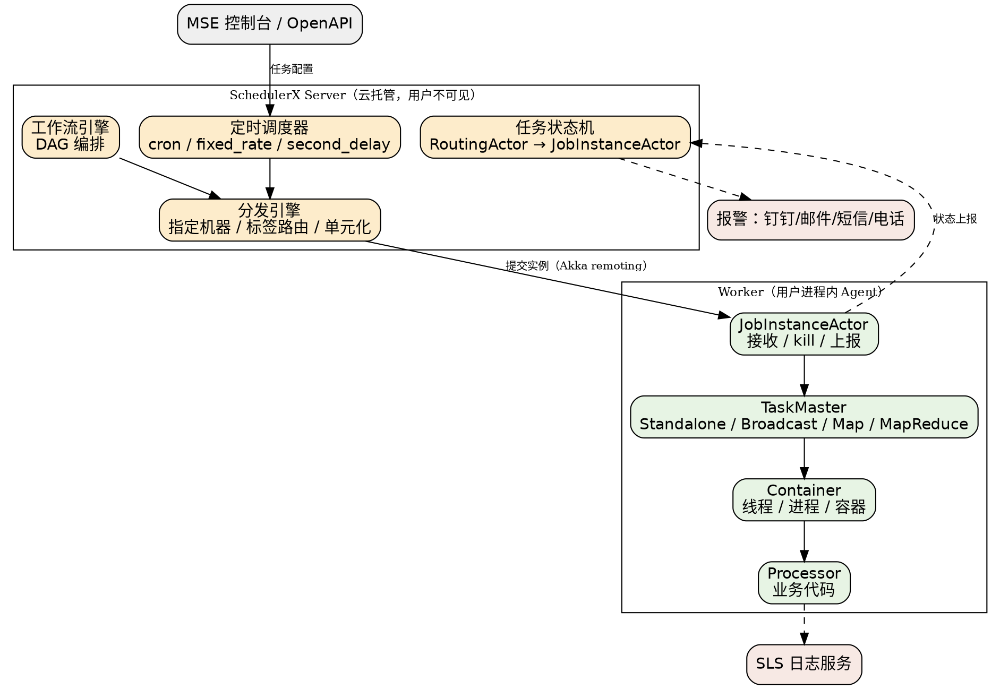

## Introduction

SchedulerX 是**阿里巴巴自研的商业化分布式任务调度平台**（本仓库文件名沿用旧写法 `ScheduleX.md`，官方写法为 **SchedulerX**），托管在阿里云 MSE（微服务引擎）之下，对外以"分布式任务调度 SchedulerX 版"售卖。它兼容开源 XXL-JOB / ElasticJob / Spring Schedule / K8s Job，支持 Cron 定时、一次性任务、可视化工作流任务编排与分布式跑批，并集成监控大盘、日志服务与多渠道报警。

本页是 Job 子树里 SchedulerX 的枢纽，父级入口见 [Job](/docs/CS/Framework/Job/Job.md)。

它与本子树另外三族（[Quartz](/docs/CS/Framework/Job/Quartz.md)、[XXL-JOB](/docs/CS/Framework/Job/xxl-job.md)、[ElasticJob](/docs/CS/Framework/Job/ElasticJob.md)、[PowerJob](/docs/CS/Framework/Job/PowerJob.md)）的根本差别不在功能多少，而在**它是云托管服务而不是可自建的软件**：Server 端不对用户开放，用户只持有 Worker（Agent）侧；调度能力、执行历史、报警链路、日志服务都按云产品的方式计费与运维。因此读 SchedulerX 的正确姿势不是"读源码"，而是"读客户端 SDK + 读服务端发布记录"。

> [!NOTE]
>
> 版本基线（2026-10-27 现场核实）：Java SDK `com.aliyun.schedulerx:schedulerx2-worker` 最新 **1.14.2**（Maven Central `maven-metadata.xml`，`lastUpdated=20260805040521`），`schedulerx2-spring-boot-starter` 同步 1.14.2。Go SDK 为独立仓库 `alibaba/schedulerx-worker-go`（无 release tag，以 `develop` 分支为准）。服务端能力以阿里云「服务端发布记录」为准（最近一次 2026-09-16）。本子树全部断言锚定上述来源；社区文章与早期博客（含 2019 年的 Akka 系列）只作架构原理佐证，不作版本事实来源。

## Product Editions

阿里云"分布式任务调度"目录下有两个不同的产品形态，选型第一步就是分清它们：

| 维度 | SchedulerX 版 | XXL-JOB 版 |
| :--- | :--- | :--- |
| 内核 | 阿里云自研调度内核 | 同样以 SchedulerX 为内核，但**兼容开源 XXL-JOB 通信协议** |
| 接入方式 | 需替换 SDK（引入 `schedulerx2-worker` / Go SDK / 脚本 / HTTP / K8s） | **无侵入**：不改代码，重新部署时以 `-D` 参数替换接入配置 |
| 计费 | Serverless：按任务托管 CU + 任务调度 CU | 实例型：按申请规格（包年包月 / 按量） |
| 公网应用 | 支持 | **不支持公网访问** |
| 语言覆盖 | Java / Go SDK + 脚本任务（shell、python、go）+ HTTP + K8s | 仅 Java / Go SDK |
| 适用判断 | 新接入、非 Java/Go 应用、公网部署 | 存量自建 XXL-JOB 平滑迁移上云 |

SchedulerX 版内部再分**基础版**与**专业版**，差异不是"能不能用"，而是"运维能力到哪一层"：

| 能力 | 基础版 | 专业版 |
| :--- | :--- | :--- |
| 日志服务 | 支持（每个任务限流 5 条/秒） | 支持 |
| 查看堆栈 / Tracing / 用户大盘 / 工作流实例图 | 不支持 | 支持 |
| 链路加密、标签路由策略 | 不支持 | 支持 |
| 可视化 MapReduce | 最多 300 子任务、无搜索 | 最多 1000 子任务、可自定义标签、有搜索 |
| 历史执行记录 | 最近 30 条 | 最近 300 条 + 60 天内归档可查 |
| 报警渠道 | 钉钉、邮件 | 钉钉、邮件、短信、电话、企业微信、飞书 |
| 单应用任务数上限 | 1000 | 10 万 |
| OpenAPI | 仅创建/更新/删除任务 | 全部 API |
| 计费项 | 任务托管 CU | 任务托管 CU + 任务调度 CU |

计费公式里藏着两条对架构有指导意义的事实：**任务托管 CU = 启用的单机任务数 + 启用的非单机任务数 × Worker 数**（即广播/分片/MapReduce 的代价随执行端规模线性放大）；**任务调度 CU = 每次调度涉及的 Worker 数**，且 `second_delay` 类型每分钟只计一次调度 CU。换句话说，秒级任务的调度成本被刻意压低，而"让多台机器同时跑"是非单机任务的真实成本项。

## Architecture

SchedulerX 是**中心化（Server/Worker）架构**，这一点与 XXL-JOB 同族、与 ElasticJob 相反。但它的 Server 侧是云托管的多租户集群，用户可见的只有 Worker Agent。



三件事值得单独拎出来：

- **Server 无状态 + Akka 异步**：官方对高性能的解释是"分布式架构 + Akka 异步特性，支持海量任务和秒级别调度"。Server 端的定时调度器、工作流引擎、任务状态机都是 actor 模型，消息经 Akka eventbus 做 Pub-Sub。
- **状态机靠 actor 顺序性保证**：所有实例状态消息先发给 `JobInstanceRoutingActor`，由它把同一 `instanceId` 的消息路由到同一个 `JobInstanceActor`；Akka 保证单 actor 按接收顺序处理，从而避免"先收到 failed 后收到 running"导致的状态机倒退。对使用者而言，这条设计意味着**状态乱序不是业务需要担心的问题**。
- **Worker 三层结构**：`TaskMaster`（类似 YARN 的 AppMaster，管理整个 jobInstance 生命周期与子任务分发，默认实现有 Standalone / Broadcast / Map / MapReduce 四种）→ `Container`（执行容器，支持线程/进程/docker/actor）→ `Processor`（业务代码）。这也是"几行代码就能分布式跑批"的由来：业务只写 Processor，分发与容错在 TaskMaster 层。

概念模型按官方定义收敛为五个词：**AppGroup（应用分组，隔离单位，生成 groupId）→ Job（最小调度单元）→ Job Instance（一次执行）→ Task（Map 产生的子任务）→ Workflow（编排 Job 的 DAG）**。另有 **schedule time**（预定执行时刻，`context.getScheduleTime()`）与 **data time**（数据时间，`context.getDataTime()`）两个时间语义，后者是"每天 00:30 跑但处理前一天数据"这类场景的官方解法。

## How to Read This Subtree

按"先分清你买的是哪个版本 → 再看任务怎么跑 → 最后查运维"的顺序读：

- 架构与概念模型看 [Architecture](/docs/CS/Framework/Job/ScheduleX/Architecture.md)：Server/Worker 拓扑、Akka actor 与状态机、Worker 三层、命名空间/应用分组隔离、高可用与安全防护手段。
- 任务长什么样看 [Job Types](/docs/CS/Framework/Job/ScheduleX/Job_Types.md)：九种 JobType、六种 ExecuteMode、Map/MapReduce 编程模型、推/拉两种子任务分发方式与三条硬限制（64 KB / 1000 B / 不保证精确一次）。
- 什么时候触发看 [Timing](/docs/CS/Framework/Job/ScheduleX/Timing.md)：cron / fixed_rate / second_delay / one_time 四种时间类型、日历、时区、数据时间偏移与重刷数据、指定机器与标签路由。
- 多任务依赖看 [Workflow](/docs/CS/Framework/Job/ScheduleX/Workflow.md)：DAG 编排、上下游数据传递、重跑与跳过、跨应用编排与"只有 Java 任务支持数据传输"这条硬限制。
- 怎么接入看 [Client Access](/docs/CS/Framework/Job/ScheduleX/Client_Access.md)：Java SDK 与 Spring Boot Starter、`SchedulerxWorker` 配置参数表、Go SDK、脚本/HTTP/K8s 任务、兼容开源客户端的插件、优雅下线。
- 上线之后看 [Operations](/docs/CS/Framework/Job/ScheduleX/Operations.md)：流控与优先级队列、重试与超时、报警与监控、日志、版本与计费要点、以及一份按报错信息组织的排障清单。

```text
                    ┌─ Architecture ──── Server/Worker、Akka、Worker 三层、隔离
                    │
                    ├─ Job Types ─────── JobType / ExecuteMode / MapReduce / 限制
                    │
            枢纽 ScheduleX ─┼─ Timing ────────── 时间类型 / 日历 / 时区 / 数据时间
            (版本/架构/对比) │
                    ├─ Workflow ──────── DAG 编排 / 数据传递 / 重跑与跳过
                    │
                    ├─ Client Access ─── SDK / Starter / Go / 脚本 / HTTP / K8s
                    │
                    └─ Operations ────── 流控 / 报警 / 日志 / 计费 / 排障
```

## Comparison

| 维度 | SchedulerX | XXL-JOB | ElasticJob | PowerJob |
| :--- | :--- | :--- | :--- | :--- |
| 形态 | 云托管服务（Server 不可自建） | 自建平台 | 内嵌 jar + ZK | 自建平台 |
| 拓扑 | 中心化 Server/Worker | 调度中心 + 执行器 | 去中心化（节点对等） | Server/Worker 多活分片 |
| Worker 通信 | 自研协议（Akka remoting 系） | HTTP | ZK 协商 | 自研 remote（akka / MU） |
| 调度精度 | 秒级（可毫秒级 `second_delay`） | 秒级时间轮 | 秒级（内嵌 Quartz） | 毫秒级时间轮 |
| 分布式计算 | Map / MapReduce / 内存网格 / 分片 | 分片广播 | 分片 | Map / MapReduce |
| 工作流 DAG | 原生可视化 | 无（父子任务模拟） | 不支持 | 原生 Workflow |
| 多语言 | Java/Go SDK + 脚本 + HTTP + K8s | Java + GLUE 脚本 | Java | Java + Shell/Python |
| 运维界面 | MSE 控制台（含计费） | 自带 Web UI | ElasticJob-UI | 自带 Console |
| 成本模型 | 任务托管 CU + 任务调度 CU | 机器成本 | 机器 + ZK 成本 | 机器成本 |

一句话取舍：**已经在阿里云上、不希望自建调度平台、且需要秒级调度或轻量分布式计算，SchedulerX 是阻力最小的选项**；它的代价是强绑定云厂商、Server 端不可控、以及非单机任务按 Worker 数线性计费。**要完全自控、代码即基础设施，选 XXL-JOB / PowerJob；已有 ZK 且任务天然分片，选 ElasticJob。**

## Version Facts

客户端（Java SDK，官方 Java SDK release notes）：

- **1.14.2**（2026-08-05）：`JobContext` 可获取工作流参数；脚本任务支持强制终止；`clientInfo.log` 打印完整脚本输出（便于 SLS 采集）。
- **1.14.0**（2026-07-30）：支持脚本任务子进程强制终止。
- **1.13.5**（2026-03-20）：`second_delay` 任务支持优雅下线；脚本任务支持工作流上下游数据传递。
- **1.13.4**（2026-02-13）：K8s 应用模式下 CPU 采集支持 cgroup v2。
- **1.13.3**（2026-01-15）：Spring 任务兼容 Spring 7.x。
- **1.13.1**（2025-07-28）：修复 Spring 父子容器场景下心跳注册过早上报；修复升级 SDK 时 map 任务意外停止。
- **1.13.0**（2025-06-18）：新增链路加密（专业版，加密 Server-Client 通信中的敏感数据）。
- **1.12.7**（2025-05-29）：Spring 升至 5.3.31 修安全漏洞；重构脚本任务占位符逻辑。
- **1.12.2**（2024-11-20）：修复可视化 MapReduce 安全漏洞；**修复部分 Akka 接口安全漏洞**（这条同时是"Server/Worker 仍走 Akka 协议"的直接证据）。
- **1.12.1**（2024-10-12）：新增 `@SchedulerX` 注解，可配合 Spring `@Scheduled` 接管部分 Spring 定时任务；移除 fastjson。
- **1.12.3**（2025-01-03）：支持 `-Dschedulerx.log.path=` 配置 SDK 日志目录，支持覆盖默认 logback 配置。

服务端（阿里云服务端发布记录摘要，最近三次）：

- **2026-09-16**：任务支持配置过期时间，过期后默认自动禁用；任务超时终止后支持失败自动重试；支持任务同步到同命名空间其他应用；工作流支持一键导入。
- **2026-08-05**：工作流参数（需 SDK ≥ 1.14.2 获取）；工作流画布升级，坐标不丢失；工作流管理拆分基本信息与 DAG 编辑。
- **2026-07-30**：客户端 1.14.0；工作流中任务可禁用（跳过执行）；修复失败重试任务有概率卡住。

> [!WARNING]
>
> 网上大量 SchedulerX 资料停留在 2019～2021 年（EDAS 时代的文档、个人博客、CSDN 转载），其中"控制台入口在 EDAS""按实例规格计费"等说法已过时：控制台现归 MSE，SchedulerX 版改 Serverless 计费，XXL-JOB 版才是实例型。以阿里云帮助中心 `schedulerx` 目录下现行文档与两份 release notes 为准。

## Links

- [Job](/docs/CS/Framework/Job/Job.md)
- [Architecture](/docs/CS/Framework/Job/ScheduleX/Architecture.md)
- [Job Types](/docs/CS/Framework/Job/ScheduleX/Job_Types.md)
- [Timing](/docs/CS/Framework/Job/ScheduleX/Timing.md)
- [Workflow](/docs/CS/Framework/Job/ScheduleX/Workflow.md)
- [Operations](/docs/CS/Framework/Job/ScheduleX/Operations.md)

## References

- [什么是分布式任务调度 SchedulerX](https://help.aliyun.com/zh/schedulerx/schedulerx-serverless/product-overview/what-is-schedulerx/)
- [什么是分布式任务调度（SchedulerX 版与 XXL-JOB 版选型）](https://help.aliyun.com/zh/doc-detail/2846644.html)
- [计费概述（基础版 / 专业版、任务托管 CU、任务调度 CU）](https://help.aliyun.com/zh/schedulerx/schedulerx-serverless/product-overview/billing-1/)
- [Java SDK release notes](https://www.alibabacloud.com/help/en/schedulerx/product-overview/java-sdk-release-notes)
- [服务端发布记录](https://help.aliyun.com/zh/document_detail/2950302.html)
- [产品优势（高可用 / 安全防护）](https://help.aliyun.com/document_detail/303859.htm)
- [Akka in SchedulerX 2.0（阿里云开发者社区）](https://developer.aliyun.com/article/709946)
- [schedulerx-worker-go（Go SDK）](https://github.com/alibaba/schedulerx-worker-go)
