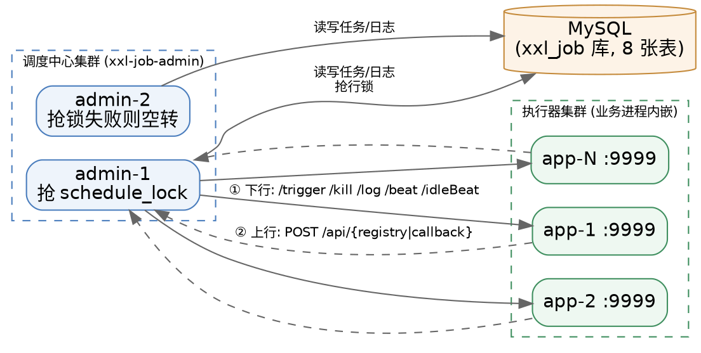

## Introduction

XXL-JOB 是一个分布式任务调度平台，核心设计目标是开发迅速、学习简单、轻量级、易扩展。它把调度行为抽象形成"调度中心"公共平台，而平台自身并不承担业务逻辑；将任务抽象成分散的 JobHandler，交由"执行器"统一管理——"调度"和"任务"两部分相互解耦，提高系统整体稳定性和扩展性。

这个二段式切分是理解全平台的钥匙：**调度中心是"大脑 + 账本"，执行器是"手脚"**。调度中心只做四件事——算下次触发时刻、选一台执行器、发一次 HTTP 请求、回收执行结果；执行器只做三件事——注册自己、收请求跑业务、把结果送回去。业务代码从不进入调度中心，调度逻辑也从不进入执行器，两端唯一的契约是一组 HTTP 接口。

存储只支持 MySQL；调度中心支持集群部署，集群情况下各节点务必连接同一个 MySQL 实例；如果 MySQL 做主从，调度中心集群节点务必强制走主库。建表 SQL 位于源码 `doc/db/tables_xxl_job.sql`（8 张表，见 [Data Model](/docs/CS/Framework/Job/xxl-job/Data_Model.md)）。

```xml
<!-- http://repo1.maven.org/maven2/com/xuxueli/xxl-job-core/ -->
<dependency>
    <groupId>com.xuxueli</groupId>
    <artifactId>xxl-job-core</artifactId>
    <version>3.5.0</version>
</dependency>
```

本篇是总览与架构全景：部署拓扑、模块划分、线程模型、调度内核、触发链路、策略族谱与可靠性设计。源码级实现细节按职责拆分到十篇分册，架构决策的"为什么"留在本篇，逐行代码留到分册。

## Architecture

### Deployment Topology

三个角色、两条通讯方向：



- **下行（调度中心 → 执行器）**：调度中心以 HTTP 客户端身份直连执行器的 Netty 端口，URI 只有 `/beat`、`/idleBeat`、`/trigger`、`/kill`、`/log` 五个（3.5.0 起原 `/run` 改名为 `/trigger`）。连接信息按需构建并缓存，详见 [OpenAPI](/docs/CS/Framework/Job/xxl-job/OpenAPI.md)。
- **上行（执行器 → 调度中心）**：执行器以 HTTP 客户端身份 POST 调度中心的 `/api/{uri}`，只做注册摘除与结果回调两件事（3.5.0 起新增任务管理类 OpenAPI）。
- **两者都是客户端主动发起**，没有任何长连接或消息中间件——这是 XXL-JOB 部署成本极低的根本原因，也是它在超大规模执行器场景下心跳压力集中在 DB 的代价来源。

### Module Split

| 模块 | 角色 | 关键类（3.5.0） |
| :--- | :--- | :--- |
| `xxl-job-core` | 执行器内核，业务方唯一依赖 | `XxlJobExecutor` / `XxlJobSpringExecutor`、`EmbedServer`（Netty）、`JobThread`、`ExecutorBizImpl`、`GlueFactory` |
| `xxl-job-admin` | 调度中心，Spring Boot Web 应用 | `XxlJobAdminBootstrap`、`JobScheduleHelper`、`JobTriggerPoolHelper`、`JobTrigger`、路由/misfire/调度类型策略包 |
| `xxl-job-executor-samples` | 示例执行器（含 3.5.0 新增的 AI 执行器 Sample） | Spring Boot / 无框架 / AI（Ollama、Dify、OpenClaw）三种 |

3.5.0 起 `xxl-job-admin` 的内部包结构做了整体归位：**调度相关代码统一收敛到 `business/scheduler` 包下**，其下按职责再分 `thread`（6 个后台 Helper）、`trigger`、`route`、`misfire`、`type`、`openapi`、`complete`、`alarm`。3.5.0 之前这些类散落在 `core/route`、`core/thread`、`core/trigger` 里。

### Thread Model

架构的核心不在类图，而在"有多少条常驻线程在跑"。调度中心侧 6 条 + 执行器侧 4 条，构成全部运转逻辑：

| 侧 | 线程 / 池 | 周期或容量 | 职责 | 分册 |
| :--- | :--- | :--- | :--- | :--- |
| admin | `JobScheduleHelper#scheduleThread` | 1s（对齐整秒） | 抢锁 → 预读未来 5s 到期任务 → 推进下次触发时刻 → 过期任务按 misfire 处理 | [Scheduler](/docs/CS/Framework/Job/xxl-job/Scheduler.md) |
| admin | `JobScheduleHelper#ringThread` | 1s（跳一格） | 取当前秒及前 2 个秒槽的 jobId，投递触发线程池 | [Scheduler](/docs/CS/Framework/Job/xxl-job/Scheduler.md) |
| admin | `JobTriggerPoolHelper` fast/slow 池 | 默认 300 / 200 | 执行真正的触发动作；慢任务自动降级 | [Trigger](/docs/CS/Framework/Job/xxl-job/Trigger.md) |
| admin | `JobRegistryHelper#registryMonitorThread` | 30s | 剔除死亡机器、回写地址簿、刷新执行器本地缓存 | [Registry](/docs/CS/Framework/Job/xxl-job/Registry_And_Discovery.md) |
| admin | `JobFailAlarmMonitorHelper#monitorThread` | 10s | 扫失败日志 → 触发失败重试 → 发邮件告警 | [Log And Alarm](/docs/CS/Framework/Job/xxl-job/Log_And_Alarm.md) |
| admin | `JobCompleteHelper#jobMonitorThread` | 60s | "结果丢失"兜底：运行超 10min 无回调的日志强制置失败 | [Log And Alarm](/docs/CS/Framework/Job/xxl-job/Log_And_Alarm.md) |
| admin | `JobLogReportHelper#logReportThread` | 60s | 刷新近 3 天运行报表；每天清理一次过期日志 | [Log And Alarm](/docs/CS/Framework/Job/xxl-job/Log_And_Alarm.md) |
| exec | `EmbedServer` 主服务线程 | Netty boss/worker | 监听端口，把请求丢进 `bizThreadPool`（0/200，队列 2000） | [Executor](/docs/CS/Framework/Job/xxl-job/Executor.md) |
| exec | `ExecutorRegistryThreadHelper#registryThread` | 30s | 向所有调度中心发注册保活；停机发摘除 | [Registry](/docs/CS/Framework/Job/xxl-job/Registry_And_Discovery.md) |
| exec | `TriggerCallbackThreadHelper` 回调队列 | 1s 或满 50 条 | 批量回传执行结果；全失败则落盘，30s 重试一次 | [Executor](/docs/CS/Framework/Job/xxl-job/Executor.md) |
| exec | `JobLogFileCleanThreadHelper` | 1 天 | 按 `logRetentionDays` 清理本地日志文件 | [Executor](/docs/CS/Framework/Job/xxl-job/Executor.md) |
| exec | `JobThread`（每 jobId 一条，按需创建） | 队列驱动 | 串行消费该 job 的触发请求，空闲 90s 自我销毁 | [Block Strategy](/docs/CS/Framework/Job/xxl-job/Block_Strategy.md) |

这个线程清单解释了 XXL-JOB 的两个性格：**调度中心是"轮询 + 扫库"而非事件驱动**（除触发外所有动作都是周期性批量处理），**执行器是"线程 + 队列"而非线程池**（每个 job 一条专属线程，天然串行）。

### Scheduling Core

调度中心刻意不引入 Quartz，用自研的"秒级预读 + 60 槽时间轮"实现调度：

1. `scheduleThread` 每秒抢一次 `xxl_job_lock` 表的 `schedule_lock` 行锁（集群内同时只有一个节点扫库），在事务里预读未来 `PRE_READ_MS = 5000ms` 内到期的任务；
2. 到期任务分三支处理——过期超 5s 走 misfire 策略、已到期立即触发、未到期挂进时间轮；
3. `ringThread` 每秒从 `Map<秒槽, List<jobId>>` 里取当前秒与前 2 个秒槽（防跨刻度漏读）的 jobId 投递触发。

**为什么是"预读 + 时间轮"而不是一次性全量扫？** 把"决定触发"从 DB 扫描路径上摘下来：DB 只承担秒级批量的预读，秒级精度由内存时间轮负责，DB 压力与任务总量解耦。代价是时间轮是**纯内存**的——调度中心进程重启，已入轮的这一轮触发会丢失，靠 misfire 补偿。完整的常量、事务边界、优雅停机逻辑见 [Scheduler](/docs/CS/Framework/Job/xxl-job/Scheduler.md)。

预读量按线程池容量估算：`(triggerPoolFastMax + triggerPoolSlowMax) × 10`，即假设单次触发耗时 100ms、单线程 QPS 10。

### Trigger Pipeline

一次触发的完整链路是"三段六步"，横跨两个进程：

| 步骤 | 位置 | 动作 |
| :--- | :--- | :--- |
| 1 | `JobTriggerPoolHelper.trigger` | 按 jobId 的历史超时计数选 fast / slow 池 |
| 2 | `JobTrigger.trigger` | 加载 jobInfo、确定分片参数；`SHARDING_BROADCAST` 时按机器数展开成 N 次调用 |
| 3 | `JobTrigger.processTrigger` | **先落一条 `xxl_job_log`**（拿到 logId），拼 `TriggerRequest` |
| 4 | 路由 | 按策略选地址；分片广播直接按下标取地址 |
| 5 | `doTrigger` | HTTP 调执行器 `/trigger`，拿返回码 |
| 6 | 回写 | 把触发结果、地址、路由过程全部拼进 `trigger_msg` 更新日志 |

关键设计是**第 3 步先落日志**：logId 在触发前就已生成并随请求下发，因此执行器的回调天然能对上号；即使执行器整个不可达，调度中心也留下了一条"触发失败"的可观测记录。执行器侧拿到 logId 后还会用它做**触发去重**（同一 logId 重复投递直接拒收），这是网络重发与调度中心重试的安全网。详见 [Trigger](/docs/CS/Framework/Job/xxl-job/Trigger.md)。

### Execution Model

任务以 GLUE 类型区分装载方式，3.5.0 共 8 种：

| 类型 | 命令 | 后缀 | 说明 |
| :--- | :--- | :--- | :--- |
| `BEAN` | — | — | 执行器内 `@XxlJob` 注解方法，反射调用 |
| `GLUE_GROOVY` | — | — | Groovy 源码存调度中心，执行时下发、编译、装载 |
| `GLUE_SHELL` | `bash` | `.sh` | 脚本类：落盘生成脚本文件后 fork 进程执行 |
| `GLUE_PYTHON` | `python3` | `.py` | 同上 |
| `GLUE_PYTHON2` | `python` | `.py` | 同上（Python 2 已 EOL，保留兼容） |
| `GLUE_NODEJS` | `node` | `.js` | 同上 |
| `GLUE_POWERSHELL` | `pwsh` | `.ps1` | 3.4.2 起改用 PowerShell 7 的 `pwsh`，执行器需装 PS 7.0+ |
| `GLUE_PHP` | `php` | `.php` | 同上 |

3.5.0 新增执行器维度的 GLUE 开关 `xxl.job.executor.glueenabled`（默认 true）：关闭后执行器收到任何非 BEAN 类型的触发请求会直接拒绝，可用于禁止在业务机器上跑动态代码。GLUE 源码的编译缓存、脚本落盘与分片传参见 [GLUE](/docs/CS/Framework/Job/xxl-job/GLUE.md)。

## Strategy Family

四个正交的策略维度，各自一个枚举 + 一个策略实现族，全部在触发前完成决策：

| 维度 | 枚举（3.5.0 位置） | 取值数 | 作用点 | 分册 |
| :--- | :--- | :--- | :--- | :--- |
| 路由策略 | `ExecutorRouteStrategyEnum`（admin） | 10 | 决定请求发往哪台执行器 | [Route Strategy](/docs/CS/Framework/Job/xxl-job/Route_Strategy.md) |
| 阻塞策略 | `ExecutorBlockStrategyEnum`（core） | 3（第 4 种已注释废弃） | 决定执行器端"跑不过来"时怎么办 | [Block Strategy](/docs/CS/Framework/Job/xxl-job/Block_Strategy.md) |
| 过期策略 | `MisfireStrategyEnum`（admin） | 2 | 决定调度中心错过触发时刻怎么办 | [Scheduler](/docs/CS/Framework/Job/xxl-job/Scheduler.md) |
| 调度类型 | `ScheduleTypeEnum`（admin） | 3（`FIX_DELAY` 已注释未启用） | 决定下次触发时刻怎么算 | [Scheduler](/docs/CS/Framework/Job/xxl-job/Scheduler.md) |

### Route Strategy

| 策略 | 语义 | 是否需要网络探测 |
| :--- | :--- | :--- |
| `FIRST` / `LAST` | 固定首 / 末个地址 | 否 |
| `ROUND` | 轮询（计数按 jobId 独立，初值随机） | 否 |
| `RANDOM` | 随机 | 否 |
| `CONSISTENT_HASH` | 按 **jobId** 做 100 虚拟节点一致性哈希 | 否 |
| `LEAST_FREQUENTLY_USED` | LFU，计数最小者当选 | 否 |
| `LEAST_RECENTLY_USED` | LRU，最久未用者当选 | 否 |
| `FAILOVER` | 顺序 `/beat`，第一个存活的当选 | 是，逐台探测 |
| `BUSYOVER` | 顺序 `/idleBeat`，第一个空闲的当选 | 是，逐台探测 |
| `SHARDING_BROADCAST` | 所有机器各执一个分片（无 router 实现） | 否 |

> [!WARNING]
>
> 常见误述是"一致性哈希按任务参数哈希，同参数落到同机"。3.5.0 源码 `ExecutorRouteConsistentHash.route()` 传的是 **`triggerParam.getJobId()`**，哈希键是 jobId 而非任务参数——语义是"同一任务固定落到同一台机器"，不是"同参数落到同机"。

### Block Strategy

阻塞处理策略是"调度过于密集、执行器来不及处理"时的行为约定，生效位置在**执行器入队前**（不是调度中心）：

| 策略 | 语义 |
| :--- | :--- |
| `SERIAL_EXECUTION`（默认） | 单机串行：同一 job 的触发进同一队列顺序执行 |
| `DISCARD_LATER` | 丢弃后续调度：运行中则直接拒绝本次触发 |
| `COVER_EARLY` | 覆盖之前调度：kill 掉运行中的旧 JobThread，立即执行本次 |
| ~~`CONCURRENT_EXECUTION`~~ | ~~并行执行~~：枚举中已注释废弃，3.5.0 不可选 |

### Misfire Strategy

| 策略 | 语义 |
| :--- | :--- |
| `DO_NOTHING`（默认） | 忽略本次，从当前时刻重算下次触发时间 |
| `FIRE_ONCE_NOW` | 立即补偿触发一次，再从当前时刻重算 |

### Schedule Type

| 类型 | 语义 |
| :--- | :--- |
| `NONE` | 不自动调度（靠 API / 人工 / 父任务触发） |
| `CRON` | Cron 表达式，自研 `CronExpression` 解析（7 位，支持秒） |
| `FIX_RATE` | 固定速率，配置值为秒数，对齐整秒 |
| ~~`FIX_DELAY`~~ | ~~固定延时~~：3.5.0 枚举中已注释，**未启用** |

> [!NOTE]
>
> 官方文档仍把"固定延时触发"列在触发策略清单里，但 3.5.0 的 `ScheduleTypeEnum` 中 `FIX_DELAY` 是注释掉的枚举常量，`JobCompleter` 里对应的"fix_delay trigger next"也标注 `on the way`。**当前可用的是 CRON 与 FIX_RATE 两种周期类型。**

## Reliability Design

| 风险 | 机制 | 代价 |
| :--- | :--- | :--- |
| 调度中心单点 | 集群部署 + `xxl_job_lock` 行锁互斥扫库 | 同一时刻只有一个节点在扫，其余空转；DB 是事实上的单点写 |
| 执行器宕机 | 30s 心跳、90s（`DEAD_TIMEOUT = BEAT_TIMEOUT × 3`）剔除 | 最长 90s 内仍可能把请求发给已死机器，由 `FAILOVER` 或触发失败兜住 |
| 调度中心整体不可达 | 执行器回调落本地 `callbacklogs/` 文件，每 30s 重发 | 执行器本地多一份待同步状态，磁盘需可写 |
| 回调彻底丢失 | `JobCompleteHelper` 每 60s 把"运行超 10min 无回调"的日志强制置失败 | 最长 10min 的状态不确定窗口 |
| 任务执行失败 | 失败重试（`executor_fail_retry_count`）+ 邮件告警 | 重试是**重新触发**而非续跑，任务需幂等 |
| 单机跑不过来 | 阻塞策略 + 快/慢池降级 | `DISCARD_LATER` 会静默丢弃，需在日志里看得到 |
| 进程被 kill | 调度中心停机等时间轮排空（10s）；执行器停机等任务跑完（5s）后再 interrupt | 优雅停机窗口有限，超时仍会强杀 |
| 重复触发 | 执行器侧 `triggerLogIdSet` 按 logId 去重；调度中心侧 `handleCode > 0` 判重 | 依赖 logId 唯一，跨分片时按分片展开成不同 logId |

## Version Baseline

版本基线 **v3.5.0**，依赖基线（取自 `pom.xml`）：

| 依赖 | 版本 |
| :--- | :--- |
| JDK（编译 source/target） | 17 |
| Spring Boot / Spring | 4.1.1 / 7.0.9 |
| MyBatis Spring Boot Starter | 4.1.0 |
| MySQL Connector/J | 26.7.0 |
| Netty | 4.2.19.Final |
| Groovy | 6.0.0 |
| Gson | 2.14.0 |
| xxl-sso | 2.4.1 |
| xxl-tool | 2.5.2 |

调度中心关键配置默认值（`application.properties`）：

| 配置 | 默认 | 说明 |
| :--- | :--- | :--- |
| `xxl.job.timeout` | 3 | 调度中心调执行器的连接/读超时（秒），合法区间 1~10，越界回落 3 |
| `xxl.job.triggerpool.fast.max` | 300 | 快池最大线程，小于 200 时按 200 兜底 |
| `xxl.job.triggerpool.slow.max` | 200 | 慢池最大线程，小于 100 时按 100 兜底 |
| `xxl.job.schedule.batchsize` | 100 | 预读结果分批回写的批大小，合法区间 50~500 |
| `xxl.job.logretentiondays` | 30 | 小于 3 时返回 -1（即关闭清理） |
| `xxl.job.i18n` | zh_CN | 仅 `zh_CN` / `zh_TC` / `en` 三者生效，其它回落 `zh_CN` |

升级到 3.5.0 需要注意的 breaking change：

- **AccessToken 改为执行器维度**（`xxl_job_group.access_token`），全局 AccessToken 废弃。因为通讯协议随之变化，**调度中心与执行器必须一并升级到 3.5.0**，不能只升一端。
- 请求需同时携带 `XXL-JOB-ACCESS-TOKEN` 与 `XXL-JOB-APPNAME` 两个 header（旧版只校验 token）。
- 执行器 URI `/run` 更名为 `/trigger`，DTO `TriggerParam` 更名为 `TriggerRequest`，`ExecutorBiz.run()` 更名为 `trigger()`。
- `xxl_job_group.title` 改名 `name`，`xxl_job_info.job_desc` 改名 `name`，`app_name` 加唯一索引，`xxl_job_log` 加 `i_alarm_status` 索引。
- 建表预置数据新增 `xxl-job-executor-sample-ai` 执行器与 Ollama / Dify / OpenClaw 三个 AI 示例任务。

## Subtree Organization

本子树为"枢纽 + 十篇分册"，基线统一为 3.5.0 源码（tag `3.5.0`）。

- **枢纽（本篇）**只承载架构决策与横向对照：拓扑、模块、线程模型、策略族谱、可靠性矩阵、版本基线。凡是"为什么这么设计"在这里，"代码怎么写"在分册。
- **同一结论只有归属分册可以展开写**，其它页只链接不重述。例如预读窗口 5s 只在 [Scheduler](/docs/CS/Framework/Job/xxl-job/Scheduler.md) 展开，路由策略的虚拟节点数只在 [Route Strategy](/docs/CS/Framework/Job/xxl-job/Route_Strategy.md) 展开。
- **分册之间按触发时序串联**：Scheduler（决定何时触发）→ Trigger（决定发给谁、怎么发）→ Executor（收到后怎么跑）→ Block Strategy（跑不过来怎么办）→ Log And Alarm（结果怎么回收）。
- 版本事实一律回到 tag 源码核对，不引用二手博客。3.5.0 相对 2.x/3.0 的包路径与类名变动已在 [Version Baseline](#version-baseline) 列出。

```
xxl-job (枢纽)
├─ Scheduler             时间轮 / 预读 / 事务与锁 / misfire / 调度类型
├─ Trigger               触发链路 / 日志先行 / 分片展开 / 快慢池
├─ Executor              启动链 / Netty / 请求分发 / JobThread / 回调
├─ Block Strategy        阻塞策略 / JobThread 队列模型 / 超时中断
├─ Route Strategy        10 种路由 / 一致性哈希 / 探测型路由
├─ Registry And Discovery 注册表 / 地址簿 / 本地缓存 / 死亡剔除
├─ Data Model            8 张表 / 字段 / 索引 / 状态机
├─ GLUE                  Groovy 编译缓存 / 脚本落盘 / glueenabled
├─ OpenAPI               协议 / 双 header 鉴权 / 任务管理 API
└─ Log And Alarm         日志落盘 / 回调补偿 / 失败重试 / 邮件告警
```

## Links

- [Job](/docs/CS/Framework/Job/Job.md)
- [PowerJob](/docs/CS/Framework/Job/PowerJob.md)
- [ElasticJob](/docs/CS/Framework/Job/ElasticJob.md)
- [Quartz](/docs/CS/Framework/Job/Quartz.md)
- [Scheduled Task](/docs/CS/SE/Scheduled_Task.md)
- [Task](/docs/CS/Framework/Spring/Task.md)

## References

- [XXL-JOB 官方文档](http://www.xuxueli.com/xxl-job/)
- [XXL-JOB GitHub](https://github.com/xuxueli/xxl-job)
- [XXL-JOB Releases](https://github.com/xuxueli/xxl-job/releases)
- [XXL-JOB v3.5.0 Release Note](https://github.com/xuxueli/xxl-job/releases/tag/3.5.0)
