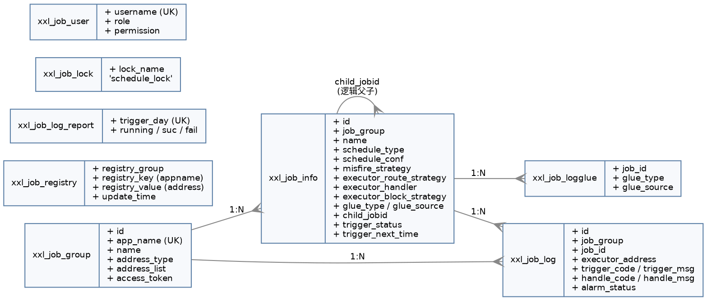

## Introduction

XXL-JOB 的存储只支持 MySQL，共 8 张表（建表脚本 `doc/db/tables_xxl_job.sql`）。表结构本身就是架构说明书：**任务元数据、在线机器、执行日志、分布式锁**四类职责泾渭分明，没有冗余表，没有存储过程。

本篇逐表列字段、索引与状态机语义，并给出几条高频查询对应的索引使用情况。源码基线 tag `3.5.0`——注意 3.5.0 做了一轮"数据模型标准化"，`xxl_job_group.title` 与 `xxl_job_info.job_desc` 统一改名为 `name`，升级脚本见 [xxl-job](/docs/CS/Framework/Job/xxl-job.md) 的版本基线章节。

## Overview

| 表 | 职责 | 写入方 | 体量特征 |
| :--- | :--- | :--- | :--- |
| `xxl_job_group` | 执行器清单（含 accessToken、地址簿） | 人工 + 注册监控线程 | 小（十~百级） |
| `xxl_job_registry` | 在线机器注册表 | 执行器注册 | 小（= 机器数） |
| `xxl_job_info` | 任务定义与调度状态 | 人工 + 扫库线程 | 中（千级） |
| `xxl_job_log` | 每次触发的执行记录 | 触发 + 回调 | **大，持续增长** |
| `xxl_job_logglue` | GLUE 源码历史版本 | 人工 | 小 |
| `xxl_job_log_report` | 按天运行报表 | 报表线程 | 小（= 天数） |
| `xxl_job_lock` | 分布式锁（一行 `schedule_lock`） | 建表时初始化 | 1 行 |
| `xxl_job_user` | 后台用户与权限 | 人工 | 小 |

## xxl_job_group

执行器（应用）维度的一行 = 一个 AppName。

```sql
CREATE TABLE `xxl_job_group`
(
    `id`           INT          NOT NULL AUTO_INCREMENT,
    `app_name`     VARCHAR(64)  NOT NULL           COMMENT '执行器AppName',
    `name`         VARCHAR(64)  NOT NULL           COMMENT '执行器名称',
    `address_type` TINYINT      NOT NULL DEFAULT 0 COMMENT '执行器地址类型：0=自动注册、1=手动录入',
    `address_list` TEXT         DEFAULT NULL       COMMENT '执行器地址列表，多地址逗号分隔',
    `access_token` VARCHAR(255) DEFAULT NULL       COMMENT '执行器AccessToken',
    `update_time`  DATETIME     DEFAULT NULL,
    PRIMARY KEY (`id`),
    UNIQUE KEY `i_app_name` (`app_name`) USING BTREE
) ENGINE = InnoDB DEFAULT CHARSET = utf8mb4;
```

- `app_name` 的唯一索引是 **3.5.0 新增**的，配合执行器维度 accessToken 使用（OpenAPI 鉴权要按 appname 反查 token）。
- `address_type = 0` 时 `address_list` 由注册监控线程每 30s 覆盖刷新；`= 1` 时人工维护，监控线程不碰。
- `access_token` 也是 3.5.0 新增列，替代了原来的全局配置。建表脚本预置值为 `default_token`，**生产必须改**。
- 表在 3.5.0 被整体缓存到调度中心内存（`appname2GroupCache` / `id2GroupCache`），刷新周期 30s，见 [Registry And Discovery](/docs/CS/Framework/Job/xxl-job/Registry_And_Discovery.md)。

## xxl_job_registry

```sql
CREATE TABLE `xxl_job_registry`
(
    `id`             BIGINT       NOT NULL AUTO_INCREMENT,
    `registry_group` VARCHAR(50)  NOT NULL,
    `registry_key`   VARCHAR(255) NOT NULL,
    `registry_value` VARCHAR(255) NOT NULL,
    `update_time`    DATETIME     DEFAULT NULL,
    PRIMARY KEY (`id`),
    UNIQUE KEY `i_g_k_v` (`registry_group`, `registry_key`, `registry_value`) USING BTREE
) ENGINE = InnoDB DEFAULT CHARSET = utf8mb4;
```

三元组唯一索引 `(group, key, value)` 让"重复注册"变成一次 upsert：执行器每 30s 的注册只是刷新 `update_time`。

实际取值：`registry_group = 'EXECUTOR'`、`registry_key = appName`、`registry_value = 'http://ip:port/'`。`RegistTypeEnum` 里还有 `ADMIN`（调度中心自注册）但当前未使用。

死亡判定靠 `update_time`：`findDead(DEAD_TIMEOUT=90s, now)` 找出 90s 没刷新的行删掉。详见 [Registry And Discovery](/docs/CS/Framework/Job/xxl-job/Registry_And_Discovery.md)。

## xxl_job_info

任务定义表，也是调度线程唯一扫的表。

```sql
CREATE TABLE `xxl_job_info`
(
    `id`                        INT          NOT NULL AUTO_INCREMENT,
    `job_group`                 INT          NOT NULL                      COMMENT '执行器主键ID',
    `name`                      VARCHAR(255) NOT NULL                      COMMENT '执行器名称',
    `author`                    VARCHAR(64)  DEFAULT NULL                  COMMENT '作者',
    `alarm_email`               VARCHAR(255) DEFAULT NULL                  COMMENT '报警邮件',
    `schedule_type`             VARCHAR(50)  NOT NULL DEFAULT 'NONE'       COMMENT '调度类型',
    `schedule_conf`             VARCHAR(128) DEFAULT NULL                  COMMENT '调度配置，值含义取决于调度类型',
    `misfire_strategy`          VARCHAR(50)  NOT NULL DEFAULT 'DO_NOTHING' COMMENT '调度过期策略',
    `executor_route_strategy`   VARCHAR(50)  DEFAULT NULL                  COMMENT '执行器路由策略',
    `executor_handler`          VARCHAR(255) DEFAULT NULL                  COMMENT '任务handler',
    `executor_param`            TEXT         DEFAULT NULL                  COMMENT '任务参数',
    `executor_block_strategy`   VARCHAR(50)  DEFAULT NULL                  COMMENT '阻塞处理策略',
    `executor_timeout`          INT          NOT NULL DEFAULT 0            COMMENT '任务执行超时时间，单位秒',
    `executor_fail_retry_count` INT          NOT NULL DEFAULT 0            COMMENT '失败重试次数',
    `glue_type`                 VARCHAR(50)  NOT NULL                      COMMENT 'GLUE类型',
    `glue_source`               MEDIUMTEXT   DEFAULT NULL                  COMMENT 'GLUE源代码',
    `glue_remark`               VARCHAR(128) DEFAULT NULL                  COMMENT 'GLUE备注',
    `glue_updatetime`           DATETIME     DEFAULT NULL                  COMMENT 'GLUE更新时间',
    `child_jobid`               VARCHAR(255) DEFAULT NULL                  COMMENT '子任务ID，多个逗号分隔',
    `trigger_status`            TINYINT      NOT NULL DEFAULT 0            COMMENT '调度状态：0-停止，1-运行',
    `trigger_last_time`         BIGINT       NOT NULL DEFAULT 0            COMMENT '上次调度时间',
    `trigger_next_time`         BIGINT       NOT NULL DEFAULT 0            COMMENT '下次调度时间',
    `add_time`                  DATETIME     DEFAULT NULL,
    `update_time`               DATETIME     DEFAULT NULL,
    PRIMARY KEY (`id`)
) ENGINE = InnoDB DEFAULT CHARSET = utf8mb4;
```

只有主键，**没有任何二级索引**——因为唯一的高频查询就是扫库：

```sql
SELECT ... FROM xxl_job_info AS t
WHERE t.trigger_status = 1 AND t.trigger_next_time <= #{maxNextTime}
ORDER BY id ASC LIMIT #{pagesize}
```

`trigger_next_time` 上是**没有索引的**，这个查询在任务量大时是全表扫 + 排序。这是 XXL-JOB 规模上限的主要瓶颈之一；任务数到万级时应考虑给 `(trigger_status, trigger_next_time)` 加复合索引（非官方做法，需自行评估写放大）。

### State Machine

`trigger_status` 的取值与流转：

| 值 | 含义 | 由谁设置 |
| :--- | :--- | :--- |
| 0 | 停止 | 人工停止；或计算下次触发时间失败时自动置此态 |
| 1 | 运行 | 人工启动 |
| -1 | 本轮已处理（内存态） | `refreshNextTriggerTime` 里临时置位，避免同轮重复处理 |

`-1` 是**不落库的内存中间态**：`scheduleBatchUpdate` 的 SQL 里有 `trigger_status = CASE ... WHEN ... ` 分支，遇到负值时不更新该列（`<if test="triggerStatus gte 0">` 类似的分支逻辑），从而让行保持 `1`。

`trigger_last_time` / `trigger_next_time` 存的是 **BIGINT 毫秒时间戳**（不是 DATETIME），这是为了时间轮计算 `(nextTime/1000)%60` 时省去转换。

`executor_timeout = 0` 表示不限超时；`executor_fail_retry_count = 0` 表示不重试。

## xxl_job_log

全库唯一的高增长表，每一行 = 一次触发。

```sql
CREATE TABLE `xxl_job_log`
(
    `id`                        BIGINT       NOT NULL AUTO_INCREMENT,
    `job_group`                 INT          NOT NULL                COMMENT '执行器主键ID',
    `job_id`                    INT          NOT NULL                COMMENT '任务，主键ID',
    `executor_address`          VARCHAR(255) DEFAULT NULL            COMMENT '执行器地址，本次执行的地址',
    `executor_handler`          VARCHAR(255) DEFAULT NULL            COMMENT '任务handler',
    `executor_param`            TEXT         DEFAULT NULL            COMMENT '任务参数',
    `executor_sharding_param`   VARCHAR(20)  DEFAULT NULL            COMMENT '任务分片参数，格式如 1/2',
    `executor_fail_retry_count` INT          NOT NULL DEFAULT 0      COMMENT '失败重试次数',
    `trigger_time`              DATETIME     DEFAULT NULL            COMMENT '调度-时间',
    `trigger_code`              INT          NOT NULL                COMMENT '调度-结果',
    `trigger_msg`               TEXT         DEFAULT NULL            COMMENT '调度-日志',
    `handle_time`               DATETIME     DEFAULT NULL            COMMENT '执行-时间',
    `handle_code`               INT          NOT NULL                COMMENT '执行-状态',
    `handle_msg`                TEXT         DEFAULT NULL            COMMENT '执行-日志',
    `alarm_status`              TINYINT      NOT NULL DEFAULT 0      COMMENT '告警状态：0-默认、-1=锁定状态、1-无需告警、2-告警成功、3-告警失败',
    PRIMARY KEY (`id`),
    KEY `i_trigger_time` (`trigger_time`),
    KEY `i_handle_code` (`handle_code`),
    KEY `i_job_group` (`job_group`),
    KEY `i_job_id` (`job_id`),
    KEY `i_alarm_status` (`alarm_status`)
) ENGINE = InnoDB DEFAULT CHARSET = utf8mb4;
```

表结构严格按"触发"与"执行"两段划分，中间以 `trigger_code` / `handle_code` 一对状态码隔开：

| 字段 | 取值 | 语义 |
| :--- | :--- | :--- |
| `trigger_code` | 200 | 触发成功（执行器收下了） |
| | 500 | 触发失败（路由失败 / 执行器不可达 / 被阻塞策略拒收） |
| | 0 | 初始态（仅理论上存在，实际触发后立刻写值） |
| `handle_code` | 0 | 未回调（初值，也是幂等判据） |
| | 200 | 执行成功 |
| | 500 | 执行失败 |
| | 502 | 执行超时 |

**`trigger_code = 200` 只代表"请求发出去了并被接受"**，不代表任务跑成功。看任务是否成功要看 `handle_code`。这是最常被误读的一对字段。

四条二级索引分别服务于：日志清理（`i_trigger_time`）、结果丢失扫描（`i_handle_code`）、按执行器/任务筛选（后两条）。`i_alarm_status` 是 **3.5.0 新增**，服务失败告警扫描 `WHERE alarm_status = 0 AND handle_code != 200`。

`executor_sharding_param` 存 `"index/total"` 字符串（如 `1/5`），`VARCHAR(20)`。

### Write Pattern

一次成功执行对这张表是 **三次写**：

1. `JobTrigger.processTrigger` 第 1 步：`save`（拿到 logId）
2. `JobTrigger.processTrigger` 第 6 步：`updateTriggerInfo`（写 `trigger_code` / `trigger_msg`）
3. `JobCompleter.complete`：`updateHandleInfo`（写 `handle_code` / `handle_msg` / `handle_time`）

分片广播时第 1、2 步按分片数展开成 N 份。

## xxl_job_logglue

```sql
CREATE TABLE `xxl_job_logglue`
(
    `id`          INT          NOT NULL AUTO_INCREMENT,
    `job_id`      INT          NOT NULL      COMMENT '任务，主键ID',
    `glue_type`   VARCHAR(50)  DEFAULT NULL  COMMENT 'GLUE类型',
    `glue_source` MEDIUMTEXT   DEFAULT NULL  COMMENT 'GLUE源代码',
    `glue_remark` VARCHAR(128) NOT NULL      COMMENT 'GLUE备注',
    `add_time`    DATETIME     DEFAULT NULL,
    `update_time` DATETIME     DEFAULT NULL,
    PRIMARY KEY (`id`)
) ENGINE = InnoDB DEFAULT CHARSET = utf8mb4;
```

GLUE 源码的**历史版本表**：每次在后台保存 GLUE 代码，旧版本进这里，当前版本留在 `xxl_job_info.glue_source` 并刷新 `glue_updatetime`。用于回滚与审计。

## xxl_job_log_report

```sql
CREATE TABLE `xxl_job_log_report`
(
    `id`            INT      NOT NULL AUTO_INCREMENT,
    `trigger_day`   DATETIME DEFAULT NULL COMMENT '调度-时间',
    `running_count` INT      NOT NULL DEFAULT 0 COMMENT '运行中-日志数量',
    `suc_count`     INT      NOT NULL DEFAULT 0 COMMENT '执行成功-日志数量',
    `fail_count`    INT      NOT NULL DEFAULT 0 COMMENT '执行失败-日志数量',
    `update_time`   DATETIME DEFAULT NULL,
    PRIMARY KEY (`id`),
    UNIQUE KEY `i_trigger_day` (`trigger_day`) USING BTREE
) ENGINE = InnoDB DEFAULT CHARSET = utf8mb4;
```

按天一行，`i_trigger_day` 唯一索引支撑 upsert。只滚动维护近 3 天。

## xxl_job_lock

```sql
CREATE TABLE `xxl_job_lock`
(
    `lock_name` VARCHAR(50) NOT NULL COMMENT '锁名称',
    PRIMARY KEY (`lock_name`)
) ENGINE = InnoDB DEFAULT CHARSET = utf8mb4;
```

建表时插入唯一一行 `schedule_lock`。调度线程每秒 `select ... for update` 抢它——这是**调度中心集群互斥的全部机制**。集群规模增大不会增加这行锁的冲突成本（冲突成本来自扫库事务持锁时长），详见 [Scheduler](/docs/CS/Framework/Job/xxl-job/Scheduler.md)。

## xxl_job_user

```sql
CREATE TABLE `xxl_job_user`
(
    `id`         INT          NOT NULL AUTO_INCREMENT,
    `username`   VARCHAR(50)  NOT NULL COMMENT '账号',
    `password`   VARCHAR(100) NOT NULL COMMENT '密码加密信息',
    `token`      VARCHAR(100) DEFAULT NULL COMMENT '登录token',
    `role`       TINYINT      NOT NULL COMMENT '角色：0-普通用户、1-管理员',
    `permission` VARCHAR(255) DEFAULT NULL COMMENT '权限：执行器ID列表，多个逗号分割',
    PRIMARY KEY (`id`),
    UNIQUE KEY `i_username` (`username`) USING BTREE
) ENGINE = InnoDB DEFAULT CHARSET = utf8mb4;
```

3.5.0 的登录改由 **xxl-sso 2.4.1** 接管（配置项 `xxl-sso.token.key=xxl_job_login_token`、超时 7 天），登录态存 cookie 而非本表的 `token` 列。`permission` 是执行器 ID 白名单，实现数据级隔离。

建表脚本预置 `admin` 账号，密码是 `123456` 的 MD5（`8d969eef6ecad3c29a3a629280e686cf0c3f5d5a86aff3ca12020c923adc6c92`）——**上线第一件事就是改它**。

## ER Sketch



## Links

- [Trigger](/docs/CS/Framework/Job/xxl-job/Trigger.md)
- [Executor](/docs/CS/Framework/Job/xxl-job/Executor.md)
- [GLUE](/docs/CS/Framework/Job/xxl-job/GLUE.md)
- [Log And Alarm](/docs/CS/Framework/Job/xxl-job/Log_And_Alarm.md)
- [OpenAPI](/docs/CS/Framework/Job/xxl-job/OpenAPI.md)
- [Job](/docs/CS/Framework/Job/Job.md)

## References

- [XXL-JOB 官方文档](http://www.xuxueli.com/xxl-job/)
- [XXL-JOB GitHub](https://github.com/xuxueli/xxl-job)
- [XXL-JOB 建表脚本](https://github.com/xuxueli/xxl-job/blob/master/doc/db/tables_xxl_job.sql)
