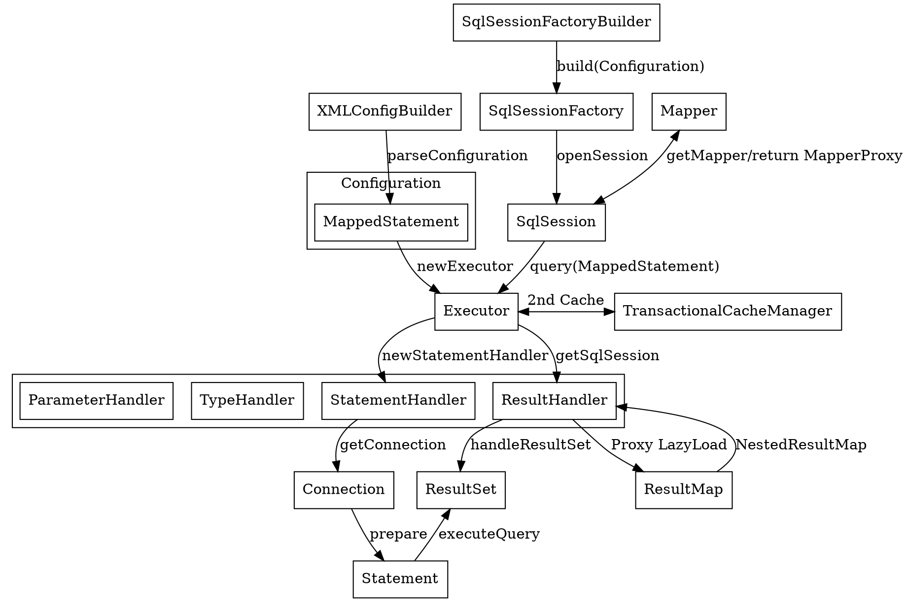

## Introduction

[MyBatis](https://mybatis.org/mybatis-3/) is a first class persistence framework with support for custom SQL, stored procedures and advanced mappings.
MyBatis eliminates almost all of the JDBC code and manual setting of parameters and retrieval of results.
MyBatis can use simple XML or Annotations for configuration and map primitives, Map interfaces and Java POJOs (Plain Old Java Objects) to database records.

它定位在「JDBC 之上、ORM 之下」：**不负责把对象图映射成表结构，只负责把 SQL 与 Java 方法的入参/出参接起来**。实体类没有持久化状态、没有脏检查、没有一级缓存的实体身份（Identity Map），`SqlSession` 的一级缓存缓存的是查询结果而不是「被管理的实体」。这一点决定了 MyBatis 的心智模型更接近「SQL 模板引擎 + 结果映射器」，而不是 Hibernate 那样的对象关系映射器。

## Version Baseline

基线以 Maven Central 上的 POM 与 JAR 字节码为准（实测，2026-10-27）。仓库内所有笔记涉及版本差异时，以本节为准。

| 构件 | 基线版本 | 关键事实 |
| :--- | :--- | :--- |
| `org.mybatis:mybatis` | **3.6.0**（2026-10-23 发布） | POM 声明 `java.version=11`；`org.apache.ibatis.*` 自身 class 的字节码 major = 55（Java 11），共 486 个；shade 进来的 `org.apache.ibatis.javassist`（407 个）与 `org.apache.ibatis.ognl`（173 个）仍是 major 52 |
| `org.mybatis:mybatis`（3.5 线末版） | 3.5.19 | 全量 class major = 52（Java 8），是 3.5 线最后一个 Java 8 字节码版本 |
| `org.mybatis:mybatis-spring` | **4.1.0** | `java.version=17`，编译依赖 Spring Framework **7.0.8** |
| `org.mybatis.spring.boot:mybatis-spring-boot-starter` | **4.1.0** | 与 mybatis-spring 4.1.0 对齐 |
| `com.baomidou:mybatis-plus` | **3.5.18**（2026-10-21 发布） | `mybatis-plus-core` 编译依赖 **mybatis 3.5.19**（不是 3.6.0），见 [MyBatis-Plus](/docs/CS/Framework/MyBatis-Plus/MyBatis-Plus.md) |

> [!WARNING]
>
> **「存在 ≠ 生效」同样适用于版本**:MyBatis 官方在 3.5.x 末期的 Release Notes「Support Notice」里说明将按 **Java 8 → 11 → 17** 逐级抬升基线，并会把原定 3.6.0 的内容顺延到 3.7.0。判断某个版本到底要求哪个 JDK，**看 POM 的 `java.version` 和实际字节码 major**，不要看 Release Notes 里的计划文案 —— 3.6.0 的变更列表里同时存在「require java 11」（#3370）和「Drop java8 fallback」（#3372）两个 PR，最终落在 Java 11 而非 Release Notes 早期提到的 Java 17。

## Compare with Hibernate

| 维度 | MyBatis | Hibernate |
| :--- | :--- | :--- |
| 抽象层级 | SQL 映射：SQL 由人写，框架负责参数绑定与结果映射 | ORM：对象图由人写，SQL 由框架生成 |
| 与数据库的关系 | 与具体 DB 强耦合，换库要改 SQL | 通过 Dialect 屏蔽方言差异 |
| 缓存 | 一级缓存（`SqlSession`）/ 二级缓存（`namespace`）缓存的是查询结果 | 一级缓存是持久化上下文（Identity Map），实体有身份与脏检查 |
| 关联加载 | `<association>` / `<collection>` 的嵌套查询，N+1 要自己处理 | 懒加载代理由 Session 生命周期托管 |
| 可控性 | SQL 完全可见可调优，适合报表、复杂查询 | SQL 不可见，调优靠 HQL/Criteria 与统计 |
| 迁移成本 | 无 schema 约束，接手遗留库成本低 | 需要对象模型与关系模型对齐 |

「Scalability 谁高」这类一刀切结论没有意义：**MyBatis 的可扩展性体现在插件链与自定义 `TypeHandler` / `LanguageDriver`，Hibernate 的可扩展性体现在拦截器、事件与自定义类型**。两者扩展的不是同一个东西。

## Architecture

MyBatis 的核心实现围绕 **「配置驱动 + 动态代理 + 流水线执行 + 插件扩展」** 展开：

1. **配置驱动**：启动时把 XML / 注解解析成一份 `Configuration` 对象，运行期只读。所有 `MappedStatement`、`ResultMap`、`Cache` 都挂在它上面。
2. **动态代理**：Mapper 接口没有实现类，[binding](/docs/CS/Framework/MyBatis/binding.md) 用 JDK 动态代理把方法调用翻译成 `namespace.id` 的 SQL 调用。
3. **流水线执行**：`SqlSession` → `Executor` → `StatementHandler` → (`ParameterHandler` / `ResultSetHandler`) → JDBC。
4. **插件扩展**：[Interceptor](/docs/CS/Framework/MyBatis/Interceptor.md) 在四个组件上挂责任链，分页、数据权限、SQL 改写都落在这里。

[Init](/docs/CS/Framework/MyBatis/Init.md)

### Infrastructure

Fig.1. MyBatis Infrastructure

- [Binding](/docs/CS/Framework/MyBatis/binding.md)
- [Log](/docs/CS/Framework/MyBatis/Logging.md) provide log4j log4j2 slf4j jdklog and so on
- [Cache](/docs/CS/Framework/MyBatis/Cache.md)
- [DataSource](/docs/CS/Framework/MyBatis/DataSource.md)
- [Reflector](/docs/CS/Framework/MyBatis/Reflector.md)：类定义信息的缓存，映射属性名与 getter/setter 方法。

### Core

- [How SQL works](/docs/CS/Framework/MyBatis/Execute.md)
- [Executor](/docs/CS/Framework/MyBatis/Executor.md)
- [StatementHandler](/docs/CS/Framework/MyBatis/StatementHandler.md)
- [ResultSetHandler](/docs/CS/Framework/MyBatis/ResultSetHandler.md)
- [Interceptor](/docs/CS/Framework/MyBatis/Interceptor.md)
- [KeyGenerator](/docs/CS/Framework/MyBatis/KeyGenerator.md)
- [SqlSession](/docs/CS/Framework/MyBatis/SqlSession.md)

## Extension

[MyBatis-Spring](/docs/CS/Framework/MyBatis/MyBatis-Spring.md) : Load Mybatis-config.xml, create Configuration and SqlsessionFactory

[MyBatis-Plus](/docs/CS/Framework/MyBatis-Plus/MyBatis-Plus.md)：第三方增强工具包（baomidou 组织，与 MyBatis 官方无关）。它在**不改 MyBatis 任何源码**的前提下，用「启动期注入 MappedStatement + 运行期插件拦截」两条路子把单表 CRUD、分页、逻辑删除、多租户做成开箱即用。代价是它与 MyBatis 版本强绑定（`mybatis-plus-core` 3.5.18 编译依赖 mybatis **3.5.19**），升级 MyBatis 3.6.0 前必须确认兼容。

### Design Patterns

## Design Pattern Summary

| 模式 | 在 MyBatis 中的体现 | 作用 |
| :--- | :--- | :--- |
| **Builder** | `SqlSessionFactoryBuilder`, `MappedStatement.Builder` | 复杂对象分步构建 |
| **Factory** | `SqlSessionFactory`, `MapperProxyFactory`, `ObjectFactory` | 对象创建解耦 |
| **Proxy** | `MapperProxy`, `Plugin` | 无侵入拦截与零实现接口 |
| **Template Method** | `BaseExecutor.doQuery()`, `StatementHandler` | 定义执行骨架，子类实现差异 |
| **Decorator** | `CachingExecutor`, `Log` 实现 | 动态增强功能（缓存/日志） |
| **Strategy** | `Executor`, `StatementHandler`, `TypeHandler` | 运行时替换算法/策略 |
| **Chain of Responsibility** | 插件拦截链 | 责任链传递请求 |
| **Adapter** | `Log` 的六种实现（slf4j / commons-logging / log4j / log4j2 / jdk14 / stdout） | 统一日志门面下的多实现适配 |

## Links

- [MyBatis 目录索引（按层导航）](/docs/CS/Framework/MyBatis/README.md)
- [MyBatis-Plus](/docs/CS/Framework/MyBatis-Plus/MyBatis-Plus.md)
- [Spring Framework](/docs/CS/Framework/Spring/Spring.md)
- [Hibernate](/docs/CS/Framework/Hibernate/Hibernate.md)
- [JDBC](/docs/CS/Java/JDK/Basic/JDBC.md)

## References

1. [MyBatis 3 Documentation](https://mybatis.org/mybatis-3/)
2. [MyBatis Source (GitHub)](https://github.com/mybatis/mybatis-3)
3. [MyBatis Releases](https://github.com/mybatis/mybatis-3/releases)
4. [MyBatis Blog](http://blog.mybatis.org/)
5. [MyBatis-Spring](https://github.com/mybatis/spring)
