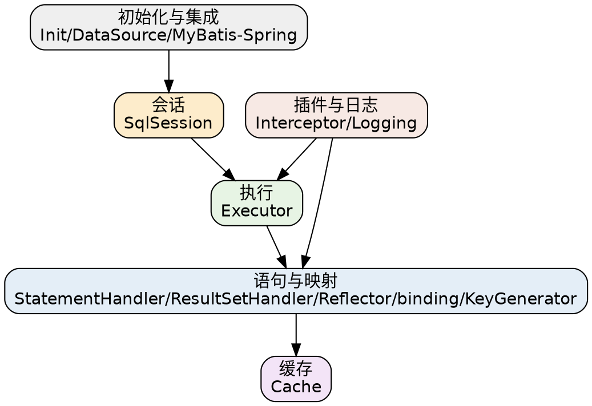

## Introduction

本目录是 **MyBatis** 的专题索引。MyBatis 的主线是一条「一次查询的执行链路」：`SqlSession` 委托 `Executor` → 经 `StatementHandler` 执行 JDBC → `ResultSetHandler` 映射结果，整条链上可挂 `Interceptor` 插件、`Cache` 二级缓存。本目录按这条链路 + 初始化 + 集成分组收录，另有一层源码级分册专讲「为什么是这样」，见 [Source-Level Volumes](/docs/CS/Framework/MyBatis/README.md?id=source-level-volumes)。

## Session and Execution

- [SqlSession](/docs/CS/Framework/MyBatis/SqlSession.md)：会话对象、生命周期、Mapper 代理。
- [Executor](/docs/CS/Framework/MyBatis/Executor.md)：执行器（Simple / Reuse / Batch）与一级缓存。
- [Execute](/docs/CS/Framework/MyBatis/Execute.md)：一条 SQL 的完整执行流程串讲。

## Statements and Result Mapping

- [StatementHandler](/docs/CS/Framework/MyBatis/StatementHandler.md)：`Statement` 封装、`#{}` 与 `${}` 差异、预编译。
- [ResultSetHandler](/docs/CS/Framework/MyBatis/ResultSetHandler.md)：结果集处理、`TypeHandler`。
- [Reflector](/docs/CS/Framework/MyBatis/Reflector.md)：反射与属性映射、getter 探测。
- [binding](/docs/CS/Framework/MyBatis/binding.md)：参数绑定规则、#{ } 占位符解析。
- [KeyGenerator](/docs/CS/Framework/MyBatis/KeyGenerator.md)：主键生成（自增 / selectKey）。

## Cache

- [Cache](/docs/CS/Framework/MyBatis/Cache.md)：一级 / 二级缓存、失效策略、Redis 扩展。

## Plugins and Logging

- [Interceptor](/docs/CS/Framework/MyBatis/Interceptor.md)：MyBatis 插件机制（拦截 `Executor` / `StatementHandler` / `ResultSetHandler`）、分页等常见插件。
- [Logging](/docs/CS/Framework/MyBatis/Logging.md)：日志体系与 MyBatis 内部日志接入。

## Initialization and Integration

- [Init](/docs/CS/Framework/MyBatis/Init.md)：启动与配置解析、`Configuration`、Mapper 解析。
- [DataSource](/docs/CS/Framework/MyBatis/DataSource.md)：数据源与事务。
- [MyBatis-Spring](/docs/CS/Framework/MyBatis/MyBatis-Spring.md)：与 Spring 集成（`SqlSessionFactoryBean`、Mapper 扫描、事务同步）。

## Source-Level Volumes

上面几组按使用与执行链路组织，回答「怎么用」；下面这一层回答「为什么是这样」。关键源码片段直接贴在正文里，读单篇不需要另开源码文件；代码块以本机 `mybatis-3.6.0` 为准，路径与行号只作出处标注，跨文件关系另用 `.codegraph/codegraph.db` 定位。顺序有依赖：先看配置怎么变成 `MappedStatement`，才能看懂 SQL 文本从哪来；再用符号图补单文件读不出来的扇入扇出。版本基准贴在 [MyBatis](/docs/CS/Framework/MyBatis/MyBatis.md?id=version-baseline) 的 Version Baseline。

- [Config Pipeline](/docs/CS/Framework/MyBatis/Config_Pipeline.md)：贴了 `parseConfiguration` 的 12 步、`StrictMap.put/get` 的歧义哨兵、`applyIncludes` 改 DOM、四个挂起队列的 `removeIf` 重试，以及四个 `pluginAll` 挂载点。
- [Annotation Mapper](/docs/CS/Framework/MyBatis/Annotation_Mapper.md)：贴了 `parse()` 的完整顺序、`loadXmlResource` 的伪资源名判断、`getAnnotationWrapper` 的 databaseId 分派、`ProviderSqlSource.getBoundSql`，以及三处 `@since 3.6.0` 的注解定义。
- [Dynamic SQL](/docs/CS/Framework/MyBatis/Dynamic_SQL.md)：贴了 `initNodeHandlerMap`、`parseDynamicTags`、`ContextMap.get`、`ForEachSqlNode.apply`、`TextSqlNode.apply` 与两个 `TrimSqlNode` 子类的构造参数。
- [SqlSource and Parameters](/docs/CS/Framework/MyBatis/SqlSource_and_Parameters.md)：贴了 `LanguageDriverRegistry`、两组 `createSqlSource` 重载、四种 `SqlSource` 的定型代码、`handleToken` 恒返回 `?`、`BoundSql` 与 `DefaultParameterHandler` 的取值分支。
- [Call Graph Internals](/docs/CS/Framework/MyBatis/Call_Graph_Internals.md)：给出可复现的 SQL 与合成边 metadata 样例，贴了 `applyCurrentNamespace` 和三处继承声明，说明边计数为什么不能当结论。

## MyBatis-Plus（增强工具包）

[MyBatis-Plus](/docs/CS/Framework/MyBatis-Plus/MyBatis-Plus.md) 是 baomidou 组织的第三方增强层（与 MyBatis 官方无关）：启动期自动注入单表 CRUD、运行期用插件链做分页 / 逻辑删除 / 多租户 / 数据权限，并提供代码生成器。它不改 MyBatis 源码，但编译锁定 `mybatis` 3.5.19，升级 MyBatis 3.6.0 前需等 MP 兼容版本。

- [Architecture](/docs/CS/Framework/MyBatis-Plus/Architecture.md)：两条接入路径（启动期 MappedStatement 注入 + 运行期插件拦截）与执行链路。
- [CRUD](/docs/CS/Framework/MyBatis-Plus/CRUD.md)：`BaseMapper` / `IService` / `IRepository` API、批量语义与 3.5.7/3.5.8 弃用迁移。
- [Wrapper](/docs/CS/Framework/MyBatis-Plus/Wrapper.md)：条件构造器与 `last()` / `apply()` 的 SQL 注入风险。
- [Interceptor](/docs/CS/Framework/MyBatis-Plus/Interceptor.md)：`MybatisPlusInterceptor` 与内置 `InnerInterceptor`（分页 / 租户 / 防全表删 / 数据权限）。
- [Features](/docs/CS/Framework/MyBatis-Plus/Features.md)：主键策略、逻辑删除、自动填充、乐观锁、字段策略、类型处理器。
- [CodeGenerator](/docs/CS/Framework/MyBatis-Plus/CodeGenerator.md)：`FastAutoGenerator` 流式代码生成与可插拔模板引擎。
- [SpringBoot](/docs/CS/Framework/MyBatis-Plus/SpringBoot.md)：starter 与自动装配关键配置项。

## Links

- [MyBatis（架构与入口）](/docs/CS/Framework/MyBatis/MyBatis.md)
- [Hibernate（JPA 另一条持久层路线）](/docs/CS/Framework/Hibernate/Hibernate.md)
- [Spring Data（Spring 侧持久层）](/docs/CS/Framework/Spring/Data.md)
- [Framework 总索引](/docs/CS/Framework/README.md)

## References

1. [MyBatis 3 Documentation](https://mybatis.org/mybatis-3/)
2. [MyBatis Source (GitHub)](https://github.com/mybatis/mybatis-3)
