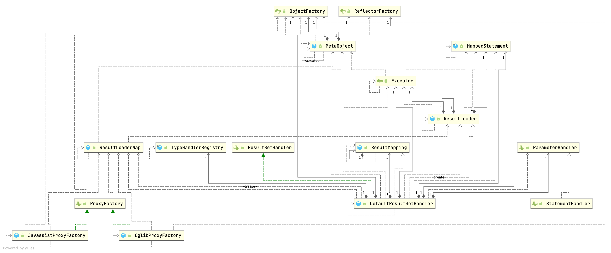

## Introduction



`ResultSetHandler` 是执行流水线最后一环：把 JDBC `ResultSet` 按 `ResultMap` 的描述翻译成 Java 对象。它同时承担三件事——**自动映射**（列名对不上时按规则猜）、**嵌套映射**（`association` / `collection`）、**懒加载代理**（延迟执行嵌套查询）。

```java
public interface ResultSetHandler {

  <E> List<E> handleResultSets(Statement stmt) throws SQLException;

  <E> Cursor<E> handleCursorResultSets(Statement stmt) throws SQLException;

  void handleOutputParameters(CallableStatement cs) throws SQLException;

}
```

唯一实现是 `DefaultResultSetHandler`。它由 [StatementHandler](/docs/CS/Framework/MyBatis/StatementHandler.md) 在 `query()` 后调用，一次调用要处理**多个** `ResultSet`（存储过程会返回多结果集），所以接口签名返回 `List` 而不是单个列表。

## DefaultResultSetHandler

### Pipeline

从 `handleResultSets` 到生成一行对象，调用链如下（方法名取自 MyBatis 3.6.0 源码）：

| 阶段 | 方法 | 职责 |
| :--- | :--- | :--- |
| 1 | `handleResultSets(Statement)` | 循环取 `ResultSet`，逐个交给 `handleResultSet` |
| 2 | `getFirstResultSet(Statement)` | 包装成 `ResultSetWrapper`（缓存列名、jdbcType、对应的 `TypeHandler`） |
| 3 | `validateResultMapsCount` | `ResultMap` 数量与 `ResultSet` 不匹配时报错 |
| 4 | `handleResultSet` | 空结果集时按 `returnInstanceForEmptyRow` 决定是否返回一个空对象 |
| 5 | `handleRowValues` | 分派：`shouldProcessMoreRows` + `skipRows` 处理 `RowBounds` |
| 6 | `handleRowValuesForSimpleResultMap` / `...NestedResultMap` | 按有无嵌套 `ResultMap` 走两条不同实现 |
| 7 | `getRowValue(ResultSetWrapper, ResultMap, ...)` | 单行映射：创建实例 → 填充属性 |
| 8 | `applyAutomaticMappings` / `applyPropertyMappings` | 先自动映射未声明列，再按 `ResultMap` 显式映射 |
| 9 | `storeObject` | 交给 `ResultHandler`（默认 `DefaultResultHandler` 塞进 List） |

`RowBounds` 在这一层是**内存分页**：`skipRows` 用 `rs.absolute()` 跳过 offset，再按 limit 停。也就是说 `RowBounds(10000, 20)` 会把前 10000 行全部读出来再丢弃——大偏移量分页必须写成 SQL 层的 `LIMIT`，或用 MyBatis-Plus 的 `PaginationInnerInterceptor`。

### ResultMap and Auto Mapping

映射顺序是**先显式后自动**：`ResultMap` 里声明过的列由 `applyPropertyMappings` 处理，剩下的未映射列才交给 `applyAutomaticMappings`。

自动映射行为由 `Configuration.autoMappingBehavior` 控制（`AutoMappingBehavior` 枚举，默认 **PARTIAL**）：

| 取值 | 行为 |
| :--- | :--- |
| `NONE` | 关闭自动映射 |
| `PARTIAL`（默认） | 只自动映射**没有**嵌套 `ResultMap` 的简单属性 |
| `FULL` | 连嵌套 `resultMap` 也自动映射 |

其余相关开关（默认值取自 `Configuration` 字段初始化）：

| 配置项 | 默认 | 作用 |
| :--- | :--- | :--- |
| `mapUnderscoreToCamelCase` | `false` | `user_name` → `userName` |
| `autoMappingUnknownColumnBehavior` | `NONE` | 遇到无法映射的列时 NONE / WARNING / FAILING |
| `returnInstanceForEmptyRow` | `false` | 结果集为空时是否返回一个新建的空对象 |
| `argNameBasedConstructorAutoMapping` | `false` | 构造器自动映射时，用参数名（而非顺序）匹配列 |
| `defaultResultSetType` | `null` | 不指定时由驱动决定游标类型 |

**一个常见误区**：`mapUnderscoreToCamelCase` 只是列名→属性名的字符串转换，**不会**让没有 setter 的字段被赋值。真正决定"能不能写进去"的是 [Reflector](/docs/CS/Framework/MyBatis/Reflector.md) 对 getter/setter 的探测结果。Lombok 的 `@Builder` 搭配 `@Data` 时，如果只留全参构造器而没有无参构造器，自动映射会直接失败。

### Nested Query vs Nested ResultMap

`<association>` / `<collection>` 有两种实现方式，代价完全不同：

| | 嵌套查询（`select` 属性） | 嵌套结果（`resultMap` 属性 + join） |
| :--- | :--- | :--- |
| SQL 条数 | 1 + N（**N+1 问题**） | 1 条 join |
| 可懒加载 | 可以（走 `lazyLoadingEnabled`） | 不行，必须一次读完 |
| 结果去重 | 天然去重，每个子对象一个查询 | 靠 `CacheKey` 在 `nestedResultObjects` 里按主键去重 |
| 适用 | 子表很少被访问、可接受懒加载 | 需要一次性取全、要求单条 SQL |

嵌套查询的触发点在 `getRowValue` 之后的 `applyPropertyMappings`：遇到带 `nestedQueryId` 的 `ResultMapping` 时，若开启懒加载就放一个代理对象，否则立刻执行子查询。

实现上，`DefaultResultSetHandler` 用一组实例字段保存嵌套状态：`nestedResultObjects`（按 `CacheKey` 缓存已建对象）、`ancestorObjects`（处理循环引用）、`pendingRelations` / `pendingPccRelations`（3.6.0 用于延迟处理嵌套关系）。这些字段是**每次查询新建 handler 实例**才安全的，所以 `ResultSetHandler` 不能被多线程共享。

## Discriminator

`<discriminator>` 是结果映射里的条件分支：按某一列的值选择不同的 `resultMap`，实现单表继承（一张表里存多种子类型）。

```
  RESULT SET
      |
      v
  <discriminator column="vehicle_type" javaType="string">
      +-- "car"  -> resultMap="carResult"
      +-- "truck" -> resultMap="truckResult"
```

`resolveDiscriminatedResultMap` 在映射每一行之前调用，因此**同一个查询的每一行可以映射成不同的 Java 类型**。

## Lazy Loading

Most MetaObjects don't implements interface, use JavassistProxyFactory rather than JDK Dynamic Proxy

1. CglibProxyFactory
2. JavassistProxyFactory default

```java
public interface ProxyFactory {

  default void setProperties(Properties properties) {
    // NOP
  }

  Object createProxy(Object target, ResultLoaderMap lazyLoader, Configuration configuration, ObjectFactory objectFactory, List<Class<?>> constructorArgTypes, List<Object> constructorArgs);

}
```

### lazyLoader

```java
// JavassistProxyFactory
private final ResultLoaderMap lazyLoader;

@Override
  public Object invoke(Object enhanced, Method method, Method methodProxy, Object[] args) throws Throwable {
    final String methodName = method.getName();
    try {
      synchronized (lazyLoader) {
        if (WRITE_REPLACE_METHOD.equals(methodName)) {
          Object original;
          if (constructorArgTypes.isEmpty()) {
            original = objectFactory.create(type);
          } else {
            original = objectFactory.create(type, constructorArgTypes, constructorArgs);
          }
          PropertyCopier.copyBeanProperties(type, enhanced, original);
          if (lazyLoader.size() > 0) {
            return new JavassistSerialStateHolder(original, lazyLoader.getProperties(), objectFactory, constructorArgTypes, constructorArgs);
          } else {
            return original;
          }
        } else {
          if (lazyLoader.size() > 0 && !FINALIZE_METHOD.equals(methodName)) {
            if (aggressive || lazyLoadTriggerMethods.contains(methodName)) {
              lazyLoader.loadAll();
            } else if (PropertyNamer.isSetter(methodName)) {
              final String property = PropertyNamer.methodToProperty(methodName);
              lazyLoader.remove(property);
            } else if (PropertyNamer.isGetter(methodName)) {
              final String property = PropertyNamer.methodToProperty(methodName);
              if (lazyLoader.hasLoader(property)) {
                lazyLoader.load(property);
              }
            }
          }
        }
      }
      return methodProxy.invoke(enhanced, args);
    } catch (Throwable t) {
      throw ExceptionUtil.unwrapThrowable(t);
    }
  }
}
```

上面的触发规则值得单独说明：`aggressiveLazyLoading=true` 或调用到 `lazyLoadTriggerMethods`（默认 `equals`、`clone`、`hashCode`、`toString`）里的任一方法，会**一次性加载全部**懒加载属性；否则按 getter 精确加载。这意味着在日志里打印实体（`toString`）或把它塞进 `HashSet`（`hashCode`）会意外触发整棵懒加载树——这是生产上最常见的 N+1 来源。

```java
// ResultLoaderMap
public boolean load(String property) throws SQLException {
  LoadPair pair = loaderMap.remove(property.toUpperCase(Locale.ENGLISH));
  if (pair != null) {
    pair.load();
    return true;
  }
  return false;
}


public void load(final Object userObject) throws SQLException {
  ...

    this.metaResultObject = config.newMetaObject(userObject);
    this.resultLoader = new ResultLoader(config, new ClosedExecutor(), ms, this.mappedParameter,
                                         metaResultObject.getSetterType(this.property), null, null);
  }

  /* We are using a new executor because we may be (and likely are) on a new thread
       * and executors aren't thread safe. (Is this sufficient?)
       *
       * A better approach would be making executors thread safe. */
  if (this.serializationCheck == null) {
    final ResultLoader old = this.resultLoader;
    this.resultLoader = new ResultLoader(old.configuration, new ClosedExecutor(), old.mappedStatement,
                                         old.parameterObject, old.targetType, old.cacheKey, old.boundSql);
  }
	// use executor to selectList and set value
  this.metaResultObject.setValue(property, this.resultLoader.loadResult());
}

// ResultLoader
public Object loadResult() throws SQLException {
    List<Object> list = selectList();
    resultObject = resultExtractor.extractObjectFromList(list, targetType);
    return resultObject;
  }

private <E> List<E> selectList() throws SQLException {
  Executor localExecutor = executor;
  if (Thread.currentThread().getId() != this.creatorThreadId || localExecutor.isClosed()) {
    localExecutor = newExecutor();
  }
  try {
    return localExecutor.query(mappedStatement, parameterObject, RowBounds.DEFAULT, Executor.NO_RESULT_HANDLER, cacheKey, boundSql);
  } finally {
    if (localExecutor != executor) {
      localExecutor.close(false);
    }
  }
}
```

注意 `selectList()` 里对 `Thread.currentThread().getId() != creatorThreadId` 的判断：懒加载**跨线程触发时会新开一个 `Executor`**，也就意味着它脱离了原 `SqlSession` 的事务与一级缓存。实体被异步线程消费时，懒加载要么在返回前强制触发，要么改用显式查询。

## Links

- [MyBatis](/docs/CS/Framework/MyBatis/MyBatis.md)
- [StatementHandler](/docs/CS/Framework/MyBatis/StatementHandler.md)
- [Reflector](/docs/CS/Framework/MyBatis/Reflector.md)

## References

1. [MyBatis 3 Documentation — Mapper XML Files](https://mybatis.org/mybatis-3/sqlmap-xml.html)
2. [MyBatis 3 Documentation — Configuration: settings](https://mybatis.org/mybatis-3/configuration.html#settings)
3. [MyBatis Source (GitHub)](https://github.com/mybatis/mybatis-3)
