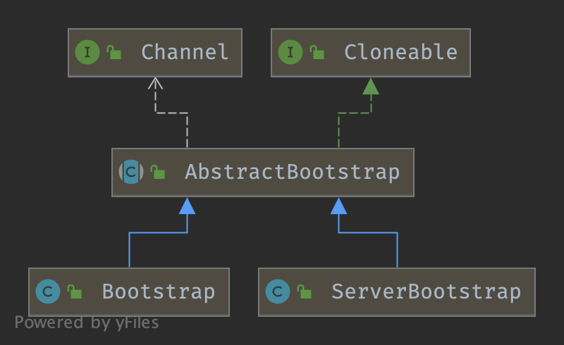

## Introduction


Bootstrap 是“引导”的意思，它主要负责整个 Netty 程序的启动、初始化、服务器连接等过程，它相当于一条主线，串联了 Netty 的其他核心组件





Bootstrap 和 ServerBootStrap 十分相似，两者非常重要的区别在于 Bootstrap 可用于连接远端服务器，只绑定一个 EventLoopGroup。而 ServerBootStrap 则用于服务端启动绑定本地端口，会绑定两个 EventLoopGroup，这两个 EventLoopGroup 通常称为 Boss 和 Worker

> [!NOTE]
>
> 本文源码依据 **Netty 4.2.19.Final**。Bootstrap 的装配 API 在 4.2 中**没有破坏性变更**，但 `NioEventLoopGroup` 等旧 group 已 `@Deprecated`，推荐改用 `MultiThreadIoEventLoopGroup` + `IoHandler.newFactory()`，见 [4.2 Migration](/docs/CS/Framework/Netty/Bootstrap.md?id=_42-migration)。另外 `AbstractBootstrap#init` 的签名由 4.1 的 `ChannelFuture init(Channel)` 改为 `void init(Channel) throws Throwable`，`ServerBootstrapAcceptor` 里 4.1 的 `initChild(child)` 方法在 4.2 已被删除——这两处是阅读旧教程时最容易踩的坑。

## Create

装配 API 全部返回 `this` 以支持链式调用，因此这里的 `B` 是泛型自类型。

### group

```java
// 源码：transport/src/main/java/io/netty/bootstrap/AbstractBootstrap.java:96-108
public B group(EventLoopGroup group) {
    ObjectUtil.checkNotNull(group, "group");
    if (this.group != null) {
        throw new IllegalStateException("group set already");
    }
    this.group = group;
    return self();
}
```

`ServerBootstrap` 另有单参与双参两个重载：

```java
// 源码：transport/src/main/java/io/netty/bootstrap/ServerBootstrap.java:71-91
@Override
public ServerBootstrap group(EventLoopGroup group) {
    return group(group, group);                 // 单参 = 父子共用同一个 group
}

public ServerBootstrap group(EventLoopGroup parentGroup, EventLoopGroup childGroup) {
    super.group(parentGroup);
    if (this.childGroup != null) {
        throw new IllegalStateException("childGroup set already");
    }
    this.childGroup = ObjectUtil.checkNotNull(childGroup, "childGroup");
    return this;
}
```

**4.2.19 中 `childGroup` 可以不设**：`ServerBootstrap.validate()` 发现 `childGroup == null` 时只打一条 warn 并自动回落到 parentGroup（源码：`ServerBootstrap.java:177-187`）。所以下面两种写法是等价的：

```java
// 写法一：显式 Boss + Worker
b.group(new MultiThreadIoEventLoopGroup(1, NioIoHandler.newFactory()),
        new MultiThreadIoEventLoopGroup(NioIoHandler.newFactory()));

// 写法二：只设一个 group，children 会复用它
b.group(new MultiThreadIoEventLoopGroup(NioIoHandler.newFactory()));
```

### channel

```java
// 源码：AbstractBootstrap.java:115-119
public B channel(Class<? extends C> channelClass) {
    return channelFactory(new ReflectiveChannelFactory<C>(
            ObjectUtil.checkNotNull(channelClass, "channelClass")
    ));
}
```

需要给 Channel 传构造参数时改用 `channelFactory(io.netty.channel.ChannelFactory)`；4.2.19 中包内的 `io.netty.bootstrap.ChannelFactory` 版本已 `@Deprecated`（源码：`AbstractBootstrap.java:122-133`）。

### handler / childHandler

```java
// 源码：AbstractBootstrap.java:392-395
public B handler(ChannelHandler handler) {
    this.handler = ObjectUtil.checkNotNull(handler, "handler");
    return self();
}
```

```java
// 源码：ServerBootstrap.java:127-130
public ServerBootstrap childHandler(ChannelHandler childHandler) {
    this.childHandler = ObjectUtil.checkNotNull(childHandler, "childHandler");
    return this;
}
```

`handler()` 是给 **ServerChannel 自己**用的（Boss 侧，通常不设），`childHandler()` 才是给每条**新接入连接**用的。注意 `childHandler` 存的是**单个实例**——所有 child Channel 共享它，所以它必须是 `@Sharable` 的，或者本身就是一个每次 `addLast` 都会新建内部 handler 的 `ChannelInitializer`。

### option / childOption / attr / childAttr

```java
// 源码：AbstractBootstrap.java:180-190
public <T> B option(ChannelOption<T> option, T value) {
    ObjectUtil.checkNotNull(option, "option");
    synchronized (options) {
        if (value == null) {
            options.remove(option);
        } else {
            options.put(option, value);
        }
    }
    return self();
}
```

```java
// 源码：ServerBootstrap.java:98-108
public <T> ServerBootstrap childOption(ChannelOption<T> childOption, T value) {
    ObjectUtil.checkNotNull(childOption, "childOption");
    synchronized (childOptions) {
        if (value == null) {
            childOptions.remove(childOption);
        } else {
            childOptions.put(childOption, value);
        }
    }
    return this;
}
```

两者都用 `synchronized` 包住写操作。容器类型不同，且这个差异是有意的：

| 容器        | 类型                 | 作用                                                                                 |
| :-------- | :----------------- | :--------------------------------------------------------------------------------- |
| `options` | `LinkedHashMap`    | **保序**。注释明确写着"The order in which ChannelOptions are applied is important they may depend on each other for validation purposes"（源码：`AbstractBootstrap.java:69-71`） |
| `attrs`   | `ConcurrentHashMap` | 属性之间无依赖，不需要保序                                                                       |

`childOptions` 同样是 `LinkedHashMap`，`childAttrs` 同样是 `ConcurrentHashMap`（源码：`ServerBootstrap.java:50-51`）。

## bind

1. [initAndRegister channel](/docs/CS/Framework/Netty/Bootstrap.md?id=initandregister)
2. doBind0 端口绑定 注册 OP_ACCEPT 事件到 Channel

```java
// 源码：transport/src/main/java/io/netty/bootstrap/AbstractBootstrap.java:253-260
// Create a new Channel and bind it.
public ChannelFuture bind() {
    // Validate all the parameters. Sub-classes may override this,
    // but should call the super method in that case.
    validate();
    SocketAddress localAddress = this.localAddress;
    if (localAddress == null) {
        throw new IllegalStateException("localAddress not set");
    }
    return doBind(localAddress);
}
```

```java
// 源码：AbstractBootstrap.java:291-322
private ChannelFuture doBind(final SocketAddress localAddress) {
    final ChannelFuture regFuture = initAndRegister();
    final Channel channel = regFuture.channel();
    if (regFuture.cause() != null) {
        return regFuture;
    }

    if (regFuture.isDone()) {
        // At this point we know that the registration was complete and successful.
        ChannelPromise promise = channel.newPromise();
        doBind0(regFuture, channel, localAddress, promise);
        return promise;
    } else {
        // Registration future is almost always fulfilled already, but just in case it's not.
        final PendingRegistrationPromise promise = new PendingRegistrationPromise(channel);
        regFuture.addListener(future -> {
            Throwable cause = future.cause();
            if (cause != null) {
                // Registration on the EventLoop failed so fail the ChannelPromise directly to not cause an
                // IllegalStateException once we try to access the EventLoop of the Channel.
                promise.setFailure(cause);
            } else {
                // Registration was successful, so set the correct executor to use.
                // See https://github.com/netty/netty/issues/2586
                promise.registered();

                doBind0(regFuture, channel, localAddress, promise);
            }
        });
        return promise;
    }
}
```

`PendingRegistrationPromise` 存在的意义是修 #2586：注册还没完成时，`promise.executor()` 会返回 `GlobalEventExecutor`，监听器可能被意外并行执行。注册成功后调用 `promise.registered()` 把 executor 切回真正的 EventLoop；失败则保持 `GlobalEventExecutor` 作为兜底（源码：`AbstractBootstrap.java:511-536`）。

> [!NOTE]
>
> 4.2 的 `doBind` 与 4.1 的关键差别是**监听器写成了 lambda**（`regFuture.addListener(future -> {...})`），语义不变但 4.1 教程里常见的 `new ChannelFutureListener(){ public void operationComplete(...)}` 匿名类形态在 4.2 源码中已全部替换。

### initAndRegister

1. new and init channel
2. register

```java
// 源码：transport/src/main/java/io/netty/bootstrap/AbstractBootstrap.java:324-359
// AbstractBootstrap#initAndRegister()
final ChannelFuture initAndRegister() {
    Channel channel = null;
    try {
        channel = channelFactory.newChannel(); // (1)
        init(channel);
    } catch (Throwable t) {
        if (channel != null) {
            // channel can be null if newChannel crashed (eg SocketException("too many open files"))
            channel.unsafe().closeForcibly();
            // as the Channel is not registered yet we need to force the usage of the GlobalEventExecutor
            return new DefaultChannelPromise(channel, GlobalEventExecutor.INSTANCE).setFailure(t);
        }
        // as the Channel is not registered yet we need to force the usage of the GlobalEventExecutor
        return new DefaultChannelPromise(new FailedChannel(), GlobalEventExecutor.INSTANCE).setFailure(t);
    }

    ChannelFuture regFuture = config().group().register(channel);// (2)
    if (regFuture.cause() != null) {
        if (channel.isRegistered()) {
            channel.close();
        } else {
            channel.unsafe().closeForcibly();
        }
    }

    // If we are here and the promise is not failed, it's one of the following cases:
    // 1) If we attempted registration from the event loop, the registration has been completed at this point.
    //    i.e. It's safe to attempt bind() or connect() now because the channel has been registered.
    // 2) If we attempted registration from the other thread, the registration request has been successfully
    //    added to the event loop's task queue for later execution.
    //    i.e. It's safe to attempt bind() or connect() now:
    //         because bind() or connect() will be executed *after* the scheduled registration task is executed
    //         because register(), bind(), and connect() are all bound to the same thread.

    return regFuture;
}
```

#### new Channel

The Class which is used to create Channel instances from. You either use this or channelFactory(io.netty.channel.ChannelFactory) if your Channel implementation has no no-args constructor.

`initAndRegister` 里调的 `channelFactory.newChannel()` 实际落到反射：

```java
// 源码：transport/src/main/java/io/netty/channel/ReflectiveChannelFactory.java:41-48
// ReflectiveChannelFactory#newChannel()
@Override
public T newChannel() {
    try {
        return constructor.newInstance();
    } catch (Throwable t) {
        throw new ChannelException("Unable to create Channel from class " + constructor.getDeclaringClass(), t);
    }
}
```

所以 `channel(NioServerSocketChannel.class)` 的本质就是：把 `.class` 包成 `ReflectiveChannelFactory`，`newChannel()` 时反射调无参构造器。这也是为什么自定义 Channel 必须暴露无参构造器，否则只能走 `channelFactory(...)`。

**new NioServerSocketChannel**

actually new `sun.nio.ch.ServerSocketChannelImpl`

```java
// 源码：transport/src/main/java/io/netty/channel/socket/nio/NioServerSocketChannel.java:73-80
public NioServerSocketChannel() {
    this(DEFAULT_SELECTOR_PROVIDER);
}

public NioServerSocketChannel(SelectorProvider provider) {
    this(provider, (SocketProtocolFamily) null);
}
```

```java
// 源码：NioServerSocketChannel.java（newSocket）
private static ServerSocketChannel newSocket(SelectorProvider provider) {
    try {
        /**
         *  Use the {@link SelectorProvider} to open {@link SocketChannel} and so remove condition in
         *  {@link SelectorProvider#provider()} which is called by each ServerSocketChannel.open() otherwise.
         *
         *  See <a href="https://github.com/netty/netty/issues/2308">#2308</a>.
         */
        return provider.openServerSocketChannel();
    } catch (IOException e) {
        throw new ChannelException("Failed to open a server socket.", e);
    }
}
```

最终在 JDK 侧落到 `sun.nio.ch.ServerSocketChannelImpl`（`Net.serverSocket(true)` + `IOUtil.fdVal(fd)`）。

#### init Channel

Add handler into ChannelPipeline will call handlerAdded of this handler.

add `ServerBootstrapAcceptor`

> [!NOTE]
>
> 4.2.19 中 `AbstractBootstrap#init` 的签名是 **`abstract void init(Channel channel) throws Throwable`**（源码：`AbstractBootstrap.java:361`），**不再返回 `ChannelFuture`**。4.1 教程里 `ChannelFuture init(Channel channel)` 的写法在 4.2 源码中已经不存在——`initAndRegister()` 里 `init(channel)` 后面直接跟 `config().group().register(channel)`，注册结果由 `register()` 自己返回的 future 承载。

```java
// 源码：transport/src/main/java/io/netty/bootstrap/ServerBootstrap.java:132-174
@Override
void init(Channel channel) throws Throwable {
    setChannelOptions(channel, newOptionsArray(), logger);
    setAttributes(channel, newAttributesArray());

    ChannelPipeline p = channel.pipeline();

    final EventLoopGroup currentChildGroup = childGroup;
    final ChannelHandler currentChildHandler = childHandler;
    final Entry<ChannelOption<?>, Object>[] currentChildOptions = newOptionsArray(childOptions);
    final Entry<AttributeKey<?>, Object>[] currentChildAttrs = newAttributesArray(childAttrs);
    final Collection<ChannelInitializerExtension> extensions = getInitializerExtensions();

    p.addLast(new ChannelInitializer<Channel>() {
        @Override
        public void initChannel(final Channel ch) {
            final ChannelPipeline pipeline = ch.pipeline();
            ChannelHandler handler = config.handler();
            if (handler != null) {
                pipeline.addLast(handler);
            }

            ch.eventLoop().execute(new Runnable() {
                @Override
                public void run() {
                    pipeline.addLast(new ServerBootstrapAcceptor(
                            ch, currentChildGroup, currentChildHandler, currentChildOptions, currentChildAttrs,
                            extensions));
                }
            });
        }
    });
    if (!extensions.isEmpty() && channel instanceof ServerChannel) {
        ServerChannel serverChannel = (ServerChannel) channel;
        for (ChannelInitializerExtension extension : extensions) {
            try {
                extension.postInitializeServerListenerChannel(serverChannel);
            } catch (Exception e) {
                logger.warn("Exception thrown from postInitializeServerListenerChannel", e);
            }
        }
    }
}
```

为什么是"`ChannelInitializer` + `eventLoop().execute`"两层？因为 `init()` 发生在 `register()` 之前，此刻 Channel 还没绑上 EventLoop，`p.addLast` 只会把 `ChannelInitializer` 挂上去。等 `register0` 触发 `fireChannelRegistered` → `handlerAdded` 时，`ChannelInitializer.initChannel` 才被真正调用；此时再往 EventLoop 抛一个任务，让 `ServerBootstrapAcceptor` 排在所有用户 handler 之后，`bind()` 才会在它入场之后执行。

```java
// 源码：transport/src/main/java/io/netty/bootstrap/Bootstrap.java:275-293
@Override
void init(Channel channel) throws Throwable {
    ChannelPipeline p = channel.pipeline();
    p.addLast(config.handler());

    setChannelOptions(channel, newOptionsArray(), logger);

    setAttributes(channel, newAttributesArray());
    Collection<ChannelInitializerExtension> extensions = getInitializerExtensions();
    if (!extensions.isEmpty()) {
        for (ChannelInitializerExtension extension : extensions) {
            try {
                extension.postInitializeClientChannel(channel);
            } catch (Exception e) {
                logger.warn("Exception thrown from postInitializeClientChannel", e);
            }
        }
    }
}
```

客户端侧没有 `ServerBootstrapAcceptor`，因为不需要处理"接入的新连接"。

> [!NOTE]
>
> `ChannelInitializerExtension` 是 4.2 新增的扩展点（通过 `AbstractBootstrap#extensionsClassLoader(ClassLoader)` 指定 ClassLoader 加载，源码：`AbstractBootstrap.java:214-217,363-369`）。它提供三个回调：`postInitializeClientChannel` / `postInitializeServerListenerChannel` / `postInitializeServerChildChannel`，让第三方库能在这三个时机插入自己的 handler，无需用户手动改 pipeline。这也是 `ServerBootstrap.init` 相对 4.1 多出来的一段。

### ServerBootstrapAcceptor

```java
// 源码：transport/src/main/java/io/netty/bootstrap/ServerBootstrap.java:189-219
// ServerBootstrap$ServerBootstrapAcceptor
private static class ServerBootstrapAcceptor extends ChannelInboundHandlerAdapter {

    private final EventLoopGroup childGroup;
    private final ChannelHandler childHandler;
    private final Entry<ChannelOption<?>, Object>[] childOptions;
    private final Entry<AttributeKey<?>, Object>[] childAttrs;
    private final Runnable enableAutoReadTask;
    private final Collection<ChannelInitializerExtension> extensions;   // 4.2 新增

    ServerBootstrapAcceptor(
            final Channel channel, EventLoopGroup childGroup, ChannelHandler childHandler,
            Entry<ChannelOption<?>, Object>[] childOptions, Entry<AttributeKey<?>, Object>[] childAttrs,
            Collection<ChannelInitializerExtension> extensions) {
        this.childGroup = childGroup;
        this.childHandler = childHandler;
        this.childOptions = childOptions;
        this.childAttrs = childAttrs;
        this.extensions = extensions;

        // Task which is scheduled to re-enable auto-read.
        // It's important to create this Runnable before we try to submit it as otherwise the URLClassLoader may
        // not be able to load the class because of the file limit it already reached.
        //
        // See https://github.com/netty/netty/issues/1328
        enableAutoReadTask = new Runnable() {
            @Override
            public void run() {
                channel.config().setAutoRead(true);
            }
        };
    }

    @Override
    public void exceptionCaught(ChannelHandlerContext ctx, Throwable cause) throws Exception {
        final ChannelConfig config = ctx.channel().config();
        if (config.isAutoRead()) {
            // stop accept new connections for 1 second to allow the channel to recover
            // See https://github.com/netty/netty/issues/1328
            config.setAutoRead(false);
            ctx.channel().eventLoop().schedule(enableAutoReadTask, 1, TimeUnit.SECONDS);
        }
        // still let the exceptionCaught event flow through the pipeline to give the user
        // a chance to do something with it
        ctx.fireExceptionCaught(cause);
    }
}
```

`enableAutoReadTask` 要在构造期就 new 出来，是因为极端情况下（URLClassLoader 打开文件数打满）等到要用时再 new 会触发类加载失败，见 #1328。

### accepted Channel Registration

**这是 4.2 与 4.1 形态差异最大的一处**：4.1 的 `ServerBootstrapAcceptor` 有一个 `initChild(child)` 私有方法，内部用 `child.eventLoop()` + `inEventLoop()` 判断把初始化转发到 child 自己的 EventLoop，最后调 `child.register()`。4.2.19 里 `initChild` **已被删除**，逻辑直接内联进 `channelRead`：

```java
// 源码：transport/src/main/java/io/netty/bootstrap/ServerBootstrap.java:221-255
@Override
@SuppressWarnings("unchecked")
public void channelRead(ChannelHandlerContext ctx, Object msg) {
    final Channel child = (Channel) msg;

    child.pipeline().addLast(childHandler);          // 1. 挂 childHandler

    try {
        setChannelOptions(child, childOptions, logger);   // 2. 应用 childOption
    } catch (Throwable cause) {
        forceClose(child, cause);
        return;
    }
    setAttributes(child, childAttrs);                 // 3. 应用 childAttr

    if (!extensions.isEmpty()) {                      // 4. 4.2 新增：扩展点回调
        for (ChannelInitializerExtension extension : extensions) {
            try {
                extension.postInitializeServerChildChannel(child);
            } catch (Exception e) {
                logger.warn("Exception thrown from postInitializeServerChildChannel", e);
            }
        }
    }

    try {
        childGroup.register(child).addListener(future -> {    // 5. 注册到 childGroup
            if (!future.isSuccess()) {
                forceClose(child, future.cause());
            }
        });
    } catch (Throwable t) {
        forceClose(child, t);
    }
}
```

```java
// 源码：ServerBootstrap.java:257-260
private static void forceClose(Channel child, Throwable t) {
    child.unsafe().closeForcibly();
    logger.warn("Failed to register an accepted channel: {}", child, t);
}
```

两点需要特别注意：

1. **注册用的是 `childGroup.register(child)`，不是 `child.register()`**。`childGroup.register(...)` 会让 childGroup 自己挑一个 EventLoop，这也是"accepted 连接被分发到 Worker 线程"的真正发生点；`child.register()` 则是复用已有 EventLoop，语义完全不同。
2. **`addLast(childHandler)` 发生在 register 之前**。此时 child 还没绑 EventLoop，所以 `ChannelInitializer` 的 `initChannel` 要等注册完成后由 `handlerAdded` 触发，这也是 `childHandler` 通常写成 `ChannelInitializer` 的原因。

> [!NOTE]
>
> 4.1 里的 `initChild(child)` 方法在 4.2.19 中**已不存在**（`ServerBootstrap.java` 全文件搜不到该方法）。如果你在旧教程里看到 `childEventLoop.inEventLoop()` + `initChild(child)` 的组合，那是 4.1 形态；4.2 去掉了这层转发，改为在 `channelRead` 里直接顺序执行，注册动作则由 `childGroup` 自己保证线程归属。

### register

[AbstractChannel$AbstractUnsafe#register()](/docs/CS/Framework/Netty/Channel.md?id=register) submit a Runnable of register0 to [EventLoop#execute()](/docs/CS/Framework/Netty/EventLoop.md?id=eventloopgroup).

```java
// 源码：transport/src/main/java/io/netty/channel/AbstractChannel.java:324-364
public final void register(EventLoop eventLoop, final ChannelPromise promise) {
    ObjectUtil.checkNotNull(eventLoop, "eventLoop");
    if (isRegistered()) {
        promise.setFailure(new IllegalStateException("registered to an event loop already"));
        return;
    }
    if (!isCompatible(eventLoop)) {
        promise.setFailure(
                new IllegalStateException("incompatible event loop type: " + eventLoop.getClass().getName()));
        return;
    }
    AbstractChannel.this.eventLoop = eventLoop;

    // Clear any cached executors from prior event loop registrations.
    AbstractChannelHandlerContext context = pipeline.tail;
    do {
        context.contextExecutor = null;
        context = context.prev;
    } while (context != null);

    if (eventLoop.inEventLoop()) {
        register0(promise);
    } else {
        try {
            eventLoop.execute(new Runnable() {
                @Override
                public void run() {
                    register0(promise);
                }
            });
        } catch (Throwable t) {
            logger.warn(
                    "Force-closing a channel whose registration task was not accepted by an event loop: {}",
                    AbstractChannel.this, t);
            closeForcibly();
            closeFuture.setClosed();
            safeSetFailure(promise, t);
        }
    }
}
```

注意"清理 pipeline 上缓存的 `contextExecutor`"这一步是 4.2 新增的：Channel 可以从一个 EventLoop 解绑再绑到另一个，此时旧 executor 缓存必须失效。

`isCompatible(eventLoop)` 是 4.2 引入 `IoHandler` 后的新检查：EventLoop 必须与 Channel 的 `IoHandle` 类型匹配（由 `IoHandler#isCompatible(Class)` 判定），混用 NIO 的 EventLoop 与 epoll 的 Channel 会在这里直接失败，而不是等到 IO 时才炸。

**AbstractChannel$AbstractUnsafe#register0**：

```java
// 源码：transport/src/main/java/io/netty/channel/AbstractChannel.java:366-406
private void register0(ChannelPromise promise) {
    if (!promise.setUncancellable() || !ensureOpen(promise)) {
        return;
    }
    ChannelPromise registerPromise = newPromise();
    boolean firstRegistration = neverRegistered;
    registerPromise.addListener(future -> {
        if (future.isSuccess()) {
            neverRegistered = false;
            registered = true;

            // Ensure we call handlerAdded(...) before we actually notify the promise. This is needed as the
            // user may already fire events through the pipeline in the ChannelFutureListener.
            pipeline.invokeHandlerAddedIfNeeded();

            safeSetSuccess(promise);
            pipeline.fireChannelRegistered();
            // Only fire a channelActive if the channel has never been registered. This prevents firing
            // multiple channel actives if the channel is deregistered and re-registered.
            if (isActive()) {
                if (firstRegistration) {
                    pipeline.fireChannelActive();
                } else if (config().isAutoRead()) {
                    // See https://github.com/netty/netty/issues/4805
                    beginRead();
                }
            }
        } else {
            // Close the channel directly to avoid FD leak.
            close(newPromise());
            closeFuture.setClosed();
            safeSetFailure(promise, future.cause());
        }
    });
    doRegister(registerPromise);
}
```

执行顺序上是：

1. [ChannelPipeline#fireChannelRegistered()](/docs/CS/Framework/Netty/ChannelHandler.md?id=firechannelregistered)（之前先 `invokeHandlerAddedIfNeeded()` 触发 `ChannelInitializer.initChannel`）
2. 若 `isActive()` 且是首次注册 → `fireChannelActive()`；`fireChannelActive` 经 HeadContext 走到 `readIfIsAutoRead()` 后才落到 [AbstractChannel#beginRead()](/docs/CS/Framework/Netty/Channel.md?id=beginread)

也就是 **OP_ACCEPT / OP_READ 的兴趣注册不是 `register0` 直接做的**，而是 `fireChannelActive` 链路的副作用；重复注册（deregister 后再 register）则不会再触发 `channelActive`，而是在 `autoRead` 打开时补一次 `beginRead()`（见 #4805）。

NIO 侧的 `doRegister` 在 4.2 改成走 `IoRegistration`：

```java
// 源码：transport/src/main/java/io/netty/channel/nio/AbstractNioChannel.java:461-473
@SuppressWarnings("unchecked")
@Override
protected void doRegister(ChannelPromise promise) {
    assert registration == null;
    ((IoEventLoop) eventLoop()).register((AbstractNioUnsafe) unsafe()).addListener(f -> {
        if (f.isSuccess()) {
            registration = (IoRegistration) f.getNow();
            promise.setSuccess();
        } else {
            promise.setFailure(f.cause());
        }
    });
}
```

### doBind0

```java
// 源码：transport/src/main/java/io/netty/bootstrap/AbstractBootstrap.java:371-387
// AbstractBootstrap#doBind0()
private static void doBind0(
        final ChannelFuture regFuture, final Channel channel,
        final SocketAddress localAddress, final ChannelPromise promise) {

    // This method is invoked before channelRegistered() is triggered.  Give user handlers a chance to set up
    // the pipeline in its channelRegistered() implementation.
    channel.eventLoop().execute(new Runnable() {
        @Override
        public void run() {
            if (regFuture.isSuccess()) {
                channel.bind(localAddress, promise).addListener(ChannelFutureListener.CLOSE_ON_FAILURE);
            } else {
                promise.setFailure(regFuture.cause());
            }
        }
    });
}
```

#### bind Chain

4.2 里 `Channel` 接口本身给 `bind` / `connect` / `close` / `deregister` / `disconnect` / `write` 都加了 **default 实现**，一律转发到 pipeline：

```java
// 源码：transport/src/main/java/io/netty/channel/Channel.java:301-303
default ChannelFuture bind(SocketAddress localAddress, ChannelPromise promise) {
    return pipeline().bind(localAddress, promise);
}
```

真正的外出事件分发落在 `AbstractChannelHandlerContext`，且 4.2 加了一条针对 JDK-8180450 的 fast path：

```java
// 源码：transport/src/main/java/io/netty/channel/AbstractChannelHandlerContext.java:480-517
@Override
public ChannelFuture bind(final SocketAddress localAddress, ChannelPromise promise) {
    ObjectUtil.checkNotNull(localAddress, "localAddress");
    if (isNotValidPromise(promise, false)) {
        // cancelled
        return promise;
    }

    final AbstractChannelHandlerContext next = findContextOutbound(MASK_BIND);
    EventExecutor executor = next.executor();
    if (executor.inEventLoop()) {
        if (next.invokeHandler()) {
            promise = ensurePromiseUseCorrectExecutor(promise);
            try {
                // DON'T CHANGE
                // Duplex handlers implements both out/in interfaces causing a scalability issue
                // see https://bugs.openjdk.org/browse/JDK-8180450
                final ChannelHandler handler = next.handler();
                final DefaultChannelPipeline.HeadContext headContext = pipeline.head;
                if (handler == headContext) {
                    headContext.bind(next, localAddress, promise);
                } else if (handler instanceof ChannelDuplexHandler) {
                    ((ChannelDuplexHandler) handler).bind(next, localAddress, promise);
                } else if (handler instanceof ChannelOutboundHandlerAdapter) {
                    ((ChannelOutboundHandlerAdapter) handler).bind(next, localAddress, promise);
                } else {
                    ((ChannelOutboundHandler) handler).bind(next, localAddress, promise);
                }
            } catch (Throwable t) {
                notifyOutboundHandlerException(t, promise);
            }
        } else {
            next.bind(localAddress, promise);
        }
    } else {
        final ChannelPromise p = promise;
        safeExecute(executor, () -> bind(localAddress, p), promise, null, false);
    }
    return promise;
}
```

> [!NOTE]
>
> 4.1 教程里这段是 `AbstractChannel#bind(...)`，内部直接 `next.invokeBind(localAddress, promise)`。4.2 把整个 `ChannelOutboundInvoker` 的默认实现搬到了 `Channel` 的 default method + `AbstractChannelHandlerContext`，并按 handler 具体类型分派（避免双工 handler 的 instanceof 链造成 JIT 内联失败，见 JDK-8180450）。`invokeBind` 在 4.2 中已被这组分支取代。

由 HeadContext 收口到 unsafe：

```java
// 源码：transport/src/main/java/io/netty/channel/DefaultChannelPipeline.java:1393-1396
@Override
public void bind(ChannelHandlerContext ctx, SocketAddress localAddress, ChannelPromise promise) {
    unsafe.bind(localAddress, promise);
}
```

call `AbstractChannel$AbstractUnsafe#bind()`

```java
// 源码：transport/src/main/java/io/netty/channel/AbstractChannel.java:408-448
// AbstractChannel$AbstractUnsafe#bind()
@Override
public final void bind(final SocketAddress localAddress, final ChannelPromise promise) {
    assertEventLoop();

    if (!promise.setUncancellable() || !ensureOpen(promise)) {
        return;
    }

    // See: https://github.com/netty/netty/issues/576
    if (Boolean.TRUE.equals(config().getOption(ChannelOption.SO_BROADCAST)) &&
        localAddress instanceof InetSocketAddress &&
        !((InetSocketAddress) localAddress).getAddress().isAnyLocalAddress() &&
        !PlatformDependent.isWindows() && !PlatformDependent.maybeSuperUser()) {
        // Warn a user about the fact that a non-root user can't receive a
        // broadcast packet on *nix if the socket is bound on non-wildcard address.
        logger.warn(
                "A non-root user can't receive a broadcast packet if the socket " +
                "is not bound to a wildcard address; binding to a non-wildcard " +
                "address (" + localAddress + ") anyway as requested.");
    }

    boolean wasActive = isActive();
    try {
        doBind(localAddress); //implement by different subClass of AbstractChannel
    } catch (Throwable t) {
        safeSetFailure(promise, t);
        closeIfClosed();
        return;
    }

    if (!wasActive && isActive()) {
        invokeLater(new Runnable() {
            @Override
            public void run() {
                pipeline.fireChannelActive();
            }
        });
    }

    safeSetSuccess(promise);
}
```

执行完 doBind() 之后，服务端 JDK 原生的 Channel 真正已经完成端口绑定了。

```java
// 源码：transport/src/main/java/io/netty/channel/socket/nio/NioSocketChannel.java:303-305
private void doBind0(SocketAddress localAddress) throws Exception {
    SocketUtils.bind(javaChannel(), localAddress);
}
```

> [!NOTE]
>
> 4.1 这段代码有一个 `if (PlatformDependent.javaVersion() >= 7)` 的 JDK 版本分支，两条路径分别调 `SocketUtils.bind(javaChannel(), localAddress)` 与 `SocketUtils.bind(javaChannel().socket(), localAddress)`。**4.2.19 中该分支已被删除**，只保留 `javaChannel()` 版本——4.2 的编译目标是 JDK 8（`pom.xml:215-216` 的 `maven.compiler.source/target = 1.8`），老分支永远走不到。

`ServerBootstrap` 侧的 `NioServerSocketChannel#doBind` 直接调 JDK 的 `javaChannel().bind(localAddress, backlog)`，把 `SO_BACKLOG` 一并带上：

```java
// 源码：transport/src/main/java/io/netty/channel/socket/nio/NioServerSocketChannel.java:147-149
protected void doBind(SocketAddress localAddress) throws Exception {
    javaChannel().bind(localAddress, config.getBacklog());
}
```

最终落到 `sun.nio.ch.ServerSocketChannelImpl#bind()`。bind 成功后 `!wasActive && isActive()` 成立，于是 `fireChannelActive()` 被抛出——这正是 OP_ACCEPT 能被注册上去的起点（见上文 `### register` 中 HeadContext 的 `readIfIsAutoRead()`）。

## connect

1. [initAndRegister Channel](/docs/CS/Framework/Netty/Bootstrap.md?id=initandregister)
2. then doResolveAndConnect0

```java
// 源码：transport/src/main/java/io/netty/bootstrap/Bootstrap.java:154-192
// Connect a Channel to the remote peer.
public ChannelFuture connect(SocketAddress remoteAddress, SocketAddress localAddress) {
    ObjectUtil.checkNotNull(remoteAddress, "remoteAddress");
    validate();
    return doResolveAndConnect(remoteAddress, localAddress);
}

private ChannelFuture doResolveAndConnect(final SocketAddress remoteAddress, final SocketAddress localAddress) {
    final ChannelFuture regFuture = initAndRegister();
    final Channel channel = regFuture.channel();

    if (regFuture.isDone()) {
        if (!regFuture.isSuccess()) {
            return regFuture;
        }
        return doResolveAndConnect0(channel, remoteAddress, localAddress, channel.newPromise());
    } else {
        // Registration future is almost always fulfilled already, but just in case it's not.
        final PendingRegistrationPromise promise = new PendingRegistrationPromise(channel);
        regFuture.addListener(future -> {
            // Directly obtain the cause and do a null check so we only need one volatile read in case of a
            // failure.
            Throwable cause = future.cause();
            if (cause != null) {
                // Registration on the EventLoop failed so fail the ChannelPromise directly to not cause an
                // IllegalStateException once we try to access the EventLoop of the Channel.
                promise.setFailure(cause);
            } else {
                // Registration was successful, so set the correct executor to use.
                // See https://github.com/netty/netty/issues/2586
                promise.registered();
                doResolveAndConnect0(channel, remoteAddress, localAddress, promise);
            }
        });
        return promise;
    }
}
```

```java
// 源码：Bootstrap.java:194-255
private ChannelFuture doResolveAndConnect0(final Channel channel, SocketAddress remoteAddress,
                                           final SocketAddress localAddress, final ChannelPromise promise) {
    // The Channel was created and registered before the address resolution started. Close it if the connect
    // attempt fails or is cancelled while resolution is still in progress.
    promise.addListener(ChannelFutureListener.CLOSE_ON_FAILURE);
    if (promise.isDone()) {
        return promise;
    }

    try {
        if (disableResolver) {                       // 4.2 支持显式关闭域名解析
            doConnect(remoteAddress, localAddress, promise);
            return promise;
        }

        final EventLoop eventLoop = channel.eventLoop();
        AddressResolver<SocketAddress> resolver;
        try {
            resolver = ExternalAddressResolver.getOrDefault(externalResolver).getResolver(eventLoop);
        } catch (Throwable cause) {
            channel.close();
            promise.tryFailure(cause);
            return promise;
        }

        if (!resolver.isSupported(remoteAddress) || resolver.isResolved(remoteAddress)) {
            // Resolver has no idea about what to do with the specified remote address or it's resolved already.
            doConnect(remoteAddress, localAddress, promise);
            return promise;
        }

        final Future<SocketAddress> resolveFuture = resolver.resolve(remoteAddress);

        if (resolveFuture.isDone()) {
            final Throwable resolveFailureCause = resolveFuture.cause();

            if (resolveFailureCause != null) {
                // Failed to resolve immediately
                channel.close();
                promise.tryFailure(resolveFailureCause);
            } else {
                // Succeeded to resolve immediately; cached? (or did a blocking lookup)
                doConnect(resolveFuture.getNow(), localAddress, promise);
            }
            return promise;
        }

        // Wait until the name resolution is finished.
        resolveFuture.addListener((FutureListener<SocketAddress>) future -> {
            Throwable cause = future.cause();
            if (cause != null) {
                channel.close();
                promise.tryFailure(cause);
            } else if (!promise.isDone()) {
                doConnect(future.getNow(), localAddress, promise);
            }
        });
    } catch (Throwable cause) {
        promise.tryFailure(cause);
    }
    return promise;
}
```

```java
// 源码：Bootstrap.java:257-273
private static void doConnect(
        final SocketAddress remoteAddress, final SocketAddress localAddress, final ChannelPromise connectPromise) {

    // This method is invoked before channelRegistered() is triggered.  Give user handlers a chance to set up
    // the pipeline in its channelRegistered() implementation.
    final Channel channel = connectPromise.channel();
    channel.eventLoop().execute(new Runnable() {
        @Override
        public void run() {
            if (localAddress == null) {
                channel.connect(remoteAddress, connectPromise);
            } else {
                channel.connect(remoteAddress, localAddress, connectPromise);
            }
        }
    });
}
```

`ExternalAddressResolver` 是个包装类，目的是让 `netty-resolver` 依赖被排除时不会抛 `NoClassDefFoundError`（源码：`Bootstrap.java:337-355`）；未设 resolver 时退回 `DefaultAddressResolverGroup.INSTANCE`。`Bootstrap#disableResolver()` 可以彻底关掉解析（源码：`Bootstrap.java:84-88`）。

### NioSocketChannel#doConnect()

finally invoke `sun.nio.ch.SocketChannelImpl#connect()`

```java
// 源码：transport/src/main/java/io/netty/channel/socket/nio/NioSocketChannel.java:307-326
@Override
protected boolean doConnect(SocketAddress remoteAddress, SocketAddress localAddress) throws Exception {
    if (localAddress != null) {
        doBind0(localAddress);
    }

    boolean success = false;
    try {
        boolean connected = SocketUtils.connect(javaChannel(), remoteAddress);
        if (!connected) {
            addAndSubmit(NioIoOps.CONNECT);   // 4.2：不再直接改 SelectionKey
        }
        success = true;
        return connected;
    } finally {
        if (!success) {
            doClose();
        }
    }
}
```

> [!NOTE]
>
> 4.1 这里是 `selectionKey().interestOps(SelectionKey.OP_CONNECT)`。4.2 引入 `IoHandle` / `IoRegistration` 后，Channel 不再持有 `SelectionKey`，改为向 `NioIoHandler` 提交 `NioIoOps.CONNECT`（源码：`NioIoOps.java:40`）。功能等价，但 IO 语义与线程模型解耦了——同一句代码在 epoll / io_uring 侧由对应的 `IoOps` 实现翻译。

## Options

Allow to specify a ChannelOption which is used for the Channel instances once they got created. Use a value of null to remove a previous set ChannelOption.

```java
// 源码：transport/src/main/java/io/netty/bootstrap/AbstractBootstrap.java:71
private final Map<ChannelOption<?>, Object> options = new LinkedHashMap<ChannelOption<?>, Object>();
```

注意类型是 **`LinkedHashMap` 而非 `ConcurrentHashMap`**——option 的应用顺序会影响校验，必须保序；写操作用 `synchronized (options)` 保护。完整源码见上文 `### option / childOption / attr / childAttr`。

## 4.2 Migration

4.2 把 IO 循环抽象成 `IoHandler` 后，`NioEventLoopGroup` / `EpollEventLoopGroup` / `KQueueEventLoopGroup` 全部被 `@Deprecated`。Bootstrap 的装配 API 本身**没有任何变化**（`group()` / `channel()` / `handler()` / `childHandler()` / `option()` / `childOption()` 签名完全兼容），只是传给 `group()` 的对象换了推荐形态。

```java
// 4.1 写法：4.2 中 NioEventLoopGroup 已 @Deprecated，但仍可编译运行
EventLoopGroup bossGroup = new NioEventLoopGroup(1);
EventLoopGroup workerGroup = new NioEventLoopGroup();
try {
    ServerBootstrap b = new ServerBootstrap();
    b.group(bossGroup, workerGroup)
     .channel(NioServerSocketChannel.class)
     .childHandler(new ChannelInitializer<SocketChannel>() {
         @Override
         public void initChannel(SocketChannel ch) {
             ch.pipeline().addLast(new EchoServerHandler());
         }
     })
     .childOption(ChannelOption.SO_KEEPALIVE, true)
     .childOption(ChannelOption.TCP_NODELAY, true);

    ChannelFuture f = b.bind(8080).sync();
    f.channel().closeFuture().sync();
} finally {
    workerGroup.shutdownGracefully();
    bossGroup.shutdownGracefully();
}
```

```java
// 4.2 推荐写法：MultiThreadIoEventLoopGroup + NioIoHandler.newFactory()
// 源码依据：MultiThreadIoEventLoopGroup.java:43,55 / NioIoHandler.java:776
EventLoopGroup bossGroup = new MultiThreadIoEventLoopGroup(1, NioIoHandler.newFactory());
EventLoopGroup workerGroup = new MultiThreadIoEventLoopGroup(NioIoHandler.newFactory());
try {
    ServerBootstrap b = new ServerBootstrap();
    b.group(bossGroup, workerGroup)
     .channel(NioServerSocketChannel.class)
     .childHandler(new ChannelInitializer<SocketChannel>() {
         @Override
         public void initChannel(SocketChannel ch) {
             ch.pipeline().addLast(new EchoServerHandler());
         }
     })
     .childOption(ChannelOption.SO_KEEPALIVE, true)
     .childOption(ChannelOption.TCP_NODELAY, true);

    ChannelFuture f = b.bind(8080).sync();
    f.channel().closeFuture().sync();
} finally {
    workerGroup.shutdownGracefully();
    bossGroup.shutdownGracefully();
}
```

只有 `group()` 那两行不同。换成 epoll / kqueue / io_uring 时，`MultiThreadIoEventLoopGroup` 与 factory 同步替换，`channel(...)` 也要跟着换成对应实现：

| Transport  | `group()` 传入                                                   | `channel(...)` 传入                  |
| :--------- | :------------------------------------------------------------- | :--------------------------------- |
| NIO        | `new MultiThreadIoEventLoopGroup(NioIoHandler.newFactory())`     | `NioServerSocketChannel.class`     |
| epoll      | `new MultiThreadIoEventLoopGroup(EpollIoHandler.newFactory())`   | `EpollServerSocketChannel.class`   |
| kqueue     | `new MultiThreadIoEventLoopGroup(KQueueIoHandler.newFactory())`  | `KQueueServerSocketChannel.class`  |
| io_uring   | `new MultiThreadIoEventLoopGroup(IoUringIoHandler.newFactory())` | `IoUringServerSocketChannel.class` |

> [!NOTE]
>
> **4.1 旧 API 在 4.2 中仍然可以正常编译与运行**，只是带 `@Deprecated` 告警。`NioEventLoopGroup extends MultiThreadIoEventLoopGroup implements IoEventLoopGroup`（源码：`transport/src/main/java/io/netty/channel/nio/NioEventLoopGroup.java:43`），内部早已改用同一套 `IoHandler` 骨架，只是对外保留了旧的便利构造器。所以升级 4.2 不必一次性改完，可以先升依赖、再逐步迁移。
>
> 但**不要混用**：`NioServerSocketChannel` 必须配 NIO 的 group，`EpollServerSocketChannel` 必须配 epoll 的，否则 `AbstractUnsafe#register` 中的 `isCompatible(eventLoop)` 检查会让注册直接失败（源码：`AbstractChannel.java:330-334`）。

客户端 `Bootstrap` 同理：

```java
// 4.2 推荐写法
EventLoopGroup group = new MultiThreadIoEventLoopGroup(NioIoHandler.newFactory());
try {
    Bootstrap b = new Bootstrap();
    b.group(group)
     .channel(NioSocketChannel.class)
     .option(ChannelOption.TCP_NODELAY, true)
     .handler(new ChannelInitializer<SocketChannel>() {
         @Override
         public void initChannel(SocketChannel ch) {
             ch.pipeline().addLast(new EchoClientHandler());
         }
     });

    ChannelFuture f = b.connect("127.0.0.1", 8080).sync();
    f.channel().closeFuture().sync();
} finally {
    group.shutdownGracefully();
}
```

迁移细节见 [原生传输层](/docs/CS/Framework/Netty/Transport.md?id=iohandler-abstraction) 与 [EventLoop 与线程模型](/docs/CS/Framework/Netty/EventLoop.md?id=iohandler)。

## Links

- [Netty](/docs/CS/Framework/Netty/Netty.md)
- [Future and Promise](/docs/CS/Framework/Netty/Future.md)
- [ChannelHandler](/docs/CS/Framework/Netty/ChannelHandler.md)
- [ByteBuf](/docs/CS/Framework/Netty/ByteBuf.md)

## References

1. [Netty 4.2 Javadoc - ServerBootstrap](https://netty.io/4.2/api/io/netty/bootstrap/ServerBootstrap.html)
2. [Netty 4.2 Javadoc - Bootstrap](https://netty.io/4.2/api/io/netty/bootstrap/Bootstrap.html)
3. [Netty 4.2 Javadoc - MultiThreadIoEventLoopGroup](https://netty.io/4.2/api/io/netty/channel/MultiThreadIoEventLoopGroup.html)
4. [Netty 4.2.0 release notes](https://netty.io/news/2025/04/03/4-2-0.html)
5. [Netty 官方示例 - EchoServer](https://github.com/netty/netty/tree/4.2/example/src/main/java/io/netty/example/echo)
