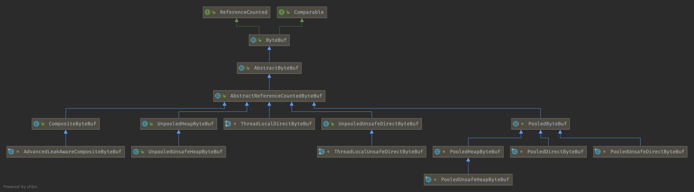

## Introduction

Netty uses its own buffer API instead of NIO [ByteBuffer](/docs/CS/Java/JDK/IO/NIO.md?id=buffers) to represent a sequence of bytes.
This approach has significant advantages over using ByteBuffer. 
Netty's new buffer type, ByteBuf has been designed from the ground up to address the problems of ByteBuffer and to meet the daily needs of network application developers. 
To list a few cool features:

- You can define your own buffer type if necessary.
- Transparent zero copy is achieved by a built-in composite buffer type.
- A dynamic buffer type is provided out-of-the-box, whose capacity is expanded on demand, just like StringBuffer.
- There's no need to call flip() anymore.
- It is often faster than ByteBuffer.


ByteBuf 是 Netty 中的数据容器，Netty 在接收网络数据和发送网络数据时，都会首先将这些网络数据事先缓存在 ByteBuf 中，然后在将它们丢给 pipeline 处理或者发送给 Socket ，
这样做的目的是防止在接收网络数据的过程中网络数据一直积压在 Socket 的接收缓冲区中使得接收缓冲区的数据越来越多，导致对端 TCP 协议中的窗口关闭（滑动窗口），影响到了整个 TCP 通信的速度


### ByteBuf Hierarchy




ByteBuf
1. readIndex and  writeIndex
2. auto expand
3. reference count
4. Pool area
5. Zero copy

### Implementations

按「是否池化 × 内存位置」两个维度交叉，4.2.19 的实现类如下（源码均位于 `buffer/src/main/java/io/netty/buffer/`）：

|          | Heap                                                                              | Direct                                                                                    |
| :------- | :------------------------------------------------------------------------------- | :---------------------------------------------------------------------------------------- |
| Unpooled | `UnpooledHeapByteBuf`（`:38`） → `UnpooledUnsafeHeapByteBuf`（`:25`）                     | `UnpooledDirectByteBuf`（`:39`） → `UnpooledUnsafeDirectByteBuf`（`:32`）                        |
| Pooled   | `PooledHeapByteBuf`（`:26`） → `PooledUnsafeHeapByteBuf`（`:22`）                          | `PooledDirectByteBuf`（`:28`）／`PooledUnsafeDirectByteBuf`（`:28`）                              |

"Unsafe" 后缀代表用 `sun.misc.Unsafe` 直接读写内存地址 / 数组，绕过 `ByteBuffer` 与数组边界检查；是否可用由 `PlatformDependent.hasUnsafe()` 决定，分配侧在 `UnsafeByteBufUtil` 里做选择。

继承骨架（`ByteBuf.java:248` / `AbstractByteBuf.java:47` / `AbstractReferenceCountedByteBuf.java:24` / `PooledByteBuf.java:30`）：

```java
public abstract class ByteBuf implements ReferenceCounted, Comparable<ByteBuf>, ByteBufConvertible {
public abstract class AbstractByteBuf extends ByteBuf {
public abstract class AbstractReferenceCountedByteBuf extends AbstractByteBuf {
abstract class PooledByteBuf<T> extends AbstractReferenceCountedByteBuf {
```

> [!NOTE]
>
> 两个容易记错的地方：
>
> 1. `PooledUnsafeDirectByteBuf extends PooledByteBuf<ByteBuffer>`——它**不是** `PooledDirectByteBuf` 的子类，两者是兄弟（源码：`buffer/src/main/java/io/netty/buffer/PooledUnsafeDirectByteBuf.java:28`）。堆内那边则相反，`PooledUnsafeHeapByteBuf extends PooledHeapByteBuf`（`PooledUnsafeHeapByteBuf.java:22`）。
> 2. 池化 buffer 对象本身由 `Recycler` 复用（`PooledByteBuf` 持有 `Recycler.Handle`），详见 [Recycler](/docs/CS/Framework/Netty/memory.md?id=recycler)。

分配入口在 `AbstractByteBufAllocator`：默认 `initialCapacity = 256`、`maxCapacity = Integer.MAX_VALUE`、`maxComponents = 16`（源码：`AbstractByteBufAllocator.java:31-33`）。

### Derived Buffers

`duplicate()` / `slice()` 创建的是**派生 buffer**：它们没有自己的引用计数，`retain()` / `release()` / `refCnt()` 全部委派给 `unwrap()` 返回的父 buffer：

// 源码：buffer/src/main/java/io/netty/buffer/AbstractDerivedByteBuf.java:53-58
```java
@Override
public final ByteBuf retain() {
    unwrap().retain();
    return this;
}
```

`retainedXxx()` 就是"先派生、再 retain"的语法糖，一次调用让**父 buffer** 的 `refCnt` +1：

// 源码：buffer/src/main/java/io/netty/buffer/AbstractByteBuf.java:1205-1234
```java
@Override
public ByteBuf duplicate() {
    ensureAccessible();
    return new UnpooledDuplicatedByteBuf(this);
}

@Override
public ByteBuf retainedDuplicate() {
    return duplicate().retain();
}

@Override
public ByteBuf slice() {
    return slice(readerIndex, readableBytes());
}

@Override
public ByteBuf retainedSlice() {
    return slice().retain();
}

@Override
public ByteBuf slice(int index, int length) {
    ensureAccessible();
    return new UnpooledSlicedByteBuf(this, index, length);
}

@Override
public ByteBuf retainedSlice(int index, int length) {
    return slice(index, length).retain();
}
```

| 方法                                                                | 是否拷贝内存 | 是否增加 refCnt | 释放责任                    |
| :---------------------------------------------------------------- | :----- | :---------- | :---------------------- |
| `duplicate()`                                                     | 否，共享父内存，独立读写指针 | 否           | 父 buffer 负责             |
| `slice()` / `slice(int, int)` / `readSlice(int)`                    | 否，共享父内存切片 | 否           | 父 buffer 负责             |
| `retainedDuplicate()`                                             | 否      | **是（+1）**   | 派生 buffer 自己必须 release 一次 |
| `retainedSlice()` / `retainedSlice(int, int)` / `readRetainedSlice(int)` | 否      | **是（+1）**   | 同上                      |
| `copy()` / `copy(int, int)`                                        | **是，深拷贝** | 新 buffer 自带 refCnt=1 | 自己 release             |
| `readBytes(int)`                                                  | **是，深拷贝** | 新 buffer 自带 refCnt=1 | 自己 release             |

`order(ByteOrder)` 也返回一个共享引用计数的视图，但它的实现路径不同：`AbstractByteBuf.order()` 在字节序已匹配时直接 `return this`，否则返回 `newSwappedByteBuf()`；`SwappedByteBuf` **不继承 `AbstractDerivedByteBuf`**（`public class SwappedByteBuf extends ByteBuf`，源码：`SwappedByteBuf.java:38`），而是手工把 `refCnt` / `retain` / `release` / `touch` 逐条委派给被包装的 `buf`（源码：`SwappedByteBuf.java:1006-1047`）：

// 源码：buffer/src/main/java/io/netty/buffer/AbstractByteBuf.java:338-350
```java
public ByteBuf order(ByteOrder endianness) {
    if (endianness == order()) {
        return this;
    }
    ObjectUtil.checkNotNull(endianness, "endianness");
    return newSwappedByteBuf();
}

/**
 * Creates a new {@link SwappedByteBuf} for this {@link ByteBuf} instance.
 */
protected SwappedByteBuf newSwappedByteBuf() {
    return new SwappedByteBuf(this);
}
```

### ByteBufUtil

`ByteBufUtil`（`buffer/src/main/java/io/netty/buffer/ByteBufUtil.java`）是 ByteBuf 的静态工具箱，也是 `ByteBufAllocator.DEFAULT` 的所在地。常用的几组：

| 方法                                                                                 | 用途                                              | 源码行号  |
| :--------------------------------------------------------------------------------- | :---------------------------------------------- | :---- |
| `DEFAULT_ALLOCATOR`                                                                | `ByteBufAllocator.DEFAULT` 指向的字段，静态块里按 `io.netty.allocator.type` 选择 | `:76` |
| `hexDump(...)` / `decodeHexDump(...)`                                                | 十六进制转储与反向解析，调试协议报文最常用                           | `:144` |
| `equals(ByteBuf, ByteBuf)` / `compare(ByteBuf, ByteBuf)`                            | 内容比较 / 字典序比较，支撑 `ByteBuf implements Comparable` | `:417` |
| `indexOf(ByteBuf needle, ByteBuf haystack)`                                         | 在 haystack 中搜索 needle（两阶段：先找首字节，再比剩余）            | `:243` |
| `writeUtf8(...)` / `utf8MaxBytes(...)` / `writeAscii(...)`                          | 字符串编码写入，`reserveAndWriteUtf8` 可预留长度前缀的字节数        | `:845` |
| `readBytes(ByteBufAllocator, ByteBuf, int)`                                         | 从 buffer 读成新 buffer（深拷贝，需要释放）                    | `:711` |
| `threadLocalDirectBuffer()`                                                         | 线程本地复用的 direct buffer，受 `io.netty.threadLocalDirectBufferSize` 控制 | `:1379` |
| `isAccessible(ByteBuf)` / `ensureAccessible(ByteBuf)`                               | 存活检查，读已释放 buffer 时给出明确报错                         | `:125` |
| `swapShort/swapMedium/swapInt/swapLong`                                             | 字节序翻转原语                                         | `:634` |


`AbstractByteBuf` 只持有索引与 `maxCapacity` 三个状态，真正的字节存取由子类实现（`_getByte` / `_setByte` 等抽象方法）：

// 源码：buffer/src/main/java/io/netty/buffer/AbstractByteBuf.java:71-75
```java
int readerIndex;
int writerIndex;
private int markedReaderIndex;
private int markedWriterIndex;
private int maxCapacity;
```

`0 <= readerIndex <= writerIndex <= capacity <= maxCapacity` 这条不变式由 `checkIndexBounds()` 与 `checkNewCapacity()` 共同维护；`markReaderIndex()` / `resetReaderIndex()` 只是把索引暂存进 `markedXxx` 字段，不产生任何拷贝。

### capacity( )

auto expand

写入前统一走 `ensureWritable0()`；只有容量不够时才扩容，扩容策略交给 `alloc().calculateNewCapacity()`：

// 源码：buffer/src/main/java/io/netty/buffer/AbstractByteBuf.java:1079-1084
```java
public ByteBuf writeBytes(byte[] src, int srcIndex, int length) {
    ensureWritable(length);
    setBytes(writerIndex, src, srcIndex, length);
    writerIndex += length;
    return this;
}
```

> [!NOTE]
>
> **4.2 的实现如下**（以 4.2.19 为准）。写扩容逻辑时最容易踩的坑是"先算 2 的幂、再用 `maxFastWritableBytes()` 修正"这个顺序——4.2 把它倒过来了：**先问 `maxFastWritableBytes()`**，够用就直接 `writerIndex + fastWritable`，一次 `calculateNewCapacity` 都不调用；不够才回落到 `calculateNewCapacity(targetCapacity, maxCapacity)`。更早的 Netty 版本（本仓库仅检出 4.2.19，未做逐行对照）走的是前一种顺序，因此网上流传的片段常与本处不同。
>
> 边界检查也值得记一下：`targetCapacity >= 0 & targetCapacity <= capacity()` 用的是**非短路 `&`**，注释说明这是为了减少热路径上的分支（溢出极少发生）。

// 源码：buffer/src/main/java/io/netty/buffer/AbstractByteBuf.java:284-306
```java
final void ensureWritable0(int minWritableBytes) {
    final int writerIndex = writerIndex();
    final int targetCapacity = writerIndex + minWritableBytes;
    // using non-short-circuit & to reduce branching - this is a hot path and targetCapacity should rarely overflow
    if (targetCapacity >= 0 & targetCapacity <= capacity()) {
        ensureAccessible();
        return;
    }
    if (checkBounds && (targetCapacity < 0 || targetCapacity > maxCapacity)) {
        ensureAccessible();
        throw new IndexOutOfBoundsException(String.format(
                "writerIndex(%d) + minWritableBytes(%d) exceeds maxCapacity(%d): %s",
                writerIndex, minWritableBytes, maxCapacity, this));
    }

    // Normalize the target capacity to the power of 2.
    final int fastWritable = maxFastWritableBytes();
    int newCapacity = fastWritable >= minWritableBytes ? writerIndex + fastWritable
            : alloc().calculateNewCapacity(targetCapacity, maxCapacity);

    // Adjust to the new capacity.
    capacity(newCapacity);
}
```

扩容阈值是 4 MiB：低于阈值向上取到 2 的幂（下限 64 B），高于阈值则不再翻倍、改为按 4 MiB 步进，避免大 buffer 一次翻倍浪费一半内存：

// 源码：buffer/src/main/java/io/netty/buffer/AbstractByteBufAllocator.java:232-259
```java
public int calculateNewCapacity(int minNewCapacity, int maxCapacity) {
    checkPositiveOrZero(minNewCapacity, "minNewCapacity");
    if (minNewCapacity > maxCapacity) {
        throw new IllegalArgumentException(String.format(
                "minNewCapacity: %d (expected: not greater than maxCapacity(%d)",
                minNewCapacity, maxCapacity));
    }
    final int threshold = CALCULATE_THRESHOLD; // 4 MiB page

    if (minNewCapacity == threshold) {
        return threshold;
    }

    // If over threshold, do not double but just increase by threshold.
    if (minNewCapacity > threshold) {
        int newCapacity = minNewCapacity / threshold * threshold;
        if (newCapacity > maxCapacity - threshold) {
            newCapacity = maxCapacity;
        } else {
            newCapacity += threshold;
        }
        return newCapacity;
    }

    // 64 <= newCapacity is a power of 2 <= threshold
    final int newCapacity = MathUtil.findNextPositivePowerOfTwo(Math.max(minNewCapacity, 64));
    return Math.min(newCapacity, maxCapacity);
}
```

`CALCULATE_THRESHOLD = 1048576 * 4`（源码：`AbstractByteBufAllocator.java:34`）。

真正的容量迁移由具体子类实现。以堆内非池化为例，4.2 的实现比 4.1 简洁不少——不再手工搬运 `writerIndex`，而是抽出 `trimIndicesToCapacity()` 统一裁剪索引：

// 源码：buffer/src/main/java/io/netty/buffer/UnpooledHeapByteBuf.java:118-138
```java
public ByteBuf capacity(int newCapacity) {
    checkNewCapacity(newCapacity);
    byte[] oldArray = array;
    int oldCapacity = oldArray.length;
    if (newCapacity == oldCapacity) {
        return this;
    }

    int bytesToCopy;
    if (newCapacity > oldCapacity) {
        bytesToCopy = oldCapacity;
    } else {
        trimIndicesToCapacity(newCapacity);
        bytesToCopy = newCapacity;
    }
    byte[] newArray = allocateArray(newCapacity);
    System.arraycopy(oldArray, 0, newArray, 0, bytesToCopy);
    setArray(newArray);
    freeArray(oldArray);
    return this;
}
```

### discardReadBytes

把 `[readerIndex, writerIndex)` 的数据搬到 0 号位置，腾出可写空间。代价是一次 `System.arraycopy`，所以只在"读走了一大半"时才划算——`discardSomeReadBytes()` 就是带这个门槛的版本：只有 `readerIndex >= capacity() >>> 1`（读走超过一半）才真正搬运，否则空转返回：

// 源码：buffer/src/main/java/io/netty/buffer/AbstractByteBuf.java:216-255
```java
public ByteBuf discardReadBytes() {
    if (readerIndex == 0) {
        ensureAccessible();
        return this;
    }

    if (readerIndex != writerIndex) {
        setBytes(0, this, readerIndex, writerIndex - readerIndex);
        writerIndex -= readerIndex;
        adjustMarkers(readerIndex);
        readerIndex = 0;
    } else {
        ensureAccessible();
        adjustMarkers(readerIndex);
        writerIndex = readerIndex = 0;
    }
    return this;
}

public ByteBuf discardSomeReadBytes() {
    if (readerIndex > 0) {
        if (readerIndex == writerIndex) {
            ensureAccessible();
            adjustMarkers(readerIndex);
            writerIndex = readerIndex = 0;
            return this;
        }

        if (readerIndex >= capacity() >>> 1) {
            setBytes(0, this, readerIndex, writerIndex - readerIndex);
            writerIndex -= readerIndex;
            adjustMarkers(readerIndex);
            readerIndex = 0;
            return this;
        }
    }
    ensureAccessible();
    return this;
}
```

`ByteToMessageDecoder` 每轮 decode 后调用的就是 `discardSomeReadBytes()`，正是出于这个"避免无谓拷贝"的考虑。


## ReferenceCounting


The general rule of thumb is that the party that accesses a reference-counted object last is also responsible for the destruction of that reference-counted object. Specifically:

- If a sending component is supposed to pass a reference-counted object to another receiving component, the sending component usually does not need to destroy it but defers that decision to the receiving component.
- If a component consumes a reference-counted object and knows nothing else will access it anymore (i.e., does not pass along a reference to yet another component), the component should destroy it.


`ByteBuf.duplicate()`, `ByteBuf.slice()` and `ByteBuf.order(ByteOrder)` create a *derived* buffer which shares the memory region of the parent buffer. 
A derived buffer does not have its own reference count, but shares the reference count of the parent buffer.


In contrast, `ByteBuf.copy()` and `ByteBuf.readBytes(int)` are *not derived* buffers. The returned `ByteBuf` is allocated and will need to be released.


Sometimes, a `ByteBuf` is contained by a buffer holder, such as `DatagramPacket`, `HttpContent`, and `WebSocketFrame`.
Those types extend a common interface called `ByteBufHolder`.
A buffer holder shares the reference count of the buffer it contains, just like a derived buffer.


> [!NOTE]
> 
> Note that a parent buffer and its derived buffers share the same reference count, and the reference count does not increase when a derived buffer is created. 
> 
> Therefore, if you are going to pass a derived buffer to an other component of your application, you will have to call `retain()` on it first.


If you are in doubt or you want to simplify releasing the messages, you can use `ReferenceCountUtil.release()`.
Alternatively, you could consider extending `SimpleChannelInboundHandler` which calls `ReferenceCountUtil.release(msg)` for all messages you receive.


### RefCnt

> [!NOTE]
>
> **4.1 vs 4.2**：4.1 的引用计数由 `AbstractReferenceCountedByteBuf` 自己持有一个静态 `ReferenceCountUpdater<AbstractReferenceCountedByteBuf>`，内部在 `AtomicIntegerFieldUpdater` 与 `Unsafe` 两个后端之间选一个（下面那段 `AIF_UPDATER` / `REFCNT_FIELD_OFFSET` 代码就是 4.1 的样子）。4.2 把它整体换成 `io.netty.util.internal.RefCnt`——一个"单态（monomorphic）"实现，类注释写明了动机：
>
> "Monomorphic reference counter implementation that always use the most efficient available atomic updater. This implementation is easier for the JIT compiler to optimize, compared to when `ReferenceCountUpdater` is used."（源码：`common/src/main/java/io/netty/util/internal/RefCnt.java:26-30`）
>
> 三点需要澄清，避免望文生义：
>
> 1. **没有 `@Contended`**。唯一的字段就是一个普通的 `volatile int value`（源码：`common/src/main/java/io/netty/util/internal/RefCnt.java:58`），整个类里 grep 不到 `Contended`；字段注释说明它之所以是 package-private，是为了让 `AtomicRefCnt` 后端在 native-image 下也能访问到。
> 2. **没有"单线程快路径"分支**。`retain` / `release` 在三个后端上走的是完全相同的算法，不存在按 owner 线程分流的逻辑。真正省掉 volatile 读的只有 `isLiveNonVolatile()`（普通读 + 奇偶判断），它被 `AbstractReferenceCountedByteBuf.isAccessible()` 当作"尽力而为"的存活检查。
> 3. **编码语义与 4.1 不变**：偶数 → 真实计数 `value >>> 1`；奇数 → 已释放（计数 0）。注释原文见 `RefCnt.java:52-57`。
>
> 本文凡涉及"更早版本 / 4.1"的对比，均指本文件此前记录下来的 4.1 片段——本仓库只检出 **4.2.19.Final**，没有 4.1 源码可做逐行对照，因此 4.1 一侧只作定性参考，请以带 `源码：` 标注的 4.2 侧为准。

#### Implementation Selection

后端在 `RefCnt` 类加载时三选一，之后所有静态方法都按 `REF_CNT_IMPL` 这个 `static final int` 分支。因为分支条件在类加载期就固化，JIT 只会看到一条实现路径，这就是"单态"的收益来源：

// 源码：common/src/main/java/io/netty/util/internal/RefCnt.java:39-47
```java
static {
    if (PlatformDependent.hasUnsafe()) {
        REF_CNT_IMPL = UNSAFE;
    } else if (PlatformDependent.hasVarHandle()) {
        REF_CNT_IMPL = VAR_HANDLE;
    } else {
        REF_CNT_IMPL = ATOMIC_UPDATER;
    }
}
```

三个后端提供同一组操作，只有底层指令不同：

| 后端                  | 触发条件                            | volatile 读                             | getAndAdd                             | compareAndSet                             | release 语义写                        |
| :------------------ | :----------------------------- | :------------------------------------- | :------------------------------------ | :---------------------------------------- | :-------------------------------- |
| `UnsafeRefCnt`      | `PlatformDependent.hasUnsafe()`    | `PlatformDependent.getVolatileInt`     | `PlatformDependent.getAndAddInt`      | `PlatformDependent.compareAndSwapInt`     | `PlatformDependent.putOrderedInt` |
| `VarHandleRefCnt`   | 否则 `hasVarHandle()`              | `VarHandle.getAcquire`                 | `VarHandle.getAndAdd`                 | `VarHandle.compareAndSet`                 | `VarHandle.setRelease`            |
| `AtomicRefCnt`      | 兜底                              | `AtomicIntegerFieldUpdater.get`        | `AtomicIntegerFieldUpdater.getAndAdd` | `AtomicIntegerFieldUpdater.compareAndSet` | `AtomicIntegerFieldUpdater.lazySet` |

#### Core Methods

`RefCnt` 对外暴露的 API 全是**静态方法**，实例本身只是"被操作的那一块内存"的载体，不承载任何行为：

| 方法                                | 语义                                                     | 源码                    |
| :-------------------------------- | :----------------------------------------------------- | :-------------------- |
| `refCnt(RefCnt)`                  | 返回真实计数 `raw >>> 1`，acquire 读                           | `RefCnt.java:81`      |
| `retain(RefCnt)`                  | +1，等价于 `retain0(ref, 2)`                                | `RefCnt.java:98`      |
| `retain(RefCnt, int increment)`   | +increment，内部 `increment << 1`                          | `RefCnt.java:120`     |
| `release(RefCnt)`                 | -1，减到 0 返回 `true`（调用方需 `deallocate()`）                  | `RefCnt.java:141`     |
| `release(RefCnt, int decrement)`  | -decrement，同上                                           | `RefCnt.java:161`     |
| `isLiveNonVolatile(RefCnt)`       | **非 volatile** 的存活判断，用于热路径上的"尽力而为"检查                     | `RefCnt.java:180`     |
| `setRefCnt(RefCnt, int)`          | 直接写入（unsafe，release 语义），`refCnt > 0 ? refCnt << 1 : 1` | `RefCnt.java:199`     |
| `resetRefCnt(RefCnt)`             | 置回 1（raw = 2），给 Recycler 复用 buffer 时用                   | `RefCnt.java:223`     |

`isLiveNonVolatile` 的实现很能说明"偶数存活性"这个编码的好处——先短路最常见的 raw == 2（即计数 1），再退回奇偶判断：

// 源码：common/src/main/java/io/netty/util/internal/RefCnt.java:468-474
```java
static boolean isLiveNonVolatile(RefCnt instance) {
    final int rawCnt = PlatformDependent.getInt(instance, VALUE_OFFSET);
    if (rawCnt == 2) {
        return true;
    }
    return (rawCnt & 1) == 0;
}
```

> [!NOTE]
>
> **4.1 与 4.2 都保留了**，但用途已经分开：`ReferenceCountUpdater`（`common/src/main/java/io/netty/util/internal/ReferenceCountUpdater.java`）在 4.2 中仍然存在，不过只服务于 `io.netty.util.AbstractReferenceCounted`——即 ByteBuf 之外的通用引用计数基类（`ResourceLeakTracker` 等）。`AbstractReferenceCountedByteBuf` 已经不再引用它。

refCnt use AtomicIntegerFieldUpdater rather than AtomicInteger to reduce memory

下面这段是 **4.1** 的写法，留作对照（`AbstractReferenceCountedByteBuf` 自带 updater + `ReferenceCountUpdater` 匿名子类）：

```java
// 4.1：AbstractReferenceCountedByteBuf
public abstract class AbstractReferenceCountedByteBuf extends AbstractByteBuf {
    private static final long REFCNT_FIELD_OFFSET =
            ReferenceCountUpdater.getUnsafeOffset(AbstractReferenceCountedByteBuf.class, "refCnt");
    private static final AtomicIntegerFieldUpdater<AbstractReferenceCountedByteBuf> AIF_UPDATER =
            AtomicIntegerFieldUpdater.newUpdater(AbstractReferenceCountedByteBuf.class, "refCnt");

    private static final ReferenceCountUpdater<AbstractReferenceCountedByteBuf> updater =
            new ReferenceCountUpdater<AbstractReferenceCountedByteBuf>() {
                @Override
                protected AtomicIntegerFieldUpdater<AbstractReferenceCountedByteBuf> updater() {
                    return AIF_UPDATER;
                }

                @Override
                protected long unsafeOffset() {
                    return REFCNT_FIELD_OFFSET;
                }
            };

    // Value might not equal "real" reference count, all access should be via the updater
    private volatile int refCnt = updater.initialValue();

    public final int initialValue() {
        return 2;
    }
}
```

4.2 的实际代码是（整个类只有 102 行，引用计数全部外派给 `RefCnt`）：

// 源码：buffer/src/main/java/io/netty/buffer/AbstractReferenceCountedByteBuf.java:24-96
```java
public abstract class AbstractReferenceCountedByteBuf extends AbstractByteBuf {

    // this is setting the ref cnt to the initial value
    private final RefCnt refCnt = new RefCnt();

    protected AbstractReferenceCountedByteBuf(int maxCapacity) {
        super(maxCapacity);
    }

    @Override
    boolean isAccessible() {
        // Try to do non-volatile read for performance as the ensureAccessible() is racy anyway and only provide
        // a best-effort guard.
        return RefCnt.isLiveNonVolatile(refCnt);
    }

    @Override
    public int refCnt() {
        return RefCnt.refCnt(refCnt);
    }

    /**
     * An unsafe operation intended for use by a subclass that sets the reference count of the buffer directly
     */
    protected final void setRefCnt(int count) {
        RefCnt.setRefCnt(refCnt, count);
    }

    /**
     * An unsafe operation intended for use by a subclass that resets the reference count of the buffer to 1
     */
    protected final void resetRefCnt() {
        RefCnt.resetRefCnt(refCnt);
    }

    @Override
    public ByteBuf retain() {
        RefCnt.retain(refCnt);
        return this;
    }

    @Override
    public ByteBuf retain(int increment) {
        RefCnt.retain(refCnt, increment);
        return this;
    }

    @Override
    public ByteBuf touch() {
        return this;
    }

    @Override
    public ByteBuf touch(Object hint) {
        return this;
    }

    @Override
    public boolean release() {
        return handleRelease(RefCnt.release(refCnt));
    }

    @Override
    public boolean release(int decrement) {
        return handleRelease(RefCnt.release(refCnt, decrement));
    }

    private boolean handleRelease(boolean result) {
        if (result) {
            deallocate();
        }
        return result;
    }

    /**
     * Called once {@link #refCnt()} is equals 0.
     */
    protected abstract void deallocate();
}
```

代价是每个带引用计数的 buffer 多出一个 `RefCnt` 对象（一个 `volatile int` + 对象头）；收益是 `retain()` / `release()` 的调用点在 JIT 眼里是单态的、可以被内联。

### retain0

**这是 retain 语义上最需要看清的一处**（以 4.2.19 为准）。条件判断把"已释放"与"溢出"合成了一个短路表达式，回滚后抛的异常也统一成 `IllegalReferenceCountException(0, increment >>> 1)`。更早版本的写法是先判 `(oldRef & 1) != 0`、再单独判溢出，两段分开（本仓库仅检出 4.2.19，未做逐行对照）。

4.2 的步骤：

1. `getAndAdd(rawIncrement)`，其中 `rawIncrement = increment << 1`
2. `oldRef & 0x80000001 != 0`（oldRef < 0 或 oldRef 为奇数 → 已释放）**或** `oldRef > Integer.MAX_VALUE - increment`（溢出）→ 回滚 `getAndAdd(-increment)` 并抛异常
3. 否则成功返回

// 源码：common/src/main/java/io/netty/util/internal/RefCnt.java:424-433（UnsafeRefCnt 后端；VarHandleRefCnt:340-349 与 AtomicRefCnt:262-271 逻辑完全相同）
```java
private static void retain0(RefCnt instance, int increment) {
    // oldRef & 0x80000001 stands for oldRef < 0 || oldRef is odd
    // NOTE: we're optimizing for inlined and constant folded increment here -> which will make
    // Integer.MAX_VALUE - increment to be computed at compile time
    int oldRef = PlatformDependent.getAndAddInt(instance, VALUE_OFFSET, increment);
    if ((oldRef & 0x80000001) != 0 || oldRef > Integer.MAX_VALUE - increment) {
        PlatformDependent.getAndAddInt(instance, VALUE_OFFSET, -increment);
        throw new IllegalReferenceCountException(0, increment >>> 1);
    }
}
```

注释里说的优化点是：`retain()` / `retain(int)` 的 `increment` 往往是常量，于是 `Integer.MAX_VALUE - increment` 会被 JIT 常量折叠掉，运行时只剩一次 `getAndAdd` 加一次条件跳转。

### release

4.2 的 `release` 收敛成了一个 CAS 循环——**没有 `Thread.yield()`，也不再区分"最终释放 / 非最终释放"两条路径**（更早版本是"三段式"：`tryFinalRelease0` / `nonFinalRelease0` / `retryRelease0`，本仓库仅检出 4.2.19，未做逐行对照）。

4.2 的步骤：

1. 普通读 `curr`；若 `curr == decrement`，说明这是最后一次释放，`next = 1`（任意奇数都表示已释放）
2. 否则若 `curr < decrement`（释放过头）或 `curr` 已是奇数（已释放）→ 抛 `IllegalReferenceCountException`
3. CAS 失败就重读重试
4. 返回 `(next & 1) == 1`，为真代表调用方需要 `deallocate()`

// 源码：common/src/main/java/io/netty/util/internal/RefCnt.java:443-457
```java
private static boolean release0(RefCnt instance, int decrement) {
    int curr, next;
    do {
        curr = PlatformDependent.getInt(instance, VALUE_OFFSET);
        if (curr == decrement) {
            next = 1;
        } else {
            if (curr < decrement || (curr & 1) == 1) {
                throwIllegalRefCountOnRelease(decrement, curr);
            }
            next = curr - decrement;
        }
    } while (!PlatformDependent.compareAndSwapInt(instance, VALUE_OFFSET, curr, next));
    return (next & 1) == 1;
}
```

注意 `retain0` 用 `getAndAdd`（单次原子加法）而 `release0` 用 `get + CAS`：因为减到 0 时要把值改写成一个固定的奇数哨兵 `1`，这个"条件改写"无法用一次原子加法表达。异常参数为什么要右移一位也能对上——

// 源码：common/src/main/java/io/netty/util/internal/RefCnt.java:238-240
```java
static void throwIllegalRefCountOnRelease(int decrement, int curr) {
    throw new IllegalReferenceCountException(curr >>> 1, -(decrement >>> 1));
}
```

### touch

`RefCnt` **不参与** `touch`。4.2 的 `AbstractReferenceCountedByteBuf.touch()` / `touch(Object)` 是空实现，直接 `return this`（源码：`buffer/src/main/java/io/netty/buffer/AbstractReferenceCountedByteBuf.java:71-79`）。

记录访问点的工作完全由泄漏检测包装类承担：只有被 `AbstractByteBufAllocator.toLeakAwareBuffer()` 包成 `SimpleLeakAwareByteBuf` / `AdvancedLeakAwareByteBuf` 之后，`touch` 才会真的落到 `ResourceLeakTracker.record()`：

// 源码：buffer/src/main/java/io/netty/buffer/AdvancedLeakAwareByteBuf.java:958-967
```java
@Override
public ByteBuf touch() {
    leak.record();
    return this;
}

@Override
public ByteBuf touch(Object hint) {
    leak.record(hint);
    return this;
}
```

所以"派生 buffer 的 `touch` 冒泡到父 buffer"这层语义是在泄漏包装层实现的，不在 `RefCnt` 里——把 `touch` 当成 `RefCnt` 的方法去找会找不到。


## CompositeByteBuf

> [!NOTE]
>
> 4.2 的 `COMPOSITE_CUMULATOR` 与 4.1 差别很大，且**位置也变了**：它现在定义在 `ByteToMessageDecoder`（`codec-base/src/main/java/io/netty/handler/codec/ByteToMessageDecoder.java:123`），不再是 `ByteBufUtil` 的静态字段。
>
> 逻辑上的三处改动：① 新增 `cumulation == in` 与 `!cumulation.isReadable()` 两个短路分支；② 不再像 4.1 那样用 `cumulation.refCnt() > 1` 判断是否要 `expandCumulation()`，改为判断 `cumulation instanceof CompositeByteBuf && cumulation.refCnt() == 1` 能否就地扩容；③ 合并组件统一走 `addFlattenedComponents(true, ...)`，并在 `finally` 里额外释放"新建出来但没用上"的 composite，堵住了 4.1 会漏掉的那个泄漏点。
>
> `ByteToMessageDecoder` 的默认累积器仍然是 `MERGE_CUMULATOR`（源码：`ByteToMessageDecoder.java:158`）。

// 源码：codec-base/src/main/java/io/netty/handler/codec/ByteToMessageDecoder.java:123-155
```java
/**
 * Cumulate {@link ByteBuf}s by add them to a {@link CompositeByteBuf} and so do no memory copy whenever possible.
 * Be aware that {@link CompositeByteBuf} use a more complex indexing implementation so depending on your use-case
 * and the decoder implementation this may be slower than just use the {@link #MERGE_CUMULATOR}.
 */
public static final Cumulator COMPOSITE_CUMULATOR = new Cumulator() {
    @Override
    public ByteBuf cumulate(ByteBufAllocator alloc, ByteBuf cumulation, ByteBuf in) {
        if (cumulation == in) {
            // when the in buffer is the same as the cumulation it is doubly retained, release it once
            in.release();
            return cumulation;
        }
        if (!cumulation.isReadable()) {
            cumulation.release();
            return in;
        }
        CompositeByteBuf composite = null;
        try {
            if (cumulation instanceof CompositeByteBuf && cumulation.refCnt() == 1) {
                composite = (CompositeByteBuf) cumulation;
                // Writer index must equal capacity if we are going to "write"
                // new components to the end
                if (composite.writerIndex() != composite.capacity()) {
                    composite.capacity(composite.writerIndex());
                }
            } else {
                composite = alloc.compositeBuffer(Integer.MAX_VALUE).addFlattenedComponents(true, cumulation);
            }
            composite.addFlattenedComponents(true, in);
            in = null;
            return composite;
        } finally {
            if (in != null) {
                // We must release if the ownership was not transferred as otherwise it may produce a leak
                in.release();
                // Also release any new buffer allocated if we're not returning it
                if (composite != null && composite != cumulation) {
                    composite.release();
                }
            }
        }
    }
};
```


### Component

```java
Component(ByteBuf buf, int srcOffset, int offset, int len, ByteBuf slice) {
    this.buf = buf;
    this.offset = offset;
    this.endOffset = offset + len;
    this.adjustment = srcOffset - offset;
    this.slice = slice;
}

/**
 * Precondition is that {@code buffer != null}.
 */
private int addComponent0(boolean increaseWriterIndex, int cIndex, ByteBuf buffer) {
    assert buffer != null;
    boolean wasAdded = false;
    try {
        checkComponentIndex(cIndex);

        // No need to consolidate - just add a component to the list.
        Component c = newComponent(buffer, 0);
        int readableBytes = c.length();

        addComp(cIndex, c);
        wasAdded = true;
        if (readableBytes > 0 && cIndex < componentCount - 1) {
            updateComponentOffsets(cIndex);
        } else if (cIndex > 0) {
            c.reposition(components[cIndex - 1].endOffset);
        }
        if (increaseWriterIndex) {
            writerIndex += readableBytes;
        }
        return cIndex;
    } finally {
        if (!wasAdded) {
            buffer.release();
        }
    }
}
```


### discardReadComponents

// 源码：buffer/src/main/java/io/netty/buffer/CompositeByteBuf.java:1798
```java
/**
 * Discard all {@link ByteBuf}s which are read.
 */
public CompositeByteBuf discardReadComponents() {
    ensureAccessible();
    final int readerIndex = readerIndex();
    if (readerIndex == 0) {
        return this;
    }

    // Discard everything if (readerIndex = writerIndex = capacity).
    int writerIndex = writerIndex();
    if (readerIndex == writerIndex && writerIndex == capacity()) {
        for (int i = 0, size = componentCount; i < size; i++) {
            components[i].free();
        }
        lastAccessed = null;
        clearComps();
        setIndex(0, 0);
        adjustMarkers(readerIndex);
        return this;
    }

    // Remove read components.
    int firstComponentId = 0;
    Component c = null;
    for (int size = componentCount; firstComponentId < size; firstComponentId++) {
        c = components[firstComponentId];
        if (c.endOffset > readerIndex) {
            break;
        }
        c.free();
    }
    if (firstComponentId == 0) {
        return this; // Nothing to discard
    }
    Component la = lastAccessed;
    if (la != null && la.endOffset <= readerIndex) {
        lastAccessed = null;
    }
    removeCompRange(0, firstComponentId);

    // Update indexes and markers.
    int offset = c.offset;
    updateComponentOffsets(0);
    setIndex(readerIndex - offset, writerIndex - offset);
    adjustMarkers(offset);
    return this;
}
```


## Pooling

上面 `retain` / `release` 只回答「谁来释放」，「内存从哪里来、怎么复用」属于内存池主题，统一记在 [Memory Pool](/docs/CS/Framework/Netty/memory.md)，本篇不重复分配代码：

- 分配层次（`PooledByteBufAllocator` → `PoolArena` → `PoolChunk` → `PoolSubpage`，外加 `PoolThreadCache` 线程本地缓存）见 [Allocator](/docs/CS/Framework/Netty/memory.md?id=allocator)、[PoolChunk](/docs/CS/Framework/Netty/memory.md?id=poolchunk) 与 [PoolSubpage](/docs/CS/Framework/Netty/memory.md?id=poolsubpage)。
- `PooledByteBuf` 对象自身的复用（`newInstance` / `reuse` / `deallocate` 走 Recycler）见 [Recycler](/docs/CS/Framework/Netty/memory.md?id=recycler)。
- 池的构造参数与运行期指标见 [Constructor](/docs/CS/Framework/Netty/memory.md?id=constructor) 与 [metrics](/docs/CS/Framework/Netty/memory.md?id=metrics)。

读源码时的常见困惑是同一个 `PoolArena.allocate` 存在两套写法：4.1.52 之前用 `synchronized (head)` / `synchronized (this)`，容量走 `normalizeCapacity()`；之后把 size class 收进 `SizeClasses`，锁换成 `head.lock()` / `head.unlock()`，缓存回收改用 `entry.unguardedRecycle()`。本库统一按重构后的版本记录，旧写法只保留这里这一句说明。

## OutBuf

> Assuming a 64-bit JVM:
>  - 16 bytes object header
>  - 6 reference fields
>  - 2 long fields
>  - 2 int fields
>  - 1 boolean field
>  - padding

```java
public final class ChannelOutboundBuffer {
    private volatile long totalPendingSize;
}
```

addMessage

The addMessage method in ChannelOutboundBuffer should add the message to the "unflushed" buffer before calling incrementPendingOutboundBytes since 
incrementPendingOutboundBytes may call fireChannelWritabilityChanged which could trigger a user handler to write a second message 
and could thus save the messages in the "unflushed" buffer in the wrong order.

```java
public final class ChannelOutboundBuffer {
    public void addMessage(Object msg, int size, ChannelPromise promise) {
        Entry entry = Entry.newInstance(msg, size, total(msg), promise);
        if (tailEntry == null) {
            flushedEntry = null;
        } else {
            Entry tail = tailEntry;
            tail.next = entry;
        }
        tailEntry = entry;
        if (unflushedEntry == null) {
            unflushedEntry = entry;
        }

        // increment pending bytes after adding message to the unflushed arrays.
        incrementPendingOutboundBytes(entry.pendingSize, false);
    }
}
```

Check HighWaterMark

每次添加数据时都会累加数据的字节数，然后判断缓存大小是否超过所设置的高水位线 64KB，如果超过了高水位，那么 Channel 会被设置为不可写状态
直到缓存的数据大小低于低水位线 32KB 以后，Channel 才恢复成可写状态

```java
private void incrementPendingOutboundBytes(long size, boolean invokeLater) {
        if (size == 0) {
            return;
        }

        long newWriteBufferSize = TOTAL_PENDING_SIZE_UPDATER.addAndGet(this, size);
        if (newWriteBufferSize > channel.config().getWriteBufferHighWaterMark()) {
            setUnwritable(invokeLater);
        }
    }
```

remove
```java
public boolean remove() {
        Entry e = flushedEntry;
        if (e == null) {
            clearNioBuffers();
            return false;
        }
        Object msg = e.msg;

        ChannelPromise promise = e.promise;
        int size = e.pendingSize;

        removeEntry(e);

        if (!e.cancelled) {
            // only release message, notify and decrement if it was not canceled before.
            ReferenceCountUtil.safeRelease(msg);
            safeSuccess(promise);
            decrementPendingOutboundBytes(size, false, true);
        }

        // recycle the entry
        e.recycle();

        return true;
    }
// Check LowWaterMark
private void decrementPendingOutboundBytes(long size, boolean invokeLater, boolean notifyWritability) {
        if (size == 0) {
            return;
        }

        long newWriteBufferSize = TOTAL_PENDING_SIZE_UPDATER.addAndGet(this, -size);
        if (notifyWritability && newWriteBufferSize < channel.config().getWriteBufferLowWaterMark()) {
            setWritable(invokeLater);
        }
    }
```


## Memory Leak

> See [Java WeakReference](/docs/CS/Java/JDK/Basic/Ref.md?id=weak-reference).

`DefaultResourceLeak` 在构造时把自己加进 `allLeaks`，在 `close()` 时移除——"还在 `allLeaks` 里"就等价于"还没被正常释放"。

> [!NOTE]
>
> 4.2 里这个栈的类名是 **`TraceRecord`**，不是 `Record`（源码：`common/src/main/java/io/netty/util/ResourceLeakDetector.java:668`）。构造函数也多了一个 `initialHint` 参数，用来在构造时就记录一个初始访问点。

// 源码：common/src/main/java/io/netty/util/ResourceLeakDetector.java:421-440
```java
DefaultResourceLeak(
        Object referent,
        ReferenceQueue<Object> refQueue,
        Set<DefaultResourceLeak<?>> allLeaks,
        Object initialHint) {
    super(referent, refQueue);

    assert referent != null;

    this.allLeaks = allLeaks;

    // Store the hash of the tracked object to later assert it in the close(...) method.
    // It's important that we not store a reference to the referent as this would disallow it from
    // be collected via the WeakReference.
    trackedHash = System.identityHashCode(referent);
    allLeaks.add(this);
    // Create a new Record so we always have the creation stacktrace included.
    headUpdater.set(this, initialHint == null ?
            new TraceRecord(TraceRecord.BOTTOM) : new TraceRecord(TraceRecord.BOTTOM, initialHint));
}
```


AbstractByteBufAllocator

#### Report Level
Represents the level of resource leak detection.

- DISABLED
- SIMPLE    SimpleLeakAwareByteBuf
- ADVANCED  AdvancedLeakAwareByteBuf
- PARANOID  AdvancedLeakAwareByteBuf

#### wrap Buf

> [!NOTE]
>
> **4.2 的 `toLeakAwareBuffer` 不再 `switch` 泄漏等级**。4.1 的实现先 `switch (ResourceLeakDetector.getLevel())`，只有 `SIMPLE` / `ADVANCED` / `PARANOID` 才 `track(buf)`，`DISABLED` 直接放行。4.2 反过来：**无条件 `track()`**（采样与等级判断在 `track0()` 内部完成），拿到非 null 的 tracker 后再用 `isRecordEnabled()` 决定包 `Advanced` 还是 `Simple`。
>
> 也就是说 `DISABLED` 下 `track()` 自己返回 `null`，外面自然不包装——少了一次 `getLevel()` 的 volatile 读。
>
> 另外 4.2 里 `AdvancedLeakAwareByteBuf extends SimpleLeakAwareByteBuf`（源码：`AdvancedLeakAwareByteBuf.java:36`），不再是两个平级的 `WrappedByteBuf` 子类，`Advanced` 只额外重写 `touch()` / `record` 相关方法。

// 源码：buffer/src/main/java/io/netty/buffer/AbstractByteBufAllocator.java:40-50
```java
protected static ByteBuf toLeakAwareBuffer(ByteBuf buf) {
    ResourceLeakTracker<ByteBuf> leak = AbstractByteBuf.leakDetector.track(buf);
    if (leak != null) {
        if (AbstractByteBuf.leakDetector.isRecordEnabled()) {
            buf = new AdvancedLeakAwareByteBuf(buf, leak);
        } else {
            buf = new SimpleLeakAwareByteBuf(buf, leak);
        }
    }
    return buf;
}
```

`isRecordEnabled()` 的判据是 `(level == ADVANCED || level == PARANOID) && TARGET_RECORDS > 0`（源码：`common/src/main/java/io/netty/util/ResourceLeakDetector.java:275-278`）——所以 `SIMPLE` 拿到的是 `SimpleLeakAwareByteBuf`，它只在 `release()` 减到 0 时 `closeLeak()`，不记录访问栈。


### Leak detection levels

There are currently 4 levels of leak detection:

- `DISABLED` - disables leak detection completely. Not recommended.
- `SIMPLE` - tells if there is a leak or not for 1% of buffers. Default.
- `ADVANCED` - tells where the leaked buffer was accessed for 1% of buffers.
- `PARANOID` - Same with `ADVANCED` except that it's for every single buffer. Useful for automated testing phase. You could fail the build if the build output contains '`LEAK: `'.

You can specify the leak detection level as a JVM option `-Dio.netty.leakDetection.level`

```shell
java -Dio.netty.leakDetection.level=advanced ...
```

> [!NOTE]
> 
> This property used to be called `io.netty.leakDetectionLevel`.


### DefaultResourceLeak

`dispose()` / `close()` 的对照见上一节：二者都在抢 `allLeaks.remove(this)`，谁先成功谁决定这个对象算不算泄漏。

Creates a new ResourceLeakTracker which is expected to be closed via ResourceLeakTracker.close(Object) when the related resource is deallocated（源码：`common/src/main/java/io/netty/util/ResourceLeakDetector.java:280`）。

`close()` 是"正常释放"的信号：先从 `allLeaks` 移除，再 `clear()`，最后按 `TRACK_CLOSE` 把 head 换成一个标记（或 `null`）。`dispose()` 是 GC 侧的信号——它同样 `allLeaks.remove(this)`，返回 `false` 说明这个对象已经被 `close()` 过了，即**不是**泄漏。

// 源码：common/src/main/java/io/netty/util/ResourceLeakDetector.java:509-523
```java
boolean dispose() {
    clear();
    return allLeaks.remove(this);
}

@Override
public boolean close() {
    if (allLeaks.remove(this)) {
        // Call clear so the reference is not even enqueued.
        clear();
        headUpdater.set(this, TRACK_CLOSE ? new TraceRecord(true) : null);
        return true;
    }
    return false;
}
```

`SimpleLeakAwareByteBuf` 侧的接入点就是 `release()` 减到 0 的那一刻：

// 源码：buffer/src/main/java/io/netty/buffer/SimpleLeakAwareByteBuf.java:27
```java
class SimpleLeakAwareByteBuf extends WrappedByteBuf {
    @Override
    public boolean release(int decrement) {
        if (super.release(decrement)) {
            closeLeak();
            return true;
        }
        return false;
    }

    private void closeLeak() {
        // Close the ResourceLeakTracker with the tracked ByteBuf as argument. This must be the same that was used when
        // calling DefaultResourceLeak.track(...).
        boolean closed = leak.close(trackedByteBuf);
        assert closed;
    }
}
```


### track

track when newBuffer()

random 1/128 report if level < PARANOID, report and new DefaultResourceLeak

采样间隔默认 128，可用 `-Dio.netty.leakDetection.samplingInterval` 调整（源码：`common/src/main/java/io/netty/util/ResourceLeakDetector.java:51-53`）。

> [!NOTE]
>
> 4.2 的 `track0` 多了个 `force` 形参，并且**用 `ThreadLocalRandom.current()` 取代了 `PlatformDependent.threadLocalRandom()`**（源码：`ResourceLeakDetector.java:280-289`）。判断条件也从"先排除 DISABLED、再按 ordinal 比较 PARANOID"压成了一个短路表达式：`force || level == PARANOID || (level != DISABLED && 命中采样)`。

// 源码：common/src/main/java/io/netty/util/ResourceLeakDetector.java:280-289
```java
private DefaultResourceLeak<T> track0(T obj, boolean force) {
    Level level = ResourceLeakDetector.level;
    if (force ||
            level == Level.PARANOID ||
            (level != Level.DISABLED && ThreadLocalRandom.current().nextInt(samplingInterval) == 0)) {
        reportLeak();
        return new DefaultResourceLeak<>(obj, refQueue, allLeaks, getInitialHint(resourceType));
    }
    return null;
}
```

#### reportLeak

从 `refQueue` 里捞出所有已被 GC 的 `DefaultResourceLeak`：`dispose()` 返回 `true` 表示它还在 `allLeaks` 里（即从未被 `close()`）→ 判定为泄漏，取报告去重后输出。

// 源码：common/src/main/java/io/netty/util/ResourceLeakDetector.java:307-345
```java
protected boolean needReport() {
    return logger.isErrorEnabled();
}

private void reportLeak() {
    if (!needReport()) {
        clearRefQueue();
        return;
    }

    // Detect and report previous leaks.
    for (;;) {
        DefaultResourceLeak<?> ref = (DefaultResourceLeak<?>) refQueue.poll();
        if (ref == null) {
            break;
        }

        if (!ref.dispose()) {
            continue;
        }

        String records = ref.getReportAndClearRecords();
        if (reportedLeaks.add(records)) {
            if (records.isEmpty()) {
                reportUntracedLeak(resourceType);
            } else {
                reportTracedLeak(resourceType, records);
            }

            LeakListener listener = leakListener;
            if (listener != null) {
                listener.onLeak(resourceType, records);
            }
        }
    }
}
```

三处与 4.1 的差异值得记一下：① 报告文本不再由 `ref.toString()` 生成，而是 `getReportAndClearRecords()`（取值即清空）；② 去重容器是 `Set<String> reportedLeaks` 的 `add()`，不再是 `ConcurrentMap.putIfAbsent`；③ 新增了 `LeakListener` 回调，可以在不读日志的情况下接住泄漏。

dispose if reference still in allLeaks after clear ByteBuf
```java
boolean dispose() {
    // Clears this reference object. 
    clear();
    return allLeaks.remove(this);
}
```


#### record

This method works by exponentially backing off as more records are present in the stack. 
Each record has a 1 / 2^n chance of dropping the top most record and replacing it with itself. This has a number of convenient properties:

- The current record is always recorded. This is due to the compare and swap dropping the top most record, rather than the to-be-pushed record.
- The very last access will always be recorded. This comes as a property of 1.
- It is possible to retain more records than the target, based upon the probability distribution.
- It is easy to keep a precise record of the number of elements in the stack, since each element has to know how tall the stack is.

In this particular implementation, there are also some advantages. A thread local random is used to decide if something should be recorded. 
This means that if there is a deterministic access pattern, it is now possible to see what other accesses occur, rather than always dropping them. 
Second, after TARGET_RECORDS accesses, backoff occurs. This matches typical access patterns, where there are either a high number of accesses (i.e. a cached buffer), or low (an ephemeral buffer), but not many in between. 
The use of atomics avoids serializing a high number of accesses, when most of the records will be thrown away. 
High contention only happens when there are very few existing records, which is only likely when the object isn't shared! If this is a problem, the loop can be aborted and the record dropped, because another thread won the race.

// 源码：common/src/main/java/io/netty/util/ResourceLeakDetector.java:478-507
```java
private void record0(Object hint) {
    // Check TARGET_RECORDS > 0 here to avoid similar check before remove from and add to lastRecords
    if (TARGET_RECORDS > 0) {
        TraceRecord oldHead;
        TraceRecord prevHead;
        TraceRecord newHead;
        boolean dropped;
        do {
            if ((prevHead = oldHead = headUpdater.get(this)) == null ||
                    oldHead.pos == TraceRecord.CLOSE_MARK_POS) {
                // already closed.
                return;
            }
            final int numElements = oldHead.pos + 1;
            if (numElements >= TARGET_RECORDS) {
                final int backOffFactor = Math.min(numElements - TARGET_RECORDS, 30);
                dropped = ThreadLocalRandom.current().nextInt(1 << backOffFactor) != 0;
                if (dropped) {
                    prevHead = oldHead.next;
                }
            } else {
                dropped = false;
            }
            newHead = hint != null ? new TraceRecord(prevHead, hint) : new TraceRecord(prevHead);
        } while (!headUpdater.compareAndSet(this, oldHead, newHead));
        if (dropped) {
            droppedRecordsUpdater.incrementAndGet(this);
        }
    }
}
```

`TARGET_RECORDS` 默认 4（`-Dio.netty.leakDetection.targetRecords`，源码：`ResourceLeakDetector.java:48-49`）。两处与 4.1 的差异：类名 `Record` → `TraceRecord`；"已关闭"的判断从只看 `head == null` 扩成 `head == null || head.pos == TraceRecord.CLOSE_MARK_POS`——这样即使开了 `TRACK_CLOSE`（close 后 head 被置为标记而非 null），`record0` 也不会往一个已关闭的 tracker 上继续 push。


### Best Practices

- Run your unit tests and integration tests at `PARANOID` leak detection level, as well as at `SIMPLE` level.
- Canary your application before rolling out to the entire cluster at `SIMPLE` level for a reasonably long time to see if there's a leak.
- If there is a leak, canary again at `ADVANCED` level to get some hints about where the leak is coming from.
- Do not deploy an application with a leak to the entire cluster.


> [!TIP]
> 
> Instead of wrapping your unit tests with `try-finally` blocks to release all buffers, you can use `ReferenceCountUtil.releaseLater()` utility method.


## Links

- [Netty](/docs/CS/Framework/Netty/Netty.md)
- [Memory Pool](/docs/CS/Framework/Netty/memory.md)
- [ChannelHandler](/docs/CS/Framework/Netty/ChannelHandler.md)
- [Channel](/docs/CS/Framework/Netty/Channel.md)

## References

1. [Reference counted objects](https://netty.io/wiki/reference-counted-objects.html)
2. [ByteBuf (Netty API Reference)](https://netty.io/4.2/api/io/netty/buffer/ByteBuf.html)
3. [RefCnt (Netty API Reference)](https://netty.io/4.2/api/io/netty/util/internal/RefCnt.html)
