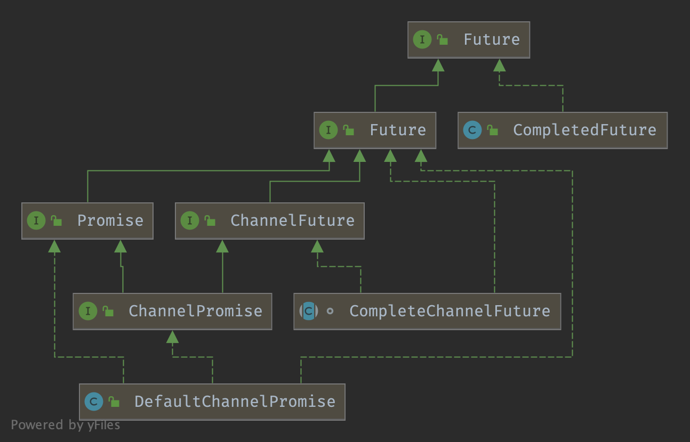

## Introduction

Netty 的 I/O 操作全是异步的：`bind` / `connect` / `write` 立刻返回一个「结果占位符」，真正的完成状态稍后由 EventLoop 线程写入。这个占位符就是 Future，Netty 在它之上做了两件事——补齐 JDK Future 的短板，以及把「读结果」和「写结果」拆成两个接口。

`java.util.concurrent.Future` 只能阻塞在 `get()` 上，既无法区分「完成但失败」与「被取消」，也无法在完成时自动触发回调。Netty 的 `Future` 因此增加 `isSuccess()` / `cause()` 表达三态结果，并用 `addListener` 把等待变成非阻塞注册，避免业务线程 park 在 EventLoop 上（`checkDeadLock()` 甚至会主动拒绝在 loop 内 await）。

可写的另一半交给 `Promise`：只有它提供 `setSuccess` / `setFailure`，因此 transport 内部用它写结果，而暴露给用户的 API 一律声明成只读的 `Future`，用户无法伪造完成状态。`ChannelFuture` / `ChannelPromise` 则是这对接口在 channel 维度的特化，额外携带 `channel()` 上下文。

按下面顺序读：先看 Future Hierarchy 的类型谱系，再看接口层（`Future` → `ChannelFuture`、`Promise` → `ChannelPromise`），最后看实现层（`AbstractFuture` → `DefaultPromise` → `DefaultChannelPromise`）。

## Future Hierarchy




## Future

```java
/**
 * The result of an asynchronous operation.
 */
@SuppressWarnings("ClassNameSameAsAncestorName")
public interface Future<V> extends java.util.concurrent.Future<V> {

    //Returns {@code true} if and only if the I/O operation was completed successfully.
    boolean isSuccess();

    //returns {@code true} if and only if the operation can be cancelled via {@link #cancel(boolean)}.
    boolean isCancellable();

    //Returns the cause of the failed I/O operation if the I/O operation has failed.
    Throwable cause();

    /**
     * Adds the specified listener to this future.  The
     * specified listener is notified when this future is
     * {@linkplain #isDone() done}.  If this future is already
     * completed, the specified listener is notified immediately.
     */
    Future<V> addListener(GenericFutureListener<? extends Future<? super V>> listener);

    /**
     * Adds the specified listeners to this future.  The
     * specified listeners are notified when this future is
     * {@linkplain #isDone() done}.  If this future is already
     * completed, the specified listeners are notified immediately.
     */
    Future<V> addListeners(GenericFutureListener<? extends Future<? super V>>... listeners);

    /**
     * Removes the first occurrence of the specified listener from this future.
     * The specified listener is no longer notified when this
     * future is {@linkplain #isDone() done}.  If the specified
     * listener is not associated with this future, this method
     * does nothing and returns silently.
     */
    Future<V> removeListener(GenericFutureListener<? extends Future<? super V>> listener);

    /**
     * Removes the first occurrence for each of the listeners from this future.
     * The specified listeners are no longer notified when this
     * future is {@linkplain #isDone() done}.  If the specified
     * listeners are not associated with this future, this method
     * does nothing and returns silently.
     */
    Future<V> removeListeners(GenericFutureListener<? extends Future<? super V>>... listeners);

    /**
     * Waits for this future until it is done, and rethrows the cause of the failure if this future
     * failed.
     */
    Future<V> sync() throws InterruptedException;

    //Waits for this future until it is done, and rethrows the cause of the failure if this future failed.
    Future<V> syncUninterruptibly();

    //Waits for this future to be completed.
    Future<V> await() throws InterruptedException;

    /**
     * Waits for this future to be completed without
     * interruption.  This method catches an {@link InterruptedException} and
     * discards it silently.
     */
    Future<V> awaitUninterruptibly();

    //Waits for this future to be completed within the specified time limit.
    boolean await(long timeout, TimeUnit unit) throws InterruptedException;

    //Waits for this future to be completed within the specified time limit.
    boolean await(long timeoutMillis) throws InterruptedException;

    /**
     * Waits for this future to be completed within the
     * specified time limit without interruption.  This method catches an
     * {@link InterruptedException} and discards it silently.
     *
     * @return {@code true} if and only if the future was completed within
     *         the specified time limit
     */
    boolean awaitUninterruptibly(long timeout, TimeUnit unit);

    /**
     * Waits for this future to be completed within the
     * specified time limit without interruption.  This method catches an
     * {@link InterruptedException} and discards it silently.
     *
     * @return {@code true} if and only if the future was completed within
     *         the specified time limit
     */
    boolean awaitUninterruptibly(long timeoutMillis);

    /**
     * Return the result without blocking. If the future is not done yet this will return {@code null}.
     *
     * As it is possible that a {@code null} value is used to mark the future as successful you also need to check
     * if the future is really done with {@link #isDone()} and not rely on the returned {@code null} value.
     */
    V getNow();

    /**
     * {@inheritDoc}
     *
     * If the cancellation was successful it will fail the future with a {@link CancellationException}.
     */
    @Override
    boolean cancel(boolean mayInterruptIfRunning);
}
```


## ChannelFuture


```java
/**
*                                      +---------------------------+
*                                      | Completed successfully    |
*                                      +---------------------------+
*                                 +---->      isDone() = true      |
* +--------------------------+    |    |   isSuccess() = true      |
* |        Uncompleted       |    |    +===========================+
* +--------------------------+    |    | Completed with failure    |
* |      isDone() = false    |    |    +---------------------------+
* |   isSuccess() = false    |----+---->      isDone() = true      |
* | isCancelled() = false    |    |    |       cause() = non-null  |
* |       cause() = null     |    |    +===========================+
* +--------------------------+    |    | Completed by cancellation |
*                                 |    +---------------------------+
*                                 +---->      isDone() = true      |
*                                      | isCancelled() = true      |
*                                      +---------------------------+
*/
```


## Promise

**Special Future which is writable.**

```java
public interface Promise<V> extends Future<V> {

    //Marks this future as a success and notifies all listeners.
    Promise<V> setSuccess(V result);

    //Marks this future as a success and notifies all listeners.
    boolean trySuccess(V result);

    //Marks this future as a failure and notifies all listeners.
    Promise<V> setFailure(Throwable cause);

    //Marks this future as a failure and notifies all listeners.
    boolean tryFailure(Throwable cause);

    //Make this future impossible to cancel.
    boolean setUncancellable();

    @Override
    Promise<V> addListener(GenericFutureListener<? extends Future<? super V>> listener);

    @Override
    Promise<V> addListeners(GenericFutureListener<? extends Future<? super V>>... listeners);

    @Override
    Promise<V> removeListener(GenericFutureListener<? extends Future<? super V>> listener);

    @Override
    Promise<V> removeListeners(GenericFutureListener<? extends Future<? super V>>... listeners);

    @Override
    Promise<V> await() throws InterruptedException;

    @Override
    Promise<V> awaitUninterruptibly();

    @Override
    Promise<V> sync() throws InterruptedException;

    @Override
    Promise<V> syncUninterruptibly();
}
```


## ChannelPromise

**Special ChannelFuture which is writable.**

Use in [Bootstrap.initAndRegister](/docs/CS/Framework/Netty/Bootstrap.md?id=initandregister-core)

```java
public interface ChannelPromise extends ChannelFuture, Promise<Void> {
    ChannelPromise setSuccess();

    boolean trySuccess();

    //Returns a new ChannelPromise if isVoid() returns true otherwise itself.
    ChannelPromise unvoid();
  
  	...
}
```


## AbstractFuture

AbstractFuture provide two  get methods

```java
public abstract class AbstractFuture<V> implements Future<V> {

    @Override
    public V get() throws InterruptedException, ExecutionException {
        await();

        Throwable cause = cause();
        if (cause == null) {
            return getNow();
        }
        if (cause instanceof CancellationException) {
            throw (CancellationException) cause;
        }
        throw new ExecutionException(cause);
    }

    @Override
    public V get(long timeout, TimeUnit unit) throws InterruptedException, ExecutionException, TimeoutException {
        if (await(timeout, unit)) {
            Throwable cause = cause();
            if (cause == null) {
                return getNow();
            }
            if (cause instanceof CancellationException) {
                throw (CancellationException) cause;
            }
            throw new ExecutionException(cause);
        }
        throw new TimeoutException();
    }
}
```

## DefaultPromise


DefaultPromise#await()

```java
@Override
public Promise<V> await() throws InterruptedException {
    if (isDone()) {
        return this;
    }

    if (Thread.interrupted()) {
        throw new InterruptedException(toString());
    }

    checkDeadLock();

    synchronized (this) {
        while (!isDone()) {
            incWaiters();
            try {
                wait();
            } finally {
                decWaiters();
            }
        }
    }
    return this;
}
```


```java
protected void checkDeadLock() {
    EventExecutor e = executor();
    if (e != null && e.inEventLoop()) {
        throw new BlockingOperationException(toString());
    }
}
```


DefaultPromise#addListener

```java
@Override
public Promise<V> addListener(GenericFutureListener<? extends Future<? super V>> listener) {
    checkNotNull(listener, "listener");

    synchronized (this) {
        addListener0(listener);
    }

    if (isDone()) {
        notifyListeners();
    }

    return this;
}

private void addListener0(GenericFutureListener<? extends Future<? super V>> listener) {
    if (listeners == null) {
        listeners = listener;
    } else if (listeners instanceof DefaultFutureListeners) {
        ((DefaultFutureListeners) listeners).add(listener);
    } else {
        listeners = new DefaultFutureListeners((GenericFutureListener<?>) listeners, listener);
    }
}

private void notifyListeners() {
    EventExecutor executor = executor();
    if (executor.inEventLoop()) {
        final InternalThreadLocalMap threadLocals = InternalThreadLocalMap.get();
        final int stackDepth = threadLocals.futureListenerStackDepth();
        if (stackDepth < MAX_LISTENER_STACK_DEPTH) {
            threadLocals.setFutureListenerStackDepth(stackDepth + 1);
            try {
                notifyListenersNow();
            } finally {
                threadLocals.setFutureListenerStackDepth(stackDepth);
            }
            return;
        }
    }

    safeExecute(executor, new Runnable() {
        @Override
        public void run() {
            notifyListenersNow();
        }
    });
}
```


## State Machine

`DefaultPromise` 的结果落在一个 `Object result` 字段上，用三个哨兵对象区分终态：

```java
private static final Object SUCCESS = new Object();
private static final Object UNCANCELLABLE = new Object();
private static final CauseHolder CANCELLATION_CAUSE_HOLDER = new CauseHolder(
        ThrowableUtil.unknownStackTrace(new CancellationException(), DefaultPromise.class, "cancel(...)"));

private volatile Object result;
```

状态迁移只有一条真正需要 CAS 的路——`setValue`：

```java
private boolean setValue0(Object objResult) {
    if (RESULT_UPDATER.compareAndSet(this, null, objResult) ||
        RESULT_UPDATER.compareAndSet(this, UNCANCELLABLE, objResult)) {
        if (checkNotifyWaiters()) {
            notifyListeners();
        }
        return true;
    }
    return false;
}
```

两个 CAS 分支对应两种"未完成"状态：`null` 是未完成的初始值，`UNCANCELLABLE` 是调用过 `setUncancellable()` 之后的状态——`cancel()` 只能把 `null` 换成 `CauseHolder`，换不掉 `UNCANCELLABLE`，这就是"承诺不可取消"的实现方式。一旦 `result` 变成 `SUCCESS` 或 `CauseHolder`，所有后续 CAS 都失败，`isDone()` 返回 `true`。

```java
@Override
public Promise<V> setSuccess(V result) {
    if (setSuccess0(result)) {
        return this;
    }
    throw new IllegalStateException("complete already: " + this);
}

@Override
public boolean trySuccess(V result) {
    return setSuccess0(result);
}
```

`setXxx` 失败抛异常、`tryXxx` 失败返回 false，这是 `Promise` 接口成对方法的全部区别。

唤醒分两步：`checkNotifyWaiters()` 在有人 `await()` 时 `notifyAll()`（用 `waiters` 计数避免无谓唤醒），`notifyListeners()` 再回调监听器。监听器通知有重入保护：

```java
private void notifyListeners() {
    EventExecutor executor = executor();
    if (executor.inEventLoop()) {
        final InternalThreadLocalMap threadLocals = InternalThreadLocalMap.get();
        final int stackDepth = threadLocals.futureListenerStackDepth();
        if (stackDepth < MAX_LISTENER_STACK_DEPTH) {
            threadLocals.setFutureListenerStackDepth(stackDepth + 1);
            try {
                notifyListenersNow();
            } finally {
                threadLocals.setFutureListenerStackDepth(stackDepth);
            }
            return;
        }
    }
    safeExecute(executor, new Runnable() {
        @Override
        public void run() {
            notifyListenersNow();
        }
    });
}
```

`MAX_LISTENER_STACK_DEPTH = 8`：监听器里再触发下一个 promise 完成时，递归深度超过 8 就改为投递到 executor 异步执行，防止栈溢出（系统属性 `io.netty.defaultPromise.maxListenerStackDepth` 可配）。

### result 状态机

`volatile Object result` + `RESULT_UPDATER` 驱动，六种值对应六种语义：

| result 值 | 来源 | isDone() | isSuccess() | isCancelled() | isCancellable() |
| :--- | :--- | :--- | :--- | :--- | :--- |
| `null` | 初始态 | false | — | — | **true** |
| `SUCCESS`（静态 Object） | `setSuccess(null)` | true | true | false | false |
| `<V>` 非 CauseHolder | `setSuccess(value)` | true | true | false | false |
| `UNCANCELLABLE`（静态 Object） | `setUncancellable()` | true | **false** | false | **false** |
| `CANCELLATION_CAUSE_HOLDER` | `cancel()` 直接 CAS | true | false | true | false |
| `new CauseHolder(Throwable)` | `setFailure(t)` | true | false | false | false |

`setUncancellable()` 的语义：Promise 置为不可取消但**还没完成**——`isCancellable() = false`，但 `isDone() = false`（result 仍是 `UNCANCELLABLE`，不是 SUCCESS）。这是 Bootstrap 初始化阶段的典型用法：channel 已经 register 但还没 bind/connect，此时 Promise 不能被用户 cancel，但也不能算完成。

### setValue0 两次 CAS

```java
private boolean setValue0(Object objResult) {
    if (RESULT_UPDATER.compareAndSet(this, null, objResult) ||
        RESULT_UPDATER.compareAndSet(this, UNCANCELLABLE, objResult)) {
        if (checkNotifyWaiters()) notifyListeners();
        return true;
    }
    return false;  // 已经 success / failure / cancel 了
}
```

两次 CAS 覆盖"正常未完成"（null → 结果）和"已 uncancellable 但仍需完成"（UNCANCELLABLE → 结果）两种场景。

### LeanCancellationException —— 无栈取消异常

`CANCELLATION_CAUSE_HOLDER` 里存的是 `StacklessCancellationException`（`fillInStackTrace()` 返回预存的一次栈帧，不再重新抓）。`cause()` 里有 lazy 替换：第一次访问时把占位 holder 换成带真实栈帧的 `CauseHolder(new LeanCancellationException())`，后续 `cause()` 就不再每次 create 异常对象。

### await / checkDeadLock —— EventLoop 内不能阻塞

```java
public Promise<V> await() throws InterruptedException {
    if (isDone()) return this;
    if (Thread.interrupted()) throw new InterruptedException(toString());
    checkDeadLock();  // ← EventLoop 线程内调用则抛 BlockingOperationException
    synchronized (this) {
        while (!isDone()) {
            incWaiters();
            try { wait(); } finally { decWaiters(); }
        }
    }
    return this;
}

protected void checkDeadLock() {
    EventExecutor e = executor();
    if (e != null && e.inEventLoop()) {
        throw new BlockingOperationException(toString());
    }
}
```

`waiters` 字段（`short waiters`）供 `notify` 时判断是否真的有人在等，避免无谓 notifyAll。

### sync / rethrowIfFailed

```java
public Promise<V> sync() throws InterruptedException {
    await();
    rethrowIfFailed();  // cause != null → throw new CompletionException(cause)
    return this;
}
```

`sync()` = `await()` + 若失败抛异常。`syncUninterruptibly()` = `awaitUninterruptibly()` + 同样 rethrow。

## DefaultChannelPromise

Channel 特化的 Promise，携带 `Channel channel` 上下文。两个关键差异：

```java
protected EventExecutor executor() {
    EventExecutor e = super.executor();
    return e != null ? e : channel().eventLoop();  // 延迟绑定
}
protected void checkDeadLock() {
    if (channel().isRegistered()) {  // channel 已注册时才检查
        super.checkDeadLock();
    }
}
```

- **executor 延迟绑定**：`new DefaultChannelPromise(channel)` 不传 executor 时，`executor()` 只有在真正需要通知监听器时才 fallback 到 `channel().eventLoop()`
- **未注册豁免**：channel 还没 register 到 EventLoop 时 `channel.isRegistered() = false`，此时 await 是安全的（Promise 会绑定 GlobalEventExecutor 兜底）

### VoidChannelPromise —— 忽略型 Promise

`channel.voidPromise()` 返回一个单例 `VoidChannelPromise.INSTANCE`（`isVoid() = true`）。它**所有可写方法都是空实现或返回 false**：

```java
public final class VoidChannelPromise extends AbstractVoidContext implements ChannelPromise {
    @Override public boolean trySuccess() { return false; }
    @Override public VoidChannelPromise addListener(...) { return this; }
    @Override public Throwable cause() { return null; }
    @Override public boolean isDone() { return false; }  // 永远不"完成"
}
```

用途：内部 API 不需要真实 Promise 时用它省对象分配（例如 `channel.read(voidPromise())` —— "read 一下，我不关心结果"）。

### PendingRegistrationPromise —— Bootstrap 注册占位

Bootstrap 内部 `doBind` / `doConnect` 的非 EventLoop 线程路径上用的特殊 Promise：

```java
static final class PendingRegistrationPromise extends DefaultChannelPromise {
    private volatile boolean registered;
    protected EventExecutor executor() {
        if (registered) return super.executor(); // channel.eventLoop()
        return GlobalEventExecutor.INSTANCE;     // 兜底（防 channel.eventLoop() 抛 IllegalStateException）
    }
}
```

`registered` 在注册成功回调里才置 true——在此之前 executor() 返回 GlobalEventExecutor 兜底，因为 channel.eventLoop() 会抛 IllegalStateException（还没注册）。issue #2586 实锤。


## Links

- [Netty](/docs/CS/Framework/Netty/Netty.md)
- [Channel](/docs/CS/Framework/Netty/Channel.md)
- [Bootstrap](/docs/CS/Framework/Netty/Bootstrap.md)
- [EventLoop](/docs/CS/Framework/Netty/EventLoop.md)

## References
1. [method io.netty.util.concurrent.DefaultPromise#cancel/isDone violates contract?](https://github.com/netty/netty/issues/7712)
